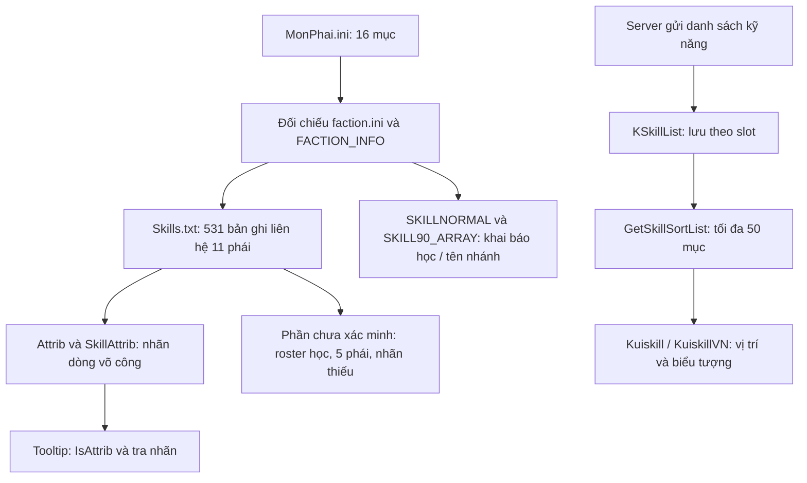

TÓM TẮT 1: [NGUỒN] Đã đối chiếu đủ 16 mục MonPhai.ini; có catalog 531 bản ghi liên hệ 11 phái, năm mục còn lại chưa có ánh xạ kỹ năng.
TÓM TẮT 2: [NGUỒN] Mỗi bản ghi có SkillId, tên giải mã TCVN3, ReqLevel, MaxLevel, Attrib, khóa Lua và file:dòng; giữ riêng tên trùng, abc/ncp và bản NPC/legacy.
TÓM TẮT 3: [NGUỒN] Võ Đang có 40 dòng trỏ đúng wudang.lua và 5 dòng dưới thư mục wudang; 45 là tổng liên hệ, không phải 45 dòng trỏ đúng cùng file.
TÓM TẮT 4: [NGUỒN]/[CHƯA KIỂM] Client dựng ô từ KSkillList; nhãn dòng tra Attrib → SkillAttrib; 224 bản ghi chưa có nhãn và chưa chứng minh danh sách học/nhánh triển khai.
TÓM TẮT 5: [CHƯA KIỂM] Chỉ đọc tĩnh; chưa build, chạy exe, VM, kết nối mạng hay kiểm thử game; không suy hành vi runtime từ các bảng này.

# S-01 — Bảng kỹ năng theo phái
Loại: tổng hợp
Chủ đề: Đối chiếu nhánh và toàn bộ bản ghi kỹ năng liên hệ các mục môn phái trong gói dữ liệu được giao.
Từ khóa: môn phái, kỹ năng, Võ Đang, wudang, 武当, SkillId, Attrib, SkillAttrib, ReqLevel, MaxLevel
Trạng thái: DONE — hoàn tất khảo sát tĩnh và công khai các phần CHƯA XÁC MINH theo task; không xác nhận roster học hay runtime.
Độ phủ: đã phủ 16 trên tổng 16 mục khai báo; có catalog 11/16 mục (531 bản ghi), 5/16 mục chưa có danh sách kỹ năng; 307/531 tra được nhãn Attrib.
Liên quan: JX1_OPS/REPORTS/S-01.md; JX1_OPS/REPORTS/A-08a-mon-phai-ky-nang.md; JX1_OPS/REPORTS/A-15a-ky-nang-phai-1-4.md; JX1_OPS/REPORTS/A-15b-ky-nang-phai-5-8.md; JX1_OPS/REPORTS/A-15c-ky-nang-phai-9-cuoi.md; JX1_OPS/DESIGN/CHUAN-BAO-CAO.md
Cần tôi quyết định: không

## Phạm vi và độ phủ

[ĐÃ XÁC MINH] Đếm section số trực tiếp từ MonPhai.ini, không tính [Name]. “Đã phủ mục” là đã đối chiếu khai báo; không đồng nghĩa có 16 phái chơi được. Số catalog là số bản ghi theo tiêu chí dưới đây, gồm bản NPC, hiệu ứng và tên tạm.

| ID INI | Tên Việt / tên gốc | Hệ gốc | Token đối chiếu | Bản ghi | Mức phủ | file:dòng |
| --- | --- | --- | --- | --- | --- | --- |
| 0 | Thiếu Lâm / 少林派 | 金 | shaolin | 47 | Đã phủ catalog; 24 có nhãn Attrib, 23 chưa có nhãn | `G/Settings/faction/MonPhai.ini:6` |
| 1 | Thiên Vương / 天王帮 | 金 | tianwang | 55 | Đã phủ catalog; 28 có nhãn Attrib, 27 chưa có nhãn | `G/Settings/faction/MonPhai.ini:11` |
| 2 | Đường Môn / 唐门 | 木 | tangmen | 56 | Đã phủ catalog; 35 có nhãn Attrib, 21 chưa có nhãn | `G/Settings/faction/MonPhai.ini:16` |
| 3 | Ngũ Độc / 五毒教 | 木 | wudu | 41 | Đã phủ catalog; 31 có nhãn Attrib, 10 chưa có nhãn | `G/Settings/faction/MonPhai.ini:21` |
| 4 | Nga My / 峨嵋派 | 水 | emei | 56 | Đã phủ catalog; 29 có nhãn Attrib, 27 chưa có nhãn | `G/Settings/faction/MonPhai.ini:26` |
| 5 | Thúy Yên / 翠烟门 | 水 | cuiyan | 56 | Đã phủ catalog; 25 có nhãn Attrib, 31 chưa có nhãn | `G/Settings/faction/MonPhai.ini:31` |
| 6 | Cái Bang / 丐帮 | 火 | gaibang | 34 | Đã phủ catalog; 19 có nhãn Attrib, 15 chưa có nhãn | `G/Settings/faction/MonPhai.ini:36` |
| 7 | Thiên Nhẫn / 天忍教 | 火 | tianren | 42 | Đã phủ catalog; 26 có nhãn Attrib, 16 chưa có nhãn | `G/Settings/faction/MonPhai.ini:41` |
| 8 | Võ Đang / 武当派 | 土 | wudang | 45 | Đã phủ catalog; 21 có nhãn Attrib, 24 chưa có nhãn | `G/Settings/faction/MonPhai.ini:46` |
| 9 | Côn Lôn / 昆仑派 | 土 | kunlun | 52 | Đã phủ catalog; 27 có nhãn Attrib, 25 chưa có nhãn | `G/Settings/faction/MonPhai.ini:51` |
| 10 | Hoa Sơn / 华山派 | 水 | huashan | 47 | Đã phủ catalog; 42 có nhãn Attrib, 5 chưa có nhãn | `G/Settings/faction/MonPhai.ini:56` |
| 11 | Lý Tầm Hoan / 李寻欢 | 木 | chưa xác minh | chưa có ánh xạ | Đã phủ mục khai báo; CHƯA PHỦ danh sách kỹ năng | `G/Settings/faction/MonPhai.ini:61` |
| 12 | Đào Hoa Đảo / 桃花岛 | 水 | chưa xác minh | chưa có ánh xạ | Đã phủ mục khai báo; CHƯA PHỦ danh sách kỹ năng | `G/Settings/faction/MonPhai.ini:66` |
| 13 | Minh Giáo / 明教 | 火 | chưa xác minh | chưa có ánh xạ | Đã phủ mục khai báo; CHƯA PHỦ danh sách kỹ năng | `G/Settings/faction/MonPhai.ini:71` |
| 14 | Đoàn Thị / 段氏 | 土 | chưa xác minh | chưa có ánh xạ | Đã phủ mục khai báo; CHƯA PHỦ danh sách kỹ năng | `G/Settings/faction/MonPhai.ini:76` |
| 15 | Tự sáng môn phái / 自创门派 | 金 | chưa xác minh | chưa có ánh xạ | Đã phủ mục khai báo; CHƯA PHỦ danh sách kỹ năng | `G/Settings/faction/MonPhai.ini:81` |

## Cách đọc và gốc bằng chứng

[ĐÃ XÁC MINH] Ngày đối chiếu dữ liệu: 17/11/2026; tiếp tục và kiểm tra hoàn tất: 18/11/2026. Các tiền tố sau chỉ áp dụng cho tài liệu này:

| Tiền tố | Gốc chỉ đọc |
| --- | --- |
| G/ | `C:/Jx1CocoV3/Folder/ServerNew-20260116T043145Z-3-001/ServerNew/_bin_v2_/gs/` |
| C/ | `D:/JX-build/qh9A/Classes/` — source client bản A qh9A |
| R/ | `D:/JX-wt/S-01/JX1_OPS/REPORTS/` |

Số dòng vật lý tính từ 1, không lấy dòng trừ 1 làm SkillId. Skills.txt là bảng TAB: SkillName cột 1, SkillId cột 2, Attrib cột 10, ReqLevel cột 54, MaxLevel cột 55, EqtLimit cột 56, LvlSetScript cột 72; đối chiếu header tại `G/Settings/Skills.txt:1`. Đếm 1.720 bản ghi có ID trên 1.721 dòng vật lý kể cả header (file kết thúc bằng newline). Số 531 ở đây là tập con theo phái, không phải tổng số kỹ năng toàn game.

Mã hóa: tên Việt trong Skills.txt và chuỗi Việt của Lua là TCVN3; đọc byte bằng Windows-1252 rồi ánh xạ TCVN3 sang Unicode. MonPhai.ini và nhãn SkillAttrib trong gamesetting.ini đọc GBK. faction.ini trộn Name/Hán tự GBK với ShowName TCVN3 nên không giải mã cả file như một bảng tên duy nhất. Source C++ có GBK và đoạn chuỗi hỗn hợp; lấy symbol ASCII, dòng và literal liên quan, không sửa mã hóa nguồn. Tài liệu đầu ra UTF-8 không BOM. Giữ nguyên chữ hoa/thường, hậu tố ##/11/npc, tên ngắn và lỗi ngữ nghĩa trong dữ liệu; không tự sửa thành tên quen thuộc.

Dấu vết phiên bản dữ liệu đọc (SHA-256, không phải hash binary đang chạy):

| File | SHA-256 |
| --- | --- |
| `G/Settings/Skills.txt` | `823e2d18eaea394a92e76257528d01040aa4687c669719e1fd3c4f57a82cfc48` |
| `G/Settings/faction/MonPhai.ini` | `17b9de22c7b1c223bbf0a320accfa310ac46b345d7715a7c4e79e44acd35c9b6` |
| `G/script/header/factionhead.lua` | `c81199ed820b4ea0e15d158c1b801af15e8ba2a0e448195f4d09c9411a973d15` |
| `G/Settings/gamesetting.ini` | `43c44e3d7b5dfef30c55374b5d3851be782faf05acdae405404ef785f4c1b4e7` |

### Tiêu chí đưa vào catalog

[ĐÃ XÁC MINH] Với từng token 0–10 ở faction.ini (`G/Settings/faction/faction.ini:7`, `G/Settings/faction/faction.ini:63`, `G/Settings/faction/faction.ini:77`), lấy các dòng LvlSetScript có basename token.lua, kể cả đường npc/token.lua, cộng các dòng dưới thư mục skill/token/. Thêm hai dòng legacy đã được A-15a dẫn: ID 3 (saolin, tên Thiếu Lâm Kiếm pháp, `G/Settings/Skills.txt:4`) và ID 59 (skill.lua, Cửu Cung Địa Sát, `G/Settings/Skills.txt:60`). Không mở rộng theo khoảng ID, tên giống, CharClass, ngũ hành hay Attrib. Do vậy một dòng mang tên vòng sáng/Tống Kim vẫn hiện nếu thực sự trỏ cùng script; cột Dấu hiệu ngăn nhầm thành danh sách học.

531 bản ghi là 531 SkillId khác nhau trong tập chọn. Không có dòng thiếu ReqLevel/MaxLevel trong tập này. Toàn Skills.txt có ID 521 lặp ngoài catalog; không dùng việc đó để gộp/xóa dòng của nguồn.

Khóa Lua ở catalog là LvlData1, dùng đối chiếu script, không phải khóa định danh hay toàn bộ 20 cặp LvlSetting/LvlData. NORMAL chỉ nghĩa có ID trong SKILLNORMAL; nút 90 chỉ nghĩa có ID trong SKILL90_ARRAY. Không diễn giải các dấu này thành đã học/đã chạy.

## Nhánh được xác định ở đâu

[ĐÃ XÁC MINH] Có ba lớp riêng cần đối chiếu:

1. Tên nhánh của lựa chọn kỹ năng trong header nằm ở phần tử thứ tư của SKILL90_ARRAY (`G/script/header/factionhead.lua:338`); ví dụ Võ Đang 365/368 tại `G/script/header/factionhead.lua:379` và `G/script/header/factionhead.lua:380`. Có 30 nút trong 11 nhóm đầu; mỗi nhánh header liệt kê một nút. SKILLNORMAL chỉ ghi cặp ID/level, không ghi nhánh (`G/script/header/factionhead.lua:172`).
2. Dòng võ công của bản ghi nằm ở Attrib. KSkill đọc nó vào m_nAttrib (`C/gamecore/KSkills.cpp:2856`); IsAttrib trả lại mã (`C/gamecore/KSkills.h:232`). Tooltip lấy mã rồi tra section SkillAttrib (`C/gameui/KuiSkilldesc.cpp:436`, `C/gameui/KuiSkilldesc.cpp:449`). Bảng GBK đọc được của gói server ở `G/Settings/gamesetting.ini:224`; các nhóm bên dưới ghi bản dịch và dòng gốc. Attrib không định danh duy nhất môn phái: Hoa Sơn tái dùng 501/504/1002/1005; không chuyển quyền sở hữu phái theo mã này.
3. Bảng ô kỹ năng client lấy danh sách skill hiện có theo slot; không thấy code phân cột theo nhánh hay tính nhánh từ ReqLevel/EqtLimit trong luồng đã đọc. Không suy nhánh chính thức từ hình biểu tượng hoặc tên chiêu.

[CHƯA XÁC MINH] GAME_SETTING_FILE đang active của client A là đường ảo `update10/gamesetting.ini` (`C/gamecore/CoreUseNameDef.h:155`), được nạp tại `C/gamecore/KCore.cpp:264`. Định nghĩa `Settings/gamesetting.ini` ở :154 đã comment. Không có file rời update10/gamesetting.ini tại root qh9A, Resources hoặc data đã kiểm; chưa đọc nội dung trong PAK. Vì vậy tên nhánh tra từ G/ là nhãn của dữ liệu khảo sát, chưa khẳng định là nhãn mà client triển khai đang nạp.

### Bảng nhãn Attrib đã đối chiếu

Bản dịch tiếng Việt dưới đây dịch nghĩa Hán tự GBK, không lấy kết quả chuyển TCVN3 của nhãn Hán. Bảng chỉ đưa các mã thực sự xuất hiện trong catalog. Mã không có ở đây được giữ “CHƯA XÁC MINH nhãn”; không dùng 0 thay ô nguồn trống.

| Attrib | Nghĩa tiếng Việt | Nhãn gốc (bỏ thẻ màu) | file:dòng |
| --- | --- | --- | --- |
| 100 | Hỗ trợ chủ động | 武功流派:主动辅助 | `G/Settings/gamesetting.ini:227` |
| 101 | Thương pháp (ngoại công) | 武功流派:枪法(外功系) | `G/Settings/gamesetting.ini:228` |
| 102 | Đao pháp (ngoại công) | 武功流派:刀法(外功系) | `G/Settings/gamesetting.ini:229` |
| 103 | Chùy pháp (ngoại công) | 武功流派:锤法(外功系) | `G/Settings/gamesetting.ini:230` |
| 104 | Thương pháp (hỗ trợ) | 武功流派:枪法(辅助性) | `G/Settings/gamesetting.ini:231` |
| 105 | Đao pháp (hỗ trợ) | 武功流派:刀法(辅助性) | `G/Settings/gamesetting.ini:232` |
| 106 | Chùy pháp (hỗ trợ) | 武功流派:锤法(辅助性) | `G/Settings/gamesetting.ini:233` |
| 201 | Côn pháp (ngoại công) | 武功流派:棍法(外功系) | `G/Settings/gamesetting.ini:235` |
| 202 | Quyền pháp (ngoại công) | 武功流派:拳法(外功系) | `G/Settings/gamesetting.ini:236` |
| 203 | Đao pháp (ngoại công) | 武功流派:刀法(外功系) | `G/Settings/gamesetting.ini:237` |
| 204 | Côn pháp / Đao pháp (ngoại công) | 武功流派:棍法/刀法(外功系) | `G/Settings/gamesetting.ini:238` |
| 205 | Quyền pháp / Côn pháp / Đao pháp (hỗ trợ) | 武功流派:拳法/棍法/刀法(辅助性) | `G/Settings/gamesetting.ini:239` |
| 206 | Côn pháp (hỗ trợ) | 武功流派:棍法(辅助性) | `G/Settings/gamesetting.ini:240` |
| 207 | Quyền pháp (hỗ trợ) | 武功流派:拳法(辅助性) | `G/Settings/gamesetting.ini:241` |
| 208 | Đao pháp (hỗ trợ) | 武功流派:刀法(辅助性) | `G/Settings/gamesetting.ini:242` |
| 301 | Phi tiêu (ngoại công) | 武功流派:飞镖(外功系) | `G/Settings/gamesetting.ini:244` |
| 302 | Phi đao (ngoại công) | 武功流派:飞刀(外功系) | `G/Settings/gamesetting.ini:245` |
| 303 | Nỏ / tụ tiễn (ngoại công) | 武功流派:弩箭(外功系) | `G/Settings/gamesetting.ini:246` |
| 304 | Hãm tĩnh (nội công) | 武功流派:陷阱(内功系) | `G/Settings/gamesetting.ini:247` |
| 305 | Phi tiêu / Phi đao / Nỏ (ngoại công) | 武功流派:飞镖/飞刀/弩箭(外功系) | `G/Settings/gamesetting.ini:248` |
| 306 | Phi tiêu / Phi đao / Nỏ (hỗ trợ) | 武功流派:飞镖/飞刀/弩箭(辅助性) | `G/Settings/gamesetting.ini:249` |
| 400 | Vòng sáng / Bùa chú (hỗ trợ) | 武功流派:光环/诅咒(辅助) | `G/Settings/gamesetting.ini:251` |
| 401 | Đao pháp (ngoại công) | 武功流派:刀法(外功系) | `G/Settings/gamesetting.ini:252` |
| 402 | Chưởng pháp (nội công) | 武功流派:掌法(内功系) | `G/Settings/gamesetting.ini:253` |
| 403 | Bùa chú (phòng ngự) | 武功流派:诅咒(防御性) | `G/Settings/gamesetting.ini:254` |
| 404 | Đao pháp (hỗ trợ) | 武功流派:刀法(辅助性) | `G/Settings/gamesetting.ini:255` |
| 405 | Chưởng pháp (hỗ trợ) | 武功流派:掌法(辅助性) | `G/Settings/gamesetting.ini:256` |
| 501 | Kiếm pháp (ngoại công) | 武功流派:剑法(外功系) | `G/Settings/gamesetting.ini:258` |
| 502 | Chưởng pháp (nội công) | 武功流派:掌法(内功系) | `G/Settings/gamesetting.ini:259` |
| 503 | Hỗ trợ | 武功流派:辅助 | `G/Settings/gamesetting.ini:260` |
| 504 | Kiếm pháp (hỗ trợ) | 武功流派:剑法(辅助性) | `G/Settings/gamesetting.ini:261` |
| 505 | Chưởng pháp (hỗ trợ) | 武功流派:掌法(辅助性) | `G/Settings/gamesetting.ini:262` |
| 601 | Đao pháp (ngoại công) | 武功流派:刀法(外功系) | `G/Settings/gamesetting.ini:264` |
| 602 | Song đao (nội công) | 武功流派:双刀(内功系) | `G/Settings/gamesetting.ini:265` |
| 603 | Đao pháp (hỗ trợ) | 武功流派:刀法(辅助性) | `G/Settings/gamesetting.ini:266` |
| 604 | Song đao (hỗ trợ) | 武功流派:双刀(辅助性) | `G/Settings/gamesetting.ini:267` |
| 701 | Bổng pháp (ngoại công) | 武功流派:棒法(外功系) | `G/Settings/gamesetting.ini:269` |
| 702 | Chưởng pháp (nội công) | 武功流派:掌法(内功系) | `G/Settings/gamesetting.ini:270` |
| 703 | Bổng pháp (hỗ trợ) | 武功流派:棒法(辅助性) | `G/Settings/gamesetting.ini:271` |
| 704 | Chưởng pháp (hỗ trợ) | 武功流派:掌法(辅助性) | `G/Settings/gamesetting.ini:272` |
| 801 | Mâu pháp (ngoại công) | 武功流派:矛法(外功系) | `G/Settings/gamesetting.ini:275` |
| 802 | Đao pháp (nội công) | 武功流派:刀法(内功系) | `G/Settings/gamesetting.ini:276` |
| 803 | Bùa chú (ngoại công) | 武功流派:诅咒(外功性) | `G/Settings/gamesetting.ini:277` |
| 804 | Mâu pháp (hỗ trợ) | 武功流派:矛法(辅助性) | `G/Settings/gamesetting.ini:278` |
| 805 | Đao pháp (hỗ trợ) | 武功流派:刀法(辅助性) | `G/Settings/gamesetting.ini:279` |
| 900 | Vòng sáng (hỗ trợ chủ động) | 光环(主动辅助) | `G/Settings/gamesetting.ini:281` |
| 901 | Kiếm pháp (ngoại công) | 武功流派:剑法(外功系) | `G/Settings/gamesetting.ini:282` |
| 902 | Quyền pháp (nội công) | 武功流派:拳法(内功系) | `G/Settings/gamesetting.ini:283` |
| 903 | Kiếm pháp (hỗ trợ) | 武功流派:剑法(辅助性) | `G/Settings/gamesetting.ini:284` |
| 904 | Quyền pháp (hỗ trợ) | 武功流派:拳法(辅助性) | `G/Settings/gamesetting.ini:285` |
| 1001 | Đao pháp (ngoại công) | 武功流派:刀法(外功系) | `G/Settings/gamesetting.ini:287` |
| 1002 | Kiếm pháp (nội công) | 武功流派:剑法(内功系) | `G/Settings/gamesetting.ini:288` |
| 1003 | Bùa chú (nội công) | 武功流派:诅咒(内功性) | `G/Settings/gamesetting.ini:289` |
| 1004 | Đao pháp (hỗ trợ) | 武功流派:刀法(辅助性) | `G/Settings/gamesetting.ini:290` |
| 1005 | Kiếm pháp (hỗ trợ) | 武功流派:剑法(辅助性) | `G/Settings/gamesetting.ini:291` |
| 1008 | Hỗ trợ bị động | 武功流派:被动辅助系 | `G/Settings/gamesetting.ini:295` |
| 1009 | Hỗ trợ chủ động | 武功流派:主动辅助系 | `G/Settings/gamesetting.ini:296` |
| 1010 | Bùa chú | 武功流派:诅咒系 | `G/Settings/gamesetting.ini:297` |
| 9999 | Võ công trấn phái | 镇派武功 | `G/Settings/gamesetting.ini:225` |

### Tổng quan 11 phái có catalog

Số “có nhãn” là tra thành công mã Attrib trong bảng nhãn G/, gồm nhóm hỗ trợ và bản riêng; không đồng nghĩa nhánh học đã được xác minh. Tên nhánh header được giữ nguyên để lộ bất nhất.

| ID | Phái | Nhánh / nút trong header | Catalog | Có nhãn Attrib | Chưa có nhãn |
| --- | --- | --- | --- | --- | --- |
| 0 | Thiếu Lâm | Quyền pháp (318); Côn pháp (319); Đao pháp (321) | 47 | 24 | 23 |
| 1 | Thiên Vương | Đao pháp (322); Thương pháp (323); Chùy pháp (325) | 55 | 28 | 27 |
| 2 | Đường Môn | Phi đao (339); Phi tiêu (342); Tụ tiễn (302); Hãm tĩnh (351) | 56 | 35 | 21 |
| 3 | Ngũ Độc | Chưởng pháp (353); Đao pháp (355); Bùa chú (390) | 41 | 31 | 10 |
| 4 | Nga My | Kiếm pháp (328); Chưởng pháp (380); Hỗ trợ (332) | 56 | 29 | 27 |
| 5 | Thúy Yên | Đao pháp (336); Chưởng pháp (337) | 56 | 25 | 31 |
| 6 | Cái Bang | Chưởng pháp (357); Bổng pháp (359) | 34 | 19 | 15 |
| 7 | Thiên Nhẫn | Mâu pháp (361); Chưởng pháp (362); Bùa chú (391) | 42 | 26 | 16 |
| 8 | Võ Đang | Chưởng pháp (365); Kiếm pháp (368) | 45 | 21 | 24 |
| 9 | Côn Lôn | Đao pháp (372); Chưởng pháp (375); Bùa chú (394) | 52 | 27 | 25 |
| 10 | Hoa Sơn | Hoa Sơn kiếm (1364); Hoa Sơn khí (1382) | 47 | 42 | 5 |

### Client dựng bảng ô và nhận danh sách

[ĐÃ XÁC MINH] Đã tra Graphify trong `C/graphify-out/graph.json:1`; marker `C/graphify-out/.graphify_root:1` là dấu chấm, tương đối với thư mục Classes chứa graphify-out. Graph chỉ định vị: nhánh VN từng ghi :2323 nhưng file thật hiện tại là :2325. Không làm mới graph; các số dòng sau đều đã mở file thật.

| Khâu | Symbol và kết quả đọc tĩnh | file:dòng |
| --- | --- | --- |
| Mở UI thường | KgameWorld::mSkillsCallback gọi Kuiskill::create | `C/gamescene/KgameWorld.cpp:2530` |
| Mở UI VN | KgameWorldVN::mSkillsCallback gọi KuiskillVN::create | `C/vn/gamescence/KgameWorldVN.cpp:2325` |
| Khởi tạo | create gọi addDialogData | `C/gameui/KuiSkill.cpp:55`; `C/vn/gameui/KuiSkillVN.cpp:40` |
| Lấy danh sách | GetGameData(GDI_FIGHT_SKILLS) | `C/gameui/KuiSkill.cpp:127`; `C/vn/gameui/KuiSkillVN.cpp:107` |
| Cầu nối | CoreShell chuyển GDI_FIGHT_SKILLS đến m_SkillList.GetSkillSortList | `C/gamecore/CoreShell.cpp:2373`; `C/gamecore/CoreShell.cpp:2377` |
| Duyệt slot | GetSkillSortList duyệt từ slot 1, giữ ID khác 0 và skill lookup được; bỏ 1/2/53, lấy cả level 0 và chặn 50 mục | `C/gamecore/KSkillList.cpp:915`; `C/gamecore/KSkillList.cpp:923`; `C/gamecore/KSkillList.cpp:955`; `C/gamecore/KSkillList.cpp:962` |
| Vị trí và hình | addDialogData dựng sprite theo i, offsetX/Y; dùng GetSkill để lấy icon | `C/gameui/KuiSkill.cpp:136`; `C/gameui/KuiSkill.cpp:154`; `C/gameui/KuiSkill.cpp:271`; `C/gameui/KuiSkill.cpp:301` |
| Vị trí VN | Tương tự, offset tính theo chỉ số; ô hình 37×48 trong source | `C/vn/gameui/KuiSkillVN.cpp:120`; `C/vn/gameui/KuiSkillVN.cpp:133`; `C/vn/gameui/KuiSkillVN.cpp:140`; `C/vn/gameui/KuiSkillVN.cpp:208` |
| Dữ liệu từ server | s2cSyncAllSkill Clear danh sách rồi Add từng SkillId/SkillLevel theo gói | `C/gamecore/KProtocolProcess.cpp:3325`; `C/gamecore/KProtocolProcess.cpp:3337`; `C/gamecore/KProtocolProcess.cpp:3345` |
| Mở theo phái kiểu cũ | OpenCurSkillLevel return TRUE; đoạn Add theo phái ở comment | `C/gamecore/KPlayerFaction.cpp:107`; `C/gamecore/KPlayerFaction.cpp:108` |

[CHƯA XÁC MINH] Thứ tự slot/gói thực nhận, danh sách đầy đủ mà server đang gửi, UI đang chọn thường hay VN, nhánh học/truyền dạy trong bản triển khai và sự khớp source với APK/binary. Luồng đã đọc chỉ đủ kết luận cách dựng ô; chưa có cơ sở lập cây prerequisite cho mọi ID.

## ReqLevel, MaxLevel và điều kiện học

[ĐÃ XÁC MINH] Các số trong catalog là giá trị dữ liệu, đơn vị cấp. Client nạp ReqLevel với chú thích mức cần để nâng kỹ năng (`C/gamecore/KSkills.cpp:2858`); KSkillManager nạp MaxLevel và lưu ánh xạ SkillId→dòng (`C/gamecore/KSkillManager.cpp:62`, `C/gamecore/KSkillManager.cpp:64`, `C/gamecore/KSkillManager.cpp:73`). Không thay ReqLevel=0/1/80 thành cấp 90 theo tên menu. Nhánh client gửi yêu cầu nâng tại `C/gameui/KuiSkill.cpp:636` → `C/gamecore/CoreShell.cpp:3968`.

Header hockynang duyệt SKILLNORMAL và AddMagic với level trong bảng (`G/script/header/factionhead.lua:106`, `G/script/header/factionhead.lua:108`); nhiều level ghi 0. show_kynang90 kiểm GetLevel()<80 tại `G/script/header/factionhead.lua:118`, selskill còn kiểm HaveMagic và TASK_KYNANG9X trước khi AddMagic (`G/script/header/factionhead.lua:156`, `G/script/header/factionhead.lua:159`, `G/script/header/factionhead.lua:163`). show_kynang150 cũng kiểm <80 nhưng tạo callback selskill dùng SKILL90_ARRAY (`G/script/header/factionhead.lua:139`, `G/script/header/factionhead.lua:145`, `G/script/header/factionhead.lua:156`); chỉ ghi nhận đường source, không sửa hoặc khẳng định menu 150 hoạt động đúng.

[CHƯA XÁC MINH] Cấp học cuối cùng, nhiệm vụ/bí kíp/điểm, kỹ năng tiền đề, whitelist truyền dạy của từng phái và của hảo hữu, ghi đè theo cấp Lua, dữ liệu trong PAK và hiệu lực thực tế. Cột MaxLevel là trần trong dòng dữ liệu, không cam kết trần UI hoặc trần sau mọi buff.

## Catalog và số bản ghi mỗi dòng / nhánh

Số bản ghi mỗi nhóm bằng số ID liệt kê tại chính hàng đó. Cộng các hàng Attrib của một phái bằng tổng catalog của phái. Các nhóm không có nhãn vẫn có ID và dữ liệu cấp đầy đủ ở catalog. Không cộng nhóm hỗ trợ chung vào mọi nhánh riêng vì sẽ đếm trùng.

### 0. Thiếu Lâm — shaolin

[ĐÃ XÁC MINH] ID 3 dùng đường saolin (khác chính tả shaolin); ID 900 nằm trong script NPC. Không tự coi kiếm/thương/chùy legacy là các nhánh học bổ sung.

Nút được header chỉ định (mỗi nhánh ở bảng này có đúng 1 nút 90; đây không phải tổng số kỹ năng học của nhánh):

| Nhánh trong header | SkillId | Tên trong Skills.txt | ReqLevel | MaxLevel | Bằng chứng |
| --- | --- | --- | --- | --- | --- |
| Quyền pháp | 318 | Đạt Ma Độ Giang | 80 | 20 | `G/script/header/factionhead.lua:340`; `G/Settings/Skills.txt:319` |
| Côn pháp | 319 | Hoành Tảo Thiên Quân | 80 | 20 | `G/script/header/factionhead.lua:341`; `G/Settings/Skills.txt:320` |
| Đao pháp | 321 | Vô Tướng Trảm | 80 | 20 | `G/script/header/factionhead.lua:342`; `G/Settings/Skills.txt:322` |

Phân nhóm theo Attrib thô: **47 bản ghi**. Nhãn tiếng Việt dịch từ GBK; nhãn client thực nạp còn CHƯA XÁC MINH. Mỗi ID chỉ thuộc một nhóm Attrib trong bảng này; nhóm chung hoặc nhãn không khớp phái vẫn giữ nguyên.

| Attrib | Dòng / nhánh khảo sát | Số bản ghi | SkillId | Nguồn nhãn |
| --- | --- | --- | --- | --- |
| 11 | CHƯA XÁC MINH nhãn | 1 | 3 | chưa có khóa trong [SkillAttrib] |
| 200 | CHƯA XÁC MINH nhãn | 3 | 15, 20, 21 | chưa có khóa trong [SkillAttrib] |
| 201 | Côn pháp (ngoại công) | 6 | 11, 319, 1056, 1082, 1147, 1201 | `G/Settings/gamesetting.ini:235` |
| 202 | Quyền pháp (ngoại công) | 5 | 14, 271, 318, 1055, 1146 | `G/Settings/gamesetting.ini:236` |
| 203 | Đao pháp (ngoại công) | 5 | 19, 321, 1057, 1085, 1148 | `G/Settings/gamesetting.ini:237` |
| 204 | Côn pháp / Đao pháp (ngoại công) | 1 | 10 | `G/Settings/gamesetting.ini:238` |
| 205 | Quyền pháp / Côn pháp / Đao pháp (hỗ trợ) | 1 | 16 | `G/Settings/gamesetting.ini:239` |
| 206 | Côn pháp (hỗ trợ) | 1 | 4 | `G/Settings/gamesetting.ini:240` |
| 207 | Quyền pháp (hỗ trợ) | 1 | 8 | `G/Settings/gamesetting.ini:241` |
| 208 | Đao pháp (hỗ trợ) | 1 | 6 | `G/Settings/gamesetting.ini:242` |
| 1008 | Hỗ trợ bị động | 2 | 709, 900 | `G/Settings/gamesetting.ini:295` |
| 9999 | Võ công trấn phái | 1 | 273 | `G/Settings/gamesetting.ini:225` |
| trống | CHƯA XÁC MINH nhãn | 19 | 5, 7, 9, 12, 13, 17, 18, 202, 213, 216, 217, 218, 272, 317, 320, 725, 734, 986, 1083 | chưa có khóa trong [SkillAttrib] |

Catalog đầy đủ (tên giải mã TCVN3; ReqLevel/MaxLevel là giá trị thô, đơn vị cấp):

| SkillId | Tên giữ nguyên dữ liệu | Attrib | ReqLevel | MaxLevel | Khóa Lua đầu tiên | Dấu hiệu | file:dòng |
| --- | --- | --- | --- | --- | --- | --- | --- |
| 3 | Thiếu Lâm Kiếm pháp | 11 | 10 | 20 | trống | bổ sung legacy | `G/Settings/Skills.txt:4` |
| 4 | Thiếu Lâm Côn pháp | 206 | 10 | 20 | `shaolin_gunfa` | script chính; NORMAL | `G/Settings/Skills.txt:5` |
| 5 | Thiếu Lâm thương pháp (##) | trống | 10 | 20 | trống | script chính; nhãn ## | `G/Settings/Skills.txt:6` |
| 6 | Thiếu Lâm Đao pháp | 208 | 10 | 20 | `shaolin_daofa` | script chính; NORMAL | `G/Settings/Skills.txt:7` |
| 7 | Thiếu Lâm Chùy pháp (##) | trống | 10 | 20 | trống | script chính; nhãn ## | `G/Settings/Skills.txt:8` |
| 8 | Thiếu Lâm Quyền Pháp | 207 | 10 | 20 | `shaolin_quanfa` | script chính; NORMAL | `G/Settings/Skills.txt:9` |
| 9 | Hỗn Nguyên Nhất Khí công | trống | 10 | 20 | trống | script chính | `G/Settings/Skills.txt:10` |
| 10 | Kim Cang Phục Ma | 204 | 10 | 20 | `jingang_fumo` | script chính; NORMAL | `G/Settings/Skills.txt:11` |
| 11 | Hoành Tảo Lục Hợp | 201 | 50 | 20 | `hengsao_liuhe` | script chính; NORMAL | `G/Settings/Skills.txt:12` |
| 12 | Kim Cang Hộ Thể | trống | 20 | 20 | trống | script chính | `G/Settings/Skills.txt:13` |
| 13 | Lập Địa Thành Phật | trống | 30 | 20 | trống | script chính | `G/Settings/Skills.txt:14` |
| 14 | Hàng Long Bất Vũ | 202 | 10 | 20 | `xinglong_buyu` | script chính; NORMAL | `G/Settings/Skills.txt:15` |
| 15 | Bất động Minh Vương | 200 | 20 | 20 | `budong_mingwang` | script chính; NORMAL | `G/Settings/Skills.txt:16` |
| 16 | La Hán Trận | 205 | 30 | 20 | `luohan_zhen` | script chính; NORMAL | `G/Settings/Skills.txt:17` |
| 17 | Long Trảo Hổ Trảo (##) | trống | 40 | 20 | `longzhao_huzhua` | script chính; nhãn ## | `G/Settings/Skills.txt:18` |
| 18 | Huệ Nhãn chú | trống | 40 | 20 | trống | script chính | `G/Settings/Skills.txt:19` |
| 19 | Ma Ha Vô Lượng | 203 | 50 | 20 | `mohe_wuliang` | script chính; NORMAL | `G/Settings/Skills.txt:20` |
| 20 | Sư Tử Hống | 200 | 40 | 20 | `shizi_hou` | script chính; NORMAL | `G/Settings/Skills.txt:21` |
| 21 | Dịch Cân kinh | 200 | 60 | 20 | `yijin_jing` | script chính; NORMAL | `G/Settings/Skills.txt:22` |
| 202 | La Hán Trận | trống | 30 | 20 | `luohan_zhen` | script chính | `G/Settings/Skills.txt:203` |
| 213 | Bất động Minh Vương | trống | 30 | 20 | `budong_mingwang` | script chính | `G/Settings/Skills.txt:214` |
| 216 | Kim Cang Phục Ma | trống | 0 | 20 | `jingang_fumo` | script chính | `G/Settings/Skills.txt:217` |
| 217 | Hoành Tảo Lục Hợp | trống | 0 | 20 | `hengsao_liuhe` | script chính | `G/Settings/Skills.txt:218` |
| 218 | Long Trảo Hổ Trảo | trống | 0 | 20 | `longzhao_huzhua` | script chính | `G/Settings/Skills.txt:219` |
| 271 | Long Trảo Hổ Trảo | 202 | 50 | 20 | `longzhao_huzhua` | script chính; NORMAL | `G/Settings/Skills.txt:272` |
| 272 | Long Trảo Hổ Trảo | trống | 30 | 20 | `longzhao_huzhua` | script chính | `G/Settings/Skills.txt:273` |
| 273 | Như Lai Thiên Diệp | 9999 | 60 | 30 | `rulai_qianye` | script chính; NORMAL | `G/Settings/Skills.txt:274` |
| 317 | Kim Phật Xuất Kích | trống | 30 | 20 | `damo_dujiang` | script chính | `G/Settings/Skills.txt:318` |
| 318 | Đạt Ma Độ Giang | 202 | 80 | 20 | `damo_dujiang` | script chính; nút 90: Quyền pháp | `G/Settings/Skills.txt:319` |
| 319 | Hoành Tảo Thiên Quân | 201 | 80 | 20 | `hengsao_qianjun` | script chính; nút 90: Côn pháp | `G/Settings/Skills.txt:320` |
| 320 | Hoành Tảo Lục Hợp 111 | trống | 50 | 20 | trống | script chính | `G/Settings/Skills.txt:321` |
| 321 | Vô Tướng Trảm | 203 | 80 | 20 | `wuxiang_zhan` | script chính; nút 90: Đao pháp | `G/Settings/Skills.txt:322` |
| 709 | Đại Thừa Như Lai Chú | 1008 | 120 | 20 | `dachengrulaizhou` | script chính | `G/Settings/Skills.txt:711` |
| 725 | Đại Thừa Như Lai Chú_Phản đòn bùa chú | trống | 120 | 20 | trống | script chính | `G/Settings/Skills.txt:727` |
| 734 | Kỹ năng phụ - Sư Tử Hống | trống | 0 | 20 | `shizi_hou` | script chính | `G/Settings/Skills.txt:736` |
| 900 | abc123 | 1008 | 1 | 20 | `dachengrulaizhou` | NPC; tên tạm | `G/Settings/Skills.txt:900` |
| 986 | abc171 | trống | 50 | 20 | `mohe_wuliang` | script chính; tên tạm | `G/Settings/Skills.txt:986` |
| 1055 | Đại Lực Kim Cang Chưởng | 202 | 150 | 26 | `quanshaolin150` | script chính | `G/Settings/Skills.txt:1055` |
| 1056 | Vi Đà Hiến Xử | 201 | 150 | 26 | `gunshaolin150` | script chính | `G/Settings/Skills.txt:1056` |
| 1057 | Tam Giới Quy Thiền | 203 | 150 | 26 | `daoshaolin150` | script chính | `G/Settings/Skills.txt:1057` |
| 1082 | abc213 | 201 | 150 | 20 | `gunshaolin150` | script chính; tên tạm | `G/Settings/Skills.txt:1082` |
| 1083 | Long Thừa Bát Nhã Thủ | trống | 30 | 20 | `quanshaolin150` | script chính | `G/Settings/Skills.txt:1083` |
| 1085 | abc215 | 203 | 150 | 20 | `daoshaolin150` | script chính; tên tạm | `G/Settings/Skills.txt:1085` |
| 1146 | ncp1 | 202 | 80 | 20 | `quanshaolin150` | script chính; tên tạm | `G/Settings/Skills.txt:1146` |
| 1147 | ncp2 | 201 | 80 | 20 | `gunshaolin150` | script chính; tên tạm | `G/Settings/Skills.txt:1147` |
| 1148 | ncp3 | 203 | 80 | 20 | `daoshaolin150` | script chính; tên tạm | `G/Settings/Skills.txt:1148` |
| 1201 | Vi Đà Hộ Pháp | 201 | 150 | 20 | `gunshaolin150` | script chính | `G/Settings/Skills.txt:1201` |

Các tên trùng hoàn toàn sau giải mã (chưa gộp ID):

| Tên | SkillId riêng | Bằng chứng |
| --- | --- | --- |
| Kim Cang Phục Ma | 10, 216 | `G/Settings/Skills.txt:11`; `G/Settings/Skills.txt:217` |
| Hoành Tảo Lục Hợp | 11, 217 | `G/Settings/Skills.txt:12`; `G/Settings/Skills.txt:218` |
| Bất động Minh Vương | 15, 213 | `G/Settings/Skills.txt:16`; `G/Settings/Skills.txt:214` |
| La Hán Trận | 16, 202 | `G/Settings/Skills.txt:17`; `G/Settings/Skills.txt:203` |
| Long Trảo Hổ Trảo | 218, 271, 272 | `G/Settings/Skills.txt:219`; `G/Settings/Skills.txt:272`; `G/Settings/Skills.txt:273` |

### 1. Thiên Vương — tianwang

[ĐÃ XÁC MINH] Giữ thêm ba bản ghi dưới thư mục tianwang: 223, 278, 279. ID 930 dùng script NPC. Vì tiêu chí này rộng hơn A-15a nên tổng ở đây là 55, không sửa con số 52 trong báo cáo cũ.

Nút được header chỉ định (mỗi nhánh ở bảng này có đúng 1 nút 90; đây không phải tổng số kỹ năng học của nhánh):

| Nhánh trong header | SkillId | Tên trong Skills.txt | ReqLevel | MaxLevel | Bằng chứng |
| --- | --- | --- | --- | --- | --- |
| Đao pháp | 322 | Phá Thiên Trảm | 80 | 20 | `G/script/header/factionhead.lua:345`; `G/Settings/Skills.txt:323` |
| Thương pháp | 323 | Truy Tinh Trục Nguyệt | 80 | 20 | `G/script/header/factionhead.lua:346`; `G/Settings/Skills.txt:324` |
| Chùy pháp | 325 | Truy Phong Quyết | 80 | 20 | `G/script/header/factionhead.lua:347`; `G/Settings/Skills.txt:326` |

Phân nhóm theo Attrib thô: **55 bản ghi**. Nhãn tiếng Việt dịch từ GBK; nhãn client thực nạp còn CHƯA XÁC MINH. Mỗi ID chỉ thuộc một nhóm Attrib trong bảng này; nhóm chung hoặc nhãn không khớp phái vẫn giữ nguyên.

| Attrib | Dòng / nhánh khảo sát | Số bản ghi | SkillId | Nguồn nhãn |
| --- | --- | --- | --- | --- |
| 12 | CHƯA XÁC MINH nhãn | 2 | 278, 279 | chưa có khóa trong [SkillAttrib] |
| 100 | Hỗ trợ chủ động | 4 | 33, 40, 42, 930 | `G/Settings/gamesetting.ini:227` |
| 101 | Thương pháp (ngoại công) | 6 | 30, 35, 41, 323, 1060, 1151 | `G/Settings/gamesetting.ini:228` |
| 102 | Đao pháp (ngoại công) | 7 | 32, 34, 37, 322, 1058, 1149, 1599 | `G/Settings/gamesetting.ini:229` |
| 103 | Chùy pháp (ngoại công) | 6 | 29, 31, 324, 325, 1059, 1150 | `G/Settings/gamesetting.ini:230` |
| 104 | Thương pháp (hỗ trợ) | 1 | 23 | `G/Settings/gamesetting.ini:231` |
| 105 | Đao pháp (hỗ trợ) | 1 | 24 | `G/Settings/gamesetting.ini:232` |
| 106 | Chùy pháp (hỗ trợ) | 1 | 26 | `G/Settings/gamesetting.ini:233` |
| 1008 | Hỗ trợ bị động | 1 | 708 | `G/Settings/gamesetting.ini:295` |
| 9999 | Võ công trấn phái | 1 | 36 | `G/Settings/gamesetting.ini:225` |
| trống | CHƯA XÁC MINH nhãn | 25 | 25, 27, 28, 38, 39, 219, 220, 221, 222, 223, 224, 225, 326, 327, 404, 405, 406, 407, 408, 724, 1077, 1084, 1086, 1087, 1088 | chưa có khóa trong [SkillAttrib] |

Catalog đầy đủ (tên giải mã TCVN3; ReqLevel/MaxLevel là giá trị thô, đơn vị cấp):

| SkillId | Tên giữ nguyên dữ liệu | Attrib | ReqLevel | MaxLevel | Khóa Lua đầu tiên | Dấu hiệu | file:dòng |
| --- | --- | --- | --- | --- | --- | --- | --- |
| 23 | Thiên Vương  Thương pháp | 104 | 10 | 20 | `tianwang_qiangfa` | script chính; NORMAL | `G/Settings/Skills.txt:24` |
| 24 | Thiên Vương  Đao pháp | 105 | 10 | 20 | `tianwang_daofa` | script chính; NORMAL | `G/Settings/Skills.txt:25` |
| 25 | Thánh Vương Đao pháp (##) | trống | 10 | 20 | trống | script chính; nhãn ## | `G/Settings/Skills.txt:26` |
| 26 | Thiên Vương  Chùy Pháp | 106 | 10 | 20 | `tianwang_chuifa` | script chính; NORMAL | `G/Settings/Skills.txt:27` |
| 27 | Thiên Vương  Phủ pháp (##) | trống | 10 | 20 | trống | script chính; nhãn ## | `G/Settings/Skills.txt:28` |
| 28 | Thánh Vương Phủ pháp (##) | trống | 10 | 20 | trống | script chính; nhãn ## | `G/Settings/Skills.txt:29` |
| 29 | Trảm Long quyết | 103 | 10 | 20 | `zhanlong_jue` | script chính; NORMAL | `G/Settings/Skills.txt:30` |
| 30 | Hồi Phong Lạc Nhạn | 101 | 10 | 20 | `huifeng_luoyan` | script chính; NORMAL | `G/Settings/Skills.txt:31` |
| 31 | Hàng Vân Quyết | 103 | 30 | 20 | `xingyun_jue` | script chính; NORMAL | `G/Settings/Skills.txt:32` |
| 32 | Vô Tâm Trảm | 102 | 60 | 20 | `wuxin_zhan` | script chính; NORMAL | `G/Settings/Skills.txt:33` |
| 33 | Tĩnh Tâm Quyết | 100 | 20 | 20 | `jingxin_jue` | script chính; NORMAL | `G/Settings/Skills.txt:34` |
| 34 | Kinh Lôi Trảm | 102 | 10 | 20 | `jinglei_zhan` | script chính; NORMAL | `G/Settings/Skills.txt:35` |
| 35 | Dương Quan Tam Điệp | 101 | 30 | 20 | `yangguan_sandie` | script chính; NORMAL | `G/Settings/Skills.txt:36` |
| 36 | Thiên Vương Chiến ý | 9999 | 60 | 30 | `tianwang_zhanyi` | script chính; NORMAL | `G/Settings/Skills.txt:37` |
| 37 | Bát Phong Trảm | 102 | 30 | 20 | `pofeng_zhan` | script chính; NORMAL | `G/Settings/Skills.txt:38` |
| 38 | Bàn Cổ Cửu Thức (##) | trống | 40 | 20 | trống | script chính; nhãn ## | `G/Settings/Skills.txt:39` |
| 39 | Triêm Y Thập Bát Điệt (##) | trống | 40 | 20 | trống | script chính; nhãn ## | `G/Settings/Skills.txt:40` |
| 40 | Đoạn Hồn Thích | 100 | 40 | 20 | `duanhun_ci` | script chính; NORMAL | `G/Settings/Skills.txt:41` |
| 41 | Huyết Chiến Bát Phương | 101 | 60 | 20 | `xuezhan_bafang` | script chính; NORMAL | `G/Settings/Skills.txt:42` |
| 42 | Kim Chung Tráo | 100 | 50 | 20 | `jinzhong_zhao` | script chính; NORMAL | `G/Settings/Skills.txt:43` |
| 219 | Hồi Phong Lạc Nhạn | trống | 0 | 20 | `huifeng_luoyan` | script chính | `G/Settings/Skills.txt:220` |
| 220 | Vô Tâm Trảm | trống | 0 | 20 | `wuxin_zhan` | script chính | `G/Settings/Skills.txt:221` |
| 221 | Dương Quan Tam Điệp | trống | 0 | 20 | `yangguan_sandie` | script chính | `G/Settings/Skills.txt:222` |
| 222 | Bát Phong Trảm | trống | 0 | 20 | `pofeng_zhan` | script chính | `G/Settings/Skills.txt:223` |
| 223 | Bàn Cổ Cửu Thức | trống | 0 | 20 | trống | thư mục con legacy | `G/Settings/Skills.txt:224` |
| 224 | Đoạn Hồn Thích | trống | 0 | 20 | `duanhun_ci` | script chính | `G/Settings/Skills.txt:225` |
| 225 | Huyết Chiến Bát Phương | trống | 0 | 20 | `xuezhan_bafang` | script chính | `G/Settings/Skills.txt:226` |
| 278 | Phong Vân Giáng | 12 | 60 | 20 | trống | thư mục con legacy | `G/Settings/Skills.txt:279` |
| 279 | Phong Vân Giáng | 12 | 50 | 20 | trống | thư mục con legacy | `G/Settings/Skills.txt:280` |
| 322 | Phá Thiên Trảm | 102 | 80 | 20 | `potian_zhan` | script chính; nút 90: Đao pháp | `G/Settings/Skills.txt:323` |
| 323 | Truy Tinh Trục Nguyệt | 101 | 80 | 20 | `zhuixing_zhuyue` | script chính; nút 90: Thương pháp | `G/Settings/Skills.txt:324` |
| 324 | Thừa Long Quyết | 103 | 60 | 20 | `chenglong_jue` | script chính; NORMAL | `G/Settings/Skills.txt:325` |
| 325 | Truy Phong Quyết | 103 | 80 | 20 | `zhuifeng_jue` | script chính; nút 90: Chùy pháp | `G/Settings/Skills.txt:326` |
| 326 | Phá Thiên Trảm | trống | 0 | 20 | `potian_zhan` | script chính | `G/Settings/Skills.txt:327` |
| 327 | Truy Tinh Trục Nguyệt | trống | 0 | 20 | `zhuixing_zhuyue` | script chính | `G/Settings/Skills.txt:328` |
| 404 | Kinh Lôi Trảm | trống | 0 | 20 | `jinglei_zhan` | script chính | `G/Settings/Skills.txt:405` |
| 405 | Trảm Long quyết | trống | 0 | 20 | `zhanlong_jue` | script chính | `G/Settings/Skills.txt:406` |
| 406 | Hàng Vân Quyết | trống | 0 | 20 | `xingyun_jue` | script chính | `G/Settings/Skills.txt:407` |
| 407 | Thừa Long Quyết | trống | 60 | 20 | `chenglong_jue` | script chính | `G/Settings/Skills.txt:408` |
| 408 | Truy Phong Quyết | trống | 60 | 20 | `zhuifeng_jue` | script chính | `G/Settings/Skills.txt:409` |
| 708 | Đảo Hư Thiên | 1008 | 120 | 20 | `daoxutian` | script chính | `G/Settings/Skills.txt:710` |
| 724 | Đảo Hư Thiên_Kháng bùa chú | trống | 120 | 20 | trống | script chính | `G/Settings/Skills.txt:726` |
| 930 | abc153 | 100 | 40 | 20 | `boss_duanhun` | NPC; tên tạm | `G/Settings/Skills.txt:930` |
| 1058 | Hào Hùng Trảm | 102 | 150 | 26 | `daotianwang150` | script chính | `G/Settings/Skills.txt:1058` |
| 1059 | Tung Hoành Bát Hoang | 103 | 150 | 26 | `chuitianwang150` | script chính | `G/Settings/Skills.txt:1059` |
| 1060 | Bá Vương Tạm Kim | 101 | 150 | 26 | `qiangtianwang150` | script chính | `G/Settings/Skills.txt:1060` |
| 1077 | Hào Hùng Trảm Địa Liệt | trống | 150 | 21 | `daotianwang150` | script chính | `G/Settings/Skills.txt:1077` |
| 1084 | abc214 | trống | 150 | 21 | `daotianwang150` | script chính; tên tạm | `G/Settings/Skills.txt:1084` |
| 1086 | abc216 | trống | 0 | 21 | `daotianwang150` | script chính; tên tạm | `G/Settings/Skills.txt:1086` |
| 1087 | abc217 | trống | 60 | 21 | `chuitianwang150` | script chính; tên tạm | `G/Settings/Skills.txt:1087` |
| 1088 | abc218 | trống | 0 | 21 | `qiangtianwang150` | script chính; tên tạm | `G/Settings/Skills.txt:1088` |
| 1149 | ncp4 | 102 | 80 | 20 | `daotianwang150` | script chính; tên tạm | `G/Settings/Skills.txt:1149` |
| 1150 | ncp5 | 103 | 80 | 20 | `chuitianwang150` | script chính; tên tạm | `G/Settings/Skills.txt:1150` |
| 1151 | ncp6 | 101 | 80 | 20 | `qiangtianwang150` | script chính; tên tạm | `G/Settings/Skills.txt:1151` |
| 1599 | Phá Thiên Trảm | 102 | 1 | 60 | `potian_zhan` | script chính | `G/Settings/Skills.txt:1588` |

Các tên trùng hoàn toàn sau giải mã (chưa gộp ID):

| Tên | SkillId riêng | Bằng chứng |
| --- | --- | --- |
| Trảm Long quyết | 29, 405 | `G/Settings/Skills.txt:30`; `G/Settings/Skills.txt:406` |
| Hồi Phong Lạc Nhạn | 30, 219 | `G/Settings/Skills.txt:31`; `G/Settings/Skills.txt:220` |
| Hàng Vân Quyết | 31, 406 | `G/Settings/Skills.txt:32`; `G/Settings/Skills.txt:407` |
| Vô Tâm Trảm | 32, 220 | `G/Settings/Skills.txt:33`; `G/Settings/Skills.txt:221` |
| Kinh Lôi Trảm | 34, 404 | `G/Settings/Skills.txt:35`; `G/Settings/Skills.txt:405` |
| Dương Quan Tam Điệp | 35, 221 | `G/Settings/Skills.txt:36`; `G/Settings/Skills.txt:222` |
| Bát Phong Trảm | 37, 222 | `G/Settings/Skills.txt:38`; `G/Settings/Skills.txt:223` |
| Đoạn Hồn Thích | 40, 224 | `G/Settings/Skills.txt:41`; `G/Settings/Skills.txt:225` |
| Huyết Chiến Bát Phương | 41, 225 | `G/Settings/Skills.txt:42`; `G/Settings/Skills.txt:226` |
| Phong Vân Giáng | 278, 279 | `G/Settings/Skills.txt:279`; `G/Settings/Skills.txt:280` |
| Phá Thiên Trảm | 322, 326, 1599 | `G/Settings/Skills.txt:323`; `G/Settings/Skills.txt:327`; `G/Settings/Skills.txt:1588` |
| Truy Tinh Trục Nguyệt | 323, 327 | `G/Settings/Skills.txt:324`; `G/Settings/Skills.txt:328` |
| Thừa Long Quyết | 324, 407 | `G/Settings/Skills.txt:325`; `G/Settings/Skills.txt:408` |
| Truy Phong Quyết | 325, 408 | `G/Settings/Skills.txt:326`; `G/Settings/Skills.txt:409` |

### 2. Đường Môn — tangmen

[ĐÃ XÁC MINH] ID 59 dùng skill.lua, bổ sung theo dòng dữ liệu và catalog A-15a. Attrib 801 của 1132/1133 được giữ nguyên (nhãn Mâu pháp); không gán hai ID này sang Thiên Nhẫn.

Nút được header chỉ định (mỗi nhánh ở bảng này có đúng 1 nút 90; đây không phải tổng số kỹ năng học của nhánh):

| Nhánh trong header | SkillId | Tên trong Skills.txt | ReqLevel | MaxLevel | Bằng chứng |
| --- | --- | --- | --- | --- | --- |
| Phi đao | 339 | Nhiếp Hồn Nguyệt ảnh | 80 | 20 | `G/script/header/factionhead.lua:350`; `G/Settings/Skills.txt:340` |
| Phi tiêu | 342 | Cửu Cung Phi Tinh | 80 | 20 | `G/script/header/factionhead.lua:351`; `G/Settings/Skills.txt:343` |
| Tụ tiễn | 302 | Bạo Vũ Lê Hoa | 80 | 20 | `G/script/header/factionhead.lua:352`; `G/Settings/Skills.txt:303` |
| Hãm tĩnh | 351 | Loạn Hoàn Kích | 80 | 20 | `G/script/header/factionhead.lua:353`; `G/Settings/Skills.txt:352` |

Phân nhóm theo Attrib thô: **56 bản ghi**. Nhãn tiếng Việt dịch từ GBK; nhãn client thực nạp còn CHƯA XÁC MINH. Mỗi ID chỉ thuộc một nhóm Attrib trong bảng này; nhóm chung hoặc nhãn không khớp phái vẫn giữ nguyên.

| Attrib | Dòng / nhánh khảo sát | Số bản ghi | SkillId | Nguồn nhãn |
| --- | --- | --- | --- | --- |
| 301 | Phi tiêu (ngoại công) | 7 | 47, 341, 342, 1071, 1099, 1100, 1160 | `G/Settings/gamesetting.ini:244` |
| 302 | Phi đao (ngoại công) | 6 | 50, 249, 339, 1069, 1158, 1600 | `G/Settings/gamesetting.ini:245` |
| 303 | Nỏ / tụ tiễn (ngoại công) | 5 | 54, 58, 302, 1070, 1159 | `G/Settings/gamesetting.ini:246` |
| 304 | Hãm tĩnh (nội công) | 11 | 303, 343, 345, 347, 349, 351, 938, 1018, 1110, 1113, 1136 | `G/Settings/gamesetting.ini:247` |
| 305 | Phi tiêu / Phi đao / Nỏ (ngoại công) | 1 | 45 | `G/Settings/gamesetting.ini:248` |
| 306 | Phi tiêu / Phi đao / Nỏ (hỗ trợ) | 1 | 43 | `G/Settings/gamesetting.ini:249` |
| 801 | Mâu pháp (ngoại công) | 2 | 1132, 1133 | `G/Settings/gamesetting.ini:275` |
| 1009 | Hỗ trợ chủ động | 1 | 710 | `G/Settings/gamesetting.ini:296` |
| 9999 | Võ công trấn phái | 1 | 48 | `G/Settings/gamesetting.ini:225` |
| trống | CHƯA XÁC MINH nhãn | 21 | 44, 46, 49, 51, 52, 55, 56, 57, 59, 227, 250, 301, 304, 340, 344, 346, 348, 350, 352, 1097, 1098 | chưa có khóa trong [SkillAttrib] |

Catalog đầy đủ (tên giải mã TCVN3; ReqLevel/MaxLevel là giá trị thô, đơn vị cấp):

| SkillId | Tên giữ nguyên dữ liệu | Attrib | ReqLevel | MaxLevel | Khóa Lua đầu tiên | Dấu hiệu | file:dòng |
| --- | --- | --- | --- | --- | --- | --- | --- |
| 43 | Đường Môn ám khí | 306 | 10 | 20 | `tangmen_anqi` | script chính; NORMAL | `G/Settings/Skills.txt:44` |
| 44 | Đường Môn Đao pháp | trống | 10 | 20 | trống | script chính | `G/Settings/Skills.txt:45` |
| 45 | Tích Lịch đơn | 305 | 10 | 20 | `pili_dan` | script chính; NORMAL | `G/Settings/Skills.txt:46` |
| 46 | Đao Nhận cơ quan (##) | trống | 10 | 20 | trống | script chính; nhãn ## | `G/Settings/Skills.txt:47` |
| 47 | Đoạt Hồn Tiêu | 301 | 30 | 20 | `duohun_biao` | script chính; NORMAL | `G/Settings/Skills.txt:48` |
| 48 | Tâm Nhãn | 9999 | 60 | 30 | `xinyan` | script chính; NORMAL | `G/Settings/Skills.txt:49` |
| 49 | Địa Diệm cơ quan (##) | trống | 20 | 20 | trống | script chính; nhãn ## | `G/Settings/Skills.txt:50` |
| 50 | Truy Tâm Tiễn | 302 | 30 | 20 | `zhuixin_jian` | script chính; NORMAL | `G/Settings/Skills.txt:51` |
| 51 | Thanh Mộc (##) | trống | 30 | 20 | trống | script chính; nhãn ## | `G/Settings/Skills.txt:52` |
| 52 | Âm Lôi Cơ quan (##) | trống | 30 | 20 | trống | script chính; nhãn ## | `G/Settings/Skills.txt:53` |
| 54 | Mạn Thiên Hoa Vũ | 303 | 30 | 20 | `mantian_huayu` | script chính; NORMAL | `G/Settings/Skills.txt:55` |
| 55 | Thối Độc Thuật | trống | 40 | 20 | trống | script chính | `G/Settings/Skills.txt:56` |
| 56 | Hàn Sương Cơ quan (##) | trống | 40 | 20 | trống | script chính; nhãn ## | `G/Settings/Skills.txt:57` |
| 57 | Băng Phách Hàn Quang | trống | 50 | 20 | trống | script chính | `G/Settings/Skills.txt:58` |
| 58 | Thiên La Địa Võng | 303 | 60 | 20 | `tianluo_diwang` | script chính; NORMAL | `G/Settings/Skills.txt:59` |
| 59 | Cửu Cung Địa Sát (##) | trống | 50 | 20 | trống | bổ sung legacy; nhãn ## | `G/Settings/Skills.txt:60` |
| 227 | Thiên La Địa Võng tiểu Phi Đao | trống | 50 | 20 | `tianluo_diwang` | script chính | `G/Settings/Skills.txt:228` |
| 249 | Tiểu Lý Phi Đao | 302 | 60 | 20 | `xiaoli_feidao` | script chính; NORMAL | `G/Settings/Skills.txt:250` |
| 250 | Tiểu Lý Phi Đao | trống | 60 | 20 | `xiaoli_feidao` | script chính | `G/Settings/Skills.txt:251` |
| 301 | Truy Tinh Trục Điện | trống | 80 | 20 | `zhuixing_zhudian` | script chính | `G/Settings/Skills.txt:302` |
| 302 | Bạo Vũ Lê Hoa | 303 | 80 | 20 | `baoyu_lihua` | script chính; nút 90: Tụ tiễn | `G/Settings/Skills.txt:303` |
| 303 | Độc Thích Cốt | 304 | 20 | 20 | `duci_gu` | script chính; NORMAL | `G/Settings/Skills.txt:304` |
| 304 | Độc Thích Cốt | trống | 60 | 30 | `duci_gu` | script chính | `G/Settings/Skills.txt:305` |
| 339 | Nhiếp Hồn Nguyệt ảnh | 302 | 80 | 20 | `shehun_yueying` | script chính; nút 90: Phi đao | `G/Settings/Skills.txt:340` |
| 340 | Ngân Đao Xạ Nguyệt | trống | 80 | 20 | `yindao_sheyue` | script chính | `G/Settings/Skills.txt:341` |
| 341 | Tán Hoa Tiêu | 301 | 60 | 20 | `sanhua_biao` | script chính; NORMAL | `G/Settings/Skills.txt:342` |
| 342 | Cửu Cung Phi Tinh | 301 | 80 | 20 | `jiugong_feixing` | script chính; nút 90: Phi tiêu | `G/Settings/Skills.txt:343` |
| 343 | Xuyên Tâm Thích | 304 | 30 | 20 | `chuanxin_ci` | script chính; NORMAL | `G/Settings/Skills.txt:344` |
| 344 | Xuyên Tâm Thích | trống | 60 | 30 | `chuanxin_ci` | script chính | `G/Settings/Skills.txt:345` |
| 345 | Hàn Băng Thích | 304 | 40 | 20 | `hanbing_ci` | script chính; NORMAL | `G/Settings/Skills.txt:346` |
| 346 | Hàn Băng Thích | trống | 60 | 30 | `hanbing_ci` | script chính | `G/Settings/Skills.txt:347` |
| 347 | Địa Diệm Hỏa | 304 | 10 | 20 | `diyan_huo` | script chính; NORMAL | `G/Settings/Skills.txt:348` |
| 348 | Địa Diệm Hỏa | trống | 60 | 30 | `diyan_huo` | script chính | `G/Settings/Skills.txt:349` |
| 349 | Lôi Kích Thuật | 304 | 50 | 20 | `leiji_shu` | script chính; NORMAL | `G/Settings/Skills.txt:350` |
| 350 | Lôi Kích Thuật | trống | 60 | 30 | `leiji_shu` | script chính | `G/Settings/Skills.txt:351` |
| 351 | Loạn Hoàn Kích | 304 | 80 | 20 | `luanhuan_ji` | script chính; nút 90: Hãm tĩnh | `G/Settings/Skills.txt:352` |
| 352 | Loạn Hoàn Kích | trống | 60 | 30 | `luanhuan_ji` | script chính | `G/Settings/Skills.txt:353` |
| 710 | Mê ảnh Tung | 1009 | 120 | 20 | `tangmen120` | script chính | `G/Settings/Skills.txt:712` |
| 938 | abc158 | 304 | 80 | 20 | `luanhuan_ji` | script chính; tên tạm | `G/Settings/Skills.txt:938` |
| 1018 | abc193 | 304 | 80 | 20 | `luanhuan_ji` | script chính; tên tạm | `G/Settings/Skills.txt:1018` |
| 1069 | Vô ảnh Xuyên | 302 | 150 | 26 | `feidaotang150` | script chính | `G/Settings/Skills.txt:1069` |
| 1070 | Thiết Liên Tứ Sát | 303 | 150 | 26 | `nutang150` | script chính | `G/Settings/Skills.txt:1070` |
| 1071 | Càn Khôn Nhất Trịch | 301 | 150 | 26 | `biaotang150` | script chính | `G/Settings/Skills.txt:1071` |
| 1097 | Truy Tâm Tỏa Mệnh | trống | 150 | 20 | `feidaotang150_2` | script chính | `G/Settings/Skills.txt:1097` |
| 1098 | Thiết Sa Xạ Tinh | trống | 150 | 20 | `nutang150_2` | script chính | `G/Settings/Skills.txt:1098` |
| 1099 | abc224 | 301 | 150 | 21 | `biaotang150_2` | script chính; tên tạm | `G/Settings/Skills.txt:1099` |
| 1100 | abc225 | 301 | 150 | 21 | `biaotang150_3` | script chính; tên tạm | `G/Settings/Skills.txt:1100` |
| 1110 | Tích Lịch Loạn Hoàn Kích | 304 | 150 | 26 | `pili_dan` | script chính | `G/Settings/Skills.txt:1110` |
| 1113 | Tích Lịch Loạn Hoàn Hãm Tĩnh | 304 | 80 | 21 | `luanhuan_ji` | script chính | `G/Settings/Skills.txt:1113` |
| 1132 | abc237 | 801 | 0 | 20 | `jiugong_feixing` | script chính; tên tạm | `G/Settings/Skills.txt:1132` |
| 1133 | abc238 | 801 | 0 | 20 | `jiugong_feixing` | script chính; tên tạm | `G/Settings/Skills.txt:1133` |
| 1136 | abc241 | 304 | 50 | 20 | `jiugong_feixing` | script chính; tên tạm | `G/Settings/Skills.txt:1136` |
| 1158 | ncp13 | 302 | 80 | 20 | `feidaotang150` | script chính; tên tạm | `G/Settings/Skills.txt:1158` |
| 1159 | ncp14 | 303 | 80 | 20 | `nutang150` | script chính; tên tạm | `G/Settings/Skills.txt:1159` |
| 1160 | ncp15 | 301 | 80 | 20 | `biaotang150` | script chính; tên tạm | `G/Settings/Skills.txt:1160` |
| 1600 | Nhiếp Hồn Nguyệt ảnh | 302 | 1 | 60 | `shehun_yueying` | script chính | `G/Settings/Skills.txt:1589` |

Các tên trùng hoàn toàn sau giải mã (chưa gộp ID):

| Tên | SkillId riêng | Bằng chứng |
| --- | --- | --- |
| Tiểu Lý Phi Đao | 249, 250 | `G/Settings/Skills.txt:250`; `G/Settings/Skills.txt:251` |
| Độc Thích Cốt | 303, 304 | `G/Settings/Skills.txt:304`; `G/Settings/Skills.txt:305` |
| Nhiếp Hồn Nguyệt ảnh | 339, 1600 | `G/Settings/Skills.txt:340`; `G/Settings/Skills.txt:1589` |
| Xuyên Tâm Thích | 343, 344 | `G/Settings/Skills.txt:344`; `G/Settings/Skills.txt:345` |
| Hàn Băng Thích | 345, 346 | `G/Settings/Skills.txt:346`; `G/Settings/Skills.txt:347` |
| Địa Diệm Hỏa | 347, 348 | `G/Settings/Skills.txt:348`; `G/Settings/Skills.txt:349` |
| Lôi Kích Thuật | 349, 350 | `G/Settings/Skills.txt:350`; `G/Settings/Skills.txt:351` |
| Loạn Hoàn Kích | 351, 352 | `G/Settings/Skills.txt:352`; `G/Settings/Skills.txt:353` |

### 3. Ngũ Độc — wudu

[ĐÃ XÁC MINH] Giữ nguyên các tên và nhãn ##; ID 71, 195 trùng tên nhưng Attrib khác nhau. Tên trùng không chứng minh cùng đường học.

Nút được header chỉ định (mỗi nhánh ở bảng này có đúng 1 nút 90; đây không phải tổng số kỹ năng học của nhánh):

| Nhánh trong header | SkillId | Tên trong Skills.txt | ReqLevel | MaxLevel | Bằng chứng |
| --- | --- | --- | --- | --- | --- |
| Chưởng pháp | 353 | Âm Phong Thực Cốt | 80 | 20 | `G/script/header/factionhead.lua:356`; `G/Settings/Skills.txt:354` |
| Đao pháp | 355 | Huyền Âm Trảm | 80 | 20 | `G/script/header/factionhead.lua:357`; `G/Settings/Skills.txt:356` |
| Bùa chú | 390 | Đoạn Cân Hủ Cốt | 80 | 20 | `G/script/header/factionhead.lua:358`; `G/Settings/Skills.txt:391` |

Phân nhóm theo Attrib thô: **41 bản ghi**. Nhãn tiếng Việt dịch từ GBK; nhãn client thực nạp còn CHƯA XÁC MINH. Mỗi ID chỉ thuộc một nhóm Attrib trong bảng này; nhóm chung hoặc nhãn không khớp phái vẫn giữ nguyên.

| Attrib | Dòng / nhánh khảo sát | Số bản ghi | SkillId | Nguồn nhãn |
| --- | --- | --- | --- | --- |
| 400 | Vòng sáng / Bùa chú (hỗ trợ) | 3 | 66, 69, 73 | `G/Settings/gamesetting.ini:251` |
| 401 | Đao pháp (ngoại công) | 7 | 65, 74, 355, 384, 1067, 1068, 1157 | `G/Settings/gamesetting.ini:252` |
| 402 | Chưởng pháp (nội công) | 11 | 63, 68, 71, 353, 1066, 1094, 1096, 1156, 1175, 1176, 1177 | `G/Settings/gamesetting.ini:253` |
| 403 | Bùa chú (phòng ngự) | 6 | 64, 67, 70, 72, 356, 390 | `G/Settings/gamesetting.ini:254` |
| 404 | Đao pháp (hỗ trợ) | 1 | 60 | `G/Settings/gamesetting.ini:255` |
| 405 | Chưởng pháp (hỗ trợ) | 1 | 62 | `G/Settings/gamesetting.ini:256` |
| 1008 | Hỗ trợ bị động | 1 | 711 | `G/Settings/gamesetting.ini:295` |
| 9999 | Võ công trấn phái | 1 | 75 | `G/Settings/gamesetting.ini:225` |
| trống | CHƯA XÁC MINH nhãn | 10 | 61, 76, 195, 203, 354, 383, 388, 719, 1095, 1232 | chưa có khóa trong [SkillAttrib] |

Catalog đầy đủ (tên giải mã TCVN3; ReqLevel/MaxLevel là giá trị thô, đơn vị cấp):

| SkillId | Tên giữ nguyên dữ liệu | Attrib | ReqLevel | MaxLevel | Khóa Lua đầu tiên | Dấu hiệu | file:dòng |
| --- | --- | --- | --- | --- | --- | --- | --- |
| 60 | Ngũ Độc Đao pháp | 404 | 10 | 20 | `wudu_daofa` | script chính; NORMAL | `G/Settings/Skills.txt:61` |
| 61 | Ngũ Độc Bổng pháp (##) | trống | 10 | 20 | trống | script chính; nhãn ## | `G/Settings/Skills.txt:62` |
| 62 | Ngũ Độc Chưởng Pháp | 405 | 10 | 20 | `wudu_zhangfa` | script chính; NORMAL | `G/Settings/Skills.txt:63` |
| 63 | Độc Sa chưởng | 402 | 10 | 20 | `dusha_zhang` | script chính; NORMAL | `G/Settings/Skills.txt:64` |
| 64 | Băng Lam Huyền Tinh | 403 | 30 | 20 | `binglan_xuanjing` | script chính; NORMAL | `G/Settings/Skills.txt:65` |
| 65 | Huyết Đao Độc Sát | 401 | 10 | 20 | `xuedao_dusha` | script chính; NORMAL | `G/Settings/Skills.txt:66` |
| 66 | Tạp Nan Dược Kinh | 400 | 20 | 20 | `zanan_yaojing` | script chính; NORMAL | `G/Settings/Skills.txt:67` |
| 67 | Cửu Thiên Cuồng Lôi | 403 | 10 | 20 | `jiutian_kuanglei` | script chính; NORMAL | `G/Settings/Skills.txt:68` |
| 68 | U Minh Khô Lâu | 402 | 30 | 20 | `youming_kulou` | script chính; NORMAL | `G/Settings/Skills.txt:69` |
| 69 | Vô Hình Độc | 400 | 30 | 20 | `wuxing_gu` | script chính; NORMAL | `G/Settings/Skills.txt:70` |
| 70 | Xích Diệm Thực Thiên | 403 | 20 | 20 | `chiyan_shitian` | script chính; NORMAL | `G/Settings/Skills.txt:71` |
| 71 | Thiên Cương Địa Sát | 402 | 60 | 20 | `tiangang_disha` | script chính; NORMAL | `G/Settings/Skills.txt:72` |
| 72 | Xuyên Tâm Độc Thích | 403 | 50 | 20 | `chuanxin_duci` | script chính; NORMAL | `G/Settings/Skills.txt:73` |
| 73 | Vạn Độc Thực Tâm | 400 | 40 | 20 | `wangu_shixin` | script chính; NORMAL | `G/Settings/Skills.txt:74` |
| 74 | Chu Cáp Thanh Minh | 401 | 60 | 20 | `zhuha_qingming` | script chính; NORMAL | `G/Settings/Skills.txt:75` |
| 75 | Ngũ Độc Kỳ Kinh | 9999 | 60 | 30 | `wudu_qijing` | script chính; NORMAL | `G/Settings/Skills.txt:76` |
| 76 | Di Hoa Tiếp Ngọc | trống | 50 | 20 | trống | script chính | `G/Settings/Skills.txt:77` |
| 195 | Thiên Cương Địa Sát | trống | 40 | 20 | `tiangang_disha` | script chính | `G/Settings/Skills.txt:196` |
| 203 | Vô Hình Độc | trống | 30 | 20 | `wuxing_gu` | script chính | `G/Settings/Skills.txt:204` |
| 353 | Âm Phong Thực Cốt | 402 | 80 | 20 | `yinfeng_shigu` | script chính; nút 90: Chưởng pháp | `G/Settings/Skills.txt:354` |
| 354 | Thiên Cương Độc Thủ | trống | 80 | 20 | `tiangang_dushou` | script chính | `G/Settings/Skills.txt:355` |
| 355 | Huyền Âm Trảm | 401 | 80 | 20 | `xuanyin_zhan` | script chính; nút 90: Đao pháp | `G/Settings/Skills.txt:356` |
| 356 | Xuyên Y Phá Giáp | 403 | 40 | 20 | `chuanyi_pojia` | script chính; NORMAL | `G/Settings/Skills.txt:357` |
| 383 | Tinh Không Phá | trống | 80 | 20 | `xingkong_po` | script chính | `G/Settings/Skills.txt:384` |
| 384 | Bách Độc Xuyên Tâm | 401 | 30 | 20 | `baidu_chuanxin` | script chính; NORMAL | `G/Settings/Skills.txt:385` |
| 388 | Truy Phong Độc Cát | trống | 10 | 20 | `zhuifeng_duji` | script chính | `G/Settings/Skills.txt:389` |
| 390 | Đoạn Cân Hủ Cốt | 403 | 80 | 20 | `duanjin_fugu` | script chính; nút 90: Bùa chú | `G/Settings/Skills.txt:391` |
| 711 | Hấp Tinh Yểm | 1008 | 120 | 20 | `wudu120` | script chính | `G/Settings/Skills.txt:713` |
| 719 | Hấp Tinh Yểm_Quyết Chú | trống | 120 | 20 | `wudu120zuzhou` | script chính | `G/Settings/Skills.txt:721` |
| 1066 | Hình Tiêu Cốt Lập | 402 | 150 | 26 | `zhangwudu150` | script chính | `G/Settings/Skills.txt:1066` |
| 1067 | U Hồn Phệ ảnh | 401 | 150 | 26 | `daowudu150` | script chính | `G/Settings/Skills.txt:1067` |
| 1068 | abc212 | 401 | 150 | 20 | `daowudu150` | script chính; tên tạm | `G/Settings/Skills.txt:1068` |
| 1094 | abc222 | 402 | 150 | 21 | `zhangwudu150_2` | script chính; tên tạm | `G/Settings/Skills.txt:1094` |
| 1095 | Hồn ảnh Tùng Sanh | trống | 150 | 20 | `daowudu150_2` | script chính | `G/Settings/Skills.txt:1095` |
| 1096 | abc223 | 402 | 150 | 21 | `zhangwudu150_2` | script chính; tên tạm | `G/Settings/Skills.txt:1096` |
| 1156 | ncp11 | 402 | 80 | 20 | `zhangwudu150` | script chính; tên tạm | `G/Settings/Skills.txt:1156` |
| 1157 | ncp12 | 401 | 80 | 20 | `daowudu150` | script chính; tên tạm | `G/Settings/Skills.txt:1157` |
| 1175 | abc255 | 402 | 0 | 20 | trống | script chính; tên tạm | `G/Settings/Skills.txt:1175` |
| 1176 | abc256 | 402 | 0 | 20 | trống | script chính; tên tạm | `G/Settings/Skills.txt:1176` |
| 1177 | abc257 | 402 | 0 | 20 | trống | script chính; tên tạm | `G/Settings/Skills.txt:1177` |
| 1232 | Hồn ảnh Tùng Sanh | trống | 120 | 20 | `daowudu150_2` | script chính | `G/Settings/Skills.txt:1232` |

Các tên trùng hoàn toàn sau giải mã (chưa gộp ID):

| Tên | SkillId riêng | Bằng chứng |
| --- | --- | --- |
| Vô Hình Độc | 69, 203 | `G/Settings/Skills.txt:70`; `G/Settings/Skills.txt:204` |
| Thiên Cương Địa Sát | 71, 195 | `G/Settings/Skills.txt:72`; `G/Settings/Skills.txt:196` |
| Hồn ảnh Tùng Sanh | 1095, 1232 | `G/Settings/Skills.txt:1095`; `G/Settings/Skills.txt:1232` |

### 4. Nga My — emei

[ĐÃ XÁC MINH] 188/204 dùng thư mục con emei. ID 1142 mang Attrib 304 (Hãm tĩnh); không tự chuyển sang Đường Môn. Tên Từ Hàng Phổ D bị ngắn trong dữ liệu, không phục dựng thành tên dài.

Nút được header chỉ định (mỗi nhánh ở bảng này có đúng 1 nút 90; đây không phải tổng số kỹ năng học của nhánh):

| Nhánh trong header | SkillId | Tên trong Skills.txt | ReqLevel | MaxLevel | Bằng chứng |
| --- | --- | --- | --- | --- | --- |
| Kiếm pháp | 328 | Tam Nga Tề Tuyết | 80 | 20 | `G/script/header/factionhead.lua:361`; `G/Settings/Skills.txt:329` |
| Chưởng pháp | 380 | Phong Sương Toái ảnh | 80 | 20 | `G/script/header/factionhead.lua:362`; `G/Settings/Skills.txt:381` |
| Hỗ trợ | 332 | Phổ Độ Chúng Sinh | 80 | 20 | `G/script/header/factionhead.lua:363`; `G/Settings/Skills.txt:333` |

Phân nhóm theo Attrib thô: **56 bản ghi**. Nhãn tiếng Việt dịch từ GBK; nhãn client thực nạp còn CHƯA XÁC MINH. Mỗi ID chỉ thuộc một nhóm Attrib trong bảng này; nhóm chung hoặc nhãn không khớp phái vẫn giữ nguyên.

| Attrib | Dòng / nhánh khảo sát | Số bản ghi | SkillId | Nguồn nhãn |
| --- | --- | --- | --- | --- |
| 304 | Hãm tĩnh (nội công) | 1 | 1142 | `G/Settings/gamesetting.ini:247` |
| 501 | Kiếm pháp (ngoại công) | 9 | 85, 88, 328, 385, 1061, 1091, 1145, 1152, 1601 | `G/Settings/gamesetting.ini:258` |
| 502 | Chưởng pháp (nội công) | 6 | 80, 82, 91, 380, 1062, 1153 | `G/Settings/gamesetting.ini:259` |
| 503 | Hỗ trợ | 10 | 86, 89, 92, 93, 282, 332, 712, 1114, 1115, 1234 | `G/Settings/gamesetting.ini:260` |
| 504 | Kiếm pháp (hỗ trợ) | 1 | 77 | `G/Settings/gamesetting.ini:261` |
| 505 | Chưởng pháp (hỗ trợ) | 1 | 79 | `G/Settings/gamesetting.ini:262` |
| 9999 | Võ công trấn phái | 1 | 252 | `G/Settings/gamesetting.ini:225` |
| trống | CHƯA XÁC MINH nhãn | 27 | 78, 81, 83, 84, 87, 94, 188, 204, 205, 206, 207, 208, 212, 243, 246, 280, 281, 329, 330, 331, 333, 334, 335, 718, 1089, 1090, 1418 | chưa có khóa trong [SkillAttrib] |

Catalog đầy đủ (tên giải mã TCVN3; ReqLevel/MaxLevel là giá trị thô, đơn vị cấp):

| SkillId | Tên giữ nguyên dữ liệu | Attrib | ReqLevel | MaxLevel | Khóa Lua đầu tiên | Dấu hiệu | file:dòng |
| --- | --- | --- | --- | --- | --- | --- | --- |
| 77 | Nga Mi Kiếm pháp | 504 | 10 | 20 | `emei_jianfa` | script chính; NORMAL | `G/Settings/Skills.txt:78` |
| 78 | Tiếp Dẫn Kiếm pháp (##) | trống | 10 | 20 | trống | script chính; nhãn ## | `G/Settings/Skills.txt:79` |
| 79 | Nga Mi Chưởng pháp | 505 | 10 | 20 | `emei_zhangfa` | script chính; NORMAL | `G/Settings/Skills.txt:80` |
| 80 | Phiêu Tuyết Xuyên Vân | 502 | 10 | 20 | `piaoyun_chuanxue` | script chính; NORMAL | `G/Settings/Skills.txt:81` |
| 81 | Thu Phong Diệp | trống | 10 | 20 | trống | script chính | `G/Settings/Skills.txt:82` |
| 82 | Tứ Tượng Đồng Quy | 502 | 30 | 20 | `sixiang_tonggui` | script chính; NORMAL | `G/Settings/Skills.txt:83` |
| 83 | Vọng Nguyệt | trống | 20 | 20 | trống | script chính | `G/Settings/Skills.txt:84` |
| 84 | Phong Vũ Phiêu Hương | trống | 20 | 20 | trống | script chính | `G/Settings/Skills.txt:85` |
| 85 | Nhất Diệp Tri Thu | 501 | 10 | 20 | `yiye_zhiqiu` | script chính; NORMAL | `G/Settings/Skills.txt:86` |
| 86 | Lưu Thủy | 503 | 40 | 20 | `liushui` | script chính; NORMAL | `G/Settings/Skills.txt:87` |
| 87 | Băng Tâm Quyết | trống | 30 | 20 | trống | script chính | `G/Settings/Skills.txt:88` |
| 88 | Bất Diệt Bất Tuyệt | 501 | 60 | 20 | `bumie_bujue` | script chính; NORMAL | `G/Settings/Skills.txt:89` |
| 89 | Mộng Điệp | 503 | 30 | 20 | `mengdie` | script chính; NORMAL | `G/Settings/Skills.txt:90` |
| 91 | Phật Quang Phổ Chiếu | 502 | 60 | 20 | `foguang_puzhao` | script chính; NORMAL | `G/Settings/Skills.txt:92` |
| 92 | Phật Tâm Từ Hữu | 503 | 50 | 20 | `foxin_ciyou` | script chính; NORMAL | `G/Settings/Skills.txt:93` |
| 93 | Từ Hàng Phổ D | 503 | 20 | 20 | `cihang_pudu` | script chính; NORMAL | `G/Settings/Skills.txt:94` |
| 94 | Từ Hàng Phổ Độ11 | trống | 0 | 20 | `cihang_pudu` | script chính | `G/Settings/Skills.txt:95` |
| 188 | Bạch Ba | trống | 50 | 20 | trống | thư mục con legacy | `G/Settings/Skills.txt:189` |
| 204 | Thu Phong Diệp | trống | 10 | 20 | trống | thư mục con legacy | `G/Settings/Skills.txt:205` |
| 205 | Vọng Nguyệt | trống | 20 | 20 | trống | script chính | `G/Settings/Skills.txt:206` |
| 206 | Lưu Thủy | trống | 30 | 20 | `liushui` | script chính | `G/Settings/Skills.txt:207` |
| 207 | Mộng Điệp | trống | 40 | 20 | `mengdie` | script chính | `G/Settings/Skills.txt:208` |
| 208 | Phật Tâm Từ Hữu | trống | 50 | 20 | `foxin_ciyou` | script chính | `G/Settings/Skills.txt:209` |
| 212 | Thanh Tâm Phạn Âm | trống | 20 | 20 | trống | script chính | `G/Settings/Skills.txt:213` |
| 243 | Tứ Tượng Đồng Quy | trống | 20 | 20 | `sixiang_tonggui` | script chính | `G/Settings/Skills.txt:244` |
| 246 | Bất Diệt Bất Tuyệt npc | trống | 40 | 20 | trống | script chính | `G/Settings/Skills.txt:247` |
| 252 | Phật Pháp Vô Biên | 9999 | 60 | 30 | `fofa_wubian` | script chính; NORMAL | `G/Settings/Skills.txt:253` |
| 280 | Ba La Tâm Kinh | trống | 30 | 20 | trống | script chính | `G/Settings/Skills.txt:281` |
| 281 | Ba La Tâm Kinh | trống | 30 | 20 | `qingyin_fanchang` | script chính | `G/Settings/Skills.txt:282` |
| 282 | Thanh Âm Phạn Xướng | 503 | 60 | 20 | `qingyin_fanchang` | script chính; NORMAL | `G/Settings/Skills.txt:283` |
| 328 | Tam Nga Tề Tuyết | 501 | 80 | 20 | `sane_jixue` | script chính; nút 90: Kiếm pháp | `G/Settings/Skills.txt:329` |
| 329 | Ngọc Tuyền Tẩy Trần | trống | 80 | 20 | `yuquan_xichen` | script chính | `G/Settings/Skills.txt:330` |
| 330 | Thiên Phật Thiên Diệp | trống | 80 | 20 | `qianfo_qianye` | script chính | `G/Settings/Skills.txt:331` |
| 331 | Kim Đỉnh Phật Quang | trống | 80 | 20 | `jinding_foguang` | script chính | `G/Settings/Skills.txt:332` |
| 332 | Phổ Độ Chúng Sinh | 503 | 80 | 20 | `pudu_zhongsheng` | script chính; nút 90: Hỗ trợ | `G/Settings/Skills.txt:333` |
| 333 | Phổ Độ Chúng Sinh | trống | 20 | 20 | `pudu_zhongsheng` | script chính | `G/Settings/Skills.txt:334` |
| 334 | Thanh Âm Phạn Xướng 11 | trống | 20 | 20 | `qingyin_fanchang` | script chính | `G/Settings/Skills.txt:335` |
| 335 | Thanh Âm Phạn Xướng | trống | 20 | 20 | `qingyin_fanchang` | script chính | `G/Settings/Skills.txt:336` |
| 380 | Phong Sương Toái ảnh | 502 | 80 | 20 | `fengshuang_suiying` | script chính; nút 90: Chưởng pháp | `G/Settings/Skills.txt:381` |
| 385 | Thôi Song Vọng Nguyệt | 501 | 30 | 20 | `tuichuang_wangyue` | script chính; NORMAL | `G/Settings/Skills.txt:386` |
| 712 | Bế Nguyệt Phất Trần | 503 | 120 | 20 | `emei120` | script chính | `G/Settings/Skills.txt:714` |
| 718 | Kỹ năng phụ - Bế Nguyệt Phất Trần | trống | 120 | 20 | `emei120` | script chính | `G/Settings/Skills.txt:720` |
| 1061 | Kiếm Hoa Vãn Tinh | 501 | 150 | 26 | `jianemei150` | script chính | `G/Settings/Skills.txt:1061` |
| 1062 | Băng Vũ Lạc Tinh | 502 | 150 | 26 | `zhangemei150` | script chính | `G/Settings/Skills.txt:1062` |
| 1089 | Kiếm Tâm Tĩnh Điển | trống | 0 | 20 | `jianemei150_2` | script chính | `G/Settings/Skills.txt:1089` |
| 1090 | abc219 | trống | 150 | 20 | `zhangemei150_2` | script chính; tên tạm | `G/Settings/Skills.txt:1090` |
| 1091 | abc220 | 501 | 0 | 20 | `jianemei150_2` | script chính; tên tạm | `G/Settings/Skills.txt:1091` |
| 1114 | Ngọc Tuyền Tâm Kinh | 503 | 150 | 26 | `fuzhuemei150` | script chính | `G/Settings/Skills.txt:1114` |
| 1115 | Minh Tâm Kiến Tính | 503 | 20 | 20 | `cihang_pudu` | script chính | `G/Settings/Skills.txt:1115` |
| 1142 | abc247 | 304 | 50 | 20 | `sane_jixue` | script chính; tên tạm | `G/Settings/Skills.txt:1142` |
| 1145 | abc250 | 501 | 0 | 20 | `sane_jixue` | script chính; tên tạm | `G/Settings/Skills.txt:1145` |
| 1152 | ncp7 | 501 | 80 | 20 | `jianemei150` | script chính; tên tạm | `G/Settings/Skills.txt:1152` |
| 1153 | ncp8 | 502 | 80 | 20 | `zhangemei150` | script chính; tên tạm | `G/Settings/Skills.txt:1153` |
| 1234 | Từ Hàng Phổ D | 503 | 120 | 20 | `cihang_pudu` | script chính | `G/Settings/Skills.txt:1234` |
| 1418 | abc367 | trống | 10 | 20 | trống | script chính; tên tạm | `G/Settings/Skills.txt:1418` |
| 1601 | Tam Nga Tề Tuyết | 501 | 1 | 60 | `sane_jixue` | script chính | `G/Settings/Skills.txt:1590` |

Các tên trùng hoàn toàn sau giải mã (chưa gộp ID):

| Tên | SkillId riêng | Bằng chứng |
| --- | --- | --- |
| Thu Phong Diệp | 81, 204 | `G/Settings/Skills.txt:82`; `G/Settings/Skills.txt:205` |
| Tứ Tượng Đồng Quy | 82, 243 | `G/Settings/Skills.txt:83`; `G/Settings/Skills.txt:244` |
| Vọng Nguyệt | 83, 205 | `G/Settings/Skills.txt:84`; `G/Settings/Skills.txt:206` |
| Lưu Thủy | 86, 206 | `G/Settings/Skills.txt:87`; `G/Settings/Skills.txt:207` |
| Mộng Điệp | 89, 207 | `G/Settings/Skills.txt:90`; `G/Settings/Skills.txt:208` |
| Phật Tâm Từ Hữu | 92, 208 | `G/Settings/Skills.txt:93`; `G/Settings/Skills.txt:209` |
| Từ Hàng Phổ D | 93, 1234 | `G/Settings/Skills.txt:94`; `G/Settings/Skills.txt:1234` |
| Ba La Tâm Kinh | 280, 281 | `G/Settings/Skills.txt:281`; `G/Settings/Skills.txt:282` |
| Thanh Âm Phạn Xướng | 282, 335 | `G/Settings/Skills.txt:283`; `G/Settings/Skills.txt:336` |
| Tam Nga Tề Tuyết | 328, 1601 | `G/Settings/Skills.txt:329`; `G/Settings/Skills.txt:1590` |
| Phổ Độ Chúng Sinh | 332, 333 | `G/Settings/Skills.txt:333`; `G/Settings/Skills.txt:334` |

### 5. Thúy Yên — cuiyan

[ĐÃ XÁC MINH] Attrib 602/604 ghi Song đao ở bảng SkillAttrib; SKILL90_ARRAY lại ghi Chưởng pháp cho 337. Các vòng sáng 500–504/509/548 cũng dùng cuiyan.lua; không tính chúng thành chiêu học của phái.

Nút được header chỉ định (mỗi nhánh ở bảng này có đúng 1 nút 90; đây không phải tổng số kỹ năng học của nhánh):

| Nhánh trong header | SkillId | Tên trong Skills.txt | ReqLevel | MaxLevel | Bằng chứng |
| --- | --- | --- | --- | --- | --- |
| Đao pháp | 336 | Băng Tung Vô ảnh | 80 | 20 | `G/script/header/factionhead.lua:366`; `G/Settings/Skills.txt:337` |
| Chưởng pháp | 337 | Băng Tâm Tiên Tử | 80 | 20 | `G/script/header/factionhead.lua:367`; `G/Settings/Skills.txt:338` |

Phân nhóm theo Attrib thô: **56 bản ghi**. Nhãn tiếng Việt dịch từ GBK; nhãn client thực nạp còn CHƯA XÁC MINH. Mỗi ID chỉ thuộc một nhóm Attrib trong bảng này; nhóm chung hoặc nhãn không khớp phái vẫn giữ nguyên.

| Attrib | Dòng / nhánh khảo sát | Số bản ghi | SkillId | Nguồn nhãn |
| --- | --- | --- | --- | --- |
| 600 | CHƯA XÁC MINH nhãn | 3 | 100, 109, 269 | chưa có khóa trong [SkillAttrib] |
| 601 | Đao pháp (ngoại công) | 7 | 99, 105, 108, 336, 1063, 1064, 1154 | `G/Settings/gamesetting.ini:264` |
| 602 | Song đao (nội công) | 7 | 102, 111, 113, 337, 1065, 1102, 1155 | `G/Settings/gamesetting.ini:265` |
| 603 | Đao pháp (hỗ trợ) | 1 | 95 | `G/Settings/gamesetting.ini:266` |
| 604 | Song đao (hỗ trợ) | 1 | 97 | `G/Settings/gamesetting.ini:267` |
| 900 | Vòng sáng (hỗ trợ chủ động) | 7 | 500, 501, 502, 503, 504, 509, 548 | `G/Settings/gamesetting.ini:281` |
| 1009 | Hỗ trợ chủ động | 1 | 713 | `G/Settings/gamesetting.ini:296` |
| 9999 | Võ công trấn phái | 1 | 114 | `G/Settings/gamesetting.ini:225` |
| trống | CHƯA XÁC MINH nhãn | 28 | 96, 98, 101, 103, 104, 106, 107, 110, 112, 189, 190, 251, 270, 338, 381, 382, 398, 541, 662, 687, 764, 765, 1092, 1093, 1172, 1263, 1288, 1471 | chưa có khóa trong [SkillAttrib] |

Catalog đầy đủ (tên giải mã TCVN3; ReqLevel/MaxLevel là giá trị thô, đơn vị cấp):

| SkillId | Tên giữ nguyên dữ liệu | Attrib | ReqLevel | MaxLevel | Khóa Lua đầu tiên | Dấu hiệu | file:dòng |
| --- | --- | --- | --- | --- | --- | --- | --- |
| 95 | Thúy Yên Đao pháp | 603 | 10 | 20 | `cuiyan_daofa` | script chính; NORMAL | `G/Settings/Skills.txt:96` |
| 96 | Thúy Yên Kiếm pháp (##) | trống | 10 | 20 | trống | script chính; nhãn ## | `G/Settings/Skills.txt:97` |
| 97 | Thúy Yên Song đao | 604 | 10 | 20 | `cuiyan_shuangdao` | script chính; NORMAL | `G/Settings/Skills.txt:98` |
| 98 | Bích Yên kiếm pháp (##) | trống | 10 | 20 | trống | script chính; nhãn ## | `G/Settings/Skills.txt:99` |
| 99 | Phong Hoa Tuyết Nguyệt | 601 | 10 | 20 | `fenghua_xueyue` | script chính; NORMAL | `G/Settings/Skills.txt:100` |
| 100 | Hộ Thể Hàn Băng | 600 | 40 | 20 | `huti_hanbing` | script chính; NORMAL | `G/Settings/Skills.txt:101` |
| 101 | Trị liệu thuật | trống | 10 | 20 | trống | script chính | `G/Settings/Skills.txt:102` |
| 102 | Phong Quyển Tàn Tuyết | 602 | 10 | 20 | `fengjuan_canxue` | script chính; NORMAL | `G/Settings/Skills.txt:103` |
| 103 | Thiên Lý Băng Phong | trống | 20 | 20 | trống | script chính | `G/Settings/Skills.txt:104` |
| 104 | Băng Hồn | trống | 20 | 20 | trống | script chính | `G/Settings/Skills.txt:105` |
| 105 | Vũ Đả Lê Hoa | 601 | 30 | 20 | `yuda_lihua` | script chính; NORMAL | `G/Settings/Skills.txt:106` |
| 106 | Băng Tung Vụ ảnh 111 | trống | 30 | 20 | trống | script chính | `G/Settings/Skills.txt:107` |
| 107 | Nhiếp Tâm Thuật | trống | 30 | 20 | trống | script chính | `G/Settings/Skills.txt:108` |
| 108 | Mục Dã Lưu Tinh | 601 | 60 | 20 | `muye_liuxing` | script chính; NORMAL | `G/Settings/Skills.txt:109` |
| 109 | Tuyết ảnh | 600 | 50 | 20 | `xueying` | script chính; NORMAL | `G/Settings/Skills.txt:110` |
| 110 | Ngũ hành độn | trống | 40 | 20 | trống | script chính | `G/Settings/Skills.txt:111` |
| 111 | Bích Hải Triều Sinh | 602 | 60 | 20 | `bihai_chaosheng` | script chính; NORMAL | `G/Settings/Skills.txt:112` |
| 112 | Bích Hải Triều Sinhb | trống | 50 | 20 | `bihai_chaosheng` | script chính | `G/Settings/Skills.txt:113` |
| 113 | Phù Vân Tán Tuyết | 602 | 30 | 20 | `fuyun_sanxue` | script chính; NORMAL | `G/Settings/Skills.txt:114` |
| 114 | Băng Cốt Tuyết Tâm | 9999 | 60 | 30 | `binggu_xuexin` | script chính; NORMAL | `G/Settings/Skills.txt:115` |
| 189 | Vũ Đả Lê Hoa | trống | 30 | 20 | `yuda_lihua` | script chính | `G/Settings/Skills.txt:190` |
| 190 | Mục Dã Lưu Tinh | trống | 40 | 20 | `muye_liuxing` | script chính | `G/Settings/Skills.txt:191` |
| 251 | Pháo Hoa | trống | 0 | 0 | trống | script chính | `G/Settings/Skills.txt:252` |
| 269 | Băng Tâm Trái ảnh | 600 | 20 | 20 | `bingxin_qianying` | script chính; NORMAL | `G/Settings/Skills.txt:270` |
| 270 | Đạp Tuyết Vô Ngân | trống | 50 | 20 | `taxue_wuhen` | script chính | `G/Settings/Skills.txt:271` |
| 336 | Băng Tung Vô ảnh | 601 | 80 | 20 | `bingzong_wuying` | script chính; nút 90: Đao pháp | `G/Settings/Skills.txt:337` |
| 337 | Băng Tâm Tiên Tử | 602 | 80 | 20 | `bingxin_xianzi` | script chính; nút 90: Chưởng pháp | `G/Settings/Skills.txt:338` |
| 338 | Phong Tuyết Băng Thiên | trống | 80 | 20 | `fengxue_bingtian` | script chính | `G/Settings/Skills.txt:339` |
| 381 | Băng Tâm Ngọc Lăng | trống | 50 | 20 | `bingxin_yuling` | script chính | `G/Settings/Skills.txt:382` |
| 382 | Băng Tâm Tuyết Liên | trống | 50 | 20 | `bingxin_xuelian` | script chính | `G/Settings/Skills.txt:383` |
| 398 | Phong Quyển Tàn Tuyết (ảnh động) | trống | 10 | 20 | `fengjuan_canxue` | script chính | `G/Settings/Skills.txt:399` |
| 500 | Hiệu úy Vòng tròn | 900 | 50 | 20 | trống | script chính | `G/Settings/Skills.txt:501` |
| 501 | Thống Lĩnh Vòng tròn | 900 | 50 | 20 | trống | script chính | `G/Settings/Skills.txt:502` |
| 502 | Phó tướng Vòng tròn | 900 | 50 | 20 | trống | script chính | `G/Settings/Skills.txt:503` |
| 503 | Đại tướng Vòng tròn | 900 | 50 | 20 | trống | script chính | `G/Settings/Skills.txt:504` |
| 504 | Nguyên Soái Vòng tròn | 900 | 50 | 20 | trống | script chính | `G/Settings/Skills.txt:505` |
| 509 | Hoàn thành nhiệm vụ | 900 | 50 | 20 | trống | script chính | `G/Settings/Skills.txt:510` |
| 541 | Hoàn thành nhiệm vụ  Sát thủ | trống | 50 | 20 | trống | script chính | `G/Settings/Skills.txt:543` |
| 548 | Vòng tròn  tăng đôi kinh nghiệm (hoàn thành nhiệm vụ sát thủ) | 900 | 50 | 20 | trống | script chính | `G/Settings/Skills.txt:550` |
| 662 | trạng thái nhiệm vụ ngẫu nhiên | trống | 50 | 20 | trống | script chính | `G/Settings/Skills.txt:664` |
| 687 | Hoa | trống | 0 | 0 | trống | script chính | `G/Settings/Skills.txt:689` |
| 713 | Ngự Tuyết ẩn | 1009 | 120 | 20 | `cuiyan120` | script chính | `G/Settings/Skills.txt:715` |
| 764 | Câu hỏi Lễ tình nhân | trống | 50 | 20 | trống | script chính | `G/Settings/Skills.txt:766` |
| 765 | Thanh diễn tiến Lễ Tình Nhân | trống | 50 | 20 | trống | script chính | `G/Settings/Skills.txt:767` |
| 1063 | Băng Tước Hoạt Kỳ | 601 | 150 | 26 | `daocuiyan150` | script chính | `G/Settings/Skills.txt:1063` |
| 1064 | Băng Ngưng Hàn Yên | 601 | 150 | 20 | `daocuiyan150_2` | script chính | `G/Settings/Skills.txt:1064` |
| 1065 | Thủy Anh Man Tú | 602 | 150 | 26 | `neicuiyan150` | script chính | `G/Settings/Skills.txt:1065` |
| 1092 | abc221 | trống | 50 | 20 | `daocuiyan150_2` | script chính; tên tạm | `G/Settings/Skills.txt:1092` |
| 1093 | Khinh Sa Phù Thủy | trống | 150 | 20 | `neicuiyan150_2` | script chính | `G/Settings/Skills.txt:1093` |
| 1102 | abc227 | 602 | 150 | 20 | `neicuiyan150` | script chính; tên tạm | `G/Settings/Skills.txt:1102` |
| 1154 | ncp9 | 601 | 80 | 20 | `daocuiyan150` | script chính; tên tạm | `G/Settings/Skills.txt:1154` |
| 1155 | ncp10 | 602 | 80 | 20 | `neicuiyan150` | script chính; tên tạm | `G/Settings/Skills.txt:1155` |
| 1172 | abc252 | trống | 0 | 1 | trống | script chính; tên tạm | `G/Settings/Skills.txt:1172` |
| 1263 | abc295a | trống | 120 | 20 | trống | script chính; tên tạm | `G/Settings/Skills.txt:1263` |
| 1288 | abc308 | trống | 0 | 20 | trống | script chính; tên tạm | `G/Settings/Skills.txt:1288` |
| 1471 | Pháo | trống | 0 | 0 | trống | script chính | `G/Settings/Skills.txt:1471` |

Các tên trùng hoàn toàn sau giải mã (chưa gộp ID):

| Tên | SkillId riêng | Bằng chứng |
| --- | --- | --- |
| Vũ Đả Lê Hoa | 105, 189 | `G/Settings/Skills.txt:106`; `G/Settings/Skills.txt:190` |
| Mục Dã Lưu Tinh | 108, 190 | `G/Settings/Skills.txt:109`; `G/Settings/Skills.txt:191` |

### 6. Cái Bang — gaibang

[ĐÃ XÁC MINH] Mã 703/704 là nhóm hỗ trợ cho bổng/chưởng theo bảng nhãn. Attrib 700 không có nhãn trong đoạn SkillAttrib đã kiểm; không mặc định coi đó là nhánh chung.

Nút được header chỉ định (mỗi nhánh ở bảng này có đúng 1 nút 90; đây không phải tổng số kỹ năng học của nhánh):

| Nhánh trong header | SkillId | Tên trong Skills.txt | ReqLevel | MaxLevel | Bằng chứng |
| --- | --- | --- | --- | --- | --- |
| Chưởng pháp | 357 | Phi Long Tại Thiên | 80 | 20 | `G/script/header/factionhead.lua:370`; `G/Settings/Skills.txt:358` |
| Bổng pháp | 359 | Thiên Hạ Vô Cẩu | 80 | 20 | `G/script/header/factionhead.lua:371`; `G/Settings/Skills.txt:360` |

Phân nhóm theo Attrib thô: **34 bản ghi**. Nhãn tiếng Việt dịch từ GBK; nhãn client thực nạp còn CHƯA XÁC MINH. Mỗi ID chỉ thuộc một nhóm Attrib trong bảng này; nhóm chung hoặc nhãn không khớp phái vẫn giữ nguyên.

| Attrib | Dòng / nhánh khảo sát | Số bản ghi | SkillId | Nguồn nhãn |
| --- | --- | --- | --- | --- |
| 700 | CHƯA XÁC MINH nhãn | 3 | 129, 277, 360 | chưa có khóa trong [SkillAttrib] |
| 701 | Bổng pháp (ngoại công) | 6 | 119, 125, 359, 1074, 1162, 1602 | `G/Settings/gamesetting.ini:269` |
| 702 | Chưởng pháp (nội công) | 7 | 122, 128, 357, 1073, 1101, 1103, 1161 | `G/Settings/gamesetting.ini:270` |
| 703 | Bổng pháp (hỗ trợ) | 2 | 115, 124 | `G/Settings/gamesetting.ini:271` |
| 704 | Chưởng pháp (hỗ trợ) | 2 | 116, 274 | `G/Settings/gamesetting.ini:272` |
| 1008 | Hỗ trợ bị động | 1 | 714 | `G/Settings/gamesetting.ini:295` |
| 9999 | Võ công trấn phái | 1 | 130 | `G/Settings/gamesetting.ini:225` |
| trống | CHƯA XÁC MINH nhãn | 12 | 117, 118, 120, 121, 123, 126, 127, 209, 358, 389, 720, 1072 | chưa có khóa trong [SkillAttrib] |

Catalog đầy đủ (tên giải mã TCVN3; ReqLevel/MaxLevel là giá trị thô, đơn vị cấp):

| SkillId | Tên giữ nguyên dữ liệu | Attrib | ReqLevel | MaxLevel | Khóa Lua đầu tiên | Dấu hiệu | file:dòng |
| --- | --- | --- | --- | --- | --- | --- | --- |
| 115 | Cái Bang Bổng pháp | 703 | 10 | 20 | `gaibang_bangfa` | script chính; NORMAL | `G/Settings/Skills.txt:116` |
| 116 | Cái Bang Chưởng Pháp | 704 | 10 | 20 | `gaibang_zhangfa` | script chính; NORMAL | `G/Settings/Skills.txt:117` |
| 117 | Đầu Thạch Vấn Lộ | trống | 10 | 20 | trống | script chính | `G/Settings/Skills.txt:118` |
| 118 | Cô Mộc Độn Lôi | trống | 10 | 20 | trống | script chính | `G/Settings/Skills.txt:119` |
| 119 | Diên Môn Thác Bát | 701 | 10 | 20 | `yanmen_tuobo` | script chính; NORMAL | `G/Settings/Skills.txt:120` |
| 120 | Bôn Lưu Đáo Hải | trống | 20 | 20 | trống | script chính | `G/Settings/Skills.txt:121` |
| 121 | Diệu Thủ Không Không | trống | 20 | 20 | trống | script chính | `G/Settings/Skills.txt:122` |
| 122 | Kiến Nhân Thần Thủ | 702 | 10 | 20 | `jianren_shenshou` | script chính; NORMAL | `G/Settings/Skills.txt:123` |
| 123 | Khuê Mộc Tinh Chiếu | trống | 30 | 20 | trống | script chính | `G/Settings/Skills.txt:124` |
| 124 | Đả Cẩu bổng | 703 | 30 | 20 | `dagou_zhen` | script chính; NORMAL | `G/Settings/Skills.txt:125` |
| 125 | Bổng Đả ác Cẩu | 701 | 50 | 20 | `bangda_egou` | script chính; NORMAL | `G/Settings/Skills.txt:126` |
| 126 | Kim Ô ánh Tuyết | trống | 40 | 20 | trống | script chính | `G/Settings/Skills.txt:127` |
| 127 | Hoạt Bất Lưu Thủ 11 | trống | 10 | 20 | `huabu_liushou` | script chính | `G/Settings/Skills.txt:128` |
| 128 | Kháng Long Hữu Hối | 702 | 50 | 20 | `kanglong_youhui` | script chính; NORMAL | `G/Settings/Skills.txt:129` |
| 129 | Hóa Hiểm Vi Di | 700 | 20 | 20 | `huaxian_weiyi` | script chính; NORMAL | `G/Settings/Skills.txt:130` |
| 130 | Túy Điệp Cuồng Vũ | 9999 | 60 | 30 | `zuidie_kuangwu` | script chính; NORMAL | `G/Settings/Skills.txt:131` |
| 209 | Đả Cẩu bổng | trống | 50 | 20 | `dagou_zhen` | script chính | `G/Settings/Skills.txt:210` |
| 274 | Giáng Long Chưởng | 704 | 30 | 20 | `xianglong_zhang` | script chính; NORMAL | `G/Settings/Skills.txt:275` |
| 277 | Hoạt Bất Lưu Thủ | 700 | 40 | 20 | `huabu_liushou` | script chính; NORMAL | `G/Settings/Skills.txt:278` |
| 357 | Phi Long Tại Thiên | 702 | 80 | 20 | `feilong_zaitian` | script chính; nút 90: Chưởng pháp | `G/Settings/Skills.txt:358` |
| 358 | Tiềm Long Tại Uyên | trống | 50 | 20 | `qianlong_zaiyuan` | script chính | `G/Settings/Skills.txt:359` |
| 359 | Thiên Hạ Vô Cẩu | 701 | 80 | 20 | `tianxia_wugou` | script chính; nút 90: Bổng pháp | `G/Settings/Skills.txt:360` |
| 360 | Tiêu Diêu Công | 700 | 60 | 20 | `xiaoyao_gong` | script chính; NORMAL | `G/Settings/Skills.txt:361` |
| 389 | Long Chiến Ư Dã | trống | 80 | 20 | `longzhan_yuye` | script chính | `G/Settings/Skills.txt:390` |
| 714 | Hỗn Thiên Khí Công | 1008 | 120 | 20 | `gaibang120` | script chính | `G/Settings/Skills.txt:716` |
| 720 | Hỗn Thiên Khí Công_Quyết Chú | trống | 120 | 20 | `gaibang120zuzhou` | script chính | `G/Settings/Skills.txt:722` |
| 1072 | Ngũ Diệu Càn Khôn | trống | 150 | 20 | `zhanggaibang150_2` | script chính | `G/Settings/Skills.txt:1072` |
| 1073 | Thời Thặng Lục Long | 702 | 150 | 26 | `zhanggaibang150` | script chính | `G/Settings/Skills.txt:1073` |
| 1074 | Bổng Huýnh Lược Địa | 701 | 150 | 26 | `gungaibang150` | script chính | `G/Settings/Skills.txt:1074` |
| 1101 | abc226 | 702 | 150 | 20 | `zhanggaibang150` | script chính; tên tạm | `G/Settings/Skills.txt:1101` |
| 1103 | Thời Thặng Lục Long Hỏa | 702 | 150 | 20 | trống | script chính | `G/Settings/Skills.txt:1103` |
| 1161 | ncp16 | 702 | 80 | 20 | `zhanggaibang150` | script chính; tên tạm | `G/Settings/Skills.txt:1161` |
| 1162 | ncp17 | 701 | 80 | 20 | `gungaibang150` | script chính; tên tạm | `G/Settings/Skills.txt:1162` |
| 1602 | Thiên Hạ Vô Cẩu | 701 | 1 | 60 | `tianxia_wugou` | script chính | `G/Settings/Skills.txt:1591` |

Các tên trùng hoàn toàn sau giải mã (chưa gộp ID):

| Tên | SkillId riêng | Bằng chứng |
| --- | --- | --- |
| Đả Cẩu bổng | 124, 209 | `G/Settings/Skills.txt:125`; `G/Settings/Skills.txt:210` |
| Thiên Hạ Vô Cẩu | 359, 1602 | `G/Settings/Skills.txt:360`; `G/Settings/Skills.txt:1591` |

### 7. Thiên Nhẫn — tianren

[ĐÃ XÁC MINH] SKILL90_ARRAY gọi 362 là Chưởng pháp; SkillAttrib 802 ghi Đao pháp (nội công). 192/254/283 là đường legacy; 931 dùng script NPC. Không đổi tên bất nhất để làm hai nguồn trùng nhau.

Nút được header chỉ định (mỗi nhánh ở bảng này có đúng 1 nút 90; đây không phải tổng số kỹ năng học của nhánh):

| Nhánh trong header | SkillId | Tên trong Skills.txt | ReqLevel | MaxLevel | Bằng chứng |
| --- | --- | --- | --- | --- | --- |
| Mâu pháp | 361 | Vân Long Kích | 80 | 20 | `G/script/header/factionhead.lua:374`; `G/Settings/Skills.txt:362` |
| Chưởng pháp | 362 | Thiên Ngoại Lưu Tinh | 80 | 20 | `G/script/header/factionhead.lua:375`; `G/Settings/Skills.txt:363` |
| Bùa chú | 391 | Nhiếp Hồn Loạn Tâm | 80 | 20 | `G/script/header/factionhead.lua:376`; `G/Settings/Skills.txt:392` |

Phân nhóm theo Attrib thô: **42 bản ghi**. Nhãn tiếng Việt dịch từ GBK; nhãn client thực nạp còn CHƯA XÁC MINH. Mỗi ID chỉ thuộc một nhóm Attrib trong bảng này; nhóm chung hoặc nhãn không khớp phái vẫn giữ nguyên.

| Attrib | Dòng / nhánh khảo sát | Số bản ghi | SkillId | Nguồn nhãn |
| --- | --- | --- | --- | --- |
| 2 | CHƯA XÁC MINH nhãn | 1 | 283 | chưa có khóa trong [SkillAttrib] |
| 11 | CHƯA XÁC MINH nhãn | 1 | 254 | chưa có khóa trong [SkillAttrib] |
| 800 | CHƯA XÁC MINH nhãn | 1 | 146 | chưa có khóa trong [SkillAttrib] |
| 801 | Mâu pháp (ngoại công) | 7 | 135, 141, 142, 361, 1075, 1131, 1163 | `G/Settings/gamesetting.ini:275` |
| 802 | Đao pháp (nội công) | 8 | 138, 145, 148, 362, 931, 1076, 1104, 1164 | `G/Settings/gamesetting.ini:276` |
| 803 | Bùa chú (ngoại công) | 6 | 136, 137, 140, 143, 364, 391 | `G/Settings/gamesetting.ini:277` |
| 804 | Mâu pháp (hỗ trợ) | 1 | 132 | `G/Settings/gamesetting.ini:278` |
| 805 | Đao pháp (hỗ trợ) | 1 | 131 | `G/Settings/gamesetting.ini:279` |
| 1010 | Bùa chú | 2 | 715, 1236 | `G/Settings/gamesetting.ini:297` |
| 9999 | Võ công trấn phái | 1 | 150 | `G/Settings/gamesetting.ini:225` |
| trống | CHƯA XÁC MINH nhãn | 13 | 133, 134, 139, 144, 147, 149, 192, 226, 363, 378, 379, 723, 876 | chưa có khóa trong [SkillAttrib] |

Catalog đầy đủ (tên giải mã TCVN3; ReqLevel/MaxLevel là giá trị thô, đơn vị cấp):

| SkillId | Tên giữ nguyên dữ liệu | Attrib | ReqLevel | MaxLevel | Khóa Lua đầu tiên | Dấu hiệu | file:dòng |
| --- | --- | --- | --- | --- | --- | --- | --- |
| 131 | Thiên Nhẫn  Đao pháp | 805 | 10 | 20 | `tianren_daofa` | script chính; NORMAL | `G/Settings/Skills.txt:132` |
| 132 | Thiên Nhẫn  Mâu pháp | 804 | 10 | 20 | `tianren_maofa` | script chính; NORMAL | `G/Settings/Skills.txt:133` |
| 133 | Thiên Nhẫn  phủ pháp (##) | trống | 10 | 20 | trống | script chính; nhãn ## | `G/Settings/Skills.txt:134` |
| 134 | Thiên Nhẫn  Chùy pháp | trống | 10 | 20 | trống | script chính | `G/Settings/Skills.txt:135` |
| 135 | Tàn Dương Như Huyết | 801 | 10 | 20 | `canyang_ruxue` | script chính; NORMAL | `G/Settings/Skills.txt:136` |
| 136 | Hỏa Liên Phần Hoa | 803 | 10 | 20 | `huolian_fenhua` | script chính; NORMAL | `G/Settings/Skills.txt:137` |
| 137 | ảo ảnh Phi Hồ | 803 | 20 | 20 | `huanying_feihu` | script chính; NORMAL | `G/Settings/Skills.txt:138` |
| 138 | Thôi sơn  Điền Hải | 802 | 30 | 20 | `tuishan_tianhai` | script chính; NORMAL | `G/Settings/Skills.txt:139` |
| 139 | Hỗn Thủy Mạc Ngư | trống | 20 | 20 | trống | script chính | `G/Settings/Skills.txt:140` |
| 140 | Phi Hồng Vô Tích | 803 | 30 | 20 | `feihong_wuji` | script chính; NORMAL | `G/Settings/Skills.txt:141` |
| 141 | Liệt Hỏa Tình Thiên | 801 | 30 | 20 | `liehuo_qingtian` | script chính; NORMAL | `G/Settings/Skills.txt:142` |
| 142 | Thâu Thiên Hoán Nhật | 801 | 60 | 20 | `toutian_huanri` | script chính; NORMAL | `G/Settings/Skills.txt:143` |
| 143 | Lịch Ma Đoạt Hồn | 803 | 50 | 20 | `limo_duopo` | script chính; NORMAL | `G/Settings/Skills.txt:144` |
| 144 | Minh Tôn Bản Sinh (##) | trống | 30 | 20 | trống | script chính; nhãn ## | `G/Settings/Skills.txt:145` |
| 145 | Đơn Chỉ Liệt Diệm | 802 | 10 | 20 | `tanzhi_lieyan` | script chính; NORMAL | `G/Settings/Skills.txt:146` |
| 146 | Ngũ hành trận | 800 | 40 | 20 | `wuxing_zhen` | script chính | `G/Settings/Skills.txt:147` |
| 147 | Huyền Minh Hấp Tinh | trống | 40 | 20 | trống | script chính | `G/Settings/Skills.txt:148` |
| 148 | Ma Diệm Thất Sát | 802 | 60 | 20 | `moyan_qisha` | script chính; NORMAL | `G/Settings/Skills.txt:149` |
| 149 | Thực Cốt Huyết Nhận | trống | 50 | 20 | trống | script chính | `G/Settings/Skills.txt:150` |
| 150 | Thiên Ma Giải Thể | 9999 | 60 | 30 | `tianmo_jieti` | script chính; NORMAL | `G/Settings/Skills.txt:151` |
| 192 | Thất Thương Thần Quyền | trống | 50 | 20 | trống | thư mục con legacy | `G/Settings/Skills.txt:193` |
| 226 | Ngũ hành trận | trống | 0 | 20 | `wuxing_zhen` | script chính | `G/Settings/Skills.txt:227` |
| 254 | Tam Muội Chân Hỏa | 11 | 60 | 20 | trống | thư mục con legacy | `G/Settings/Skills.txt:255` |
| 283 | Kháng Long Hữu Hối | 2 | 20 | 20 | trống | thư mục con legacy | `G/Settings/Skills.txt:284` |
| 361 | Vân Long Kích | 801 | 80 | 20 | `yunlong_ji` | script chính; nút 90: Mâu pháp | `G/Settings/Skills.txt:362` |
| 362 | Thiên Ngoại Lưu Tinh | 802 | 80 | 20 | `tianwai_liuxing` | script chính; nút 90: Chưởng pháp | `G/Settings/Skills.txt:363` |
| 363 | Nghiệp Hỏa Phàn Thành | trống | 80 | 20 | `yehuo_fencheng` | script chính | `G/Settings/Skills.txt:364` |
| 364 | Bi Tô Thanh Phong | 803 | 40 | 20 | `beisu_qingfeng` | script chính; NORMAL | `G/Settings/Skills.txt:365` |
| 378 | Phong Hỏa Liên Thiên | trống | 80 | 20 | `fenghuo_liantian` | script chính | `G/Settings/Skills.txt:379` |
| 379 | Ma Viêm Tại Thiên | trống | 80 | 20 | `moyan_zaitian` | script chính | `G/Settings/Skills.txt:380` |
| 391 | Nhiếp Hồn Loạn Tâm | 803 | 80 | 20 | `shehun_luanxin` | script chính; nút 90: Bùa chú | `G/Settings/Skills.txt:392` |
| 715 | Ma Âm Phệ Phách | 1010 | 120 | 20 | `tianren120` | script chính | `G/Settings/Skills.txt:717` |
| 723 | Ma Âm Phệ Phách - Hoảng loạn | trống | 120 | 20 | `quntisuijizoudong` | script chính | `G/Settings/Skills.txt:725` |
| 876 | abc100 | trống | 1 | 20 | `quntisuijizoudong` | script chính; tên tạm | `G/Settings/Skills.txt:876` |
| 931 | abc154 | 802 | 80 | 20 | `boss_tianwai` | NPC; tên tạm | `G/Settings/Skills.txt:931` |
| 1075 | Giang Hải Nộ Lan | 801 | 150 | 26 | `zhanren150` | script chính | `G/Settings/Skills.txt:1075` |
| 1076 | Tật Hỏa Liệu Nguyên | 802 | 150 | 26 | `moren150` | script chính | `G/Settings/Skills.txt:1076` |
| 1104 | abc228 | 802 | 80 | 20 | `moren150` | script chính; tên tạm | `G/Settings/Skills.txt:1104` |
| 1131 | Ma Âm Kích | 801 | 150 | 20 | `zhanren150` | script chính | `G/Settings/Skills.txt:1131` |
| 1163 | ncp18 | 801 | 80 | 20 | `zhanren150` | script chính; tên tạm | `G/Settings/Skills.txt:1163` |
| 1164 | ncp19 | 802 | 80 | 20 | `moren150` | script chính; tên tạm | `G/Settings/Skills.txt:1164` |
| 1236 | Ma Âm Phệ Phách | 1010 | 120 | 20 | `tianren120` | script chính | `G/Settings/Skills.txt:1236` |

Các tên trùng hoàn toàn sau giải mã (chưa gộp ID):

| Tên | SkillId riêng | Bằng chứng |
| --- | --- | --- |
| Ngũ hành trận | 146, 226 | `G/Settings/Skills.txt:147`; `G/Settings/Skills.txt:227` |
| Ma Âm Phệ Phách | 715, 1236 | `G/Settings/Skills.txt:717`; `G/Settings/Skills.txt:1236` |

### 8. Võ Đang — wudang

[ĐÃ XÁC MINH] SKILL90_ARRAY gọi 365 là Chưởng pháp; SkillAttrib 902 ghi Quyền pháp (nội công). Đối chiếu 40 + 5, bản trùng và cấp thô được giải thích riêng ở mục Võ Đang.

Nút được header chỉ định (mỗi nhánh ở bảng này có đúng 1 nút 90; đây không phải tổng số kỹ năng học của nhánh):

| Nhánh trong header | SkillId | Tên trong Skills.txt | ReqLevel | MaxLevel | Bằng chứng |
| --- | --- | --- | --- | --- | --- |
| Chưởng pháp | 365 | Thiên Địa Vô Cực | 80 | 30 | `G/script/header/factionhead.lua:379`; `G/Settings/Skills.txt:366` |
| Kiếm pháp | 368 | Nhân Kiếm Hợp Nhất | 80 | 20 | `G/script/header/factionhead.lua:380`; `G/Settings/Skills.txt:369` |

Phân nhóm theo Attrib thô: **45 bản ghi**. Nhãn tiếng Việt dịch từ GBK; nhãn client thực nạp còn CHƯA XÁC MINH. Mỗi ID chỉ thuộc một nhóm Attrib trong bảng này; nhóm chung hoặc nhãn không khớp phái vẫn giữ nguyên.

| Attrib | Dòng / nhánh khảo sát | Số bản ghi | SkillId | Nguồn nhãn |
| --- | --- | --- | --- | --- |
| 2 | CHƯA XÁC MINH nhãn | 5 | 290, 680, 686, 694, 695 | chưa có khóa trong [SkillAttrib] |
| 900 | Vòng sáng (hỗ trợ chủ động) | 3 | 157, 159, 160 | `G/Settings/gamesetting.ini:281` |
| 901 | Kiếm pháp (ngoại công) | 7 | 155, 158, 267, 368, 1079, 1166, 1603 | `G/Settings/gamesetting.ini:282` |
| 902 | Quyền pháp (nội công) | 6 | 153, 164, 165, 365, 1078, 1165 | `G/Settings/gamesetting.ini:283` |
| 903 | Kiếm pháp (hỗ trợ) | 1 | 151 | `G/Settings/gamesetting.ini:284` |
| 904 | Quyền pháp (hỗ trợ) | 1 | 152 | `G/Settings/gamesetting.ini:285` |
| 1009 | Hỗ trợ chủ động | 2 | 716, 899 | `G/Settings/gamesetting.ini:296` |
| 9999 | Võ công trấn phái | 1 | 166 | `G/Settings/gamesetting.ini:225` |
| trống | CHƯA XÁC MINH nhãn | 19 | 154, 156, 161, 162, 163, 193, 211, 215, 268, 366, 367, 369, 370, 371, 377, 738, 1105, 1106, 1107 | chưa có khóa trong [SkillAttrib] |

Catalog đầy đủ (tên giải mã TCVN3; ReqLevel/MaxLevel là giá trị thô, đơn vị cấp):

| SkillId | Tên giữ nguyên dữ liệu | Attrib | ReqLevel | MaxLevel | Khóa Lua đầu tiên | Dấu hiệu | file:dòng |
| --- | --- | --- | --- | --- | --- | --- | --- |
| 151 | Võ Đang Kiếm pháp | 903 | 10 | 20 | `wudang_jianfa` | script chính; NORMAL | `G/Settings/Skills.txt:152` |
| 152 | Võ Đang Quyền Pháp | 904 | 10 | 20 | `wudang_quanfa` | script chính; NORMAL | `G/Settings/Skills.txt:153` |
| 153 | Nộ Lôi Chỉ | 902 | 10 | 20 | `nulei_zhi` | script chính; NORMAL | `G/Settings/Skills.txt:154` |
| 154 | Âm Dương Khí (##) | trống | 10 | 20 | trống | script chính; nhãn ## | `G/Settings/Skills.txt:155` |
| 155 | Thương Hải Minh Nguyệt | 901 | 10 | 20 | `canghai_mingyue` | script chính; NORMAL | `G/Settings/Skills.txt:156` |
| 156 | Thuần Dương Tâm pháp | trống | 20 | 20 | trống | script chính | `G/Settings/Skills.txt:157` |
| 157 | Tọa Vọng Vô Ngã | 900 | 50 | 20 | `zuowang_wuwo` | script chính; NORMAL | `G/Settings/Skills.txt:158` |
| 158 | Kiếm Phi Kinh Thiên | 901 | 30 | 20 | `jianfei_jingtian` | script chính; NORMAL | `G/Settings/Skills.txt:159` |
| 159 | Thất Tinh Trận | 900 | 20 | 20 | `qingxing_zhen` | script chính; NORMAL | `G/Settings/Skills.txt:160` |
| 160 | Thế Vân Tung | 900 | 40 | 20 | `tiyun_zong` | script chính; NORMAL | `G/Settings/Skills.txt:161` |
| 161 | Lưỡng Nghi Tâm pháp | trống | 40 | 20 | trống | script chính | `G/Settings/Skills.txt:162` |
| 162 | Huyền Nhất Vô Tượng | trống | 40 | 20 | `xuanyi_wuxiang` | script chính | `G/Settings/Skills.txt:163` |
| 163 | Nhân Kiếm Hợp Nhất (##) | trống | 40 | 20 | `renjian_heyi` | script chính; nhãn ## | `G/Settings/Skills.txt:164` |
| 164 | Bác Cấp Nhi Phục | 902 | 30 | 20 | `boji_erfu` | script chính; NORMAL | `G/Settings/Skills.txt:165` |
| 165 | Vô Ngã Vô Kiếm | 902 | 60 | 20 | `wuwo_wujian` | script chính; NORMAL | `G/Settings/Skills.txt:166` |
| 166 | Thái Cực Thần Công | 9999 | 60 | 30 | `taiji_shengong` | script chính; NORMAL | `G/Settings/Skills.txt:167` |
| 193 | Kiếm Phi Kinh Thiên | trống | 30 | 20 | `jianfei_jingtian` | script chính | `G/Settings/Skills.txt:194` |
| 211 | Thất Tinh Trận | trống | 0 | 20 | `qingxing_zhen` | script chính | `G/Settings/Skills.txt:212` |
| 215 | Nhân Kiếm Hợp Nhất | trống | 50 | 20 | `renjian_heyi` | script chính | `G/Settings/Skills.txt:216` |
| 267 | Tam Hoàn Thao Nguyệt | 901 | 60 | 20 | `sanhuan_taoyue` | script chính; NORMAL | `G/Settings/Skills.txt:268` |
| 268 | Tam Hoàn Thao Nguyệt | trống | 60 | 20 | `sanhuan_taoyue` | script chính | `G/Settings/Skills.txt:269` |
| 290 | Hoa Hồng trên mặt đất | 2 | 50 | 20 | trống | thư mục con legacy | `G/Settings/Skills.txt:291` |
| 365 | Thiên Địa Vô Cực | 902 | 80 | 30 | `tiandi_wuji` | script chính; nút 90: Chưởng pháp | `G/Settings/Skills.txt:366` |
| 366 | Thái Cực Vô ý | trống | 80 | 20 | `taiji_wuyi` | script chính | `G/Settings/Skills.txt:367` |
| 367 | Kiếm Khí Tung Hoành | trống | 80 | 20 | `jianqi_zongheng` | script chính | `G/Settings/Skills.txt:368` |
| 368 | Nhân Kiếm Hợp Nhất | 901 | 80 | 20 | `renjian_heyi` | script chính; nút 90: Kiếm pháp | `G/Settings/Skills.txt:369` |
| 369 | Minh Nguyệt Vô Tâm | trống | 20 | 20 | trống | script chính | `G/Settings/Skills.txt:370` |
| 370 | Vạn Kiếm Tề Phát | trống | 30 | 20 | trống | script chính | `G/Settings/Skills.txt:371` |
| 371 | Thái Cực Kiếm ý | trống | 80 | 20 | `taiji_jianyi` | script chính | `G/Settings/Skills.txt:372` |
| 377 | Nộ Lôi Liên hoàn Kích | trống | 80 | 20 | `nulei_lianhuanji` | script chính | `G/Settings/Skills.txt:378` |
| 680 | Hoa hồng trên đất | 2 | 50 | 20 | trống | thư mục con legacy | `G/Settings/Skills.txt:682` |
| 686 | Hoa tuyết trên đất | 2 | 50 | 20 | trống | thư mục con legacy | `G/Settings/Skills.txt:688` |
| 694 | Hoa hồng trên đất | 2 | 50 | 20 | trống | thư mục con legacy | `G/Settings/Skills.txt:696` |
| 695 | Hoa Hồng trên mặt đất | 2 | 50 | 20 | trống | thư mục con legacy | `G/Settings/Skills.txt:697` |
| 716 | Xuất ứ Bất Nhiễm | 1009 | 120 | 20 | `wudang120` | script chính | `G/Settings/Skills.txt:718` |
| 738 | Kỹ năng phụ - Xuất ứ Bất Nhiễm | trống | 120 | 20 | `wudang120_child` | script chính | `G/Settings/Skills.txt:740` |
| 899 | abc122 | 1009 | 1 | 20 | `wudang120` | script chính; tên tạm | `G/Settings/Skills.txt:899` |
| 1078 | Tạo Hóa Thái Thanh | 902 | 150 | 26 | `qiwudang150` | script chính | `G/Settings/Skills.txt:1078` |
| 1079 | Kiếm Thùy Tinh Hà | 901 | 150 | 26 | `jianwudang150` | script chính | `G/Settings/Skills.txt:1079` |
| 1105 | Kiếm Vũ Diệu Nguyệt | trống | 150 | 20 | `jianwudang150_3` | script chính | `G/Settings/Skills.txt:1105` |
| 1106 | abc229 | trống | 150 | 20 | `zaohuataiqing_2` | script chính; tên tạm | `G/Settings/Skills.txt:1106` |
| 1107 | Kiếm Minh Thương Khung | trống | 150 | 20 | `jianwudang150_2` | script chính | `G/Settings/Skills.txt:1107` |
| 1165 | ncp20 | 902 | 80 | 20 | `qiwudang150` | script chính; tên tạm | `G/Settings/Skills.txt:1165` |
| 1166 | ncp21 | 901 | 80 | 20 | `jianwudang150` | script chính; tên tạm | `G/Settings/Skills.txt:1166` |
| 1603 | Nhân Kiếm Hợp Nhất | 901 | 1 | 60 | `renjian_heyi` | script chính | `G/Settings/Skills.txt:1592` |

Các tên trùng hoàn toàn sau giải mã (chưa gộp ID):

| Tên | SkillId riêng | Bằng chứng |
| --- | --- | --- |
| Kiếm Phi Kinh Thiên | 158, 193 | `G/Settings/Skills.txt:159`; `G/Settings/Skills.txt:194` |
| Thất Tinh Trận | 159, 211 | `G/Settings/Skills.txt:160`; `G/Settings/Skills.txt:212` |
| Nhân Kiếm Hợp Nhất | 215, 368, 1603 | `G/Settings/Skills.txt:216`; `G/Settings/Skills.txt:369`; `G/Settings/Skills.txt:1592` |
| Tam Hoàn Thao Nguyệt | 267, 268 | `G/Settings/Skills.txt:268`; `G/Settings/Skills.txt:269` |
| Hoa Hồng trên mặt đất | 290, 695 | `G/Settings/Skills.txt:291`; `G/Settings/Skills.txt:697` |
| Hoa hồng trên đất | 680, 694 | `G/Settings/Skills.txt:682`; `G/Settings/Skills.txt:696` |

### 9. Côn Lôn — kunlun

[ĐÃ XÁC MINH] SKILL90_ARRAY gọi 375 là Chưởng pháp; SkillAttrib 1002 ghi Kiếm pháp (nội công). 656 mang tên Giảm tốc đoạt cờ (Tống Kim), 1796/1799 dùng khóa skill_ga_a: cùng script không chứng minh là chiêu học.

Nút được header chỉ định (mỗi nhánh ở bảng này có đúng 1 nút 90; đây không phải tổng số kỹ năng học của nhánh):

| Nhánh trong header | SkillId | Tên trong Skills.txt | ReqLevel | MaxLevel | Bằng chứng |
| --- | --- | --- | --- | --- | --- |
| Đao pháp | 372 | Ngạo Tuyết Tiêu Phong | 80 | 20 | `G/script/header/factionhead.lua:383`; `G/Settings/Skills.txt:373` |
| Chưởng pháp | 375 | Lôi động Cửu Thiên | 80 | 20 | `G/script/header/factionhead.lua:384`; `G/Settings/Skills.txt:376` |
| Bùa chú | 394 | Túy Tiên Tá Cốt | 80 | 20 | `G/script/header/factionhead.lua:385`; `G/Settings/Skills.txt:395` |

Phân nhóm theo Attrib thô: **52 bản ghi**. Nhãn tiếng Việt dịch từ GBK; nhãn client thực nạp còn CHƯA XÁC MINH. Mỗi ID chỉ thuộc một nhóm Attrib trong bảng này; nhóm chung hoặc nhãn không khớp phái vẫn giữ nguyên.

| Attrib | Dòng / nhánh khảo sát | Số bản ghi | SkillId | Nguồn nhãn |
| --- | --- | --- | --- | --- |
| 801 | Mâu pháp (ngoại công) | 2 | 1134, 1143 | `G/Settings/gamesetting.ini:275` |
| 1000 | CHƯA XÁC MINH nhãn | 5 | 171, 173, 181, 1796, 1799 | chưa có khóa trong [SkillAttrib] |
| 1001 | Đao pháp (ngoại công) | 5 | 169, 176, 372, 1080, 1167 | `G/Settings/gamesetting.ini:287` |
| 1002 | Kiếm pháp (nội công) | 8 | 172, 179, 182, 375, 1081, 1109, 1144, 1168 | `G/Settings/gamesetting.ini:288` |
| 1003 | Bùa chú (nội công) | 7 | 90, 174, 175, 392, 393, 394, 656 | `G/Settings/gamesetting.ini:289` |
| 1004 | Đao pháp (hỗ trợ) | 2 | 167, 178 | `G/Settings/gamesetting.ini:290` |
| 1005 | Kiếm pháp (hỗ trợ) | 1 | 168 | `G/Settings/gamesetting.ini:291` |
| 1008 | Hỗ trợ bị động | 1 | 717 | `G/Settings/gamesetting.ini:295` |
| 6666 | CHƯA XÁC MINH nhãn | 1 | 400 | chưa có khóa trong [SkillAttrib] |
| 9999 | Võ công trấn phái | 1 | 275 | `G/Settings/gamesetting.ini:225` |
| trống | CHƯA XÁC MINH nhãn | 19 | 170, 177, 180, 183, 184, 276, 373, 374, 376, 386, 387, 399, 630, 704, 721, 722, 1108, 1137, 1138 | chưa có khóa trong [SkillAttrib] |

Catalog đầy đủ (tên giải mã TCVN3; ReqLevel/MaxLevel là giá trị thô, đơn vị cấp):

| SkillId | Tên giữ nguyên dữ liệu | Attrib | ReqLevel | MaxLevel | Khóa Lua đầu tiên | Dấu hiệu | file:dòng |
| --- | --- | --- | --- | --- | --- | --- | --- |
| 90 | Mê Tung ảo ảnh | 1003 | 50 | 20 | `mizhong_huanying` | script chính; NORMAL | `G/Settings/Skills.txt:91` |
| 167 | Côn Lôn Đao pháp | 1004 | 10 | 20 | `kunlun_daofa` | script chính; NORMAL | `G/Settings/Skills.txt:168` |
| 168 | Côn Lôn Kiếm pháp | 1005 | 10 | 20 | `kunlun_jianfa` | script chính; NORMAL | `G/Settings/Skills.txt:169` |
| 169 | Hô Phong Pháp | 1001 | 10 | 20 | `hufeng_fa` | script chính; NORMAL | `G/Settings/Skills.txt:170` |
| 170 | Đại Lãng Thực Không | trống | 10 | 20 | trống | script chính | `G/Settings/Skills.txt:171` |
| 171 | Thanh Phong phù | 1000 | 10 | 20 | `qingfeng_fu` | script chính; NORMAL | `G/Settings/Skills.txt:172` |
| 172 | Thiên Tế Tấn Lôi | 1002 | 30 | 20 | `tianji_xunlei` | script chính; NORMAL | `G/Settings/Skills.txt:173` |
| 173 | Thiên Thanh Địa Trọc | 1000 | 30 | 20 | `tianqing_dizhuo` | script chính; NORMAL | `G/Settings/Skills.txt:174` |
| 174 | Ki Bán phù | 1003 | 20 | 20 | `jiban_fu` | script chính; NORMAL | `G/Settings/Skills.txt:175` |
| 175 | Khi Hàn Ngạo Tuyết | 1003 | 40 | 20 | `qihan_aoxue` | script chính; NORMAL | `G/Settings/Skills.txt:176` |
| 176 | Cuồng Phong Sậu Điện | 1001 | 50 | 20 | `kuangfeng_zhoudian` | script chính; NORMAL | `G/Settings/Skills.txt:177` |
| 177 | Bách Xuyên Nạp Hải | trống | 30 | 20 | `baichuan_nahai` | script chính | `G/Settings/Skills.txt:178` |
| 178 | Nhất Khí Tam Thanh | 1004 | 30 | 20 | `yiqi_sanqing` | script chính; NORMAL | `G/Settings/Skills.txt:179` |
| 179 | Cuồng Lôi Chấn Địa | 1002 | 10 | 20 | `kuanglei_zhendi` | script chính; NORMAL | `G/Settings/Skills.txt:180` |
| 180 | Độc Tê Tị Tà | trống | 40 | 20 | trống | script chính | `G/Settings/Skills.txt:181` |
| 181 | Khí Tâm phù | 1000 | 40 | 20 | `qixin_fu` | script chính; NORMAL | `G/Settings/Skills.txt:182` |
| 182 | Ngũ Lôi Chánh Pháp | 1002 | 60 | 20 | `wulei_zhengfa` | script chính; NORMAL | `G/Settings/Skills.txt:183` |
| 183 | Tuế Nguyệt Vô Tình phù | trống | 50 | 20 | trống | script chính | `G/Settings/Skills.txt:184` |
| 184 | Kim Thiền Thoát Xác | trống | 50 | 20 | trống | script chính | `G/Settings/Skills.txt:185` |
| 275 | Sương Ngạo Côn Lôn | 9999 | 60 | 30 | `shuangao_kunlun` | script chính; NORMAL | `G/Settings/Skills.txt:276` |
| 276 | Tuế Nguyệt Vô Tình | trống | 20 | 20 | trống | script chính | `G/Settings/Skills.txt:277` |
| 372 | Ngạo Tuyết Tiêu Phong | 1001 | 80 | 20 | `aoxue_xiaofeng` | script chính; nút 90: Đao pháp | `G/Settings/Skills.txt:373` |
| 373 | Khiếu Phong Tam Liên Kích | trống | 80 | 20 | `xiaofeng_sanlianji` | script chính | `G/Settings/Skills.txt:374` |
| 374 | Vụ Tỏa Côn Lôn | trống | 80 | 20 | `wusuo_kunlun` | script chính | `G/Settings/Skills.txt:375` |
| 375 | Lôi động Cửu Thiên | 1002 | 80 | 20 | `leidong_jiutian` | script chính; nút 90: Chưởng pháp | `G/Settings/Skills.txt:376` |
| 376 | Túy Tiên Tá Cốt 99 | trống | 80 | 20 | `zuixian_cuogu` | script chính | `G/Settings/Skills.txt:377` |
| 386 | Ngự Phong thuật | trống | 80 | 20 | `yufeng_shu` | script chính | `G/Settings/Skills.txt:387` |
| 387 | Bình Địa Hám Lôi | trống | 80 | 20 | `pingdi_hanlei` | script chính | `G/Settings/Skills.txt:388` |
| 392 | Thúc Phược Chú | 1003 | 10 | 20 | `shufu_zhou` | script chính; NORMAL | `G/Settings/Skills.txt:393` |
| 393 | Bắc Minh Đáo Hải | 1003 | 80 | 20 | `beiming_daohai` | script chính; NORMAL | `G/Settings/Skills.txt:394` |
| 394 | Túy Tiên Tá Cốt | 1003 | 80 | 20 | `zuixian_cuogu` | script chính; nút 90: Bùa chú | `G/Settings/Skills.txt:395` |
| 399 | Thiên Tế Tấn Lôi (ảnh động) | trống | 30 | 20 | `tianji_xunlei` | script chính | `G/Settings/Skills.txt:400` |
| 400 | Kiếp Phú Tế Bần | 6666 | 30 | 20 | `tianji_xunlei` | script chính | `G/Settings/Skills.txt:401` |
| 630 | Huyền Thiên Vô Cực | trống | 60 | 20 | `xuantianwuji` | script chính; NORMAL | `G/Settings/Skills.txt:632` |
| 656 | Giảm tốc đoạt cờ (Tống Kim) | 1003 | 20 | 20 | `jiban_fu` | script chính | `G/Settings/Skills.txt:658` |
| 704 | Thông minh lanh lợi | trống | 1 | 20 | trống | script chính | `G/Settings/Skills.txt:706` |
| 717 | Lưỡng Nghi Chân Khí | 1008 | 120 | 20 | `kunlun120` | script chính | `G/Settings/Skills.txt:719` |
| 721 | Lưỡng Nghi Chân Khí_Ma Pháp Độn | trống | 120 | 20 | `kunlun120mofadun` | script chính | `G/Settings/Skills.txt:723` |
| 722 | Lưỡng Nghi Chân Khí_Gia Tốc | trống | 120 | 20 | `kunlun120jiasu` | script chính | `G/Settings/Skills.txt:724` |
| 1080 | Cửu Thiên Cương Phong | 1001 | 150 | 26 | `daokunlun150` | script chính | `G/Settings/Skills.txt:1080` |
| 1081 | Thiên Lôi Chấn Nhạc | 1002 | 150 | 26 | `jiankunlun150fu` | script chính | `G/Settings/Skills.txt:1081` |
| 1108 | Phong Minh Ngọc Toái | trống | 150 | 20 | `daokunlun150_2` | script chính | `G/Settings/Skills.txt:1108` |
| 1109 | Lôi Động Càn Khôn | 1002 | 150 | 20 | `jiankunlun150` | script chính | `G/Settings/Skills.txt:1109` |
| 1134 | abc239 | 801 | 0 | 20 | `aoxue_xiaofeng` | script chính; tên tạm | `G/Settings/Skills.txt:1134` |
| 1137 | abc242 | trống | 60 | 30 | `aoxue_xiaofeng` | script chính; tên tạm | `G/Settings/Skills.txt:1137` |
| 1138 | abc243 | trống | 60 | 30 | `aoxue_xiaofeng` | script chính; tên tạm | `G/Settings/Skills.txt:1138` |
| 1143 | abc248 | 801 | 0 | 20 | `aoxue_xiaofeng` | script chính; tên tạm | `G/Settings/Skills.txt:1143` |
| 1144 | abc249 | 1002 | 30 | 20 | `aoxue_xiaofeng` | script chính; tên tạm | `G/Settings/Skills.txt:1144` |
| 1167 | ncp22 | 1001 | 80 | 20 | `daokunlun150` | script chính; tên tạm | `G/Settings/Skills.txt:1167` |
| 1168 | ncp23 | 1002 | 80 | 20 | `jiankunlun150fu` | script chính; tên tạm | `G/Settings/Skills.txt:1168` |
| 1796 | Thanh Long Xuất Thế | 1000 | 30 | 20 | `skill_ga_a` | script chính | `G/Settings/Skills.txt:1686` |
| 1799 | Kim Long Xuất Thế | 1000 | 30 | 20 | `skill_ga_a` | script chính | `G/Settings/Skills.txt:1689` |

Không có tên trùng hoàn toàn trong phạm vi catalog của phái.

### 10. Hoa Sơn — huashan

[ĐÃ XÁC MINH] Header xác định Hoa Sơn kiếm/khí bằng 1364/1382, nhưng các mã Attrib tái dùng từ nhóm khác. Giữ nhãn từ gamesetting.ini đúng nguyên nghĩa; không coi Attrib là khóa duy nhất của phái. ID 1359 và 1361 đều tên abc330.

Nút được header chỉ định (mỗi nhánh ở bảng này có đúng 1 nút 90; đây không phải tổng số kỹ năng học của nhánh):

| Nhánh trong header | SkillId | Tên trong Skills.txt | ReqLevel | MaxLevel | Bằng chứng |
| --- | --- | --- | --- | --- | --- |
| Hoa Sơn kiếm | 1364 | Đoạt Mệnh Liên Hoàn Tam Tiên Kiếm | 90 | 20 | `G/script/header/factionhead.lua:388`; `G/Settings/Skills.txt:1364` |
| Hoa Sơn khí | 1382 | Phách Thạch Phá Ngọc | 90 | 20 | `G/script/header/factionhead.lua:389`; `G/Settings/Skills.txt:1382` |

Phân nhóm theo Attrib thô: **47 bản ghi**. Nhãn tiếng Việt dịch từ GBK; nhãn client thực nạp còn CHƯA XÁC MINH. Mỗi ID chỉ thuộc một nhóm Attrib trong bảng này; nhóm chung hoặc nhãn không khớp phái vẫn giữ nguyên.

| Attrib | Dòng / nhánh khảo sát | Số bản ghi | SkillId | Nguồn nhãn |
| --- | --- | --- | --- | --- |
| 501 | Kiếm pháp (ngoại công) | 15 | 1347, 1348, 1351, 1352, 1353, 1355, 1356, 1357, 1360, 1361, 1362, 1363, 1368, 1420, 1421 | `G/Settings/gamesetting.ini:258` |
| 504 | Kiếm pháp (hỗ trợ) | 6 | 1349, 1350, 1354, 1359, 1364, 1369 | `G/Settings/gamesetting.ini:261` |
| 1002 | Kiếm pháp (nội công) | 11 | 1372, 1373, 1376, 1377, 1380, 1381, 1382, 1383, 1384, 1385, 1419 | `G/Settings/gamesetting.ini:288` |
| 1005 | Kiếm pháp (hỗ trợ) | 4 | 1374, 1375, 1378, 1379 | `G/Settings/gamesetting.ini:291` |
| 1008 | Hỗ trợ bị động | 5 | 1365, 1366, 1367, 1370, 1371 | `G/Settings/gamesetting.ini:295` |
| 9999 | Võ công trấn phái | 1 | 1358 | `G/Settings/gamesetting.ini:225` |
| trống | CHƯA XÁC MINH nhãn | 5 | 1410, 1411, 1412, 1413, 1414 | chưa có khóa trong [SkillAttrib] |

Catalog đầy đủ (tên giải mã TCVN3; ReqLevel/MaxLevel là giá trị thô, đơn vị cấp):

| SkillId | Tên giữ nguyên dữ liệu | Attrib | ReqLevel | MaxLevel | Khóa Lua đầu tiên | Dấu hiệu | file:dòng |
| --- | --- | --- | --- | --- | --- | --- | --- |
| 1347 | Bạch Hồng Quán Nhật | 501 | 10 | 20 | `baihong_guanri` | script chính | `G/Settings/Skills.txt:1347` |
| 1348 | Vân Chưng Hà úy | 501 | 10 | 20 | `baihong_guanri` | script chính | `G/Settings/Skills.txt:1348` |
| 1349 | Kiếm Tông Tổng Quyết | 504 | 10 | 20 | `jianzong_zongjue` | script chính | `G/Settings/Skills.txt:1349` |
| 1350 | Dưỡng Ngô Kiếm Pháp | 504 | 10 | 20 | `yangwu_jianfa` | script chính | `G/Settings/Skills.txt:1350` |
| 1351 | Kim Nhạn Hoành Không | 501 | 30 | 20 | `jinyan_hengkong` | script chính | `G/Settings/Skills.txt:1351` |
| 1352 | Hữu Phụng Lai Nghi | 501 | 30 | 20 | `podao_pojian` | script chính | `G/Settings/Skills.txt:1352` |
| 1353 | abc328 | 501 | 30 | 20 | `jinyan_hengkong` | script chính; tên tạm | `G/Settings/Skills.txt:1353` |
| 1354 | Hi Di Kiếm Pháp | 504 | 40 | 20 | `xiyi_jianfa` | script chính | `G/Settings/Skills.txt:1354` |
| 1355 | Thiên Thân Đảo Huyền | 501 | 50 | 20 | `tianshen_daoxuan` | script chính | `G/Settings/Skills.txt:1355` |
| 1356 | abc329 | 501 | 50 | 20 | `pogun_poqiang` | script chính; tên tạm | `G/Settings/Skills.txt:1356` |
| 1357 | Cao Sơn Lưu Thủy | 501 | 50 | 20 | `tianshen_daoxuan` | script chính | `G/Settings/Skills.txt:1357` |
| 1358 | Huyễn Nhãn Vân Yên | 9999 | 60 | 30 | `huanyan_yunyan` | script chính | `G/Settings/Skills.txt:1358` |
| 1359 | abc330 | 504 | 10 | 30 | trống | script chính; tên tạm | `G/Settings/Skills.txt:1359` |
| 1360 | Thương Tùng Nghênh Khách | 501 | 60 | 20 | `cangsong_yingke` | script chính | `G/Settings/Skills.txt:1360` |
| 1361 | abc330 | 501 | 60 | 20 | `cangsong_yingke` | script chính; tên tạm | `G/Settings/Skills.txt:1361` |
| 1362 | abc331 | 501 | 60 | 20 | `cangsong_yingke` | script chính; tên tạm | `G/Settings/Skills.txt:1362` |
| 1363 | Thái Nhạc Tam Thanh Phong | 501 | 90 | 20 | `duoming_lianhuan` | script chính | `G/Settings/Skills.txt:1363` |
| 1364 | Đoạt Mệnh Liên Hoàn Tam Tiên Kiếm | 504 | 90 | 20 | `duoming_start` | script chính; nút 90: Hoa Sơn kiếm | `G/Settings/Skills.txt:1364` |
| 1365 | Tử Hà Kiếm Khí | 1008 | 120 | 20 | `zixia_jianqi` | script chính | `G/Settings/Skills.txt:1365` |
| 1366 | Lạc Nhạn Kinh Hồng | 1008 | 0 | 20 | `zixia_xiaoguo` | script chính | `G/Settings/Skills.txt:1366` |
| 1367 | abc332 | 1008 | 0 | 20 | trống | script chính; tên tạm | `G/Settings/Skills.txt:1367` |
| 1368 | Độc Cô Cửu Kiếm | 501 | 150 | 26 | `jiujian_heyi` | script chính | `G/Settings/Skills.txt:1368` |
| 1369 | Cửu kiếm hợp nhất | 504 | 150 | 26 | `jiujian_start` | script chính | `G/Settings/Skills.txt:1369` |
| 1370 | Hạo Nhiên Chi Khí | 1008 | 0 | 20 | `haoran_zhiqi` | script chính | `G/Settings/Skills.txt:1370` |
| 1371 | abc333 | 1008 | 0 | 20 | trống | script chính; tên tạm | `G/Settings/Skills.txt:1371` |
| 1372 | Thanh Vân Tống Sảng | 1002 | 10 | 20 | `qingfeng_songshuang` | script chính | `G/Settings/Skills.txt:1372` |
| 1373 | Kỹ năng vô hiệu Thanh Phong Chiếm Vị | 1002 | 10 | 20 | `wuji_jianqi2` | script chính | `G/Settings/Skills.txt:1373` |
| 1374 | Long Nhiễu Thân | 1005 | 10 | 20 | `longraoshen` | script chính | `G/Settings/Skills.txt:1374` |
| 1375 | Hải Nạp Bách Xuyên | 1005 | 20 | 20 | `haina_baichuan` | script chính | `G/Settings/Skills.txt:1375` |
| 1376 | Long Huyền Kiếm Khí | 1002 | 30 | 20 | `longxuan_jianqi1` | script chính | `G/Settings/Skills.txt:1376` |
| 1377 | Long Huyền Kiếm Khí 2 | 1002 | 30 | 20 | `longxuan_jianqi2` | script chính | `G/Settings/Skills.txt:1377` |
| 1378 | Khí Chấn Sơn Hà | 1005 | 40 | 20 | `qizhen_shanhe` | script chính | `G/Settings/Skills.txt:1378` |
| 1379 | Khí Quán Trường Hồng | 1005 | 50 | 20 | `qiguan_changhong` | script chính | `G/Settings/Skills.txt:1379` |
| 1380 | Ma Vân Kiếm Khí | 1002 | 60 | 20 | `shenguang_xuanrao` | script chính | `G/Settings/Skills.txt:1380` |
| 1381 | Kiếm Khí Vô Cấp | 1002 | 60 | 20 | `new_wuji` | script chính | `G/Settings/Skills.txt:1381` |
| 1382 | Phách Thạch Phá Ngọc | 1002 | 90 | 20 | `pishi_poyu` | script chính; nút 90: Hoa Sơn khí | `G/Settings/Skills.txt:1382` |
| 1383 | abc334 | 1002 | 90 | 20 | `pishi_poyu` | script chính; tên tạm | `G/Settings/Skills.txt:1383` |
| 1384 | Thần Quang Toàn Nhiễu | 1002 | 150 | 26 | `shenguang_xuanrao1` | script chính | `G/Settings/Skills.txt:1384` |
| 1385 | abc335 | 1002 | 150 | 26 | `new_wuji` | script chính; tên tạm | `G/Settings/Skills.txt:1385` |
| 1410 | abc359 | trống | 60 | 20 | `poanqi_pozhang` | script chính; tên tạm | `G/Settings/Skills.txt:1410` |
| 1411 | abc360 | trống | 10 | 20 | `longxuan2` | script chính; tên tạm | `G/Settings/Skills.txt:1411` |
| 1412 | abc361 | trống | 10 | 20 | `longxuan2` | script chính; tên tạm | `G/Settings/Skills.txt:1412` |
| 1413 | abc362 | trống | 10 | 20 | `longxuan2` | script chính; tên tạm | `G/Settings/Skills.txt:1413` |
| 1414 | abc363 | trống | 60 | 20 | `cangsong_yingke` | script chính; tên tạm | `G/Settings/Skills.txt:1414` |
| 1419 | abc368 | 1002 | 150 | 20 | `qisha_qichang2` | script chính; tên tạm | `G/Settings/Skills.txt:1419` |
| 1420 | Kiếm Pháp - Thái Nhạc Tam Thanh Phong | 501 | 90 | 20 | `duoming_lianhuan` | script chính | `G/Settings/Skills.txt:1420` |
| 1421 | Kiếm pháp - Độc Cô Cửu Kiếm | 501 | 150 | 20 | `jiujian_heyi` | script chính | `G/Settings/Skills.txt:1421` |

Các tên trùng hoàn toàn sau giải mã (chưa gộp ID):

| Tên | SkillId riêng | Bằng chứng |
| --- | --- | --- |
| abc330 | 1359, 1361 | `G/Settings/Skills.txt:1359`; `G/Settings/Skills.txt:1361` |

## Đối chiếu riêng Võ Đang (ID INI 8)

[ĐÃ XÁC MINH] `G/Settings/faction/MonPhai.ini:46` khai báo [8], tên 武当派 ở :47; `G/Settings/faction/faction.ini:63` cho token wudang; FACTION_INFO có token này tại `G/script/header/factionhead.lua:14`. SKILLNORMAL[9] liệt kê 12 ID tại `G/script/header/factionhead.lua:301`, SKILL90_ARRAY[9] có 365/368 tại `G/script/header/factionhead.lua:379`, SKILL150_ARRAY[9] có 1078/1079 tại `G/script/header/factionhead.lua:442` và :443. Không nhầm INI ID 8 với thứ tự phái thứ 9.

### Đối chiếu con số 45 của PM

| Tiêu chí đếm cột 72 | Số bản ghi | Bằng chứng |
| --- | --- | --- |
| Trỏ chính xác script/skill/wudang.lua (không phân biệt chữ hoa/thường) | 40 | `G/Settings/Skills.txt:1`; danh sách 40 ID dưới đây có dòng nguồn trong catalog |
| Nằm dưới thư mục script/skill/wudang/ | 5 | `G/Settings/Skills.txt:291`; `G/Settings/Skills.txt:682`; `G/Settings/Skills.txt:688`; `G/Settings/Skills.txt:696`; `G/Settings/Skills.txt:697` |
| Tổng hai tập rời nhau | 45 | Đếm trực tiếp 40 + 5; không gọi cả 45 là trỏ đúng wudang.lua |

40 ID trỏ đúng file chính: `151, 152, 153, 154, 155, 156, 157, 158, 159, 160, 161, 162, 163, 164, 165, 166, 193, 211, 215, 267, 268, 365, 366, 367, 368, 369, 370, 371, 377, 716, 738, 899, 1078, 1079, 1105, 1106, 1107, 1165, 1166, 1603`.

Năm dòng thư mục con:

| SkillId | Tên TCVN3 giải mã | ReqLevel | MaxLevel | file:dòng |
| --- | --- | --- | --- | --- |
| 290 | Hoa Hồng trên mặt đất | 50 | 20 | `G/Settings/Skills.txt:291` |
| 680 | Hoa hồng trên đất | 50 | 20 | `G/Settings/Skills.txt:682` |
| 686 | Hoa tuyết trên đất | 50 | 20 | `G/Settings/Skills.txt:688` |
| 694 | Hoa hồng trên đất | 50 | 20 | `G/Settings/Skills.txt:696` |
| 695 | Hoa Hồng trên mặt đất | 50 | 20 | `G/Settings/Skills.txt:697` |

Số theo Attrib của toàn 45: Kiếm pháp ngoại công 901 = 7; hỗ trợ kiếm 903 = 1; Quyền pháp nội công 902 = 6; hỗ trợ quyền 904 = 1; vòng sáng/hỗ trợ chủ động 900 = 3; hỗ trợ chủ động 1009 = 2; trấn phái 9999 = 1; chưa có nhãn (trống hoặc 2) = 24. Như vậy 7+1+6+1+3+2+1+24 = 45. “Kiếm” có 8 bản ghi trong hai mã 901/903 và “Quyền” có 7 trong hai mã 902/904, **chỉ theo nhãn Attrib**, chưa tính biến thể không có mã và không phải số kỹ năng được học. Nhánh 90 header gọi Quyền là Chưởng; giữ nguyên bất nhất này (`G/Settings/gamesetting.ini:283`; `G/script/header/factionhead.lua:379`).

### Bản ghi trùng tên và bản riêng

| SkillId | Tên trong dữ liệu | ReqLevel | MaxLevel | Attrib | EqtLimit | ChildSkillNum | LvlData1 | file:dòng |
| --- | --- | --- | --- | --- | --- | --- | --- | --- |
| 151 | Võ Đang Kiếm pháp | 10 | 20 | 903 | 0 | 0 | wudang_jianfa | `G/Settings/Skills.txt:152` |
| 152 | Võ Đang Quyền Pháp | 10 | 20 | 904 | -2 | 0 | wudang_quanfa | `G/Settings/Skills.txt:153` |
| 153 | Nộ Lôi Chỉ | 10 | 20 | 902 | -2 | 1 | nulei_zhi | `G/Settings/Skills.txt:154` |
| 155 | Thương Hải Minh Nguyệt | 10 | 20 | 901 | 0 | 1 | canghai_mingyue | `G/Settings/Skills.txt:156` |
| 158 | Kiếm Phi Kinh Thiên | 30 | 20 | 901 | 0 | 1 | jianfei_jingtian | `G/Settings/Skills.txt:159` |
| 193 | Kiếm Phi Kinh Thiên | 30 | 20 | trống | -2 | 5 | jianfei_jingtian | `G/Settings/Skills.txt:194` |
| 163 | Nhân Kiếm Hợp Nhất (##) | 40 | 20 | trống | -2 | 1 | renjian_heyi | `G/Settings/Skills.txt:164` |
| 215 | Nhân Kiếm Hợp Nhất | 50 | 20 | trống | -2 | 1 | renjian_heyi | `G/Settings/Skills.txt:216` |
| 267 | Tam Hoàn Thao Nguyệt | 60 | 20 | 901 | 0 | 3 | sanhuan_taoyue | `G/Settings/Skills.txt:268` |
| 268 | Tam Hoàn Thao Nguyệt | 60 | 20 | trống | -2 | 1 | sanhuan_taoyue | `G/Settings/Skills.txt:269` |
| 365 | Thiên Địa Vô Cực | 80 | 30 | 902 | -2 | 1 | tiandi_wuji | `G/Settings/Skills.txt:366` |
| 368 | Nhân Kiếm Hợp Nhất | 80 | 20 | 901 | 0 | 3 | renjian_heyi | `G/Settings/Skills.txt:369` |
| 716 | Xuất ứ Bất Nhiễm | 120 | 20 | 1009 | -2 | 1 | wudang120 | `G/Settings/Skills.txt:718` |
| 738 | Kỹ năng phụ - Xuất ứ Bất Nhiễm | 120 | 20 | trống | -2 | 1 | wudang120_child | `G/Settings/Skills.txt:740` |
| 899 | abc122 | 1 | 20 | 1009 | -2 | 1 | wudang120 | `G/Settings/Skills.txt:899` |
| 1078 | Tạo Hóa Thái Thanh | 150 | 26 | 902 | -2 | 1 | qiwudang150 | `G/Settings/Skills.txt:1078` |
| 1079 | Kiếm Thùy Tinh Hà | 150 | 26 | 901 | 0 | 1 | jianwudang150 | `G/Settings/Skills.txt:1079` |
| 1106 | abc229 | 150 | 20 | trống | -2 | 8 | zaohuataiqing_2 | `G/Settings/Skills.txt:1106` |
| 1165 | ncp20 | 80 | 20 | 902 | -2 | 1 | qiwudang150 | `G/Settings/Skills.txt:1165` |
| 1166 | ncp21 | 80 | 20 | 901 | -2 | 1 | jianwudang150 | `G/Settings/Skills.txt:1166` |
| 1603 | Nhân Kiếm Hợp Nhất | 1 | 60 | 901 | -2 | 3 | renjian_heyi | `G/Settings/Skills.txt:1592` |

[ĐÃ XÁC MINH] 158/193 cùng tên và khóa jianfei_jingtian nhưng khác EqtLimit (0/-2), ChildSkillId (26/83) và số đạn con (1/5); nguồn `G/Settings/Skills.txt:159` và `G/Settings/Skills.txt:194`, khối Lua tại `G/script/skill/wudang.lua:69`. Không coi ID 193 là một lần học thêm chỉ vì cùng tên.

163 mang nhãn (##), 215/368/1603 cùng tên Nhân Kiếm Hợp Nhất, cùng khóa renjian_heyi; ReqLevel lần lượt 40/50/80/1 và MaxLevel 20/20/20/60. ID 1603 ở dòng 1592, khác dòng/ID 368; không lấy dòng làm ID. EqtLimit của 368 là 0, của 215/1603 là -2. Các field chỉ chứng minh các bản dữ liệu riêng; nhánh gọi/cấp học thực tế của từng bản **CHƯA XÁC MINH**. Lua có khối renjian_heyi tại `G/script/skill/wudang.lua:278`.

267/268 cùng tên Tam Hoàn Thao Nguyệt, cùng khóa sanhuan_taoyue nhưng EqtLimit 0/-2, ChildSkillNum 3/1 (`G/Settings/Skills.txt:268`; `G/Settings/Skills.txt:269`; `G/script/skill/wudang.lua:144`). Không gộp hai ID hay suy cả hai là chiêu học.

Tên tạm của Võ Đang: abc122 (899), abc229 (1106), ncp20 (1165), ncp21 (1166). ID 1165/1166 dùng khóa qiwudang150/jianwudang150 nhưng ReqLevel=80; 1078/1079 cùng các khóa đó có ReqLevel=150. Tên/khóa “150” không được dùng sửa cột cấp. Khối Lua qiwudang150 tại `G/script/skill/wudang.lua:213`, jianwudang150 tại `G/script/skill/wudang.lua:330`.

[CHƯA XÁC MINH] Danh sách học đầy đủ của hai nhánh, whitelist riêng NPC/partner, đường event phụ và 5 dòng hoa trên đất có được game dùng cho Võ Đang hay không. Catalog ghi chúng vì đường script, không quyết định quyền sở hữu dựa trên tên file.

## Năm mục còn thiếu dữ liệu kỹ năng

### 11. Lý Tầm Hoan / 李寻欢

[ĐÃ XÁC MINH] Có section [11] trong `G/Settings/faction/MonPhai.ini:61`, tên tại `G/Settings/faction/MonPhai.ini:62`. [CHƯA XÁC MINH] Chưa có token ASCII trong FACTION_INFO, script basename tương ứng hoặc bảng ánh xạ SkillId đủ tin cậy trong nguồn đã đọc. Số kỹ năng mỗi nhánh, danh sách ID/tên và ReqLevel/MaxLevel theo phái này: **CHƯA XÁC MINH**, không ghi số 0. Không gán theo vị trí mảng mở rộng hoặc tên nghe giống.

### 12. Đào Hoa Đảo / 桃花岛

[ĐÃ XÁC MINH] Có section [12] trong `G/Settings/faction/MonPhai.ini:66`, tên tại `G/Settings/faction/MonPhai.ini:67`. [CHƯA XÁC MINH] Chưa có token ASCII trong FACTION_INFO, script basename tương ứng hoặc bảng ánh xạ SkillId đủ tin cậy trong nguồn đã đọc. Số kỹ năng mỗi nhánh, danh sách ID/tên và ReqLevel/MaxLevel theo phái này: **CHƯA XÁC MINH**, không ghi số 0. Không gán theo vị trí mảng mở rộng hoặc tên nghe giống.

### 13. Minh Giáo / 明教

[ĐÃ XÁC MINH] Có section [13] trong `G/Settings/faction/MonPhai.ini:71`, tên tại `G/Settings/faction/MonPhai.ini:72`. [CHƯA XÁC MINH] Chưa có token ASCII trong FACTION_INFO, script basename tương ứng hoặc bảng ánh xạ SkillId đủ tin cậy trong nguồn đã đọc. Số kỹ năng mỗi nhánh, danh sách ID/tên và ReqLevel/MaxLevel theo phái này: **CHƯA XÁC MINH**, không ghi số 0. Không gán theo vị trí mảng mở rộng hoặc tên nghe giống.

### 14. Đoàn Thị / 段氏

[ĐÃ XÁC MINH] Có section [14] trong `G/Settings/faction/MonPhai.ini:76`, tên tại `G/Settings/faction/MonPhai.ini:77`. [CHƯA XÁC MINH] Chưa có token ASCII trong FACTION_INFO, script basename tương ứng hoặc bảng ánh xạ SkillId đủ tin cậy trong nguồn đã đọc. Số kỹ năng mỗi nhánh, danh sách ID/tên và ReqLevel/MaxLevel theo phái này: **CHƯA XÁC MINH**, không ghi số 0. Không gán theo vị trí mảng mở rộng hoặc tên nghe giống.

### 15. Tự sáng môn phái / 自创门派

[ĐÃ XÁC MINH] Có section [15] trong `G/Settings/faction/MonPhai.ini:81`, tên tại `G/Settings/faction/MonPhai.ini:82`. [CHƯA XÁC MINH] Chưa có token ASCII trong FACTION_INFO, script basename tương ứng hoặc bảng ánh xạ SkillId đủ tin cậy trong nguồn đã đọc. Số kỹ năng mỗi nhánh, danh sách ID/tên và ReqLevel/MaxLevel theo phái này: **CHƯA XÁC MINH**, không ghi số 0. Không gán theo vị trí mảng mở rộng hoặc tên nghe giống.

[ĐÃ XÁC MINH] FACTION_INFO chỉ có 11 phần tử (`G/script/header/factionhead.lua:5`, :17), dùng newfac+1 (`G/script/header/factionhead.lua:20`). Tuy SKILL90_ARRAY có mục [12]/[13], nhãn “Minh Giáo kiếm” của 1661 không khớp INI [11] Lý Tầm Hoan; dòng 1661 trong Skills.txt lại tên bachchienbachthang, script vongevent.lua (`G/script/header/factionhead.lua:392`; `G/Settings/Skills.txt:1649`). SkillId 1702 không có trong 1.720 bản ghi Skills.txt đã đọc dù header liệt kê tại `G/script/header/factionhead.lua:395`. Không dùng hai mục này tự điền năm phái.

## Sổ thông số

| Nhóm | Tên / hằng số | file:dòng | Giá trị | Đơn vị | Ảnh hưởng | Đổi an toàn (CÓ/CẨN THẬN/KHÔNG) | Nguồn đo |
| --- | --- | --- | --- | --- | --- | --- | --- |
| Danh sách phái | Section [0]…[15] | `G/Settings/faction/MonPhai.ini:6`; :81 | 16 | mục khai báo | Độ phủ bắt buộc; không phải số phái chơi được | KHÔNG — task chỉ đọc | Đọc tĩnh, đếm section |
| Nhận diện bản ghi | SkillId | `G/Settings/Skills.txt:1`; `C/gamecore/KSkillManager.cpp:62` | cột 2 | ID | Giữ riêng ID khác nhau kể cả cùng tên | CẨN THẬN — cần kiểm liên kết; chưa có quyền sửa | Đọc tĩnh |
| Dòng võ công | Attrib | `G/Settings/Skills.txt:1`; `C/gamecore/KSkills.cpp:2856` | cột 10; 307 có nhãn, 224 chưa có nhãn trong catalog | mã / bản ghi | Tra SkillAttrib; không nhận diện duy nhất phái | CẨN THẬN — không sửa trong task | Đọc tĩnh |
| Cấp dữ liệu | ReqLevel / MaxLevel | `G/Settings/Skills.txt:1`; `C/gamecore/KSkills.cpp:2858`; `C/gamecore/KSkillManager.cpp:64` | cột 54/55; giá trị mỗi ID ở catalog | cấp nhân vật / cấp kỹ năng | Không thay thế toàn bộ điều kiện học | CẨN THẬN — cần đọc luồng học cụ thể | Đọc tĩnh, chưa đo runtime |
| Võ Đang | ID 365 | `G/Settings/Skills.txt:366` | ReqLevel 80; MaxLevel 30 | cấp | Dữ liệu Thiên Địa Vô Cực | CẨN THẬN — chưa kiểm triển khai | Đọc tĩnh |
| Bản riêng | ID 1603 | `G/Settings/Skills.txt:1592` | ReqLevel 1; MaxLevel 60 | cấp | Khác bản 368 dù trùng tên/khóa | CẨN THẬN — không gộp ID | Đọc tĩnh |
| UI client | FIGHT_SKILL_COUNT; điểm dừng GetSkillSortList | `C/gameui/KuiSkill.h:15`; `C/gamecore/KSkillList.cpp:962` | 50 | ô / danh sách | Giới hạn danh sách dựng UI trong source A | CẨN THẬN — cần sửa đồng bộ, ngoài task | Đọc tĩnh, chưa mở client |

## Kiểm tra hoàn tất ngày 18/11/2026

[ĐÃ XÁC MINH] Tiếp tục hai file nháp có sẵn, không dựng lại catalog. Đối chiếu trực tiếp 531/531 hàng với Skills.txt: SkillId, tên TCVN3, Attrib, ReqLevel, MaxLevel, LvlData1 và dòng nguồn đều khớp; 531 ID riêng. Đối chiếu 106 nhóm Attrib (tổng 531 ID), 30 nút SKILL90, 54 nhóm tên trùng và 59 nhãn gốc SkillAttrib đều khớp. Đủ section số [0]–[15]; 81 tên tạm, 307 bản ghi có nhãn và 224 chưa có nhãn. Hash bốn nguồn khớp bảng đã ghi. Đây là kiểm dữ liệu/tài liệu cục bộ, không phải test game.

## Đã xác minh / Chưa xác minh

**ĐÃ XÁC MINH:** đủ 16 mục nguồn; 531 dòng catalog đối chiếu theo dòng thật; tên TCVN3 giữ nguyên; phân nhóm và đếm theo Attrib; 81 tên tạm abc/ncp; các ID Võ Đang được yêu cầu; đường dựng UI thường/VN, lấy danh sách và tra nhãn. Tất cả là đọc tĩnh, nguồn cụ thể ở các bảng trên.

**CHƯA XÁC MINH:** bộ kỹ năng chính thức của 5 mục 11–15; tên nhánh của 224 bản ghi không tra được nhãn; ánh xạ prerequisite/roster học đầy đủ; nội dung update10/gamesetting.ini trong dữ liệu client triển khai; source/data/binary có cùng phiên bản; thực thi chiêu, NPC/hảo hữu, build, exe, VM và test game. Không dùng 0 để thay các kết quả thiếu.

## Đề xuất tối ưu

Không thay cấu hình hoặc thông số. Khi cần chốt danh sách học, ưu tiên lấy đúng bản update10/gamesetting.ini và dữ liệu truyền dạy của cùng gói client/server trong một task được duyệt; sau đó đối chiếu các mã thiếu và 5 phái. Bảng Attrib/ID hiện tại dùng để tra cứu; không dùng ngay làm whitelist triển khai.

## Bàn giao

Đầu ra: tài liệu này, `JX1_OPS/REPORTS/S-01.md`, `JX1_OPS/REPORTS/_CHIMUC/S-01.tsv` và mục Kết quả của `JX1_OPS/TASKS/S-01.md` theo yêu cầu trực tiếp. Các báo cáo A-08a/A-15a/b/c giữ nguyên byte và kết luận. Đợt bàn giao gồm 4 file trên nhánh task/S-01. BỊ CHẶN – CHƯA PUSH: git add không tạo được D:/jx1-reports/.git/worktrees/S-01/index.lock (Permission denied); chưa stage/commit, chưa có SHA. Báo cáo S-01 ghi lỗi và bước PM tiếp tục; nội dung khảo sát đã hoàn tất. Không đổi quyền/config/credential để vượt lỗi.

## Phát hiện khi chuẩn hóa

- [ĐÃ XÁC MINH] A-15b dừng ở INI ID 7 (`R/A-15b-ky-nang-phai-5-8.md:29`); A-15c bắt đầu ID 9 (`R/A-15c-ky-nang-phai-9-cuoi.md:22`); vì vậy INI ID 8 Võ Đang không có catalog trong chuỗi A-15. S-01 bổ sung riêng, không sửa báo cáo cũ.
- [ĐÃ XÁC MINH] A-15c có ký tự ? thay nhiều chữ có dấu ngay trong nội dung UTF-8 (`R/A-15c-ky-nang-phai-9-cuoi.md:1`, :7). Lấy tên mới trực tiếp từ Skills.txt thay vì phục dựng từ bản cũ; không thay chữ hay kết luận trong A-15c.
- [ĐÃ XÁC MINH] A-15a nêu 196 dòng cho bốn phái (`R/A-15a-ky-nang-phai-1-4.md:33`); catalog S-01 theo tiêu chí có thêm đường thư mục con tianwang nên có 199 cho bốn phái đầu. Chênh 3 ID 223/278/279 có nguồn `G/Settings/Skills.txt:224`, :279, :280. Đây là thay đổi tiêu chí của tài liệu mới, không sửa số cũ.
- [ĐÃ XÁC MINH] Header gọi Chưởng pháp ở Thúy Yên 337, Thiên Nhẫn 362, Võ Đang 365, Côn Lôn 375 (`G/script/header/factionhead.lua:367`, :375, :379, :384); SkillAttrib tương ứng ghi Song đao, Đao pháp, Quyền pháp, Kiếm pháp (`G/Settings/gamesetting.ini:265`, :276, :283, :288). Giữ hai nguồn, chưa chọn ngầm tên nào làm nhãn triển khai.
- [ĐÃ XÁC MINH] Số PM nêu 45 đối chiếu được bằng tổng hai đường script; phép lọc trỏ đúng wudang.lua chỉ cho 40. Không sửa dữ liệu để khớp câu mô tả cũ.
