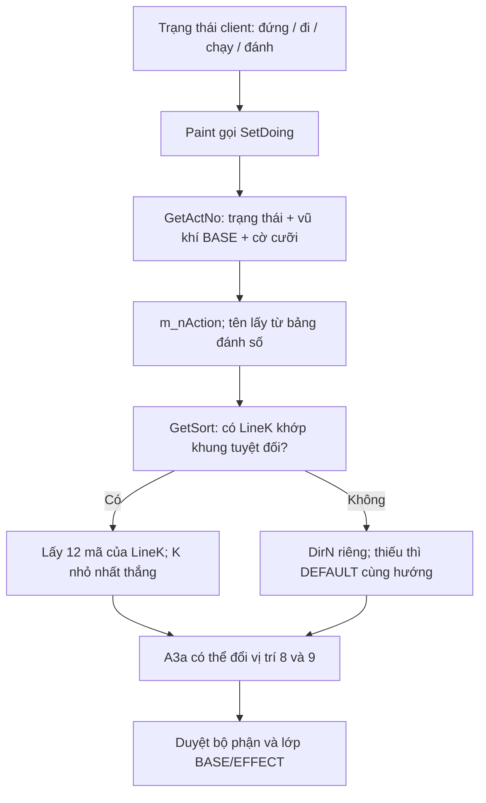

# Bảng thứ tự vẽ bộ phận nhân vật — U-03

Ngày khảo sát: 17/11/2026. Trạng thái: **PARTIAL** ở việc chốt số hành động tài nguyên thực tế; bảng dữ liệu nữ và luật chọn bảng đã hoàn thành bằng đọc tĩnh.

liên quan: [QUY-LUAT-VE-BO-PHAN.md](QUY-LUAT-VE-BO-PHAN.md), [BUG-001.md](../BUGS/BUG-001.md), [báo cáo U-03](../REPORTS/U-03.md), [J-04](../REPORTS/J-04-lop-chong-nhan-vat.md), chỉ thị #093 mục 6.

## Mục lục

1. [Kết luận và độ chắc](#1-kết-luận-và-độ-chắc).
2. [Nguồn và cách đọc bảng](#2-nguồn-và-cách-đọc-bảng).
3. [Luật chọn bảng](#3-luật-chọn-bảng).
4. [Đi bộ, chạy, đứng, đánh và cưỡi](#4-đi-bộ-chạy-đứng-đánh-và-cưỡi).
5. [Kiểm tra các hướng đối xứng](#5-kiểm-tra-các-hướng-đối-xứng).
6. [Khung tuyệt đối và LineK](#6-khung-tuyệt-đối-và-linek).
7. [Nhân vật nam](#7-nhân-vật-nam).
8. [Bảng DEFAULT của nữ](#8-bảng-default-của-nữ).
9. [Bảng đầy đủ từng hành động nữ](#9-bảng-đầy-đủ-từng-hành-động-nữ).

## 1. Kết luận và độ chắc

- **ĐÃ XÁC MINH – dữ liệu:** file nữ có 46 mục: `DEFAULT` và 45 hành động, 152 dòng `DirN` hoạt động, 297 dòng `LineK`, mỗi dòng mang đúng 12 mã bộ phận. Có cả `RangeWWalk` và `RangeWRun` tại N:518, N:530.
- **ĐÃ XÁC MINH – mã:** khung đặc biệt được so bằng số khung tuyệt đối; không chia lại cho số khung mỗi hướng trong `GetSort` (G/KNpcResNode.cpp:1425, :1455).
- **ĐÃ XÁC MINH – mã:** đi bộ gửi trạng thái client `cdo_fightwalk=3` hoặc `cdo_walk=4`; đây là `m_nDoing` của tài nguyên, còn `m_nAction` được tra tiếp theo vũ khí và cờ cưỡi (G/KNpc.h:104; G/KNpc.cpp:2891; G/KNpcRes.cpp:1684).
- **CHƯA XÁC MINH:** số `m_nAction` và tên mục INI thực sự được chọn cho nhân vật/thương A3a. Thiếu `人物类型.txt`, `动作编号表.txt`, bảng liên kết vũ khí và metadata bộ phận trong nguồn được giao; không lấy thứ tự các mục INI làm số hành động.
- **CHƯA XÁC MINH trực tiếp:** file nam; task và tài liệu cũ nói chỉ có `[DEFAULT]`. Hệ quả của điều kiện đó được chứng minh từ mã tại mục 7. Không chạy client, build, VM, exe hoặc mạng.

## 2. Nguồn và cách đọc bảng

**ĐÃ XÁC MINH – nguồn đã mở:**

| Ký hiệu | Nguồn |
|---|---|
| A | Root client bản A: `D:/JX-build/qh9A` |
| G | `A/Classes/gamecore`; chứa `KNpcResNode.cpp`, `KNpcRes.cpp`, `KNpc.h`, `CoreUseNameDef.h` |
| V | `A/Classes/vn/gamecore/KNpcResVN.cpp` |
| N | `D:/JX-wt/_data/nu-decoded-utf8.ini`, bản giải mã do task cấp, SHA-256 `ffd0a5551595784e392227963580b117fcd0437b1f4c58f50e9a6184c9dd462d` |
| N:K | Dòng K của file N, giữ nguyên cách đếm dòng, gồm cả dòng trống/chú thích |

**ĐÃ XÁC MINH – cách trình bày:** bảng dưới là 12 mã trong dữ liệu, theo thứ tự từ vị trí 1 đến 12, trước phép hoán đổi bổ sung A3a. Bỏ số đầu `-1` của `DirN`; với `LineK`, tách số đầu thành cột “Khung tuyệt đối”. Mã nhỏ không có nghĩa là vẽ trước: vị trí trong chuỗi mới quyết định thứ tự.

**ĐÃ XÁC MINH – cấu trúc:** 12 mã xuất hiện là `0,1,4,5,6,7,8,9,12,13,14,16`; đây là các phần nhỏ của hình nhân vật, không phải 12 ô trang bị. Các nhóm mũ 0–3, áo 4–7, vũ khí 8–11, ngựa 12–15, Phi Phong 16–19 được suy ra từ nhóm và bốn phần/nhóm (G/CoreUseNameDef.h:8; G/KNpcResNode.h:23; G/KNpcResNode.cpp:91). Việc ảnh nào thực sự hiện còn cần tài nguyên.

**CHƯA XÁC MINH:** `m_nPartNum` thực tế của nhân vật. Mã đếm các phần có tên trong file bộ phận (G/KNpcResNode.cpp:90), rồi dùng số đó để nạp/copy bảng (:1223, :1325). Vì file bộ phận chưa có, số 12 ở đây là độ dài dữ liệu đã đọc; không khẳng định số sprite đang hiện là 12.

**Quy ước hướng theo task:** 0 xuống, 1 xuống-trái, 2 trái, 3 lên-trái, 4 lên, 5 lên-phải, 6 phải, 7 xuống-phải. Khóa `DirN` tương ứng hướng `N-1`. Cột “Nguồn” nêu rõ dùng dòng riêng hay kế thừa `DEFAULT`.

## 3. Luật chọn bảng

**ĐÃ XÁC MINH – đọc mã, áp dụng khi các file tài nguyên nạp thành công:**

1. Danh sách hành động được nạp từ `动作编号表.txt` (G/CoreUseNameDef.h:50; G/KNpcResList.cpp:42). Chỉ những tên có trong danh sách này mới được `GetkTable` tìm mục tương ứng (G/KNpcResNode.cpp:1246).
2. Một hành động không có mục riêng dùng `DEFAULT` theo hướng (G/KNpcResNode.cpp:1255, :1404).
3. Có ít nhất một `DirN` riêng thì tạo bảng hướng cho hành động; hướng nào thiếu sẽ chép đúng hướng từ `DEFAULT`, không kế thừa mục hành động đứng bên trên trong file (:1258, :1343, :1354).
4. `Line1,Line2,...` được đọc theo **số K tăng dần**, dừng ngay tại K đầu tiên bị thiếu; vị trí vật lý trong file không đổi luật này (:1271, :1363).
5. Khi chọn bảng, tìm `LineK` khớp số khung trước. Nếu hai dòng cùng khung, K nhỏ hơn thắng vì hàm trả về ngay khi tìm thấy (:1422, :1435, :1452, :1465). Không khớp thì dùng bảng hướng của hành động, hoặc `DEFAULT` (:1438, :1468).
6. Số đầu `LineK` là khóa khung; không ràng buộc trực tiếp với `DirN` đứng gần nó. Trong bảng chi tiết, mọi `LineK` được liệt kê một lần cho cả mục, tránh gán nhầm cho một hướng.
7. `MAX_SORT_DIR=16` (G/KNpcResNode.cpp:21): chỉ `Dir1..Dir16` được nạp. `Dir17..Dir24` có trong dữ liệu nhưng không được mã này đọc (:1238, :1320). `DirNum=26` (N:27) nằm trên đường đọc đã comment (:1316); `UnitNum=11` (N:26) không được dùng trong `GetkTable`. Không có căn cứ nói `Dir9..Dir24` là bảng dành riêng cho cưỡi.

**ĐÃ XÁC MINH – ba khung trùng và một khóa bị bỏ qua:**

| Mục | Khóa | Kết quả theo mã | Nguồn |
|---|---|---|---|
| FreeRun | Thiếu Line10; có Line11, khung 52 | Chỉ đọc Line1..Line9; Line11 không được nạp | N:281, N:284; G/KNpcResNode.cpp:1287, :1367 |
| MeleeWCut | Line2 và Line3 cùng khung 60 | Line2 thắng, dù Line3 nằm trước trong file | N:354, N:355; G/KNpcResNode.cpp:1366, :1425 |
| MeleeWMagic | Line8 và Line9 cùng khung 8 | Line8 thắng, dù Line9 nằm trước trong file | N:384, N:385; G/KNpcResNode.cpp:1366, :1455 |
| MeleeWRun | Line13 và Line14 cùng khung 50 | Line13 thắng, dù Line14 nằm trước trong file | N:510, N:511; G/KNpcResNode.cpp:1366, :1455 |

**ĐÃ XÁC MINH – số học trên dữ liệu:** 297 dòng tồn tại; 296 dòng qua được quy tắc K liên tục; trừ ba dòng trùng bị che, còn 293 khóa khung có thể thắng, tính riêng theo từng mục. Đây là kết quả áp luật vào file N, có điều kiện tên mục nằm trong bảng hành động; chưa xác nhận client đã nạp cả 45 mục.

**ĐÃ XÁC MINH – bước sau tra bảng:** V:205 lấy bảng, rồi V:208..214 hoán đổi vị trí mã 8 và 9 ở hướng 0–3 nếu công tắc A3a bật và NPC không cưỡi. Phép đổi này không xét riêng hành động đi bộ. Log `SORTIN` ở V:217 chạy **sau** phép đổi. Các bảng trong tài liệu mô tả đầu ra tra INI trước bước đổi đó; chưa phải kết quả pixel trên điện thoại. V:460, :465, :493 lần lượt duyệt bảng, các lớp BASE/EFFECT và gửi danh sách vẽ.



## 4. Đi bộ, chạy, đứng, đánh và cưỡi

**ĐÃ XÁC MINH – trạng thái đầu vào:** `CLIENTACTION` bắt đầu từ 0, không gán số riêng (G/KNpc.h:104). `Paint` truyền `m_ClientDoing` vào `SetDoing`, rồi gọi bản VN để vẽ (G/KNpc.cpp:6096). `SetDoing` cập nhật `m_nDoing` và gọi `UpdateAction` (G/KNpcRes.cpp:1656); `UpdateAction` lấy loại vũ khí ở lớp BASE và cờ cưỡi để tra hành động (:1684).

| Trạng thái | ID trạng thái CLIENTACTION đã xác minh | Bằng chứng caller | m_nAction và mục INI thực tế |
|---|---|---|---|
| Đi bộ, không cưỡi | Chiến đấu: cdo_fightwalk=3; thường: cdo_walk=4 | G/KNpc.cpp:2871, :2891 | CHƯA XÁC MINH; tra m_NoHorseTable(vũ khí, 3 hoặc 4) |
| Chạy bộ, không cưỡi | Chiến đấu: cdo_fightrun=5; thường: cdo_run=6 | G/KNpc.cpp:2159, :2177 | CHƯA XÁC MINH; tra m_NoHorseTable(vũ khí, 5 hoặc 6) |
| Đứng, không cưỡi | Chiến đấu: cdo_fightstand=0; thường: cdo_stand=1 hoặc cdo_stand1=2 | G/KNpc.cpp:2073, :2098 | CHƯA XÁC MINH; tra m_NoHorseTable(vũ khí, 0/1/2) |
| Đánh thường, không cưỡi | cdo_attack=9 hoặc cdo_attack1=10 | G/KNpc.cpp:2494 | CHƯA XÁC MINH; tra m_NoHorseTable(vũ khí, 9 hoặc 10) |
| Cưỡi, đứng/đi/chạy/đánh | Giữ họ trạng thái tương ứng; cờ cưỡi chọn bảng khác | G/KNpcRes.cpp:1885; G/KNpcResNode.cpp:599 | CHƯA XÁC MINH; tra m_OnHorseTable(vũ khí, trạng thái) |

**ĐÃ XÁC MINH – mắt xích còn thiếu:** với nhân vật ghép hình, `GetActNo` trả ô trong bảng không cưỡi hoặc bảng cưỡi (G/KNpcResNode.cpp:592). Tên hai bảng lấy từ cột `武器行为关联表1` và `武器行为关联表2` của `人物类型.txt` (:319). Các ô chứa tên hành động, được đổi thành số bằng `CActionName::GetActionNo` (:335, :357, :714). Số là chỉ số dòng dữ liệu trong bảng đánh số, bắt đầu từ 0 (:703); không phải số thứ tự mục INI.

**ĐÃ XÁC MINH – tên cột đúng trong bản A:** mã đọc cột `动作贴图顺序表` tại G/KNpcResNode.cpp:366, cũng được khai báo ở G/CoreUseNameDef.h:61. Task/tài liệu cũ viết `人物贴图顺序表`; chưa có file `人物类型.txt` để đối chiếu tiêu đề thực tế. Không tự đổi tên cột hay sửa source.

**ĐÃ XÁC MINH – các mục sẵn có trong file N, chưa phải ánh xạ gameplay:**

| Họ tên trong INI | Đi | Chạy | Đứng | Đánh/phép |
|---|---|---|---|---|
| Free | FreeWalk | FreeRun | FreeStand1, FreeStand2, FreeStand3 | FreeAttack, FreeMagic |
| MeleeW | MeleeWWalk | MeleeWRun | MeleeWStand | MeleeWCut, MeleeWPuncture, MeleeWMagic |
| RangeW | RangeWWalk | RangeWRun | RangeWStand | RangeWCut, RangeWPuncture, RangeWMagic |
| DoubleW | DoubleWWalk | DoubleWRun | DoubleWStand | DoubleWPound, DoubleWPull, DoubleWMagic |
| Ride | RideWalk | RideRun | RideStand, RideStand1, RideStand2 | RideCut, RidePuncture, RideMagic |

**CHƯA XÁC MINH:** với nhân vật đang cầm thương, trạng thái 3/4 đi tới họ nào, số tài nguyên nào, mục nào, tổng khung/hướng bao nhiêu. Không đủ bằng chứng chọn `FreeWalk` chỉ vì là đi bộ, hoặc chọn `RangeWWalk` chỉ vì tên gợi ý. `act=38` đứng trong BUG-001.md:6 là số đo do báo cáo cũ ghi lại; chưa nối được số 38 với tên mục bằng dữ liệu hiện có.

## 5. Kiểm tra các hướng đối xứng

**ĐÃ XÁC MINH – so chuỗi dữ liệu, trước LineK/A3a:** ở cả 45 mục hành động, ba cặp 1↔7, 2↔6, 3↔5 đều có chuỗi 12 mã khác nhau sau khi bù hướng thiếu bằng `DEFAULT`: 135/135 phép so khác; `DEFAULT` cũng khác ở cả ba cặp. Mỗi mục 9 ghi lại kết quả riêng.

**Quy tắc phép so:** so nguyên chuỗi mã ở cùng trạng thái cơ sở, không đảo thứ tự vẽ và không tự hoán đổi mã trái/phải. Đây là bất đối xứng theo tiêu chí chuỗi mà task yêu cầu. **CHƯA XÁC MINH:** quy tắc phản chiếu của ảnh SPR, nên chuỗi khác nhau không đủ kết luận hình ảnh sai.

**ĐÃ XÁC MINH – ví dụ DEFAULT và vị trí mã vũ khí 9 so với thân áo 4:**

| Cặp hướng | Vị trí mã 9 / mã 4 ở hướng trái | Vị trí mã 9 / mã 4 ở hướng phải | Nguồn |
|---|---|---|---|
| 1↔7 | d1: 4 / 6 → 9 trước 4 | d7: 11 / 4 → 9 sau 4 | N:3, N:9 |
| 2↔6 | d2: 1 / 8 → 9 trước 4 | d6: 11 / 8 → 9 sau 4 | N:4, N:8 |
| 3↔5 | d3: 1 / 8 → 9 trước 4 | d5: 11 / 8 → 9 sau 4 | N:5, N:7 |

**ĐÃ XÁC MINH – giới hạn so theo khung:** các `LineK` dùng khóa tuyệt đối, vì vậy cùng tiến độ động tác ở hai hướng thường tạo hai khóa khác nhau. Chưa có F thực tế để lập đối xứng theo từng khung tương ứng; các bảng hướng là cơ sở khi chưa có `LineK` thắng. Ví dụ `RangeWWalk` d1/d7 cơ sở khác nhau (N:520, N:527), còn việc khung 31..34 thuộc hướng nào phải tính bằng F.

## 6. Khung tuyệt đối và LineK

**ĐÃ XÁC MINH – công thức đang hoạt động ở V:60, :63, :66, :67:**

```text
D = số hướng của SPR; nếu D <= 0 thì dùng 1
d = (nDir + 32/D) / (64/D); nếu d >= D thì d -= D
F = totalFrames / D
r = F * nCurFrame / nAllFrame
nCurFrameNo = d*F + r
```

Các phép chia là chia nguyên. Công thức trên áp dụng nhánh `nAllFrame>0`; khi tiến độ khung nằm trong chu kỳ hợp lệ thì `0 <= r < F`. Bản G/KNpcRes.cpp:271 có cùng dạng. Các biến khóa sort được ghi lại sau mỗi bộ phận/lớp đang tồn tại; V:205 dùng cặp `d,nCurFrameNo` cuối cùng. **CHƯA XÁC MINH:** SPR cuối cùng và F của nó trong tình huống A3a.

**ĐÃ XÁC MINH – phép suy số học:** một khóa `L` có thể khớp hướng khác 0 trong bộ 8 hướng khi `F <= L < 8F`, với `d=floor(L/F)` và `r=L mod F`. Chỉ cần một khóa thỏa là bác bỏ nhận định “LineK chỉ có thể khớp hướng 0”. Dữ liệu thực có khóa từ **0 đến 119**, không chỉ 0..52 như tài liệu cũ.

| Mục và LineK thực có | L | F giả định để kiểm số học | d và r tính được | Nguồn |
|---|---:|---:|---|---|
| FreeWalk Line1/2/3 | 8/9/10 | 8 khung/hướng | d=1, r=0/1/2 | N:265, N:266, N:267 |
| RangeWWalk Line1..4 | 31..34 | 12 khung/hướng | d=2, r=7..10 | N:521 |
| RangeWRun Line1/2 | 24/25 | 12 khung/hướng | d=2, r=0/1 | N:533 |
| RangeWRun Line3 | 48 | 12 khung/hướng | d=4, r=0 | N:536 |
| FreeRun Line9 | 44 | 12 khung/hướng | d=3, r=8 | N:281 |
| RangeWCut Line48 | 94 | 12 khung/hướng | d=7, r=10 | N:127 |
| MeleeWDie Line10 | 119 | 16 khung/hướng | d=7, r=7 | N:484 |

**ĐÃ XÁC MINH – kết luận có điều kiện:** có nhiều `LineK` có thể khớp hướng khác 0; bảng trên cung cấp các phép thế số cụ thể. **GIẢ THUYẾT dùng để tính:** F=8/12/16 là giả định minh họa, không phải metadata đã đo. Với FreeWalk, F=12 lại đưa cả 8/9/10 vào hướng 0; nếu F>119 thì mọi khóa của file N đều nằm ở hướng 0. Vì vậy chưa thể nói khóa nào thực sự trúng ở A3a, hay cách đánh số của tác giả sai.

**ĐÃ XÁC MINH – mã V, thứ tự duyệt:** trong nhánh `nAllFrame>0`, vòng lặp qua từng slot và lớp chỉ cập nhật `nCurDirNo/nCurFrameNo` khi sprite tồn tại (V:53-68). Sau vòng lặp, `GetnSort` nhận cặp giá trị cuối cùng còn lại (V:197-205). Do metadata SPR của các slot chưa có, chưa xác minh cặp cuối thuộc sprite nào hoặc có cùng với metadata sprite khác hay không. Vì vậy phép tính `F` ở trên là điều kiện toán học của khóa thực sự truyền vào, không chứng minh khung của một sprite cụ thể.

**ĐÃ XÁC MINH – ngoại lệ dữ liệu:** FreeRun Line11 có L=52 nhưng không được nạp do thiếu Line10; không dùng nó làm ví dụ một ghi đè có hiệu lực. Khóa K của `LineK` chỉ là số thứ tự đọc, không phải L.

## 7. Nhân vật nam

**Nguồn gián tiếp:** task U-03 và QUY-LUAT-VE-BO-PHAN.md:4 mô tả `男主角贴图顺序表.ini` chỉ có `[DEFAULT]`, 1007 byte. Không tìm thấy file rời này trong A; thư mục dữ liệu được giao chỉ có bản nữ. **CHƯA XÁC MINH trực tiếp:** nội dung, độ dài, từng DirN và liên kết nhân vật nam tới file đó.

**ĐÃ XÁC MINH – hệ quả theo điều kiện “nam chỉ có DEFAULT”:** mọi hành động nam sẽ lấy chuỗi mặc định của cùng hướng, vì không có mục hành động để đặt `nActOff` khác 0 (G/KNpcResNode.cpp:1255, :1404). Không có ghi đè riêng theo khung; đi/chạy/đứng/đánh/cưỡi vẫn đổi ảnh và hành động nhưng bảng thứ tự dùng chung theo hướng. Điều này không có nghĩa mọi hướng dùng cùng một chuỗi.

**CHƯA XÁC MINH:** bảng nam có giống nữ hay không, bảng nam đúng về che khuất hay không, nam có cùng triệu chứng BUG-001 hay không. Không mượn các số của nữ làm bảng nam. Phép hoán đổi A3a còn phụ thuộc cờ cưỡi/hướng, không có điều kiện giới tính ở V:210.

## 8. Bảng DEFAULT của nữ

**ĐÃ XÁC MINH – dữ liệu N:1:** tám hướng theo quy ước task, trước các ghi đè. Tất cả dòng dưới có đúng 12 mã. Kết quả cơ sở trùng các chuỗi đứng được dẫn lại ở BUG-001.md:7; chưa xác nhận cùng dữ liệu với APK đang cài.

| Hướng | Chiều | Khóa | Thứ tự vẽ từ vị trí 1 đến 12 | Nguồn |
|---|---|---|---|---|
| 0 | xuống | Dir1 | `14,16,13,1,4,9,7,5,6,12,8,0` | N:2 |
| 1 | xuống-trái | Dir2 | `14,16,13,9,7,4,1,5,12,6,8,0` | N:3 |
| 2 | trái | Dir3 | `9,7,12,13,14,5,16,4,1,0,6,8` | N:4 |
| 3 | lên-trái | Dir4 | `9,7,12,13,5,14,16,4,1,0,8,6` | N:5 |
| 4 | lên | Dir5 | `12,13,8,6,5,14,16,4,1,0,7,9` | N:6 |
| 5 | lên-phải | Dir6 | `8,6,12,13,5,14,16,4,1,0,9,7` | N:7 |
| 6 | phải | Dir7 | `8,6,12,13,14,5,16,4,1,0,9,7` | N:8 |
| 7 | xuống-phải | Dir8 | `14,16,13,4,1,8,6,5,12,0,9,7` | N:9 |

**ĐÃ XÁC MINH – ngoài tám hướng task:** Dir9..Dir16 là các bảng cơ sở còn được bộ nạp đọc khi hướng nằm trong miền 16; chưa chứng minh một hành động nào sử dụng chúng. Dir17..Dir24 chỉ là dữ liệu tồn tại, bộ nạp này bỏ qua.

| Khóa | 12 mã theo file | Nguồn | Bộ nạp bản A |
|---|---|---|---|
| Dir9 | `12,13,14,8,6,9,5,16,4,0,1,7` | N:10 | Đọc |
| Dir10 | `12,13,14,8,6,9,5,16,4,0,1,7` | N:11 | Đọc |
| Dir11 | `12,13,14,8,6,9,5,16,4,0,1,7` | N:12 | Đọc |
| Dir12 | `12,13,14,8,6,5,16,4,0,1,9,7` | N:13 | Đọc |
| Dir13 | `12,13,14,8,6,5,16,4,0,1,9,7` | N:14 | Đọc |
| Dir14 | `12,13,14,8,6,5,16,4,1,0,7,9` | N:15 | Đọc |
| Dir15 | `12,13,14,6,8,5,16,4,1,0,7,9` | N:16 | Đọc |
| Dir16 | `12,13,14,5,16,0,1,6,8,7,9,4` | N:17 | Đọc |
| Dir17 | `12,13,14,5,16,0,1,6,8,7,9,4` | N:18 | Bỏ qua: vượt MAX_SORT_DIR |
| Dir18 | `12,13,14,5,16,0,1,6,8,7,9,4` | N:19 | Bỏ qua: vượt MAX_SORT_DIR |
| Dir19 | `12,13,14,5,16,0,1,6,8,7,9,4` | N:20 | Bỏ qua: vượt MAX_SORT_DIR |
| Dir20 | `12,13,14,5,16,0,1,6,8,7,9,4` | N:21 | Bỏ qua: vượt MAX_SORT_DIR |
| Dir21 | `12,13,14,5,16,0,1,6,8,7,9,4` | N:22 | Bỏ qua: vượt MAX_SORT_DIR |
| Dir22 | `12,13,14,5,16,0,1,6,8,7,9,4` | N:23 | Bỏ qua: vượt MAX_SORT_DIR |
| Dir23 | `12,13,14,5,16,0,1,6,8,7,9,4` | N:24 | Bỏ qua: vượt MAX_SORT_DIR |
| Dir24 | `12,13,14,5,16,0,1,6,8,7,9,4` | N:25 | Bỏ qua: vượt MAX_SORT_DIR |

## 9. Bảng đầy đủ từng hành động nữ

**ĐÃ XÁC MINH – trích dữ liệu N và áp luật mã:** 45 mục dưới có đủ 8 hướng cơ sở (360 dòng), 297 dòng LineK tồn tại trong file và nguồn N:dòng. Chỉ các LineK được nạp, không bị khung trùng che và khớp khóa mới ghi đè bảng cơ sở. Số K được sắp tăng như bộ nạp, giữ nguyên số dòng nguồn để thấy chỗ khác thứ tự vật lý. Các DirN thiếu dùng DEFAULT; năm dòng DirN có dấu chấm phẩy của RangeWDie là chú thích, không phải ghi đè.

**CHƯA XÁC MINH:** các tên mục này có mặt trong bảng đánh số của bản cài hay không. “Được nạp theo quy tắc K” dưới đây chỉ xét cấu trúc file, không xác nhận trạng thái bộ nhớ của client.

| Mục | Dòng mở mục | DirN riêng (d0..7) | LineK tồn tại | Phạm vi L | Xem |
|---|---:|---:|---:|---|---|
| RangeWStand | N:29 | 4 | 0 | Không có | [Bảng](#rangewstand) |
| RangeWWound | N:35 | 6 | 1 | 12..12 | [Bảng](#rangewwound) |
| RangeWDie | N:44 | 3 | 15 | 27..69 | [Bảng](#rangewdie) |
| RangeWMagic | N:69 | 4 | 0 | Không có | [Bảng](#rangewmagic) |
| RangeWCut | N:75 | 4 | 50 | 0..94 | [Bảng](#rangewcut) |
| RangeWPuncture | N:131 | 3 | 21 | 6..101 | [Bảng](#rangewpuncture) |
| RideStand | N:157 | 3 | 0 | Không có | [Bảng](#ridestand) |
| RideStand1 | N:162 | 3 | 0 | Không có | [Bảng](#ridestand1) |
| RideStand2 | N:167 | 3 | 0 | Không có | [Bảng](#ridestand2) |
| RideRun | N:172 | 3 | 0 | Không có | [Bảng](#riderun) |
| RideWalk | N:177 | 3 | 0 | Không có | [Bảng](#ridewalk) |
| RideWound | N:182 | 3 | 1 | 2..2 | [Bảng](#ridewound) |
| RideMagic | N:188 | 3 | 7 | 0..11 | [Bảng](#ridemagic) |
| RideDie | N:200 | 2 | 23 | 6..55 | [Bảng](#ridedie) |
| RideCut | N:227 | 2 | 17 | 4..90 | [Bảng](#ridecut) |
| RidePuncture | N:248 | 3 | 11 | 5..68 | [Bảng](#ridepuncture) |
| FreeWalk | N:264 | 1 | 3 | 8..10 | [Bảng](#freewalk) |
| FreeRun | N:270 | 4 | 10 | 0..52 | [Bảng](#freerun) |
| DoubleWDie | N:286 | 3 | 15 | 5..79 | [Bảng](#doublewdie) |
| DoubleWStand | N:306 | 1 | 0 | Không có | [Bảng](#doublewstand) |
| DoubleWWound | N:309 | 3 | 1 | 24..24 | [Bảng](#doublewwound) |
| DoubleWPound | N:315 | 4 | 2 | 54..66 | [Bảng](#doublewpound) |
| DoubleWPull | N:323 | 3 | 16 | 1..73 | [Bảng](#doublewpull) |
| DoubleWMagic | N:344 | 2 | 0 | Không có | [Bảng](#doublewmagic) |
| MeleeWStand | N:348 | 2 | 0 | Không có | [Bảng](#meleewstand) |
| MeleeWCut | N:352 | 0 | 8 | 8..62 | [Bảng](#meleewcut) |
| MeleeWPuncture | N:362 | 1 | 9 | 6..62 | [Bảng](#meleewpuncture) |
| MeleeWMagic | N:374 | 2 | 17 | 0..56 | [Bảng](#meleewmagic) |
| FreeStand3 | N:395 | 3 | 0 | Không có | [Bảng](#freestand3) |
| FreeStand1 | N:400 | 4 | 0 | Không có | [Bảng](#freestand1) |
| FreeStand2 | N:406 | 4 | 0 | Không có | [Bảng](#freestand2) |
| FreeWound | N:412 | 3 | 0 | Không có | [Bảng](#freewound) |
| FreeDie | N:417 | 0 | 12 | 9..103 | [Bảng](#freedie) |
| FreeAttack | N:431 | 4 | 10 | 7..89 | [Bảng](#freeattack) |
| FreeMagic | N:447 | 2 | 0 | Không có | [Bảng](#freemagic) |
| SitDown | N:451 | 5 | 0 | Không có | [Bảng](#sitdown) |
| DartThrow | N:458 | 2 | 7 | 6..67 | [Bảng](#dartthrow) |
| MeleeWWound | N:469 | 1 | 0 | Không có | [Bảng](#meleewwound) |
| MeleeWDie | N:472 | 2 | 15 | 10..119 | [Bảng](#meleewdie) |
| MeleeWWalk | N:491 | 2 | 0 | Không có | [Bảng](#meleewwalk) |
| MeleeWRun | N:495 | 2 | 19 | 0..56 | [Bảng](#meleewrun) |
| RangeWWalk | N:518 | 6 | 4 | 31..34 | [Bảng](#rangewwalk) |
| RangeWRun | N:530 | 6 | 3 | 24..48 | [Bảng](#rangewrun) |
| DoubleWWalk | N:541 | 2 | 0 | Không có | [Bảng](#doublewwalk) |
| DoubleWRun | N:545 | 2 | 0 | Không có | [Bảng](#doublewrun) |

### RangeWStand

**ĐÃ XÁC MINH – dữ liệu:** mục mở tại N:29; bảng cơ sở khi chưa có LineK thắng.

| Hướng | Chiều | Thứ tự vẽ từ vị trí 1 đến 12 | Nguồn |
|---|---|---|---|
| 0 | xuống | `14,16,13,1,4,7,5,6,9,8,0,12` | Dir1 riêng — N:30 |
| 1 | xuống-trái | `14,16,13,7,4,1,5,12,6,8,0,9` | Dir2 riêng — N:31 |
| 2 | trái | `9,7,12,13,14,5,16,4,1,0,6,8` | DEFAULT/Dir3 — N:4 |
| 3 | lên-trái | `9,7,12,13,5,14,16,4,1,0,8,6` | DEFAULT/Dir4 — N:5 |
| 4 | lên | `12,13,9,8,6,7,5,14,16,4,1,0` | Dir5 riêng — N:32 |
| 5 | lên-phải | `8,6,12,13,9,5,14,16,4,1,0,7` | Dir6 riêng — N:33 |
| 6 | phải | `8,6,12,13,14,5,16,4,1,0,9,7` | DEFAULT/Dir7 — N:8 |
| 7 | xuống-phải | `14,16,13,4,1,8,6,5,12,0,9,7` | DEFAULT/Dir8 — N:9 |

**ĐÃ XÁC MINH – so chuỗi cơ sở:** 1↔7: khác; 2↔6: khác; 3↔5: khác.

**ĐÃ XÁC MINH:** không có LineK trong mục này.

### RangeWWound

**ĐÃ XÁC MINH – dữ liệu:** mục mở tại N:35; bảng cơ sở khi chưa có LineK thắng.

| Hướng | Chiều | Thứ tự vẽ từ vị trí 1 đến 12 | Nguồn |
|---|---|---|---|
| 0 | xuống | `14,16,13,1,4,7,6,5,12,8,0,9` | Dir1 riêng — N:36 |
| 1 | xuống-trái | `14,16,13,7,4,1,5,12,6,8,0,9` | Dir2 riêng — N:37 |
| 2 | trái | `7,12,13,14,5,16,4,1,0,6,8,9` | Dir3 riêng — N:38 |
| 3 | lên-trái | `9,7,12,13,5,14,16,4,1,0,8,6` | DEFAULT/Dir4 — N:5 |
| 4 | lên | `9,12,13,8,6,7,5,14,16,4,1,0` | Dir5 riêng — N:40 |
| 5 | lên-phải | `9,8,6,12,13,5,14,16,4,1,0,7` | Dir6 riêng — N:41 |
| 6 | phải | `8,6,12,13,14,5,16,4,1,9,7,0` | Dir7 riêng — N:42 |
| 7 | xuống-phải | `14,16,13,4,1,8,6,5,12,0,9,7` | DEFAULT/Dir8 — N:9 |

**ĐÃ XÁC MINH – so chuỗi cơ sở:** 1↔7: khác; 2↔6: khác; 3↔5: khác.

| LineK | Khung tuyệt đối L | 12 mã ghi đè | Nguồn | Hiệu lực theo bộ nạp |
|---|---:|---|---|---|
| Line1 | 12 | `9,7,12,13,14,5,16,4,1,0,6,8` | N:39 | Được nạp theo quy tắc K; thắng nếu khớp L |

### RangeWDie

**ĐÃ XÁC MINH – dữ liệu:** mục mở tại N:44; bảng cơ sở khi chưa có LineK thắng.

| Hướng | Chiều | Thứ tự vẽ từ vị trí 1 đến 12 | Nguồn |
|---|---|---|---|
| 0 | xuống | `14,16,13,1,4,7,5,6,12,8,0,9` | Dir1 riêng — N:45 |
| 1 | xuống-trái | `14,16,13,7,4,1,5,12,6,8,0,9` | Dir2 riêng — N:46 |
| 2 | trái | `7,12,13,14,5,16,4,1,0,6,8,9` | Dir3 riêng — N:47 |
| 3 | lên-trái | `9,7,12,13,5,14,16,4,1,0,8,6` | DEFAULT/Dir4 — N:5 |
| 4 | lên | `12,13,8,6,5,14,16,4,1,0,7,9` | DEFAULT/Dir5 — N:6 |
| 5 | lên-phải | `8,6,12,13,5,14,16,4,1,0,9,7` | DEFAULT/Dir6 — N:7 |
| 6 | phải | `8,6,12,13,14,5,16,4,1,0,9,7` | DEFAULT/Dir7 — N:8 |
| 7 | xuống-phải | `14,16,13,4,1,8,6,5,12,0,9,7` | DEFAULT/Dir8 — N:9 |

**ĐÃ XÁC MINH – so chuỗi cơ sở:** 1↔7: khác; 2↔6: khác; 3↔5: khác.

| LineK | Khung tuyệt đối L | 12 mã ghi đè | Nguồn | Hiệu lực theo bộ nạp |
|---|---:|---|---|---|
| Line1 | 27 | `16,7,12,13,14,5,4,1,0,6,8,9` | N:49 | Được nạp theo quy tắc K; thắng nếu khớp L |
| Line2 | 28 | `16,7,12,13,14,5,4,1,0,6,8,9` | N:50 | Được nạp theo quy tắc K; thắng nếu khớp L |
| Line3 | 29 | `16,7,12,13,14,5,4,1,0,6,8,9` | N:51 | Được nạp theo quy tắc K; thắng nếu khớp L |
| Line4 | 37 | `16,12,13,5,14,4,1,0,9,7,8,6` | N:53 | Được nạp theo quy tắc K; thắng nếu khớp L |
| Line5 | 38 | `16,12,13,5,14,4,1,0,9,7,8,6` | N:54 | Được nạp theo quy tắc K; thắng nếu khớp L |
| Line6 | 39 | `16,12,13,5,14,4,1,0,9,7,8,6` | N:55 | Được nạp theo quy tắc K; thắng nếu khớp L |
| Line7 | 47 | `16,12,13,5,14,4,1,0,8,6,9,7` | N:57 | Được nạp theo quy tắc K; thắng nếu khớp L |
| Line8 | 48 | `16,12,13,5,14,4,1,0,8,6,9,7` | N:58 | Được nạp theo quy tắc K; thắng nếu khớp L |
| Line9 | 49 | `16,12,13,5,14,4,1,0,8,6,9,7` | N:59 | Được nạp theo quy tắc K; thắng nếu khớp L |
| Line10 | 57 | `16,12,13,5,14,4,1,0,8,6,9,7` | N:61 | Được nạp theo quy tắc K; thắng nếu khớp L |
| Line11 | 58 | `16,12,13,5,14,4,1,0,8,6,9,7` | N:62 | Được nạp theo quy tắc K; thắng nếu khớp L |
| Line12 | 59 | `16,12,13,5,14,4,1,0,8,6,9,7` | N:63 | Được nạp theo quy tắc K; thắng nếu khớp L |
| Line13 | 67 | `16,12,13,14,5,4,1,0,8,6,9,7` | N:65 | Được nạp theo quy tắc K; thắng nếu khớp L |
| Line14 | 68 | `16,12,13,14,5,4,1,0,8,6,9,7` | N:66 | Được nạp theo quy tắc K; thắng nếu khớp L |
| Line15 | 69 | `16,12,13,14,5,4,1,0,8,6,9,7` | N:67 | Được nạp theo quy tắc K; thắng nếu khớp L |

### RangeWMagic

**ĐÃ XÁC MINH – dữ liệu:** mục mở tại N:69; bảng cơ sở khi chưa có LineK thắng.

| Hướng | Chiều | Thứ tự vẽ từ vị trí 1 đến 12 | Nguồn |
|---|---|---|---|
| 0 | xuống | `14,16,13,1,4,7,5,6,12,8,0,9` | Dir1 riêng — N:70 |
| 1 | xuống-trái | `14,16,13,7,4,1,5,12,6,8,0,9` | Dir2 riêng — N:71 |
| 2 | trái | `9,7,12,13,14,5,16,4,1,0,6,8` | DEFAULT/Dir3 — N:4 |
| 3 | lên-trái | `9,7,12,13,5,14,16,4,1,0,8,6` | DEFAULT/Dir4 — N:5 |
| 4 | lên | `9,12,13,8,6,7,5,14,16,4,1,0` | Dir5 riêng — N:72 |
| 5 | lên-phải | `9,8,6,12,13,5,14,16,4,1,0,7` | Dir6 riêng — N:73 |
| 6 | phải | `8,6,12,13,14,5,16,4,1,0,9,7` | DEFAULT/Dir7 — N:8 |
| 7 | xuống-phải | `14,16,13,4,1,8,6,5,12,0,9,7` | DEFAULT/Dir8 — N:9 |

**ĐÃ XÁC MINH – so chuỗi cơ sở:** 1↔7: khác; 2↔6: khác; 3↔5: khác.

**ĐÃ XÁC MINH:** không có LineK trong mục này.

### RangeWCut

**ĐÃ XÁC MINH – dữ liệu:** mục mở tại N:75; bảng cơ sở khi chưa có LineK thắng.

| Hướng | Chiều | Thứ tự vẽ từ vị trí 1 đến 12 | Nguồn |
|---|---|---|---|
| 0 | xuống | `14,16,13,1,4,7,5,6,12,8,0,9` | Dir1 riêng — N:76 |
| 1 | xuống-trái | `14,16,13,9,7,4,1,5,12,6,8,0` | DEFAULT/Dir2 — N:3 |
| 2 | trái | `9,7,12,13,14,5,16,4,1,0,6,8` | DEFAULT/Dir3 — N:4 |
| 3 | lên-trái | `9,7,12,13,5,14,16,4,1,0,8,6` | DEFAULT/Dir4 — N:5 |
| 4 | lên | `9,12,13,8,6,5,14,16,4,1,0,7` | Dir5 riêng — N:103 |
| 5 | lên-phải | `9,8,6,12,13,5,14,16,4,1,0,7` | Dir6 riêng — N:108 |
| 6 | phải | `8,6,12,13,14,5,16,4,1,9,7,0` | Dir7 riêng — N:116 |
| 7 | xuống-phải | `14,16,13,4,1,8,6,5,12,0,9,7` | DEFAULT/Dir8 — N:9 |

**ĐÃ XÁC MINH – so chuỗi cơ sở:** 1↔7: khác; 2↔6: khác; 3↔5: khác.

| LineK | Khung tuyệt đối L | 12 mã ghi đè | Nguồn | Hiệu lực theo bộ nạp |
|---|---:|---|---|---|
| Line1 | 2 | `14,16,13,1,4,6,5,7,12,8,0,9` | N:77 | Được nạp theo quy tắc K; thắng nếu khớp L |
| Line2 | 1 | `14,16,13,1,4,6,5,7,12,8,0,9` | N:78 | Được nạp theo quy tắc K; thắng nếu khớp L |
| Line3 | 3 | `14,16,13,1,4,6,5,7,12,8,0,9` | N:79 | Được nạp theo quy tắc K; thắng nếu khớp L |
| Line4 | 4 | `14,16,13,1,4,6,5,7,12,8,0,9` | N:80 | Được nạp theo quy tắc K; thắng nếu khớp L |
| Line5 | 5 | `14,16,13,1,4,6,5,7,12,8,0,9` | N:81 | Được nạp theo quy tắc K; thắng nếu khớp L |
| Line6 | 12 | `14,16,13,7,4,1,5,12,6,8,0,9` | N:82 | Được nạp theo quy tắc K; thắng nếu khớp L |
| Line7 | 13 | `14,16,13,7,4,1,5,12,6,8,0,9` | N:83 | Được nạp theo quy tắc K; thắng nếu khớp L |
| Line8 | 14 | `14,16,13,4,1,6,5,7,12,8,0,9` | N:84 | Được nạp theo quy tắc K; thắng nếu khớp L |
| Line9 | 15 | `14,16,13,4,1,6,5,7,12,8,0,9` | N:85 | Được nạp theo quy tắc K; thắng nếu khớp L |
| Line10 | 16 | `14,16,13,4,1,6,5,7,12,8,0,9` | N:86 | Được nạp theo quy tắc K; thắng nếu khớp L |
| Line11 | 17 | `14,16,13,4,1,6,5,7,12,8,0,9` | N:87 | Được nạp theo quy tắc K; thắng nếu khớp L |
| Line12 | 18 | `14,16,13,7,4,1,5,12,6,8,0,9` | N:88 | Được nạp theo quy tắc K; thắng nếu khớp L |
| Line13 | 25 | `7,12,13,14,5,16,4,1,0,6,8,9` | N:89 | Được nạp theo quy tắc K; thắng nếu khớp L |
| Line14 | 26 | `7,12,13,14,5,16,4,1,0,6,8,9` | N:90 | Được nạp theo quy tắc K; thắng nếu khớp L |
| Line15 | 27 | `7,12,13,14,5,16,4,1,0,6,8,9` | N:91 | Được nạp theo quy tắc K; thắng nếu khớp L |
| Line16 | 28 | `7,12,13,14,5,16,4,1,0,6,8,9` | N:92 | Được nạp theo quy tắc K; thắng nếu khớp L |
| Line17 | 29 | `7,12,13,14,5,16,4,1,0,6,8,9` | N:93 | Được nạp theo quy tắc K; thắng nếu khớp L |
| Line18 | 30 | `7,12,13,14,5,16,4,1,9,0,6,8` | N:94 | Được nạp theo quy tắc K; thắng nếu khớp L |
| Line19 | 38 | `7,12,13,5,14,16,4,1,0,8,6,9` | N:95 | Được nạp theo quy tắc K; thắng nếu khớp L |
| Line20 | 39 | `7,12,13,5,14,16,4,1,0,8,6,9` | N:96 | Được nạp theo quy tắc K; thắng nếu khớp L |
| Line21 | 40 | `7,12,13,5,14,16,4,1,0,8,6,9` | N:97 | Được nạp theo quy tắc K; thắng nếu khớp L |
| Line22 | 41 | `7,12,13,5,14,16,4,1,0,8,6,9` | N:98 | Được nạp theo quy tắc K; thắng nếu khớp L |
| Line23 | 43 | `9,12,13,6,5,14,16,7,4,1,0,8` | N:99 | Được nạp theo quy tắc K; thắng nếu khớp L |
| Line24 | 44 | `9,12,13,6,5,7,14,16,4,1,0,8` | N:100 | Được nạp theo quy tắc K; thắng nếu khớp L |
| Line25 | 45 | `9,12,13,6,5,7,14,16,4,1,0,8` | N:101 | Được nạp theo quy tắc K; thắng nếu khớp L |
| Line26 | 46 | `9,12,13,6,5,7,14,16,4,1,0,8` | N:102 | Được nạp theo quy tắc K; thắng nếu khớp L |
| Line27 | 52 | `12,13,8,7,5,6,14,16,4,1,0,9` | N:104 | Được nạp theo quy tắc K; thắng nếu khớp L |
| Line28 | 50 | `9,12,13,8,7,5,6,14,16,4,1,0` | N:105 | Được nạp theo quy tắc K; thắng nếu khớp L |
| Line29 | 51 | `9,12,13,8,7,5,6,14,16,4,1,0` | N:106 | Được nạp theo quy tắc K; thắng nếu khớp L |
| Line30 | 53 | `9,12,13,8,7,5,6,14,16,4,1,0` | N:107 | Được nạp theo quy tắc K; thắng nếu khớp L |
| Line31 | 64 | `9,8,12,13,7,5,6,14,16,4,1,0` | N:109 | Được nạp theo quy tắc K; thắng nếu khớp L |
| Line32 | 63 | `9,8,12,13,7,5,6,14,16,4,1,0` | N:110 | Được nạp theo quy tắc K; thắng nếu khớp L |
| Line33 | 65 | `9,8,12,13,7,5,6,14,16,4,1,0` | N:111 | Được nạp theo quy tắc K; thắng nếu khớp L |
| Line34 | 67 | `8,6,12,13,5,9,14,16,4,1,0,7` | N:112 | Được nạp theo quy tắc K; thắng nếu khớp L |
| Line35 | 68 | `8,6,12,13,5,14,16,4,1,0,7,9` | N:113 | Được nạp theo quy tắc K; thắng nếu khớp L |
| Line36 | 69 | `8,6,12,13,5,14,16,4,1,0,7,9` | N:114 | Được nạp theo quy tắc K; thắng nếu khớp L |
| Line37 | 70 | `8,6,12,13,5,14,16,4,1,0,7,9` | N:115 | Được nạp theo quy tắc K; thắng nếu khớp L |
| Line38 | 74 | `9,8,6,12,13,14,5,16,4,1,7,0` | N:117 | Được nạp theo quy tắc K; thắng nếu khớp L |
| Line39 | 75 | `9,8,6,12,13,14,5,16,4,1,7,0` | N:118 | Được nạp theo quy tắc K; thắng nếu khớp L |
| Line40 | 76 | `9,8,6,12,13,14,5,16,4,1,7,0` | N:119 | Được nạp theo quy tắc K; thắng nếu khớp L |
| Line41 | 77 | `9,8,6,12,13,14,5,16,4,1,7,0` | N:120 | Được nạp theo quy tắc K; thắng nếu khớp L |
| Line42 | 87 | `9,14,16,13,4,1,8,6,5,12,0,7` | N:121 | Được nạp theo quy tắc K; thắng nếu khớp L |
| Line43 | 88 | `9,14,16,13,4,1,8,6,5,12,0,7` | N:122 | Được nạp theo quy tắc K; thắng nếu khớp L |
| Line44 | 89 | `9,14,16,13,4,1,8,6,5,12,0,7` | N:123 | Được nạp theo quy tắc K; thắng nếu khớp L |
| Line45 | 91 | `14,16,13,4,1,8,5,6,12,0,9,7` | N:124 | Được nạp theo quy tắc K; thắng nếu khớp L |
| Line46 | 92 | `14,16,13,4,1,8,5,6,12,0,9,7` | N:125 | Được nạp theo quy tắc K; thắng nếu khớp L |
| Line47 | 93 | `14,16,13,4,1,8,5,6,12,0,9,7` | N:126 | Được nạp theo quy tắc K; thắng nếu khớp L |
| Line48 | 94 | `14,16,13,4,1,8,5,6,12,0,9,7` | N:127 | Được nạp theo quy tắc K; thắng nếu khớp L |
| Line49 | 0 | `14,16,13,1,4,7,6,5,12,8,0,9` | N:128 | Được nạp theo quy tắc K; thắng nếu khớp L |
| Line50 | 62 | `9,8,6,12,13,7,5,14,16,4,1,0` | N:129 | Được nạp theo quy tắc K; thắng nếu khớp L |

### RangeWPuncture

**ĐÃ XÁC MINH – dữ liệu:** mục mở tại N:131; bảng cơ sở khi chưa có LineK thắng.

| Hướng | Chiều | Thứ tự vẽ từ vị trí 1 đến 12 | Nguồn |
|---|---|---|---|
| 0 | xuống | `14,16,13,1,4,7,5,6,12,8,0,9` | Dir1 riêng — N:132 |
| 1 | xuống-trái | `14,16,13,9,7,4,1,5,12,6,8,0` | DEFAULT/Dir2 — N:3 |
| 2 | trái | `9,7,12,13,14,5,16,4,1,0,6,8` | DEFAULT/Dir3 — N:4 |
| 3 | lên-trái | `9,7,12,13,5,14,16,4,1,0,8,6` | DEFAULT/Dir4 — N:5 |
| 4 | lên | `9,12,13,8,6,5,14,16,4,1,0,7` | Dir5 riêng — N:139 |
| 5 | lên-phải | `8,6,12,13,5,14,16,4,1,9,7,0` | Dir6 riêng — N:140 |
| 6 | phải | `8,6,12,13,14,5,16,4,1,0,9,7` | DEFAULT/Dir7 — N:8 |
| 7 | xuống-phải | `14,16,13,4,1,8,6,5,12,0,9,7` | DEFAULT/Dir8 — N:9 |

**ĐÃ XÁC MINH – so chuỗi cơ sở:** 1↔7: khác; 2↔6: khác; 3↔5: khác.

| LineK | Khung tuyệt đối L | 12 mã ghi đè | Nguồn | Hiệu lực theo bộ nạp |
|---|---:|---|---|---|
| Line1 | 13 | `14,16,13,7,4,1,5,12,6,8,0,9` | N:133 | Được nạp theo quy tắc K; thắng nếu khớp L |
| Line2 | 14 | `14,16,13,7,4,1,5,12,6,8,0,9` | N:134 | Được nạp theo quy tắc K; thắng nếu khớp L |
| Line3 | 25 | `14,16,13,7,4,1,5,12,6,8,0,9` | N:135 | Được nạp theo quy tắc K; thắng nếu khớp L |
| Line4 | 43 | `9,7,12,13,6,5,14,16,4,1,0,8` | N:136 | Được nạp theo quy tắc K; thắng nếu khớp L |
| Line5 | 44 | `9,7,12,13,6,5,14,16,4,1,0,8` | N:137 | Được nạp theo quy tắc K; thắng nếu khớp L |
| Line6 | 45 | `9,7,12,13,6,5,14,16,4,1,0,8` | N:138 | Được nạp theo quy tắc K; thắng nếu khớp L |
| Line7 | 6 | `14,16,13,1,4,5,7,6,12,8,0,9` | N:141 | Được nạp theo quy tắc K; thắng nếu khớp L |
| Line8 | 7 | `14,16,13,1,4,5,7,6,12,8,0,9` | N:142 | Được nạp theo quy tắc K; thắng nếu khớp L |
| Line9 | 8 | `14,16,13,1,4,5,7,6,12,8,0,9` | N:143 | Được nạp theo quy tắc K; thắng nếu khớp L |
| Line10 | 42 | `9,7,12,13,6,5,14,16,4,1,0,8` | N:144 | Được nạp theo quy tắc K; thắng nếu khớp L |
| Line11 | 59 | `9,12,13,8,6,7,5,14,16,4,1,0` | N:145 | Được nạp theo quy tắc K; thắng nếu khớp L |
| Line12 | 60 | `9,12,13,8,6,7,5,14,16,4,1,0` | N:146 | Được nạp theo quy tắc K; thắng nếu khớp L |
| Line13 | 82 | `8,12,13,14,5,16,6,4,1,0,9,7` | N:147 | Được nạp theo quy tắc K; thắng nếu khớp L |
| Line14 | 83 | `8,12,13,14,5,16,6,4,1,0,9,7` | N:148 | Được nạp theo quy tắc K; thắng nếu khớp L |
| Line15 | 93 | `14,16,13,4,1,8,5,6,12,0,9,7` | N:149 | Được nạp theo quy tắc K; thắng nếu khớp L |
| Line16 | 94 | `14,16,13,4,1,8,5,6,12,0,9,7` | N:150 | Được nạp theo quy tắc K; thắng nếu khớp L |
| Line17 | 95 | `14,16,13,4,1,8,5,6,12,0,9,7` | N:151 | Được nạp theo quy tắc K; thắng nếu khớp L |
| Line18 | 96 | `14,16,13,4,1,8,5,6,12,0,9,7` | N:152 | Được nạp theo quy tắc K; thắng nếu khớp L |
| Line19 | 97 | `14,16,13,4,1,8,5,6,12,0,9,7` | N:153 | Được nạp theo quy tắc K; thắng nếu khớp L |
| Line20 | 100 | `14,16,13,4,1,8,5,6,12,0,9,7` | N:154 | Được nạp theo quy tắc K; thắng nếu khớp L |
| Line21 | 101 | `14,16,13,4,1,8,5,6,12,0,9,7` | N:155 | Được nạp theo quy tắc K; thắng nếu khớp L |

### RideStand

**ĐÃ XÁC MINH – dữ liệu:** mục mở tại N:157; bảng cơ sở khi chưa có LineK thắng.

| Hướng | Chiều | Thứ tự vẽ từ vị trí 1 đến 12 | Nguồn |
|---|---|---|---|
| 0 | xuống | `14,16,13,1,4,9,7,6,5,12,8,0` | Dir1 riêng — N:159 |
| 1 | xuống-trái | `14,16,13,9,7,4,1,5,12,6,8,0` | DEFAULT/Dir2 — N:3 |
| 2 | trái | `9,7,12,13,14,5,16,4,1,0,6,8` | DEFAULT/Dir3 — N:4 |
| 3 | lên-trái | `9,7,12,13,5,14,16,0,8,6,4,1` | Dir4 riêng — N:160 |
| 4 | lên | `12,13,8,6,5,14,16,0,7,9,4,1` | Dir5 riêng — N:158 |
| 5 | lên-phải | `8,6,12,13,5,14,16,4,1,0,9,7` | DEFAULT/Dir6 — N:7 |
| 6 | phải | `8,6,12,13,14,5,16,4,1,0,9,7` | DEFAULT/Dir7 — N:8 |
| 7 | xuống-phải | `14,16,13,4,1,8,6,5,12,0,9,7` | DEFAULT/Dir8 — N:9 |

**ĐÃ XÁC MINH – so chuỗi cơ sở:** 1↔7: khác; 2↔6: khác; 3↔5: khác.

**ĐÃ XÁC MINH:** không có LineK trong mục này.

### RideStand1

**ĐÃ XÁC MINH – dữ liệu:** mục mở tại N:162; bảng cơ sở khi chưa có LineK thắng.

| Hướng | Chiều | Thứ tự vẽ từ vị trí 1 đến 12 | Nguồn |
|---|---|---|---|
| 0 | xuống | `14,16,13,1,4,9,7,6,5,12,8,0` | Dir1 riêng — N:164 |
| 1 | xuống-trái | `14,16,13,9,7,4,1,5,12,6,8,0` | DEFAULT/Dir2 — N:3 |
| 2 | trái | `9,7,12,13,14,5,16,4,1,0,6,8` | DEFAULT/Dir3 — N:4 |
| 3 | lên-trái | `9,7,12,13,5,14,16,0,8,6,4,1` | Dir4 riêng — N:165 |
| 4 | lên | `12,13,8,6,5,14,16,0,7,9,4,1` | Dir5 riêng — N:163 |
| 5 | lên-phải | `8,6,12,13,5,14,16,4,1,0,9,7` | DEFAULT/Dir6 — N:7 |
| 6 | phải | `8,6,12,13,14,5,16,4,1,0,9,7` | DEFAULT/Dir7 — N:8 |
| 7 | xuống-phải | `14,16,13,4,1,8,6,5,12,0,9,7` | DEFAULT/Dir8 — N:9 |

**ĐÃ XÁC MINH – so chuỗi cơ sở:** 1↔7: khác; 2↔6: khác; 3↔5: khác.

**ĐÃ XÁC MINH:** không có LineK trong mục này.

### RideStand2

**ĐÃ XÁC MINH – dữ liệu:** mục mở tại N:167; bảng cơ sở khi chưa có LineK thắng.

| Hướng | Chiều | Thứ tự vẽ từ vị trí 1 đến 12 | Nguồn |
|---|---|---|---|
| 0 | xuống | `14,16,13,1,4,9,7,6,5,12,8,0` | Dir1 riêng — N:169 |
| 1 | xuống-trái | `14,16,13,9,7,4,1,5,12,6,8,0` | DEFAULT/Dir2 — N:3 |
| 2 | trái | `9,7,12,13,14,5,16,4,1,0,6,8` | DEFAULT/Dir3 — N:4 |
| 3 | lên-trái | `9,7,12,13,5,14,16,0,8,6,4,1` | Dir4 riêng — N:170 |
| 4 | lên | `12,13,8,6,5,14,16,0,7,9,4,1` | Dir5 riêng — N:168 |
| 5 | lên-phải | `8,6,12,13,5,14,16,4,1,0,9,7` | DEFAULT/Dir6 — N:7 |
| 6 | phải | `8,6,12,13,14,5,16,4,1,0,9,7` | DEFAULT/Dir7 — N:8 |
| 7 | xuống-phải | `14,16,13,4,1,8,6,5,12,0,9,7` | DEFAULT/Dir8 — N:9 |

**ĐÃ XÁC MINH – so chuỗi cơ sở:** 1↔7: khác; 2↔6: khác; 3↔5: khác.

**ĐÃ XÁC MINH:** không có LineK trong mục này.

### RideRun

**ĐÃ XÁC MINH – dữ liệu:** mục mở tại N:172; bảng cơ sở khi chưa có LineK thắng.

| Hướng | Chiều | Thứ tự vẽ từ vị trí 1 đến 12 | Nguồn |
|---|---|---|---|
| 0 | xuống | `14,16,13,9,7,4,1,5,6,12,8,0` | Dir1 riêng — N:174 |
| 1 | xuống-trái | `14,16,13,9,7,4,1,5,12,6,8,0` | DEFAULT/Dir2 — N:3 |
| 2 | trái | `9,7,12,13,14,5,16,4,1,0,6,8` | DEFAULT/Dir3 — N:4 |
| 3 | lên-trái | `9,7,12,13,5,14,16,0,8,6,4,1` | Dir4 riêng — N:175 |
| 4 | lên | `12,13,8,6,5,14,16,0,9,7,4,1` | Dir5 riêng — N:173 |
| 5 | lên-phải | `8,6,12,13,5,14,16,4,1,0,9,7` | DEFAULT/Dir6 — N:7 |
| 6 | phải | `8,6,12,13,14,5,16,4,1,0,9,7` | DEFAULT/Dir7 — N:8 |
| 7 | xuống-phải | `14,16,13,4,1,8,6,5,12,0,9,7` | DEFAULT/Dir8 — N:9 |

**ĐÃ XÁC MINH – so chuỗi cơ sở:** 1↔7: khác; 2↔6: khác; 3↔5: khác.

**ĐÃ XÁC MINH:** không có LineK trong mục này.

### RideWalk

**ĐÃ XÁC MINH – dữ liệu:** mục mở tại N:177; bảng cơ sở khi chưa có LineK thắng.

| Hướng | Chiều | Thứ tự vẽ từ vị trí 1 đến 12 | Nguồn |
|---|---|---|---|
| 0 | xuống | `14,16,13,1,4,9,7,6,5,12,8,0` | Dir1 riêng — N:179 |
| 1 | xuống-trái | `14,16,13,9,7,4,1,5,12,6,8,0` | DEFAULT/Dir2 — N:3 |
| 2 | trái | `9,7,12,13,14,5,16,4,1,0,6,8` | DEFAULT/Dir3 — N:4 |
| 3 | lên-trái | `9,7,12,13,5,14,16,0,8,6,4,1` | Dir4 riêng — N:180 |
| 4 | lên | `12,13,8,6,5,14,16,0,7,9,4,1` | Dir5 riêng — N:178 |
| 5 | lên-phải | `8,6,12,13,5,14,16,4,1,0,9,7` | DEFAULT/Dir6 — N:7 |
| 6 | phải | `8,6,12,13,14,5,16,4,1,0,9,7` | DEFAULT/Dir7 — N:8 |
| 7 | xuống-phải | `14,16,13,4,1,8,6,5,12,0,9,7` | DEFAULT/Dir8 — N:9 |

**ĐÃ XÁC MINH – so chuỗi cơ sở:** 1↔7: khác; 2↔6: khác; 3↔5: khác.

**ĐÃ XÁC MINH:** không có LineK trong mục này.

### RideWound

**ĐÃ XÁC MINH – dữ liệu:** mục mở tại N:182; bảng cơ sở khi chưa có LineK thắng.

| Hướng | Chiều | Thứ tự vẽ từ vị trí 1 đến 12 | Nguồn |
|---|---|---|---|
| 0 | xuống | `14,16,13,1,4,9,7,6,5,12,8,0` | Dir1 riêng — N:184 |
| 1 | xuống-trái | `14,16,13,9,7,4,1,5,12,6,8,0` | DEFAULT/Dir2 — N:3 |
| 2 | trái | `9,7,12,13,14,5,16,4,1,0,6,8` | DEFAULT/Dir3 — N:4 |
| 3 | lên-trái | `9,7,12,13,5,14,16,0,8,6,4,1` | Dir4 riêng — N:186 |
| 4 | lên | `12,13,8,6,5,14,16,0,9,7,4,1` | Dir5 riêng — N:183 |
| 5 | lên-phải | `8,6,12,13,5,14,16,4,1,0,9,7` | DEFAULT/Dir6 — N:7 |
| 6 | phải | `8,6,12,13,14,5,16,4,1,0,9,7` | DEFAULT/Dir7 — N:8 |
| 7 | xuống-phải | `14,16,13,4,1,8,6,5,12,0,9,7` | DEFAULT/Dir8 — N:9 |

**ĐÃ XÁC MINH – so chuỗi cơ sở:** 1↔7: khác; 2↔6: khác; 3↔5: khác.

| LineK | Khung tuyệt đối L | 12 mã ghi đè | Nguồn | Hiệu lực theo bộ nạp |
|---|---:|---|---|---|
| Line1 | 2 | `14,16,13,1,4,9,7,8,6,5,12,0` | N:185 | Được nạp theo quy tắc K; thắng nếu khớp L |

### RideMagic

**ĐÃ XÁC MINH – dữ liệu:** mục mở tại N:188; bảng cơ sở khi chưa có LineK thắng.

| Hướng | Chiều | Thứ tự vẽ từ vị trí 1 đến 12 | Nguồn |
|---|---|---|---|
| 0 | xuống | `14,16,13,1,4,9,7,5,12,8,0,6` | Dir1 riêng — N:192 |
| 1 | xuống-trái | `14,16,13,9,7,4,1,5,12,6,8,0` | DEFAULT/Dir2 — N:3 |
| 2 | trái | `9,7,12,13,14,5,16,4,1,0,6,8` | DEFAULT/Dir3 — N:4 |
| 3 | lên-trái | `9,7,12,13,5,14,16,0,8,6,4,1` | Dir4 riêng — N:198 |
| 4 | lên | `12,13,8,5,6,14,16,0,7,9,4,1` | Dir5 riêng — N:197 |
| 5 | lên-phải | `8,6,12,13,5,14,16,4,1,0,9,7` | DEFAULT/Dir6 — N:7 |
| 6 | phải | `8,6,12,13,14,5,16,4,1,0,9,7` | DEFAULT/Dir7 — N:8 |
| 7 | xuống-phải | `14,16,13,4,1,8,6,5,12,0,9,7` | DEFAULT/Dir8 — N:9 |

**ĐÃ XÁC MINH – so chuỗi cơ sở:** 1↔7: khác; 2↔6: khác; 3↔5: khác.

| LineK | Khung tuyệt đối L | 12 mã ghi đè | Nguồn | Hiệu lực theo bộ nạp |
|---|---:|---|---|---|
| Line1 | 8 | `14,16,13,1,4,7,5,12,8,0,9,6` | N:189 | Được nạp theo quy tắc K; thắng nếu khớp L |
| Line2 | 9 | `14,16,13,1,4,7,5,12,8,0,9,6` | N:190 | Được nạp theo quy tắc K; thắng nếu khớp L |
| Line3 | 10 | `14,16,13,1,4,7,5,12,8,0,9,6` | N:191 | Được nạp theo quy tắc K; thắng nếu khớp L |
| Line4 | 0 | `14,16,13,1,4,9,7,6,5,12,8,0` | N:193 | Được nạp theo quy tắc K; thắng nếu khớp L |
| Line5 | 1 | `14,16,13,1,4,9,7,6,5,12,8,0` | N:194 | Được nạp theo quy tắc K; thắng nếu khớp L |
| Line6 | 2 | `14,16,13,1,4,9,7,6,5,12,8,0` | N:195 | Được nạp theo quy tắc K; thắng nếu khớp L |
| Line7 | 11 | `14,16,13,1,4,9,7,6,5,12,8,0` | N:196 | Được nạp theo quy tắc K; thắng nếu khớp L |

### RideDie

**ĐÃ XÁC MINH – dữ liệu:** mục mở tại N:200; bảng cơ sở khi chưa có LineK thắng.

| Hướng | Chiều | Thứ tự vẽ từ vị trí 1 đến 12 | Nguồn |
|---|---|---|---|
| 0 | xuống | `14,16,13,1,4,9,7,5,6,12,8,0` | DEFAULT/Dir1 — N:2 |
| 1 | xuống-trái | `14,16,13,9,7,4,1,5,12,6,8,0` | DEFAULT/Dir2 — N:3 |
| 2 | trái | `9,7,12,13,14,5,16,4,1,0,6,8` | DEFAULT/Dir3 — N:4 |
| 3 | lên-trái | `9,7,12,13,5,14,16,0,8,6,4,1` | Dir4 riêng — N:224 |
| 4 | lên | `12,13,8,6,5,14,16,0,7,9,4,1` | Dir5 riêng — N:225 |
| 5 | lên-phải | `8,6,12,13,5,14,16,4,1,0,9,7` | DEFAULT/Dir6 — N:7 |
| 6 | phải | `8,6,12,13,14,5,16,4,1,0,9,7` | DEFAULT/Dir7 — N:8 |
| 7 | xuống-phải | `14,16,13,4,1,8,6,5,12,0,9,7` | DEFAULT/Dir8 — N:9 |

**ĐÃ XÁC MINH – so chuỗi cơ sở:** 1↔7: khác; 2↔6: khác; 3↔5: khác.

| LineK | Khung tuyệt đối L | 12 mã ghi đè | Nguồn | Hiệu lực theo bộ nạp |
|---|---:|---|---|---|
| Line1 | 6 | `14,16,13,1,4,7,5,6,12,8,0,9` | N:201 | Được nạp theo quy tắc K; thắng nếu khớp L |
| Line2 | 7 | `14,16,13,1,4,7,5,6,12,8,0,9` | N:202 | Được nạp theo quy tắc K; thắng nếu khớp L |
| Line3 | 8 | `14,16,13,1,4,7,5,6,12,8,0,9` | N:203 | Được nạp theo quy tắc K; thắng nếu khớp L |
| Line4 | 9 | `14,16,13,1,4,5,6,12,8,0,7,9` | N:204 | Được nạp theo quy tắc K; thắng nếu khớp L |
| Line5 | 10 | `14,16,13,1,4,5,6,12,8,0,7,9` | N:205 | Được nạp theo quy tắc K; thắng nếu khớp L |
| Line6 | 11 | `8,14,16,13,1,4,5,6,12,0,7,9` | N:206 | Được nạp theo quy tắc K; thắng nếu khớp L |
| Line7 | 13 | `8,14,16,13,1,4,5,6,12,0,7,9` | N:207 | Được nạp theo quy tắc K; thắng nếu khớp L |
| Line8 | 12 | `8,14,16,13,1,4,5,6,12,0,7,9` | N:208 | Được nạp theo quy tắc K; thắng nếu khớp L |
| Line9 | 23 | `14,16,13,4,1,5,12,6,8,0,7,9` | N:209 | Được nạp theo quy tắc K; thắng nếu khớp L |
| Line10 | 24 | `14,16,13,4,1,5,12,6,8,0,7,9` | N:210 | Được nạp theo quy tắc K; thắng nếu khớp L |
| Line11 | 25 | `14,16,13,4,1,5,12,6,8,0,7,9` | N:211 | Được nạp theo quy tắc K; thắng nếu khớp L |
| Line12 | 26 | `14,16,13,4,1,5,12,6,8,0,9,7` | N:212 | Được nạp theo quy tắc K; thắng nếu khớp L |
| Line13 | 27 | `14,16,13,4,1,5,12,6,8,0,9,7` | N:213 | Được nạp theo quy tắc K; thắng nếu khớp L |
| Line14 | 37 | `6,12,13,14,5,16,4,1,0,8,7,9` | N:214 | Được nạp theo quy tắc K; thắng nếu khớp L |
| Line15 | 38 | `6,12,13,14,5,16,4,1,0,8,7,9` | N:215 | Được nạp theo quy tắc K; thắng nếu khớp L |
| Line16 | 39 | `6,12,13,14,5,16,4,1,0,8,7,9` | N:216 | Được nạp theo quy tắc K; thắng nếu khớp L |
| Line17 | 40 | `6,12,13,14,5,16,4,1,0,8,7,9` | N:217 | Được nạp theo quy tắc K; thắng nếu khớp L |
| Line18 | 41 | `6,12,13,14,5,16,4,1,0,8,7,9` | N:218 | Được nạp theo quy tắc K; thắng nếu khớp L |
| Line19 | 51 | `6,12,13,5,14,16,4,1,0,8,7,9` | N:219 | Được nạp theo quy tắc K; thắng nếu khớp L |
| Line20 | 52 | `6,12,13,5,14,16,4,1,0,8,7,9` | N:220 | Được nạp theo quy tắc K; thắng nếu khớp L |
| Line21 | 53 | `6,12,13,5,14,16,4,1,0,8,7,9` | N:221 | Được nạp theo quy tắc K; thắng nếu khớp L |
| Line22 | 54 | `6,12,13,5,14,16,4,1,0,8,7,9` | N:222 | Được nạp theo quy tắc K; thắng nếu khớp L |
| Line23 | 55 | `6,12,13,5,14,16,4,1,0,8,7,9` | N:223 | Được nạp theo quy tắc K; thắng nếu khớp L |

### RideCut

**ĐÃ XÁC MINH – dữ liệu:** mục mở tại N:227; bảng cơ sở khi chưa có LineK thắng.

| Hướng | Chiều | Thứ tự vẽ từ vị trí 1 đến 12 | Nguồn |
|---|---|---|---|
| 0 | xuống | `14,16,13,1,4,9,7,5,6,12,8,0` | DEFAULT/Dir1 — N:2 |
| 1 | xuống-trái | `14,16,13,9,7,4,1,5,12,6,8,0` | DEFAULT/Dir2 — N:3 |
| 2 | trái | `9,7,12,13,14,5,16,4,1,0,6,8` | DEFAULT/Dir3 — N:4 |
| 3 | lên-trái | `9,7,12,13,5,14,16,0,8,6,4,1` | Dir4 riêng — N:244 |
| 4 | lên | `12,13,8,6,5,14,16,0,9,7,4,1` | Dir5 riêng — N:233 |
| 5 | lên-phải | `8,6,12,13,5,14,16,4,1,0,9,7` | DEFAULT/Dir6 — N:7 |
| 6 | phải | `8,6,12,13,14,5,16,4,1,0,9,7` | DEFAULT/Dir7 — N:8 |
| 7 | xuống-phải | `14,16,13,4,1,8,6,5,12,0,9,7` | DEFAULT/Dir8 — N:9 |

**ĐÃ XÁC MINH – so chuỗi cơ sở:** 1↔7: khác; 2↔6: khác; 3↔5: khác.

| LineK | Khung tuyệt đối L | 12 mã ghi đè | Nguồn | Hiệu lực theo bộ nạp |
|---|---:|---|---|---|
| Line1 | 4 | `14,16,13,1,4,7,5,6,12,8,0,9` | N:228 | Được nạp theo quy tắc K; thắng nếu khớp L |
| Line2 | 7 | `14,16,13,1,4,7,9,5,6,12,8,0` | N:229 | Được nạp theo quy tắc K; thắng nếu khớp L |
| Line3 | 8 | `14,16,13,1,4,5,7,12,8,6,0,9` | N:230 | Được nạp theo quy tắc K; thắng nếu khớp L |
| Line4 | 9 | `14,16,13,1,4,5,7,12,9,8,6,0` | N:231 | Được nạp theo quy tắc K; thắng nếu khớp L |
| Line5 | 10 | `14,16,13,1,4,5,12,8,6,0,9,7` | N:232 | Được nạp theo quy tắc K; thắng nếu khớp L |
| Line6 | 56 | `12,13,5,8,6,14,16,9,7,4,0,1` | N:234 | Được nạp theo quy tắc K; thắng nếu khớp L |
| Line7 | 88 | `14,16,13,4,1,8,6,5,12,0,7,9` | N:235 | Được nạp theo quy tắc K; thắng nếu khớp L |
| Line8 | 89 | `14,16,13,4,1,8,6,5,12,0,7,9` | N:236 | Được nạp theo quy tắc K; thắng nếu khớp L |
| Line9 | 90 | `14,16,13,4,1,8,6,5,12,0,7,9` | N:237 | Được nạp theo quy tắc K; thắng nếu khớp L |
| Line10 | 11 | `14,16,13,1,4,9,7,5,12,8,6,0` | N:238 | Được nạp theo quy tắc K; thắng nếu khớp L |
| Line11 | 55 | `12,13,5,8,6,14,16,9,0,7,4,1` | N:239 | Được nạp theo quy tắc K; thắng nếu khớp L |
| Line12 | 57 | `9,12,13,5,6,8,14,16,7,4,0,1` | N:240 | Được nạp theo quy tắc K; thắng nếu khớp L |
| Line13 | 58 | `12,13,5,6,8,14,16,0,9,7,4,1` | N:241 | Được nạp theo quy tắc K; thắng nếu khớp L |
| Line14 | 59 | `12,13,5,8,6,14,16,0,9,7,4,1` | N:242 | Được nạp theo quy tắc K; thắng nếu khớp L |
| Line15 | 48 | `12,13,8,5,6,14,16,0,9,7,4,1` | N:243 | Được nạp theo quy tắc K; thắng nếu khớp L |
| Line16 | 53 | `12,13,8,6,5,14,16,0,7,4,1,9` | N:245 | Được nạp theo quy tắc K; thắng nếu khớp L |
| Line17 | 54 | `12,13,8,6,5,14,16,0,7,4,1,9` | N:246 | Được nạp theo quy tắc K; thắng nếu khớp L |

### RidePuncture

**ĐÃ XÁC MINH – dữ liệu:** mục mở tại N:248; bảng cơ sở khi chưa có LineK thắng.

| Hướng | Chiều | Thứ tự vẽ từ vị trí 1 đến 12 | Nguồn |
|---|---|---|---|
| 0 | xuống | `14,16,13,1,4,9,7,5,6,12,8,0` | DEFAULT/Dir1 — N:2 |
| 1 | xuống-trái | `14,16,13,9,7,4,1,5,12,8,6,0` | Dir2 riêng — N:255 |
| 2 | trái | `9,7,12,13,14,5,16,4,1,0,6,8` | DEFAULT/Dir3 — N:4 |
| 3 | lên-trái | `9,7,12,13,5,14,16,0,8,6,4,1` | Dir4 riêng — N:262 |
| 4 | lên | `12,13,8,6,5,14,16,0,9,7,4,1` | Dir5 riêng — N:256 |
| 5 | lên-phải | `8,6,12,13,5,14,16,4,1,0,9,7` | DEFAULT/Dir6 — N:7 |
| 6 | phải | `8,6,12,13,14,5,16,4,1,0,9,7` | DEFAULT/Dir7 — N:8 |
| 7 | xuống-phải | `14,16,13,4,1,8,6,5,12,0,9,7` | DEFAULT/Dir8 — N:9 |

**ĐÃ XÁC MINH – so chuỗi cơ sở:** 1↔7: khác; 2↔6: khác; 3↔5: khác.

| LineK | Khung tuyệt đối L | 12 mã ghi đè | Nguồn | Hiệu lực theo bộ nạp |
|---|---:|---|---|---|
| Line1 | 5 | `14,16,13,1,4,5,12,8,6,0,9,7` | N:249 | Được nạp theo quy tắc K; thắng nếu khớp L |
| Line2 | 6 | `14,16,13,1,4,5,6,12,8,0,9,7` | N:250 | Được nạp theo quy tắc K; thắng nếu khớp L |
| Line3 | 10 | `14,16,13,1,4,7,5,12,8,6,0,9` | N:251 | Được nạp theo quy tắc K; thắng nếu khớp L |
| Line4 | 11 | `14,16,13,1,4,5,12,8,6,0,9,7` | N:252 | Được nạp theo quy tắc K; thắng nếu khớp L |
| Line5 | 12 | `14,16,13,1,4,5,12,8,6,0,9,7` | N:253 | Được nạp theo quy tắc K; thắng nếu khớp L |
| Line6 | 13 | `14,16,13,1,4,9,7,5,12,8,6,0` | N:254 | Được nạp theo quy tắc K; thắng nếu khớp L |
| Line7 | 61 | `12,13,9,5,8,6,14,16,0,7,4,1` | N:257 | Được nạp theo quy tắc K; thắng nếu khớp L |
| Line8 | 62 | `12,13,9,5,8,6,14,16,0,7,4,1` | N:258 | Được nạp theo quy tắc K; thắng nếu khớp L |
| Line9 | 66 | `9,12,13,5,8,6,14,16,0,7,4,1` | N:259 | Được nạp theo quy tắc K; thắng nếu khớp L |
| Line10 | 67 | `9,12,13,5,8,6,14,16,0,7,4,1` | N:260 | Được nạp theo quy tắc K; thắng nếu khớp L |
| Line11 | 68 | `9,12,13,5,8,6,14,16,7,4,0,1` | N:261 | Được nạp theo quy tắc K; thắng nếu khớp L |

### FreeWalk

**ĐÃ XÁC MINH – dữ liệu:** mục mở tại N:264; bảng cơ sở khi chưa có LineK thắng.

| Hướng | Chiều | Thứ tự vẽ từ vị trí 1 đến 12 | Nguồn |
|---|---|---|---|
| 0 | xuống | `14,16,13,1,4,9,7,5,6,12,8,0` | DEFAULT/Dir1 — N:2 |
| 1 | xuống-trái | `14,16,13,9,7,4,1,5,12,6,8,0` | DEFAULT/Dir2 — N:3 |
| 2 | trái | `9,7,12,13,14,5,16,4,1,0,6,8` | DEFAULT/Dir3 — N:4 |
| 3 | lên-trái | `9,7,12,13,5,14,16,4,1,0,8,6` | DEFAULT/Dir4 — N:5 |
| 4 | lên | `12,13,8,6,5,14,16,4,1,0,9,7` | Dir5 riêng — N:268 |
| 5 | lên-phải | `8,6,12,13,5,14,16,4,1,0,9,7` | DEFAULT/Dir6 — N:7 |
| 6 | phải | `8,6,12,13,14,5,16,4,1,0,9,7` | DEFAULT/Dir7 — N:8 |
| 7 | xuống-phải | `14,16,13,4,1,8,6,5,12,0,9,7` | DEFAULT/Dir8 — N:9 |

**ĐÃ XÁC MINH – so chuỗi cơ sở:** 1↔7: khác; 2↔6: khác; 3↔5: khác.

| LineK | Khung tuyệt đối L | 12 mã ghi đè | Nguồn | Hiệu lực theo bộ nạp |
|---|---:|---|---|---|
| Line1 | 8 | `14,16,13,1,4,5,7,6,8,0,9,12` | N:265 | Được nạp theo quy tắc K; thắng nếu khớp L |
| Line2 | 9 | `14,16,13,1,4,5,7,9,6,8,0,12` | N:266 | Được nạp theo quy tắc K; thắng nếu khớp L |
| Line3 | 10 | `14,16,13,1,4,5,7,6,8,9,0,12` | N:267 | Được nạp theo quy tắc K; thắng nếu khớp L |

### FreeRun

**ĐÃ XÁC MINH – dữ liệu:** mục mở tại N:270; bảng cơ sở khi chưa có LineK thắng.

| Hướng | Chiều | Thứ tự vẽ từ vị trí 1 đến 12 | Nguồn |
|---|---|---|---|
| 0 | xuống | `14,16,13,1,4,5,7,9,6,8,0,12` | Dir1 riêng — N:271 |
| 1 | xuống-trái | `14,16,13,7,9,4,1,5,12,6,8,0` | Dir2 riêng — N:280 |
| 2 | trái | `9,7,12,13,14,5,16,4,1,0,6,8` | DEFAULT/Dir3 — N:4 |
| 3 | lên-trái | `9,7,12,13,5,14,16,4,1,0,8,6` | DEFAULT/Dir4 — N:5 |
| 4 | lên | `12,13,8,6,9,7,5,14,16,0,4,1` | Dir5 riêng — N:282 |
| 5 | lên-phải | `8,6,12,13,5,14,16,4,1,0,9,7` | DEFAULT/Dir6 — N:7 |
| 6 | phải | `8,6,12,13,14,5,16,4,1,0,9,7` | DEFAULT/Dir7 — N:8 |
| 7 | xuống-phải | `14,16,13,4,1,8,6,5,12,0,7,9` | Dir8 riêng — N:283 |

**ĐÃ XÁC MINH – so chuỗi cơ sở:** 1↔7: khác; 2↔6: khác; 3↔5: khác.

| LineK | Khung tuyệt đối L | 12 mã ghi đè | Nguồn | Hiệu lực theo bộ nạp |
|---|---:|---|---|---|
| Line1 | 0 | `14,16,13,1,4,6,5,7,9,8,0,12` | N:272 | Được nạp theo quy tắc K; thắng nếu khớp L |
| Line2 | 1 | `14,16,13,1,4,6,5,7,9,8,0,12` | N:273 | Được nạp theo quy tắc K; thắng nếu khớp L |
| Line3 | 3 | `14,16,13,1,4,7,5,9,6,8,0,12` | N:274 | Được nạp theo quy tắc K; thắng nếu khớp L |
| Line4 | 4 | `14,16,13,1,4,7,5,9,6,8,0,12` | N:275 | Được nạp theo quy tắc K; thắng nếu khớp L |
| Line5 | 5 | `14,16,13,1,4,7,5,9,6,8,0,12` | N:276 | Được nạp theo quy tắc K; thắng nếu khớp L |
| Line6 | 6 | `14,16,13,1,4,7,5,9,6,8,0,12` | N:277 | Được nạp theo quy tắc K; thắng nếu khớp L |
| Line7 | 7 | `14,16,13,1,4,7,5,9,6,8,0,12` | N:278 | Được nạp theo quy tắc K; thắng nếu khớp L |
| Line8 | 8 | `14,16,13,1,4,7,5,9,6,8,0,12` | N:279 | Được nạp theo quy tắc K; thắng nếu khớp L |
| Line9 | 44 | `12,13,8,9,7,5,6,14,16,4,1,0` | N:281 | Được nạp theo quy tắc K; thắng nếu khớp L |
| Line11 | 52 | `12,13,6,8,9,7,5,14,16,0,4,1` | N:284 | Không nạp: thiếu Line10 |

### DoubleWDie

**ĐÃ XÁC MINH – dữ liệu:** mục mở tại N:286; bảng cơ sở khi chưa có LineK thắng.

| Hướng | Chiều | Thứ tự vẽ từ vị trí 1 đến 12 | Nguồn |
|---|---|---|---|
| 0 | xuống | `14,16,13,1,4,5,7,6,8,0,12,9` | Dir1 riêng — N:287 |
| 1 | xuống-trái | `14,16,13,9,7,4,1,5,12,6,0,8` | Dir2 riêng — N:288 |
| 2 | trái | `9,7,12,13,14,5,16,4,1,0,6,8` | DEFAULT/Dir3 — N:4 |
| 3 | lên-trái | `9,7,12,13,5,14,16,4,1,0,8,6` | DEFAULT/Dir4 — N:5 |
| 4 | lên | `12,13,8,6,9,5,14,16,4,1,0,7` | Dir5 riêng — N:289 |
| 5 | lên-phải | `8,6,12,13,5,14,16,4,1,0,9,7` | DEFAULT/Dir6 — N:7 |
| 6 | phải | `8,6,12,13,14,5,16,4,1,0,9,7` | DEFAULT/Dir7 — N:8 |
| 7 | xuống-phải | `14,16,13,4,1,8,6,5,12,0,9,7` | DEFAULT/Dir8 — N:9 |

**ĐÃ XÁC MINH – so chuỗi cơ sở:** 1↔7: khác; 2↔6: khác; 3↔5: khác.

| LineK | Khung tuyệt đối L | 12 mã ghi đè | Nguồn | Hiệu lực theo bộ nạp |
|---|---:|---|---|---|
| Line1 | 15 | `14,13,9,7,5,12,6,0,8,4,1,16` | N:290 | Được nạp theo quy tắc K; thắng nếu khớp L |
| Line2 | 16 | `14,13,9,7,5,12,6,0,8,4,1,16` | N:291 | Được nạp theo quy tắc K; thắng nếu khớp L |
| Line3 | 17 | `14,13,9,7,5,12,6,0,8,4,1,16` | N:292 | Được nạp theo quy tắc K; thắng nếu khớp L |
| Line4 | 18 | `14,13,9,7,5,12,6,0,8,4,1,16` | N:293 | Được nạp theo quy tắc K; thắng nếu khớp L |
| Line5 | 19 | `14,13,9,7,5,12,6,0,8,4,1,16` | N:294 | Được nạp theo quy tắc K; thắng nếu khớp L |
| Line6 | 5 | `14,13,1,4,5,7,6,8,0,12,9,16` | N:295 | Được nạp theo quy tắc K; thắng nếu khớp L |
| Line7 | 6 | `14,13,1,4,5,7,6,8,0,12,9,16` | N:296 | Được nạp theo quy tắc K; thắng nếu khớp L |
| Line8 | 7 | `14,13,1,4,5,7,6,8,0,12,9,16` | N:297 | Được nạp theo quy tắc K; thắng nếu khớp L |
| Line9 | 8 | `14,13,1,4,5,7,6,8,0,12,9,16` | N:298 | Được nạp theo quy tắc K; thắng nếu khớp L |
| Line10 | 9 | `14,13,1,4,5,7,6,8,0,12,9,16` | N:299 | Được nạp theo quy tắc K; thắng nếu khớp L |
| Line11 | 75 | `14,13,4,1,8,6,5,12,0,9,7,16` | N:300 | Được nạp theo quy tắc K; thắng nếu khớp L |
| Line12 | 76 | `14,13,4,1,8,6,5,12,0,9,7,16` | N:301 | Được nạp theo quy tắc K; thắng nếu khớp L |
| Line13 | 77 | `14,13,4,1,8,6,5,12,0,9,7,16` | N:302 | Được nạp theo quy tắc K; thắng nếu khớp L |
| Line14 | 78 | `14,13,4,1,8,6,5,12,0,9,7,16` | N:303 | Được nạp theo quy tắc K; thắng nếu khớp L |
| Line15 | 79 | `14,13,4,1,8,6,5,12,0,9,7,16` | N:304 | Được nạp theo quy tắc K; thắng nếu khớp L |

### DoubleWStand

**ĐÃ XÁC MINH – dữ liệu:** mục mở tại N:306; bảng cơ sở khi chưa có LineK thắng.

| Hướng | Chiều | Thứ tự vẽ từ vị trí 1 đến 12 | Nguồn |
|---|---|---|---|
| 0 | xuống | `14,16,13,1,4,7,5,6,8,0,9,12` | Dir1 riêng — N:307 |
| 1 | xuống-trái | `14,16,13,9,7,4,1,5,12,6,8,0` | DEFAULT/Dir2 — N:3 |
| 2 | trái | `9,7,12,13,14,5,16,4,1,0,6,8` | DEFAULT/Dir3 — N:4 |
| 3 | lên-trái | `9,7,12,13,5,14,16,4,1,0,8,6` | DEFAULT/Dir4 — N:5 |
| 4 | lên | `12,13,8,6,5,14,16,4,1,0,7,9` | DEFAULT/Dir5 — N:6 |
| 5 | lên-phải | `8,6,12,13,5,14,16,4,1,0,9,7` | DEFAULT/Dir6 — N:7 |
| 6 | phải | `8,6,12,13,14,5,16,4,1,0,9,7` | DEFAULT/Dir7 — N:8 |
| 7 | xuống-phải | `14,16,13,4,1,8,6,5,12,0,9,7` | DEFAULT/Dir8 — N:9 |

**ĐÃ XÁC MINH – so chuỗi cơ sở:** 1↔7: khác; 2↔6: khác; 3↔5: khác.

**ĐÃ XÁC MINH:** không có LineK trong mục này.

### DoubleWWound

**ĐÃ XÁC MINH – dữ liệu:** mục mở tại N:309; bảng cơ sở khi chưa có LineK thắng.

| Hướng | Chiều | Thứ tự vẽ từ vị trí 1 đến 12 | Nguồn |
|---|---|---|---|
| 0 | xuống | `14,16,13,1,4,7,5,6,8,0,9,12` | Dir1 riêng — N:310 |
| 1 | xuống-trái | `14,16,13,7,4,1,5,12,6,8,0,9` | Dir2 riêng — N:311 |
| 2 | trái | `9,7,12,13,14,5,16,4,1,0,6,8` | DEFAULT/Dir3 — N:4 |
| 3 | lên-trái | `9,7,12,13,5,14,16,4,1,0,8,6` | DEFAULT/Dir4 — N:5 |
| 4 | lên | `12,13,8,5,6,14,16,4,9,1,0,7` | Dir5 riêng — N:312 |
| 5 | lên-phải | `8,6,12,13,5,14,16,4,1,0,9,7` | DEFAULT/Dir6 — N:7 |
| 6 | phải | `8,6,12,13,14,5,16,4,1,0,9,7` | DEFAULT/Dir7 — N:8 |
| 7 | xuống-phải | `14,16,13,4,1,8,6,5,12,0,9,7` | DEFAULT/Dir8 — N:9 |

**ĐÃ XÁC MINH – so chuỗi cơ sở:** 1↔7: khác; 2↔6: khác; 3↔5: khác.

| LineK | Khung tuyệt đối L | 12 mã ghi đè | Nguồn | Hiệu lực theo bộ nạp |
|---|---:|---|---|---|
| Line1 | 24 | `12,13,8,6,5,14,16,4,9,1,0,7` | N:313 | Được nạp theo quy tắc K; thắng nếu khớp L |

### DoubleWPound

**ĐÃ XÁC MINH – dữ liệu:** mục mở tại N:315; bảng cơ sở khi chưa có LineK thắng.

| Hướng | Chiều | Thứ tự vẽ từ vị trí 1 đến 12 | Nguồn |
|---|---|---|---|
| 0 | xuống | `13,1,4,7,16,5,6,9,0,8,12,14` | Dir1 riêng — N:316 |
| 1 | xuống-trái | `14,16,13,9,7,4,1,5,12,6,8,0` | DEFAULT/Dir2 — N:3 |
| 2 | trái | `9,7,12,13,14,5,16,4,1,0,6,8` | DEFAULT/Dir3 — N:4 |
| 3 | lên-trái | `9,7,12,13,5,14,16,4,1,0,8,6` | DEFAULT/Dir4 — N:5 |
| 4 | lên | `12,13,8,6,5,14,16,4,1,0,9,7` | Dir5 riêng — N:318 |
| 5 | lên-phải | `8,6,12,13,5,14,16,4,1,0,9,7` | DEFAULT/Dir6 — N:7 |
| 6 | phải | `8,6,12,13,14,5,16,4,1,0,7,9` | Dir7 riêng — N:321 |
| 7 | xuống-phải | `14,16,13,4,1,8,6,5,12,0,7,9` | Dir8 riêng — N:317 |

**ĐÃ XÁC MINH – so chuỗi cơ sở:** 1↔7: khác; 2↔6: khác; 3↔5: khác.

| LineK | Khung tuyệt đối L | 12 mã ghi đè | Nguồn | Hiệu lực theo bộ nạp |
|---|---:|---|---|---|
| Line1 | 54 | `12,13,6,8,5,14,16,4,1,0,7,9` | N:319 | Được nạp theo quy tắc K; thắng nếu khớp L |
| Line2 | 66 | `8,6,12,13,5,14,16,4,1,0,7,9` | N:320 | Được nạp theo quy tắc K; thắng nếu khớp L |

### DoubleWPull

**ĐÃ XÁC MINH – dữ liệu:** mục mở tại N:323; bảng cơ sở khi chưa có LineK thắng.

| Hướng | Chiều | Thứ tự vẽ từ vị trí 1 đến 12 | Nguồn |
|---|---|---|---|
| 0 | xuống | `14,16,13,1,4,5,6,7,8,0,9,12` | Dir1 riêng — N:324 |
| 1 | xuống-trái | `14,16,13,9,7,4,1,5,12,6,8,0` | DEFAULT/Dir2 — N:3 |
| 2 | trái | `9,7,12,13,14,5,16,4,1,0,6,8` | DEFAULT/Dir3 — N:4 |
| 3 | lên-trái | `9,7,12,13,5,14,16,4,1,0,8,6` | DEFAULT/Dir4 — N:5 |
| 4 | lên | `12,13,8,9,6,5,14,16,4,1,0,7` | Dir5 riêng — N:325 |
| 5 | lên-phải | `8,6,12,13,5,14,16,4,1,0,9,7` | DEFAULT/Dir6 — N:7 |
| 6 | phải | `8,6,12,13,14,5,16,4,1,0,9,7` | DEFAULT/Dir7 — N:8 |
| 7 | xuống-phải | `14,16,13,4,1,8,6,5,12,0,7,9` | Dir8 riêng — N:342 |

**ĐÃ XÁC MINH – so chuỗi cơ sở:** 1↔7: khác; 2↔6: khác; 3↔5: khác.

| LineK | Khung tuyệt đối L | 12 mã ghi đè | Nguồn | Hiệu lực theo bộ nạp |
|---|---:|---|---|---|
| Line1 | 69 | `12,13,9,8,7,5,6,14,16,4,1,0` | N:326 | Được nạp theo quy tắc K; thắng nếu khớp L |
| Line2 | 70 | `12,13,9,8,7,5,6,14,16,4,1,0` | N:327 | Được nạp theo quy tắc K; thắng nếu khớp L |
| Line3 | 1 | `14,16,13,1,4,7,5,6,8,0,9,12` | N:328 | Được nạp theo quy tắc K; thắng nếu khớp L |
| Line4 | 2 | `14,16,13,1,4,7,5,6,8,0,9,12` | N:329 | Được nạp theo quy tắc K; thắng nếu khớp L |
| Line5 | 3 | `14,16,13,1,4,7,5,6,8,0,9,12` | N:330 | Được nạp theo quy tắc K; thắng nếu khớp L |
| Line6 | 4 | `14,16,13,1,4,7,5,6,8,0,9,12` | N:331 | Được nạp theo quy tắc K; thắng nếu khớp L |
| Line7 | 5 | `14,16,13,1,4,6,5,7,8,0,9,12` | N:332 | Được nạp theo quy tắc K; thắng nếu khớp L |
| Line8 | 6 | `14,16,13,1,4,6,5,7,8,0,9,12` | N:333 | Được nạp theo quy tắc K; thắng nếu khớp L |
| Line9 | 7 | `14,16,13,1,4,6,5,7,8,0,9,12` | N:334 | Được nạp theo quy tắc K; thắng nếu khớp L |
| Line10 | 12 | `14,16,13,1,4,7,5,6,8,0,9,12` | N:335 | Được nạp theo quy tắc K; thắng nếu khớp L |
| Line11 | 13 | `14,16,13,1,4,7,5,6,8,0,9,12` | N:336 | Được nạp theo quy tắc K; thắng nếu khớp L |
| Line12 | 14 | `14,16,13,1,4,7,5,6,8,0,9,12` | N:337 | Được nạp theo quy tắc K; thắng nếu khớp L |
| Line13 | 15 | `14,16,13,1,4,7,5,6,8,0,9,12` | N:338 | Được nạp theo quy tắc K; thắng nếu khớp L |
| Line14 | 71 | `12,13,8,9,7,5,6,14,16,4,1,0` | N:339 | Được nạp theo quy tắc K; thắng nếu khớp L |
| Line15 | 72 | `12,13,8,9,7,5,6,14,16,4,1,0` | N:340 | Được nạp theo quy tắc K; thắng nếu khớp L |
| Line16 | 73 | `12,13,8,9,7,5,6,14,16,4,1,0` | N:341 | Được nạp theo quy tắc K; thắng nếu khớp L |

### DoubleWMagic

**ĐÃ XÁC MINH – dữ liệu:** mục mở tại N:344; bảng cơ sở khi chưa có LineK thắng.

| Hướng | Chiều | Thứ tự vẽ từ vị trí 1 đến 12 | Nguồn |
|---|---|---|---|
| 0 | xuống | `14,16,13,1,4,7,5,6,0,12,9,8` | Dir1 riêng — N:345 |
| 1 | xuống-trái | `14,16,13,9,7,4,1,5,12,6,8,0` | DEFAULT/Dir2 — N:3 |
| 2 | trái | `9,7,12,13,14,5,16,4,1,0,6,8` | DEFAULT/Dir3 — N:4 |
| 3 | lên-trái | `9,7,12,13,5,14,16,4,1,0,8,6` | DEFAULT/Dir4 — N:5 |
| 4 | lên | `12,13,8,6,5,14,16,4,1,0,7,9` | DEFAULT/Dir5 — N:6 |
| 5 | lên-phải | `8,6,12,13,5,14,16,4,1,0,9,7` | DEFAULT/Dir6 — N:7 |
| 6 | phải | `8,6,12,13,14,5,16,4,1,0,9,7` | DEFAULT/Dir7 — N:8 |
| 7 | xuống-phải | `14,16,13,4,1,8,6,5,12,0,7,9` | Dir8 riêng — N:346 |

**ĐÃ XÁC MINH – so chuỗi cơ sở:** 1↔7: khác; 2↔6: khác; 3↔5: khác.

**ĐÃ XÁC MINH:** không có LineK trong mục này.

### MeleeWStand

**ĐÃ XÁC MINH – dữ liệu:** mục mở tại N:348; bảng cơ sở khi chưa có LineK thắng.

| Hướng | Chiều | Thứ tự vẽ từ vị trí 1 đến 12 | Nguồn |
|---|---|---|---|
| 0 | xuống | `14,16,13,1,4,9,7,5,6,12,8,0` | DEFAULT/Dir1 — N:2 |
| 1 | xuống-trái | `14,16,13,9,7,4,1,5,12,6,8,0` | DEFAULT/Dir2 — N:3 |
| 2 | trái | `9,7,12,13,14,5,16,4,1,0,6,8` | DEFAULT/Dir3 — N:4 |
| 3 | lên-trái | `9,7,12,13,5,14,16,4,1,0,8,6` | DEFAULT/Dir4 — N:5 |
| 4 | lên | `12,13,8,6,5,14,16,4,1,0,9,7` | Dir5 riêng — N:350 |
| 5 | lên-phải | `8,6,12,13,5,14,16,4,1,0,9,7` | DEFAULT/Dir6 — N:7 |
| 6 | phải | `8,6,12,13,14,4,1,5,16,0,9,7` | Dir7 riêng — N:349 |
| 7 | xuống-phải | `14,16,13,4,1,8,6,5,12,0,9,7` | DEFAULT/Dir8 — N:9 |

**ĐÃ XÁC MINH – so chuỗi cơ sở:** 1↔7: khác; 2↔6: khác; 3↔5: khác.

**ĐÃ XÁC MINH:** không có LineK trong mục này.

### MeleeWCut

**ĐÃ XÁC MINH – dữ liệu:** mục mở tại N:352; bảng cơ sở khi chưa có LineK thắng.

| Hướng | Chiều | Thứ tự vẽ từ vị trí 1 đến 12 | Nguồn |
|---|---|---|---|
| 0 | xuống | `14,16,13,1,4,9,7,5,6,12,8,0` | DEFAULT/Dir1 — N:2 |
| 1 | xuống-trái | `14,16,13,9,7,4,1,5,12,6,8,0` | DEFAULT/Dir2 — N:3 |
| 2 | trái | `9,7,12,13,14,5,16,4,1,0,6,8` | DEFAULT/Dir3 — N:4 |
| 3 | lên-trái | `9,7,12,13,5,14,16,4,1,0,8,6` | DEFAULT/Dir4 — N:5 |
| 4 | lên | `12,13,8,6,5,14,16,4,1,0,7,9` | DEFAULT/Dir5 — N:6 |
| 5 | lên-phải | `8,6,12,13,5,14,16,4,1,0,9,7` | DEFAULT/Dir6 — N:7 |
| 6 | phải | `8,6,12,13,14,5,16,4,1,0,9,7` | DEFAULT/Dir7 — N:8 |
| 7 | xuống-phải | `14,16,13,4,1,8,6,5,12,0,9,7` | DEFAULT/Dir8 — N:9 |

**ĐÃ XÁC MINH – so chuỗi cơ sở:** 1↔7: khác; 2↔6: khác; 3↔5: khác.

| LineK | Khung tuyệt đối L | 12 mã ghi đè | Nguồn | Hiệu lực theo bộ nạp |
|---|---:|---|---|---|
| Line1 | 62 | `9,12,7,13,8,5,6,14,16,4,1,0` | N:353 | Được nạp theo quy tắc K; thắng nếu khớp L |
| Line2 | 60 | `9,7,12,13,8,5,14,16,4,1,0,6` | N:355 | Được nạp theo quy tắc K; thắng nếu khớp L |
| Line3 | 60 | `12,13,6,8,5,14,16,4,1,0,7,9` | N:354 | Bị Line2 che ở cùng L |
| Line4 | 61 | `9,7,12,13,8,5,6,14,16,4,1,0` | N:356 | Được nạp theo quy tắc K; thắng nếu khớp L |
| Line5 | 8 | `14,16,13,1,4,5,6,8,0,12,9,7` | N:357 | Được nạp theo quy tắc K; thắng nếu khớp L |
| Line6 | 9 | `14,16,13,1,4,5,6,8,0,12,9,7` | N:358 | Được nạp theo quy tắc K; thắng nếu khớp L |
| Line7 | 10 | `14,16,13,1,4,5,6,8,0,12,9,7` | N:359 | Được nạp theo quy tắc K; thắng nếu khớp L |
| Line8 | 11 | `14,16,13,1,4,7,5,6,8,0,12,9` | N:360 | Được nạp theo quy tắc K; thắng nếu khớp L |

### MeleeWPuncture

**ĐÃ XÁC MINH – dữ liệu:** mục mở tại N:362; bảng cơ sở khi chưa có LineK thắng.

| Hướng | Chiều | Thứ tự vẽ từ vị trí 1 đến 12 | Nguồn |
|---|---|---|---|
| 0 | xuống | `14,16,13,1,4,9,7,5,6,12,8,0` | DEFAULT/Dir1 — N:2 |
| 1 | xuống-trái | `14,16,13,9,7,4,1,5,12,6,8,0` | DEFAULT/Dir2 — N:3 |
| 2 | trái | `9,7,12,13,14,5,16,4,1,0,6,8` | DEFAULT/Dir3 — N:4 |
| 3 | lên-trái | `9,7,12,13,5,14,16,4,1,0,8,6` | DEFAULT/Dir4 — N:5 |
| 4 | lên | `12,13,8,6,5,14,16,4,1,0,9,7` | Dir5 riêng — N:368 |
| 5 | lên-phải | `8,6,12,13,5,14,16,4,1,0,9,7` | DEFAULT/Dir6 — N:7 |
| 6 | phải | `8,6,12,13,14,5,16,4,1,0,9,7` | DEFAULT/Dir7 — N:8 |
| 7 | xuống-phải | `14,16,13,4,1,8,6,5,12,0,9,7` | DEFAULT/Dir8 — N:9 |

**ĐÃ XÁC MINH – so chuỗi cơ sở:** 1↔7: khác; 2↔6: khác; 3↔5: khác.

| LineK | Khung tuyệt đối L | 12 mã ghi đè | Nguồn | Hiệu lực theo bộ nạp |
|---|---:|---|---|---|
| Line1 | 58 | `7,9,12,13,8,6,5,14,16,4,1,0` | N:363 | Được nạp theo quy tắc K; thắng nếu khớp L |
| Line2 | 6 | `14,16,13,1,4,7,5,9,6,12,8,0` | N:364 | Được nạp theo quy tắc K; thắng nếu khớp L |
| Line3 | 7 | `14,16,13,1,4,5,7,9,6,12,8,0` | N:365 | Được nạp theo quy tắc K; thắng nếu khớp L |
| Line4 | 8 | `14,16,13,1,4,6,5,7,9,12,8,0` | N:366 | Được nạp theo quy tắc K; thắng nếu khớp L |
| Line5 | 9 | `14,16,13,1,4,6,5,7,9,12,8,0` | N:367 | Được nạp theo quy tắc K; thắng nếu khớp L |
| Line6 | 59 | `12,13,8,9,7,5,6,14,16,4,1,0` | N:369 | Được nạp theo quy tắc K; thắng nếu khớp L |
| Line7 | 60 | `12,13,8,9,7,5,6,14,16,4,1,0` | N:370 | Được nạp theo quy tắc K; thắng nếu khớp L |
| Line8 | 61 | `12,13,8,9,7,5,6,14,16,4,1,0` | N:371 | Được nạp theo quy tắc K; thắng nếu khớp L |
| Line9 | 62 | `12,13,8,9,7,5,6,14,16,4,1,0` | N:372 | Được nạp theo quy tắc K; thắng nếu khớp L |

### MeleeWMagic

**ĐÃ XÁC MINH – dữ liệu:** mục mở tại N:374; bảng cơ sở khi chưa có LineK thắng.

| Hướng | Chiều | Thứ tự vẽ từ vị trí 1 đến 12 | Nguồn |
|---|---|---|---|
| 0 | xuống | `14,16,13,1,4,5,6,7,8,0,12,9` | Dir1 riêng — N:379 |
| 1 | xuống-trái | `14,16,13,9,7,4,1,5,12,6,8,0` | DEFAULT/Dir2 — N:3 |
| 2 | trái | `9,7,12,13,14,5,16,4,1,0,6,8` | DEFAULT/Dir3 — N:4 |
| 3 | lên-trái | `9,7,12,13,5,14,16,4,1,0,8,6` | DEFAULT/Dir4 — N:5 |
| 4 | lên | `7,12,13,8,6,9,5,14,16,4,1,0` | Dir5 riêng — N:375 |
| 5 | lên-phải | `8,6,12,13,5,14,16,4,1,0,9,7` | DEFAULT/Dir6 — N:7 |
| 6 | phải | `8,6,12,13,14,5,16,4,1,0,9,7` | DEFAULT/Dir7 — N:8 |
| 7 | xuống-phải | `14,16,13,4,1,8,6,5,12,0,9,7` | DEFAULT/Dir8 — N:9 |

**ĐÃ XÁC MINH – so chuỗi cơ sở:** 1↔7: khác; 2↔6: khác; 3↔5: khác.

| LineK | Khung tuyệt đối L | 12 mã ghi đè | Nguồn | Hiệu lực theo bộ nạp |
|---|---:|---|---|---|
| Line1 | 55 | `8,6,12,13,9,5,14,16,4,1,0,7` | N:376 | Được nạp theo quy tắc K; thắng nếu khớp L |
| Line2 | 54 | `8,6,12,13,5,9,14,16,4,1,0,7` | N:377 | Được nạp theo quy tắc K; thắng nếu khớp L |
| Line3 | 56 | `8,6,12,13,5,9,14,16,4,1,0,7` | N:378 | Được nạp theo quy tắc K; thắng nếu khớp L |
| Line4 | 0 | `14,16,13,9,1,7,4,5,6,8,0,12` | N:380 | Được nạp theo quy tắc K; thắng nếu khớp L |
| Line5 | 15 | `14,16,13,7,4,9,1,5,12,6,8,0` | N:381 | Được nạp theo quy tắc K; thắng nếu khớp L |
| Line6 | 16 | `14,16,13,7,9,4,1,5,12,6,8,0` | N:382 | Được nạp theo quy tắc K; thắng nếu khớp L |
| Line7 | 14 | `14,16,13,7,9,4,1,5,12,6,8,0` | N:383 | Được nạp theo quy tắc K; thắng nếu khớp L |
| Line8 | 8 | `14,16,13,1,4,7,5,6,8,0,12,9` | N:385 | Được nạp theo quy tắc K; thắng nếu khớp L |
| Line9 | 8 | `14,16,13,1,4,6,5,7,8,0,12,9` | N:384 | Bị Line8 che ở cùng L |
| Line10 | 9 | `14,16,13,1,4,7,5,6,8,0,12,9` | N:386 | Được nạp theo quy tắc K; thắng nếu khớp L |
| Line11 | 1 | `14,16,13,1,4,7,5,6,8,0,12,9` | N:387 | Được nạp theo quy tắc K; thắng nếu khớp L |
| Line12 | 2 | `14,16,13,1,4,7,5,6,8,0,12,9` | N:388 | Được nạp theo quy tắc K; thắng nếu khớp L |
| Line13 | 40 | `12,13,8,6,9,5,7,14,16,4,1,0` | N:389 | Được nạp theo quy tắc K; thắng nếu khớp L |
| Line14 | 41 | `12,13,8,6,9,5,7,14,16,4,1,0` | N:390 | Được nạp theo quy tắc K; thắng nếu khớp L |
| Line15 | 42 | `12,13,8,6,9,5,7,14,16,4,1,0` | N:391 | Được nạp theo quy tắc K; thắng nếu khớp L |
| Line16 | 48 | `12,13,8,6,9,5,14,16,7,4,1,0` | N:392 | Được nạp theo quy tắc K; thắng nếu khớp L |
| Line17 | 49 | `12,13,8,6,9,5,7,14,16,4,1,0` | N:393 | Được nạp theo quy tắc K; thắng nếu khớp L |

### FreeStand3

**ĐÃ XÁC MINH – dữ liệu:** mục mở tại N:395; bảng cơ sở khi chưa có LineK thắng.

| Hướng | Chiều | Thứ tự vẽ từ vị trí 1 đến 12 | Nguồn |
|---|---|---|---|
| 0 | xuống | `14,16,13,1,4,7,9,5,6,12,8,0` | Dir1 riêng — N:396 |
| 1 | xuống-trái | `14,16,13,9,7,4,1,5,12,6,8,0` | DEFAULT/Dir2 — N:3 |
| 2 | trái | `9,7,12,13,14,5,16,4,1,0,6,8` | DEFAULT/Dir3 — N:4 |
| 3 | lên-trái | `9,7,12,13,5,14,16,4,1,0,8,6` | DEFAULT/Dir4 — N:5 |
| 4 | lên | `12,13,8,6,5,14,16,4,1,0,9,7` | Dir5 riêng — N:397 |
| 5 | lên-phải | `8,6,12,13,5,14,16,4,1,0,9,7` | DEFAULT/Dir6 — N:7 |
| 6 | phải | `8,6,12,13,14,5,16,4,1,0,9,7` | DEFAULT/Dir7 — N:8 |
| 7 | xuống-phải | `14,16,13,4,1,8,6,5,12,0,7,9` | Dir8 riêng — N:398 |

**ĐÃ XÁC MINH – so chuỗi cơ sở:** 1↔7: khác; 2↔6: khác; 3↔5: khác.

**ĐÃ XÁC MINH:** không có LineK trong mục này.

### FreeStand1

**ĐÃ XÁC MINH – dữ liệu:** mục mở tại N:400; bảng cơ sở khi chưa có LineK thắng.

| Hướng | Chiều | Thứ tự vẽ từ vị trí 1 đến 12 | Nguồn |
|---|---|---|---|
| 0 | xuống | `14,16,13,1,4,9,7,5,8,6,12,0` | Dir1 riêng — N:402 |
| 1 | xuống-trái | `14,16,13,9,7,4,1,5,12,8,6,0` | Dir2 riêng — N:403 |
| 2 | trái | `9,7,12,13,14,5,16,4,1,0,8,6` | Dir3 riêng — N:404 |
| 3 | lên-trái | `9,7,12,13,5,14,16,4,1,0,8,6` | DEFAULT/Dir4 — N:5 |
| 4 | lên | `12,13,8,6,5,14,16,4,1,0,9,7` | Dir5 riêng — N:401 |
| 5 | lên-phải | `8,6,12,13,5,14,16,4,1,0,9,7` | DEFAULT/Dir6 — N:7 |
| 6 | phải | `8,6,12,13,14,5,16,4,1,0,9,7` | DEFAULT/Dir7 — N:8 |
| 7 | xuống-phải | `14,16,13,4,1,8,6,5,12,0,9,7` | DEFAULT/Dir8 — N:9 |

**ĐÃ XÁC MINH – so chuỗi cơ sở:** 1↔7: khác; 2↔6: khác; 3↔5: khác.

**ĐÃ XÁC MINH:** không có LineK trong mục này.

### FreeStand2

**ĐÃ XÁC MINH – dữ liệu:** mục mở tại N:406; bảng cơ sở khi chưa có LineK thắng.

| Hướng | Chiều | Thứ tự vẽ từ vị trí 1 đến 12 | Nguồn |
|---|---|---|---|
| 0 | xuống | `14,16,13,1,4,9,7,5,8,6,12,0` | Dir1 riêng — N:408 |
| 1 | xuống-trái | `14,16,13,9,7,4,1,5,12,8,6,0` | Dir2 riêng — N:409 |
| 2 | trái | `9,7,12,13,14,5,16,4,1,0,8,6` | Dir3 riêng — N:410 |
| 3 | lên-trái | `9,7,12,13,5,14,16,4,1,0,8,6` | DEFAULT/Dir4 — N:5 |
| 4 | lên | `12,13,8,6,5,14,16,4,1,0,9,7` | Dir5 riêng — N:407 |
| 5 | lên-phải | `8,6,12,13,5,14,16,4,1,0,9,7` | DEFAULT/Dir6 — N:7 |
| 6 | phải | `8,6,12,13,14,5,16,4,1,0,9,7` | DEFAULT/Dir7 — N:8 |
| 7 | xuống-phải | `14,16,13,4,1,8,6,5,12,0,9,7` | DEFAULT/Dir8 — N:9 |

**ĐÃ XÁC MINH – so chuỗi cơ sở:** 1↔7: khác; 2↔6: khác; 3↔5: khác.

**ĐÃ XÁC MINH:** không có LineK trong mục này.

### FreeWound

**ĐÃ XÁC MINH – dữ liệu:** mục mở tại N:412; bảng cơ sở khi chưa có LineK thắng.

| Hướng | Chiều | Thứ tự vẽ từ vị trí 1 đến 12 | Nguồn |
|---|---|---|---|
| 0 | xuống | `14,16,13,1,4,7,9,5,6,12,8,0` | Dir1 riêng — N:413 |
| 1 | xuống-trái | `14,16,13,7,9,4,1,5,12,6,8,0` | Dir2 riêng — N:414 |
| 2 | trái | `9,7,12,13,14,5,16,4,1,0,6,8` | DEFAULT/Dir3 — N:4 |
| 3 | lên-trái | `9,7,12,13,5,14,16,4,1,0,8,6` | DEFAULT/Dir4 — N:5 |
| 4 | lên | `12,13,8,6,5,14,16,4,1,0,9,7` | Dir5 riêng — N:415 |
| 5 | lên-phải | `8,6,12,13,5,14,16,4,1,0,9,7` | DEFAULT/Dir6 — N:7 |
| 6 | phải | `8,6,12,13,14,5,16,4,1,0,9,7` | DEFAULT/Dir7 — N:8 |
| 7 | xuống-phải | `14,16,13,4,1,8,6,5,12,0,9,7` | DEFAULT/Dir8 — N:9 |

**ĐÃ XÁC MINH – so chuỗi cơ sở:** 1↔7: khác; 2↔6: khác; 3↔5: khác.

**ĐÃ XÁC MINH:** không có LineK trong mục này.

### FreeDie

**ĐÃ XÁC MINH – dữ liệu:** mục mở tại N:417; bảng cơ sở khi chưa có LineK thắng.

| Hướng | Chiều | Thứ tự vẽ từ vị trí 1 đến 12 | Nguồn |
|---|---|---|---|
| 0 | xuống | `14,16,13,1,4,9,7,5,6,12,8,0` | DEFAULT/Dir1 — N:2 |
| 1 | xuống-trái | `14,16,13,9,7,4,1,5,12,6,8,0` | DEFAULT/Dir2 — N:3 |
| 2 | trái | `9,7,12,13,14,5,16,4,1,0,6,8` | DEFAULT/Dir3 — N:4 |
| 3 | lên-trái | `9,7,12,13,5,14,16,4,1,0,8,6` | DEFAULT/Dir4 — N:5 |
| 4 | lên | `12,13,8,6,5,14,16,4,1,0,7,9` | DEFAULT/Dir5 — N:6 |
| 5 | lên-phải | `8,6,12,13,5,14,16,4,1,0,9,7` | DEFAULT/Dir6 — N:7 |
| 6 | phải | `8,6,12,13,14,5,16,4,1,0,9,7` | DEFAULT/Dir7 — N:8 |
| 7 | xuống-phải | `14,16,13,4,1,8,6,5,12,0,9,7` | DEFAULT/Dir8 — N:9 |

**ĐÃ XÁC MINH – so chuỗi cơ sở:** 1↔7: khác; 2↔6: khác; 3↔5: khác.

| LineK | Khung tuyệt đối L | 12 mã ghi đè | Nguồn | Hiệu lực theo bộ nạp |
|---|---:|---|---|---|
| Line1 | 100 | `14,13,8,6,5,12,0,9,7,4,1,16` | N:418 | Được nạp theo quy tắc K; thắng nếu khớp L |
| Line2 | 101 | `14,13,8,6,5,12,0,9,7,4,1,16` | N:419 | Được nạp theo quy tắc K; thắng nếu khớp L |
| Line3 | 102 | `14,13,8,6,5,12,0,9,7,4,1,16` | N:420 | Được nạp theo quy tắc K; thắng nếu khớp L |
| Line4 | 103 | `14,13,8,6,5,12,0,9,7,4,1,16` | N:421 | Được nạp theo quy tắc K; thắng nếu khớp L |
| Line5 | 22 | `14,13,9,7,5,12,6,8,0,4,1,16` | N:422 | Được nạp theo quy tắc K; thắng nếu khớp L |
| Line6 | 23 | `14,13,9,7,5,12,6,8,0,4,1,16` | N:423 | Được nạp theo quy tắc K; thắng nếu khớp L |
| Line7 | 24 | `14,13,9,7,5,12,6,8,0,4,1,16` | N:424 | Được nạp theo quy tắc K; thắng nếu khớp L |
| Line8 | 25 | `14,13,9,7,5,12,6,8,0,4,1,16` | N:425 | Được nạp theo quy tắc K; thắng nếu khớp L |
| Line9 | 9 | `14,13,9,7,5,6,12,8,0,4,1,16` | N:426 | Được nạp theo quy tắc K; thắng nếu khớp L |
| Line10 | 10 | `14,13,9,7,5,6,12,8,0,4,1,16` | N:427 | Được nạp theo quy tắc K; thắng nếu khớp L |
| Line11 | 11 | `14,13,9,7,5,6,12,8,0,4,1,16` | N:428 | Được nạp theo quy tắc K; thắng nếu khớp L |
| Line12 | 12 | `14,13,9,7,5,6,12,8,0,4,1,16` | N:429 | Được nạp theo quy tắc K; thắng nếu khớp L |

### FreeAttack

**ĐÃ XÁC MINH – dữ liệu:** mục mở tại N:431; bảng cơ sở khi chưa có LineK thắng.

| Hướng | Chiều | Thứ tự vẽ từ vị trí 1 đến 12 | Nguồn |
|---|---|---|---|
| 0 | xuống | `14,16,13,1,4,7,9,5,6,12,8,0` | Dir1 riêng — N:432 |
| 1 | xuống-trái | `14,16,13,7,9,4,1,5,12,6,8,0` | Dir2 riêng — N:437 |
| 2 | trái | `9,7,12,13,14,5,16,4,1,0,6,8` | DEFAULT/Dir3 — N:4 |
| 3 | lên-trái | `9,7,12,13,5,14,16,4,1,0,8,6` | DEFAULT/Dir4 — N:5 |
| 4 | lên | `12,13,8,6,5,14,16,4,1,0,9,7` | Dir5 riêng — N:438 |
| 5 | lên-phải | `8,6,12,13,5,14,16,4,1,0,9,7` | DEFAULT/Dir6 — N:7 |
| 6 | phải | `8,6,12,13,14,5,16,4,1,0,9,7` | DEFAULT/Dir7 — N:8 |
| 7 | xuống-phải | `14,16,13,4,1,8,6,5,12,0,7,9` | Dir8 riêng — N:445 |

**ĐÃ XÁC MINH – so chuỗi cơ sở:** 1↔7: khác; 2↔6: khác; 3↔5: khác.

| LineK | Khung tuyệt đối L | 12 mã ghi đè | Nguồn | Hiệu lực theo bộ nạp |
|---|---:|---|---|---|
| Line1 | 7 | `14,16,13,1,4,6,8,5,12,0,7,9` | N:433 | Được nạp theo quy tắc K; thắng nếu khớp L |
| Line2 | 8 | `14,16,13,1,4,6,8,5,7,9,12,0` | N:434 | Được nạp theo quy tắc K; thắng nếu khớp L |
| Line3 | 9 | `14,16,13,1,4,6,5,7,9,12,8,0` | N:435 | Được nạp theo quy tắc K; thắng nếu khớp L |
| Line4 | 10 | `14,16,13,1,4,6,5,7,9,12,8,0` | N:436 | Được nạp theo quy tắc K; thắng nếu khớp L |
| Line5 | 55 | `12,13,9,7,5,6,8,14,16,4,1,0` | N:439 | Được nạp theo quy tắc K; thắng nếu khớp L |
| Line6 | 56 | `12,13,7,9,5,6,8,14,16,4,1,0` | N:440 | Được nạp theo quy tắc K; thắng nếu khớp L |
| Line7 | 57 | `12,13,9,7,5,8,6,14,16,4,1,0` | N:441 | Được nạp theo quy tắc K; thắng nếu khớp L |
| Line8 | 58 | `12,13,9,7,5,8,6,14,16,4,1,0` | N:442 | Được nạp theo quy tắc K; thắng nếu khớp L |
| Line9 | 88 | `14,16,13,4,1,8,7,5,6,12,0,9` | N:443 | Được nạp theo quy tắc K; thắng nếu khớp L |
| Line10 | 89 | `14,16,13,4,1,8,7,5,6,12,0,9` | N:444 | Được nạp theo quy tắc K; thắng nếu khớp L |

### FreeMagic

**ĐÃ XÁC MINH – dữ liệu:** mục mở tại N:447; bảng cơ sở khi chưa có LineK thắng.

| Hướng | Chiều | Thứ tự vẽ từ vị trí 1 đến 12 | Nguồn |
|---|---|---|---|
| 0 | xuống | `14,16,13,1,4,7,9,5,6,12,8,0` | Dir1 riêng — N:448 |
| 1 | xuống-trái | `14,16,13,9,7,4,1,5,12,6,8,0` | DEFAULT/Dir2 — N:3 |
| 2 | trái | `9,7,12,13,14,5,16,4,1,0,6,8` | DEFAULT/Dir3 — N:4 |
| 3 | lên-trái | `9,7,12,13,5,14,16,4,1,0,8,6` | DEFAULT/Dir4 — N:5 |
| 4 | lên | `12,13,8,6,5,14,16,4,1,0,9,7` | Dir5 riêng — N:449 |
| 5 | lên-phải | `8,6,12,13,5,14,16,4,1,0,9,7` | DEFAULT/Dir6 — N:7 |
| 6 | phải | `8,6,12,13,14,5,16,4,1,0,9,7` | DEFAULT/Dir7 — N:8 |
| 7 | xuống-phải | `14,16,13,4,1,8,6,5,12,0,9,7` | DEFAULT/Dir8 — N:9 |

**ĐÃ XÁC MINH – so chuỗi cơ sở:** 1↔7: khác; 2↔6: khác; 3↔5: khác.

**ĐÃ XÁC MINH:** không có LineK trong mục này.

### SitDown

**ĐÃ XÁC MINH – dữ liệu:** mục mở tại N:451; bảng cơ sở khi chưa có LineK thắng.

| Hướng | Chiều | Thứ tự vẽ từ vị trí 1 đến 12 | Nguồn |
|---|---|---|---|
| 0 | xuống | `14,16,13,1,4,5,7,9,6,12,8,0` | Dir1 riêng — N:452 |
| 1 | xuống-trái | `14,16,13,7,4,1,5,9,12,6,8,0` | Dir2 riêng — N:453 |
| 2 | trái | `9,7,12,13,14,5,16,4,1,0,6,8` | DEFAULT/Dir3 — N:4 |
| 3 | lên-trái | `9,7,12,13,5,14,16,4,1,0,8,6` | DEFAULT/Dir4 — N:5 |
| 4 | lên | `12,13,5,8,6,14,16,4,1,0,7,9` | Dir5 riêng — N:454 |
| 5 | lên-phải | `8,6,12,13,5,14,16,4,1,0,9,7` | DEFAULT/Dir6 — N:7 |
| 6 | phải | `8,6,12,13,14,5,16,4,1,0,7,9` | Dir7 riêng — N:455 |
| 7 | xuống-phải | `14,16,13,4,1,8,6,5,12,0,7,9` | Dir8 riêng — N:456 |

**ĐÃ XÁC MINH – so chuỗi cơ sở:** 1↔7: khác; 2↔6: khác; 3↔5: khác.

**ĐÃ XÁC MINH:** không có LineK trong mục này.

### DartThrow

**ĐÃ XÁC MINH – dữ liệu:** mục mở tại N:458; bảng cơ sở khi chưa có LineK thắng.

| Hướng | Chiều | Thứ tự vẽ từ vị trí 1 đến 12 | Nguồn |
|---|---|---|---|
| 0 | xuống | `14,16,13,1,4,7,9,5,6,12,8,0` | Dir1 riêng — N:459 |
| 1 | xuống-trái | `14,16,13,9,7,4,1,5,12,6,8,0` | DEFAULT/Dir2 — N:3 |
| 2 | trái | `9,7,12,13,14,5,16,4,1,0,6,8` | DEFAULT/Dir3 — N:4 |
| 3 | lên-trái | `9,7,12,13,5,14,16,4,1,0,8,6` | DEFAULT/Dir4 — N:5 |
| 4 | lên | `12,13,8,6,5,14,16,4,1,0,9,7` | Dir5 riêng — N:463 |
| 5 | lên-phải | `8,6,12,13,5,14,16,4,1,0,9,7` | DEFAULT/Dir6 — N:7 |
| 6 | phải | `8,6,12,13,14,5,16,4,1,0,9,7` | DEFAULT/Dir7 — N:8 |
| 7 | xuống-phải | `14,16,13,4,1,8,6,5,12,0,9,7` | DEFAULT/Dir8 — N:9 |

**ĐÃ XÁC MINH – so chuỗi cơ sở:** 1↔7: khác; 2↔6: khác; 3↔5: khác.

| LineK | Khung tuyệt đối L | 12 mã ghi đè | Nguồn | Hiệu lực theo bộ nạp |
|---|---:|---|---|---|
| Line1 | 6 | `14,16,13,1,4,6,8,5,7,9,12,0` | N:460 | Được nạp theo quy tắc K; thắng nếu khớp L |
| Line2 | 7 | `14,16,13,1,4,6,5,7,9,12,8,0` | N:461 | Được nạp theo quy tắc K; thắng nếu khớp L |
| Line3 | 8 | `14,16,13,1,4,6,5,7,9,12,8,0` | N:462 | Được nạp theo quy tắc K; thắng nếu khớp L |
| Line4 | 54 | `12,13,8,9,7,5,6,14,16,4,1,0` | N:464 | Được nạp theo quy tắc K; thắng nếu khớp L |
| Line5 | 55 | `12,13,8,9,7,5,6,14,16,4,1,0` | N:465 | Được nạp theo quy tắc K; thắng nếu khớp L |
| Line6 | 56 | `12,13,8,9,7,5,6,14,16,4,1,0` | N:466 | Được nạp theo quy tắc K; thắng nếu khớp L |
| Line7 | 67 | `8,6,12,13,7,5,14,16,4,1,0,9` | N:467 | Được nạp theo quy tắc K; thắng nếu khớp L |

### MeleeWWound

**ĐÃ XÁC MINH – dữ liệu:** mục mở tại N:469; bảng cơ sở khi chưa có LineK thắng.

| Hướng | Chiều | Thứ tự vẽ từ vị trí 1 đến 12 | Nguồn |
|---|---|---|---|
| 0 | xuống | `14,16,13,1,4,9,7,5,6,12,8,0` | DEFAULT/Dir1 — N:2 |
| 1 | xuống-trái | `14,16,13,9,7,4,1,5,12,6,8,0` | DEFAULT/Dir2 — N:3 |
| 2 | trái | `9,7,12,13,14,5,16,4,1,0,6,8` | DEFAULT/Dir3 — N:4 |
| 3 | lên-trái | `9,7,12,13,5,14,16,4,1,0,8,6` | DEFAULT/Dir4 — N:5 |
| 4 | lên | `12,13,8,6,5,14,16,4,1,0,7,9` | DEFAULT/Dir5 — N:6 |
| 5 | lên-phải | `8,6,12,13,5,14,16,4,1,0,9,7` | DEFAULT/Dir6 — N:7 |
| 6 | phải | `8,6,12,13,14,5,16,4,1,0,9,7` | DEFAULT/Dir7 — N:8 |
| 7 | xuống-phải | `14,16,13,4,1,8,6,5,12,0,7,9` | Dir8 riêng — N:470 |

**ĐÃ XÁC MINH – so chuỗi cơ sở:** 1↔7: khác; 2↔6: khác; 3↔5: khác.

**ĐÃ XÁC MINH:** không có LineK trong mục này.

### MeleeWDie

**ĐÃ XÁC MINH – dữ liệu:** mục mở tại N:472; bảng cơ sở khi chưa có LineK thắng.

| Hướng | Chiều | Thứ tự vẽ từ vị trí 1 đến 12 | Nguồn |
|---|---|---|---|
| 0 | xuống | `14,16,13,1,4,9,7,5,6,12,8,0` | DEFAULT/Dir1 — N:2 |
| 1 | xuống-trái | `14,16,13,9,7,4,1,5,12,6,8,0` | DEFAULT/Dir2 — N:3 |
| 2 | trái | `9,7,12,13,14,5,16,4,1,0,6,8` | DEFAULT/Dir3 — N:4 |
| 3 | lên-trái | `9,7,12,13,5,14,16,4,1,0,8,6` | DEFAULT/Dir4 — N:5 |
| 4 | lên | `12,13,8,6,5,14,16,4,1,0,7,9` | DEFAULT/Dir5 — N:6 |
| 5 | lên-phải | `8,6,12,13,5,14,16,4,1,0,9,7` | DEFAULT/Dir6 — N:7 |
| 6 | phải | `8,6,12,13,14,5,16,4,1,0,7,9` | Dir7 riêng — N:478 |
| 7 | xuống-phải | `14,16,13,4,1,8,6,5,12,0,7,9` | Dir8 riêng — N:479 |

**ĐÃ XÁC MINH – so chuỗi cơ sở:** 1↔7: khác; 2↔6: khác; 3↔5: khác.

| LineK | Khung tuyệt đối L | 12 mã ghi đè | Nguồn | Hiệu lực theo bộ nạp |
|---|---:|---|---|---|
| Line1 | 10 | `14,13,7,9,5,6,12,8,0,4,1,16` | N:473 | Được nạp theo quy tắc K; thắng nếu khớp L |
| Line2 | 11 | `14,13,7,9,5,6,12,8,0,4,1,16` | N:474 | Được nạp theo quy tắc K; thắng nếu khớp L |
| Line3 | 12 | `14,13,7,9,5,6,12,8,0,4,1,16` | N:475 | Được nạp theo quy tắc K; thắng nếu khớp L |
| Line4 | 13 | `14,13,7,9,5,6,12,8,0,4,1,16` | N:476 | Được nạp theo quy tắc K; thắng nếu khớp L |
| Line5 | 14 | `14,13,7,9,5,6,12,8,0,4,1,16` | N:477 | Được nạp theo quy tắc K; thắng nếu khớp L |
| Line6 | 115 | `14,13,8,6,5,12,0,7,9,4,1,16` | N:480 | Được nạp theo quy tắc K; thắng nếu khớp L |
| Line7 | 116 | `14,13,8,6,5,12,0,7,9,4,1,16` | N:481 | Được nạp theo quy tắc K; thắng nếu khớp L |
| Line8 | 117 | `14,13,8,6,5,12,0,7,9,4,1,16` | N:482 | Được nạp theo quy tắc K; thắng nếu khớp L |
| Line9 | 118 | `14,13,8,6,5,12,0,7,9,4,1,16` | N:483 | Được nạp theo quy tắc K; thắng nếu khớp L |
| Line10 | 119 | `14,13,8,6,5,12,0,7,9,4,1,16` | N:484 | Được nạp theo quy tắc K; thắng nếu khớp L |
| Line11 | 25 | `14,13,9,7,4,1,5,12,6,8,0,16` | N:485 | Được nạp theo quy tắc K; thắng nếu khớp L |
| Line12 | 26 | `14,13,9,7,4,1,5,12,6,8,0,16` | N:486 | Được nạp theo quy tắc K; thắng nếu khớp L |
| Line13 | 27 | `14,13,9,7,4,1,5,12,6,8,0,16` | N:487 | Được nạp theo quy tắc K; thắng nếu khớp L |
| Line14 | 28 | `14,13,9,7,4,1,5,12,6,8,0,16` | N:488 | Được nạp theo quy tắc K; thắng nếu khớp L |
| Line15 | 29 | `14,13,9,7,4,1,5,12,6,8,0,16` | N:489 | Được nạp theo quy tắc K; thắng nếu khớp L |

### MeleeWWalk

**ĐÃ XÁC MINH – dữ liệu:** mục mở tại N:491; bảng cơ sở khi chưa có LineK thắng.

| Hướng | Chiều | Thứ tự vẽ từ vị trí 1 đến 12 | Nguồn |
|---|---|---|---|
| 0 | xuống | `14,16,13,1,4,5,9,7,6,12,8,0` | Dir1 riêng — N:492 |
| 1 | xuống-trái | `14,16,13,9,7,4,1,5,12,6,8,0` | DEFAULT/Dir2 — N:3 |
| 2 | trái | `9,7,12,13,14,5,16,4,1,0,6,8` | DEFAULT/Dir3 — N:4 |
| 3 | lên-trái | `9,7,12,13,5,14,16,4,1,0,8,6` | DEFAULT/Dir4 — N:5 |
| 4 | lên | `12,13,8,6,5,14,16,4,1,0,9,7` | Dir5 riêng — N:493 |
| 5 | lên-phải | `8,6,12,13,5,14,16,4,1,0,9,7` | DEFAULT/Dir6 — N:7 |
| 6 | phải | `8,6,12,13,14,5,16,4,1,0,9,7` | DEFAULT/Dir7 — N:8 |
| 7 | xuống-phải | `14,16,13,4,1,8,6,5,12,0,9,7` | DEFAULT/Dir8 — N:9 |

**ĐÃ XÁC MINH – so chuỗi cơ sở:** 1↔7: khác; 2↔6: khác; 3↔5: khác.

**ĐÃ XÁC MINH:** không có LineK trong mục này.

### MeleeWRun

**ĐÃ XÁC MINH – dữ liệu:** mục mở tại N:495; bảng cơ sở khi chưa có LineK thắng.

| Hướng | Chiều | Thứ tự vẽ từ vị trí 1 đến 12 | Nguồn |
|---|---|---|---|
| 0 | xuống | `14,16,13,1,4,5,9,7,6,12,8,0` | Dir1 riêng — N:496 |
| 1 | xuống-trái | `14,16,13,9,7,4,1,5,12,6,8,0` | DEFAULT/Dir2 — N:3 |
| 2 | trái | `9,7,12,13,14,5,16,4,1,0,6,8` | DEFAULT/Dir3 — N:4 |
| 3 | lên-trái | `9,7,12,13,5,14,16,4,1,0,8,6` | DEFAULT/Dir4 — N:5 |
| 4 | lên | `12,13,9,7,5,8,6,14,16,4,1,0` | Dir5 riêng — N:508 |
| 5 | lên-phải | `8,6,12,13,5,14,16,4,1,0,9,7` | DEFAULT/Dir6 — N:7 |
| 6 | phải | `8,6,12,13,14,5,16,4,1,0,9,7` | DEFAULT/Dir7 — N:8 |
| 7 | xuống-phải | `14,16,13,4,1,8,6,5,12,0,9,7` | DEFAULT/Dir8 — N:9 |

**ĐÃ XÁC MINH – so chuỗi cơ sở:** 1↔7: khác; 2↔6: khác; 3↔5: khác.

| LineK | Khung tuyệt đối L | 12 mã ghi đè | Nguồn | Hiệu lực theo bộ nạp |
|---|---:|---|---|---|
| Line1 | 3 | `14,16,13,1,4,7,5,9,6,12,8,0` | N:497 | Được nạp theo quy tắc K; thắng nếu khớp L |
| Line2 | 4 | `14,16,13,1,4,7,5,9,6,12,8,0` | N:498 | Được nạp theo quy tắc K; thắng nếu khớp L |
| Line3 | 5 | `14,16,13,1,4,7,5,9,6,12,8,0` | N:499 | Được nạp theo quy tắc K; thắng nếu khớp L |
| Line4 | 6 | `14,16,13,1,4,7,5,9,6,12,8,0` | N:500 | Được nạp theo quy tắc K; thắng nếu khớp L |
| Line5 | 7 | `14,16,13,1,4,7,5,9,6,12,8,0` | N:501 | Được nạp theo quy tắc K; thắng nếu khớp L |
| Line6 | 8 | `14,16,13,1,4,7,5,9,6,12,8,0` | N:502 | Được nạp theo quy tắc K; thắng nếu khớp L |
| Line7 | 2 | `14,16,13,1,4,7,5,9,6,12,8,0` | N:503 | Được nạp theo quy tắc K; thắng nếu khớp L |
| Line8 | 0 | `14,16,13,1,4,6,5,9,7,12,8,0` | N:504 | Được nạp theo quy tắc K; thắng nếu khớp L |
| Line9 | 1 | `14,16,13,1,4,6,5,9,7,12,8,0` | N:505 | Được nạp theo quy tắc K; thắng nếu khớp L |
| Line10 | 10 | `14,16,13,1,4,6,5,9,7,12,8,0` | N:506 | Được nạp theo quy tắc K; thắng nếu khớp L |
| Line11 | 11 | `14,16,13,1,4,6,5,9,7,12,8,0` | N:507 | Được nạp theo quy tắc K; thắng nếu khớp L |
| Line12 | 52 | `12,13,9,8,6,5,7,14,16,4,1,0` | N:509 | Được nạp theo quy tắc K; thắng nếu khớp L |
| Line13 | 50 | `12,13,9,8,6,5,7,14,16,4,1,0` | N:511 | Được nạp theo quy tắc K; thắng nếu khớp L |
| Line14 | 50 | `12,13,9,5,7,8,6,14,16,4,1,0` | N:510 | Bị Line13 che ở cùng L |
| Line15 | 51 | `12,13,9,8,6,5,7,14,16,4,1,0` | N:512 | Được nạp theo quy tắc K; thắng nếu khớp L |
| Line16 | 53 | `12,13,9,8,6,5,7,14,16,4,1,0` | N:513 | Được nạp theo quy tắc K; thắng nếu khớp L |
| Line17 | 54 | `12,13,8,6,5,9,7,14,16,4,1,0` | N:514 | Được nạp theo quy tắc K; thắng nếu khớp L |
| Line18 | 55 | `12,13,8,6,5,9,7,14,16,4,1,0` | N:515 | Được nạp theo quy tắc K; thắng nếu khớp L |
| Line19 | 56 | `12,13,9,7,8,6,5,14,16,4,1,0` | N:516 | Được nạp theo quy tắc K; thắng nếu khớp L |

### RangeWWalk

**ĐÃ XÁC MINH – dữ liệu:** mục mở tại N:518; bảng cơ sở khi chưa có LineK thắng.

| Hướng | Chiều | Thứ tự vẽ từ vị trí 1 đến 12 | Nguồn |
|---|---|---|---|
| 0 | xuống | `14,16,13,1,4,7,5,6,12,8,0,9` | Dir1 riêng — N:519 |
| 1 | xuống-trái | `14,16,13,7,4,1,5,12,6,8,0,9` | Dir2 riêng — N:520 |
| 2 | trái | `9,7,12,13,14,5,16,4,1,0,6,8` | DEFAULT/Dir3 — N:4 |
| 3 | lên-trái | `9,7,12,13,5,14,16,4,1,0,8,6` | DEFAULT/Dir4 — N:5 |
| 4 | lên | `12,13,9,8,6,5,14,16,4,1,0,7` | Dir5 riêng — N:525 |
| 5 | lên-phải | `8,6,12,13,9,5,14,16,4,1,0,7` | Dir6 riêng — N:526 |
| 6 | phải | `8,6,12,13,14,5,16,4,1,0,7,9` | Dir7 riêng — N:528 |
| 7 | xuống-phải | `14,16,13,4,1,8,6,5,12,0,7,9` | Dir8 riêng — N:527 |

**ĐÃ XÁC MINH – so chuỗi cơ sở:** 1↔7: khác; 2↔6: khác; 3↔5: khác.

| LineK | Khung tuyệt đối L | 12 mã ghi đè | Nguồn | Hiệu lực theo bộ nạp |
|---|---:|---|---|---|
| Line1 | 31 | `7,12,13,14,5,16,4,1,0,6,8,9` | N:521 | Được nạp theo quy tắc K; thắng nếu khớp L |
| Line2 | 32 | `7,12,13,14,5,16,4,1,0,6,8,9` | N:522 | Được nạp theo quy tắc K; thắng nếu khớp L |
| Line3 | 33 | `7,12,13,14,5,16,4,1,0,6,8,9` | N:523 | Được nạp theo quy tắc K; thắng nếu khớp L |
| Line4 | 34 | `7,12,13,14,5,16,4,1,0,6,8,9` | N:524 | Được nạp theo quy tắc K; thắng nếu khớp L |

### RangeWRun

**ĐÃ XÁC MINH – dữ liệu:** mục mở tại N:530; bảng cơ sở khi chưa có LineK thắng.

| Hướng | Chiều | Thứ tự vẽ từ vị trí 1 đến 12 | Nguồn |
|---|---|---|---|
| 0 | xuống | `14,16,13,1,4,7,5,6,12,8,0,9` | Dir1 riêng — N:531 |
| 1 | xuống-trái | `14,16,13,7,4,1,5,12,6,8,0,9` | Dir2 riêng — N:532 |
| 2 | trái | `9,7,12,13,14,5,16,4,1,0,6,8` | DEFAULT/Dir3 — N:4 |
| 3 | lên-trái | `9,7,12,13,5,14,16,4,1,0,8,6` | DEFAULT/Dir4 — N:5 |
| 4 | lên | `12,13,9,8,6,5,14,16,4,1,0,7` | Dir5 riêng — N:535 |
| 5 | lên-phải | `8,6,12,13,9,5,14,16,4,1,0,7` | Dir6 riêng — N:537 |
| 6 | phải | `8,6,12,13,14,5,16,4,1,7,9,0` | Dir7 riêng — N:538 |
| 7 | xuống-phải | `14,16,13,4,1,8,6,5,12,0,7,9` | Dir8 riêng — N:539 |

**ĐÃ XÁC MINH – so chuỗi cơ sở:** 1↔7: khác; 2↔6: khác; 3↔5: khác.

| LineK | Khung tuyệt đối L | 12 mã ghi đè | Nguồn | Hiệu lực theo bộ nạp |
|---|---:|---|---|---|
| Line1 | 24 | `7,12,13,14,5,16,4,1,0,6,8,9` | N:533 | Được nạp theo quy tắc K; thắng nếu khớp L |
| Line2 | 25 | `7,12,13,14,5,16,4,1,0,6,8,9` | N:534 | Được nạp theo quy tắc K; thắng nếu khớp L |
| Line3 | 48 | `12,13,9,8,5,6,14,16,4,1,0,7` | N:536 | Được nạp theo quy tắc K; thắng nếu khớp L |

### DoubleWWalk

**ĐÃ XÁC MINH – dữ liệu:** mục mở tại N:541; bảng cơ sở khi chưa có LineK thắng.

| Hướng | Chiều | Thứ tự vẽ từ vị trí 1 đến 12 | Nguồn |
|---|---|---|---|
| 0 | xuống | `14,16,13,1,4,5,9,7,6,12,8,0` | Dir1 riêng — N:542 |
| 1 | xuống-trái | `14,16,13,9,7,4,1,5,12,6,8,0` | DEFAULT/Dir2 — N:3 |
| 2 | trái | `9,7,12,13,14,5,16,4,1,0,6,8` | DEFAULT/Dir3 — N:4 |
| 3 | lên-trái | `9,7,12,13,5,14,16,4,1,0,8,6` | DEFAULT/Dir4 — N:5 |
| 4 | lên | `12,13,8,6,9,5,14,16,4,1,0,7` | Dir5 riêng — N:543 |
| 5 | lên-phải | `8,6,12,13,5,14,16,4,1,0,9,7` | DEFAULT/Dir6 — N:7 |
| 6 | phải | `8,6,12,13,14,5,16,4,1,0,9,7` | DEFAULT/Dir7 — N:8 |
| 7 | xuống-phải | `14,16,13,4,1,8,6,5,12,0,9,7` | DEFAULT/Dir8 — N:9 |

**ĐÃ XÁC MINH – so chuỗi cơ sở:** 1↔7: khác; 2↔6: khác; 3↔5: khác.

**ĐÃ XÁC MINH:** không có LineK trong mục này.

### DoubleWRun

**ĐÃ XÁC MINH – dữ liệu:** mục mở tại N:545; bảng cơ sở khi chưa có LineK thắng.

| Hướng | Chiều | Thứ tự vẽ từ vị trí 1 đến 12 | Nguồn |
|---|---|---|---|
| 0 | xuống | `14,16,13,1,4,7,5,6,12,0,9,8` | Dir1 riêng — N:546 |
| 1 | xuống-trái | `14,16,13,9,7,4,1,5,12,6,8,0` | DEFAULT/Dir2 — N:3 |
| 2 | trái | `9,7,12,13,14,5,16,4,1,0,6,8` | DEFAULT/Dir3 — N:4 |
| 3 | lên-trái | `9,7,12,13,5,14,16,4,1,0,8,6` | DEFAULT/Dir4 — N:5 |
| 4 | lên | `12,13,8,6,9,5,14,16,7,4,0,1` | Dir5 riêng — N:547 |
| 5 | lên-phải | `8,6,12,13,5,14,16,4,1,0,9,7` | DEFAULT/Dir6 — N:7 |
| 6 | phải | `8,6,12,13,14,5,16,4,1,0,9,7` | DEFAULT/Dir7 — N:8 |
| 7 | xuống-phải | `14,16,13,4,1,8,6,5,12,0,9,7` | DEFAULT/Dir8 — N:9 |

**ĐÃ XÁC MINH – so chuỗi cơ sở:** 1↔7: khác; 2↔6: khác; 3↔5: khác.

**ĐÃ XÁC MINH:** không có LineK trong mục này.

