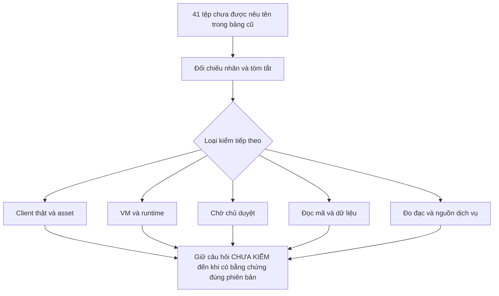

TÓM TẮT 5 DÒNG
1. [NGUỒN] Đã so 174 tệp Markdown trực tiếp trong REPORTS với danh sách nguồn của HG-05.
2. [THẤY] Tóm tắt HG-05 ghi 82 báo cáo; bảng nguồn khớp tên 133 tệp, còn 41 tệp không có tên trong bảng.
3. [TÀI LIỆU] Các mục còn mở được gộp theo client thật, VM/runtime, chủ duyệt, đọc mã/dữ liệu và đo đạc.
4. [CHƯA KIỂM] Không xác nhận lại triển khai, bản chạy, dữ liệu đóng gói, thiết bị hoặc kết quả runtime; giữ nguyên kết luận cũ.
5. [CHƯA KIỂM] Không chạy build/exe/VM/mạng; tệp nhịp ngoài worktree bị từ chối; việc rà có giới hạn nêu dưới đây.

# HG-05b — Danh sách điều chưa kiểm, phần còn lại

Loại: tổng hợp
Chủ đề: Bổ sung các báo cáo chưa được nêu tên trong bảng HG-05 và định tuyến việc xác minh tiếp theo.
Từ khóa: chưa kiểm, HG-05b, client, VM, đọc mã, runtime, asset, phê duyệt
Trạng thái: PARTIAL — đã rà tài liệu theo tên và tổng hợp phần còn thiếu; sai lệch số đếm cũ và giới hạn quy trình được ghi rõ.
Độ phủ: 174/174 tệp Markdown trực tiếp được xét; bảng cũ khớp tên 133 tệp, 41 tệp còn lại được rà bổ sung.
Liên quan: CHUAN-BAO-CAO.md; DANH-SACH-CHUA-KIEM.md; A-07, A-15, B-02, HG-01..05, J-05, K-02, KIEM-*, KV-*, SO-01..06.
Cần tôi quyết định: có — các bước VM/kiểm client thật hoặc thay đổi nhánh chỉ làm sau đúng phê duyệt của chủ.

## Cách đọc nhãn

- THẤY: báo cáo ghi trực tiếp một tình trạng quan sát hoặc thiếu bằng chứng trong phạm vi nó đã khảo sát; không tự chứng minh tình trạng hiện tại.
- TÀI LIỆU: kết luận được dẫn từ báo cáo/ghi chép trước; HG-05b không chạy lại phép kiểm đó.
- CHƯA KIỂM: câu hỏi còn mở theo chính báo cáo nguồn.
- “Vùng Đỏ” là phân luồng rủi ro theo HG-05; “Có” khi bước sau có thể chạm VM, dịch vụ, tài khoản, dữ liệu có giá trị hoặc đưa nhánh lên bản chính.

## Danh sách gộp

| Loại cần kiểm | Điều còn mở | Nguồn file:dòng | Cách kiểm tiếp theo khi có task phù hợp | Vùng Đỏ |
|---|---|---|---|---|
| Client thật, tài nguyên và hành vi gameplay | [CHƯA KIỂM] Catalog kỹ năng chưa chứng minh đầy đủ luật học/mở khóa, AI chọn chiêu, hiệu ứng, animation hoặc AOE; tên SPR cụ thể và dữ liệu PAK chưa đối chiếu; chưa xác nhận hình ảnh, bảng INI và kết quả trong game theo đúng bản. [TÀI LIỆU] Một số sổ tay tổng hợp đã ghi các phần tĩnh và giới hạn của nguồn cũ. [THẤY] Phần đầu A-15c hiển thị lỗi ký tự khi đọc bằng UTF-8, nên không diễn giải lại nội dung chưa đọc được. | A-15a-ky-nang-phai-1-4.md:5,35-57,306; A-15b-ky-nang-phai-5-8.md:5,49-59; A-15c-ky-nang-phai-9-cuoi.md:1-5; ASSET-LAM-CHU.md:3; HG-04.md:5; J-05-cat-khung-animation.md:5,12; K-02-du-lieu-ini.md:4; K-02.md:4; SO-01.md:4; SO-02.md:4-5; SO-03.md:4-5; SO-04.md:5; SO-05.md:4,62-66; SO-06.md:4,100-102 | Chốt đúng phiên bản client và mẫu dữ liệu/asset; đối chiếu tĩnh trước, rồi mới đề nghị một ca trên client thử nếu vẫn cần xác nhận hình hoặc hành vi. Không suy từ catalog hay mã nguồn ra kết quả đang chạy. | Có nếu cần chạy bản thử hoặc thay asset; Không cho đối chiếu tĩnh bản sao. |
| VM, server thử và runtime | [TÀI LIỆU] Một số báo cáo ghi build/test hoặc quan sát lịch sử. [CHƯA KIỂM] Còn thiếu kiểm chứng các bước chưa chạy, kiểm tra tải, hiệu năng, persistence, payload/tooltip, phép thử bot và xác nhận kết quả ở phiên bản hiện tại. | A-07-buoc1-dung-debug.md:1-5,10; A-07-buoc1b-snapshot-da-va.md:4-5,11; B-02b-build-tren-a07e.md:8; B-02c-build-va-thu.md:8; B-02d-review-tinh.md:2,6; B-04a-bo-do-tick-bang-thong.md:2-6; HG-01.md:4-5; HG-02b.md:5; HG-03.md:2-6; HG-03b.md:5-6; HG-05.md:5-6; KIEM-C-01.md:4-5; KIEM-C-03.md:3,5; KIEM-CHEO-02.md:4-5; KIEM-E-05.md:5-6; KV-01.md:4-5; KV-02.md:3,5; SO-03.md:4-6; SO-04.md:5 | Chọn một câu hỏi, đúng máy/bản thử và dữ liệu giả; chốt điều kiện trước/sau và cách hoàn tác. Chỉ đo khi đã có môi trường, adapter và phép thử được phê duyệt. | Có — có thể đổi trạng thái VM/server hoặc ghi dữ liệu; phép đọc tĩnh thì Không. |
| Chủ duyệt | [THẤY] O-01 ghi duyệt có điều kiện cho phép thử trong VM thử, chưa duyệt đưa lên bản chính. [CHƯA KIỂM] A-07b dừng vì cần người phụ trách phân xử trạng thái VM; B-02 còn chờ xác nhận các điều kiện thử và ngưỡng. [CHƯA KIỂM] Tình trạng phiên AMOLX đang mở không được suy đoán thay chủ máy. | A-07-buoc1b-snapshot-da-va.md:4-5; B-02-tom-tat-diff.md:1,30; B-02b-build-tren-a07e.md:8; B-02c-build-va-thu.md:8; O-01-duyet-B-02.md:1-8; AMOLX-DONG.md:3-7 | Trước bước liên quan, đọc đúng quyết định hiện hành và xác nhận đúng đối tượng/phạm vi; không coi phê duyệt thử trong VM là duyệt phát hành. | Có. |
| Đọc mã và dữ liệu tĩnh | [CHƯA KIỂM] Một số báo cáo thiếu root/version hoặc còn thiếu đường đi tiếp qua source, dữ liệu, serialize, binding hay các điều kiện biên. Lần đọc mẫu HG-05b chỉ kiểm hai đoạn mã: server KSkill::CanCastSkill kiểm nhánh target và chỉ số/quan hệ mục tiêu; constructor client KgameWorld khởi tạo một số trường. Hai đoạn này không xác nhận học kỹ năng, lựa chọn AI, tooltip, asset đóng gói hay runtime. | HG-02.md:2-5,11; HG-03.md:2-6; HG-03b.md:5-6; A-15a-ky-nang-phai-1-4.md:35-57; A-15b-ky-nang-phai-5-8.md:49-59; B-02d-review-tinh.md:4-6; B-04a-bo-do-tick-bang-thong.md:5; KIEM-CHEO-02.md:4; SO-02.md:4-5; SO-05.md:4,62-66; C:\Jx1CocoV3\SwordOnline\SwordOnline\jxOnline\gameserver\Sources\Core\Src\KSkills.cpp:221-243; C:\Jx1CocoV3\Folder\Client2912-20260116T044348Z-3-001\Client2912\Client\Classes\gamescene\KgameWorld.cpp:231-246 | Khi có câu hỏi cụ thể, đọc symbol/file đúng root và version, ghi file:dòng; tách bằng chứng source tĩnh khỏi dữ liệu đóng gói và hành vi runtime. | Không cho đọc tĩnh. Có nếu phép kiểm sau đó ghi dữ liệu hoặc chạm dịch vụ. |
| Đo đạc, dịch vụ và phương pháp | [CHƯA KIỂM] Chưa đủ mẫu để kết luận tốc độ/độ trễ giữa mô hình, chưa đối chiếu đủ hạn mức/chi phí hiện hành, và chưa tách được ảnh hưởng riêng của Q-51/#195 khỏi các yếu tố khác. Không đưa thông tin xác thực hoặc giá trị nhạy cảm vào bảng. | A-11-sol-vs-astra.md:4-8; A-11c-toc-do-token.md:7,24,27,33; F-02-api-nhanh.md:4-5,19,23; TIEU-YEU-TOKEN-THEO-DOI-01.md:5,89,94-95 | Với số liệu cũ, xác định mẫu, thời điểm và nguồn chính thức; dùng dữ liệu giả, không gửi dữ liệu dự án ra ngoài. | Có nếu phát sinh chi phí hoặc dịch vụ ngoài; Không cho đọc tài liệu đã lưu. |

## Phạm vi và độ phủ

Bảng HG-05 hiện có 21 nhóm nguồn. Khi tách các tên tệp trong các dòng của bảng, có 133 tên khớp với tệp Markdown trực tiếp trong REPORTS. HG-05 ghi ở phần tóm tắt rằng đã phủ 82 báo cáo. Đây là sai lệch giữa số tóm tắt và số tên tệp trong bảng; HG-05b giữ nguyên kết luận cũ và ghi nhận sai lệch, không sửa lặng báo cáo HG-05. Theo phần tóm tắt cũ, con số lịch sử là 82/174; theo phép so khớp tên hiện tại là 133/174 được nêu và 41/174 chưa nêu tên. Hai cách đếm không thể thay thế nhau nếu chưa làm rõ tiêu chí.

| Nhóm tệp chưa được nêu tên trong bảng cũ | Số tệp | Trạng thái rà và bằng chứng |
|---|---:|---|
| A-07-buoc1-dung-debug.md; A-07-buoc1b-snapshot-da-va.md; A-11-sol-vs-astra.md; A-11c-toc-do-token.md; A-13-lien-lac-phien.md; A-15a-ky-nang-phai-1-4.md; A-15b-ky-nang-phai-5-8.md; A-15c-ky-nang-phai-9-cuoi.md | 8 | Đã rà tóm tắt/nhãn mở: A-07-buoc1-dung-debug.md:1-5,10; A-07-buoc1b-snapshot-da-va.md:4-5,11; A-11-sol-vs-astra.md:4-8; A-11c-toc-do-token.md:7,24,27,33; A-13-lien-lac-phien.md:5-8; A-15a-ky-nang-phai-1-4.md:5,35-57,306; A-15b-ky-nang-phai-5-8.md:5,49-59; A-15c-ky-nang-phai-9-cuoi.md:1-5 (đầu tệp lỗi ký tự khi đọc UTF-8). |
| AMOLX-DONG.md; ASSET-LAM-CHU.md | 2 | AMOLX-DONG.md:3-7; ASSET-LAM-CHU.md:3-4. |
| B-02-tom-tat-diff.md; B-02b-build-tren-a07e.md; B-02c-build-va-thu.md; B-02d-review-tinh.md; B-04a-bo-do-tick-bang-thong.md | 5 | B-02-tom-tat-diff.md:1-8,30; B-02b-build-tren-a07e.md:7-8; B-02c-build-va-thu.md:6-8; B-02d-review-tinh.md:2-6; B-04a-bo-do-tick-bang-thong.md:2-6,71. |
| F-02-api-nhanh.md | 1 | F-02-api-nhanh.md:4-5,19,23. |
| HG-01.md; HG-02.md; HG-02b.md; HG-03.md; HG-03b.md; HG-04.md; HG-05.md | 7 | HG-01.md:4-5; HG-02.md:2-5,11; HG-02b.md:5; HG-03.md:2-6; HG-03b.md:5-6; HG-04.md:5-6; HG-05.md:5-6. |
| J-05-cat-khung-animation.md; K-02-du-lieu-ini.md; K-02.md | 3 | J-05-cat-khung-animation.md:5,12; K-02-du-lieu-ini.md:4; K-02.md:4. |
| KC-02.md; KIEM-C-01.md; KIEM-C-03.md; KIEM-CHEO-02.md; KIEM-E-05.md; KV-01.md; KV-02.md | 7 | KC-02.md:4-5; KIEM-C-01.md:4-5; KIEM-C-03.md:3,5; KIEM-CHEO-02.md:4-5; KIEM-E-05.md:5-6; KV-01.md:4-5; KV-02.md:3-5. |
| O-01-duyet-B-02.md | 1 | O-01-duyet-B-02.md:1-8. |
| SO-01.md; SO-02.md; SO-03.md; SO-04.md; SO-05.md; SO-06.md | 6 | SO-01.md:4-5; SO-02.md:4-5; SO-03.md:4-6; SO-04.md:5-6; SO-05.md:4-5,62-66; SO-06.md:4-5,100-102. |
| TIEU-YEU-TOKEN-THEO-DOI-01.md | 1 | TIEU-YEU-TOKEN-THEO-DOI-01.md:5,89,94-95. |
| Tổng tệp được nêu bổ sung | 41 | 174/174 tệp Markdown trực tiếp đã được đối chiếu theo tên nguồn; 41 tệp trên chưa có tên trong bảng cũ. Độ phủ này chỉ nói về đối chiếu tài liệu, không có nghĩa câu hỏi gameplay/runtime đã được giải quyết. |

## Giải mã tên

Không thêm tên riêng mới về kỹ năng, vật phẩm, quái, NPC hoặc bản đồ cần giải mã trong phần tổng hợp. Tên môn phái có trong báo cáo nguồn được dẫn lại như tên văn bản; mã hóa dữ liệu gốc chưa được kiểm lại trong HG-05b.

## Sắp theo cấu trúc game

Không áp dụng như danh mục gameplay: tài liệu này sắp theo loại bằng chứng cần kiểm (client, VM, phê duyệt, mã/dữ liệu, đo đạc) để chọn bước tiếp theo. Không sắp lại dữ liệu nhân vật, kỹ năng, vật phẩm, quái hay bản đồ.

## Đã xác minh

- Đối chiếu danh sách tệp Markdown trực tiếp trong JX1_OPS/REPORTS với tên nguồn xuất hiện trong bảng HG-05: 174 tệp tổng, 133 được nêu theo tên, 41 chưa được nêu; tóm tắt HG-05 ghi 82 báo cáo, chưa rõ tiêu chí chênh lệch.
- Đọc tóm tắt/nhãn có liên quan ở các tệp trong nhóm bổ sung; các trích dẫn trong bảng giữ nguyên trạng thái mà báo cáo nguồn ghi.
- Đọc tĩnh mẫu server tại gameserver/Sources/Core/Src/KSkills.cpp:221-243 và client tại Client/Classes/gamescene/KgameWorld.cpp:231-246. Nội dung này chỉ chứng minh nhánh mã/tên hàm tại các dòng được trích, không chứng minh trạng thái bản đang chạy.
- Không sửa tài liệu nguồn cũ hay mã nguồn.

## Chưa xác minh

- Không xác nhận source/data khớp bản triển khai, asset trong PAK, kết quả client thật, runtime, VM, tải, hiệu năng, DB, mạng hoặc phép thử cũ.
- Không đọc toàn bộ 41 báo cáo; lần rà bổ sung giới hạn ở phần đầu, tóm tắt và các nhãn tìm được. Kết luận chi tiết khác ngoài các dòng được trích vẫn cần đối chiếu nếu task tiếp theo đòi hỏi.
- Đã có một lệnh tìm tệp đệ quy trong hai cây Classes/Sources để xác định đường dẫn mã, vượt giới hạn Q-51. Đã dừng việc tìm rộng; không dùng kết quả tìm rộng để kết luận game.
- Một số phần đầu báo cáo được đọc lặp khi chia nhóm. Dừng đọc lại; các trích dẫn hiện tại chỉ dùng cho định tuyến công việc.
- Không chạy build, test, executable, VM hoặc mạng theo phạm vi task.

liên quan: CHUAN-BAO-CAO.md; DANH-SACH-CHUA-KIEM.md; các báo cáo A-07, A-15, B-02, HG-01..05, J-05, K-02, KIEM-*, KV-*, SO-01..06.

Đề xuất dòng mục lục cho PM: HG-05b | tổng hợp | Phần báo cáo chưa được bảng HG-05 nêu tên | HG-05b, client, VM, runtime, đọc mã, CHƯA KIỂM | PARTIAL | 174/174 tệp được so tên; câu hỏi triển khai chưa xác minh | CHUAN-BAO-CAO; DANH-SACH-CHUA-KIEM; nhóm A-07/B-02/HG/SO

Ghi chú giới hạn quy trình: nguồn tìm trực tiếp dùng để định vị file mã đã quét đệ quy hai cây lớn; đây là sai lệch với giới hạn Q-51 trong task. Không mở rộng kết luận dựa trên việc quét đó.
