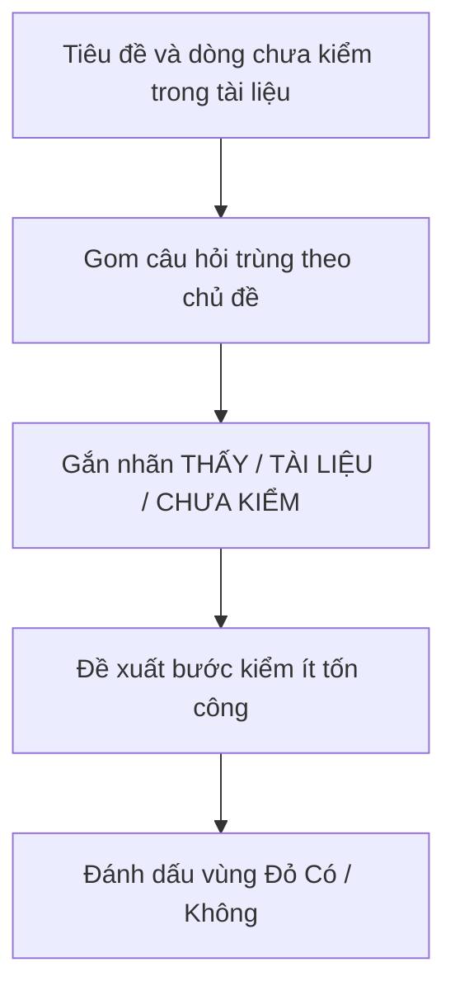

TÓM TẮT
1. [NGUỒN] Đã rà mục chưa kiểm trong các tệp Markdown trực tiếp thuộc REPORTS/ và DESIGN/; tìm được 85 tiêu đề trong 82 báo cáo và 3 tiêu đề trong 2 tài liệu thiết kế.
2. [NGUỒN] Các câu hỏi trùng nhau được gộp theo nhóm; mỗi nhóm vẫn dẫn tới dòng của tài liệu gốc.
3. [NGUỒN] Mỗi nhóm nêu cách kiểm ít tốn công nhất và đánh dấu vùng Đỏ theo tiêu chí ở dưới.
4. [CHƯA KIỂM] Đây là bảng tổng hợp tài liệu; HG-05 không kiểm lại game, bản chạy, dữ liệu thật hay các kết quả lịch sử.
5. [CHƯA KIỂM] Không chạy build, exe, VM, mạng hoặc phép thử; các bước dưới đây chỉ là gợi ý cho task được duyệt sau.

# HG-05 — Danh sách điều chưa kiểm

Loại: tổng hợp
Chủ đề: Gom các câu hỏi còn mở trong báo cáo và tài liệu thiết kế JX1, kèm bước kiểm an toàn ít tốn công.
Từ khóa: chưa kiểm, runtime, dữ liệu nạp, giao thức, hảo hữu, client, PAK, DB, kiểm thử
Trạng thái: PARTIAL — bảng tổng hợp hoàn tất; không ghi được tệp nhịp nằm ngoài quyền ghi của worktree.
Độ phủ: 85 tiêu đề mục trong 82 báo cáo và 3 tiêu đề trong 2 tài liệu thiết kế; thêm các dòng [CHƯA KIỂM] nổi bật ở mục khác.
Liên quan: JX1_OPS/DESIGN/CHUAN-BAO-CAO.md; JX1_OPS/REPORTS/; JX1_OPS/DESIGN/
Cần tôi quyết định: không

## Cách đọc nhãn

- **THẤY**: tài liệu ghi nhận trực tiếp một dấu hiệu hoặc thiếu tệp/dữ liệu trong phạm vi mà báo cáo đã khảo sát; chưa chứng minh trạng thái khi game chạy.
- **TÀI LIỆU**: thông tin được dẫn lại từ báo cáo, ghi chép hoặc kết quả cũ; HG-05 không làm lại phép kiểm đó.
- **CHƯA KIỂM**: chính tài liệu nói rằng câu hỏi vẫn cần được xác nhận.
- **Vùng Đỏ** được đánh dấu **Có** nếu nguồn nêu rõ cần chủ duyệt, hoặc bước kiểm có thể đụng tài khoản, thông tin xác thực, DB, dữ liệu có giá trị hay trạng thái máy chủ. Còn lại ghi **Không**. Đây là phân loại rủi ro để định tuyến bước sau, không phải xác nhận an toàn.

## Danh sách gộp

| Nguồn và dòng | Điều chưa kiểm | Cách kiểm rẻ nhất khi có task được duyệt | Vùng Đỏ |
|---|---|---|---|
| **A-01, A-03, A-04, A-05, A-06, A-07/a/b/c/d/e** — `A-01-ban-do-tien-trinh.md:73-74`; `A-03-kiem-ke-cau-hinh.md:156-163`; `A-04-kien-truc-tong.md:81-88`; `A-05-diem-tuong-tac-gs001.md:255-259`; `A-06-bang-goi-tin.md:866-870`; `A-07-goc-re-crash-gs001.md:64,209-213`; `A-07b-ep-con-tro.md:183-187`; `A-07c-link-gs001.md:127-130`; `A-07d-breakpoint.md:363-367`; `A-07e-rtc.md:170-174` | [CHƯA KIỂM] Cổng và tiến trình hiện tại; source có khớp bản chạy không; cấu hình/PAK thực được nạp; sức chịu tải, luồng gói, ABI/kích thước gói, lỗi và hành vi runtime. Bản ghi về crash hoặc cổng trong tài liệu là thông tin cũ, không phải phép xác nhận hiện tại. | Trước tiên xin đúng bản build và cấu hình đã lược thông tin nhạy cảm; so mã phiên bản/hash. Nếu còn cần hành vi, yêu cầu PM duyệt một ca trên bản thử cô lập với dữ liệu giả. | Có — nếu thử trên máy chủ đang giữ dữ liệu hoặc trạng thái thật; nếu chỉ so tài liệu thì Không. |
| **A-02** — `A-02-luong-dang-nhap.md:176-180` | [CHƯA KIỂM] Đăng nhập và cấu hình đang chạy; schema/độ bền DB nhân vật; lịch và khả năng khôi phục bản sao lưu; khả năng triển khai cờ tài khoản mới mà không ảnh hưởng tài khoản hiện có. | Dùng bản sao đã khử dữ liệu nhạy cảm để đối chiếu schema và quy trình sao lưu; chưa cần đăng nhập hay sửa DB thật. | Có — đụng dữ liệu tài khoản, DB hoặc khôi phục có thể làm đổi/mất dữ liệu. |
| **A-08a/b/c/d, A-09, A-10, A-16, A-17** — `A-08a-mon-phai-ky-nang.md:115-119`; `A-08b-dong-ban.md:64-68`; `A-08c-lua-trai-nuong-ca.md:98-104`; `A-08d-kinh-nghiem.md:92-99`; `A-09-dong-ban-nhieu-slot.md:152-158`; `A-10-lua-trai-boss.md:83-89`; `A-16-tong-kim.md:92-96`; `A-17-roi-do-boss-trang-bi.md:18-21,136` | [CHƯA KIỂM] Phái/kỹ năng thực dùng; hành vi hảo hữu, lửa trại, EXP và boss; giới hạn NPC, tải/AI; điều kiện Tống Kim; bảng rơi đồ, tỉ lệ và hiển thị trang bị. Còn thiếu đối chiếu bản nạp, dữ liệu đóng gói và phép thử gameplay. | Chọn một câu hỏi cụ thể, lấy bảng/tài nguyên và bản client/server cùng phiên bản, đối chiếu tĩnh trước. Chỉ dùng nhân vật thử trong máy thử nếu cần xác nhận hành vi. | Không — đọc đối chiếu tĩnh; Có nếu ca thử làm thay đổi dữ liệu/nhân vật thật. |
| **A-12, A-14** — `A-12-hao-huu-mac-do.md:43,85,102,127`; `A-14-hao-huu-trang-bi-thiet-ke.md:59,91,133,147,175-186` | [CHƯA KIỂM] Tên/vị trí ô đồ và ngoại hình; luật gắn vật phẩm; cân bằng chiến đấu; lưu bền mã món đồ, giao dịch và hoàn tác; giao thức, tài nguyên UI và khả năng client thể hiện trang bị cho hảo hữu. | Bắt đầu bằng sơ đồ luồng dữ liệu và schema đã làm sạch; xác nhận một món mẫu qua đường server→client trên bản thử, không dùng vật phẩm thật. | Có — có thể ảnh hưởng DB, vật phẩm và trạng thái nhân vật. |
| **B-02, B-03, C-01/02/03, C01-C03, D-01** — `B-02-loc-hien-thi.md:77-82`; `B-03-test-visibility.md:47`; `C-01-jxadm.md:57-64`; `C-02-co-is-bot.md:86`; `C-03-jxweb.md:53-56`; `C01-C03-TEST36.md:21-23`; `D-01-bang-hoat-dong.md:90-95` | [THẤY] Báo cáo ghi các chỗ còn thiếu như chưa có bộ thử/adapter hoặc chưa tới cổng thử. [CHƯA KIỂM] Hiển thị, bộ lọc, hành vi bot, schema/cấu hình hiệu lực, tải và luồng hoạt động theo lịch chưa được xác nhận trên bản chạy. | Kiểm lại hợp đồng và cấu hình mẫu bằng bản sao; với tính năng giao diện dùng ảnh/bản dựng đã xác định phiên bản. Không gửi lệnh ghi qua web hoặc thử bằng tài khoản thật. | Có — C-01/C-03 chạm dữ liệu đăng nhập, SQL hoặc hành động ghi; chỉ xem tài liệu thì Không. |
| **E-01, E-01b, E-02, E-03, E-05a/b, E-07, E-08, E-09a, E-10, E-11/12, E-13/13b** — `E-01-thieu-giao-thuc.md:164-167`; `E-03-dieu-phoi-dan-so.md:109-112`; `E-05a-khung-tester.md:146-149`; `E-05b-kich-ban-full-cycle.md:149`; `E-01b-thieu-giao-thuc.md:107-112,162-165`; `E-02-hanh-vi-bot.md:108-116,162-165`; `E-03-dieu-phoi-dan-so.md:109-112`; `E-05a-khung-tester.md:146-149`; `E-07-goi-tao-nhan-vat-logout.md:353-359,398`; `E-08-goi-danh-quai-xac-nhan-kill.md:427`; `E-09a-real-login-allowlist.md:136-140`; `E-11-hoi-mau-vat-pham-doi-ban-do.md:444-448`; `E-12-khao-sat-goi-tuong-tac.md:176,262-266`; `E-09a-real-login-allowlist.md:136-140`; `E-10-bot-tao-role-logout-offline.md:124-128`; `E-11-hoi-mau-vat-pham-doi-ban-do.md:444-448`; `E-12-khao-sat-goi-tuong-tac.md:176,262-266`; `E-13-dispatcher-p1.md:115-117,130-134`; `E-13b-watchdog.md:152-160,176-180` | [TÀI LIỆU] Các số test/pass cũ được báo cáo là lịch sử, chưa chạy lại trong các đợt chuẩn hóa. [CHƯA KIỂM] ABI và cấu trúc gói; hành vi Bot, hồi máu/kill credit, map và persistence; login thật; provider/dispatcher, lịch chạy và tiến trình con. | Tách kiểm tĩnh ABI/fixture khỏi kiểm runtime. Trước tiên xin phiên bản binary và bộ dữ liệu giả; chạy lại đúng một test offline/mock. Chỉ khi cần kết nối thật thì cần duyệt riêng và dùng môi trường thử. | Có — login/giao dịch/gói tin, provider hoặc tác vụ có thể tác động dịch vụ. |
| **F-01, G-01, JIBS** — `F-01-client-hao-huu-ui-ngoai-hinh.md:28,66`; `G-01-campfire-design.md:27,127-136,148-154`; `JIBS-danh-gia-bot.md:90` | [CHƯA KIỂM] Panel và ngoại hình hảo hữu; chu kỳ/tác dụng lửa trại; nguồn EXP, thời hạn và chống cộng dồn; tài nguyên hoặc tính năng bot có thật trong bản triển khai hay không. Các ca trong G-01 là kịch bản đề xuất, chưa phải kết quả. | Chốt một mẫu nhân vật và một vòng đời ngắn trên bản thử; kiểm asset/config trước, rồi mới đo một hành vi. | Không — nếu dùng fixture; Có nếu dùng người chơi, vật phẩm hoặc dịch vụ thật. |
| **H-01, H-02, H-03** — `H-01-ngu-hanh.md:267-268`; `H-02-magic-attrib.md:72,174,205,244-251`; `H-03-cuong-hoa.md:155,205` | [CHƯA KIỂM] Dữ liệu/ngôn ngữ/asset thực nạp; helper và biên số; tỉ lệ thật của phép ngẫu nhiên; giá trị đầu vào âm/tràn; bản nguồn có khớp client/server hay không. Các con số mô hình không phải tỉ lệ đo. | Đọc đúng một bảng dữ liệu và định nghĩa helper đang được gọi; làm phép thử biên bằng dữ liệu giả/offline trước khi đề nghị đo runtime. | Không — kiểm tĩnh/offline. |
| **H-04 đến H-15** — `H-04.md:134-138`; `H-04.md:134-138`; `H-04-hieu-ung-vu-khi.md:62-66`; `H-05-ui-cuong-hoa.md:134-140`; `H-06-he-thong-an.md:186-194`; `H-07-trang-suc-mat-na-phi-phong.md:175-183`; `H-08-tai-phu.md:179-187`; `H-09.md:76-83`; `H-10-phim-tat-thanh-nut.md:123-131`; `H-11-nut-he-thong-cai-dat.md:186-194`; `H-12-tu-dong-chien-dau.md:263-270`; `H-13-tick-do-tre-don.md:138-143`; `H-14-mat-khung-hieu-ung.md:165-173`; `H-15-dan-xuyen-quai-fps.md:109-115` | [CHƯA KIỂM] Nguồn/bản cài/PAK và cấu hình đang dùng; hiệu ứng, menu, phím tắt, nâng cấp, tự chiến đấu; sprite và frame; điều kiện NPC/shop; FPS, tick, độ trễ, va chạm và hành vi khi tải. | Xác định trước một thiết bị/bản cài và một triệu chứng cụ thể; đối chiếu asset/config liên quan, sau đó đo đúng một ca trên thiết bị thử. Không so ảnh giữa các bản chưa rõ phiên bản. | Không — kiểm asset/tài liệu; Có nếu thao tác nâng cấp hoặc dùng tài khoản/vật phẩm thật. |
| **I-01 đến I-08** — `I-01-cac-loai-diem.md:158-166,210`; `I-02-vat-pham-ban.md:180-186,203`; `I-03-khao-sat-quai-vat.md:203-210,266`; `I-04-khao-sat-map.md:184-190,238`; `I-05-npc-chuc-nang.md:92-98`; `I-06.md:78-83`; `I-06b.md:62-65`; `I-07-cac-loai-tien-te.md:138-148`; `I-08-he-thong-nhiem-vu.md:70-75` | [CHƯA KIỂM] Bảng EXP/điểm, vật phẩm và giá; map/spawn/quái/NPC; nhiệm vụ, tiền và phần thưởng. Thiếu xác nhận dữ liệu hiệu lực, đường nạp, các nhánh động, điều kiện và kết quả sau khi lưu. Số liệu đọc tĩnh không chứng minh số đang chạy. | Lấy một bản sao bảng đã xác định phiên bản; so schema và một ID/mẫu đại diện. Mọi phép thử tiền, giao dịch hoặc thưởng dùng dữ liệu thử, không ghi vào tài khoản thật. | Có — tiền, vật phẩm và lưu nhân vật có giá trị; đối chiếu tĩnh thì Không. |
| **J-01 đến J-04** — `J-01-animation-nhan-vat-tran.md:112-120`; `J-02-animation-quai-npc.md:84-89`; `J-03-hoat-anh-ky-nang.md:142-148`; `J-04-lop-chong-nhan-vat.md:103-110` | [CHƯA KIỂM] Số frame/hướng/tốc độ; sprite và hành động thực; fallback, thứ tự che khuất, layer và thời lượng hiệu ứng; khác biệt giữa dữ liệu source và asset trên client. Chưa có phép đo FPS/khung mới. | Chọn một sprite, một hành động và một hướng; đọc metadata cùng bản asset, rồi so với một ảnh/đoạn quay từ bản thử có ghi phiên bản. | Không. |
| **K-01, K-02, K-02d/g, K-03a/b/c/d/e** — `K-01-ban-do-truyen-tin-hieu.md:11`; `K-02-am-thanh.md:320,387`; `K-01-ban-do-truyen-tin-hieu.md:11`; `K-02-am-thanh.md:320,387`; `K-02-giao-dien.md:129-134`; `K-02-nhan-vat.md:98-104`; `K-02-ban-do.md:170-173`; `K-02-quai-npc.md:144-148`; `K-02-script-lua.md:272-276`; `K-02d.md:69`; `K-02g.md:89`; `K-02d.md:69`; `K-02g.md:89`; `K-03a.md:250-255`; `K-03b.md:177-183`; `K-03c.md:157`; `K-03d.md:274-280`; `K-03e.md:233-239` | [CHƯA KIỂM] Nội dung trong gói đóng; tên/ảnh/tài nguyên đúng bản; tên Hán–Việt và cặp dịch; âm thanh/bản nhạc có khớp bảng và bản game được nạp; kỹ năng/phái, NPC/map, hiệu lực cấu hình; âm thanh/bản nhạc được nạp; hành vi script và dữ liệu client/server. Tên hoặc bảng đối chiếu chưa tự xác nhận ngữ nghĩa. | Chỉ xin đúng một asset/bảng và nguồn gói có phiên bản; dùng công cụ đọc được duyệt để kiểm một mẫu. Chưa dịch tên chưa có căn cứ. | Không — kiểm dữ liệu/asset đã sao chép. |
| **L-01, L-02, L-03** — `L-01-lam-muot-hinh-anh.md:207-213`; `L-02.md:85-88`; `L-03-quy-trinh-dung-apk.md:57-60` | [CHƯA KIỂM] Cache/đồ họa và nhánh blend; bản dựng lại trên máy khác; APK/chứng chỉ/đường phát hành; FPS/RAM/ảnh thật. | So file và cấu hình của đúng phiên bản trước; kiểm quy trình dựng trên bản sao không phát hành, không cài đè lên thiết bị chính. | Có — phát hành/cài đặt gói lên thiết bị có thể đổi trạng thái; chỉ so tài liệu thì Không. |
| **M-01, M-02** — `M-01-kiem-tra-may-that.md:65-72,75`; `M-02.md:80-84` | [CHƯA KIỂM] Số liệu phần cứng/VM hiện tại; số đo worker, thời gian và độ chính xác đối chứng; việc triển khai/cài các công cụ đề xuất. | Đọc báo cáo máy đã khử thông tin; nếu cần đo thì dùng máy thử và đồng hồ đo sẵn có, ghi điều kiện đo. Không cài hoặc chạy công cụ theo tài liệu chỉ vì tài liệu có hướng dẫn. | Có — nếu thay đổi máy, VM, công cụ hoặc cấu hình; xem báo cáo thì Không. |
| **N-01 đến N-06** — `N-01.md:108-114`; `N-02.md:75,239,284-306`; `N-03.md:58,101,143,211-217,239`; `N-04.md:119-123`; `N-05.md:125-131`; `N-06.md:103,204-210,298-304` | [TÀI LIỆU] Một số thử cũ chỉ được dẫn lại, không chạy lại. [CHƯA KIỂM] Source và gói chạy/ABI; cấu hình, ngôn ngữ và UI; listener/kết nối; tạo vai, thao tác quản trị, lưu/khôi phục DB và tác động khi dừng/chạy lại; hiệu năng. | Xin bản thử, cấu hình đã bỏ thông tin xác thực và sơ đồ trạng thái trước/sau. Kiểm trước bằng bản sao; nếu cần thử dừng, khởi động, tạo vai hoặc ghi dữ liệu thì cần duyệt ca riêng và dữ liệu giả. | Có — tài liệu nêu DB, phiên người chơi, cổng/kết nối và thao tác máy chủ. |
| **P-02; R-01 đến R-07** — `P-02-bench.md:96-101`; `R-01.md:56-60`; `R-02.md:68-71`; `R-03.md:57-61`; `R-04.md:82,95-100`; `R-04a.md:84-89`; `R-04b.md:48-52`; `R-04c.md:89-93`; `R-05a.md:76-80`; `R-05b.md:59-64`; `R-05c.md:46-50`; `R-05d.md:55-59`; `R-06a.md:58-62`; `R-06b.md:73-77`; `R-06c.md:58-62`; `R-07a.md:66-70`; `R-07b.md:62-67` | [TÀI LIỆU] Kết quả kiểm thử/đo cũ chưa được tái hiện. [CHƯA KIỂM] Đo tick/FPS/mạng; xác nhận source, binary, dữ liệu và PAK; phép thử runtime; kết quả render sơ đồ; một số mục còn phụ thuộc báo cáo/root khác. Commit/push lịch sử không phải nội dung game cần kiểm trong bảng này. | Với đo hiệu năng, chốt một máy và một kịch bản nhỏ; với kết luận từ báo cáo trước, mở đúng báo cáo được dẫn và chỉ xác minh một điểm then chốt. Không chạy lại toàn bộ suite nếu chưa có mục tiêu cụ thể. | Không — việc đọc báo cáo; Có nếu cần máy chủ/mạng hay ghi dữ liệu thật. |
| **S-01, T-02, T-03, T-04** — `S-01.md:73`; `T-02.md:105-114`; `T-03.md:206-220`; `T-04.md:164-179` | [CHƯA KIỂM] Kết quả thử/bản chạy, thao tác và hiệu ứng nâng cấp, bản dựng/locale; các ca, dữ liệu mẫu và quyền thử chưa đủ để xác nhận hành vi. | Hỏi PM xác nhận đúng bản dữ liệu và một ca thử; dùng mẫu được cấp, ghi trước/sau và dừng nếu cần dùng vật phẩm có giá trị. | Có — nếu thao tác thay tiền, vật phẩm hoặc trang bị; nếu chỉ đối chiếu bảng thì Không. |
| **U-01, U-02, U-03, W-01a/b/c/d, X-01/02/03/04** — `U-01.md:18-22`; `U-02.md:103-107`; `U-03.md:90-96`; `W-01a.md:111-116`; `W-01b.md:59,126-140`; `W-01c.md:135-140`; `W-01d.md:133-140`; `X-01.md:105-109`; `X-02.md:138-143`; `X-03.md:161-165`; `X-04.md:73-77` | [THẤY] Có báo cáo ghi không tìm thấy bảng/tài nguyên cần cho một số đối chiếu trong root đã khảo sát. [CHƯA KIỂM] Action, hướng, frame, sort, asset, hiệu ứng, cache, FPS và quan hệ giữa source với APK/bản chạy vẫn chưa chốt. | Xin đúng bảng hoặc asset bị thiếu cùng phiên bản client; với hiện tượng hình, chỉ cần một item/hướng/frame mẫu và ảnh/chụp từ bản thử. Không suy nguyên nhân chỉ từ tên hàm hay metadata. | Không — nếu chỉ kiểm asset; Có nếu cài hoặc thay APK đang dùng. |
| **SO-SANH-NHA-CUNG-CAP, TIEU-YEU-429-VA-TOKEN** — `SO-SANH-NHA-CUNG-CAP.md:31-34`; `TIEU-YEU-429-VA-TOKEN.md:76-79` | [CHƯA KIỂM] Khả năng/hạn mức gói dịch vụ, độ ổn định và nguyên nhân lỗi; mức dùng thực tế của các tác vụ chưa có số liệu đầy đủ. | Chủ dự án xem hạn mức trong bảng điều khiển chính thức của dự án thử; đối chứng bằng yêu cầu không nhạy cảm, không gửi tài liệu dự án. | Có — nếu định dùng khóa/dữ liệu bên ngoài hoặc phát sinh chi phí; không thử cho tới khi chủ duyệt. |
| **Thiết kế hoạt động, quy tắc vẽ và tác động máy chủ** — `NUT-EXE-TAC-DONG.md:162-168`; `THU-NHA-CUNG-CAP.md:34-45,64-67`; `BANG-KY-NANG-THEO-PHAI.md:1297`; `BANG-THU-TU-VE.md:24-25,43,111,167,209`; `HIEU-GAME-CHO-NGUOI-KHONG-LAP-TRINH.md:8,14,22,30,38,46,54,62`; `HIEU-HIEU-UNG-VU-KHI.md:9,68`; `HUONG-DAN-EXE-SERVER.md:4,25-34`; `KE-HOACH-TAI-HIEN-HIEU-UNG.md:9,49`; `QUY-LUAT-VE-BO-PHAN.md:39`; `TRUYEN-TAI-VA-EXE-SERVER.md:11` | [TÀI LIỆU] Tài liệu thiết kế giữ các giả thuyết và thiếu hụt làm chỗ chờ, không phải kết quả trong bản triển khai. [CHƯA KIỂM] Vai trò/phái/kỹ năng; giới hạn và giá trị được nạp; hiệu ứng, thứ tự vẽ, asset và hành vi client; tác động tắt máy chủ. | Dùng ma trận câu hỏi nhỏ: một mục dữ liệu, một nhân vật, một hành động. Trước runtime, xác định đúng bản và nhờ người phụ trách cung cấp bản thử cùng quy trình hoàn tác. | Có — nguồn nêu rõ thao tác máy chủ cần duyệt; thử dịch vụ ngoài hoặc trạng thái máy chủ cần chủ duyệt riêng. |
| **THU-NHA-CUNG-CAP — hạn mức và dữ liệu gửi ra** — `THU-NHA-CUNG-CAP.md:34-45,64-67` | [THẤY] Tài liệu tự đánh dấu các giới hạn/chạy thử là chưa kiểm và nêu rõ rủi ro dữ liệu. [CHƯA KIỂM] Hạn mức hiện hành, khả năng chạy bộ công cụ và mức phù hợp của nhà cung cấp. | Không cần thử bằng dữ liệu dự án; chủ xem bảng hạn mức chính thức và chỉ dùng nội dung giả nếu đã duyệt nhà cung cấp. | Có — tài liệu đánh dấu vùng Đỏ và liên quan dữ liệu/khóa. |

## Phạm vi và độ phủ

| Phần tử phạm vi | Trạng thái | Bằng chứng |
|---|---|---|
| Tệp Markdown trực tiếp trong `JX1_OPS/REPORTS/` | Đã tìm tiêu đề mục chưa kiểm và các dòng nhãn tường minh; 85 tiêu đề trong 82 báo cáo. | Kết quả tìm kiếm giới hạn trong `JX1_OPS/REPORTS/*.md`; các nhóm nguồn ở bảng trên. |
| Tệp Markdown trực tiếp trong `JX1_OPS/DESIGN/` | Đã tìm 3 tiêu đề trong 2 tài liệu và các nhãn chưa kiểm ở tài liệu thiết kế hiểu game/quy luật vẽ. | `NUT-EXE-TAC-DONG.md:162`; `THU-NHA-CUNG-CAP.md:34,64`; các tài liệu thiết kế được dẫn ở nhóm cuối. |
| Xác nhận lại source, máy chạy, VM, exe, DB, thiết bị, mạng hoặc kết quả test | Chưa làm, đúng phạm vi chỉ đọc của HG-05. | Không có kiểm chứng mới trong nhiệm vụ này. |

## Giải mã tên

Không có tên riêng cụ thể của kỹ năng, trang bị, quái, NPC hoặc bản đồ được nêu trong phần tổng hợp; các mã báo cáo và ID được giữ nguyên như trong nguồn. Vì vậy không có mục tên game cần chuyển mã hoặc giải nghĩa.

## Sắp theo cấu trúc game

Không áp dụng cho bảng này: mỗi dòng ghi nhóm câu hỏi cần kiểm, không phải danh mục dữ liệu game. Nội dung được gom theo chủ đề (server, giao thức, hệ thống game, client/asset, vận hành) để tiện chọn việc tiếp theo.

## Đã xác minh

- Đã tìm kiếm các tiêu đề và dòng có nhãn trong hai thư mục được task nêu; kết quả được giới hạn ở mục/dòng liên quan, không sửa các nguồn.
- Các dòng dẫn trong bảng là vị trí ghi nhận tại tài liệu nguồn, không phải kiểm chứng lại khẳng định bên trong tài liệu.
- `rg` không có trong môi trường; đã dùng `Select-String` theo đúng thư mục và mẫu cụ thể, không cài công cụ.

## Chưa xác minh

- Chưa kiểm bất kỳ game, source code, VM, exe, DB, thiết bị hoặc mạng nào; chưa làm các phép đo/ca test được đề xuất trong báo cáo nguồn.
- Chưa chứng minh các nguồn cũ là phiên bản đang chạy; chưa phân xử các khác biệt giữa báo cáo khi chúng phụ thuộc root, bản dựng hoặc thời điểm khác nhau.
- Một số mục trong báo cáo dùng tiêu đề chung “Đã xác minh / Chưa xác minh”; chỉ đưa vào bảng khi dòng chưa kiểm có thể định vị bằng số dòng. Các nhãn trạng thái phản ánh tài liệu nguồn, không phải kết luận mới của HG-05.

liên quan: `CHUAN-BAO-CAO.md`, `HIEU-GAME-CHO-NGUOI-KHONG-LAP-TRINH.md`, `THE-GIOI-TONG-QUAN.md`, các báo cáo A–X trong `JX1_OPS/REPORTS/`.
