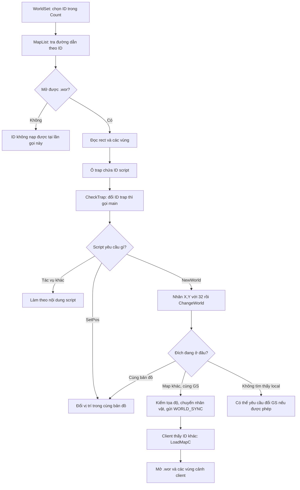

TÓM TẮT 1/5: [NGUỒN] [THẤY] WorldSet chọn ID cho máy chủ game; danh mục MapList dẫn tới .wor, rồi mới nạp các vùng. Nguồn: S/Core/Src/KCore.cpp:654–656; S/Core/Src/KSubWorldSet.cpp:448–464; S/Core/Src/KSubWorld.cpp:913–955.
TÓM TẮT 2/5: [NGUỒN] [THẤY] Trap là ô gọi script; cổng có thể chỉ đổi chỗ trong cùng bản đồ hoặc yêu cầu sang bản đồ khác. Nguồn: S/Core/Src/KNpc.cpp:15309–15325, :14934–14957; [TÀI LIỆU] R/E-11-hoi-mau-vat-pham-doi-ban-do.md:263–274.
TÓM TẮT 3/5: [NGUỒN] [THẤY] SetPos/NewWorld phía server nhân tọa độ Lua với 32; client đổi cảnh khi WORLD_SYNC mang ID khác. Nguồn: S/Core/Src/ScriptFuns.cpp:5198–5205, :6740–6746; C/gamecore/KProtocolProcess.cpp:3223–3227.
TÓM TẮT 4/5: [NGUỒN] [TÀI LIỆU] 28 ID trong Count=800 chưa thấy .wor là kết quả kiểm kê K-02, chưa phải 28 lỗi đã tái hiện; giữ nguyên kết luận HG-09. Nguồn: R/K-02-ban-do.md:41–47, :173; D/HIEU-NAP-VA-CHUYEN-BAN-DO.md:99–115.
TÓM TẮT 5/5: [CHƯA KIỂM] Không build, chạy game/exe, VM, mạng hoặc test trong game; chưa xác nhận bộ tài nguyên, binary hay cổng thực chạy. Giới hạn: JX1_OPS/TASKS/HG-15.md:28–31; R/K-02-ban-do.md:173.

# HG-15 — Hiểu bản đồ, cổng dịch chuyển và trap

Loại: tổng hợp
Chủ đề: Bản đồ được chọn, nạp và nối với nhau qua ô trap, script và cảnh client như thế nào.
Từ khóa: bản đồ, MapList, WorldSet, cổng làng, trap, tọa độ, SetPos, NewWorld, .wor, WORLD_SYNC
Trạng thái: DONE — đủ bảy nhóm giải thích tĩnh; các kiểm chứng dữ liệu và hành vi khi chạy được tách ở mục Chưa kiểm.
Độ phủ: 7/7 nhóm trong bảng phạm vi; 4/4 ví dụ cổng được dẫn lại từ E-11; 0/28 ID được tái kiểm asset hoặc thử trong game trong HG-15.
Liên quan: JX1_OPS/DESIGN/HIEU-NAP-VA-CHUYEN-BAN-DO.md; JX1_OPS/REPORTS/K-02-ban-do.md; JX1_OPS/REPORTS/I-04-khao-sat-map.md; JX1_OPS/REPORTS/E-11-hoi-mau-vat-pham-doi-ban-do.md; JX1_OPS/REPORTS/HG-15.md
Cần tôi quyết định: không — phần đọc tĩnh đã đủ; mọi thử nghiệm chạy game cần nhiệm vụ riêng.

## Cách đọc và nguồn

- **[THẤY] — ĐÃ XÁC MINH ở mức đọc tĩnh:** đã mở đoạn mã hiện tại và đối chiếu dòng. Không chứng minh chương trình đang chạy dùng đúng mã này.
- **[TÀI LIỆU]:** đã đọc báo cáo được dẫn; dữ liệu gốc của báo cáo đó chưa được tái kiểm trong HG-15.
- **[CHƯA KIỂM] — CHƯA XÁC MINH:** bằng chứng còn thiếu hoặc nằm ngoài quyền task. Dẫn nguồn chỉ vị trí cần nối tiếp.

| Tiền tố dẫn nguồn | Gốc đường dẫn |
|---|---|
| `S/` | `C:/Jx1CocoV3/SwordOnline/SwordOnline/jxOnline/gameserver/Sources/` |
| `C/` | `C:/Jx1CocoV3/Folder/Client2912-20260116T044348Z-3-001/Client2912/Client/Classes/` |
| `R/` | `JX1_OPS/REPORTS/` trong worktree HG-15 |
| `D/` | `JX1_OPS/DESIGN/` trong worktree HG-15 |

**[TÀI LIỆU]** Hai root source theo task; root dữ liệu và source lịch sử trong K-02 khác root đang đọc. Chỉ dùng số liệu K-02 với nhãn gián tiếp, không đổi thành kết quả của phiên bản hiện tại. Nguồn: `JX1_OPS/TASKS/HG-15.md:24`; `R/K-02-ban-do.md:31–37`.

## Sơ đồ chính

**[THẤY]** Luồng nạp map, gọi script và đổi cảnh dưới đây được ghép từ mã hiện tại; các mũi tên thể hiện đường xử lý, chưa phải phiên chạy thành công. Nguồn: `S/Core/Src/KSubWorldSet.cpp:458–464`; `S/Core/Src/KSubWorld.cpp:915–929`; `S/Core/Src/KRegion.cpp:608–617`; `S/Core/Src/KNpc.cpp:14934–14957, :15309–15325`; `C/gamecore/KProtocolProcess.cpp:3223–3227`.

## Phạm vi và độ phủ

| Nhóm trong mục tiêu | Độ phủ HG-15 | Nhãn, bằng chứng và giới hạn |
|---|---|---|
| 1. MapList và WorldSet | Đã phủ cơ chế | [THẤY] `S/Core/Src/KCore.cpp:609–610, :654–656`; `S/Core/Src/KSubWorldSet.cpp:448–464`. Tên tệp MapList server theo [TÀI LIỆU] `R/I-04-khao-sat-map.md:78`. |
| 2. .wor và vùng server | Đã phủ đường nạp, nhánh lỗi | [THẤY] `S/Core/Src/KSubWorld.cpp:913–1056`; `S/Core/Src/KRegion.cpp:157–290`. Chưa kiểm từng asset. |
| 3. Trap và script | Đã phủ cách nạp ô, kích hoạt main | [THẤY] `S/Core/Src/KRegion.cpp:592–622`; `S/Core/Src/KNpc.cpp:15298–15325`; `S/Core/Src/KPlayer.cpp:8089–8100`. Chưa nối từng ô với từng Lua. |
| 4. Cổng làng và đổi bản đồ | Đã phủ ba nhánh chuyển; ví dụ cổng là nguồn gián tiếp | [THẤY] `S/Core/Src/KNpc.cpp:14932–15045`; [TÀI LIỆU] 4 script ở `R/E-11-hoi-mau-vat-pham-doi-ban-do.md:263–274`. |
| 5. Tọa độ | Đã phủ ID, vùng, ô và phép đổi Lua → MPS | [THẤY] `S/Core/Src/KSubWorld.cpp:385–439`; `S/Core/Src/ScriptFuns.cpp:5198–5205, :6740–6746`. Chưa đo tọa độ hiển thị trong game. |
| 6. Client nhận ID và đổi cảnh | Đã phủ nhận đồng bộ, mở .wor, đọc vùng cảnh | [THẤY] `C/gamecore/KProtocolProcess.cpp:3214–3227`; `C/gamecore/KSubWorld.cpp:736–818`; `C/gamescene/KScenePlaceRegionC.cpp:84–194`. |
| 7. 28 bản đồ thiếu .wor | Đã giải thích mẫu số và ảnh hưởng có điều kiện; chưa tái lập 28 ID | [TÀI LIỆU] `R/K-02-ban-do.md:41–47, :173`; [THẤY] nhánh lỗi `S/Core/Src/KSubWorld.cpp:925–929`. |

## Giải mã tên

**[TÀI LIỆU]** Địa danh duy nhất dùng làm ví dụ là Ba Lăng, theo đường dẫn trong E-11 và cách gọi của HG-09. Khóa `balang` là ASCII; không dùng nó để khẳng định đã giải mã tên hiển thị TCVN3 hoặc tên Hán GBK. Nguồn: `R/E-11-hoi-mau-vat-pham-doi-ban-do.md:263–274`; `D/HIEU-NAP-VA-CHUYEN-BAN-DO.md:63–69`.

| Tên gốc giữ nguyên | Mã hóa | Chữ đúng UTF-8 hoặc giới hạn | Nguồn file:dòng |
|---|---|---|---|
| `balang` trong `script/trap/thon/balang/` | ASCII của đường dẫn; byte tên Việt TCVN3 và tên Hán GBK chưa đọc | Ba Lăng, tên diễn giải kế thừa; chưa giải mã độc lập tên hiển thị, chưa xác nhận tên Hán | `R/E-11-hoi-mau-vat-pham-doi-ban-do.md:263`; `D/HIEU-NAP-VA-CHUYEN-BAN-DO.md:63–69` |
| `cong10h.lua`, `cong2h.lua`, `cong4h.lua`, `cong8h.lua` | ASCII | Khóa tệp ví dụ bốn cổng; chưa xác nhận nhãn cổng hiển thị trong game | `R/E-11-hoi-mau-vat-pham-doi-ban-do.md:267–270` |

## Sắp theo cấu trúc game

**[THẤY]** Tài liệu đi theo **GS → ID bản đồ → vùng → ô trap → script → đích → cảnh client**. GS là một tiến trình máy chủ game. Ví dụ cổng được nhóm theo làng, không xếp theo thứ tự file source. HG-15 không phải catalog toàn bộ địa danh hay đồ thị mọi cổng. Nguồn: `S/Core/Src/KSubWorldSet.cpp:458–464`; `S/Core/Src/KRegion.cpp:608–617`; `S/Core/Src/KNpc.cpp:15309–15325`; `C/gamecore/KSubWorld.cpp:752–761`.

## 1. Một bản đồ được nạp như thế nào?

**[THẤY]** Có hai việc khác nhau: chọn ID để nạp và tìm tài nguyên cho ID đó. Server ghép `maps/WorldSet_<tham số>.ini`, đọc `[Init] Count`, rồi lần lượt lấy `World00` đến mục thứ `Count−1` trong `[World]`. Mỗi ID được đưa vào `LoadMapS`. Vị trí `i` trong mảng là chỗ chứa nội bộ, không phải ID dùng trong script. Nguồn: `S/Core/Src/KCore.cpp:654–656`; `S/Core/Src/KSubWorldSet.cpp:419–426, :448–464`.

**[TÀI LIỆU]** MapList có thể hiểu là sổ địa chỉ, WorldSet là danh sách giao cho GS. I-04 ghi danh mục gốc 993 ID và WorldSet được khảo sát có 872 khóa nhưng chỉ chọn 800 mục đầu. Định nghĩa `MAP_DROPRATE_FILE` trỏ `Settings/mapList.ini` cũng lấy từ I-04; header định nghĩa macro không được mở ngoài hai root của task. Nguồn: `R/I-04-khao-sat-map.md:68–80`. **[THẤY]** Mã hiện tại nạp đối tượng `g_NpcMapDropRate` qua macro và lấy `[List] <ID>` từ đối tượng đó. Nguồn: `S/Core/Src/KCore.cpp:609–610`; `S/Core/Src/KSubWorld.cpp:913–921`.

**[THẤY]** `.wor` là khung bản đồ: loader ghép đường dẫn, mở tệp và đọc `[MAIN] rect`. Chiều rộng vùng = phải − trái + 1; chiều cao = dưới − trên + 1, tính cả hai biên. Không mở được `.wor` thì đặt ID ô chứa về `-1` và trả `-1`; khung không hợp lệ hoặc nhánh cấp phát vùng thất bại trả `-2`. Nguồn: `S/Core/Src/KSubWorld.cpp:919–988`.

**[THẤY]** Tiếp đó server nối các vùng kề và đọc dữ liệu từng vùng. Tên có dạng `v_<Y ba chữ số>/<X ba chữ số>_region_s.dat`; phần trong tệp gộp gồm va chạm, trap, NPC và vật thể. Nếu không mở được tệp gộp thì có nhánh thử phần rời, gồm `OBSTACLE.DAT`, `Trap.dat`, `Npc_S.dat`. Có `.wor` mới qua được cửa kiểm tra khung, chưa bảo đảm đủ nội dung. Nguồn: `S/Core/Src/KSubWorld.cpp:996–1049`; `S/Core/Src/KRegion.cpp:157–290`; `S/Core/Src/Scene/SceneDataDef.h:12–13, :26–47`.

**[THẤY]** “Map OK” trong loader dựa trên kết quả `LoadMapS >= 0`. Vòng nạp map bắt ngoại lệ khi đọc từng vùng rồi tiếp tục; chỗ gọi `LoadServerTrap` không kiểm kết quả trả về. `LoadSerMaps` vẫn trả `TRUE` ở cuối sau khi đếm thành/bại. Vì vậy không lấy một dòng “Map OK” hoặc `TRUE` làm chứng nhận mọi cổng đã đủ dữ liệu. Nguồn: `S/Core/Src/KSubWorldSet.cpp:483–500`; `S/Core/Src/KSubWorld.cpp:1033–1056`; `S/Core/Src/KRegion.cpp:193–206`.

## 2. Tọa độ: ID bản đồ, vùng và ô là ba việc khác nhau

| Cấp tọa độ/định danh | Ý nghĩa dễ hiểu | Nhãn và nguồn |
|---|---|---|
| ID bản đồ | Mã để tra danh mục, tìm bản đồ đích; khác số thứ tự ô chứa nội bộ | [THẤY] `S/Core/Src/KSubWorldSet.cpp:419–426, :460–464` |
| Tọa độ vùng | Chia bản đồ thành các mảnh lớn; tên thư mục dùng Y trước, tên tệp dùng X sau | [THẤY] `S/Core/Src/KRegion.cpp:159–161` |
| Ô trong vùng | Một vùng có 16 ô ngang × 32 ô dọc; trap được tra theo ô của nhân vật | [THẤY] `S/Core/Src/KRegion.h:22–23`; `S/Core/Src/KNpc.cpp:15309` |
| MPS | Tọa độ thế giới dùng trong xử lý vị trí; mã tách vùng bằng X dịch phải 9, Y dịch phải 10, tức 512 × 1.024 đơn vị cho tọa độ không âm | [THẤY] `S/Core/Src/KSubWorld.cpp:395–419` |
| Ô và phần lẻ | Sau khi trừ góc vùng, chia cho 32 để lấy ô; phần dư lưu với hệ số nhị phân `<<10` | [THẤY] `S/Core/Src/KSubWorld.cpp:433–439`; chiều ngược `:385–388` |
| Đối số Lua | `SetPos(x,y)` và `NewWorld(id,x,y,...)` phía server đều nhân X,Y với 32 trước lời gọi C++ | [THẤY] `S/Core/Src/ScriptFuns.cpp:5185–5205, :6738–6746` |
| Điểm trên bảng bản đồ | Chưa phải tọa độ world để chép thẳng vào NewWorld | [TÀI LIỆU] `R/I-04-khao-sat-map.md:150` |

**[THẤY]** Với ví dụ cổng ở mục 4, `SetPos(1539,3112)` tương ứng lời gọi server `SetPos(49248,99584)` sau nhân 32. Đây chỉ là phép tính từ ví dụ tài liệu và mã, không phải vị trí đo trong game; không nhân thêm 32 lần nữa khi đã dùng MPS. Nguồn phép đổi: `S/Core/Src/ScriptFuns.cpp:5198–5205`; đối số ví dụ [TÀI LIỆU]: `R/E-11-hoi-mau-vat-pham-doi-ban-do.md:267, :274`.

## 3. Trap là gì, vì sao chưa thể gọi mọi trap là cổng?

**[THẤY]** Bản ghi trap giữ ô bắt đầu `cX,cY`, số ô liên tiếp theo ngang `cNumCell` và ID `uTrapId`. Loader kiểm kích thước phần dữ liệu, kiểm biên rồi gán cùng ID cho các ô đó. `GetTrap` trả 0 khi ngoài biên. Dữ liệu này chỉ cho biết ô nào mang ID nào, chưa cho biết script sẽ dịch chuyển, đổi trạng thái hay làm việc khác. Nguồn: `S/Core/Src/Scene/SceneDataDef.h:265–278`; `S/Core/Src/KRegion.cpp:592–622, :1543–1552`.

**[THẤY]** `CheckTrap` chỉ nhận đối tượng người chơi có chỉ số và vùng hợp lệ. Hàm lấy trap ở ô hiện tại, so với ID ghi nhớ `m_TrapScriptID`: trùng thì dừng; khác thì lưu ID mới; ID 0 thì dừng; ID khác 0 gọi `ExecuteScriptD(ID,"main",...)`. Bước rời sang ô không trap có thể đặt ID nhớ về 0 khi được kiểm tra; cùng một ID trap không được chính hàm này gọi lại liên tục nếu giá trị nhớ vẫn giữ nguyên. Nguồn: `S/Core/Src/KNpc.cpp:15298–15325`.

**[THẤY]** `ExecuteScriptD` tìm đối tượng script bằng `g_GetScript(ID)`; không tìm thấy thì trả `FALSE`. Mã thiết lập thông tin người chơi, bản đồ hiện tại rồi gọi hàm được yêu cầu. **[CHƯA KIỂM]** Chưa đối chiếu byte trap trong asset với đường dẫn Lua cụ thể; không suy một tên tệp từ số ID. Nguồn: `S/Core/Src/KPlayer.cpp:8089–8128`; giới hạn dữ liệu: `R/K-02-ban-do.md:173`.

**[THẤY]** Một điểm gọi đã thấy là khi server nhận lệnh chạy: `NpcRunCommand` kiểm trap ở vị trí hiện tại trước khi đưa lệnh chạy mới vào xử lý. **[CHƯA KIỂM]** Chưa lần mọi điểm gọi hoặc đo nhịp chạy; không khẳng định mọi bước đi bộ qua cổng đều kích hoạt đúng lúc ở chương trình thực tế. Nguồn: `S/Core/Src/KProtocolProcess.cpp:5452–5481`; giới hạn tương ứng của E-11: `R/E-11-hoi-mau-vat-pham-doi-ban-do.md:249–261`.

## 4. Cổng làng: ví dụ có đổi chỗ nhưng vẫn cùng bản đồ

**[TÀI LIỆU]** E-11 đã đọc bốn script dưới `script/trap/thon/balang/`. Bảng dưới giữ nguyên đối số và điều kiện mà E-11 ghi; HG-15 không mở lại Lua dữ liệu ngoài hai root source được giao. Các cổng được nhóm trong cùng làng Ba Lăng. Nguồn: `R/E-11-hoi-mau-vat-pham-doi-ban-do.md:263–274`.

| Khóa script | Ra cổng khi FightState=0 | Vào cổng khi FightState khác 0 | Nguồn tài liệu |
|---|---|---|---|
| `cong10h.lua` | `SetPos(1539,3112)`, `SetFightState(1)` | `SetPos(1542,3116)`, `SetFightState(0)` | `R/E-11-hoi-mau-vat-pham-doi-ban-do.md:267` |
| `cong2h.lua` | `SetPos(1631,3096)`, `SetFightState(1)` | `SetPos(1628,3100)`, `SetFightState(0)` | `R/E-11-hoi-mau-vat-pham-doi-ban-do.md:268` |
| `cong4h.lua` | `SetPos(1654,3242)`, `SetFightState(1)` | `SetPos(1652,3237)`, `SetFightState(0)` | `R/E-11-hoi-mau-vat-pham-doi-ban-do.md:269` |
| `cong8h.lua` | `SetPos(1562,3256)`, `SetFightState(1)` | `SetPos(1564,3251)`, `SetFightState(0)` | `R/E-11-hoi-mau-vat-pham-doi-ban-do.md:270` |

**[TÀI LIỆU]** Cả bốn có nhánh `SVScheck(1)==1` chỉ `SetPos` rồi thoát; không có `NewWorld` trong bốn script đã khảo sát. Đổi trạng thái chiến đấu không tự chứng minh đổi map. Nguồn: `R/E-11-hoi-mau-vat-pham-doi-ban-do.md:272–274`. **[THẤY]** `KNpc::SetPos` dùng bản đồ hiện tại để tìm vùng và cập nhật vị trí; đoạn đã đọc gửi đồng bộ vị trí `s2c_npcsetpos`. Nguồn: `S/Core/Src/KNpc.cpp:14826–14845, :14872–14900`.

## 5. Khi script thật sự yêu cầu sang bản đồ khác

**[THẤY]** Tên Lua `NewWorld` được đăng ký tới `LuaEnterNewWorld`. Hàm nhận ID map đích, X, Y; nhân hai tọa độ với 32 và gọi `ChangeWorld`. Đối số thứ tư cho phép đổi GS, mặc định true. Nguồn: `S/Core/Src/ScriptFuns.cpp:6728–6749, :25922`.

| Tình huống của người chơi | Xử lý thấy trong mã | Giới hạn kết luận |
|---|---|---|
| Đích cùng bản đồ đang đứng | [THẤY] Trả kết quả `SetPos(nX,nY)`; `S/Core/Src/KNpc.cpp:14951–14954` | Đổi chỗ; không đi qua nhánh đổi map phía dưới. |
| Map đích khác nhưng có tại GS này | [THẤY] Quy đổi tọa độ, tìm vị trí trống, kiểm vùng; bỏ khỏi vùng nguồn, gọi `OnLeaveMap`, thêm vào vùng đích, gửi đồng bộ; `OnNewMap` được gọi khi `AddPlayer` thành công. `S/Core/Src/KNpc.cpp:14956–15045` | Có nhánh trả 0 vì vùng đích/nguồn không hợp lệ. Đi hết hàm trả 1 chưa phải phép thử cảnh client. |
| Không tìm thấy ID đích tại GS này | [THẤY] Nếu được phép thì gọi `TobeExchangeServer`, sau đó `ChangeWorld` trả -1; `S/Core/Src/KNpc.cpp:14934–14948` | Có thể là yêu cầu chuyển GS; -1 ở đây không đủ chứng minh map thiếu trên mọi GS. [CHƯA KIỂM] Bàn giao liên GS. |

**[THẤY]** Yêu cầu đổi GS tiếp tục xuống `Player[].TobeExchangeServer`. Trong nhánh chuyển map local, gói `WORLD_SYNC` chứa ID bản đồ `m_SubWorldID` và ID vùng `SRegion`, khác chỉ số ô chứa `m_SubWorldIndex` trong bộ nhớ. **[CHƯA KIỂM]** Chưa nối toàn bộ giao thức sang GS khác hoặc đo kích thước gói theo binary. Nguồn: `S/Core/Src/KNpc.cpp:15102–15114`; `S/Core/Src/KSubWorld.cpp:1736–1744, :1768–1773`.

## 6. Vì sao server chuyển xong chưa đủ để nói client đã có cảnh?

**[THẤY]** Khi nhận `WORLD_SYNC`, client cho nhân vật đứng, so ID mới với ID đang giữ; khác ID thì gọi `LoadMapC`. Khi đổi ID, `LoadMapC` đóng cảnh cũ, đọc `settings/MapList.ini`, tìm đường dẫn, đặt ID mới và gọi `OpenPlace`. Sau đó xử lý vùng hiện tại và tám vùng kề. Nguồn: `C/gamecore/KProtocolProcess.cpp:3214–3227`; `C/gamecore/KSubWorld.cpp:736–818`.

**[THẤY]** `OpenPlace` mở danh mục, tra khóa ID, mở `maps/<đường_dẫn>.wor`, đọc `IsInDoor` và `rect`; thiếu danh mục, thiếu khóa hoặc không mở được `.wor` có nhánh trả false. Luồng cảnh gọi `LoadRe`, ghép `v_<Y>/<X>_Region_C.dat` rồi đọc nền, vật dựng, va chạm và trap; không mở được tệp gộp thì thử các phần rời. Nguồn: `C/gamescene/KScenePlaceC.cpp:537–597, :1218–1235`; `C/gamescene/KScenePlaceRegionC.cpp:84–194`; `C/gamescene/SceneDataDef.h:13`.

**[THẤY]** Tại các chỗ đã đọc, `SyncWorld` không kiểm kết quả `LoadMapC`, và `LoadMapC` không kiểm kết quả `OpenPlace`. **[CHƯA KIỂM]** Chưa khảo sát đầy đủ xử lý lỗi/phục hồi ở nơi khác; chưa thể khẳng định treo, màn hình đen hay mất kết nối. Chỉ có thể nói nhận ID map mới chưa chứng minh đã nạp đủ cảnh. Nguồn: `C/gamecore/KProtocolProcess.cpp:3223–3227`; `C/gamecore/KSubWorld.cpp:760–762`.

## 7. 28 bản đồ thiếu .wor ảnh hưởng gì?

**[TÀI LIỆU]** Giữ nguyên ba mẫu số của K-02; không dùng danh sách 37 ID của toàn catalog thay cho tập 28 ID trong Count. HG-09 cũng tách các mẫu số này. Nguồn: `R/K-02-ban-do.md:41–43, :74–88`; `D/HIEU-NAP-VA-CHUYEN-BAN-DO.md:99–115`.

| Phạm vi kiểm kê cũ | Kết quả giữ nguyên | Ý nghĩa |
|---|---|---|
| ID trong WorldSet được chọn bởi Count | [TÀI LIỆU] 800 = 772 có .wor + 28 chưa thấy | 28 là số ID được chọn, chưa phải số lần chạy thất bại; `R/K-02-ban-do.md:43`. |
| Toàn catalog gốc | [TÀI LIỆU] 993 = 956 có .wor + 37 chưa thấy | Bao gồm cả ID không được GS đó chọn; `R/K-02-ban-do.md:41`. |
| Đường dẫn .wor sau gộp ID dùng chung | [TÀI LIỆU] 324 = 296 đọc được + 28 chưa thấy | 28 đường dẫn là đơn vị khác 28 ID trong Count; `R/K-02-ban-do.md:42`. |

**[THẤY]** Nếu `.wor` thực sự không mở được qua cơ chế tìm tài nguyên của lần chạy, ID đó dừng ở nhánh `LoadMapS` trả -1, trước vòng nạp vùng. Khi người chơi yêu cầu sang ID không tìm được local, `ChangeWorld` có thể yêu cầu đổi GS nếu cho phép. Vì vậy không thể dùng riêng biểu hiện “cổng không sang được” để phân biệt map thiếu tài nguyên, đích thuộc GS khác, script không chạy hay tọa độ sai. Đây là đối chiếu các nhánh mã, chưa phải chẩn đoán một lỗi runtime cụ thể. Nguồn: `S/Core/Src/KSubWorld.cpp:925–929, :996–1044`; `S/Core/Src/KNpc.cpp:14934–14979`; `S/Core/Src/KPlayer.cpp:8094–8100`.

**[THẤY]** Không thấy tệp rời chưa đủ kết luận thiếu: `KIniFile` dùng `KPakFile`; chế độ 0 tìm tệp rời trước rồi PAK, chế độ khác tìm PAK trước rồi tệp rời. **[CHƯA KIỂM]** HG-15 không đọc lại PAK, cấu hình khởi động hoặc log để chứng minh đúng 28 ID thất bại trong một phiên chạy. Nguồn: `S/Engine/Src/KIniFile.cpp:72–103`; `S/Engine/Src/KPakFile.cpp:245–274`; giới hạn kiểm kê: `R/K-02-ban-do.md:47, :173`.

## Mục sổ thông số

Các đánh giá dưới đây không cấp quyền sửa; không có thông số nào được đổi trong HG-15.

| Nhóm | Tên/hằng số | file:dòng | Giá trị | Đơn vị | Ảnh hưởng | Đổi an toàn | Nguồn đo |
|---|---|---|---|---|---|---|---|
| Chọn map | Count trong cấu hình cũ | `R/K-02-ban-do.md:43` | 800; 872 khóa vật lý | mục / khóa | Giới hạn chọn ID; ngoài Count không được vòng này nạp | CẨN THẬN | [TÀI LIỆU], chưa kiểm cấu hình hiện hành |
| Thiếu .wor | Trong Count / toàn catalog | `R/K-02-ban-do.md:41–43` | 28 / 37 | ID | Tách hai tập kiểm kê | CẨN THẬN | [TÀI LIỆU], chưa tái kiểm asset |
| Khung | Kích thước rect | `S/Core/Src/KSubWorld.cpp:948–955` | phải−trái+1; dưới−trên+1 | vùng | Số vùng cần cấp phát và nạp | KHÔNG | [THẤY], đọc tĩnh |
| Lưới | REGION_GRID_WIDTH/HEIGHT | `S/Core/Src/KRegion.h:22–23` | 16 × 32 | ô/vùng | Phạm vi tra ô trap | KHÔNG | [THẤY], đọc tĩnh |
| Tọa độ | Chia vùng / chia ô | `S/Core/Src/KSubWorld.cpp:400–401, :436–439` | 512 × 1.024 / 32 | đơn vị MPS/vùng; MPS/ô | Không trộn vùng với ô hoặc tọa độ Lua | KHÔNG | [THẤY], suy đổi từ phép dịch bit cho tọa độ không âm |
| Lua | SetPos, NewWorld | `S/Core/Src/ScriptFuns.cpp:5205, :6746` | ×32 cho X,Y | MPS/đơn vị đối số | Quy đổi điểm đích | KHÔNG | [THẤY], chưa đo trong game |
| Trap | ID bỏ qua | `S/Core/Src/KNpc.cpp:15317–15325` | 0; hoặc trùng ID nhớ | ID / điều kiện | Không gọi main tại chính lần kiểm đó | KHÔNG | [THẤY], đọc tĩnh |
| Đổi GS | Đối số 4 NewWorld | `S/Core/Src/ScriptFuns.cpp:6742–6746` | mặc định true | cờ | Cho phép đi vào lời gọi đổi GS khi đích không local | CẨN THẬN | [THẤY], chưa thử bàn giao |
| Loader | Lỗi .wor / khung hoặc cấp phát | `S/Core/Src/KSubWorld.cpp:925–929, :964–988` | -1 / -2 | mã trả về | Dừng nạp map tại nhánh lỗi | KHÔNG | [THẤY], đọc tĩnh |
| Client | Vùng lân cận được xét | `C/gamecore/KSubWorld.cpp:726–727, :803–818` | 8 | vùng kề | Nạp quanh vùng xuất phát | KHÔNG | [THẤY], không phải số vùng đã đo runtime |

## Đã xác minh / Chưa xác minh

**ĐÃ XÁC MINH — [THẤY]:** đã đối chiếu source ở đúng hai root task, các nhánh và dòng được dẫn cho chọn map, mở khung/vùng, trap, Lua, tọa độ, đổi map và cảnh client. Không sửa source. Các dẫn chứng nằm trong bảng phạm vi và thân tài liệu.

**ĐÃ XÁC MINH — [TÀI LIỆU]:** đã đối chiếu phần liên quan của HG-09, K-02, I-04 và E-11; giữ nguyên số liệu, ví dụ và giới hạn của các báo cáo này. Nguồn: `R/K-02-ban-do.md:41–47, :173`; `R/I-04-khao-sat-map.md:68–80`; `R/E-11-hoi-mau-vat-pham-doi-ban-do.md:263–274`; `D/HIEU-NAP-VA-CHUYEN-BAN-DO.md:99–115`.

### Chưa kiểm

- **[CHƯA KIỂM]** Binary thực chạy có khớp source, tên WorldSet và chế độ/gói tài nguyên thực nạp hay không. Điểm nối tiếp: `S/Core/Src/KCore.cpp:654–656`; `S/Engine/Src/KPakFile.cpp:254–270`.
- **[CHƯA KIỂM]** Danh sách chính xác 28 ID trong Count và việc chúng có thất bại khi chạy. Không tái lập danh sách từ 37 ID toàn catalog. Nguồn giới hạn: `R/K-02-ban-do.md:41–43, :74–88, :173`.
- **[CHƯA KIỂM]** Ánh xạ từng ô trap → ID → tệp Lua, đầy đủ dữ liệu từng vùng và nhịp gọi trap trong mọi kiểu di chuyển. Điểm nối tiếp: `S/Core/Src/KRegion.cpp:608–617`; `S/Core/Src/KPlayer.cpp:8094–8100`; `S/Core/Src/KProtocolProcess.cpp:5465`.
- **[CHƯA KIỂM]** Bốn cổng ví dụ có hoạt động trong bộ dữ liệu hiện tại, tên hiển thị và vị trí thực trong game. Chỉ dẫn lại: `R/E-11-hoi-mau-vat-pham-doi-ban-do.md:263–274`.
- **[CHƯA KIỂM]** Kết quả chuyển GS, phản hồi khi thiếu cảnh và thời gian chuyển map. Điểm nối tiếp: `S/Core/Src/KNpc.cpp:15102–15114`; `C/gamecore/KSubWorld.cpp:760–762`.
- **[CHƯA KIỂM]** Không build, chạy game/exe, VM, mạng hoặc đo hiệu năng; không dùng kết quả đọc tĩnh thay test thực. Phạm vi: `JX1_OPS/TASKS/HG-15.md:28–31`.

## Phát hiện khi chuẩn hóa, giữ nguyên kết luận cũ

1. **[TÀI LIỆU]** Không có căn cứ đổi kết luận HG-09 về 28 ID; bổ sung bảng tọa độ và bốn cổng chỉ để người đọc phân biệt ô kích hoạt, vị trí và map đích. Nguồn đối chiếu: `D/HIEU-NAP-VA-CHUYEN-BAN-DO.md:99–115`; `R/E-11-hoi-mau-vat-pham-doi-ban-do.md:263–274`.
2. **[THẤY] / [TÀI LIỆU]** Dòng hiện tại của `CheckTrap` là 15298, `ChangeWorld` là 14932; E-11 dẫn vị trí lịch sử khác. Giữ báo cáo cũ nguyên trạng, dùng dòng root hiện tại cho nhãn THẤY. Nguồn: `S/Core/Src/KNpc.cpp:14932, :15298`; `R/E-11-hoi-mau-vat-pham-doi-ban-do.md:256–259, :282`.
3. **[CHƯA KIỂM]** Một số comment source legacy không đọc đúng khi hiển thị UTF-8. Chỉ dùng tên hàm, chuỗi ASCII, biểu thức và nhánh mã; chưa xác nhận mã hóa mọi tệp source. Không coi lỗi hiển thị console là bằng chứng source hỏng. Tên địa danh chưa giải mã byte được giữ rõ trong mục Giải mã tên; cấu trúc ASCII đối chiếu tại `S/Core/Src/Scene/SceneDataDef.h:265–278`.

## Đề xuất tối ưu

**[ĐỀ XUẤT — CHƯA KIỂM]** Trong task kiểm thử riêng, lần từng cổng theo chuỗi: ID được chọn → mở .wor → nạp vùng và ô trap → tìm script → nhánh SetPos/NewWorld → tọa độ đích → đồng bộ → mở cảnh client. Đối chiếu trước 28 ID bằng đúng asset và log cùng phiên bản; chưa tăng Count, chép asset hoặc đổi cấu hình để thử. Đây là cách thu thập bằng chứng, chưa có kết quả tăng hiệu năng. Căn cứ: `S/Core/Src/KSubWorldSet.cpp:458–500`; `S/Core/Src/KRegion.cpp:592–622`; `S/Core/Src/KNpc.cpp:14934–15045`; `C/gamecore/KSubWorld.cpp:752–762`.

## Bàn giao

- Tài liệu này hoàn tất phạm vi giải thích tĩnh HG-15; báo cáo thực hiện ở `JX1_OPS/REPORTS/HG-15.md`, mục Kết quả được ghi cuối task theo yêu cầu.
- Chưa stage, commit hoặc push; Tổng quan nhận review và commit hộ, chưa có SHA mới.
- Hàng đề nghị cho mục lục tri thức: **Bản đồ, cổng dịch chuyển và trap | DESIGN/HIEU-BAN-DO-TRAP.md | WorldSet, MapList, LoadMapS, CheckTrap, SetPos, NewWorld, LoadMapC | Mã tĩnh + tài liệu; asset và runtime chưa kiểm**. Không sửa mục lục hoặc tạo TSV ngoài vùng được giao.
- Kỹ năng đã dùng: jx1-retrofit, jx1-read-server, jx1-read-client, jx1-parameters, jx1-knowledge, jx1-report.
