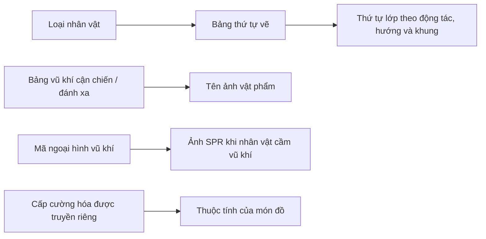

## TÓM TẮT 5 DÒNG
1. [NGUỒN] [THẤY] Chưa tìm thấy bảng sort nữ hoặc hai bảng vũ khí trong các thư mục tài nguyên và mục lục hai APK đã kiểm (phạm vi theo JX1_OPS/TASKS/HG-04.md:19).
2. [NGUỒN] [THẤY] Client lấy tên bảng sort từ bảng loại nhân vật rồi tra dưới `settings/npcres` (Classes/gamecore/KNpcResNode.cpp:365–369, 1209–1212).
3. [NGUỒN] [THẤY] Client tra `MeleeWeapon.txt` và `rangeweapon.txt` dưới `update10/settings/item/004` (Classes/gamecore/KBasPropTbl.cpp:16–23, 830–831).
4. [NGUỒN] [THẤY] Cột 5 là trường tên ảnh vật phẩm theo mã đọc bảng. Cấp cường hóa được truyền riêng vào hàm tạo đồ (Classes/gamecore/KBasPropTbl.cpp:113–118, 1419–1425 và Classes/gamecore/KItemGenerator.CPP:416).
5. [CHƯA KIỂM] Chưa có nội dung bảng, tên SPR cụ thể hoặc xác minh trong game. Không chạy build, EXE hay VM (JX1_OPS/TASKS/HG-04.md:26–28).

# HG-04 — Bảng thứ tự vẽ nhân vật nữ và bảng item vũ khí

Loại: khảo sát  
Chủ đề: Tìm bảng thứ tự vẽ và bảng vũ khí trong gói client JX1.  
Từ khóa: JX1, HG-04, nhân vật nữ, thứ tự vẽ, 女主角贴图顺序表.ini, MeleeWeapon, rangeweapon, cường hóa, SPR  
Trạng thái: DONE. Đã kiểm nguồn được giao và ghi lại nơi đã tìm.  
Độ phủ: Đã tìm 3/3 tệp chính (1 bảng sort và 2 bảng vũ khí). Tìm thấy 0/3 tệp trong phạm vi kiểm.  
Liên quan: [Quy luật vẽ bộ phận](QUY-LUAT-VE-BO-PHAN.md), [Báo cáo HG-04](../REPORTS/HG-04.md)  
Cần tôi quyết định: không

## Phạm vi và độ phủ

[THẤY] Gốc khảo sát là `D:/Android/b/Client`. Các đường dẫn bắt đầu bằng `Classes/`, `Resources/`, `data/` và `proj.android/` bên dưới tính từ gốc này. Phiên bản đang chạy chưa được xác minh.

| Phần tử | Đường dẫn trong client hoặc tên đã thử | Kết quả |
|---|---|---|
| Thứ tự vẽ nhân vật nữ | `settings/npcres/女主角贴图顺序表.ini` và `settings/npcres/Å®Ö÷½ÇÌùͼ˳Ðò±í.ini` | [THẤY] Đã tìm, không có kết quả khớp. Thư mục dựa trên mã. Tên tệp do task cung cấp. `Classes/gamecore/CoreUseNameDef.h:35`, `JX1_OPS/TASKS/HG-04.md:19`. |
| Bảng chọn tài nguyên theo loại nhân vật | `settings/npcres/人物类型.txt` và `settings/npcres/ÈËÎïÀàÐÍ.txt` | [THẤY] Đã tìm, không có kết quả khớp. `Classes/gamecore/CoreUseNameDef.h:30`. |
| Vũ khí cận chiến | `update10/settings/item/004/MeleeWeapon.txt` | [THẤY] Đã tìm, không có kết quả khớp. `Classes/gamecore/KBasPropTbl.cpp:16–23, 830–831`. |
| Vũ khí đánh xa / ám khí | `update10/settings/item/004/rangeweapon.txt` | [THẤY] Đã tìm, không có kết quả khớp. `Classes/gamecore/KBasPropTbl.cpp:16–23, 147–148, 830–831`. |
| Bảng tra mã ngoại hình | `settings/item/MeleeRes.txt`, `settings/item/RangeRes.txt` | [THẤY] Đã tìm, không có kết quả khớp. `Classes/gamecore/CoreUseNameDef.h:119–120`. |

## Giải mã tên

| Tên gốc | Mã hóa | Chữ đúng / nghĩa tiếng Việt | Nguồn file:dòng |
|---|---|---|---|
| `女主角贴图顺序表.ini` | UTF-8 trong task. Đã thử tên theo GBK (CP936). | `女主角贴图顺序表.ini` — Bảng thứ tự lớp ảnh nhân vật nữ. | `JX1_OPS/TASKS/HG-04.md:19` |
| `人物类型.txt` | GBK (CP936) trong mã | `人物类型.txt` — Bảng loại nhân vật. | `Classes/gamecore/CoreUseNameDef.h:30` |
| `动作贴图顺序表` | GBK (CP936) trong mã | `动作贴图顺序表` — Cột tên bảng thứ tự lớp ảnh theo động tác. | `Classes/gamecore/KNpcResNode.cpp:366` |

[CHƯA KIỂM] Chưa có tên món vũ khí từ dòng dữ liệu để giải mã. Các tên tệp Latin trong bảng phạm vi được giữ theo mã đọc bảng. `Classes/gamecore/KBasPropTbl.cpp:22–23`.

## Sắp theo cấu trúc game

**Nhân vật nữ → động tác → hướng → khung ảnh.** [THẤY] Client tra tên INI từ cột `动作贴图顺序表`, đọc `DEFAULT`, các khóa dạng `DirN` và `LineK` theo động tác. [TÀI LIỆU] Bảng nữ đứng gồm tám hướng trong tài liệu cũ là số liệu dẫn lại. [CHƯA KIỂM] Thiếu INI nên chưa đối chiếu thứ tự lớp trong từng ô và chưa xác định mục dùng cho đi bộ. `Classes/gamecore/KNpcResNode.cpp:365–369, 1237–1242, 1259–1275`, `JX1_OPS/DESIGN/QUY-LUAT-VE-BO-PHAN.md:22–26, 37–39`.

**Trang bị → vũ khí cận chiến / vũ khí đánh xa.** [THẤY] Hai nhóm dùng chung cách đọc thuộc tính trang bị cơ bản. Cột 5 được đọc vào trường tên ảnh và chép vào ảnh của vật phẩm. Cột 12 được đọc vào trường cấp độ món đồ. Món đồ khởi tạo cấp cường hóa bằng 0. Khi tạo trang bị ở nhánh trắng/xanh, client áp dụng cấp cường hóa nhận qua `nEnChance`. [CHƯA KIỂM] Thiếu bảng gốc nên chưa biết chữ trên tiêu đề cột, giá trị từng món hoặc nguồn quyết định cấp cường hóa sinh ra ban đầu. `Classes/gamecore/KBasPropTbl.cpp:113–118, 147–148, 1419–1432`, `Classes/gamecore/KItem.cpp:601, 627, 661–671`, `Classes/gamecore/KItemGenerator.CPP:280, 405–416`.

**Nhân vật → vũ khí đang cầm → ảnh theo động tác.** [THẤY] Hai bảng `MeleeRes.txt` và `RangeRes.txt` được đọc ở cột 2 để lấy mã ngoại hình. Khi đổi vũ khí, client tra ảnh theo bộ phận, động tác và mã vũ khí rồi nạp ảnh SPR. [CHƯA KIỂM] Chưa có tên SPR cụ thể để ghi cho từng món hoặc động tác. `Classes/gamecore/KItemChangeRes.cpp:43–62`, `Classes/gamecore/KNpcRes.cpp:1237–1239, 1280–1285`.

## Nơi đã tìm

- [THẤY] Tệp rời: thử đường dẫn dự kiến ngay dưới gốc client và lọc theo tên tại `Resources`, `data` (gồm `data/data`), `proj.android/app/assets`, `proj.android/app/src/main/res` và `proj.android/app/build/intermediates/assets`. Tìm tên Hán ở dạng Unicode và dạng hiện sai khi byte GBK được đọc như Latin. Không có tên đích khớp. Phạm vi gốc theo `JX1_OPS/TASKS/HG-04.md:19, 23`.
- [THẤY] Mục lục APK: `proj.android/app/release/projectdebug-release.apk` có 962 mục. `proj.android/app/build/outputs/apk/debug/projectdebug-debug.apk` có 964 mục. Đọc mục lục mỗi APK theo UTF-8 và CP936. Không thấy các tên trong bảng phạm vi, thư mục `settings` hoặc mục `.pak` ở hai mục lục. Phạm vi gốc theo `JX1_OPS/TASKS/HG-04.md:19, 23`.
- [THẤY] Hai danh sách gói có khai báo `setting.pak` và `update10.pak`. Không thấy hai tệp gói trong các vị trí tài nguyên đã lọc hoặc trong hai APK. [CHƯA KIỂM] Chưa biết các PAK này chứa bảng nào. `Resources/package.ini:5, 28`, `data/data/package.ini:30, 38`.

## Đã xác minh / Chưa xác minh

- [THẤY] Đã kiểm tên tệp rời, mục lục APK và các dòng mã client nêu trên. Mã đọc cấu hình và bảng dùng `KPakFile`, nên kết quả tìm tên chỉ giới hạn trong các dạng lưu trữ đã kiểm. `Classes/engine/KIniFile.cpp:71–74`, `Classes/engine/KTabFile.cpp:62–65`, `Classes/engine/KPakFile.cpp:256–273`.
- [CHƯA KIỂM] Nội dung các PAK, bảng sort thật, tên SPR cụ thể và hành vi trong game. Không chạy build, EXE, VM hoặc mạng. `JX1_OPS/TASKS/HG-04.md:26–28`.

## Bàn giao

Đầu ra của HG-04 kèm [báo cáo khảo sát](../REPORTS/HG-04.md). Tổng quan phụ trách commit. Khi có bản sao gói chứa bảng, đọc hàng tiêu đề, đối chiếu tên ảnh theo từng món và kiểm bảng loại nhân vật để xác nhận chính xác tên INI.
