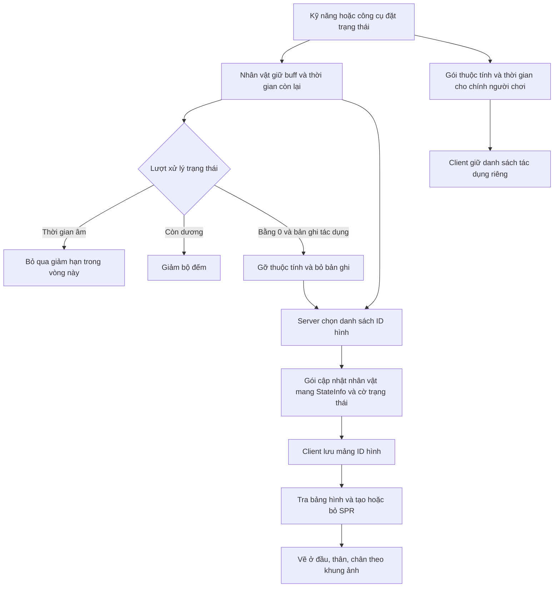

TÓM TẮT 1/5 — [NGUỒN][THẤY] Buff kỹ năng nằm trong danh sách trạng thái của nhân vật; độc, băng, choáng còn có bộ đếm riêng (`S/KNpc.h:129–134,208–219,452–485`).
TÓM TẮT 2/5 — [NGUỒN][THẤY] Buff hữu hạn giảm theo lượt xử lý; về 0 thì gỡ tác dụng và bỏ bản ghi, còn thời gian âm được bỏ qua trong vòng đếm này (`S/KNpc.cpp:2258–2304`).
TÓM TẮT 3/5 — [NGUỒN][THẤY] Chính người chơi nhận thuộc tính/thời gian; hình trạng thái và cờ độc, băng, choáng còn đi trong gói cập nhật nhân vật (`S/KNpc.cpp:10385–10394,7932,7998–8013`; `C/gamecore/KProtocolProcess.cpp:2571–2608`).
TÓM TẮT 4/5 — [NGUỒN][THẤY] Client đổi ID hình thành SPR ở đầu/thân/chân; vòng ảnh khác vòng đếm buff, và gói trạng thái riêng có lời gọi cập nhật đã bị comment (`C/gamecore/KNpcRes.cpp:2095–2165`; `C/gamecore/KProtocolProcess.cpp:3445–3454`).
TÓM TẮT 5/5 — [CHƯA KIỂM] Chỉ khảo sát tĩnh: chưa build, chạy game/exe/VM hoặc dùng mạng; chưa chốt số giây từng kỹ năng hay độ khớp binary/data (`JX1_OPS/TASKS/HG-06.md:20–30`).

# HG-06 — Hiểu trạng thái, buff và thời gian hiệu lực

Loại: khảo sát
Chủ đề: Nhân vật giữ buff, hết hạn, đồng bộ và gắn hình trạng thái như thế nào trong hai gốc mã được giao.
Từ khóa: trạng thái, buff, aura, thời gian hiệu lực, KStateNode, m_LeftTime, StateSpecialId, StateInfo, SPR
Trạng thái: DONE — trả lời 4/4 câu hỏi trong phạm vi đọc tĩnh; runtime và thời lượng từng kỹ năng chưa kiểm.
Độ phủ: 4/4 câu hỏi chính; 5/5 nhóm cơ chế trong bảng dưới; 0 ca runtime. Tổng số buff/kỹ năng chưa đếm vì task không giao kiểm kê bảng kỹ năng.
Liên quan: ../REPORTS/H-02-magic-attrib.md; ../REPORTS/H-06-he-thong-an.md; ../REPORTS/J-03-hoat-anh-ky-nang.md; ../REPORTS/HG-06.md; MUC-LUC-TRI-THUC.md
Cần tôi quyết định: không

[THẤY] Sơ đồ ghép các đường mã đã đọc, không mô tả một lần bắt gói hay đo game: đặt buff `S/KNpc.cpp:10365–10504`; hết hạn `S/KNpc.cpp:2258–2304`; đồng bộ `S/KNpc.cpp:7886–8052`; nhận/vẽ `C/gamecore/KProtocolProcess.cpp:2571–2608`, `C/gamecore/KNpc.cpp:711–714`, `C/gamecore/KNpcRes.cpp:2095–2165`.

## Phạm vi và độ phủ

| Nhóm trong game | Độ phủ | Bằng chứng và giới hạn |
|---|---|---|
| Nhân vật giữ buff kỹ năng | [THẤY] Đã phủ | Danh sách, ID/cấp/thời gian, dữ liệu hoàn tác: `S/KNpc.h:208–219,485`; `S/KNpc.cpp:10439–10503`. |
| Trạng thái riêng và thời hạn | [THẤY] Đã phủ cơ chế đại diện | Độc, băng, cháy, mê hoặc, choáng, hồi sinh lực/nội lực: `S/KNpc.cpp:1974–2154`; không phải catalog mọi trạng thái. |
| Áp dụng, làm mới, hết hạn và hào quang | [THẤY] Đã phủ đường chính | `S/KSkills.cpp:3393–3404,3462–3472`; `S/KNpc.cpp:815–863,2258–2357,10401–10503`. |
| Gửi và nhận trạng thái | [THẤY] Đã phủ bốn loại gói | Ba loại gói riêng cho chính người chơi và gói nhân vật thường kỳ; phân biệt gói trạng thái riêng bị bỏ lời gọi ở client: mục 3. |
| Gắn và vẽ hình | [THẤY] Đã phủ ID → bảng → SPR → lớp vẽ | `C/gamecore/KNpc.cpp:711–714,2856–2862`; `C/gamecore/KNpcRes.cpp:2095–2165`; `C/vn/gamecore/KNpcResVN.cpp:164–168,238–299,330–345,505–526`. |
| Từng kỹ năng, lưu qua đăng xuất, binary và hình thực tế | [CHƯA KIỂM] Chưa phủ | Nguồn task chỉ giao cơ chế trong source, không có quyền chạy và không giao kiểm kê Settings/SPR: `JX1_OPS/TASKS/HG-06.md:20–30`. |

## Giải mã tên

[THẤY] Tài liệu này dùng tên trường/hàm để chỉ cơ chế, không đặt tên riêng cho kỹ năng, trang bị, quái, NPC hoặc bản đồ. Vì vậy không có tên Hán/Việt cũ phải đoán chuyển từ GBK/TCVN3; tên gốc được giữ nguyên. Ví dụ định danh nằm tại `S/KNpc.h:208–219,452–485` và `C/gamecore/KNpcResNode.h:75–95`.

| Tên gốc | Mã hóa | Chữ đúng UTF-8 / nghĩa trong tài liệu | Nguồn file:dòng |
|---|---|---|---|
| `KStateNode`, `m_LeftTime` | ASCII; không cần chuyển GBK/TCVN3 | Bản ghi buff; bộ đếm còn lại | `S/KNpc.h:208–219` |
| `m_PoisonState`, `m_FreezeState`, `m_StunState` | ASCII; không cần chuyển GBK/TCVN3 | Trạng thái độc, băng, choáng; đây là tên cơ chế | `S/KNpc.h:452–456` |
| `Head`, `Body`, `Foot` | ASCII; không cần chuyển GBK/TCVN3 | Lớp đầu, thân, chân | `C/gamecore/KNpcResNode.h:75–80`; `C/gamecore/KNpcResNode.cpp:852–859` |

## Sắp theo cấu trúc game và cách đọc nguồn

[TÀI LIỆU] Thứ tự đọc là nhân vật → kỹ năng/buff → thời hạn → người nhận đồng bộ → hình trên nhân vật. Đây là tài liệu cơ chế chung, không phải danh sách kỹ năng nên không chia theo môn phái/nhánh/cấp học (`JX1_OPS/TASKS/HG-06.md:19–25`; `JX1_OPS/DESIGN/CHUAN-BAO-CAO.md:18–21`).

| Ký hiệu | Gốc được task cho phép đọc |
|---|---|
| `S` | `C:/Jx1CocoV3/SwordOnline/SwordOnline/jxOnline/gameserver/Sources/Core/Src` |
| `C` | `C:/Jx1CocoV3/Folder/Client2912-20260116T044348Z-3-001/Client2912/Client/Classes` |
| Báo cáo không có tiền tố | Tệp tương ứng dưới `JX1_OPS/REPORTS/` |

[TÀI LIỆU] Hai root lấy đúng từ task, không thay bằng mirror ở báo cáo cũ (`JX1_OPS/TASKS/HG-06.md:23–25`). `[THẤY]` = đọc trực tiếp câu lệnh/khai báo ở root này; `[TÀI LIỆU]` = dẫn tài liệu đã có; `[CHƯA KIỂM]` = nguồn chưa đủ hoặc chưa chạy. Các nhãn THẤY chỉ là **đã xác minh tĩnh**. Nội dung mới được ghi UTF-8 không BOM theo `JX1_OPS/DESIGN/CHUAN-BAO-CAO.md:29`; source có phần GBK và phần UTF-8, căn cứ kỹ thuật là định danh/câu lệnh, không suy tên game từ chữ hiển thị lỗi.

## 1. Trạng thái/buff của nhân vật lưu ở đâu?

[THẤY] Trong mã, mỗi nhân vật có một danh sách buff (`m_StateSkillList`). Mỗi bản ghi giữ **kỹ năng nào**, **cấp nào**, **còn bao nhiêu lượt**, **dữ liệu gỡ tác dụng** và **ID hình**. Nhân vật người chơi cũng dùng cấu trúc `KNpc`; đường đặt buff kiểm tra `IsPlayer()` để gửi về đúng người chơi (`S/KNpc.h:208–219,485`; `S/KNpc.cpp:10373–10394,10439–10464`).

[THẤY] Khi nhận buff mới, mã áp các thuộc tính lên nhân vật rồi lưu các giá trị đối dấu để dùng lúc gỡ. Có thể hiểu đây là “sổ ghi phần đã cộng để sau này trả lại”; cách xử lý cụ thể của từng thuộc tính vẫn do `ModifyAttrib` quyết định (`S/KNpc.cpp:10489–10503`). Không kết luận mọi thuộc tính đều là phép cộng đơn giản.

[THẤY] Độc, băng, cháy, mê hoặc, choáng, hồi sinh lực và hồi nội lực còn có các ô riêng kiểu `KState`, gồm `nMagicAttrib`, ba giá trị và `nTime`. Chúng không đồng nhất với một bản ghi buff kỹ năng trong danh sách (`S/KNpc.h:129–134,452–485`).

[THẤY] Phần hình có mảng riêng `m_btStateInfo`. Server dựng mảng này từ hào quang đang bật trước, rồi lấy ID hình của các buff từ cuối danh sách; giới hạn theo `MAX_SKILL_STATE` (`S/KNpc.h:443`; `S/KNpc.cpp:14398–14443`). Mảng ID hình không chứa toàn bộ thuộc tính hoặc thời hạn từng buff.

[CHƯA KIỂM] Đây là chỗ giữ trạng thái trong đối tượng của mã nguồn. Chưa lần lưu DB, chuyển server, đăng xuất/đăng nhập hoặc khôi phục offline; không khẳng định buff còn nguyên hay tự hết khi offline (`S/KNpc.h:208–219,485`; giới hạn task `JX1_OPS/TASKS/HG-06.md:23–30`).

## 2. Buff được đặt và hết hạn như thế nào?

[THẤY] Với đường hỗ trợ chủ động đã đọc, thời gian truyền vào buff lấy từ tham số thứ hai của thuộc tính trạng thái đầu tiên (`m_pStateMagicAttribs[0].nValue[1]`). Đường bị động truyền tiếp `nWaitTime`; caller kỹ năng bị động có chỗ gọi với `-1` (`S/KSkills.cpp:3393–3404,3462–3469`; `S/KSkillList.cpp:240–250`). Đây là nghĩa của tham số trong **những đường này**, không phải mọi `nValue[1]` trong game đều là thời gian.

[THẤY] Đường công cụ có thuộc tính dùng `nTime` khi nó khác 0; khi bằng 0 thì lấy `pTemp->nValue[1]`. Đường công cụ không có dữ liệu thuộc tính lưu trực tiếp `nTime`. Vì vậy số 0 không có một nghĩa chung ở mọi hàm (`S/KNpc.cpp:10124–10129,10223–10226,10280–10286`).

[THẤY] Trong đường buff thông thường, nếu tìm thấy cùng ID kỹ năng, cùng cấp và `nIsEuq == 0`, mã thay bộ đếm cũ bằng bộ đếm mới rồi trả về. Nhánh này là làm mới hạn, không tạo thêm một bản sao buff. Khi khác cấp/cờ thì đi nhánh thay thuộc tính; chưa coi đây là quy tắc cộng dồn cho mọi hệ thống (`S/KNpc.cpp:10401–10436`).

| Khi vòng xử lý gặp bản ghi | Điều xảy ra theo source |
|---|---|
| [THẤY] `m_LeftTime <= -1` | Bỏ qua bản ghi trong vòng giảm hạn; “vô hạn” chỉ nói về vòng này (`S/KNpc.cpp:2265–2268`). |
| [THẤY] `m_LeftTime > 0` | Giảm 1 khi đi qua đoạn cuối vòng xử lý (`S/KNpc.cpp:2270–2300`). |
| [THẤY] `m_LeftTime == 0` và `m_IsClientState == 0` | Áp dữ liệu hoàn tác, bỏ bản ghi, cập nhật danh sách ID hình ở server (`S/KNpc.cpp:2270–2296`). |
| [THẤY] Đặt hạn bằng 0 từ lệnh riêng | `SetSkillLeftTime` đổi bộ đếm, đồng thời gửi `s2c_synconestate` về chính người chơi nếu đang ở nhánh server (`S/KNpc.cpp:2330–2357`). |

[THẤY] Kiểm tra 0 xảy ra **trước** lệnh giảm. Bản ghi vừa giảm từ 1 xuống 0 được xét gỡ ở lượt sau nếu tiếp tục đi đến đoạn xử lý này. Không gọi đó là sai lệch một giây (`S/KNpc.cpp:2270–2300`). `ProcessState()` chỉ được gọi tại đường `Activate` khi còn sinh lực và cho phép xử lý trạng thái; xử lý còn có điều kiện vùng hoạt động (`S/KNpc.cpp:991–995,1418–1422`; `S/KRegion.cpp:1106–1120`).

[THẤY] Các ô riêng cũng đếm hạn: độc giảm `nTime` và gây sát thương theo nhịp của nó; băng/choáng ảnh hưởng khả năng hành động; mê hoặc trả lại phe khi hết; hồi sinh lực/nội lực cộng theo nhịp rồi chặn ở mức tối đa (`S/KNpc.cpp:1974–2045,2061–2154`). Không dùng nhịp hồi máu làm nhịp chạy ảnh.

[THẤY] Hào quang có đường gọi lại kỹ năng con khi nhân vật đủ điều kiện (`stateActivate`, `m_ActiveAuraID`), nên việc nguồn phát tiếp tục đặt trạng thái phải được tách với bộ đếm của một lần nhận (`S/KNpc.cpp:815–863`). Chưa chứng minh nhịp gọi của riêng đường này trong binary.

[THẤY] Một số trạng thái liên quan danh hiệu còn dùng đồng hồ khác: `m_nPlayerTime` giảm dần, còn `m_nPlayerTitleTime` so với `KSG_GetCurSec()`; đến hạn đều có đường đặt thời gian kỹ năng về 0 (`S/KPlayer.cpp:296–335`). Không gom chúng thành một bộ đếm chung.

[CHƯA KIỂM] Chưa chốt giây thực của từng kỹ năng, mọi đường miễn/giải trạng thái, chết/hồi sinh hoặc thay cấp. `FRAME2TIME = 18` là hằng đọc được, không phải số đo bảo đảm 18 lượt xử lý mỗi giây trong mọi tình huống; không tự đổi tất cả hạn sang giây (`S/KNpc.cpp:78,991–995,2258–2304`).

## 3. Server gửi cho client như thế nào?

| Người nhận / nội dung | Gửi ở server | Xử lý ở client được giao |
|---|---|---|
| [THẤY] Chính người chơi: buff có thuộc tính | `s2c_syncstateeffect`: ID, cấp, thời gian, cờ và các thuộc tính; độ dài theo số thuộc tính (`S/KNpc.cpp:10385–10394`). | `SyncStateEffect` lấy dữ liệu và gọi `SetStateSkillEffect` (`C/gamecore/KProtocolProcess.cpp:4236–4244`; cấu trúc `C/gamecore/KProtocol.h:2076–2085`). |
| [THẤY] Chính người chơi: trạng thái không mang dữ liệu thuộc tính | `s2c_syncnodataeffect`: ID, cấp, thời gian (`S/KNpc.cpp:10078–10090`). | Gọi `SetToolNoStateEffect` (`C/gamecore/KProtocolProcess.cpp:2371–2379`; cấu trúc `C/gamecore/KProtocol.h:2087–2095`). |
| [THẤY] Chính người chơi: đổi hạn một kỹ năng | `s2c_synconestate`: ID nhân vật, ID kỹ năng, thời gian (`S/KNpc.cpp:2348–2357`). | Kiểm đúng nhân vật của mình rồi gọi `SetSkillLeftTime` (`C/gamecore/KProtocolProcess.cpp:2382–2393`; cấu trúc `C/gamecore/KProtocol.h:130–136`). |
| [THẤY] Các client trong vùng: hình và cờ trạng thái | `NormalSync`, gói `s2c_syncnpcmin`, chép `StateInfo`, tạo `nState` và phát trong vùng/vùng nối (`S/KNpc.cpp:7886–7904,7932,7998–8013,8043–8052`). | `SyncNpcMin` nhận cờ và gọi `SetNpcState(StateInfo)` (`C/gamecore/KProtocolProcess.cpp:2410–2427,2571–2608`). |

[THẤY] Ở đường vùng đang hoạt động đã đọc, lời gọi `NormalSync()` phụ thuộc bộ đếm `m_nNpcSyncCounter`, rồi nhân vật được `Activate()`. Đây là bằng chứng có đường gửi thường kỳ; không phải số đo chu kỳ mạng hay cam kết mỗi lần buff đổi đều có một gói riêng tức thời (`S/KRegion.cpp:1106–1127`).

[THẤY] Gói thường kỳ mang cờ “đang độc/băng/choáng/ẩn…” bằng phép bật bit. Client gán kết quả phép AND bit vào `nTime` để thể hiện trạng thái; những số nhận được ở đây không phải thời gian còn lại thật (`S/KNpc.cpp:7998–8013`; `C/gamecore/KProtocolProcess.cpp:2571–2578`).

[THẤY] Gói riêng `s2c_syncnpcstate` vẫn có hàm gửi `BroadCastState` ở server. Nhưng trong client này, câu gọi `SetNpcState` của hàm nhận đã bị comment; hơn nữa đường vẽ hiện tại dùng mảng BYTE từ gói thường kỳ. Không dùng riêng tên giao thức để kết luận hình được cập nhật qua gói này (`S/KNpc.cpp:14485–14522`; `C/gamecore/KProtocolProcess.cpp:3445–3454`; `C/gamecore/KNpc.cpp:2856–2862,711–714`).

[THẤY] Client giữ danh sách tác dụng riêng: tạo bản ghi, cộng thuộc tính và lưu dữ liệu hoàn tác; vòng xử lý cũng giảm/gỡ bản ghi hữu hạn (`C/gamecore/KNpc.cpp:6390–6486,1183–1263`). Tồn tại hai danh sách phục vụ hai việc, nên không lấy việc hình còn/không còn làm bằng chứng duy nhất cho buff gameplay.

[CHƯA KIỂM] Chưa bắt gói, kiểm mất gói, độ trễ, thứ tự đến, ABI/packing hoặc cờ build của hai binary. Header protocol ngoài `Sources` của server chưa đọc vì ngoài root nguồn được giao; không khẳng định hai binary tương thích chỉ vì có tên cấu trúc giống nhau (`JX1_OPS/TASKS/HG-06.md:25–30`; `C/gamecore/KProtocol.h:2076–2095`).

## 4. Hiệu ứng vẽ gắn vào nhân vật ra sao?

[THẤY] Kỹ năng nạp khóa `StateSpecialId`. Khi tạo buff, mã lấy ID đó qua hàm tên gốc `GetStateSpecailId()` và ghi vào `m_StateGraphics`; ID kỹ năng và ID hình là hai trường khác nhau (`C/gamecore/KSkills.cpp:2949`; `S/KNpc.h:212–217`; `S/KNpc.cpp:10460–10464`).

[THẤY] Client nhận `StateInfo` vào mảng `m_btStateInfo`, rồi gọi `m_DataRes.SetState(m_btStateInfo, ...)`. Lời gọi dùng trực tiếp danh sách buff ở cạnh đó đã bị comment (`C/gamecore/KNpc.cpp:2856–2862,711–714`). Đây là bước nối dữ liệu mạng với phần hình trên nhân vật.

[THẤY] Với mỗi ID, client tra bảng `CStateMagicTable`: lấy đường SPR, lớp đầu/thân/chân, cách phát, khoảng khung trước/sau thân, tổng khung, số hướng và khoảng khung. Bảng được nạp qua `STATE_MAGIC_TABLE_NAME`; lượt này chưa đọc tệp dữ liệu/asset tương ứng (`C/gamecore/KNpcResNode.cpp:839–910`).

[THẤY] `SetState` giữ SPR có ID còn trong mảng, giải phóng SPR có ID đã mất, bỏ qua ID đã có, rồi tìm ô trống đúng lớp để tạo hình mới. Client có `MAX_SKILL_STATE = 18`; đoạn này chia thành ba nhóm, mỗi nhóm 6 ô. Đây là số ô hình trong đường vẽ, không phải kết luận nhân vật chỉ có tối đa 18 buff có tác dụng (`C/gamecore/GameDataDef.h:132`; `C/gamecore/KNpcRes.cpp:2106–2165`).

[THẤY] Renderer VN tiến khung bằng `GetNextFrame`, rồi vẽ đầu ở phía trên nhân vật, thân theo khoảng khung sau/trước, chân tại mặt đất. Vị trí được lấy theo nhân vật khi vẽ (`C/vn/gamecore/KNpcResVN.cpp:164–168,238–299,330–345,505–526`). Thời hạn buff nằm ở mục 2; đoạn chọn khung này không dùng `m_LeftTime` để tính hạn.

[THẤY] Điểm cần giữ nguyên khi đọc kết quả cũ: caller `GetInfo` truyền trùng biến hướng/khoảng khung cho hai đầu ra tọa độ, còn hàm nhận ghi cả bốn đầu ra. Vì vậy chưa lấy metadata bảng để chốt tốc độ ảnh hiệu dụng (`C/gamecore/KNpcRes.cpp:2143`; `C/gamecore/KNpcResNode.cpp:907–910`). Đây là dấu hiệu tĩnh, chưa phải lỗi đã tái hiện.

[CHƯA KIỂM] Chưa có bằng chứng hình thực tế mất đúng lúc buff hết, thứ tự hiển thị dưới độ trễ, hình khi đủ ô, thời lượng SPR hoặc dữ liệu client thật được nạp. Phải tách việc buff hết ở server, client nhận cập nhật và SPR bị bỏ ở lần xử lý hình (`S/KNpc.cpp:2270–2296,7932`; `C/gamecore/KNpcRes.cpp:2106–2122`).

## Mục sổ thông số

| Nhóm | Tên/hằng số | file:dòng | Giá trị | Đơn vị | Ảnh hưởng | Đổi an toàn | Nguồn đo |
|---|---|---|---|---|---|---|---|
| [THẤY] Hạn buff | `m_LeftTime` | `S/KNpc.cpp:2265–2300` | Âm: bỏ qua; 0: xét gỡ; dương: giảm 1 | Lượt xử lý trạng thái | Vòng đời buff | CẨN THẬN | Đọc tĩnh; chưa đo giây |
| [THẤY] Đặt hạn | `SetSkillLeftTime(..., 0)` | `S/KNpc.cpp:2330–2357` | 0 | Giá trị bộ đếm | Gỡ qua vòng xử lý kế tiếp; gửi hạn cho chủ thể | CẨN THẬN | Đọc tĩnh |
| [THẤY] Tái áp | Cùng ID/cấp, `nIsEuq == 0` | `S/KNpc.cpp:10406–10433` | Thay bằng `nTime` mới | Lượt xử lý | Làm mới hạn của nhánh đã đọc | CẨN THẬN | Đọc tĩnh |
| [THẤY] Công cụ | `nTime == 0` trong `SetToolStateSkillEffect` | `S/KNpc.cpp:10223–10226,10280–10283` | Lấy `pTemp->nValue[1]` | Theo caller | Không đồng nghĩa lệnh xóa ở API khác | CẨN THẬN | Đọc tĩnh |
| [THẤY] Quy ước mã | `FRAME2TIME` | `S/KNpc.cpp:78` | 18 | Hằng quy ước; chưa đo nhịp thực | Không dùng để tự suy mọi hạn ra giây | CẨN THẬN | Đọc tĩnh |
| [THẤY] Hồi phục | `GAME_UPDATE_TIME` | `S/KNpc.cpp:80,2133–2154` | 10 | Theo bộ đếm trong source | Nhịp cộng sinh lực/nội lực | CẨN THẬN | Đọc tĩnh |
| [THẤY] Hình client | `MAX_SKILL_STATE`, chia lớp | `C/gamecore/GameDataDef.h:132`; `C/gamecore/KNpcRes.cpp:2150` | 18 tổng; 6/lớp | Ô hình ở đường đã đọc | Sức chứa hình đầu/thân/chân | CẨN THẬN | Đọc tĩnh, 18/3 = 6 |
| [THẤY] Gói trạng thái riêng | `MAX_NPC_RECORDER_STATE` | `C/gamecore/GameDataDef.h:139`; `C/gamecore/KProtocol.h:2033–2038` | 36 phần tử `int` ở cấu trúc này | Phần tử | Khác mảng BYTE 18 dùng ở đường hình thường kỳ | CẨN THẬN | Header client; ABI server chưa kiểm |
| [CHƯA KIỂM] Thời lượng game | Số giây của từng buff | `S/KSkills.cpp:3400–3401`; `JX1_OPS/TASKS/HG-06.md:25–30` | Chưa có số đo/bảng đối chiếu | Giây | Không điền 0 thay dữ liệu thiếu | KHÔNG trong task này | Chưa đo |

[TÀI LIỆU] Đánh giá “đổi an toàn” không cấp quyền sửa. Lượt HG-06 chỉ đọc, không đổi bất kỳ tham số nào (`JX1_OPS/TASKS/HG-06.md:27–30`).

## Liên hệ tài liệu cũ và phát hiện khi chuẩn hóa

- [TÀI LIỆU] H-02 mô tả cấu trúc thuộc tính và nhiều nhóm thuộc tính trang bị; H-06 xác định ấn là trang bị. Không dùng hai báo cáo đó làm catalog thời hạn buff (`H-02-magic-attrib.md:82–100`; `H-06-he-thong-an.md:68–73`).
- [TÀI LIỆU] J-03 đã tách thời hạn buff khỏi vòng ảnh và nêu nghi vấn trùng đầu ra `GetInfo`; HG-06 kiểm lại các câu lệnh liên quan ở root client được giao, không sửa kết luận cũ (`J-03-hoat-anh-ky-nang.md:78–90,116`; `C/gamecore/KNpcRes.cpp:2143`; `C/gamecore/KNpcResNode.cpp:907–910`).
- [THẤY] Root server còn mã phía client trong các nhánh tiền xử lý; ví dụ `SetNpcState(int*)` nằm dưới `#ifndef _SERVER`. HG-06 ưu tiên client canonical khi mô tả client, không coi mã phía client nằm trong root server là bằng chứng client được giao đang dùng nó (`S/KNpc.cpp:14526–14552`; `C/gamecore/KNpc.cpp:2856–2862`).

## Đã xác minh / Chưa xác minh

**ĐÃ XÁC MINH TĨNH:** [THẤY] Nơi giữ trạng thái, dữ liệu hoàn tác, nhánh làm mới/hết hạn, ba gói riêng của chủ thể, gói thường kỳ cho hình/cờ, đường mảng ID → SPR và lớp vẽ; bằng chứng nằm tại các mục 1–4. Mốc nguồn chính: `S/KNpc.h:208–219,452–485`; `S/KNpc.cpp:2258–2357,7886–8052,10365–10504`; `C/gamecore/KProtocolProcess.cpp:2371–2393,2571–2608,4236–4244`; `C/gamecore/KNpcRes.cpp:2095–2165`.

**CHƯA XÁC MINH:** [CHƯA KIỂM] Danh mục mọi buff/ID và số giây theo cấp; lưu qua offline/chuyển server/chết; lịch gọi mọi vòng aura; header/packing server; binary/cờ build/Settings/PAK/SPR đang chạy; mất gói, độ trễ và hình trên màn hình. Không chạy test gameplay, build, exe, VM hay kết nối mạng do giới hạn `JX1_OPS/TASKS/HG-06.md:25–30`.

## Đề xuất tối ưu và bàn giao

[TÀI LIỆU] Bước tiếp theo để tăng độ chắc là đối chiếu đúng phiên bản bảng kỹ năng, dữ liệu hình và binary, rồi chỉ thiết kế ca runtime khi có task cấp quyền riêng. Chưa đủ cơ sở chọn thay đổi tham số; yêu cầu HG-06 là giải thích cơ chế và không đề xuất sửa hiệu ứng vũ khí (`JX1_OPS/TASKS/HG-06.md:20–30`).

[TÀI LIỆU] Commit/push: không thực hiện theo yêu cầu trực tiếp của phiên HG-06; Tổng quan sẽ commit hộ. Báo cáo bàn giao: `JX1_OPS/REPORTS/HG-06.md`. PM có thể thêm vào mục lục dòng “Trạng thái, buff, thời hạn và ID hình | DESIGN/HIEU-BUFF-TRANG-THAI.md | KNpc, KProtocolProcess, KNpcRes | khảo sát tĩnh”; HG-06 không sửa mục lục hoặc tạo TSV ngoài vùng được giao (`JX1_OPS/TASKS/HG-06.md:13,28–31`; mẫu chỉ mục `JX1_OPS/DESIGN/CHUAN-BAO-CAO.md:30`).

Kỹ năng đã dùng: jx1-retrofit (giữ nguyên tài liệu cũ), jx1-read-server, jx1-read-client, jx1-parameters, jx1-knowledge, jx1-report.
