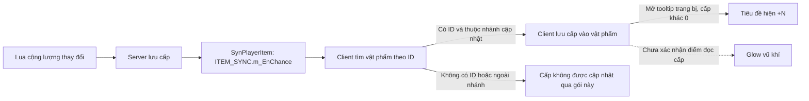

TÓM TẮT 5 DÒNG
1. [NGUỒN] [THẤY] Lua cộng lượng thay đổi vào cấp hiện tại rồi gọi đồng bộ nếu có người chơi và cờ bật (`S/ScriptFuns.cpp:10912-10929`).
2. [NGUỒN] [THẤY] `SynPlayerItem` ghi cấp vào `ITEM_SYNC.m_EnChance` và đưa cả gói `s2c_syncequipitem` vào hàm gửi (`S/KItemList.cpp:4379-4385,4404,4481-4482`).
3. [NGUỒN] [THẤY] Client cập nhật cấp của vật phẩm đã có theo ID và loại đồ. Tooltip đọc cấp vừa lưu để dựng chữ `+N` cho trang bị (`C/gamecore/KProtocolProcess.cpp:1555-1562,1640-1651`, `C/vn/gameui/KuiItemdescVN.cpp:167-168,1146-1176`).
4. [CHƯA KIỂM] Đường vẽ vũ khí đã đọc trong Client2912 chưa có chỗ đọc cấp bật glow. Mốc glow của qh9A do H-04 ghi lại (`C/gamescene/KgameWorld.cpp:11660-11733`, `JX1_OPS/REPORTS/H-04-hieu-ung-vu-khi.md:30-31,48-51`).
5. [CHƯA KIỂM] Chưa đối chiếu bố cục gói của binary hoặc quan sát runtime. Phạm vi chỉ đọc tĩnh, chưa chạy build, exe, VM hay mạng (`JX1_OPS/TASKS/HG-03c.md:27-30`).

# HG-03c — Cấp cường hóa từ Lua đến tooltip và hiệu ứng vũ khí
Loại: khảo sát\
Chủ đề: Theo dõi cấp cường hóa khi cập nhật một vật phẩm đã có trên client.\
Từ khóa: cường hóa, SetItemEnChance, SynPlayerItem, ITEM_SYNC, s2c_syncequipitem, tooltip +N, glow\
Trạng thái: DONE — hoàn tất đối chiếu tĩnh và ghi rõ điểm chưa kiểm.\
Độ phủ: 4/5 mắt xích đã xác minh, còn thiếu chỗ đọc cấp cho glow trong Client2912.\
Liên quan: [HG-03b](../REPORTS/HG-03b.md), [H-03](../REPORTS/H-03-cuong-hoa.md), [H-04](../REPORTS/H-04-hieu-ung-vu-khi.md), [Báo cáo HG-03c](../REPORTS/HG-03c.md)\
Cần tôi quyết định: không

## Phạm vi và độ phủ

| Mắt xích | Độ phủ | Bằng chứng |
|---|---|---|
| Lua đổi cấp server | Đã phủ | `S/ScriptFuns.cpp:10912-10929`, `S/KItem.cpp:3800-3818` |
| Server đưa cấp vào gói cập nhật | Đã phủ | `S/KItemList.cpp:4379-4385,4404,4481-4482` |
| Client tìm vật phẩm và lưu cấp | Đã phủ | `C/gamecore/KProtocolProcess.cpp:172,1555-1562,1640-1651`, `C/gamecore/KItem.cpp:3516-3518,3574-3576` |
| Tooltip đọc cấp và hiện `+N` | Đã phủ | `C/vn/gameui/KuiItemdescVN.cpp:167-168,1146-1176,1239-1260` |
| Vẽ glow theo cấp | Chưa phủ điểm đọc cấp | Đã xem đường vẽ vũ khí và đổi màu trong Client2912. Mốc glow của qh9A chỉ có nguồn lịch sử (`C/vn/gamecore/KNpcResVN.cpp:670-671`, `C/gamescene/KgameWorld.cpp:8185-8219,11660-11733`, `JX1_OPS/REPORTS/H-04-hieu-ung-vu-khi.md:30-31`). |

## Giải mã tên

| Tên gốc | Mã hóa | Chữ đúng hoặc diễn giải | Nguồn file:dòng |
|---|---|---|---|
| `LuaSetItemEnChance` | ASCII | Hàm Lua đổi cấp cường hóa | `S/ScriptFuns.cpp:10912` |
| `SynPlayerItem` | ASCII | Gửi cập nhật vật phẩm | `S/KItemList.cpp:4379` |
| `s2c_syncequipitem` | ASCII | Mã gói cập nhật trang bị | `S/KItemList.cpp:4383` |
| `m_EnChance` / `nEnChance` | ASCII | Cấp cường hóa trong gói / trong vật phẩm | `C/gamecore/KProtocol.h:968`, `C/gamecore/KItem.h:372` |
| `+N` | ASCII | Hậu tố hiện cấp cường hóa | `C/vn/gameui/KuiItemdescVN.cpp:1175` |

Phạm vi này không có tên riêng của trang bị, kỹ năng, quái, NPC hay bản đồ cần giải mã GBK hoặc TCVN3. Tài liệu viết bằng UTF-8.

## Sắp theo cấu trúc game

Xếp theo vòng đời trang bị: đổi cấp → đồng bộ vật phẩm → đọc ở giao diện → vẽ hiệu ứng. Ở bước đồng bộ, tách các nhóm đồ xanh, tím và vàng theo điều kiện xử lý trong client (`C/gamecore/KProtocolProcess.cpp:1640-1651`).

## Đối chiếu từng bước

`S/` là `C:/Jx1CocoV3/SwordOnline/SwordOnline/jxOnline/gameserver/Sources/Core/Src/`. `C/` là `C:/Jx1CocoV3/Folder/Client2912-20260116T044348Z-3-001/Client2912/Client/Classes/`. Định danh và chuỗi định dạng trích dẫn dùng ASCII.

1. **Đổi cấp.** [THẤY] `LuaSetItemEnChance` lấy cấp hiện tại cộng tham số thứ hai. `KItem::EnChance` giới hạn kết quả trong 0–30 và ghi vào vật phẩm. Sau đó Lua gọi đồng bộ nếu tìm được chỉ số người chơi dương và tham số thứ ba `nIsSyn >= 1`. Nếu điều kiện đồng bộ không đạt, lời gọi này vẫn có thể đã cập nhật cấp ở server (`S/ScriptFuns.cpp:10912-10929`, `S/KItem.cpp:3800-3818`, `S/KItem.h:371`).
2. **Đóng gói.** [THẤY] `SynPlayerItem` tạo `ITEM_SYNC`, đặt mã `s2c_syncequipitem`, ID vật phẩm, `m_SyncType = 2` và `m_EnChance = GetEnChance()`. Nếu có `g_pServer`, hàm đưa địa chỉ gói và `sizeof(ITEM_SYNC)` vào `PackDataToClient`. Client khai báo `m_EnChance` là `int` trong `ITEM_SYNC`. [CHƯA KIỂM] Chưa xác nhận bố cục gói của cặp binary hoặc byte thực tế trên đường truyền (`S/KItemList.cpp:4379-4385,4404,4481-4482`, `C/gamecore/KProtocol.h:946-992`).
3. **Nhận và lưu.** [THẤY] `s2csyncequipitem` tìm vật phẩm đã có bằng `m_ID`. Khi tìm được, đồ xanh có `m_IsWhere > 0` hoặc `m_Rongpiont > 0` đi qua `EnChanceRong`, đồ xanh còn lại và đồ tím qua `EnChance`, đồ có `GetGoldId()` qua `EnChanceRong` rồi `EnChanceBao`. Hai hàm `EnChance` và `EnChanceRong` ghi cấp vào `m_CommonAttrib.nEnChance`. Vì vậy, khi không tìm được ID hoặc vật phẩm nằm ngoài các nhánh ghi cấp, gói này không đổi cấp trên client (`C/gamecore/KProtocolProcess.cpp:172,1555-1562,1638-1651,1698-1704`, `C/gamecore/KItemList.cpp:2561-2573`, `C/gamecore/KItem.cpp:3516-3518,3574-3576`).
4. **Hiện chữ.** [THẤY] Giao diện túi và trang bị tiếng Việt gọi `KuiItemdescVN::create`, rồi `addDialogData` đọc `Item[m_ItemData.uId].GetEnChance()`. Nếu cấp khác 0 và loại vật phẩm là trang bị (`item_equip = 0`), hàm gắn ` +%d` vào chuỗi tiêu đề rồi tạo và gắn nhãn lên tooltip. Giao diện trong `C/gameui` cũng có nhánh ghép `%s+%d`. [CHƯA KIỂM] Tooltip đang mở có tự dựng lại sau khi nhận gói hay không (`C/vn/gameui/KuiItemVN.cpp:1116,1229`, `C/vn/gameui/KuiItemdescVN.cpp:63-78,126-134,167-168,1146-1176,1239-1260`, `C/gamecore/KItem.h:42,372`, `C/gameui/KuiItemdesc.cpp:834-839,1850-1855`).
5. **Vẽ glow.** [THẤY] Trong Client2912, `KNpcResVN::Draw` chuyển phần hình vũ khí (`EQ_PART_HAND_W`) sang `DrawPrimitives`. Nhánh đã đọc cập nhật sprite. Hàm đổi màu mà nhánh này gọi lấy trạng thái đóng băng, choáng hoặc trúng độc từ nhân vật. [CHƯA KIỂM] Chưa tìm thấy chỗ nối cấp cường hóa với glow trong các điểm vẽ đã khoanh. [TÀI LIỆU] H-04 ghi glow trắng ở +6, vàng và có sét từ +12, xanh từ +15 trong luồng qh9A. Kết quả đó thuộc bản được H-04 dẫn (`C/vn/gamecore/KNpcResVN.cpp:670-671`, `C/gamescene/KgameWorld.cpp:8185-8219,11660-11733`, `JX1_OPS/REPORTS/H-04-hieu-ung-vu-khi.md:30-31,48-58`).

[THẤY] Kết luận cho tooltip. Trong nguồn đã đọc, cấp có đường đi từ Lua đến tiêu đề nếu lệnh Lua bật đồng bộ, client tìm thấy đúng vật phẩm, loại đồ thuộc nhánh cập nhật cấp và tooltip được dựng với cấp khác 0. Chưa có bằng chứng server bỏ trường cấp. [TÀI LIỆU] HG-03b đã xác minh bộ nhận `s2cSyncItem` cho luồng tạo vật phẩm, với mã `s2c_syncitem`. Gói của `SynPlayerItem` đi vào `s2csyncequipitem` để cập nhật vật phẩm đã có. HG-03b cũng dẫn lần thử thiếu `+N`. Các điều kiện trong source cho biết điểm cần đối chiếu khi có lần thử thích hợp (`JX1_OPS/REPORTS/HG-03b.md:58-64`, `S/KItemList.cpp:4383-4385,4404`, `C/gamecore/KProtocolProcess.cpp:98,172,1555-1562,1640-1651,1707-1782`, `C/vn/gameui/KuiItemdescVN.cpp:1146-1176`).

## Mục sổ thông số

| Nhóm | Tên/hằng số | file:dòng | Giá trị | Đơn vị | Ảnh hưởng | Đổi an toàn | Nguồn đo |
|---|---|---|---|---|---|---|---|
| Lua | `nIsSyn` | `S/ScriptFuns.cpp:10916,10926` | ≥ 1 | Cờ | Bật gọi đồng bộ khi có người chơi | CẨN THẬN | Đọc tĩnh |
| Server | `nN` | `S/KItem.cpp:3804-3806,3817` | 0–30 | Cấp | Giới hạn cấp được lưu từ Lua | CẨN THẬN | Đọc tĩnh |
| Gói | `m_SyncType` | `S/KItemList.cpp:4385` | 2 | Mã | Giá trị ghi vào gói cập nhật | CẨN THẬN | Đọc tĩnh |
| Tooltip | `item_equip` và `nEnChance` | `C/gamecore/KItem.h:42`, `C/vn/gameui/KuiItemdescVN.cpp:1146-1176` | 0 và cấp khác 0 | Mã loại và cấp | Bật hậu tố `+N` cho trang bị | CẨN THẬN | Đọc tĩnh |

## Đã xác minh / Chưa xác minh

- Đã xác minh bằng đọc tĩnh đường Lua → gói cập nhật → vật phẩm client → tiêu đề tooltip, cùng với điều kiện ở từng bước.
- Chưa xác minh bố cục và byte gói của binary, tự cập nhật tooltip đang mở, điểm glow đọc cấp trong Client2912 hoặc nguyên nhân của lần thử thiếu `+N`. Chưa chạy build, exe, VM, mạng hay thử trong game theo phạm vi task.

## Bàn giao

Thông tin về độ phủ và giới hạn công việc ở [báo cáo HG-03c](../REPORTS/HG-03c.md). Phần commit do Tổng quan thực hiện.
