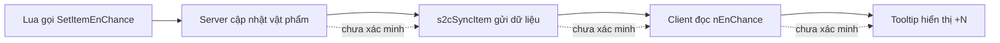

TÓM TẮT 5 DÒNG
1. [TÀI LIỆU] W-02 ghi SetItemEnChance được gọi với sync=1 nhưng cấp không hiện trên vật phẩm Lua (KE-HOACH-TAI-HIEN-HIEU-UNG.md:44).
2. [CHƯA KIỂM] Chưa xác định hàm sửa trường nào: ScriptFuns.cpp không có tại đường dẫn task trong worktree.
3. [CHƯA KIỂM] Chưa xác định dữ liệu s2cSyncItem gửi hoặc bước đồng bộ thiếu: KProtocolProcess.cpp không có tại đường dẫn task trong worktree.
4. [TÀI LIỆU] Tooltip vật phẩm thử không có dòng “+N”; nguồn cấp cho tooltip chưa rõ (KE-HOACH-TAI-HIEN-HIEU-UNG.md:31,44).
5. [CHƯA KIỂM] Không chạy build, exe hay VM; chưa đọc được mã nguồn.

# HG-03 — Vì sao cấp cường hóa từ Lua không tới client
Loại: tổng hợp
Chủ đề: Theo dõi luồng cấp cường hóa từ Lua qua server tới client.
Từ khóa: cường hóa, SetItemEnChance, s2cSyncItem, nEnChance, Lua, client
Trạng thái: PARTIAL — mã nguồn không có tại hai đường dẫn server nêu trong task.
Độ phủ: 0/3 câu hỏi về luồng mã được xác minh trực tiếp.
Liên quan: JX1_OPS/DESIGN/KE-HOACH-TAI-HIEN-HIEU-UNG.md; JX1_OPS/TASKS/HG-03.md
Cần tôi quyết định: có — cung cấp đường dẫn source chính xác nếu khác đường dẫn trong task.

## Luồng cần xác minh

## Phạm vi và độ phủ
| Hạng mục | Kết quả | Bằng chứng / giới hạn |
|---|---|---|
| SetItemEnChance sửa trường nào | CHƯA KIỂM | ScriptFuns.cpp không tồn tại tại đường dẫn task; vị trí task nêu gần 10912. |
| Dữ liệu s2cSyncItem gửi | CHƯA KIỂM | KProtocolProcess.cpp không tồn tại tại đường dẫn task; vị trí task nêu gần 1819, 2976, 3098. |
| Client đọc nEnChance, tạo “+N” | CHƯA KIỂM | Task không chỉ rõ đường dẫn file client. |
| Quan sát vật phẩm thử không có “+N” | TÀI LIỆU | KE-HOACH-TAI-HIEN-HIEU-UNG.md:31,44; kết quả được dẫn lại, không phải kiểm tra mã. |

## Giải mã tên
| Tên gốc | Mã hóa | Chữ đúng | Nguồn |
|---|---|---|---|
| SetItemEnChance | Tên hàm/mã ASCII | SetItemEnChance | JX1_OPS/TASKS/HG-03.md, mục tiêu |
| s2cSyncItem | Tên hàm/mã ASCII | s2cSyncItem | JX1_OPS/TASKS/HG-03.md, mục tiêu |
| nEnChance | Tên trường/mã ASCII | nEnChance | JX1_OPS/TASKS/HG-03.md, mục tiêu |

Không có tên nhân vật, kỹ năng, trang bị, quái, NPC hoặc bản đồ cần giải mã GBK/TCVN3.

## Sắp theo cấu trúc game
Không áp dụng thứ tự danh mục game; phạm vi task là luồng dữ liệu Lua → server → client. Chưa thể xác nhận thứ tự xử lý thực tế khi chưa đọc được mã.

## Kết quả đối chiếu
[TÀI LIỆU] Kế hoạch W-02 ghi gọi SetItemEnChance(idx, n, sync) với sync=1, song vật phẩm Lua không hiện glow và tooltip thiếu “+N” (JX1_OPS/DESIGN/KE-HOACH-TAI-HIEN-HIEU-UNG.md:31,44).

[CHƯA KIỂM] Chưa thể kết luận hàm sửa trường nào, payload đồng bộ có nEnChance không, client đọc trường ở đâu, hoặc thiếu bước nào. Hai file server ở đường dẫn task không có trong worktree; đường dẫn client cũng chưa được nêu.

## Mục sổ thông số
| Nhóm | Tên | file:dòng | Giá trị | Đơn vị | Ảnh hưởng | Đổi an toàn | Nguồn |
|---|---|---|---|---|---|---|---|
| Đồng bộ vật phẩm | sync | JX1_OPS/DESIGN/KE-HOACH-TAI-HIEN-HIEU-UNG.md:44 | 1 | cờ/đối số | Tác dụng thực tế chưa xác minh | CẨN THẬN | Đọc tĩnh tài liệu W-02; chưa đo runtime |

## Đã xác minh / Chưa xác minh
ĐÃ XÁC MINH: tài liệu W-02 ghi sync=1 và tooltip thử nghiệm không có “+N” (KE-HOACH-TAI-HIEN-HIEU-UNG.md:31,44).
CHƯA XÁC MINH: trường hàm sửa, payload s2cSyncItem, client dùng nEnChance ra sao và nguồn tooltip. Không kiểm tra runtime.

## Bàn giao
PARTIAL. Tiếp tục khi có đúng source server và file client chứa nEnChance. Không sửa mã, không chạy build/exe/VM, không commit theo yêu cầu.
Kỹ năng đã dùng: jx1-retrofit, jx1-read-server, jx1-read-client, jx1-parameters, jx1-knowledge, jx1-report.
