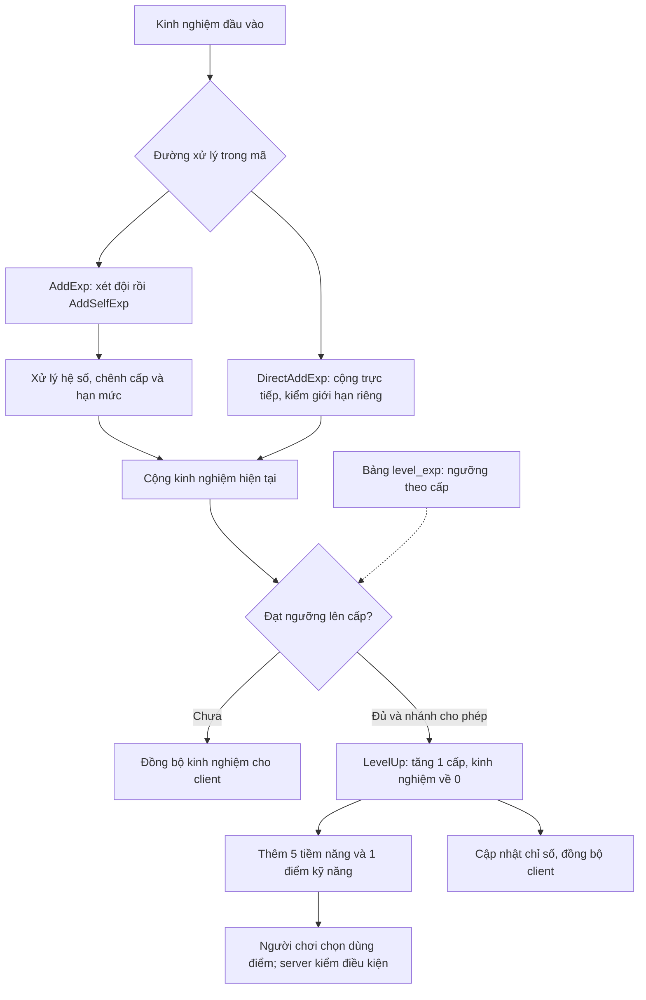

TÓM TẮT 1: [NGUỒN] [THẤY] Mã có đường cộng kinh nghiệm trực tiếp và đường xử lý kinh nghiệm cá nhân/chia đội; khi đủ ngưỡng, chúng gọi hàm lên cấp. `S/KPlayer.cpp:2935–2945,3099–3173,3232–3258`.
TÓM TẮT 2: [NGUỒN] [THẤY] Mỗi lần `LevelUp()` tăng một cấp, cộng 5 điểm tiềm năng chưa dùng và 1 điểm kỹ năng chưa dùng; kinh nghiệm được đặt về 0. `S/KPlayer.cpp:60–62,3264–3279`.
TÓM TẮT 3: [NGUỒN] [THẤY] Client chỉ tới `settings/npc/player/level_exp.txt` và `level_add.txt`; server đọc hai macro tương ứng. [CHƯA KIỂM] Chưa có số liệu từng hàng của hai bảng. `C/CoreUseNameDef.h:103–104`; `S/KPlayerSet.cpp:1291–1322`.
TÓM TẮT 4: [NGUỒN] [TÀI LIỆU] Sổ tay nhân vật hiện nói về hình ảnh; sổ tay kỹ năng đã nói về điều kiện nâng chiêu. Tài liệu này bổ sung hệ thống cấp và điểm, giữ nguyên hai sổ tay. `SO-TAY-NHAN-VAT.md:7–17,34–42`; `SO-TAY-KY-NANG.md:110–117`.
TÓM TẮT 5: [CHƯA KIỂM] Chỉ đọc tĩnh nguồn trên đĩa; không build, chạy exe, VM hoặc mạng; chưa xác minh cấu hình, bảng dữ liệu và hành vi bản đang chạy. `JX1_OPS/TASKS/HG-10.md:28–31`.

# HG-10 — Hiểu cấp, kinh nghiệm và điểm tiềm năng

Loại: khảo sát
Chủ đề: Nhân vật tích kinh nghiệm, lên cấp, nhận điểm và dùng điểm như thế nào trong mã được giao.
Từ khóa: cấp nhân vật, kinh nghiệm, tiềm năng, điểm kỹ năng, LevelUp, DirectAddExp, AddSelfExp, level_exp, level_add
Trạng thái: DONE — trả lời đủ câu hỏi bằng nguồn tĩnh, ghi rõ dữ liệu và hành vi chưa kiểm.
Độ phủ: 6/6 câu hỏi có trả lời hoặc giới hạn; 2/2 tên bảng được định vị trong client, 0/2 bảng dữ liệu được mở thành công; chưa đếm được các hàng kinh nghiệm vì thiếu bảng.
Liên quan: [Sổ tay nhân vật](SO-TAY-NHAN-VAT.md), [Sổ tay kỹ năng](SO-TAY-KY-NANG.md), [Báo cáo HG-10](../REPORTS/HG-10.md).
Cần tôi quyết định: không; việc bổ sung bảng dữ liệu được ghi ở phần bàn giao.

**[THẤY] Căn cứ sơ đồ:** đây là luồng trong mã, không phải kết quả chạy thử. Hai đường cộng có điều kiện khác nhau; không hiểu sơ đồ là mọi nguồn kinh nghiệm đều qua cùng một bộ kiểm tra. `S/KPlayer.cpp:2935–3059,3099–3179,3232–3279,3339–3351,5400–5430,5460–5546`.

## Phạm vi và độ phủ

| Câu hỏi trong task | Độ phủ và kết quả | Bằng chứng |
|---|---|---|
| Lên cấp thế nào? | Đã phủ tĩnh: tích kinh nghiệm, so ngưỡng, gọi lên cấp; có khác biệt giữa hai đường cộng. | [THẤY] `S/KPlayer.cpp:3099–3179,3232–3279` |
| Bảng kinh nghiệm ở đâu và đọc thế nào? | Đã phủ tên bảng phía client và cách nạp ở hai phía; chưa phủ số liệu từng cấp. | [THẤY] `C/CoreUseNameDef.h:103`; `S/KPlayerSet.cpp:1291–1301,1329–1333`; [CHƯA KIỂM] bảng rời không tìm thấy trong phạm vi kiểm tra nêu dưới |
| Lên cấp được cộng gì? | Đã phủ 5 tiềm năng, 1 điểm kỹ năng, cập nhật chỉ số; chưa có mức tăng sinh lực/thể lực/nội lực từng hệ. | [THẤY] `S/KPlayer.cpp:60–62,3271–3284,3818–3839`; [CHƯA KIỂM] thiếu `level_add.txt` |
| Hàm nào cộng hoặc dùng điểm tiềm năng? | Đã phủ hàm thưởng điểm và bốn nhánh tiêu điểm; chưa phủ nội dung luật Lua. | [THẤY] `S/KPlayer.cpp:3277,2571–2721,5400–5430` |
| Điểm kỹ năng được nhận và dùng thế nào? | Đã phủ điểm thưởng, kiểm tra nâng chiêu và phân biệt với kinh nghiệm luyện chiêu; Lua và dữ liệu chiêu còn chưa kiểm. | [THẤY] `S/KPlayer.cpp:3156–3159,3182–3208,3279,5460–5576` |
| Đối chiếu hai sổ tay ra sao? | Đã phủ 2/2 sổ tay, giữ nguyên kết luận cũ. | [TÀI LIỆU] `SO-TAY-NHAN-VAT.md:7–17,34–42`; `SO-TAY-KY-NANG.md:110–117,142–145` |

### Quy ước nguồn và mức chắc

- **[THẤY]**: đã đọc đúng đoạn mã trên đĩa; xác minh tĩnh, không xác nhận máy chủ đang chạy mã đó.
- **[TÀI LIỆU]**: dẫn lại nội dung hai sổ tay, không nâng thành bằng chứng runtime.
- **[CHƯA KIỂM]**: thiếu tệp, chưa đọc luật ngoài phạm vi hoặc chưa được phép chạy thử. Phạm vi này theo `JX1_OPS/TASKS/HG-10.md:23–31`.

| Ký hiệu | Đường dẫn đầy đủ và cách đọc |
|---|---|
| `S/` | `C:/Jx1CocoV3/SwordOnline/SwordOnline/jxOnline/gameserver/Sources/Core/Src/`; đoạn chú thích Hán đã đọc bằng GBK/CP936, định danh mã là ASCII. |
| `C/` | `C:/Jx1CocoV3/Folder/Client2912-20260116T044348Z-3-001/Client2912/Client/Classes/gamecore/`; đọc định danh ASCII; `KPlayer.cpp` là UTF-8 hợp lệ nhưng nhiều chú thích đã có chữ lỗi. Không dùng chú thích lỗi để kết luận. |
| Tên hai sổ tay | Tệp UTF-8 trong `JX1_OPS/DESIGN/` của worktree `D:/JX-wt/HG-10`. |

## Giải mã tên

Tài liệu không liệt kê tên riêng kỹ năng, trang bị, quái, NPC hay bản đồ. Bảng này giải thích các tên trường kỹ thuật được dùng, giữ nguyên cách viết gốc; tên thuộc tính là lời giải thích, chưa xác nhận nhãn giao diện bản cài.

| Tên gốc | Mã hóa | Chữ đúng / nghĩa tiếng Việt | Nguồn file:dòng |
|---|---|---|---|
| `m_nExp` / `m_nNextLevelExp` | ASCII | Kinh nghiệm hiện tại / ngưỡng lên cấp đang giữ | [THẤY] `S/KPlayer.cpp:3244–3255` |
| `m_nAttributePoint` | ASCII | Điểm tiềm năng chưa phân phối | [THẤY] `S/KPlayer.cpp:3275–3277,2573–2580` |
| `m_nSkillPoint` | ASCII | Điểm kỹ năng chưa dùng | [THẤY] `S/KPlayer.cpp:3278–3279,5542–5546` |
| `Strength`, `Dexterity`, `Vitality`, `Engergy` | ASCII; giữ nguyên lỗi viết `Engergy` trong mã | Sức mạnh, thân pháp, sức sống/sinh khí, nội công; đây là bốn hướng phân phối tiềm năng | [THẤY] `S/KPlayer.cpp:5398–5428,2571–2580,2615–2620,2659–2668,2700–2709` |

## Sắp theo cấu trúc game

Các phần dưới đi theo nhân vật → tích kinh nghiệm → lên cấp → nhận điểm → dùng điểm → đối chiếu sổ tay. Bảng tăng chỉ số dùng thứ tự hệ và cột mà bộ nạp thực sự đọc; không dựng danh sách giá trị khi chưa có bảng. [THẤY] `S/KPlayerSet.cpp:1297–1319`; [CHƯA KIỂM] nội dung `level_exp.txt`, `level_add.txt`.

### 1. Kinh nghiệm tích như thế nào?

**[THẤY] Có hai đường xử lý cần phân biệt.** `AddExp()` xét việc chia kinh nghiệm trong đội rồi gọi `AddSelfExp()` cho từng người đủ điều kiện. Nhánh không có đội gọi thẳng `AddSelfExp()`. Người được chia phải cùng khu vực thế giới và trong khoảng cách kiểm tra; hằng khoảng cách là 768 đơn vị game, chưa quy đổi ra mét. `S/KPlayer.cpp:63,2935–2945,2964–3008,3030–3056`.

**[THẤY] Kinh nghiệm cá nhân có thể khác số đầu vào.** `AddSelfExp()` bỏ qua số không dương và người đang chết/hồi sinh; sau đó xét hệ số `ServerExp`, giá trị nhiệm vụ toàn cục 27, chênh cấp, cờ tăng kinh nghiệm và hạn mức `ServerExpLimit`. Hàm tự cộng vào kinh nghiệm, không gọi vòng qua `DirectAddExp()`. [CHƯA KIỂM] Các giá trị cấu hình thật, tình trạng nhiệm vụ và lượng kinh nghiệm thực nhận. `S/KPlayer.cpp:3099–3159`.

**[THẤY] Đường cộng trực tiếp** (`DirectAddExp`) cộng số đầu vào mà không đi qua các bước chia đội và hệ số của `AddSelfExp`. Nó có kiểm giới hạn cấp riêng trước khi cộng. Tên hàm không bảo đảm mọi số truyền vào đều là phần thưởng: mã không loại số âm ở điều kiện đầu. Không dùng điều này để suy ra quy tắc mất kinh nghiệm khi chết vì HG-10 chưa khảo sát đường đó. `S/KPlayer.cpp:3232–3244`.

### 2. Ngưỡng mỗi cấp nằm ở đâu?

| Bảng | Điều đã thấy | Điều chưa kiểm |
|---|---|---|
| `\settings\npc\player\level_exp.txt` | [THẤY] Đường dẫn literal trong client; server dùng macro `PLAYER_LEVEL_EXP_FILE`. Bộ nạp lấy cột 2, bỏ hàng tiêu đề, theo thứ tự hàng. Với cấp L, `GetLevelExp(L)` trả phần tử L−1, tức hàng L+1 của bảng. `C/CoreUseNameDef.h:103`; `C/KPlayerSet.cpp:243–252,281–285`; `S/KPlayerSet.cpp:1291–1301,1329–1333`. | [CHƯA KIỂM] Mọi giá trị từng cấp, hàng tiêu đề thực, số hàng thật và bảng đang được bản cài nạp. |
| `\settings\npc\player\level_add.txt` | [THẤY] Đường dẫn literal trong client; server dùng macro `PLAYER_LEVEL_ADD_FILE`. Đọc từng hàng theo hệ, các cột 2–13. `C/CoreUseNameDef.h:104`; `S/KPlayerSet.cpp:1303–1319`. | [CHƯA KIỂM] Giá trị tăng từng hệ; không suy rằng đây là bảng quy định phần thưởng 5/1 điểm. |

**[THẤY] Đây là ngưỡng cho tiến độ ở cấp hiện tại, không phải tổng kinh nghiệm trọn đời.** Sau khi tăng cấp, mã tra ngưỡng bằng cấp mới; kinh nghiệm hiện tại đã được xóa. Bộ nạp đọc tối đa `MAX_LEVEL` hàng dữ liệu và dùng giá trị mặc định 0 khi gọi đọc ô; riêng lệnh mở tệp thất bại thì trả `FALSE`. [CHƯA KIỂM] Tình trạng nạp bảng ở bản chạy. `S/KPlayer.cpp:3264–3273`; `S/KPlayerSet.cpp:1291–1305,1329–1333`; `S/KPlayerSet.h:6`.

**[THẤY] Số 48 chỉ là ngưỡng khởi tạo trong mã.** `PLAYER_LEVEL_1_EXP = 48` được gán cho `m_nNextLevelExp` khi khởi tạo đối tượng. [CHƯA KIỂM] Không có hàng đầu của bảng để xác nhận ngưỡng cấp 1 thực tế; không lấy 48 điền thay vào bảng kinh nghiệm. `S/KPlayer.cpp:60,161–162`.

**[CHƯA KIỂM] Giới hạn tìm tệp:** tìm có lọc tên `level_exp.txt` trong `C:/Jx1CocoV3/SwordOnline/SwordOnline/` và `level_add.txt` trong cây `Sources` được giao không trả về tệp; kiểm đường `gameserver/Settings/npc/player/level_exp.txt`, `jxOnline/Settings/npc/player/level_exp.txt` và hai bảng dưới `Client/Resources/settings/npc/player/` cũng không thấy. Điều này không chứng minh dữ liệu không tồn tại trong gói tài nguyên hoặc tại một bản triển khai khác. Các đường cần tìm bắt nguồn từ `C/CoreUseNameDef.h:103–104`; không mở gói hay quét root khác.

**[CHƯA KIỂM] Riêng đường dẫn phía server:** `S/KPlayerSet.cpp:19` include `../../../header/CoreUseNameDef.h`, nhưng tệp không có tại đường tương đối đó, cũng không tìm thấy theo đúng tên trong `Sources`. Vì vậy chỉ xác nhận hai macro server đang dùng; chưa khẳng định literal của header server giống hệt client. Không lấy header client thay thế file server.

### 3. Đủ kinh nghiệm thì xảy ra gì?

1. **[THẤY] Kiểm ngưỡng.** `DirectAddExp()` gọi lên cấp khi tổng kinh nghiệm `>=` ngưỡng. `AddSelfExp()` tách trường hợp `>` và `==`; trường hợp bằng còn kiểm cấp nhỏ hơn `MAX_LEVEL`. `S/KPlayer.cpp:3161–3173,3249–3257`.
2. **[THẤY] Tăng đúng một cấp trong một lần gọi.** `LevelUp()` đặt kinh nghiệm bằng 0, kiểm `MAX_LEVEL`, tăng cấp thêm 1 và tra ngưỡng mới. Hai đường vừa đọc gọi hàm một lần, không có vòng lặp lên nhiều cấp; phần vượt ngưỡng không được chuyển sang cấp sau trong nhánh này. Đây là kết luận đọc mã, chưa phải ca thử. `S/KPlayer.cpp:3161–3173,3249–3250,3264–3273`.
3. **[THẤY] Thưởng điểm chưa dùng.** Cộng 5 vào quỹ tiềm năng và 1 vào quỹ điểm kỹ năng. Đây là hằng trong `KPlayer.cpp`, không phải giá trị đã đọc từ `level_add.txt`. `S/KPlayer.cpp:61–62,3275–3279`.
4. **[THẤY] Cập nhật nhân vật.** Gọi ba hàm tăng sinh lực, thể lực, nội lực theo hệ; các hàm lấy hệ số từ bộ dữ liệu tăng theo cấp. Mã còn cập nhật kháng, tính lại dữ liệu hiện tại và nạp đầy ba tài nguyên hiện tại. [CHƯA KIỂM] Mức tăng cụ thể từng hệ. `S/KPlayer.cpp:3281–3297,3328–3337,3818–3839`; `S/KPlayerSet.cpp:1306–1319`.
5. **[THẤY] Gửi kết quả cho client.** Server gửi cấp mới, kinh nghiệm, điểm còn lại và chỉ số gốc; client `s2cLevelUp()` nhận cấp/điểm, đặt kinh nghiệm về 0 và tra ngưỡng theo cấp mới. Không lấy việc có hàm `LevelUp()` trong client làm bằng chứng client tự quyết định phần thưởng của server. `S/KPlayer.cpp:3339–3351`; `C/KPlayer.cpp:4517–4539,4554–4568`.

**[THẤY] Giới hạn cấp phải đọc theo từng nhánh.** `MAX_LEVEL` trong header server là 500. `DirectAddExp()` còn chặn ở `PlayerInfo.nMaxLevel + m_nLimitMaxLevel`; `PlayerMaxLevel` có giá trị dự phòng 1000 lúc đọc cấu hình. Giá trị dự phòng không chứng minh trần game là 1000. `AddSelfExp()` tự cộng và gọi lên cấp, không đi qua kiểm giới hạn riêng của `DirectAddExp()`; `LevelUp()` vẫn kiểm `MAX_LEVEL`. [CHƯA KIỂM] Cấu hình thật, giới hạn bổ sung từng nhân vật và mọi đường thay đổi cấp khác. `S/KPlayerSet.h:6`; `S/KGameglobalSet.cpp:126`; `S/KPlayer.cpp:3154–3173,3235–3242,3266–3271`; `S/KPlayer.h:226,488–489`.

### 4. Điểm tiềm năng dùng thế nào?

**[THẤY] Nhận điểm và tiêu điểm là hai việc.** `LevelUp()` chỉ tăng quỹ điểm còn lại. Khi có yêu cầu phân phối, `AddBaseAttribute()` gọi luật `main_attributeSet` trong `\script\global\global_setting.lua` trước, rồi chuyển sang một trong bốn hàm bên dưới. [CHƯA KIỂM] Nội dung Lua và mọi giới hạn do luật đó đặt ra; không mở rộng đọc script ngoài nguồn được giao. `S/KPlayer.cpp:3277,5400–5430`.

| Hướng cộng | Hàm tiêu điểm | Kiểm và thay đổi đã thấy |
|---|---|---|
| Sức mạnh | `AddBaseStrength` | [THẤY] Số cộng phải dương, không vượt quỹ; tăng thuộc tính và trừ đúng số điểm đó. `S/KPlayer.cpp:2571–2580` |
| Thân pháp | `AddBaseDexterity` | [THẤY] Cùng điều kiện quỹ và phép trừ. `S/KPlayer.cpp:2615–2620` |
| Sinh khí/sức sống | `AddBaseVitality` | [THẤY] Cùng điều kiện quỹ; còn tăng mức sinh lực/thể lực theo hệ số tương ứng. `S/KPlayer.cpp:2659–2669` |
| Nội công | `AddBaseEngergy` | [THẤY] Cùng điều kiện quỹ; tăng mức nội lực theo hệ số tương ứng. `S/KPlayer.cpp:2700–2709` |

### 5. Điểm kỹ năng khác kinh nghiệm luyện chiêu thế nào?

**[THẤY] Một điểm thưởng không có nghĩa tự học thêm một chiêu.** `LevelUp()` chỉ cộng quỹ `m_nSkillPoint`. `AddSkillPoint()` tìm kỹ năng đã có trong danh sách, kiểm số điểm còn lại và trần kỹ thuật, gọi luật `main_Skillset`, rồi có thể chuyển cho script nâng riêng của kỹ năng. `S/KPlayer.cpp:3279,5460–5497`.

**[THẤY] Ở các nhánh nâng thông thường đã đọc,** server kiểm giới hạn của kỹ năng và điều kiện cấp nhân vật so với `GetSkillReqLevel()`. Khi `IncreaseLevel()` thành công, số điểm yêu cầu được trừ khỏi quỹ. Những kiểm tra còn có điểm cộng thêm và giới hạn chuyển sinh; không rút gọn thành một trần chung cho mọi chiêu. [CHƯA KIỂM] Kết quả luật Lua, bảng kỹ năng và nhánh script riêng. `S/KPlayer.cpp:5507–5546,5550–5576`.

**[THẤY] Kinh nghiệm luyện chiêu là quỹ khác.** Trong `AddSelfExp()`, công tắc `Skill120Rate` có thể gọi `AddSkillExp()`. Hàm này xét các kỹ năng phù hợp rồi tăng kinh nghiệm của chúng và gửi đồng bộ riêng. Nó khác thao tác cộng 1 vào `m_nSkillPoint` khi lên cấp; không được hiểu mọi kỹ năng đều tăng cấp chỉ nhờ cấp nhân vật. `S/KPlayer.cpp:3156–3159,3182–3208,3279`.

### 6. Đối chiếu với hai sổ tay

| Tài liệu gốc | Nội dung đang có | Cách HG-10 bổ sung |
|---|---|---|
| `SO-TAY-NHAN-VAT.md` | [TÀI LIỆU] Sổ tay nhân vật và bộ phận: các phần hình, chồng hình và dữ liệu hình ảnh. `SO-TAY-NHAN-VAT.md:7–17,34–42,102–109`. | [THẤY] Hệ thống cấp/điểm là phần khác trong `KPlayer`; không biến kết luận về hình ảnh thành kết luận tăng trưởng nhân vật. `S/KPlayer.cpp:3264–3279`. |
| `SO-TAY-KY-NANG.md` | [TÀI LIỆU] Bấm nâng trên client gửi yêu cầu; nguồn cũ nói server kiểm cấp, điểm, cấp tối đa và để mở đường học đầy đủ. `SO-TAY-KY-NANG.md:110–117,142–145`. | [THẤY] Đối chiếu được kiểm quỹ điểm, cấp yêu cầu và trần trên nhánh thường; bổ sung tên hàm thưởng/tiêu điểm. [CHƯA KIỂM] Không đóng các câu hỏi về toàn bộ cách học hoặc cấu hình đang chạy. `S/KPlayer.cpp:3279,5460–5497,5540–5576`. |

## Đã xác minh / Chưa xác minh

### Đã xác minh bằng đọc tĩnh

- **[THẤY]** Luồng cộng kinh nghiệm, so ngưỡng, lên một cấp, xóa phần dư, thưởng 5/1 điểm và đồng bộ client. `S/KPlayer.cpp:3099–3179,3232–3279,3339–3351`; `C/KPlayer.cpp:4537–4568`.
- **[THẤY]** Tên bảng phía client, cách nạp/ngưỡng theo hàng và các cột tăng chỉ số phía server. `C/CoreUseNameDef.h:103–104`; `S/KPlayerSet.cpp:1291–1333`.
- **[THẤY]** Bốn nhánh tiêu tiềm năng; kiểm tra và tiêu điểm kỹ năng ở nhánh thường. `S/KPlayer.cpp:2571–2721,5400–5430,5460–5576`.
- **[TÀI LIỆU]** Đối chiếu hai sổ tay, không sửa nội dung hay kết luận của chúng. `SO-TAY-NHAN-VAT.md:7–17,34–42`; `SO-TAY-KY-NANG.md:110–117`.

### Chưa xác minh

- **[CHƯA KIỂM]** Dữ liệu thật của hai bảng, literal header server còn thiếu, cấu hình cấp/hệ số/hạn mức đang nạp. Chỉ có tên và cách gọi đọc bảng, không có giá trị từng hàng. `S/KPlayerSet.cpp:19,1291–1322`; `C/CoreUseNameDef.h:103–104`.
- **[CHƯA KIỂM]** Nội dung hai luật Lua phân phối điểm, nhánh nâng riêng từng kỹ năng, các đường script khác có thể sửa cấp/điểm; không tuyên bố khảo sát hết mọi nguồn thưởng. `S/KPlayer.cpp:5405–5413,5483–5497`; giới hạn nguồn `JX1_OPS/TASKS/HG-10.md:23–31`.
- **[CHƯA KIỂM]** Bộ source này có khớp binary và dữ liệu triển khai không; chưa build, test runtime, chạy exe, VM hoặc mạng theo quyền task. `JX1_OPS/TASKS/HG-10.md:28–31`.

## Bàn giao

Tài liệu đạt tiêu chí khảo sát HG-10: câu hỏi nào cũng có nhãn và bằng chứng hoặc lý do chưa kiểm. Báo cáo thực hiện, sổ thông số, kiểm tra tệp và đề xuất mục lục nằm tại [HG-10.md](../REPORTS/HG-10.md). Không commit; Tổng quan phụ trách commit theo yêu cầu.

Bước tiếp theo khi có nguồn được duyệt: cung cấp đúng hai bảng và header server tương ứng, rồi đối chiếu từng hàng ngưỡng và hệ số. Chỉ kiểm thử hành vi khi có task cho phép riêng; chưa dùng kết quả đọc tĩnh thay cho kiểm thử.
