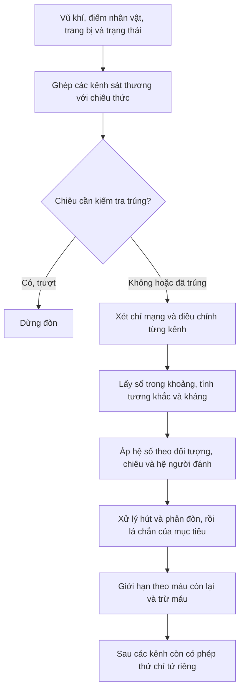

## TÓM TẮT 5 DÒNG

1. [NGUỒN][THẤY] Vũ khí cho khoảng sát thương nền. Sức mạnh hoặc thân pháp và các dòng thuộc tính có thể cộng tiếp trước khi ghép chiêu. `S/KItemList.cpp:117–147`, `S/KPlayer.cpp:2859–2876`, `S/KNpc.cpp:5992–5993`.
2. [NGUỒN][THẤY] Server ghép sát thương theo kênh, kiểm tra trúng nếu chiêu yêu cầu và xét chí mạng trước khi tính kháng. `S/KSkills.cpp:3247–3257`, `S/KNpc.cpp:4494–4503`, `S/KNpc.cpp:4636–4658`.
3. [NGUỒN][THẤY] Tương khắc trừ điểm phần trăm kháng. Sau kháng còn hệ số theo đối tượng, hệ số người đánh, lá chắn và giới hạn theo máu còn lại. `S/KNpc.cpp:5100–5266`, `S/KNpc.cpp:5268–5435`, `S/KNpc.cpp:5614–5719`.
4. [NGUỒN][THẤY] Chí mạng nhân đôi hai đầu khoảng ở năm kênh. Nhánh độc nhân hai lần cùng một trường. Lực tay trên client có phép tính riêng. `S/KNpc.cpp:4651–4857`, `C/gamecore/KPlayer.cpp:5698–5719`.
5. [CHƯA KIỂM] Đã đối chiếu mã và kiểm ví dụ bằng số học PowerShell. Chưa build, chạy exe, VM hay đo trận thật. `JX1_OPS/TASKS/HG-08.md:27–32`.

# HG-08 — Hiểu công thức sát thương

- Loại: khảo sát
- Chủ đề: Từ chỉ số vũ khí và chiêu thức đến số máu mục tiêu mất trong mã server đã đọc.
- Từ khóa: sát thương, lực tay, ngũ hành, giảm trừ, chí mạng, GetWeaponDamage, AppendSkillEffect, ReceiveDamage, CalcDamage, HG-08
- Trạng thái: DONE — đủ phạm vi khảo sát tĩnh và ví dụ số.
- Độ phủ: 5/5 nhóm đầu vào, 6/6 kênh được gọi trong nhánh nhận đòn đã khảo sát, 4/4 báo cáo đối chiếu.
- Liên quan: [H-01](../REPORTS/H-01-ngu-hanh.md), [H-02](../REPORTS/H-02-magic-attrib.md), [T-02](../REPORTS/T-02.md), [T-03](../REPORTS/T-03.md), [bàn giao HG-08](../REPORTS/HG-08.md).
- Cần tôi quyết định: không.

## Phạm vi và độ phủ

| Phần tử | Độ phủ | Nguồn |
|---|---|---|
| Vũ khí gần, xa và tay không | Đã phủ | `S/KItemList.cpp:105–160`, `S/KPlayer.cpp:2859–2876` |
| Chiêu thức và sáu kênh | Đã phủ nhánh ghép và nhận đòn chính | `S/KSkills.cpp:3677–3747`, `S/KNpc.cpp:5978–6233`, `S/KNpc.cpp:4650–4866` |
| Ngũ hành | Đã phủ năm cặp khắc và kháng theo kênh | `S/KNpc.cpp:5100–5266` |
| Giảm trừ | Đã phủ thứ tự và các nhánh chính | `S/KNpc.cpp:5268–5719` |
| Chí mạng và chí tử | Đã phủ phép thử và chỗ thay đổi sát thương | `S/KNpc.cpp:4636–4658`, `S/KNpc.cpp:4803–4866` |
| Lực tay và tooltip client | Đã phủ đường đọc chính | `C/gamecore/CoreShell.cpp:1587–1588`, `C/gamecore/KPlayer.cpp:5458–5490`, `C/gamecore/KPlayer.cpp:5698–5719`, `C/gamecore/KSkills.cpp:3866–3879` |
| H-01, H-02, T-02, T-03 | Đã đối chiếu 4/4 | Phần đối chiếu bên dưới |
| Dữ liệu đang nạp, hành vi bản chạy và toàn bộ ngoại lệ theo chiêu | Chưa phủ | `JX1_OPS/TASKS/HG-08.md:23–32` |

## Giải mã tên

| Tên gốc | Mã hóa | Chữ đúng UTF-8 | Nguồn file:dòng |
|---|---|---|---|
| 金系 (`series_metal`) | GBK | Hệ Kim (金系) | `C/gamecore/GameDataDef.h:332` |
| 木系 (`series_wood`) | GBK | Hệ Mộc (木系) | `C/gamecore/GameDataDef.h:333` |
| 水系 (`series_water`) | GBK | Hệ Thủy (水系) | `C/gamecore/GameDataDef.h:334` |
| 火系 (`series_fire`) | GBK | Hệ Hỏa (火系) | `C/gamecore/GameDataDef.h:335` |
| 土系 (`series_earth`) | GBK | Hệ Thổ (土系) | `C/gamecore/GameDataDef.h:336` |

## Sắp theo cấu trúc game

Bắt đầu từ người đánh và đồ đang mặc, sang chiêu thức, rồi tới kênh sát thương, mục tiêu và số máu mất. Các ví dụ dùng chiêu giả định và mã ca thử, không cần gán tên chiêu, phái, cấp học hoặc tên món.

## Cách đọc bằng chứng

**[THẤY]** là đọc trực tiếp mã trong các gốc dưới đây, hoặc suy tính được ghi rõ từ mã đó. **[TÀI LIỆU]** là dẫn kết quả của báo cáo cũ. **[CHƯA KIỂM]** là chưa có bằng chứng cho chi tiết hoặc bản đang chạy.

| Tiền tố | Gốc đọc |
|---|---|
| `S/` | `C:/Jx1CocoV3/SwordOnline/SwordOnline/jxOnline/gameserver/Sources/Core/Src/` |
| `H/` | `C:/Jx1CocoV3/SwordOnline/SwordOnline/jxOnline/header/` |
| `E/` | `C:/Jx1CocoV3/SwordOnline/SwordOnline/jxOnline/gameserver/Sources/Engine/Src/` |
| `C/` | `C:/Jx1CocoV3/Folder/Client2912-20260116T044348Z-3-001/Client2912/Client/Classes/` |

[THẤY] File dự án server liệt kê `KMissle.cpp`, `KSkills.cpp` và `KNpc.cpp`. Dẫn chứng dùng các định danh ASCII trong mã. Riêng năm tên Hán trong bảng trên được giải mã từ chú thích GBK, còn tài liệu này dùng UTF-8. [CHƯA KIỂM] Bản build nào đang dùng các tệp đó. `S/../Core.vcxproj:662,684,704`, `C/gamecore/GameDataDef.h:332–336`.

## Từ vũ khí đến sát thương của chiêu

1. **[THẤY] Vũ khí cho hai đầu khoảng.** `GetWeaponDamage` lấy hai giá trị gốc từ vũ khí đang mặc. Với từng đầu, hàm tính `(gốc + tổng điểm cộng đầu đó) × (100 + tổng % tăng sát thương vũ khí) / 100`. Hàm đọc cả sáu ô magic và chỉ lấy ba loại `magic_weapondamagemin_v`, `magic_weapondamagemax_v`, `magic_weapondamageenhance_p`. Vòng đọc này không gọi kiểm kích hoạt. Đường áp thuộc tính lên nhân vật là đoạn khác, có kiểm kích hoạt cho các ô ẩn. `S/KItemList.cpp:117–147`, `S/KItem.cpp:148–178`, `S/KItemList.cpp:2674–2706`.
2. **[THẤY] Nhân vật cộng điểm vào khoảng nền.** Vũ khí gần cộng `sức mạnh hiện tại / 5`, vũ khí xa cộng `thân pháp hiện tại / 5` vào cả hai đầu. Tay không có nền `sức mạnh hiện tại / 5 + 1` ngay trong `GetWeaponDamage`. `SetNpcPhysicsDamage` chuyển khoảng này qua `SetPhysicsDamage` để lưu vào `m_PhysicsDamage`. `S/KItemList.cpp:149–159`, `S/KPlayer.cpp:2859–2876`, `S/KPlayer.h:37–38`, `S/KNpc.cpp:11257–11260`.
3. **[THẤY] Chiêu có dữ liệu riêng theo cấp.** `KSkill` đọc kết quả thiết lập cấp chiêu và đưa vào `m_DamageAttribs`. `CreateMissleMagicAttribsData` gọi `AppendSkillEffect` với dữ liệu đó, cờ loại chiêu và `m_nEnChance` khi có người tung chiêu. `KMissle::ProcessDamage` chuyển đòn sang `ReceiveDamage`. Nhánh áp trực tiếp cũng gọi `ReceiveDamage`. `S/KSkills.cpp:3194–3216`, `S/KSkills.cpp:3240–3257`, `S/KSkills.cpp:3393–3398`, `S/KMissle.cpp:1350,1531,1544`.
4. **[THẤY] Vật lý theo phần trăm và vật lý theo điểm là hai nhánh.** Với `magic_physicsenhance_p`, mỗi đầu lấy nền `B = m_PhysicsDamage + m_CurrentAddPhysicsDamage`, rồi tính riêng `B × (100 + % chiêu) / 100` và cộng `B × % tăng theo loại vũ khí / 100` cho người chơi. Hai phép chia nguyên xảy ra trước phép cộng. Với `magic_physicsdamage_v`, mỗi đầu lấy điểm của chiêu nhân `(100 + nSkillEnhance) / 100`, rồi cộng `m_MagicPhysicsDamage` nếu cờ `IsPhysical` tắt. Dòng cộng điểm và dòng cộng % vào nhân vật đi qua hai handler riêng. `S/KNpc.cpp:5990–6054`, `S/KNpcAttribModify.cpp:93–94,2814–2858`.

[THẤY] Cờ `IsPhysical`, hệ `Series` của chiêu và kênh sát thương là các trường riêng. Một đòn có thể đưa nhiều kênh vào xử lý theo thứ tự sau, với điều kiện đầu vào kênh tại `ReceiveDamage` lớn hơn 0. `S/KSkills.cpp:3044–3047`, `S/KNpc.cpp:4650–4857`.

| Kênh | Ghép ở người đánh | Tính ở mục tiêu |
|---|---|---|
| Vật lý | [THẤY] Lấy nền theo % hoặc điểm chiêu như trên. `S/KNpc.cpp:5992–6054` | Kháng vật lý. `S/KNpc.cpp:4686–4690,5161–5174` |
| Băng | [THẤY] Điểm chiêu có thể nhận % hỗ trợ và điểm cộng theo cờ. Có trường thời gian làm chậm riêng. `S/KNpc.cpp:6059–6092` | Kháng băng. Làm chậm xử lý riêng sau sát thương kênh. `S/KNpc.cpp:4727–4740,5185–5198` |
| Hỏa | [THẤY] Có % hỗ trợ chiêu và `m_CurrentFireEnhance`. Điểm hỏa cộng thêm cũng đi qua mức tăng hỏa. `S/KNpc.cpp:6098–6122` | Kháng hỏa. `S/KNpc.cpp:4765–4770,5202–5215` |
| Lôi | [THẤY] `% tăng lôi` dùng chênh hai đầu đã qua hỗ trợ để nâng đầu thấp. Sau đó cộng điểm lôi theo cờ. `S/KNpc.cpp:6128–6147` | Kháng lôi. `S/KNpc.cpp:4792–4798,5219–5232` |
| Độc | [THẤY] Ghép điểm, thời gian và chu kỳ riêng. Có thể trộn độc từ chiêu và chỉ số đang có. `S/KNpc.cpp:6152–6190` | Kháng độc. Nhánh đã đọc có cả sát thương ngay và danh sách độc theo chu kỳ. `S/KNpc.cpp:4829–4843,5236–5252,2032–2039` |
| `damage_magic` | [THẤY] Điểm `magic_magicdamage_v` nhân hệ số hỗ trợ chiêu. `S/KNpc.cpp:6197–6201` | Kháng hiệu dụng đặt 0 trong nhánh này. `S/KNpc.cpp:4857,5254–5259` |

## Khi đòn chạm mục tiêu

1. **[THẤY] Trúng trước, chí mạng sau.** Nếu bật `bUseAR`, `ReceiveDamage` dùng điểm đánh, né và % bỏ qua né. `CheckHitTarget` tính `né hiệu dụng = né × (100 − % bỏ qua né) / 100`, rồi tính `% trúng = điểm đánh × 100 / (điểm đánh + né hiệu dụng)`. Nếu mẫu số bằng 0 thì lấy 50, sau đó chặn từ 10 đến 95 và thử ngẫu nhiên. Trượt thì trả về trước các kênh. `S/KNpc.cpp:4487–4503,10995–11012`, `H/GameDataDef.h:120`, `S/KNpc.h:63`.
2. **[THẤY] Chí mạng tăng khoảng của kênh trước khi lấy số.** `AppendSkillEffect` chép tỷ lệ `magic_deadlystrike_p` của chiêu. Với `bIsPhysical`, đoạn đọc được tính `p + trunc(p × m_CurrentDeadlyStrike / 100)`, ví dụ `20 + 20 × 50 / 100 = 30` nếu các đầu vào lần lượt là 20 và 50. `ReceiveDamage` gọi `g_RandPercent` một lần cho đòn. Khi trúng chí mạng, vật lý, băng, hỏa, lôi và `damage_magic` đều nhân đôi hai đầu khoảng. Riêng độc chạy hai phép `nValue[0] *= 2`, đưa trường đó lên gấp bốn trước khi tính độc ngay và chia danh sách độc. Một số nhánh còn điều chỉnh theo mã đòn `nDameXG`. `S/KNpc.cpp:6213–6225,4506–4541,4636–4857`, `S/KNpcAttribModify.cpp:1300–1303`, `S/KMath.h:376–384`.
3. **[THẤY] Lấy một số cho mỗi kênh.** `CalcDamage` chặn mục tiêu không hợp lệ hoặc có miễn sát thương theo các điều kiện đầu hàm. Sau đó dùng `đầu thấp + g_Random(đầu cao − đầu thấp)`, kể cả khi hai đầu truyền vào đảo thứ tự. Trong helper đọc được, hiệu bằng 0 trả 0, còn hiệu dương dùng phép lấy dư, nên đầu cao không được lấy khi hai đầu khác nhau. `S/KNpc.cpp:5070–5098`, `E/KRandom.cpp:68–94`.
4. **[THẤY] Tương khắc làm giảm kháng theo kênh.** Hàm so hệ người đánh và mục tiêu, theo chiều Kim → Mộc → Thổ → Thủy → Hỏa → Kim. Nếu khắc, lấy `R_thô = kháng hiện tại − S`, với `S` là giá trị `seriesdamage_p` từ gói chiêu. Các cặp còn lại giữ `R_thô = kháng hiện tại`. Với trần kênh `M ≥ 0`, chặn `R_thô` vào `[-M, M]`, rồi áp trần toàn cục 150. Sát thương sau kháng là `trunc(D₀ × (100 − R_hiệu_dụng) / 100)`. Vật lý, băng, hỏa, lôi, độc có kháng riêng. Kênh `damage_magic` đặt kháng về 0. `S/KNpc.cpp:5100–5266`, `H/GameDataDef.h:116,329–333`.
5. **[THẤY] Sau kháng còn giảm theo đối tượng và theo người đánh.** Người đánh NPC có thể chịu `m_nReducedDamge` của mục tiêu, giá trị trên 100 bị đặt về 99 ở nhánh này. Người đánh người dùng hệ số PK khi `bReturn == FALSE`. Ca mặc định chia nguyên cho 2 trước khi nhân tỷ lệ PK, còn một số ID chiêu có cách tính riêng. NPC đánh người giảm còn 50% khi `bReturn == FALSE` và `GoldType != 1`. Tiếp theo, mã đang hoạt động nhân 60% cho mỗi hệ 0–4 của người chơi đánh. `S/KNpc.cpp:5268–5380,5410–5435`, `S/KNpcSet.cpp:93–107`.
6. **[THẤY] Hút và phản đòn diễn ra trước lá chắn của mục tiêu.** Lá chắn theo % tính phần nội lực phải trả. Khi nội lực đủ, sát thương giảm đúng phần đó. Khi thiếu, mã trừ nội lực xuống âm tạm thời, trừ số âm ấy vào sát thương rồi đặt nội lực về 0. Đoạn chống chịu `m_CurrentDamageReduce` tiếp đó ghi đè mức chắn đã tính trước bằng `nội lực tối đa × m_CurrentDamageReduce / 100`, rồi trừ đến tối thiểu 0 trong nhánh này. Cuối đường thường, giá trị âm bị đổi thành 1, giá trị 0 vẫn có thể giữ nguyên, giá trị dương bị chặn theo máu còn lại rồi mới trừ máu. `S/KNpc.cpp:5438–5611,5614–5655,5713–5719`.
7. **[THẤY] Chí tử được thử riêng sau các kênh.** Nếu phép thử `pTemp_FatallyStrike[0]` thành công, lời gọi `CalcDamage` với `bFatally` trừ ngay `máu hiện tại / 10` sau các điều kiện chặn đầu hàm. Với độc theo chu kỳ, đoạn đọc được gọi `CalcDamage` với độ tương khắc bằng 0 và `bReturn = TRUE`, rồi còn có dòng trừ máu riêng theo `m_CurPoisonDamage`. [CHƯA KIỂM] Tổng máu mất của cả chu kỳ trong bản chạy, phạm vi lặp và quan hệ với hiệu ứng độc khác. `S/KNpc.cpp:4861–4867,5070–5080,2032–2044`.

## Ví dụ tính tay

[THẤY — suy tính] Giả sử người hệ Kim đánh một NPC hệ Mộc bằng kênh vật lý duy nhất. Cả hai đầu khoảng giống nhau. Vũ khí gốc 95, cộng 5 điểm cho mỗi đầu, tăng 10%. Sức mạnh 100, cộng vật lý 5 điểm, chiêu tăng 50%, loại vũ khí được tăng 20%. Mục tiêu có kháng vật lý 40, trần 75, tương khắc 20 điểm và lá chắn nội lực 25% với đủ nội lực. Giả định đòn trúng, máu đủ, không có hệ số riêng của chiêu, giảm sát thương riêng của NPC, phản đòn, chí tử hay lá chắn thứ hai. Trình tự lấy từ `S/KItemList.cpp:124–147`, `S/KPlayer.cpp:2859–2866`, `S/KNpc.cpp:5992–6030,4651–4686,5101–5266,5412–5415,5614–5628,5713–5719`.

| Bước | Đánh thường | Chí mạng |
|---|---:|---:|
| Vũ khí `(95 + 5) × 110 / 100` | 110 | 110 |
| Nền `110 + 100 / 5 + 5` | 135 | 135 |
| Ghép chiêu `trunc(135 × 150 / 100) + trunc(135 × 20 / 100)` | 229 | 229 |
| Sau xét chí mạng | 229 | 458 |
| Sau kháng hiệu dụng `40 − 20 = 20` | 183 | 366 |
| Sau hệ số người đánh `× 60%` | 109 | 219 |
| Nội lực trả cho lá chắn | 27 | 54 |
| **Máu mục tiêu mất trong ví dụ** | **82** | **165** |

[THẤY — suy tính] Với sát thương trước kháng 1.000, kháng 90, trần 75 và mức khắc 20, không khắc thì kháng hiệu dụng là 75 và còn 250 sát thương. Có khắc thì `90 − 20 = 70`, còn 300 sát thương. Hai số dừng ngay sau kháng. Đã kiểm số học bằng PowerShell. `S/KNpc.cpp:5100–5266`, `JX1_OPS/REPORTS/H-01-ngu-hanh.md:192–207`.

## Đối chiếu client và báo cáo cũ

- **[THẤY] Client có số lực tay và mô tả chiêu riêng.** Bảng chỉ số lấy khoảng từ `GetEchoDamage` và hiển thị hai đầu. Hàm dùng dữ liệu người đánh và chiêu, ghép công thức hiển thị theo `IsMagic` và không có đầu vào kháng mục tiêu. Tooltip đọc `m_DamageAttribs`, còn lời gọi ghép chỉ số người đánh trong đoạn tooltip đang là chú thích. [CHƯA KIỂM] Giá trị hiển thị thực tế của bản cài. `C/gamecore/CoreShell.cpp:1587–1588`, `C/gameui/KuiRoleState.cpp:2613–2615`, `C/gamecore/KPlayer.cpp:5458–5490,5698–5719`, `C/gamecore/KSkills.cpp:3866–3879`.
- **[TÀI LIỆU][THẤY] H-01 khớp chiều trừ tương khắc rồi mới chặn kháng.** H-01 cũng nêu client cộng `m_CurrentSerisesEnhance` khi `bIsPhysical` và có thuộc tính tương khắc trong chiêu. Server hiện đọc được vẫn chỉ chép ba giá trị của chiêu tại đoạn ghép, dù có handler cộng chỉ số trạng thái. Client cũng vẫn có phép trừ `kháng băng − kháng băng` ở phần dư của bảng hiển thị. [CHƯA KIỂM] Các đường xử lý khác có bù phần chênh này hay hành vi bản chạy. `JX1_OPS/REPORTS/H-01-ngu-hanh.md:166–221`, `S/KNpc.cpp:6206–6211`, `S/KNpcAttribModify.cpp:3968–3971`, `C/gamecore/KNpc.cpp:3243–3252`, `C/gamecore/CoreShell.cpp:1623,1638`.
- **[TÀI LIỆU][THẤY] H-02 giải thích ID và ba tham số của mỗi dòng đồ.** Giá trị của chúng tùy handler. Ví dụ `magic_addphysicsdamage_p` chọn loại vũ khí bằng tham số thứ ba, còn `magic_addphysicsdamage_v` cộng điểm từ tham số thứ nhất. Khi áp magic thường lên nhân vật, ô 0/2/4 áp trực tiếp, ô 1/3/5 cần lượt kích hoạt. `JX1_OPS/REPORTS/H-02-magic-attrib.md:82–114,176–178`, `S/KNpcAttribModify.cpp:93–94,2814–2858`, `S/KItem.cpp:159–178`.
- **[TÀI LIỆU] T-02 có khung đo trước/sau một món và chưa có phép đo runtime.** Có thể dùng khung để ghi riêng chỉ số nền, dòng đồ, độ lệch và nguồn đọc trước/sau. `JX1_OPS/REPORTS/T-02.md:67–86`.
- **[TÀI LIỆU] T-03 có mẫu AB-01 cộng thô 15–20 điểm kháng mỗi kênh và ví dụ kháng 70, trần 75, cộng 20 chỉ tăng thực 5 điểm tại handler đã khảo sát.** [THẤY — suy tính] Nếu server đưa đúng kháng 70 rồi 75 vào bước tính đòn và không tương khắc, cùng đầu vào 1.000 sẽ cho 300 rồi 250 ngay sau kháng. Hai ví dụ nói về hai thời điểm chặn khác nhau: cập nhật chỉ số khi mặc đồ trong T-03 và tính kháng của từng đòn trong HG-08. [CHƯA KIỂM] Kết quả mặc đồ hoặc chiến đấu thực tế. `JX1_OPS/REPORTS/T-03.md:123,143–151,161–169`, `S/KNpc.cpp:5161–5266`.

## Đã xác minh / Chưa xác minh

- **Đã xác minh.** Các đoạn mã dẫn trên giải thích năm nhóm đầu vào và thứ tự sáu kênh của nhánh chính. PowerShell đã tính lại ba bộ số trong phần ví dụ.
- **Chưa xác minh.** Phiên bản binary đang chạy, giá trị bảng chiêu và cấu hình PK đang nạp, mức kháng theo từng mục tiêu, tỉ lệ chí mạng quan sát được, toàn bộ ngoại lệ theo chiêu, kết quả độc theo chu kỳ và chỉ số hiển thị trên thiết bị. Không build, chạy exe, VM hay mạng trong HG-08.

## Bàn giao

Báo cáo HG-08 chứa sổ thông số, phát hiện tĩnh và hàng chỉ mục đề xuất. Tổng quan phụ trách commit.
