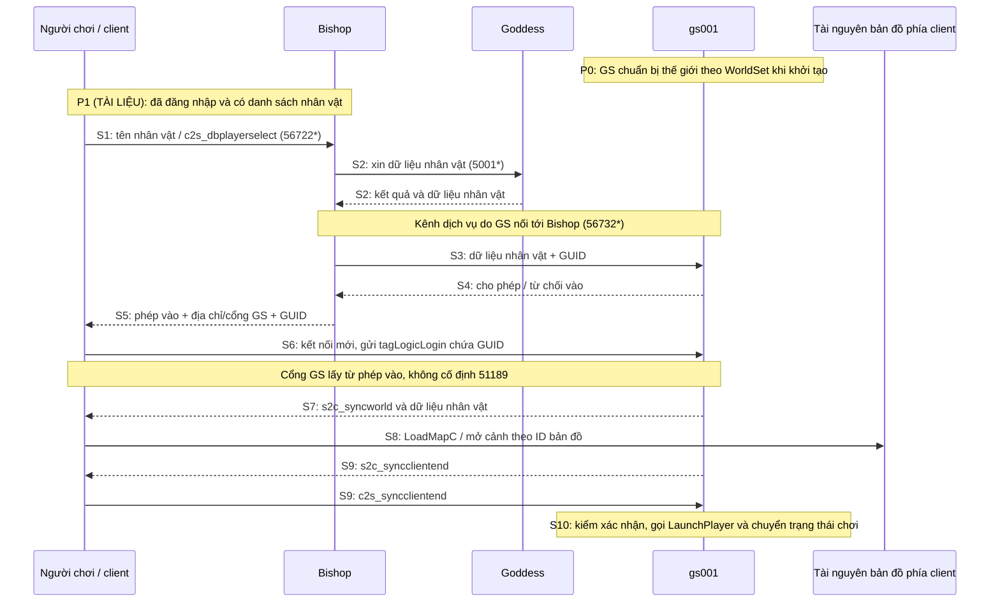

TÓM TẮT 1: [NGUỒN][THẤY] Chọn nhân vật là gửi tên nhân vật cho Bishop, chưa phải vào bản đồ; `O/gameui/KSelPlayer.cpp:1176–1190`.
TÓM TẮT 2: [NGUỒN][THẤY] Bishop hỏi Goddess, gửi dữ liệu nhân vật kèm GUID sang GS, rồi chuyển phép vào về client; `G/MultiServer/Bishop/GamePlayer.cpp:1903–1918,2158,2433`; `G/MultiServer/Bishop/GameServer.cpp:1421–1446`.
TÓM TẮT 3: [NGUỒN][THẤY] Client mở kết nối GS theo phép vào; GS ghép GUID với nhân vật đã chờ, rồi đồng bộ thế giới; `O/gameui/KSelPlayer.cpp:1122–1134`; `S/Core/Src/KPlayerSet.cpp:1723–1745`; `S/Core/Src/KPlayer.cpp:983–1004`.
TÓM TẮT 4: [NGUỒN][THẤY] Nạp bản đồ phía GS, mở tài nguyên phía client và xác nhận đồng bộ là ba việc riêng; `S/Core/Src/KCore.cpp:654–656`; `O/gamecore/KSubWorld.cpp:752–762`; `S/MultiServer/GameServer/KSOServer.cpp:3770–3774`.
TÓM TẮT 5: [CHƯA KIỂM] Chỉ đọc tĩnh; chưa build, chạy exe, VM, mạng hoặc đo phiên vào game; giới hạn theo `JX1_OPS/TASKS/HG-01.md:25–28`.

# HG-01 — Hiểu đường đăng nhập đến vào bản đồ

Loại: khảo sát
Chủ đề: Giải thích từ lúc chọn nhân vật qua Bishop, gs001 đến lúc mở cảnh và nhận vào thế giới.
Từ khóa: đăng nhập, chọn nhân vật, Bishop, Goddess, gs001, GUID, đồng bộ, bản đồ, LoadMapC, WorldSet
Trạng thái: DONE — hoàn tất tài liệu tĩnh trong phạm vi HG-01; cổng hiệu lực, binary và kết quả vào game chưa xác minh.
Độ phủ: đã mô tả 12/12 chặng trong bảng; 11 chặng có đối chiếu source/dữ liệu tĩnh, 1 chặng tiền đề chỉ dẫn tài liệu.
Liên quan: `JX1_OPS/REPORTS/HG-01.md`; `JX1_OPS/REPORTS/A-02-luong-dang-nhap.md`; `JX1_OPS/REPORTS/K-01-ban-do-truyen-tin-hieu.md`; `JX1_OPS/REPORTS/I-04-khao-sat-map.md`; `JX1_OPS/DESIGN/THE-GIOI-TONG-QUAN.md`.
Cần tôi quyết định: không — phần triển khai và kiểm thử chỉ đề xuất bàn giao.

## Sơ đồ chính

[THẤY] Các nhãn P0, S1–S10 trỏ tới bằng chứng từng hàng ngay dưới sơ đồ. [TÀI LIỆU] P1 là phần đăng nhập nền dẫn lại `JX1_OPS/REPORTS/A-02-luong-dang-nhap.md:107–109`. Cổng trong sơ đồ là quy ước/mặc định source, không phải listener đã đo; xem mục cổng.

## Phạm vi và độ phủ — bảng từng bước

[THẤY] Mỗi hàng là một chặng cần giải thích của HG-01, không phải một gói TCP hay một tiến trình riêng. Nguồn được rút gọn bằng các gốc ở mục “Nguồn và cách đọc”; tiêu chí theo `JX1_OPS/TASKS/HG-01.md:18–23`. [TÀI LIỆU] K-01 gọi các kênh này là TCP; HG-01 không bắt gói để xác nhận lại (`JX1_OPS/REPORTS/K-01-ban-do-truyen-tin-hieu.md:94–100`).

| Chặng | Người không lập trình có thể hiểu là | Bên gửi → bên nhận | Cổng đích / kênh | Thông điệp hoặc thao tác | Nguồn file:dòng, nhãn và độ phủ |
|---|---|---|---|---|---|
| P0 — GS chuẩn bị bản đồ | GS dựng sẵn các thế giới sẽ phục vụ; đây không phải mỗi người đăng nhập lại tải toàn bộ danh sách | Nội bộ GS | Không phát sinh cổng ở thao tác đọc tệp | `g_InitCore` ghép `WorldSet_<tham số>.ini`; `LoadSerMaps` đọc Count, lặp các mục rồi gọi `LoadMapS` | [THẤY] Đã phủ: `S/Core/Src/KCore.cpp:249,654–656`; `S/Core/Src/KSubWorldSet.cpp:441–464`; `S/Core/Src/KSubWorld.cpp:825–840`; `GS/maps/WorldSet_gs001.ini:1–4`. |
| P1 — Đã có danh sách nhân vật | Tài khoản đã qua bước kiểm tra và client nhận danh sách để người chơi chọn | Client ↔ Bishop; Bishop ↔ PaySys/Goddess | Bishop 56722*, PaySys 5002*, Goddess 5001* | `c2s_login`, `c2s_accountlogin`, `c2s_roleserver_getrolelist` | [TÀI LIỆU] Đã phủ ở mức dẫn lại: `JX1_OPS/REPORTS/A-02-luong-dang-nhap.md:107–109`. Không đọc dữ liệu tài khoản hoặc kiểm lại PaySys trong HG-01. |
| S1 — Bấm vào game | Client gửi tên nhân vật đang chọn, rồi chuyển sang đợi phép vào | Client → Bishop | 56722* trên kết nối gateway hiện có | `tagDBSelPlayer`, `c2s_dbplayerselect`; trạng thái `LL_S_WAIT_TO_LOGIN_GAMESERVER` | [THẤY] Đã phủ: `O/gameui/KSelPlayer.cpp:1176–1190`; Bishop lấy gói từ hàng đợi tại `G/MultiServer/Bishop/GamePlayer.cpp:1523–1545`. |
| S2 — Lấy hồ sơ nhân vật | Bishop xin bộ dữ liệu của nhân vật từ dịch vụ lưu nhân vật | Bishop → Goddess → Bishop | 5001* | `c2s_roleserver_getroleinfo`; kết quả `s2c_rolehjdkalritopq_getroleinfo_result` | [THẤY] Đã phủ phía Bishop: `G/MultiServer/Bishop/GamePlayer.cpp:1903–1918,2140–2158`. [CHƯA KIỂM] Không mở DB nhân vật hoặc xác nhận dữ liệu trả thật. |
| S3 — Chuyển hồ sơ tới GS | Bishop chọn GS và gửi hồ sơ kèm một mã nhận diện phiên (GUID) | Bishop → GS trên kết nối dịch vụ GS đã mở tới Bishop | 56732* ở phía Bishop; không phải cổng người chơi của GS | `_SyncRoleInfo_ToGameServerFs`, `QueryServer`, `enumSyncRoleInfo`, `tagGuidableInfo`; `s2c_syncogjfkdnvhf_roleinfo_cipher` được chia thành gói | [THẤY] Đã phủ: `G/MultiServer/Bishop/GamePlayer.cpp:2225,2241–2246,2330`; `G/MultiServer/Bishop/GameServer.cpp:1421–1446`; hướng nối GS tại `S/MultiServer/GameServer/KSOServer.cpp:1224`. |
| S4 — GS chuẩn bị nhân vật | GS nhận hồ sơ và GUID; nếu thêm nhân vật chờ thành công thì trả phép vào | GS → Bishop trên kênh dịch vụ trên | 56732* ở phía Bishop | `AddCharacter`, `tagPermitPlayerLogin`, `c2s_permit_logftihmcginqknd`, trường `bPermit` | [THẤY] Đã phủ: `S/MultiServer/GameServer/KSOServer.cpp:3939–3949,3974–3994`. Có phép vào chưa có nghĩa nhân vật đã chơi trên bản đồ. |
| S5 — Trả giấy phép vào | Bishop báo client được vào GS nào và mang theo GUID nào | Bishop → client trên kết nối gateway | Kết nối hiện có tới Bishop 56722* | `tagNotifyPlayerLogin`, `s2c_notifypl_ayerlogin_hfkqotivbhd`; GUID, `bPermit`, `nIPAddr`, `nPort` | [THẤY] Đã phủ: `G/MultiServer/Bishop/GameServer.cpp:991–1021,1073–1081`; `G/MultiServer/Bishop/GamePlayer.cpp:2411–2433`. |
| S6 — Đổi sang kết nối game | Client kiểm phép vào và tên, mở kết nối GS mới, gửi GUID; GS tìm nhân vật chờ có cùng GUID | Client → GS | `nPort` trong phép vào; mặc định source GS 56766*, lịch sử có 51189 | `tagLogicLogin`, `c2s__loginfs_kfjghtueodnchsf`; GS gọi `AttachPlayer` | [THẤY] Đã phủ: `O/gameui/KSelPlayer.cpp:1073–1083,1105–1106,1122–1154`; `S/MultiServer/GameServer/KSOServer.cpp:5036,5049,5077,5087–5092`; `S/Core/Src/CoreServerShell.cpp:2300–2302`; `S/Core/Src/KPlayerSet.cpp:1723–1745`. |
| S7 — Đồng bộ thế giới | GS đọc dữ liệu nhân vật theo từng phần, báo nhân vật đứng ở bản đồ/vùng nào, rồi gửi dữ liệu nhân vật | GS → client | Cùng kết nối GS của S6 | `LoadDBPlayerInfo` → `SendSyncData`; `WORLD_SYNC` / `s2c_syncworld`, rồi thông tin NPC/nhân vật | [THẤY] Đã phủ: `S/MultiServer/GameServer/KSOServer.cpp:5128–5156`; `S/Core/Src/CoreServerShell.cpp:496–509`; `S/Core/Src/KPlayerDBFuns.cpp:174–190`; `S/Core/Src/KPlayer.cpp:983–1004`; `S/Core/Src/KSubWorld.cpp:1750–1757,1782`. |
| S8 — Mở bản đồ trên máy người chơi | Client nhận ID bản đồ và vùng; nếu khác bản đồ hiện tại thì mở dữ liệu cảnh tương ứng trên máy | Nội bộ client sau khi nhận GS | Không có cổng mới ở thao tác đọc tài nguyên | Dispatcher `s2c_syncworld` → `SyncWorld` → `LoadMapC`; đọc `settings/MapList.ini`, gọi `OpenPlace` và `LoadDataMap` | [THẤY] Đã phủ: `O/gamecore/KProtocolProcess.cpp:53,3214–3227`; `O/gamecore/KSubWorld.cpp:724–762`. [CHƯA KIỂM] Chưa chứng minh các tệp/PAK thực nạp có đủ hay cảnh được vẽ thành công. |
| S9 — Báo đồng bộ xong | GS báo đã gửi phần đồng bộ; client kiểm điều kiện, trả xác nhận và đánh dấu đang trong game ở phía client | GS → client → GS | Cùng kết nối GS của S6 | `CLIENT_SYNC_END`, `s2c_syncclientend`, `c2s_syncclientend`; sau đó client có gửi `c2s_cplock` | [THẤY] Đã phủ: `S/MultiServer/GameServer/KSOServer.cpp:5149–5156,5177–5196`; `O/gamecore/KProtocolProcess.cpp:47,3332–3365`. Không trích giá trị khóa hoặc coi các điều kiện kiểm tra đã vượt qua thật. |
| S10 — Đưa nhân vật vào thế giới | GS nhận xác nhận, gọi thêm người chơi vào thế giới; đường này có gọi luật vào bản đồ và script đăng nhập | Nội bộ GS; sau đó thông báo Bishop | Không có cổng mới cho thao tác thêm nhân vật; thông báo Bishop dùng kênh 56732* | `ProcessSyncReplyProtocol` → `AddPlayerToWorld` → `LaunchPlayer`; `SubWorld.AddPlayer`, `OnNewMap`, `playerlogin.lua`; GS đặt `enumPlayerPlaying` | [THẤY] Đã phủ: `S/MultiServer/GameServer/KSOServer.cpp:3770–3783,5203–5233`; `S/Core/Src/CoreServerShell.cpp:514–519`; `S/Core/Src/KPlayer.cpp:7411–7456`. [CHƯA KIỂM] Chưa chạy các script hay kiểm chứng kết quả thêm nhân vật. |

## Giải mã tên

[THẤY] Bảng này giải thích tên thành phần dùng trong tài liệu, giữ nguyên cách viết trong source. Không đưa tên nhân vật, NPC, quái, kỹ năng hoặc tên riêng bản đồ từ dữ liệu vào tài liệu, nên không có tên game cần chuyển từ GBK/TCVN3. Căn cứ yêu cầu bảng: `JX1_OPS/DESIGN/CHUAN-BAO-CAO.md:19`.

| Tên gốc | Mã hóa phần tên | Chữ đúng / cách hiểu tiếng Việt | Nguồn file:dòng |
|---|---|---|---|
| `Bishop` | ASCII, giữ nguyên trong UTF-8 | Bishop — cổng tiếp nhận và điều phối vào game | [THẤY] `G/MultiServer/Bishop/Intercessor.cpp:323,335`; `G/MultiServer/Bishop/GamePlayer.cpp:2433`. |
| `Goddess` | ASCII, giữ nguyên trong UTF-8 | Goddess — dịch vụ dữ liệu nhân vật | [TÀI LIỆU] `JX1_OPS/REPORTS/A-02-luong-dang-nhap.md:91–96,109–110`. |
| `PaySys` / `Sword3PaySys` | ASCII, giữ nguyên trong UTF-8 | Dịch vụ kiểm tài khoản/quyền chơi ở chặng tiền đề | [TÀI LIỆU] `JX1_OPS/REPORTS/A-02-luong-dang-nhap.md:86–89,108`. |
| `gs001` | ASCII, giữ nguyên trong UTF-8 | Tên instance GS được task yêu cầu giải thích | [THẤY] `JX1_OPS/TASKS/HG-01.md:19`; `GS/maps/WorldSet_gs001.ini:1–4`. Không khẳng định instance đang chạy. |
| `Client2912` / `client` | ASCII, giữ nguyên trong UTF-8 | Cây mã phía người chơi được dùng để đối chiếu | [TÀI LIỆU] Gốc O tại `JX1_OPS/REPORTS/K-01-ban-do-truyen-tin-hieu.md:28`; [THẤY] `O/gameui/KSelPlayer.cpp:1176–1187`. |
| `GUID` | ASCII | Mã nhận diện dùng để ghép kết nối GS với hồ sơ đã chuyển | [THẤY] `G/MultiServer/Bishop/GameServer.cpp:1421–1425`; `S/Core/Src/KPlayerSet.cpp:1732–1739`. Không ghi GUID thực. |
| `WorldSet_gs001.ini` / `MapList.ini` | ASCII | Danh sách GS xét nạp / bảng client tra đường dẫn bản đồ | [THẤY] `GS/maps/WorldSet_gs001.ini:1–4`; `O/gamecore/KSubWorld.cpp:752–756`. |

## Sắp theo cấu trúc game

[THẤY] Tài liệu xếp theo đường đi của người chơi và trách nhiệm của từng lớp: **thế giới GS chuẩn bị → tài khoản/danh sách nhân vật → chọn nhân vật → hồ sơ/giấy phép → kết nối game → đồng bộ → mở cảnh → nhập thế giới**. Đây là cấu trúc chặng P0, P1, S1–S10 ở bảng trên, không xếp theo thứ tự tệp. Bằng chứng nối chặng chính: `O/gameui/KSelPlayer.cpp:1185–1190,1122–1154`; `S/Core/Src/KPlayer.cpp:988–1004`; `O/gamecore/KProtocolProcess.cpp:3214–3227,3348–3356`; `S/MultiServer/GameServer/KSOServer.cpp:3770–3774`.

## Hiểu ba mốc dễ nhầm

1. [THẤY] **Có giấy phép vào:** GS đã nhận hồ sơ và trả `bPermit`; client còn phải kết nối GS và gửi GUID. Nguồn: `S/MultiServer/GameServer/KSOServer.cpp:3980–3994`; `O/gameui/KSelPlayer.cpp:1122–1134`.
2. [THẤY] **Chuyển màn hình game:** `KSelPlayer` đặt `LL_S_ENTERING_GAME` sau khi gửi GUID và thay cảnh bằng `KgameWorld::scene()`. Điều kiện thay cảnh này không chờ cờ `m_bIsPlayerInGame` tại chính đoạn đó. Nguồn: `O/gameui/KSelPlayer.cpp:1146–1154,805–808`; cờ phía nhận đồng bộ ở `O/gamecore/KProtocolProcess.cpp:3353–3356`.
3. [THẤY] **GS gọi nhập thế giới:** sau hàm kiểm xác nhận, GS gọi `AddPlayerToWorld` rồi đặt `enumPlayerPlaying`. `LaunchPlayer` vẫn có các nhánh thoát sớm khi bản đồ/thêm người chơi thất bại; vì vậy không dùng riêng phép vào hay biến trạng thái làm bằng chứng cảnh đã tải thành công. Nguồn: `S/MultiServer/GameServer/KSOServer.cpp:3770–3774`; `S/Core/Src/CoreServerShell.cpp:514–519`; `S/Core/Src/KPlayer.cpp:7421–7429`.

[THẤY] Bản đồ nhận lúc đồng bộ chưa bảo đảm là bản đồ cuối cùng sau mọi luật đăng nhập: `LaunchPlayer` gọi `OnNewMap`, có nhánh đổi nơi đứng khi gặp vật cản/điều kiện bản đồ và gọi script đăng nhập. [CHƯA KIỂM] HG-01 chưa đọc hoặc thực thi nội dung các script đó; không gán một map khởi đầu cố định cho mọi nhân vật. Nguồn: `S/Core/Src/KPlayer.cpp:7433–7456`.

## Mục sổ thông số — cổng và giới hạn cấu hình

[THẤY] Dấu `*` trong bảng bước/sơ đồ chỉ giá trị macro, mặc định source hoặc giá trị được dẫn lại; **không phải cổng đang mở đã xác minh**. Riêng Bishop đọc `ClientOpenPort` và `GameSvrOpenPort` với mặc định của hàm đọc là **0**; không coi macro trong header tự thay thế cấu hình bị thiếu (`G/MultiServer/Bishop/Network.cpp:72–73`).

| Nhóm | Tên/hằng số | file:dòng | Giá trị | Đơn vị | Ảnh hưởng | Đổi an toàn | Nguồn đo |
|---|---|---|---|---|---|---|---|
| Gateway người chơi | `GATEWAY_USER_VERIFY_PORT` / `ClientOpenPort` | `GH/ServerPort.h:6`; `G/MultiServer/Bishop/Network.cpp:72`; `G/MultiServer/Bishop/Intercessor.cpp:335` | Macro 56722; reader mặc định 0 | Số cổng | Điểm client nối Bishop | CẨN THẬN | [THẤY] Đọc tĩnh; cấu hình hiệu lực chưa kiểm. |
| Gateway dịch vụ | `GATEWAY_GAMESVR_SERVICE_PORT` / `GameSvrOpenPort` | `GH/ServerPort.h:7`; `G/MultiServer/Bishop/Network.cpp:73`; `S/MultiServer/GameServer/KSOServer.cpp:731,1224` | Macro 56732; Bishop reader mặc định 0, GS reader mặc định 56732 | Số cổng | Kênh GS nối Bishop | CẨN THẬN | [THẤY] Đọc tĩnh; không đo listener. |
| Dữ liệu nhân vật | `ROLEDBSVR_ROLEDB_PORT` | `GH/ServerPort.h:5`; `JX1_OPS/REPORTS/K-01-ban-do-truyen-tin-hieu.md:53` | Macro/mặc định 5001 | Số cổng | Kênh tới Goddess | CẨN THẬN | [THẤY] Macro; [TÀI LIỆU] listener, cấu hình hiệu lực chưa kiểm. |
| Tài khoản | `ACCSVR_ACCOUNT_VERIFY_PORT` | `GH/ServerPort.h:4`; `JX1_OPS/REPORTS/K-01-ban-do-truyen-tin-hieu.md:52` | Macro/mặc định 5002 | Số cổng | Kênh tới PaySys ở P1 | CẨN THẬN | [THẤY] Macro; [TÀI LIỆU] phần xác thực, chưa đối chiếu lại PaySys. |
| GS người chơi | `GameServer/Port`, `g_nPort` | `S/MultiServer/GameServer/KSOServer.cpp:725–728,863`; `O/gameui/KSelPlayer.cpp:1122` | Mặc định 56766; có nhánh ghi đè bằng `g_nPort`; client dùng `nPort` được cấp | Số cổng | Đích kết nối game mới của client | CẨN THẬN | [THẤY] Đọc tĩnh; không đọc cấu hình chứa thông tin nhạy cảm. |
| GS lịch sử | Cổng 51189 | `JX1_OPS/REPORTS/A-02-luong-dang-nhap.md:112`; `JX1_OPS/REPORTS/K-01-ban-do-truyen-tin-hieu.md:56` | 51189, ghi nhận lịch sử | Số cổng | Mốc tài liệu, không phải hằng số client | KHÔNG dùng làm cấu hình hiện tại | [TÀI LIỆU] Chưa đo lại, không sửa kết luận cũ. |
| GS chuẩn bị map | `Init/Count` | `GS/maps/WorldSet_gs001.ini:2`; `S/Core/Src/KSubWorldSet.cpp:448–464` | 800 trong tệp được đọc | Mục được vòng lặp xét | Giới hạn danh sách map của tệp đó | CẨN THẬN | [THẤY] Đọc tĩnh; không đồng nghĩa 800 map tải thành công. |

## Nguồn và cách đọc

[THẤY] Nguồn mở đầu theo task là `CLAUDE.md` mục “Bản đồ code” và tổng quan thế giới (`JX1_OPS/TASKS/HG-01.md:22–23`). **Không có `CLAUDE.md` tại worktree HG-01 khi đọc ngày 19/11/2026**; không tìm sang repository khác. Dùng mục mạng/đăng nhập trong `JX1_OPS/DESIGN/MUC-LUC-TRI-THUC.md:17` để định vị A-02/K-01, rồi kiểm source thật được các báo cáo dẫn. [TÀI LIỆU] Tổng quan thế giới tự ghi chỉ tổng hợp tài liệu, chưa đối chiếu source/runtime (`JX1_OPS/DESIGN/THE-GIOI-TONG-QUAN.md:5–7`); phần map ở `:81–95` không chứng minh một phiên vào map.

| Alias | Gốc tuyệt đối chỉ đọc | Nguồn định vị |
|---|---|---|
| `S/` | `D:/JX-source/server/jxOnline/gameserver/Sources/` | [TÀI LIỆU] `JX1_OPS/REPORTS/K-01-ban-do-truyen-tin-hieu.md:25`. |
| `G/` | `D:/JX-source/server/jxOnline/gateway/Sources/` | [TÀI LIỆU] `JX1_OPS/REPORTS/K-01-ban-do-truyen-tin-hieu.md:26`. |
| `GH/` | `D:/JX-source/server/jxOnline/gateway/Headers/` | [TÀI LIỆU] `JX1_OPS/REPORTS/K-01-ban-do-truyen-tin-hieu.md:27`. |
| `O/` | `C:/Jx1CocoV3/Folder/Client2912-20260116T044348Z-3-001/Client2912/Client/Classes/` | [TÀI LIỆU] `JX1_OPS/REPORTS/K-01-ban-do-truyen-tin-hieu.md:28`. |
| `GS/` | `C:/Jx1CocoV3/Folder/ServerNew-20260116T043145Z-3-001/ServerNew/_bin_v2_/gs/` | [TÀI LIỆU] `JX1_OPS/REPORTS/I-04-khao-sat-map.md:55`. Chỉ đọc header tệp map đã chỉ ra. |

- [THẤY] **THẤY** = đã đối chiếu tĩnh tệp/symbol hoặc trạng thái tệp trong HG-01; không có nghĩa binary đã chạy như vậy. **TÀI LIỆU** = dẫn lại báo cáo, chưa tái kiểm phần đó. **CHƯA KIỂM** = chưa có đối chiếu/phép đo đủ để kết luận; cách tách nguồn tuân theo `JX1_OPS/DESIGN/CHUAN-BAO-CAO.md:21–23` và task `:20`.
- [THẤY] Số dòng sử dụng vị trí dòng vật lý, kiểm bằng token ASCII; phần giải mã GBK ban đầu của client làm lệch dòng đã bị loại. Source server có chú thích GBK; một số chú thích client đang lỗi/trộn mã, chưa phục hồi chữ đúng. Không dựa vào chú thích lỗi để suy nghĩa hoặc sửa tệp gốc; định danh được trích là ASCII, tài liệu đầu ra là UTF-8 không BOM. Điểm đối chiếu: `O/gameui/KSelPlayer.cpp:1185–1187`; `S/Core/Src/KSubWorld.cpp:1753–1757`.
- [CHƯA KIỂM] Không có commit source ghim trong task, không xác nhận cây D:/source, client O, client build khác và exe/APK đang dùng là cùng phiên bản. A-02 cũng phân biệt các cây/phiên bản tại `JX1_OPS/REPORTS/A-02-luong-dang-nhap.md:33,68–78`; HG-01 không gộp các gốc đó.

## Đã xác minh / Chưa xác minh

**ĐÃ XÁC MINH — trong giới hạn đọc tĩnh:**

- [THẤY] Các điểm gửi/nhận chọn nhân vật, dữ liệu hồ sơ/GUID, phép vào, ghép GUID, đồng bộ ID map, mở cảnh, xác nhận và lời gọi nhập thế giới đã có đối chiếu tệp thật ở 11 hàng P0/S1–S10. Nguồn tiêu biểu: `G/MultiServer/Bishop/GameServer.cpp:1423–1446`; `S/Core/Src/KPlayerSet.cpp:1732–1739`; `O/gamecore/KProtocolProcess.cpp:3223–3225,3348–3356`; `S/MultiServer/GameServer/KSOServer.cpp:3770–3774`.
- [THẤY] Đã tách macro/mặc định và lịch sử cổng thay vì đồng nhất: `GH/ServerPort.h:4–8`; `G/MultiServer/Bishop/Network.cpp:72–73`; `S/MultiServer/GameServer/KSOServer.cpp:725–728`. [TÀI LIỆU] Giá trị lịch sử giữ theo `JX1_OPS/REPORTS/A-02-luong-dang-nhap.md:112`.

**CHƯA XÁC MINH:**

- [CHƯA KIỂM] Một phiên thật từ tài khoản tới map; cổng đang lắng nghe, thời gian từng chặng, lỗi/timeout/reconnect, thứ tự record trên đường truyền. Task chỉ cho đọc tĩnh: `JX1_OPS/TASKS/HG-01.md:25–28`.
- [CHƯA KIỂM] Dữ liệu nhân vật thật, ABI/kích thước/giá trị byte của mọi protocol giữa đúng bộ binary, các điều kiện kiểm phép vào/xác nhận có vượt qua và các asset/PAK có nạp đủ. Điểm cần đối chiếu: `O/gameui/KSelPlayer.cpp:1134`; `O/gamecore/KProtocolProcess.cpp:3332–3354`; `S/MultiServer/GameServer/KSOServer.cpp:5203–5233`; `O/gamecore/KSubWorld.cpp:752–762`.
- [CHƯA KIỂM] GS thực nạp những map nào, nhân vật xuất hiện/vẽ đủ hay có chuyển map do script. Điểm cần đo khi có task riêng: `S/Core/Src/KSubWorldSet.cpp:458–464`; `S/Core/Src/KPlayer.cpp:7421–7456`. Không có kết quả build/exe/VM/mạng của HG-01.

## Đề xuất tối ưu và bàn giao

[CHƯA KIỂM — ĐỀ XUẤT] Trước khi sửa lỗi hoặc tối ưu đăng nhập, khóa đúng bộ source/binary/asset, rồi giao task đo riêng các mốc S1, S5, S6, S8, S9 và S10; tách thời gian người dùng chọn nhân vật khỏi thời gian hệ thống. Không bật log chứa tài khoản, GUID thực, khóa hoặc toàn bộ gói tin. Điểm đặt mốc tĩnh: `O/gameui/KSelPlayer.cpp:1187,1122,1134`; `O/gamecore/KSubWorld.cpp:761–762`; `O/gamecore/KProtocolProcess.cpp:3354`; `S/MultiServer/GameServer/KSOServer.cpp:3773–3774`. Đây là đề xuất, chưa thực hiện.

[THẤY] Bàn giao kết quả và ngoại lệ môi trường tại `JX1_OPS/REPORTS/HG-01.md`; task yêu cầu Tổng quan xử lý commit nên HG-01 không stage/commit/push, chưa có SHA của lượt này. Dòng chỉ mục đề xuất nằm trong báo cáo; không tự sửa mục lục hoặc tạo tệp chỉ mục ngoài vùng được giao (`JX1_OPS/TASKS/HG-01.md:13,26,29`).

Kỹ năng đã dùng: jx1-retrofit, jx1-read-server, jx1-read-client, jx1-parameters, jx1-knowledge, jx1-report.
