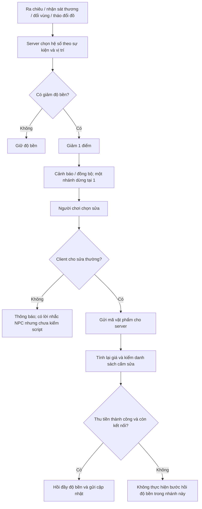

TÓM TẮT 1: [NGUỒN] [THẤY] Server gọi hao mòn khi ra chiêu, nhận sát thương, đổi vùng và một số thao tác tháo/đổi đồ; nguồn: S/KNpc.cpp:3629, S/KNpc.cpp:5727, S/KNpc.cpp:3271, S/KItemList.cpp:5605.
TÓM TẮT 2: [NGUỒN] [THẤY] Giá sửa phụ thuộc cấp, giá gốc, phần độ bền đã mất và số ô thuộc tính; thu tiền thành công mới hồi đầy độ bền; nguồn: S/KItem.cpp:3666, S/KPlayer.cpp:10970.
TÓM TẮT 3: [NGUỒN] [THẤY] Có nút sửa trên trang trang bị; client chặn sửa thường khi độ bền ≤1 và nhắc đến Thợ Rèn Thần Bí; nguồn: C/gameui/KuiRoleState.cpp:2133, C/gamecore/CoreShell.cpp:4402.
TÓM TẮT 4: [NGUỒN] [THẤY] Không thể kết luận đồ về 0 tự biến mất: lệnh xóa tại hai nhánh hao mòn đã bị chú thích; client/server còn khác ngưỡng xử lý; nguồn: S/KItemList.cpp:9498, S/KItemList.cpp:9537, C/gamecore/KItem.cpp:3401.
TÓM TẮT 5: [CHƯA KIỂM] Chưa xác nhận script/vị trí NPC, cấu hình thực nạp và hành vi trong game; không chạy build, game/exe, VM hoặc mạng; căn cứ giới hạn: JX1_OPS/TASKS/HG-14.md:28.

# HG-14 — Hiểu độ bền trang bị và sửa đồ

Loại: khảo sát
Chủ đề: Đọc tĩnh cơ chế hao mòn, giá sửa, đường sửa thường và giới hạn khi trang bị hỏng.
Từ khóa: trang bị, độ bền, sửa đồ, hao mòn, durability, Abrade, RepairItem, KItem, KItemList, Thợ Rèn Thần Bí
Trạng thái: PARTIAL — đã đối chiếu cơ chế nguồn; thiếu script NPC và dữ liệu cấu hình thực để khép kín hai phần này.
Độ phủ: đã phủ 8 trên tổng 10 nhóm ở bảng phạm vi; đã liệt kê 15 vị trí trong bảng hệ số mặc định; chưa kiểm thử runtime.
Liên quan: JX1_OPS/TASKS/HG-14.md; JX1_OPS/DESIGN/CHUAN-BAO-CAO.md; JX1_OPS/REPORTS/HG-14.md.
Cần tôi quyết định: không — phần chưa kiểm được bàn giao để giao tiếp nguồn dữ liệu phù hợp.

## Sơ đồ chính



[THẤY] Sơ đồ rút từ S/KItemList.cpp:9378, S/KItem.cpp:1905, C/gamecore/CoreShell.cpp:4382 và S/KPlayer.cpp:10931; không phải kết quả chạy game. Thao tác không phải lúc nào cũng giảm độ bền, và nhánh dừng tại 1 có thể kết thúc sớm cả lượt duyệt đồ đang mặc (S/KItemList.cpp:9475).

## Phạm vi và độ phủ

| Nhóm cần trả lời | Đã phủ / chưa phủ | Bằng chứng hoặc giới hạn |
|---|---|---|
| 1. Độ bền hiện tại, tối đa, giá trị không hao mòn | Đã phủ bằng đọc tĩnh | S/KItem.h:286; S/KItem.cpp:3617; S/KItem.cpp:1907 |
| 2. Hao mòn khi ra chiêu | Đã phủ bằng đọc tĩnh | S/KNpc.cpp:3609–3629 |
| 3. Hao mòn khi nhận sát thương | Đã phủ bằng đọc tĩnh | S/KNpc.cpp:5038–5043; S/KNpc.cpp:5719–5727 |
| 4. Hao mòn khi di chuyển | Đã phủ bằng đọc tĩnh | S/KNpc.cpp:3261–3271; S/KNpc.cpp:6457–6465; S/KNpc.cpp:6566–6575 |
| 5. Hao mòn khi tháo/đổi đồ | Đã phủ bằng đọc tĩnh | S/KItemList.cpp:5596–5620; S/KItemList.cpp:9517 |
| 6. Giá sửa và thanh toán | Đã phủ bằng đọc tĩnh | S/KItem.cpp:3648–3669; S/KPlayer.cpp:10931–10985 |
| 7. Độ bền thấp/0 và khác biệt hai phía | Đã phủ bằng đọc tĩnh, có giới hạn | S/KItemList.cpp:9462–9499; C/gamecore/KItem.cpp:3371; C/gamecore/KItemList.cpp:2235 |
| 8. Nút sửa, gói tin và cầu nối Lua | Đã phủ bằng đọc tĩnh | C/gameui/KuiRoleState.cpp:2133; S/KProtocolProcess.cpp:6271; S/ScriptFuns.cpp:16158 |
| 9. NPC thật, bản đồ, tọa độ, script sửa đặc biệt | Chưa phủ | Mới thấy tên trong C/gamecore/CoreShell.cpp:4399; tìm tên tệp `*.lua` trong root Sources không có kết quả |
| 10. Hệ số thực nạp và giá của từng món đang dùng | Chưa phủ | S/KItemSet.cpp:74 chỉ ra macro nguồn cấu hình; chưa đọc tệp dữ liệu ngoài hai root được giao |

## Nguồn cần đọc và quy ước dẫn dòng

[TÀI LIỆU] Hai root lấy đúng từ mục Nguồn của task, không thay bằng bản build khác (JX1_OPS/TASKS/HG-14.md:24). Các ký hiệu dưới đây mở rộng thành đường dẫn thật; ví dụ `S/KItem.cpp:1905` là tệp `KItem.cpp` tại root S, dòng 1905.

| Ký hiệu | Root chỉ đọc |
|---|---|
| S | `C:/Jx1CocoV3/SwordOnline/SwordOnline/jxOnline/gameserver/Sources/Core/Src` |
| C | `C:/Jx1CocoV3/Folder/Client2912-20260116T044348Z-3-001/Client2912/Client/Classes` |

[THẤY] Danh sách tệp nội dung đã chọn từ hai root và các lời gọi liên quan: `S/KItem.cpp`, `S/KItem.h`, `S/KItemList.cpp`, `S/KItemList.h`, `S/KItemSet.cpp`, `S/KItemSet.h`, `S/KPlayer.cpp`, `S/KNpc.cpp`, `S/KProtocol.cpp`, `S/KProtocolProcess.cpp`, `S/ScriptFuns.cpp`; `C/gamecore/KItem.cpp`, `C/gamecore/KItemList.cpp`, `C/gamecore/KItemSet.cpp`, `C/gamecore/KPlayer.cpp`, `C/gamecore/KNpc.cpp`, `C/gamecore/CoreShell.cpp`, `C/gamecore/KProtocol.cpp`, `C/gamecore/KProtocolProcess.cpp`, `C/gameui/KuiShop.cpp`, `C/vn/gameui/KuiShopVN.cpp`, `C/gameui/KuiItem.cpp`, `C/gameui/KuiItemdesc.cpp`, `C/gameui/KuiBtnControl.cpp`, `C/gameui/KuiRoleState.cpp`, `C/vn/gameui/KuiItemdescVN.cpp`. Các tệp không có kết quả tìm biểu tượng chỉ được dùng để định vị, không làm bằng chứng phủ định toàn hệ thống.

[THẤY] Nhãn `THẤY` chỉ có nghĩa đã thấy mã/chuỗi đang nằm trên đĩa tại dòng dẫn; `TÀI LIỆU` là yêu cầu hoặc nguồn dẫn lại; `CHƯA KIỂM` là dữ kiện chưa được xác minh. Phần mã C/C++ dùng định danh ASCII; comment/chuỗi có GBK, UTF-8 và dấu hiệu trộn mã. Riêng tên NPC tiếng Việt đọc bằng UTF-8 tại C/gamecore/CoreShell.cpp:4399; không coi toàn bộ client là GBK. Dòng dẫn được chốt theo lần tìm/đọc UTF-8; không dùng số dòng bị lệch khi ép toàn tệp client sang GBK.

## Giải mã tên

[THẤY] Đây là tên nhóm vị trí trong lời cảnh báo, không phải danh sách bộ trang bị hay tên từng món. Giữ nguyên chuỗi gốc; bổ sung dấu tiếng Việt theo nhãn nhóm, không gán mã TCVN3 cho chuỗi ASCII (S/KItemList.cpp:9400–9443).

| Tên gốc | Mã hóa | Chữ đúng UTF-8 / nhãn nhóm | Nguồn file:dòng |
|---|---|---|---|
| `Non` | ASCII | Nón | S/KItemList.cpp:9401 |
| `Y phuc` | ASCII | Y phục | S/KItemList.cpp:9404 |
| `Dai lung` | ASCII | Đai lưng | S/KItemList.cpp:9407 |
| `Vu khi` | ASCII | Vũ khí | S/KItemList.cpp:9410 |
| `Giay` | ASCII | Giày | S/KItemList.cpp:9413 |
| `Bao tay` | ASCII | Bao tay | S/KItemList.cpp:9416 |
| `Day chuyen` | ASCII | Dây chuyền | S/KItemList.cpp:9419 |
| `Nhan 1` | ASCII | Nhẫn 1 | S/KItemList.cpp:9422 |
| `Nhan 2` | ASCII | Nhẫn 2 | S/KItemList.cpp:9425 |
| `Ngoc boi` | ASCII | Ngọc bội | S/KItemList.cpp:9428 |
| `Ngua` | ASCII | Ngựa | S/KItemList.cpp:9431 |
| `Mat na` | ASCII | Mặt nạ | S/KItemList.cpp:9434 |
| `Phi phong` | ASCII | Phi phong | S/KItemList.cpp:9437 |
| `An` | ASCII | Ấn | S/KItemList.cpp:9440 |
| `Trang suc` | ASCII | Trang sức | S/KItemList.cpp:9443 |
| `Thợ Rèn Thần Bí` | UTF-8 | Thợ Rèn Thần Bí; mới là tên trong thông báo | C/gamecore/CoreShell.cpp:4399 |

## Sắp theo cấu trúc game

[THẤY] Trình bày theo vòng đời trang bị: đang sử dụng → hao mòn theo vị trí → cảnh báo/hỏng → chọn sửa → thanh toán/hồi độ bền. Không có dữ liệu bộ trang bị hay từng món trong phạm vi này, nên không tự dựng danh sách bộ (S/KItemList.cpp:9383; S/KItem.cpp:3653).

### 1. Người chơi đang nhìn loại độ bền nào?

- [THẤY] Độ bền hiện tại là số lưu riêng trên món đồ; tối đa lấy từ thuộc tính `magic_durability_v`. Không tìm được thuộc tính tối đa thì hàm trả `-1` (S/KItem.h:286–287; S/KItem.cpp:3617–3626).
- [THẤY] Độ bền hiện tại `-1` được nhánh hao mòn coi là không hao mòn. Ở bước dựng thuộc tính phía client, giá trị 0 có thể được đổi thành `-1`; đây là bước khởi tạo, không phải bằng chứng đồ đã hỏng tự hồi thành bất hoại (S/KItem.cpp:1907; C/gamecore/KItem.cpp:428–444).
- [THẤY] Khi dựng mô tả, client có chuỗi `Trang bi hong` cho độ bền 0 và cảnh báo ở 1–3. Giao diện mô tả khác lấy chữ hiển thị từ khóa bản địa hóa; chưa khẳng định mọi cửa sổ có cùng câu chữ (C/gamecore/KItem.cpp:2377–2397; C/gameui/KuiItemdesc.cpp:446–466).

### 2. Khi nào bị giảm?

| Hoạt động trong game | Điều đã thấy trong mã | Dẫn chứng |
|---|---|---|
| Ra chiêu | Người chơi có chế độ chiến đấu, qua các điều kiện đầu hàm, gọi hao mòn loại Attack ngay trong `DoSkill`; không cần chứng minh đòn đã trúng mới có lời gọi này | S/KNpc.cpp:3609–3629 |
| Nhận sát thương | Nhánh sau khi trừ máu có `nDamage > 0` gọi loại Defend; còn một điểm gọi khác với điều kiện `m_CurrentLife - nLife < 0` | S/KNpc.cpp:5038–5043; S/KNpc.cpp:5719–5727 |
| Di chuyển / nhảy | Các điểm đã thấy chỉ gọi loại Move khi vùng nội bộ thay đổi (`nOldRegion != m_RegionIndex`); không phải mỗi khung hình hay mỗi bước chân | S/KNpc.cpp:3261–3271; S/KNpc.cpp:6457–6465; S/KNpc.cpp:6566–6575 |
| Tháo hoặc đổi đồ | Trong nhánh chuyển đồ từ ô trang bị, vật phẩm được đưa về tay (`m_Hand`) rồi gọi `EquipAbrade`; không khái quát mọi thao tác đổi đồ đều hao | S/KItemList.cpp:5596–5620 |

[THẤY] Mỗi lần gọi không đồng nghĩa mất điểm. Hàm chọn hệ số theo loại sự kiện và vị trí đồ; nếu loại/vị trí không hợp lệ thì trả 0. Hệ số 0 hoặc độ bền hiện tại `-1` không giảm; hệ số âm giảm chắc 1; hệ số dương giảm 1 khi `g_Random(R) == 0` (S/KItemSet.cpp:525–532; S/KItem.cpp:1905–1926). Cách đọc danh nghĩa là một lần trúng trong R khả năng; chưa kiểm phân bố bộ sinh số ngẫu nhiên hoặc tần suất trong game.

### 3. Những vị trí nào có hệ số mặc định?

[THẤY] Bảng dưới là **giá trị dự phòng viết trong source**, không phải cấu hình đang vận hành. `0` là không hao ở loại sự kiện đó; `64`/`256` là R trong phép thử ngẫu nhiên, không phải số điểm mất, phần trăm hay số giây. Tệp cấu hình có thể ghi đè chúng (S/KItemSet.cpp:74–142; C/gamecore/KItemSet.cpp:58–126).

| Vị trí trong game | Ra chiêu | Nhận sát thương | Đổi vùng | Tháo/đổi đồ | Nguồn server |
|---|---:|---:|---:|---:|---|
| Vũ khí | 256 | 0 | 0 | 0 | S/KItemSet.cpp:80,96,112,128 |
| Nón | 0 | 64 | 0 | 0 | S/KItemSet.cpp:81,97,113,129 |
| Y phục | 0 | 64 | 0 | 0 | S/KItemSet.cpp:82,98,114,130 |
| Đai lưng | 0 | 64 | 0 | 0 | S/KItemSet.cpp:83,99,115,131 |
| Giày | 0 | 64 | 64 | 64 | S/KItemSet.cpp:84,100,116,132 |
| Bao tay | 0 | 64 | 0 | 0 | S/KItemSet.cpp:85,101,117,133 |
| Dây chuyền | 0 | 0 | 0 | 0 | S/KItemSet.cpp:86,102,118,134 |
| Nhẫn 1 | 0 | 0 | 0 | 0 | S/KItemSet.cpp:87,103,119,135 |
| Nhẫn 2 | 0 | 0 | 0 | 0 | S/KItemSet.cpp:88,104,120,136 |
| Ngọc bội | 0 | 0 | 0 | 0 | S/KItemSet.cpp:89,105,121,137 |
| Ngựa | 0 | 0 | 64 | 64 | S/KItemSet.cpp:90,106,122,138 |
| Phi phong | 0 | 0 | 64 | 64 | S/KItemSet.cpp:91,107,123,139 |
| Ấn | 0 | 0 | 64 | 64 | S/KItemSet.cpp:92,108,124,140 |
| Trang sức | 0 | 0 | 64 | 64 | S/KItemSet.cpp:93,109,125,141 |
| Mặt nạ | 0 | 0 | 64 | 64 | S/KItemSet.cpp:94,110,126,142 |

### 4. Độ bền rất thấp và về 0 thì sao?

- [THẤY] Lượt hao mòn đồ đang mặc bỏ qua món đã bằng 0 hoặc tối đa không dương. Ở mức 3–5 có nhánh cảnh báo; ở mức 1, nếu thỏa `GetDetailType() != itempart_mask` và `GetGenre() == 0`, hàm báo tổn hại rồi `return` trước khi giảm tiếp. Lệnh này còn dừng xử lý các ô sau trong chính lượt đó (S/KItemList.cpp:9394; S/KItemList.cpp:9455–9479).
- [CHƯA KIỂM] Không suy rằng mọi món đều dừng ở 1, hoặc ngoại lệ trên chắc chắn tương ứng toàn bộ nhóm mặt nạ: điều kiện đang so sánh loại đồ với tên hằng vị trí `itempart_mask`, còn cách dựng mô tả dùng `equip_mask`; chưa đối chiếu giá trị hai enum. Nguồn: S/KItemList.cpp:9462; C/gamecore/KItem.cpp:2385.
- [THẤY] Nhánh hao khi tháo/đổi đồ gọi giảm trực tiếp, không có chốt dừng 1 như nhánh trên. Khi kết quả bằng 0, cả hai hàm gửi thông báo đồ hỏng, nhưng các lệnh xóa `Remove` và `ItemSet.Remove` đều nằm trong comment. Đây chỉ là kết luận tại hai hàm đã kiểm, không phải cam kết vật phẩm không bao giờ bị xóa ở nơi khác (S/KItemList.cpp:9484–9499; S/KItemList.cpp:9517–9538).
- [THẤY] Ở hai hàm đó, nhánh kết quả 0 gửi thông báo hỏng; gói cộng/trừ độ bền thông thường nằm trong `else if`. Bộ nhận thông báo hỏng phía client đã đọc chỉ dựng thông báo hệ thống; chưa thấy tại đó việc đặt độ bền về 0, xóa vật phẩm hay tháo toàn bộ thuộc tính (S/KItemList.cpp:9484–9510; S/KItemList.cpp:9525–9548; C/gamecore/KProtocolProcess.cpp:3787–3804).
- [THẤY] Client chặn một đường yêu cầu mặc khi độ bền 0–1; bản code phía server có đường kiểm 0–3. Hàm xác định loại vũ khí phía client còn kiểm độ bền khác 0, trong khi hàm cùng tên ở server chỉ kiểm ô vũ khí có món. Vì vậy chưa thể quy tất cả ảnh hưởng chiến đấu thành một quy tắc chung (C/gamecore/KItemList.cpp:2235; S/KItemList.cpp:2909; C/gamecore/KItemList.cpp:94–99; S/KItemList.cpp:96–101).
- [THẤY] Đoạn đổi ảnh thành `BROKEN_ITEM_SPR` khi độ bền 0 đang bị bọc trong comment. Không dùng ghi chú “cục sắt” để kết luận giao diện hiện tại chắc chắn biến đồ thành vật phẩm khác (C/gamecore/KItem.cpp:1809–1814).

### 5. Sửa ở đâu và thao tác qua những bước nào?

1. [THẤY] Trên trang trang bị của nhân vật có callback sửa cho món đang chọn; nút được liên kết tới callback và gửi yêu cầu `GOI_TRADE_NPC_REPAIR`. Một đường sửa khác trong nút vật phẩm yêu cầu trạng thái giao diện cửa hàng `BTN_ITME_SHOP`. Bản giao diện VN có callback sửa ở mô tả vật phẩm (C/gameui/KuiRoleState.cpp:1950,2086–2133; C/gameui/KuiBtnControl.cpp:742–769; C/vn/gameui/KuiItemdescVN.cpp:2864–2889).
2. [THẤY] Lõi client kiểm đúng loại trang bị, độ bền không phải `-1`, chưa đầy, lớn hơn 1, đang ngoài chế độ chiến đấu và có đủ tiền theo giá tính tại client. Qua các bước này mới gửi mã vật phẩm lên server (C/gamecore/CoreShell.cpp:4382–4419; C/gamecore/KProtocol.cpp:714–720).
3. [THẤY] Nếu độ bền ≤1, client hiện lời nhắc đến **Thợ Rèn Thần Bí**; chuỗi này cũng xuất hiện ở nhánh đồ bất hoại/đã đầy. Đây là lời nhắc trong mã, không xác nhận NPC ấy hiện tồn tại, đứng ở bản đồ nào hay chắc chắn nhận mọi món bị từ chối (C/gamecore/CoreShell.cpp:4397–4404).
4. [THẤY] Bộ nhận server chuyển mã vật phẩm tới `KPlayer::RepairItem`. Hàm này tìm món trong danh sách người chơi, tính lại giá và kiểm cấu hình `ForbitRepairSet` bằng cách so chuỗi tên món. Giá không dương hoặc khớp danh sách cấm thì báo rồi dừng (S/KProtocolProcess.cpp:6271–6277; S/KPlayer.cpp:10933–10964).
5. [THẤY] Nếu `Pay(nCost)` thành công và chỉ số kết nối không âm, server đặt độ bền bằng tối đa, đặt cờ dùng được 1 và gửi chênh lệch về client. Gói trả về còn có kiểm tra hết hạn, nên không hiểu sửa độ bền là gia hạn vật phẩm. `Pay` gọi `CostMoney`, không phải nhánh `PayXu` (S/KPlayer.cpp:7334–7347; S/KPlayer.cpp:10967–10985).
6. [CHƯA KIỂM] Chưa có script Lua gắn NPC để chứng minh cách mở menu và phí sửa đặc biệt. Trong source chỉ xác minh được cầu nối `Sale` gọi mở cửa hàng và các hàm Lua đọc/đặt độ bền; không tự ghép chúng thành một script NPC giả định (S/ScriptFuns.cpp:5418–5427; S/ScriptFuns.cpp:16158–16206; S/ScriptFuns.cpp:26041–26043).

### 6. Giá sửa được tính như thế nào?

[THẤY] Giá không phải một mức cố định cho mọi món. Với món đủ điều kiện tính giá, mã server dùng phép toán số nguyên theo đúng thứ tự sau (S/KItem.cpp:3648–3669):

```text
L = cấp của món; P = giá gốc của món
D = độ bền tối đa; d = độ bền hiện tại
Ls, Ps, Ms = ba hệ số giá sửa
N = số ô có giá trị khác 0 trong hai dãy thuộc tính được xét
A = (P * Ps) / 100
B = (A * (D - d)) / D
Giá = L * Ls + (B * (Ms + N)) / Ms
```

[THẤY] Đây là cách viết lại đại số của biểu thức số nguyên: mỗi phép chia cắt phần lẻ, không tính hết bằng số thực rồi mới làm tròn. Trong trường hợp dữ liệu không âm, không tràn số, nó cho cùng thứ tự tính với mã nguồn. `N` đếm tối đa 6 ô thường và 6 ô R khác 0; tên `GetTotalMagicLevel` không có nghĩa đang cộng cấp của từng dòng thuộc tính (S/KItem.cpp:3629–3645; S/KItem.cpp:3666).

[THẤY] Giá trị dự phòng là `Ps = 100`, `Ms = 10`, `Ls = 1000`. Giá trả 0 nếu `Ms == 0`, không phải trang bị, độ bền hiện tại `-1` hoặc độ bền tối đa không dương. Client bổ sung trường hợp độ bền hiện tại 0 trả giá 0; hàm giá server không có riêng điều kiện đó (S/KItemSet.cpp:76–78; S/KItem.cpp:3650–3663; C/gamecore/KItem.cpp:3364–3379).

[CHƯA KIỂM] Chưa có giá cụ thể của một món đang được người chơi sử dụng: chưa xác nhận cấp/giá gốc/độ bền/thuộc tính của món và các hệ số thực nạp. Không dùng giá trị dự phòng để báo giá runtime. Nguồn phân biệt dữ liệu và mặc định: S/KItemSet.cpp:74–78; S/KItem.cpp:3659–3666.

## Mục sổ thông số

| Nhóm | Tên/hằng số | file:dòng | Giá trị | Đơn vị | Ảnh hưởng | Đổi an toàn (CÓ/CẨN THẬN/KHÔNG) | Nguồn đo |
|---|---|---|---|---|---|---|---|
| Trạng thái | `m_nCurrentDur == -1` | S/KItem.cpp:1907 | -1 | Giá trị đặc biệt | Bỏ qua hao mòn | KHÔNG — không đổi ý nghĩa sentinel | Đọc tĩnh, chưa đo runtime |
| Hao mòn | `nRandRange` | S/KItem.cpp:1907–1920 | 0 / âm / dương | Hệ số mỗi lần gọi | Không giảm / chắc giảm 1 / thử ngẫu nhiên | CẨN THẬN — chưa biết tệp cấu hình thực | Đọc tĩnh |
| Ra chiêu | `Attack/Weapon` | S/KItemSet.cpp:80 | 256 dự phòng | R | Chọn hao mòn vũ khí khi ra chiêu | CẨN THẬN | Mặc định source, chưa đo |
| Nhận sát thương | `Defend/Head...Cuff` | S/KItemSet.cpp:97–101 | 64 dự phòng | R | Áp dụng 5 ô bảo hộ trong bảng | CẨN THẬN | Mặc định source, chưa đo |
| Di chuyển/đổi đồ | `Move`, `Equip` | S/KItemSet.cpp:112–142 | 0 hoặc 64, theo bảng 15 vị trí | R | Chọn hao theo sự kiện và vị trí | CẨN THẬN | Mặc định source, chưa đo |
| Giá sửa | `ItemPriceScale` | S/KItemSet.cpp:76 | 100 dự phòng | Hệ số chia 100 | Phần giá gốc trong tiền sửa | CẨN THẬN | Mặc định source |
| Giá sửa | `MagicPriceScale` | S/KItemSet.cpp:77 | 10 dự phòng | Hệ số | Điều chỉnh theo số ô thuộc tính; bằng 0 làm hàm giá trả 0 | CẨN THẬN | Mặc định source |
| Giá sửa | `LevelPriceScale` | S/KItemSet.cpp:78 | 1000 dự phòng | Tiền trong phép tính / cấp món | Phần tiền cộng theo cấp | CẨN THẬN | Mặc định source |
| Sửa thường | Chốt độ bền client | C/gamecore/CoreShell.cpp:4402 | ≤1 bị chặn | Điểm độ bền | Chuyển sang lời nhắc sửa đặc biệt | CẨN THẬN — phải đối chiếu hai phía | Đọc tĩnh |
| Cấm sửa | `ForbitRepairSet/Count`, `ItemName_i` | S/KPlayer.cpp:10944–10964 | Count dự phòng 0; danh sách thực chưa đọc | Số mục / chuỗi tên | Có thể chặn sửa món khớp tên | CẨN THẬN | Đọc tĩnh; không phải cấu hình thực |

## Đã xác minh / Chưa kiểm

### Đã xác minh

- [THẤY] Đã kiểm các lời gọi hao mòn, điều kiện dừng, mặc định của 15 vị trí, biểu thức tiền sửa và đường hồi độ bền trong source server; các dẫn dòng đặt ngay tại phần giải thích (S/KNpc.cpp:3629; S/KItemList.cpp:9378; S/KItemSet.cpp:80; S/KPlayer.cpp:10931).
- [THẤY] Đã đối chiếu client ở nút sửa, chốt độ bền, gói yêu cầu và bộ nhận thông báo; đã chỉ rõ chỗ không đồng nhất thay vì chọn ngầm một phía (C/gameui/KuiRoleState.cpp:2133; C/gamecore/CoreShell.cpp:4402; C/gamecore/KProtocolProcess.cpp:3787).

### Chưa kiểm

- [CHƯA KIỂM] Script NPC sửa đồ thật, ID NPC, bản đồ, tọa độ, giá/số nguyên liệu sửa đặc biệt và việc menu có đang được gắn. Chỉ có tên NPC trong thông báo; không có tệp `*.lua` tìm được tại root Sources được giao (C/gamecore/CoreShell.cpp:4399; S/ScriptFuns.cpp:16158).
- [CHƯA KIỂM] Tệp cấu hình ứng với `ITEM_ABRADE_FILE`, danh sách cấm sửa thực tế và dữ liệu từng món; không đọc lan ra root dữ liệu khác (S/KItemSet.cpp:74; S/KPlayer.cpp:10944).
- [CHƯA KIỂM] Ngưỡng 1/3/0, đồng bộ lúc chạm 0, khả năng sửa qua đường khác, tác động đủ lên thuộc tính chiến đấu, ngoại lệ mặt nạ và xử lý hết hạn trong phiên chơi thật. Mã có các khác biệt cần thử riêng khi có task cho phép (S/KItemList.cpp:9462; C/gamecore/KItemList.cpp:2235; S/KItemList.cpp:2909; S/KPlayer.cpp:10979).
- [CHƯA KIỂM] Chưa chạy build, kiểm thử game, exe, VM, mạng; chỉ dùng công cụ đọc tệp cục bộ theo JX1_OPS/TASKS/HG-14.md:27–29.

## Phát hiện khi chuẩn hóa và đề xuất tối ưu

[TÀI LIỆU] Đây là tài liệu mới; không có kết luận cũ để sửa. Giữ các phát hiện khác biệt thành ghi chú, không sửa source hay đổi báo cáo cũ (JX1_OPS/DESIGN/CHUAN-BAO-CAO.md:26–29).

- [THẤY] Cần giao task đối chiếu các chốt sửa/dùng đồ giữa hai phía và đường đồng bộ khi chạm 0 trước khi viết hướng dẫn người chơi tuyệt đối. Đây là đề xuất khảo sát tiếp, chưa phải kết luận lỗi runtime (S/KItemList.cpp:9484–9510; C/gamecore/CoreShell.cpp:4402; S/KItemList.cpp:2909).
- [THẤY] Comment “xóa đồ” không khớp các lệnh xóa đang bị chú thích; một số chuỗi/comment trộn mã. Khi bổ sung tài liệu phải ưu tiên câu lệnh hoạt động và giữ nguyên chuỗi gốc (S/KItemList.cpp:9484–9499; C/gamecore/CoreShell.cpp:4399).
- [CHƯA KIỂM] Bước tiếp theo là giao rõ root dữ liệu Lua/cấu hình chỉ đọc cho PM/người được phân công; chưa đề xuất tăng/giảm hệ số hay thay đổi giá khi thiếu giá trị thực (S/KItemSet.cpp:74–78; S/ScriptFuns.cpp:16158).

## Bàn giao

[TÀI LIỆU] Báo cáo thực hiện: `JX1_OPS/REPORTS/HG-14.md`. Không stage, commit hoặc push theo yêu cầu lượt này; Tổng quan thực hiện commit. Không tự tạo chỉ mục ngoài vùng được giao; hàng đề xuất cho mục lục và TSV nằm trong báo cáo để PM gộp. Căn cứ vùng đầu ra: JX1_OPS/TASKS/HG-14.md:21,27–30 và yêu cầu bổ sung trong lượt này.

Kỹ năng đã dùng: jx1-retrofit (áp dụng khuôn, không sửa kết luận cũ), jx1-read-server, jx1-read-client, jx1-parameters, jx1-knowledge, jx1-report.

## Bổ sung HG-14b — tiếp tục phần còn thiếu ngày 19/11/2026

[TÀI LIỆU] Phần HG-14 phía trên được giữ nguyên, gồm 5 dòng tóm tắt, kết luận PARTIAL, số liệu và bằng chứng cũ. Đợt này chỉ đọc tiếp đường sửa qua Lua và cấu hình trong hai root đã duyệt; không làm lại khảo sát hao mòn đã có. Phạm vi: JX1_OPS/TASKS/HG-14b.md:19–33; báo cáo thực hiện: `JX1_OPS/REPORTS/HG-14b.md`.

### Phạm vi và độ phủ bổ sung

| Phần còn thiếu cần kiểm | Kết quả đợt HG-14b | Bằng chứng hoặc giới hạn |
|---|---|---|
| Cầu nối Lua đọc/đặt độ bền | Đã phủ bằng đọc tĩnh; bổ sung hai đường đặt khác ngoài đường cũ | S/ScriptFuns.cpp:16158–16208,16211–16249,16253–16299,26041–26048 |
| Cách chọn cấu hình cấm sửa | Đã phủ mẫu tên tệp; chưa phủ nội dung thực nạp | S/KCore.cpp:261–265; S/KPlayer.cpp:10944–10964 |
| Script NPC sửa thường/đặc biệt, menu, vị trí và giá | Chưa phủ | Tìm tệp có bộ lọc `*.lua` trong từng root S-cha/C cho 0 kết quả; lời nhắc client không phải script: C/gamecore/CoreShell.cpp:4399,4404 |
| Hệ số sửa/hao mòn và danh sách cấm thực tế | Chưa phủ | Tìm tệp có bộ lọc `*.ini` trong từng root S-cha/C cho 0 kết quả; mã chỉ cho điểm nạp và mặc định: S/KItemSet.cpp:74–78; S/KCore.cpp:262–265 |

[THẤY] `S-cha` là `C:/Jx1CocoV3/SwordOnline/SwordOnline/jxOnline/gameserver/Sources`; `S` và `C` giữ nghĩa trong bảng root ở trên. Kết quả tìm tên tệp chỉ áp dụng hai root này, không chứng minh dữ liệu không tồn tại ở nơi khác hoặc trong gói tài nguyên. Server còn có lời gọi mở `\package.ini` trong nhánh `_SERVER`, nhưng chưa kiểm nội dung gói hoặc việc nạp thực tế (S/KCore.cpp:255–256).

### Sắp theo cấu trúc game: chọn sửa → script xử lý → đồng bộ

1. [THẤY] Với sửa thường, client chặn món có độ bền ≤1 trước khi gửi yêu cầu và hiện tên **Thợ Rèn Thần Bí**. Vì vậy không thể dùng việc có nút sửa để bảo đảm món đã hỏng sẽ sửa được qua đường này (C/gamecore/CoreShell.cpp:4402–4414). Tên riêng duy nhất trong phần bổ sung này giữ nguyên chuỗi gốc, mã hóa UTF-8, đã giải thích trong bảng **Giải mã tên** phía trên (C/gamecore/CoreShell.cpp:4399,4404).
2. [THẤY] Server có hàm để script đặt trực tiếp độ bền (`SetCurDurability`): lấy chỉ số vật phẩm và độ bền muốn đặt, nhận giá trị lớn hơn `-2`, chặn trên ở độ bền tối đa, rồi gọi đồng bộ vật phẩm. Trong thân hàm này không có bước tính hay thu tiền sửa; nếu script dùng nó thì phải đọc chính script mới biết điều kiện và phí (S/ScriptFuns.cpp:16160–16174).
3. [THẤY] Hai hàm đọc cho script có kiểm chỉ số vật phẩm: `GetCurDurability` trả `-2` khi chỉ số ngoài khoảng được xét; `GetMaxDurability` trả `0` trong trường hợp đó. Đây là giá trị báo về của hàm, không phải số đo độ bền của một món trong game (S/ScriptFuns.cpp:16181–16208).
4. [THẤY] Còn hai đường đặt độ bền và đồng bộ: `SetAndSycItem` dùng tham số thứ 7; `SetSpecItemParam` dùng khóa `6`. Cả hai nhận giá trị lớn hơn `-2`, giới hạn theo tối đa rồi gọi `SynPlayerItem`. Chúng được đăng ký cho Lua cùng ba hàm cũ (S/ScriptFuns.cpp:16222,16236–16247,16281–16297,26041–26048). Đây là khả năng của cầu nối, chưa phải bằng chứng NPC nào đang gọi.
5. [THẤY] Đường sửa thường phía server vẫn tính lại phí, kiểm danh sách cấm rồi mới thu tiền/hồi độ bền. Danh sách cấm dùng `strstr`, tức tìm chuỗi con trong tên món, không phải phép so tên bằng nhau hoàn toàn. Chưa có nội dung cấu hình nên chưa biết các chuỗi con thực tế (S/KPlayer.cpp:10933–10953,10961–10985).

### Mục sổ thông số bổ sung

| Nhóm | Tên/hằng số | file:dòng | Giá trị | Đơn vị | Ảnh hưởng | Đổi an toàn (CÓ/CẨN THẬN/KHÔNG) | Nguồn đo |
|---|---|---|---|---|---|---|---|
| Script | `SetCurDurability`, `nability > -2` | S/ScriptFuns.cpp:16163–16174 | Nhận từ -1; chặn trên bằng tối đa | Điểm độ bền / sentinel | Đặt độ bền và gửi lại thông tin món | CẨN THẬN — thiếu script gọi; không cấp quyền sửa | Đọc tĩnh, chưa đo runtime |
| Script | `SetAndSycItem`, tham số 7 | S/ScriptFuns.cpp:16222,16236–16247 | Độ bền do bên gọi truyền | Điểm độ bền / sentinel | Có đường đặt độ bền trong hàm nhiều tham số | CẨN THẬN — thiếu script gọi | Đọc tĩnh |
| Script | `SetSpecItemParam`, khóa 6 | S/ScriptFuns.cpp:16281–16297 | 6 | Mã thuộc tính | Chọn thao tác đặt độ bền rồi đồng bộ | CẨN THẬN — đây không phải phí sửa | Đọc tĩnh |
| Cấu hình | `gamesetting_%s.ini` | S/KCore.cpp:261–265 | `\Settings\gamesetting_<nParmName>.ini` | Mẫu đường dẫn | Chọn đối tượng `g_GameSetTing` để đọc danh sách cấm | CẨN THẬN — chưa biết tham số thực | Đọc tĩnh; chưa thấy tệp dữ liệu |

### Đã xác minh / Chưa kiểm của HG-14b

- [THẤY] Đã kiểm trực tiếp các thân hàm Lua, bảng đăng ký, mẫu tên tệp cấu hình, nhánh cấm sửa và lời nhắc client nêu trên; không lấy sự tồn tại của API làm bằng chứng script NPC đã triển khai (S/ScriptFuns.cpp:26041–26048; S/KCore.cpp:262–265; C/gamecore/CoreShell.cpp:4402–4405).
- [CHƯA KIỂM] Chưa có script NPC, liên kết NPC–menu–bản đồ/tọa độ, nguyên liệu/phí sửa đặc biệt và cấu hình thực nạp. Vẫn giữ kết luận PARTIAL cùng độ phủ 8/10 nhóm của phần trước; việc thấy thêm cầu nối không khép kín hai nhóm dữ liệu còn thiếu (S/ScriptFuns.cpp:16158; S/KItemSet.cpp:74; JX1_OPS/TASKS/HG-14b.md:20,24,33).
- [CHƯA KIỂM] Chưa chạy build/test game, exe, VM hoặc mạng; không chạy Graphify vì giới hạn không exe của task. Không suy hành vi đang vận hành từ source trên đĩa (JX1_OPS/TASKS/HG-14b.md:27–30).

### Phát hiện khi chuẩn hóa và bàn giao bổ sung

[TÀI LIỆU] Phần cũ ghi đây là tài liệu mới và dẫn HG-14; giữ nguyên như dấu vết của lượt trước. Phần tiếp nối này thuộc HG-14b, không thay kết luận cũ. PM cần giao rõ root dữ liệu chỉ đọc chứa Lua NPC, dữ liệu gắn NPC và cấu hình theo tham số khởi tạo trước khi xác nhận nơi sửa/phí thực tế (JX1_OPS/TASKS/HG-14b.md:20,24,33; S/KCore.cpp:262–265).

[TÀI LIỆU] Không stage/commit/push; Tổng quan commit theo yêu cầu. Không tạo TSV hoặc sửa mục lục ngoài vùng được giao; hàng đề xuất nằm trong `JX1_OPS/REPORTS/HG-14b.md`. Không ghi được nhịp tại `D:\JX-wt\HG-14b.nhip` vì đường dẫn ngoài workspace được phép ghi; không thử vượt sandbox. Liên quan: JX1_OPS/TASKS/HG-14b.md:13,21,27–30; `JX1_OPS/REPORTS/HG-14b.md`.

Kỹ năng đã dùng trong HG-14b: jx1-retrofit, jx1-read-server, jx1-read-client, jx1-parameters, jx1-knowledge, jx1-report.
