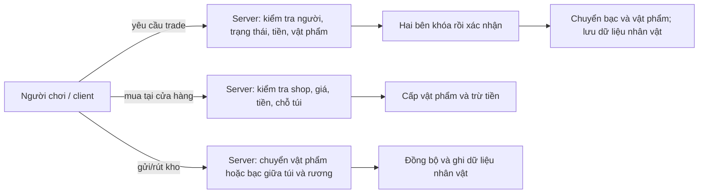

TÓM TẮT 1: [NGUỒN] DONE trong phạm vi khảo sát tĩnh: đã mô tả giao dịch người chơi, quầy cá nhân, cửa hàng hệ thống và rương/kho.
TÓM TẮT 2: [NGUỒN] Server nhận các yêu cầu qua protocol; kiểm tra tiền, trạng thái quầy, vật phẩm và chỗ chứa tùy từng đường.
TÓM TẮT 3: [NGUỒN] Bạc trong túi/rương và vị trí vật phẩm được ghi vào dữ liệu nhân vật; luồng giao dịch có lưu cả hai nhân vật.
TÓM TẮT 4: [CHƯA KIỂM] Chưa chạy thử; khả năng đổi đề nghị sau khóa và một số điều kiện quầy cá nhân cần kiểm thử riêng.
TÓM TẮT 5: [NGUỒN] Không build, chạy exe, VM, mạng hay runtime; chưa có commit; file nhịp ngoài worktree bị từ chối quyền ghi.

# HG-07 — Chợ, giao dịch và kho đồ
Loại: khảo sát
Chủ đề: Mô tả đường trao đổi vật phẩm và tiền giữa người chơi, cửa hàng hệ thống, quầy người chơi và kho cá nhân.
Từ khóa: chợ người chơi, giao dịch, rương, kho đồ, BaiTan, KBuySell, c2sTradeBuy, room_repository
Trạng thái: PARTIAL — nội dung và đối chiếu tĩnh hoàn tất; file nhịp ngoài thư mục được cấp quyền không ghi được.
Độ phủ: Đã phủ 6/6 mảng được liệt kê trong bảng Phạm vi và độ phủ.
Liên quan: `JX1_OPS/REPORTS/I-02-vat-pham-ban.md`, `I-07-cac-loai-tien-te.md`, `A-05-diem-tuong-tac-gs001.md`, `JX1_OPS/DESIGN/MUC-LUC-TRI-THUC.md`.
Cần tôi quyết định: không

Quy ước nguồn mã: `C` là client `C:/Jx1CocoV3/Folder/Client2912-20260116T044348Z-3-001/Client2912/Client/Classes`; `S` là server `C:/Jx1CocoV3/SwordOnline/SwordOnline/jxOnline/gameserver/Sources/Core/Src`. Đã đọc tĩnh đúng các tệp liên quan trong hai root task chỉ định; đường dẫn dưới đây theo `C/` và `S/`. Các kết luận mã là của snapshot trên đĩa, không chứng minh binary triển khai hoặc hành vi đang chạy.

## Sơ đồ chính

## Phạm vi và độ phủ

| Mảng | Trạng thái | Bằng chứng chính |
|---|---|---|
| Giao dịch trực tiếp giữa hai người | Đã phủ tĩnh | `S/KProtocolProcess.cpp:251-255`; `S/KPlayer.cpp:6563-6633,6640-6653,6724-7059` |
| Đặt hàng và mua tại quầy người chơi | Đã phủ tĩnh | `S/KProtocolProcess.cpp:8834-9007`; đối chiếu `A-05-diem-tuong-tac-gs001.md:143-158` |
| Cửa hàng hệ thống/NPC | Đã phủ tĩnh | `S/KBuySell.cpp:281-516,601-645`; đối chiếu `I-02-vat-pham-ban.md:120-128` |
| Gửi/rút bạc và cất/lấy vật phẩm ở rương | Đã phủ tĩnh | `S/KProtocolProcess.cpp:775-778,6135-6145`; `S/KItemList.cpp:3329-3365,5728-5792` |
| Nơi lưu và đồng bộ | Đã phủ tĩnh; không truy cập dữ liệu tài khoản | `S/KPlayerDBFuns.cpp:1518-1531,1618-1653`; `I-07-cac-loai-tien-te.md:77-94` |
| Điểm cần kiểm thêm về gian lận | Đã nêu giả thuyết; chưa kiểm thử | `S/KProtocolProcess.cpp:5697-5705,8834-9007`; `S/KItemList.cpp:8095-8150,8751-8939` |

## Sắp theo cấu trúc game

| Thứ tự hệ thống | Phần được mô tả |
|---|---|
| Người chơi → người chơi | Mời giao dịch; đặt bạc/vật phẩm; khóa và xác nhận; hủy hoặc chuyển giao |
| Người chơi → quầy người chơi | Xem hàng, kiểm tra giá và tiền, nhận hàng; chủ quầy nhận tiền sau giao dịch |
| Người chơi → cửa hàng NPC | Chọn hàng, xác thực chỉ số shop, tiền tệ và chỗ trống; trừ tiền và cấp món |
| Người chơi → rương/kho cá nhân | Chuyển vật phẩm và bạc giữa hành trang với kho; đồng bộ và lưu |

## 1. Giao dịch trực tiếp giữa người chơi

- **THẤY** Client tạo yêu cầu mở/mời trade, thêm hoặc rút vật phẩm, chỉnh bạc, khóa/mở khóa và hủy qua các yêu cầu lõi; ví dụ `KuiPlayerTrade.cpp:385-410,488-566,1180-1194`. Các loại gói được nối tới hàm server tại `KProtocolProcess.cpp:251-255`.
- **THẤY** Server chỉ bắt đầu với người chơi tìm thấy quanh nhân vật và đang mở trạng thái nhận trade; không cho bắt đầu khi một bên đang mở quầy cá nhân. `KPlayer.cpp:6605-6633`.
- **THẤY** Khi chuyển vật phẩm vào khay trade, mã server chặn vật phẩm bị ràng buộc, giới hạn bản đồ hoặc còn hạn, trừ trường hợp tài khoản được cấu hình ngoại lệ; vị trí gói trade được đồng bộ cho phía còn lại. `KItemList.cpp:6082-6095,6128-6216,8835-8933`.
- **THẤY** Server yêu cầu cả hai bên khóa, bên kia xác nhận, kiểm tra số dư bạc sau khi trao đổi và mô phỏng chỗ túi nhận được trước khi hoàn tất. Khi thành công, server chuyển bạc/vật phẩm, lưu dữ liệu hai nhân vật. Khi hủy, mã khôi phục vật phẩm đã đưa vào khay. `KPlayer.cpp:6724-7059`.
- **TÀI LIỆU** Nhánh tiền trực tiếp được khảo sát là bạc; không lấy việc thêm bạn làm điều kiện mở quyền chuyển đồ khóa. Một trạng thái khóa vật phẩm riêng chưa được chứng minh có cùng quy tắc với cờ ràng buộc. `I-07-cac-loai-tien-te.md:110-124`.
- **CHƯA KIỂM** Chưa chạy hai nhân vật để xác nhận packet, hủy, mất kết nối, thời hạn khóa hoặc độ bền sau khi thoát/vào lại. Không suy kết quả runtime từ mã.

## 2. Quầy người chơi

- **THẤY** Server tìm chủ quầy ở gần, yêu cầu cờ quầy đang mở, tra ID vật phẩm, yêu cầu giá dương, kiểm tra bạc/XU của người mua và chỗ trong túi; sau đó cấp món, bỏ món khỏi chủ quầy và ghi thu nhập cho người bán, có tính nhánh thuế. `KProtocolProcess.cpp:8834-9007`.
- **TÀI LIỆU** `A-05` xác nhận đường xem/mua quầy đi qua `c2sNeedCount` và `c2sTradeBuy`; báo cáo đó nêu nguy cơ người mua/người bán có thể còn trạng thái nhưng mất kết nối, vì vậy không coi gửi tới chỉ số kết nối là kiểm tra người nhận an toàn. Đây là kết quả đọc tĩnh, chưa tái kiểm runtime. `A-05-diem-tuong-tac-gs001.md:143-158`.
- **CHƯA KIỂM** Trong handler mua đã đọc, chưa thấy đối chiếu tường minh ID yêu cầu thuộc danh sách đang rao và thuộc chính chủ quầy trước khi sao chép/cấp món. `ItemSet.SearchID` tra ID toàn cục rồi mã mới gọi xóa ở danh sách người bán. Cần xác minh quyền sở hữu, vòng đời ID và điều kiện ở các hàm dựng danh sách quầy; chưa kết luận có thể lấy vật phẩm ngoài quầy.

## 3. Cửa hàng NPC/hệ thống

- **TÀI LIỆU** Dữ liệu cửa hàng và luồng mua theo I-02 có kiểm trạng thái shop, chỉ số món, đơn giá/tổng dương, tiền đủ, chỗ hành trang và điều kiện xếp chồng; loại tiền khác nhau được kiểm riêng. `I-02-vat-pham-ban.md:120-128`; đối chiếu mã `S/KBuySell.cpp:281-516`.
- **THẤY** Khi bán lại cho cửa hàng, mã tính tiền từ giá vật phẩm, áp dụng hệ số giá, rồi cộng bạc. `S/KBuySell.cpp:601-645`.
- **CHƯA KIỂM** Số lượng/ngày, giá có hiệu lực trên máy chủ đã triển khai, mọi NPC hoặc mọi đường mua khác chưa được đối chiếu. Mức chặn số lượng trên giao diện không đồng nghĩa giới hạn máy chủ.

## 4. Rương/kho cá nhân

- **THẤY** Client nhận yêu cầu mở rương và dùng ô nhập số để chọn gửi hoặc rút bạc; `KuistoreBox.cpp:360-421`, `KuigetMoney.cpp:74-248`. Gói mở rương ở hàm server đã đọc chỉ phát thông báo mở giao diện; không đủ để kết luận quyền mở được xác thực ở toàn bộ tầng gọi. `S/KProtocolProcess.cpp:775-778`.
- **THẤY** Gói `c2s_storemoney` gọi chuyển giữa `room_equipment` và `room_repository`. Hàm chuyển từ chối số âm, kiểm tra tiền ở ngăn nguồn và hoàn lại nguồn nếu ngăn đích không nhận được. `S/KProtocolProcess.cpp:270,6135-6145`; `S/KItemList.cpp:3329-3365`.
- **THẤY** Rương là một ngăn vật phẩm riêng; chuyển vật phẩm cập nhật vị trí trong ngăn kho và đồng bộ thay đổi. Mã lưu nhân vật ghi số bạc túi/rương vào hai trường riêng; bản ghi vật phẩm chứa ngăn và tọa độ. `S/KItemList.cpp:5728-5792`; `S/KPlayerDBFuns.cpp:1518-1531,1618-1653`.
- **TÀI LIỆU** `I-07` phân biệt bạc trong túi và rương; tổng hai ngăn không đồng nghĩa số tiền có thể dùng để mua, vì hàm trả tiền thông thường dùng bạc ở túi. `I-07-cac-loai-tien-te.md:77-81,90-94`.
- **CHƯA KIỂM** Chưa lần hết kiểm tra vị trí/map, trạng thái mở rương và quyền gửi/rút ở mọi điểm vào. Chưa mở hoặc đọc dữ liệu nhân vật/tài khoản thật.

## 5. Điểm có thể gian lận cần kiểm thử

- **CHƯA KIỂM — thay đổi khay sau khi khóa:** Đường tự chuyển vật phẩm được đăng ký ở `KProtocolProcess.cpp:303,5697-5705`; kiểm tra `CheckTrading` của handler đang bị comment. `KPlayer::AutoItem` xác minh ID và tọa độ nguồn rồi gọi `serAutoMoveItem`, nhưng không kiểm tra khóa trade (`KPlayer.cpp:5916-5999`). Hàm chuyển nhanh chấp nhận ngăn trade làm nguồn; kiểm tra trạng thái trade chỉ xuất hiện khi đích là ngăn trade, không thấy kiểm tra khóa khi rút ra (`KItemList.cpp:8095-8150,8751-8939`). Đây là khả năng thay đổi nội dung chào sau khi khóa; chưa kiểm tra liệu packet, trạng thái xác nhận hoặc lớp khác ngăn được hay không.
- **CHƯA KIỂM — lựa chọn tiền ở quầy:** Mã mua quầy chỉ kiểm tra đủ tiền cho `m_Model` 0/1 hoặc 2; nhánh trả tiền dùng `PayXu` cho trường hợp còn lại, rồi tiếp tục cấp vật phẩm mà không xét giá trị trả về của `PayXu`. `KProtocolProcess.cpp:8876-8935`; `KPlayer.cpp:7342-7350`. Cần xác minh miền giá trị hợp lệ và đường tạo packet trước khi kết luận có thể bỏ qua thanh toán.
- **CHƯA KIỂM — xác thực người nhận/hiện diện:** Báo cáo A-05 ghi nhận tìm người quanh và gửi packet trực tiếp tới chỉ số kết nối có thể gặp slot còn dữ liệu nhưng đã offline. Chưa chạy thử hoặc đối chiếu lại mọi hàm gửi hiện tại. `A-05-diem-tuong-tac-gs001.md:150-158`.
- **THẤY** Các điểm trên là vị trí cần rà soát từ mã tĩnh, không phải kết luận đã khai thác được. Không thử trên máy chủ thật.

## Giải mã tên

| Tên gốc | Mã hóa | Chữ đúng | Nguồn |
|---|---|---|---|
| Không phát sinh tên riêng cụ thể của vật phẩm, NPC, quái hoặc bản đồ trong phạm vi tài liệu | — | Không có tên riêng cần giải mã | — |

## MỤC SỔ THÔNG SỐ

| Nhóm | Tên/điều kiện | file:dòng | Giá trị | Đơn vị | Ảnh hưởng | Đổi an toàn | Nguồn đo |
|---|---|---|---|---|---|---|---|
| Giao dịch trực tiếp | Tiền chào | `S/KPlayer.cpp:6640-6653` | 0 đến số bạc hiện có trong túi; ngoài miền được đổi thành 0 | bạc | Số bạc đưa vào giao dịch | CẨN THẬN | Đọc tĩnh; chưa runtime |
| Rương | Chuyển bạc giữa túi và kho | `S/KItemList.cpp:3329-3365` | Không âm; không quá số dư nguồn; sức chứa ngăn đích được kiểm tra khi cộng | bạc | Gửi/rút bạc | CẨN THẬN | Đọc tĩnh; giới hạn tối đa chưa xác định |
| Quầy người chơi | Giá món | `S/KProtocolProcess.cpp:8876-8895` | Phải lớn hơn 0; miền loại tiền cần kiểm thêm | bạc hoặc XU theo nhánh | Trừ người mua, cộng người bán | CẨN THẬN | Đọc tĩnh; chưa xác minh packet |

## Đã xác minh / Chưa xác minh

**Đã xác minh bằng đọc tĩnh**

- Định tuyến các gói mở kho, gửi/rút bạc, thao tác vật phẩm, trade và mua tại quầy: `S/KProtocolProcess.cpp:132,237-255,270,284,303,775-778,5697-5736,6135-6145,8834-9007`.
- Điều kiện và chuyển giao trade, gồm khóa hai bên, kiểm tra số bạc/chỗ túi, chuyển món và lưu cả hai nhân vật: `S/KPlayer.cpp:6605-7059`.
- Ghi số bạc túi/rương cùng thông tin vị trí từng vật phẩm khi lưu dữ liệu nhân vật: `S/KPlayerDBFuns.cpp:1518-1531,1618-1653`.
- Báo cáo nền đã đối chiếu: `I-02-vat-pham-ban.md:120-128`; `I-07-cac-loai-tien-te.md:77-124`; `A-05-diem-tuong-tac-gs001.md:143-158`.

**Chưa xác minh**

- Packet thủ công và phản hồi UI; mức bảo toàn giao dịch khi mất kết nối/lỗi ghi; giới hạn thực tế trên binary đang chạy.
- Có thể thay nội dung khay sau khi khóa hay không; miền `m_Model` hợp lệ; xác thực item thuộc danh sách của đúng chủ quầy.
- Quyền mở kho theo vị trí/trạng thái ở toàn bộ đường xử lý, và các hạn mức kinh tế không hiện trong những đoạn đã đọc.
- Build, test tự động, runtime, VM, mạng: chưa chạy theo phạm vi task.

## Đề xuất tối ưu

- Tester chỉ chạy trong môi trường thử được duyệt: kiểm tra cập nhật/hủy khay sau hai bên khóa; thử từng kiểu tiền hợp lệ và giá trị ngoài miền qua kiểm thử có kiểm soát; thử ID không thuộc danh sách quầy và trường hợp người bán rời kết nối. Ghi số dư/vật phẩm trước-sau và xác nhận tính toàn vẹn; không dùng tài khoản thật.
- PM có thể thêm vào mục lục tri thức sau khi duyệt: `Chợ, giao dịch và kho đồ | HG-07 / DESIGN/HIEU-GIAO-DICH-KHO-DO.md | KProtocolProcess.cpp, KPlayer.cpp, KItemList.cpp, KPlayerDBFuns.cpp | khảo sát tĩnh; các rủi ro chờ kiểm thử`.

## Bàn giao

- Đầu ra: `JX1_OPS/DESIGN/HIEU-GIAO-DICH-KHO-DO.md`.
- Commit: không tạo theo yêu cầu; chưa có SHA. Bước kế tiếp là kiểm thử có duyệt riêng các mục CHƯA KIỂM.
- Ghi nhịp: thử ghi `D:\JX-wt\HG-07.nhip` lúc bắt đầu nhưng hệ thống từ chối quyền ghi ngoài worktree; không có file nhịp nào được cập nhật.
- Kỹ năng đã dùng: `jx1-retrofit`, `jx1-read-server`, `jx1-read-client`, `jx1-parameters`, `jx1-knowledge`, `jx1-report`.

liên quan: `I-02-vat-pham-ban.md`, `I-07-cac-loai-tien-te.md`, `A-05-diem-tuong-tac-gs001.md`, `DESIGN/MUC-LUC-TRI-THUC.md`.
