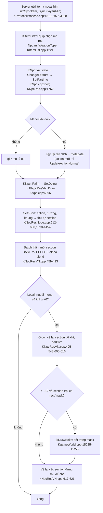

# Hiểu hiệu ứng vũ khí (glow, tia sét) trong client bản A — tổng hợp W-01a..d

Đợt #190, 18/11/2026. Chỉ thiết kế và khảo sát tĩnh trên `D:/JX-build/qh9A`. **Không sửa mã, không build, không chạy client.** Việc "dừng sửa hiệu ứng vũ khí" vẫn giữ. Bước tái hiện là W-02 (sau C01).

**TÓM TẮT 5 DÒNG**
1. [THẤY] Cấp cường hóa lấy từ vũ khí đang mặc (`nEnChance`); glow từ +6 (trắng +6–11, vàng +12–14, xanh điện từ +15); sét từ +12, +15 xét thêm cung và cường độ cao hơn (`KNpcResVN.cpp:503-522,556-618`).
2. [THẤY] Thứ tự vẽ: bóng → các section theo bảng sort (mỗi section BASE rồi EFFECT) → glow (additive) → sét (trong mask section trội) → vẽ lại section đứng sau để che.
3. [THẤY] Sét chạy theo **đồng hồ tường** (16 pha × 50 ms), không theo khung hành động. Nhiều guard (R<8, mask<8, lưới >200×200, span<6) có thể bỏ cả lượt sét.
4. [CHƯA KIỂM] BUG-002 (sét "nhảy") chưa tái hiện trên LD; chưa đọc bảng sort `女主角贴图顺序表.ini`, bảng item, SPR cụ thể; chưa có capture. Cả bốn báo cáo đều PARTIAL.
5. Có 5 giả thuyết (H1–H5) kèm phép kiểm **không sửa mã**; phép kiểm cần đúng một ca cụ thể (vũ khí, action, hướng, khung). Cần tôi quyết định: không.

Nguồn: `REPORTS/W-01a.md` (dữ liệu/ngưỡng), `W-01b.md` (nhận trang bị → nạp sprite), `W-01c.md` (thứ tự lớp, điều kiện vẽ), `W-01d.md` (action/khung, giả thuyết). Tiền đề: `BUGS/BUG-002.md`, `REPORTS/H-04`, `H-14`, `J-01..J-05`, `DESIGN/QUY-LUAT-VE-BO-PHAN.md`.

## 1. Luồng từ đầu đến cuối

## 2. Ai vẽ gì, theo thứ tự nào

| # | Thành phần | Điều kiện | Nguồn (qh9A/Classes) | Mức |
|---:|---|---|---|---|
| 1 | Cập nhật hướng, khung cho từng part (chia nguyên frame logic / tổng khung) | trả sớm nếu hướng hoặc khung âm, thiếu resource | `vn/gamecore/KNpcResVN.cpp:21-70` | THẤY |
| 2 | Bảng sort chọn chuỗi section; có nhánh **đổi chỗ section 8↔9** | không cưỡi, hướng 0–3, file cờ `/sdcard/jxlayeroff` không tồn tại; **không kiểm action đi bộ** | `KNpcResVN.cpp:204-215` | THẤY |
| 3 | Bóng + các section thân/trang bị; BASE trước EFFECT | layer không có tên ảnh bị bỏ | `KNpcResVN.cpp:437-493` | THẤY |
| 4 | Batch nền, alpha blend `SRC_ALPHA, ONE_MINUS_SRC_ALPHA` | — | `gamecore/KNpcRes.cpp:166-175`; `gamescene/KgameWorld.cpp:14993-15002` | THẤY |
| 5 | Glow: phát lại section vũ khí cùng khung hiện tại, additive `SRC_ALPHA, ONE`, shader `glow.vsh/fsh` | player local ngoài menu; cấp ≥ +6; section vũ khí có ảnh | `KNpcResVN.cpp:495-522,540-548,600-616`; `KgameWorld.cpp:9032-9047` | THẤY |
| 6 | Sét: texture RGBA 8×8 tạo tại chỗ, cùng shader glow, chạy trong mask của section có nhiều mẫu mask nhất | đã chụp rect; R≥8, mask≥8, lưới ≤200×200, `abs(span)≥6` | `KNpcResVN.cpp:554-584`; `KgameWorld.cpp:15065-15103,15132` | THẤY |
| 7 | Vẽ lại các section phía sau vũ khí để che glow/sét | lặp theo từng section vũ khí | `KNpcResVN.cpp:617-626` | THẤY |
| 8 | State/aura thân trước/sau, chân, special (cơ chế riêng, không gộp với EFFECT hay glow) | khoảng `[BackStart,BackEnd)` | `KNpcResVN.cpp:259-366,420-434,663-684` | THẤY |

Ngưỡng cường hóa: +6–11 glow trắng, +12–14 glow vàng và sét, từ +15 glow xanh điện, xét nhiều cung ứng viên (`KNpcResVN.cpp:514-522`). Số cung chỉ là ứng viên trước các bộ lọc, **không phải** số nét vẽ chắc chắn.

## 3. Điều W-01 đã xác lập và chưa xác lập

| Điều | Trạng thái |
|---|---|
| Luồng trang bị → mã vũ khí → nạp SPR → vẽ | THẤY (W-01b), đủ file:dòng |
| Ngưỡng +6/+12/+15 và màu | THẤY (W-01a); nguồn dữ liệu cột nào trong bảng item sinh cấp: chưa biết |
| Gate góc của H-14 | THẤY: không còn `return` trong qh9A (`KgameWorld.cpp:15135-15144`); guard mask/grid/span vẫn còn |
| Bảng sort `女主角贴图顺序表.ini` | **CHƯA KIỂM**: không có trong root qh9A; chỉ biết mã nạp qua `KindFile` (`KNpcResNode.cpp:365-369,1201-1215`) |
| Bảng item vũ khí, tên SPR của món cụ thể | **CHƯA KIỂM** |
| Hành vi trên thiết bị / LD | **CHƯA KIỂM**; BUG-002 không tái hiện được ở +15 |
| qh9A có đúng là binary A2 trên điện thoại | **CHƯA KIỂM** |

Lưu ý khi đọc: J-04 nói về root cũ `D:/JX-source/client`; W-01 chỉ dựa qh9A. Cờ ẩn `/sdcard/jxhide_<section>` nằm trong vòng batch thân (`:464`), còn bộ thu glow (`:540-546`) không đọc cờ đó.

## 4. Giả thuyết cho BUG-002 (sét/khung hiệu ứng "nhảy") và phép kiểm

Tất cả [CHƯA KIỂM]. Phép kiểm chỉ đọc dữ liệu/capture đã có, không sửa mã.

| ID | Giả thuyết | Căn cứ | Phép kiểm không sửa mã | Hạng ưu tiên |
|---|---|---|---|---|
| H4 | Mask/rect của section trội đổi theo khung; chọn neo hoặc bỏ điểm theo PCA/clip khiến sét đổi vị trí khi kiếm xoay | `KNpcResVN.cpp:540-585`; `KgameWorld.cpp:15087-15152` (chọn section trội theo số điểm mask) | Với capture/video liền kề, so rect, section trội, số điểm mask, hình kiếm giữa các khung | **1** (khớp triệu chứng "nhảy khỏi vũ khí") |
| H5 | Pha sét theo đồng hồ tường (`nowUs/50000`, 16 pha) lệch khung hành động; một số pha không có cung nên nhìn như chớp | `KgameWorld.cpp:15027-15035,15091,15195` | Trên video có sẵn, xem sét lặp chu kỳ 800 ms hay khớp theo khung hành động | **2** |
| H3 | Sort/đổi chỗ 8↔9 làm vũ khí bị thân che ở vài hướng | `KNpcResVN.cpp:204-215,619-626` | Tính bảng sort cho đúng action/hướng, tách "không vẽ" với "vẽ nhưng bị che" | 3 |
| H2 | Chia nguyên frame logic/tổng khung SPR bỏ hoặc lặp khung; body và vũ khí chọn khung nguồn khác nhau | `KNpcResVN.cpp:36-68`; J-05 | Lập bảng frame logic → chỉ số SPR theo công thức cho một ca cụ thể | 4 |
| H1 | Ánh xạ action theo loại vũ khí/cưỡi thiếu SPR, giữ action cũ | `KNpcRes.cpp:1672-1702`; `KNpcResNode.cpp:592-607` | Đọc đúng một bảng resource mà action/file dẫn tới | 5 |

Đề xuất thứ tự: H4 và H5 trước vì cùng nhìn được trên một đoạn quay (đã có quy trình "quay ~3 giây phân giải cao rồi phân tích từng khung"); H1–H3 cần bảng sort/item mà hiện chưa có trong root qh9A.

## 5. Điều kiện để W-02 (kế hoạch tái hiện) chạy được

Ghi cùng lúc, mỗi lần tái hiện: nhân vật (nam/nữ), vũ khí, cấp cường hóa, action, hướng, số khung, rect/mask, trạng thái cờ `jxlayeroff`/`jxhide_*`, đúng bản APK (SHA-256). Cần có bảng item và `女主角贴图顺序表.ini` từ gói client thật (đường dẫn, mã hóa tên tệp UTF-8/GBK phải kiểm). Cần C01 (đã đạt, `REPORTS/C01-C03-TEST36.md`) để có phiên chơi thử trên Test-36. Không chạm Main VM.

## 6. Bàn giao

- Không đề xuất sửa mã lúc này (luật dừng sửa hiệu ứng vũ khí còn hiệu lực).
- Mục lục tri thức đề xuất: `W-01 | tổng hợp | Hiệu ứng vũ khí: glow, sét, thứ tự vẽ | glow, bolt, nEnChance, KNpcResVN, jxDrawBolts | PARTIAL | tĩnh, chưa runtime | BUG-002, J-01..J-05, H-04, H-14`.
- Điểm chưa rõ cần dữ liệu thật: tên SPR và cột item sinh cấp cường hóa; nội dung bảng sort; nội dung `glow.fsh/vsh` ở runtime.

## 7. Lịch sử các lần sửa trước và vì sao chưa dứt (thêm theo #193, 19/11/2026)

Nguồn: thư #046/#047, #062, #073, #090 trong `HOP-THU/CHO-SONNET.md`; `REPORTS/H-04.md`, `H-14-mat-khung-hieu-ung.md`; `BUGS/BUG-002.md`. Nhãn: TÀI LIỆU = đọc từ báo cáo/thư, không tự kiểm lại mã.

| Mốc | Việc | Kết quả ghi lại |
|---|---|---|
| 14/11 | Nghiệm thu glow ở qh7 (`jx-wglow7.apk`) | TÀI LIỆU (H-04): glow +6 trắng, +12 vàng + sét, +15 xanh điện; lịch sử vòng chân → glow → sét 2/4 tia → 4/6 tia → sửa che lớp/cắt mặt nạ → thu nhỏ bán kính. `KgameWorld.cpp` bị sửa lại sau qh7 (10:48 ngày 14/11) |
| #046/#047 (17/11) | H-04: tìm dấu vết bản sửa cũ, không khảo sát lại | đã dựng lịch sử; APK qh7 sao lưu khớp bản serve theo SHA-256, nhưng chưa chứng minh khớp nguồn mang tên `Client-qh7` |
| #062 (17/11) | H-14: khung mất glow/sét khi di chuyển, vung kiếm | 5 giả thuyết (khung vẽ nhánh khác, cờ cộng, neo sét, hẹn giờ tia, FPS); kết quả chỉ là khảo sát tĩnh |
| #073 (17/11) | L-01 giai đoạn 2 trên nền qh7 | dựng lại trên bản sao, vẫn qua APK thử |
| #090 (17/11 21:15) | Chủ test A2 trên máy thật: sai lớp vũ khí, bộ +12/+15 "nhảy khung", yêu cầu xBRZ | A2 giảm lượt vẽ glow 9→5 và bỏ lượt trùng vị trí: nghi mất thứ tự lớp; A1 (chiếu float) nghi làm lệch khóa sắp xếp |
| BUG-002 | Sét nhảy ra ngoài | không tái hiện trên LD ở +15; "nguyên nhân gốc: chưa biết" |
| 18/11 | W-01 (tĩnh) | 5 giả thuyết H1–H5, vẫn [CHƯA KIỂM] |
| 19/11 | W-02 (quan sát LD) | thấy glow/sét đúng ngưỡng, nhưng chỉ khi **ép cấp bằng cờ**; hình sét đổi từng khung, có khung lệch khi đổi hướng |

**Giả thuyết vì sao sửa mãi chưa dứt (CHƯA KIỂM, để tiểu yêu và Sonnet kiểm):**
1. Mỗi lần sửa chạm một lớp, nhưng nhiều thứ cùng quyết định hình hiện ra (thứ tự lớp, mặt nạ, đồng hồ tường, khung hành động, A1/A2); sửa một thứ làm lộ thứ khác (A2 → lỗi lớp vũ khí).
2. Kiểm bằng cờ ép cấp trên LD không đi qua đường cấp thật (server → `nEnChance`), nên ca thật trên điện thoại chưa từng được tái hiện đúng (W-02: vũ khí Lua không hiện glow).
3. Sét đổi theo đồng hồ tường (H5) làm "nhảy" vốn có; khó phân biệt với lỗi do khung lệch (H4) nếu không có video từng khung.
4. Không có bảng sort `女主角贴图顺序表.ini` và bảng item thật để tính trước ca (H1–H3).
5. Nhiều lần chỉ có ảnh tĩnh chủ gửi, không có quay có chuẩn (vũ khí, hướng, khung).

## 8. Kết quả #193 (19/11/2026)
- **Tìm bảng sort / bảng item trong gói client:** đã tìm trong `D:\Android\b\Client` (chỉ đọc). Có `data/jx50ai/itemName.ini`, `itemUseName.ini`; có 182 tệp tên không-ASCII nhưng **không tệp `.ini` nào**, và không tệp tên chứa `贴图`/`顺序`. Nguồn `D:/JX-build/qh9A/Classes` không có chuỗi UTF-8 `贴图顺序表`. Kết luận: **không thấy** trong gói đã tìm; có thể tên GBK hoặc nằm trong PAK. [CHƯA KIỂM] PAK. Việc `HG-04` đang tìm tiếp.
- **SHA-256 APK (8 ký tự đầu):** build qh9A `projectdebug-release.apk` = `47eb28e3` (sửa 19/11 04:30); `apk-fix36/jx-fix36-perf3.apk` = `9abdf095` (12/11). **Đã kiểm 19/11 01:20 (#201):** APK đang cài trong T36test (`com.jxclient.hoiuctruyenky`, `/data/app/.../base.apk`) có SHA-256 `8da22c0cbebaec45d93976be3daa34321cfe61d5a3157f5017d0b244cd973f84` — **KHÁC** qh9A `47eb28e3` và fix36 `9abdf095`; quét `D:\`, `C:\LDPlayer`, Downloads, Documents không thấy tệp nào trùng. Kết luận: [THẤY] "T36test dùng đúng qh9A" **SAI** (hoặc không chứng minh được); các quan sát W-02 chạy trên APK chưa định danh. Việc kế: cài qh9A vào T36test rồi quan sát lại (chưa làm).
- **Quay video H4/H5:** chưa làm (cần mục tiêu đánh được hoặc cách bật trạng thái chiến đấu; xem HG-02).
