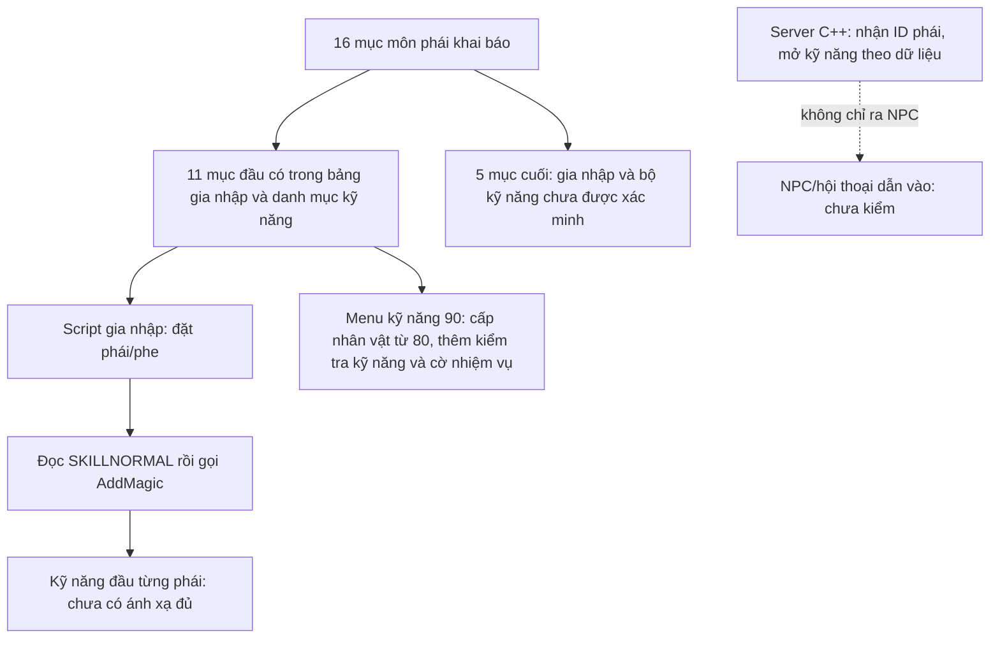

TÓM TẮT 1: [TÀI LIỆU] [THẤY] Có 16 mục môn phái khai báo; 11 mục đầu có trong bảng gia nhập và danh mục kỹ năng. `JX1_OPS/DESIGN/SO-TAY-KY-NANG.md:34,41–57`.
TÓM TẮT 2: [TÀI LIỆU] Luồng gia nhập được ghi là đặt phái/phe, đọc `SKILLNORMAL` rồi thêm bằng `AddMagic`; chưa có bảng ánh xạ đủ kỹ năng đầu theo từng phái. `JX1_OPS/DESIGN/SO-TAY-KY-NANG.md:112`.
TÓM TẮT 3: [TÀI LIỆU] Menu kỹ năng 90 có cổng cấp nhân vật 80, kiểm tra kỹ năng đã có và cờ nhiệm vụ; đây không phải điều kiện gia nhập phái. `JX1_OPS/DESIGN/SO-TAY-KY-NANG.md:113`.
TÓM TẮT 4: [THẤY] Server có hàm nhận ID phái và mở kỹ năng theo dữ liệu phái; mã nguồn này không xác định NPC/hội thoại khởi đầu. `C:/Jx1CocoV3/SwordOnline/SwordOnline/jxOnline/gameserver/Sources/Core/Src/KPlayerFaction.cpp:63–137`.
TÓM TẮT 5: [CHƯA KIỂM] Điều kiện gia nhập cụ thể, kỹ năng đầu mỗi phái và NPC/script gọi vào còn thiếu bằng chứng; chưa build/chạy game, exe, VM hoặc mạng.

# HG-11 — Chọn môn phái và kỹ năng khởi đầu

Loại: tổng hợp
Chủ đề: Tổng hợp môn phái có trong dữ liệu, điều kiện gia nhập, kỹ năng ban đầu và đường NPC/script theo tài liệu đã giao.
Từ khóa: môn phái, kỹ năng, Thiếu Lâm, Võ Đang, wudang, 武当, SKILLNORMAL, AddMagic
Trạng thái: DONE — câu hỏi đã được đối chiếu; phần thiếu nguồn được ghi CHƯA KIỂM theo tiêu chí task.
Độ phủ: 16/16 mục khai báo đã liệt kê; 11/16 mục có bảng gia nhập và danh mục liên hệ; kỹ năng đầu chính xác 0/11 mục được ánh xạ đủ trong nguồn đã đọc.
Liên quan: `SO-TAY-KY-NANG.md`, `SO-TAY-NHIEM-VU-LUA.md`, `MUC-LUC-TRI-THUC.md`.
Cần tôi quyết định: không.

## Phạm vi và độ phủ

Nguồn liệt kê 16 mục cấu hình và 11 mục gia nhập/danh mục; bảng này giữ thứ tự ID của dữ liệu, không khẳng định 11 phái đều mở trong bản đang chạy. Nhánh ở cột cuối là lựa chọn menu 90, không phải kỹ năng đầu khi gia nhập. `JX1_OPS/DESIGN/SO-TAY-KY-NANG.md:34–57,95–106`.

| ID | Môn phái | Bảng gia nhập/danh mục | Nhánh menu 90 | Kỹ năng đầu và điều kiện vào |
| ---: | --- | --- | --- | --- |
| 0 | Thiếu Lâm | [TÀI LIỆU] Có | Quyền, Côn, Đao | [CHƯA KIỂM] Tên/cấp kỹ năng đầu và điều kiện gia nhập cụ thể |
| 1 | Thiên Vương | [TÀI LIỆU] Có | Đao, Thương, Chùy | [CHƯA KIỂM] Tên/cấp kỹ năng đầu và điều kiện gia nhập cụ thể |
| 2 | Đường Môn | [TÀI LIỆU] Có | Phi đao, Phi tiêu, Tụ tiễn, Hãm tĩnh | [CHƯA KIỂM] Tên/cấp kỹ năng đầu và điều kiện gia nhập cụ thể |
| 3 | Ngũ Độc | [TÀI LIỆU] Có | Chưởng, Đao, Bùa chú | [CHƯA KIỂM] Tên/cấp kỹ năng đầu và điều kiện gia nhập cụ thể |
| 4 | Nga My | [TÀI LIỆU] Có | Kiếm, Chưởng, Hỗ trợ | [CHƯA KIỂM] Tên/cấp kỹ năng đầu và điều kiện gia nhập cụ thể |
| 5 | Thúy Yên | [TÀI LIỆU] Có | Đao, Chưởng | [CHƯA KIỂM] Tên/cấp kỹ năng đầu và điều kiện gia nhập cụ thể |
| 6 | Cái Bang | [TÀI LIỆU] Có | Chưởng, Bổng | [CHƯA KIỂM] Tên/cấp kỹ năng đầu và điều kiện gia nhập cụ thể |
| 7 | Thiên Nhẫn | [TÀI LIỆU] Có | Mâu, Chưởng, Bùa chú | [CHƯA KIỂM] Tên/cấp kỹ năng đầu và điều kiện gia nhập cụ thể |
| 8 | Võ Đang | [TÀI LIỆU] Có | Chưởng, Kiếm | [CHƯA KIỂM] Tên/cấp kỹ năng đầu và điều kiện gia nhập cụ thể |
| 9 | Côn Lôn | [TÀI LIỆU] Có | Đao, Chưởng, Bùa chú | [CHƯA KIỂM] Tên/cấp kỹ năng đầu và điều kiện gia nhập cụ thể |
| 10 | Hoa Sơn | [TÀI LIỆU] Có | Kiếm, Khí | [CHƯA KIỂM] Tên/cấp kỹ năng đầu và điều kiện gia nhập cụ thể |
| 11 | Lý Tầm Hoan | [THẤY] Có mục khai báo; [CHƯA KIỂM] Chưa có danh mục trong phần đã khảo sát | [CHƯA KIỂM] Chưa gán nhánh | Có gia nhập được hay không và bộ kỹ năng đều [CHƯA KIỂM] |
| 12 | Đào Hoa Đảo | [THẤY] Có mục khai báo; [CHƯA KIỂM] Chưa có danh mục trong phần đã khảo sát | [CHƯA KIỂM] Chưa gán nhánh | Có gia nhập được hay không và bộ kỹ năng đều [CHƯA KIỂM] |
| 13 | Minh Giáo | [THẤY] Có mục khai báo; [CHƯA KIỂM] Chưa có danh mục trong phần đã khảo sát | [CHƯA KIỂM] Chưa gán nhánh | Có gia nhập được hay không và bộ kỹ năng đều [CHƯA KIỂM] |
| 14 | Đoàn Thị | [THẤY] Có mục khai báo; [CHƯA KIỂM] Chưa có danh mục trong phần đã khảo sát | [CHƯA KIỂM] Chưa gán nhánh | Có gia nhập được hay không và bộ kỹ năng đều [CHƯA KIỂM] |
| 15 | Tự sáng môn phái | [THẤY] Có mục khai báo; [CHƯA KIỂM] Chưa có danh mục trong phần đã khảo sát | [CHƯA KIỂM] Chưa gán nhánh | Có gia nhập được hay không và bộ kỹ năng đều [CHƯA KIỂM] |

## Điều kiện gia nhập và luồng kỹ năng

- **[TÀI LIỆU]** Sổ kỹ năng mô tả rằng script gia nhập đặt phái và phe, sau đó đọc mã chiêu/cấp từ `SKILLNORMAL` rồi thêm kỹ năng bằng `AddMagic`. Sổ ghi có 10 nhóm kỹ năng trong khi bảng gia nhập có 11 phái; các dòng ban đầu có cấp 0. Nguồn chưa cho ánh xạ đủ từng phái sang mã chiêu/cấp đầu. `JX1_OPS/DESIGN/SO-TAY-KY-NANG.md:112`.
- **[CHƯA KIỂM]** Tiền đề cụ thể để nhận lời/gia nhập — cấp, vật phẩm, nhiệm vụ trước hoặc lựa chọn hội thoại — chưa được nêu trong hai sổ đã đọc. Không thể coi cổng của menu 90 là điều kiện gia nhập.
- **[THẤY]** Trong server `KPlayerFaction.cpp`, `AddFaction` kiểm tra dải ngũ hành và giới hạn ID phái rồi lưu phái hiện tại; `OpenCurSkillLevel` lấy kỹ năng từ dữ liệu phái để thêm vào danh sách. Đây là xử lý C++ tĩnh, không nêu NPC hoặc tiêu chí hội thoại. `C:/Jx1CocoV3/SwordOnline/SwordOnline/jxOnline/gameserver/Sources/Core/Src/KPlayerFaction.cpp:63–137`.
- **[TÀI LIỆU]** Menu 90 mở từ cấp nhân vật 80; lúc chọn còn kiểm tra kỹ năng đã có và cờ nhiệm vụ. Điều này mô tả nhánh học kỹ năng ở menu, không chứng minh một kỹ năng là chiêu khởi đầu. `JX1_OPS/DESIGN/SO-TAY-KY-NANG.md:113`.
- **[CHƯA KIỂM]** Tên NPC, vị trí NPC và script hội thoại dẫn tới gia nhập không tìm thấy trong hai báo cáo nguồn hoặc phần C++ đã truy vấn. Sổ nhiệm vụ khuyến nghị lần từ NPC/menu tới script, nhưng không cung cấp chuỗi riêng cho gia nhập phái. `JX1_OPS/DESIGN/SO-TAY-NHIEM-VU-LUA.md:130`.

## Sắp theo cấu trúc game

**[TÀI LIỆU]** Sắp theo ID phái → nhánh lựa chọn trong menu 90 → cấp yêu cầu/cấp tối đa của dòng kỹ năng. Đây là phân loại nhánh menu, không thay thế danh sách kỹ năng đầu; ID 11–15 và toàn bộ ánh xạ kỹ năng đầu vẫn chưa kiểm. `JX1_OPS/DESIGN/SO-TAY-KY-NANG.md:91,95–106,112`.

| Phái | Nhánh menu 90 (ID kỹ năng) | Cấp yêu cầu / tối đa |
| --- | --- | --- |
| Thiếu Lâm | Quyền pháp (318), Côn pháp (319), Đao pháp (321) | 80/20 |
| Thiên Vương | Đao pháp (322), Thương pháp (323), Chùy pháp (325) | 80/20 |
| Đường Môn | Phi đao (339), Phi tiêu (342), Tụ tiễn (302), Hãm tĩnh (351) | 80/20 |
| Ngũ Độc | Chưởng pháp (353), Đao pháp (355), Bùa chú (390) | 80/20 |
| Nga My | Kiếm pháp (328), Chưởng pháp (380), Hỗ trợ (332) | 80/20 |
| Thúy Yên | Đao pháp (336), Chưởng pháp (337) | 80/20 |
| Cái Bang | Chưởng pháp (357), Bổng pháp (359) | 80/20 |
| Thiên Nhẫn | Mâu pháp (361), Chưởng pháp (362), Bùa chú (391) | 80/20 |
| Võ Đang | Chưởng pháp (365), Kiếm pháp (368) | 80/30 (365), 80/20 (368) |
| Côn Lôn | Đao pháp (372), Chưởng pháp (375), Bùa chú (394) | 80/20 |
| Hoa Sơn | Hoa Sơn kiếm (1364), Hoa Sơn khí (1382) | 90/20 |
| ID 11–15 | Chưa có nhánh được gán trong phần dữ liệu khảo sát | Chưa xác minh |

## Giải mã tên

**[TÀI LIỆU]** Sổ kỹ năng ghi tên Hán trong cấu hình môn phái theo GBK và cung cấp các chữ tương ứng. Giữ nguyên tên gốc cùng cách đọc tiếng Việt; chưa mở lại byte nguồn gốc trong task này. `JX1_OPS/DESIGN/SO-TAY-KY-NANG.md:61–82`.

| Tên gốc | Mã hóa | Chữ đúng | Nguồn file:dòng |
| --- | --- | --- | --- |
| 少林派 | GBK | Thiếu Lâm (少林派) | `JX1_OPS/DESIGN/SO-TAY-KY-NANG.md:63–82` |
| 天王帮 | GBK | Thiên Vương (天王帮) | `JX1_OPS/DESIGN/SO-TAY-KY-NANG.md:63–82` |
| 唐门 | GBK | Đường Môn (唐门) | `JX1_OPS/DESIGN/SO-TAY-KY-NANG.md:63–82` |
| 五毒教 | GBK | Ngũ Độc (五毒教) | `JX1_OPS/DESIGN/SO-TAY-KY-NANG.md:63–82` |
| 峨嵋派 | GBK | Nga My (峨嵋派) | `JX1_OPS/DESIGN/SO-TAY-KY-NANG.md:63–82` |
| 翠烟门 | GBK | Thúy Yên (翠烟门) | `JX1_OPS/DESIGN/SO-TAY-KY-NANG.md:63–82` |
| 丐帮 | GBK | Cái Bang (丐帮) | `JX1_OPS/DESIGN/SO-TAY-KY-NANG.md:63–82` |
| 天忍教 | GBK | Thiên Nhẫn (天忍教) | `JX1_OPS/DESIGN/SO-TAY-KY-NANG.md:63–82` |
| 武当派 | GBK | Võ Đang (武当派) | `JX1_OPS/DESIGN/SO-TAY-KY-NANG.md:63–82` |
| 昆仑派 | GBK | Côn Lôn (昆仑派) | `JX1_OPS/DESIGN/SO-TAY-KY-NANG.md:63–82` |
| 华山派 | GBK | Hoa Sơn (华山派) | `JX1_OPS/DESIGN/SO-TAY-KY-NANG.md:63–82` |
| 李寻欢 | GBK | Lý Tầm Hoan (李寻欢) | `JX1_OPS/DESIGN/SO-TAY-KY-NANG.md:63–82` |
| 桃花岛 | GBK | Đào Hoa Đảo (桃花岛) | `JX1_OPS/DESIGN/SO-TAY-KY-NANG.md:63–82` |
| 明教 | GBK | Minh Giáo (明教) | `JX1_OPS/DESIGN/SO-TAY-KY-NANG.md:63–82` |
| 段氏 | GBK | Đoàn Thị (段氏) | `JX1_OPS/DESIGN/SO-TAY-KY-NANG.md:63–82` |
| 自创门派 | GBK | Tự sáng môn phái (自创门派) | `JX1_OPS/DESIGN/SO-TAY-KY-NANG.md:63–82` |

## Đã xác minh / Chưa xác minh

- **[THẤY]** Bản server được task chỉ định có xử lý ID phái và danh sách kỹ năng theo dữ liệu trong `C:/Jx1CocoV3/SwordOnline/SwordOnline/jxOnline/gameserver/Sources/Core/Src/KPlayerFaction.cpp:63–137`; phía client có bộ xử lý nhận dữ liệu phái/kỹ năng trong `C:/Jx1CocoV3/Folder/Client2912-20260116T044348Z-3-001/Client2912/Client/Classes/gamecore/KProtocolProcess.cpp:89–99,1271–1312`.
- **[TÀI LIỆU]** Có 16 mục khai báo, 11 dòng đầu có trong danh mục phái/kỹ năng; menu 90 có các cổng cấp 80/90 theo dữ liệu. `JX1_OPS/DESIGN/SO-TAY-KY-NANG.md:34,41–57,95–113`.
- **[CHƯA KIỂM]** Điều kiện gia nhập cụ thể, danh sách mã/cấp chiêu đầu của từng phái, NPC/script dẫn tới và phái nào thực sự mở trong bản chạy. Chưa build, chạy game/exe/VM hoặc kiểm tra mạng.

## Bàn giao

- Không sửa mã hoặc báo cáo nguồn; chỉ tạo tài liệu HG-11 theo phạm vi đã duyệt.
- Đề nghị PM bổ sung dòng mục lục: `Môn phái, kỹ năng khởi đầu | JX1_OPS/DESIGN/HIEU-MON-PHAI.md | KPlayerFaction.cpp::AddFaction/OpenCurSkillLevel | khảo sát tĩnh; điều kiện gia nhập và kỹ năng đầu chưa kiểm`.
- Bước tiếp theo nếu cần chốt các mục CHƯA KIỂM: giao phạm vi đọc tĩnh cụ thể cho script Lua/dữ liệu gia nhập và bảng kỹ năng đầu; không suy từ menu 90.
- Không commit theo yêu cầu task.

liên quan: `JX1_OPS/DESIGN/SO-TAY-KY-NANG.md`, `JX1_OPS/DESIGN/SO-TAY-NHIEM-VU-LUA.md`, `JX1_OPS/DESIGN/MUC-LUC-TRI-THUC.md`.
