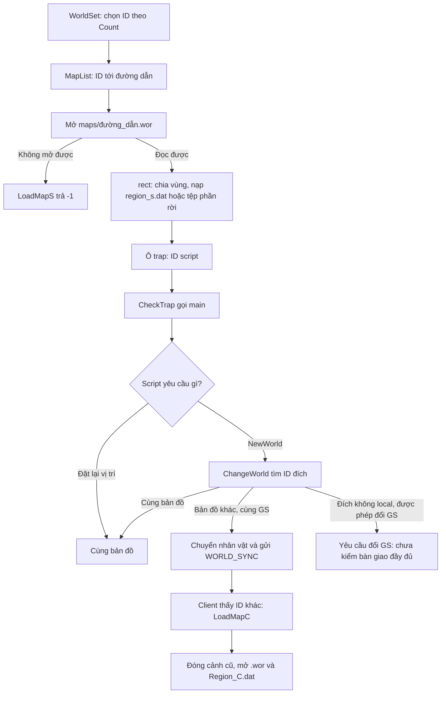

TÓM TẮT 1/5: [NGUỒN] DONE khảo sát tĩnh — [THẤY] Server chọn ID bằng WorldSet, tra đường dẫn qua MapList, mở .wor rồi nạp từng vùng; nguồn: S/Core/Src/KCore.cpp:654–656, S/Core/Src/KSubWorld.cpp:913–1044.
TÓM TẮT 2/5: [NGUỒN] [TÀI LIỆU] K-02 ghi 28 ID trong 800 mục được chọn chưa thấy .wor; đây là kết quả kiểm kê tĩnh, chưa phải 28 lỗi runtime; nguồn: R/K-02-ban-do.md:41–47, :173.
TÓM TẮT 3/5: [NGUỒN] [THẤY] Trap gọi script; script yêu cầu đổi bản đồ thì NewWorld đi qua ChangeWorld, tách cùng bản đồ/cùng GS/khác GS; nguồn: S/Core/Src/KNpc.cpp:14932–15045, :15298–15325.
TÓM TẮT 4/5: [NGUỒN] [THẤY] Client nhận WORLD_SYNC, đổi ID thì LoadMapC và mở cảnh .wor/vùng client; nguồn: C/gamecore/KProtocolProcess.cpp:3214–3227, C/gamescene/KScenePlaceC.cpp:537–597.
TÓM TẮT 5/5: [CHƯA KIỂM] Không build, chạy game/exe, VM, mạng hoặc kiểm thử trong game; không xác nhận binary, gói thực nạp hay bàn giao giữa GS; giới hạn: JX1_OPS/TASKS/HG-09.md:28–30.

# HG-09 — Hiểu nạp và chuyển bản đồ

Loại: tổng hợp
Chủ đề: Giải thích server nạp bản đồ, trap/cổng chuyển nơi chơi và client thay cảnh.
Từ khóa: bản đồ, MapList, WorldSet, .wor, region_s.dat, trap, NewWorld, ChangeWorld, WORLD_SYNC, LoadMapC
Trạng thái: DONE — trả lời đủ 5 nhóm câu hỏi bằng mã tĩnh và báo cáo; phần runtime ghi CHƯA KIỂM.
Độ phủ: 5/5 nhóm câu hỏi tĩnh trong bảng phạm vi; không phải kiểm lại toàn bộ catalog hoặc thử 28 ID.
Liên quan: JX1_OPS/REPORTS/I-04-khao-sat-map.md; JX1_OPS/REPORTS/K-02-ban-do.md; JX1_OPS/REPORTS/E-11-hoi-mau-vat-pham-doi-ban-do.md; JX1_OPS/REPORTS/HG-09.md
Cần tôi quyết định: không — các phép thử runtime cần task được duyệt riêng.

## Cách đọc và nguồn

- **[THẤY] = ĐÃ XÁC MINH ở mức đọc tĩnh:** đã mở đúng mã trong hai root bên dưới, đối chiếu symbol và dòng hiện tại. Không có nghĩa executable đang chạy đúng mã đó.
- **[TÀI LIỆU] = nguồn gián tiếp:** kế thừa số liệu hoặc ví dụ từ ba báo cáo task chỉ định; không nhận là đã kiểm lại dữ liệu gốc.
- **[CHƯA KIỂM] = CHƯA XÁC MINH:** chưa có bằng chứng trong phạm vi đọc này; dẫn nguồn chỉ rõ chỗ dừng, không dùng nguồn đó để khẳng định runtime.

| Ký hiệu | Gốc đường dẫn, chỉ đọc | Căn cứ |
|---|---|---|
| `S/` | `C:/Jx1CocoV3/SwordOnline/SwordOnline/jxOnline/gameserver/Sources/` | `JX1_OPS/TASKS/HG-09.md:25` |
| `C/` | `C:/Jx1CocoV3/Folder/Client2912-20260116T044348Z-3-001/Client2912/Client/Classes/` | `JX1_OPS/TASKS/HG-09.md:25` |
| `R/` | `JX1_OPS/REPORTS/` trong worktree HG-09 | `JX1_OPS/TASKS/HG-09.md:24` |

**[TÀI LIỆU]** Các root server lịch sử của I-04, K-02 và E-11 khác `S/`; client A trong K-02 cũng khác `C/`. Không chuyển nhãn xác minh của báo cáo cũ sang mã hiện tại. Các root cũ được mô tả tại `R/I-04-khao-sat-map.md:53–60`, `R/K-02-ban-do.md:31–37`, `R/E-11-hoi-mau-vat-pham-doi-ban-do.md:67–80`.

## Sơ đồ chính

**[THẤY]** Sơ đồ tóm lược mã nạp và chuyển nơi chơi; nhánh “không thấy .wor” chỉ mô tả điều kiện mã, không phải log đã đo. Nguồn: `S/Core/Src/KSubWorldSet.cpp:458–492`, `S/Core/Src/KSubWorld.cpp:913–1056`, `S/Core/Src/KNpc.cpp:14932–15045`, `C/gamecore/KProtocolProcess.cpp:3223–3227`.

## Phạm vi và độ phủ

| Nhóm câu hỏi | Độ phủ | Nhãn và nguồn chính |
|---|---|---|
| Server chọn bản đồ bằng MapList/WorldSet thế nào? | Đã phủ cơ chế tĩnh | [THẤY] `S/Core/Src/KCore.cpp:609–610, :654–656`; `S/Core/Src/KSubWorldSet.cpp:441–500`. Tên tệp của macro MapList theo [TÀI LIỆU] `R/I-04-khao-sat-map.md:78`. |
| .wor và dữ liệu vùng được nạp ra sao? | Đã phủ đường nạp và nhánh lỗi chính | [THẤY] `S/Core/Src/KSubWorld.cpp:913–1056`; `S/Core/Src/KRegion.cpp:147–290`. |
| Trap/cổng và chuyển bản đồ khác nhau thế nào? | Đã phủ cơ chế; chưa phủ từng cổng | [THẤY] `S/Core/Src/KNpc.cpp:15298–15325, :14932–15045`; [TÀI LIỆU] `R/E-11-hoi-mau-vat-pham-doi-ban-do.md:263–274`. |
| Vì sao nói có 28 bản đồ không nạp? | Đã giải thích số liệu và điều kiện mã; chưa xác nhận 28 lỗi chạy | [TÀI LIỆU] `R/K-02-ban-do.md:41–47, :173`; [THẤY] `S/Core/Src/KSubWorld.cpp:925–929`. |
| Client đổi bản đồ thế nào? | Đã phủ nhận đồng bộ, mở cảnh và đọc vùng | [THẤY] `C/gamecore/KProtocolProcess.cpp:3214–3248`; `C/gamecore/KSubWorld.cpp:724–818`; `C/gamescene/KScenePlaceRegionC.cpp:84–194`. |

## Giải mã tên

**[TÀI LIỆU]** Tài liệu này dùng ID và tên kỹ thuật; tên địa danh duy nhất trong phần giải thích là ví dụ cổng Ba Lăng. Khóa thư mục ASCII không phải bằng chứng về byte tên hiển thị. Không đọc thêm bảng tên ngoài các nguồn được giao. Nguồn: `R/E-11-hoi-mau-vat-pham-doi-ban-do.md:263–274`; `R/I-04-khao-sat-map.md:62, :104`.

| Tên gốc giữ nguyên | Mã hóa | Chữ đúng hoặc giới hạn | Nguồn file:dòng |
|---|---|---|---|
| `balang` trong `script/trap/thon/balang/` | ASCII của khóa đường dẫn; tên Việt legacy chưa đối chiếu byte trực tiếp | Ba Lăng / Ba Lăng Huyện, tên diễn giải theo báo cáo; chưa giải mã độc lập tên hiển thị TCVN3 trong HG-09 | `R/E-11-hoi-mau-vat-pham-doi-ban-do.md:263–274`; `R/I-04-khao-sat-map.md:104` |

## Sắp theo cấu trúc game

**[THẤY]** Thứ tự giải thích là **GS chọn bản đồ → ID bản đồ → khung vùng → ô trap → script → bản đồ đích → cảnh client**. Đây là mô tả cơ chế theo cấu trúc thế giới, không phải kiểm kê lại mọi bản đồ; các phần tương ứng được dẫn trong bảng phạm vi. Nguồn: `S/Core/Src/KSubWorldSet.cpp:458–464`; `S/Core/Src/KSubWorld.cpp:948–1056`; `S/Core/Src/KRegion.cpp:608–617`; `S/Core/Src/KNpc.cpp:15309–15325`; `C/gamecore/KSubWorld.cpp:750–800`.

## 1. Server chọn và nạp bản đồ như thế nào?

### 1.1. Danh mục khác danh sách được chọn

**[TÀI LIỆU]** Có thể hiểu MapList là “sổ địa chỉ”: biết ID nào dẫn tới tài nguyên nào. WorldSet là danh sách giao cho một GS, tức một tiến trình máy chủ game. Catalog không tự chứng minh bản đồ đã nạp. I-04 ghi catalog gốc 993 ID; WorldSet gs001 có 872 mục vật lý nhưng `Count=800`. Nguồn: `R/I-04-khao-sat-map.md:68–80`.

**[THẤY]** Server nạp đối tượng `g_NpcMapDropRate` bằng macro `MAP_DROPRATE_FILE`. Sau đó ghép tên `\maps\WorldSet_<nParmName>.ini` và gọi `LoadSerMaps`. Tên tham số thực khi khởi động chưa kiểm. Nguồn: `S/Core/Src/KCore.cpp:609–610, :653–656`. **[TÀI LIỆU]** Macro trỏ `\Settings\mapList.ini` theo `R/I-04-khao-sat-map.md:78`; HG-09 không mở header ngoài root Sources để xác minh lại định nghĩa macro.

**[THẤY]** `LoadSerMaps` lấy `[Init] Count`, mặc định 1; nếu `Count >= MAX_SUBWORLD` thì trả `FALSE`. Vòng lặp đọc `World00` đến mục thứ `Count−1` trong `[World]`, lấy ID rồi gọi `SubWorld[i].LoadMapS(ID)`. Chỉ số `i` là chỗ chứa nội bộ, khác ID bản đồ. `SearchWorld` tìm ID để trả về chỉ số nội bộ. Nguồn: `S/Core/Src/KSubWorldSet.cpp:419–426, :448–464`.

### 1.2. .wor là khung bản đồ, chưa phải toàn bộ nội dung

**[THẤY]** Với ID đã chọn, `LoadMapS` lấy giá trị `[List] ID=đường_dẫn` từ đối tượng danh mục, chuyển gốc về `\maps` rồi ghép `<đường_dẫn>.wor`. Nếu mở thất bại, hàm đặt `m_SubWorldID=-1` và trả `-1`. Nguồn: `S/Core/Src/KSubWorld.cpp:913–929`.

**[THẤY]** Tệp INI được mở qua `KPakFile`. Tùy `m_nPakFileMode`, mã thử tệp rời rồi PAK hoặc PAK rồi tệp rời. Vì vậy không thấy tệp rời chưa đủ kết luận thiếu tài nguyên. Chế độ và danh sách PAK thực nạp chưa kiểm. Nguồn: `S/Engine/Src/KIniFile.cpp:72–103`; `S/Engine/Src/KPakFile.cpp:245–274`.

**[THẤY]** `[MAIN] rect` trong .wor cho biết vùng trái/trên/phải/dưới. Hai đầu đều được tính: rộng = phải − trái + 1, cao = dưới − trên + 1. Mã kiểm kích thước không dương và cấp phát vùng thất bại; các nhánh này trả `-2`. Sau đó mã nối các vùng kề và nạp nội dung từng vùng. Nguồn: `S/Core/Src/KSubWorld.cpp:944–988, :996–1044`.

**[THẤY]** Dưới thư mục bản đồ, server ghép `v_<Y ba chữ số>\<X ba chữ số>_region_s.dat`. Tệp gộp có các phần va chạm, trap, NPC và vật thể. Nếu không mở được tệp gộp, mã thử `OBSTACLE.DAT`, `Trap.dat`, `Npc_S.dat` rời theo cùng tiền tố vùng. Nguồn: `S/Core/Src/KRegion.cpp:157–206, :211–290`; `S/Core/Src/Scene/SceneDataDef.h:12–13, :40–47`.

**[THẤY]** Một dòng “Map OK” chỉ dựa vào giá trị trả về `>=0` của `LoadMapS`; không phải phép kiểm toàn bộ tài nguyên. Hàm nạp map không kiểm kết quả `LoadServerTrap` trong đoạn gọi; vòng nạp còn bắt ngoại lệ từng vùng rồi tiếp tục. `LoadSerMaps` in số thành/bại nhưng cuối cùng vẫn trả `TRUE` sau vòng lặp. Không lấy một giá trị TRUE hoặc số NPC bằng 0 làm bằng chứng toàn cảnh đủ/thiếu. Nguồn: `S/Core/Src/KSubWorldSet.cpp:483–500`; `S/Core/Src/KSubWorld.cpp:1033–1056`; `S/Core/Src/KRegion.cpp:193–206`.

## 2. Vì sao có con số “28 bản đồ không nạp”?

### 2.1. Phải giữ đúng mẫu số

**[TÀI LIỆU]** Các số sau là kiểm kê cũ được giữ nguyên, không phải phép dò PAK mới của HG-09. Nguồn: `R/K-02-ban-do.md:41–47`; `R/I-04-khao-sat-map.md:72–80`.

| Tập được nói tới | Số liệu kế thừa | Ý nghĩa và nguồn |
|---|---|---|
| Danh sách WorldSet trong giới hạn Count | 800 ID = 772 có .wor + 28 chưa thấy .wor | 28 **ID được chọn** nhưng chưa thấy tài nguyên trong phạm vi K-02; `R/K-02-ban-do.md:43`. |
| Toàn catalog gốc | 993 ID = 956 có .wor + 37 chưa thấy | 37 là số ID trên toàn catalog; `R/K-02-ban-do.md:41`. |
| Đường dẫn .wor sau gộp ID dùng chung | 324 đường dẫn = 296 đọc được + 28 chưa thấy | 28 **đường dẫn** khác mẫu số 28 ID phía trên; `R/K-02-ban-do.md:42`. |
| Mục nằm ngoài Count của WorldSet gs001 | 72 mục = 872 − 800 | World800–World871 không được vòng lặp 800 mục chọn; `R/I-04-khao-sat-map.md:38, :80`. |
| ID catalog ngoài 800 mục đầu | 193 ID = 72 ngoài Count + 121 vắng trong WorldSet này | Không đồng nghĩa 193 lỗi mở .wor; `R/I-04-khao-sat-map.md:74`. |

**[THẤY]** Khi một ID trong 800 mục thật sự không tìm thấy .wor theo đường dẫn, chế độ và gói đang dùng, mã dừng nạp ID đó ở nhánh trả `-1`. Đây là lời giải thích ở mức điều kiện mã cho nhóm thiếu tài nguyên mà K-02 báo cáo. Nó khác trường hợp “không được chọn vì ngoài Count”. Nguồn: `S/Core/Src/KSubWorld.cpp:913–929`; `S/Core/Src/KSubWorldSet.cpp:458–464, :489–492`.

**[CHƯA KIỂM]** Chưa đủ bằng chứng nói executable thực tế đã thất bại đúng 28 map. Cần cấu hình khởi động, bộ PAK và log nạp của cùng phiên bản để nối kết kiểm kê với lần chạy. HG-09 không đọc lại asset/PAK hoặc log, không đổi Count và không chạy server. K-02 cũng ghi chưa xác minh bản đồ/vùng thực nạp. Nguồn giới hạn: `R/K-02-ban-do.md:47, :173`; `JX1_OPS/TASKS/HG-09.md:28–31`.

**[CHƯA KIỂM]** Danh sách chính xác 28 ID thuộc nhóm trong Count chưa được tái lập trong lượt này. K-02 có danh sách 37 ID thiếu theo vùng trên toàn catalog; không lấy toàn bộ danh sách ấy gán cho nhóm 28, cũng không suy mỗi ID thiếu là một tệp riêng. Nguồn: `R/K-02-ban-do.md:74–88`. Nguồn hiện có chưa xác định nguyên nhân lịch sử làm thiếu asset hoặc asset có trong gói ngoài phạm vi hay không; giới hạn ở `R/K-02-ban-do.md:47, :173`.

### 2.2. Phân biệt các cửa kiểm tra

| Cửa kiểm tra | Dấu hiệu trong mã/tài liệu | Kết luận được phép |
|---|---|---|
| Có được GS chọn? | [THẤY] `i < Count`, `S/Core/Src/KSubWorldSet.cpp:458–464` | Ngoài Count không được vòng này gọi nạp. |
| Mở được .wor? | [THẤY] `S/Core/Src/KSubWorld.cpp:925–929` | Không mở được thì ID đó trả -1 và bị xóa ID trong ô chứa. |
| Khung vùng hợp lệ/cấp phát được? | [THẤY] `S/Core/Src/KSubWorld.cpp:948–988` | Các nhánh kiểm lỗi ở đây trả -2. |
| Đủ từng vùng, trap, NPC? | [THẤY] Các lời gọi nạp phần tại `S/Core/Src/KRegion.cpp:193–206`; [CHƯA KIỂM] độ đầy đủ runtime theo `R/K-02-ban-do.md:173` | Có .wor hoặc “Map OK” chưa đủ xác nhận. |

## 3. Cổng và trap chuyển bản đồ như thế nào?

**[THẤY]** Trap là ô kích hoạt, chưa tự có nghĩa “cổng sang map khác”. `LoadServerTrap` đọc các bản ghi, kiểm biên, rồi điền `uTrapId` vào từng ô liên tiếp. `GetTrap` trả ID ở ô nhân vật; ngoài biên trả 0. Nguồn: `S/Core/Src/KRegion.cpp:592–622, :1543–1552`.

**[THẤY]** `CheckTrap` chỉ xử lý nhân vật loại người chơi có map/vùng hợp lệ. Khi ID trap đang đứng khác ID ghi nhớ, mã lưu ID mới; ID 0 thì dừng, ID khác 0 thì gọi `ExecuteScriptD(ID,"main",...)`. Đứng nguyên trong cùng ID trap không khiến chính hàm này gọi lại main liên tục. Nếu không tìm được script, `ExecuteScriptD` trả FALSE. Nguồn: `S/Core/Src/KNpc.cpp:15298–15325`; `S/Core/Src/KPlayer.cpp:8089–8100, :8121–8152`.

**[THẤY]** Một điểm gọi được xác nhận là handler nhận lệnh chạy: kiểm trap tại vị trí hiện tại **trước** khi đưa lệnh chạy mới vào xử lý. Đoạn mã này không chứng minh mọi bước đi bộ hoặc mọi lần vượt cổng đều kích hoạt đúng nhịp. Nguồn: `S/Core/Src/KProtocolProcess.cpp:5452–5481`. **[CHƯA KIỂM]** Tần suất kích hoạt đầy đủ và ô nào gắn với script nào trong bộ dữ liệu thực chưa xác nhận; giới hạn: `R/E-11-hoi-mau-vat-pham-doi-ban-do.md:249–261`.

**[TÀI LIỆU]** Bốn script cổng Ba Lăng được E-11 khảo sát chỉ gọi `SetPos` và `SetFightState`; không có `NewWorld` trong các script ấy. Đây là ví dụ qua cổng nhưng vẫn trong cùng bản đồ. HG-09 kế thừa ví dụ, không mở lại Lua ngoài hai root mã được giao. Nguồn: `R/E-11-hoi-mau-vat-pham-doi-ban-do.md:263–274`.

**[TÀI LIỆU]** MapTraffic mô tả các điểm nối phía client; I-04 đếm 342 cặp có hướng, không phải đồ thị trap server hoàn chỉnh. Tọa độ điểm trên bảng bản đồ không tự bằng tọa độ world để truyền cho NewWorld. Một cặp xuất hiện trên bản đồ phụ chưa chứng minh script/cổng đang hoạt động. Nguồn: `R/I-04-khao-sat-map.md:136–152`.

## 4. Khi script yêu cầu đổi bản đồ

**[THẤY]** API Lua `NewWorld` được đăng ký tới `LuaEnterNewWorld`. Hàm nhận ID đích, X, Y; nhân X và Y với 32 trước khi gọi `ChangeWorld`. Tham số thứ tư điều khiển cho phép đổi GS, mặc định true. Không dùng trực tiếp tọa độ ảnh bản đồ cho lời gọi này. Nguồn: `S/Core/Src/ScriptFuns.cpp:6728–6749, :25922`; phần tọa độ ảnh đối chiếu [TÀI LIỆU] `R/I-04-khao-sat-map.md:150`.

| Tình huống | [THẤY] Mã xử lý | Ý nghĩa cho người chơi |
|---|---|---|
| Đích cùng chỉ số bản đồ đang đứng | `SetPos` và trả kết quả; `S/Core/Src/KNpc.cpp:14951–14954` | Đổi chỗ đứng, không đi qua nhánh đổi map gửi world sync bên dưới. |
| ID đích không tìm thấy tại GS, đối tượng là người chơi | Nếu cho phép thì gọi `TobeExchangeServer`; hàm ChangeWorld trả -1; `S/Core/Src/KNpc.cpp:14934–14948` | Có thể là yêu cầu sang GS khác; -1 ở nhánh này không tự chứng minh map thiếu trên toàn hệ thống. |
| Bản đồ khác nhưng local | Đổi tọa độ sang vùng/ô, tìm vị trí trống và kiểm vùng; bỏ nhân vật khỏi vùng cũ, chạy OnLeaveMap, thêm vùng mới, gửi đồng bộ, cập nhật danh sách và OnNewMap; `S/Core/Src/KNpc.cpp:14956–15045` | Chuyển bản đồ trong cùng tiến trình máy chủ. |

**[THẤY]** Nhánh local có thể trả 0 khi tọa độ/vùng không hợp lệ hoặc nhân vật chưa có vùng nguồn hợp lệ; đi hết nhánh trả 1. `TobeExchangeServer` chuyển tiếp yêu cầu xuống `Player[].TobeExchangeServer`. **[CHƯA KIỂM]** Chưa lần hết giao thức bàn giao liên GS hoặc xác nhận máy đích. Nguồn: `S/Core/Src/KNpc.cpp:14959–14979, :15006–15009, :15045, :15102–15114`.

**[THẤY]** Trong nhánh đổi map local của người chơi, `SendSyncData` được gọi sau khi thêm nhân vật vào vùng đích. Gói `WORLD_SYNC` mang `SubWorld=m_SubWorldID`, `SRegion` là ID vùng, cùng frame và thời tiết. Không nhầm `SubWorld` trên gói với chỉ số mảng nội bộ. Nguồn: `S/Core/Src/KNpc.cpp:15019–15030`; `S/Core/Src/KSubWorld.cpp:1736–1744, :1768–1773`.

**[TÀI LIỆU]** E-11 mô tả S2C 73/0x49 dài 304 byte theo profile ABI của báo cáo; con số đó chưa được HG-09 đo compiler/binary và không phải định nghĩa mọi phiên bản. Nguồn: `R/E-11-hoi-mau-vat-pham-doi-ban-do.md:296–328`. **[CHƯA KIỂM]** Không dùng kích thước này để xác nhận binary hiện hành hoặc tự tạo gói teleport; giới hạn profile ở `R/E-11-hoi-mau-vat-pham-doi-ban-do.md:89–110, :292–294`.

## 5. Client nhận gì và thay cảnh ra sao?

**[THẤY]** Khi nhận `WORLD_SYNC`, `SyncWorld` cho nhân vật dừng; nếu ID mới khác ID hiện tại thì gọi `LoadMapC(SubWorld,SRegion)`. Sau đó cập nhật frame, thời tiết và các cờ bản đồ. Nguồn: `C/gamecore/KProtocolProcess.cpp:3214–3248`.

**[THẤY]** Khi đổi ID, `LoadMapC` đóng bản đồ lớn/cảnh cũ, đọc `settings\MapList.ini`, tra đường dẫn bằng ID, đặt ID mới rồi gọi `OpenPlace`. Nó còn nạp dữ liệu bản đồ phụ và thiết lập nền nếu có cấu hình. Nguồn: `C/gamecore/KSubWorld.cpp:736–779`.

**[THẤY]** `OpenPlace` tiếp tục tra cùng MapList để mở `\maps\<đường_dẫn>.wor`; đọc `IsInDoor` và `rect`. Thiếu danh mục, thiếu khóa ID hoặc không mở được .wor đều có nhánh trả false. Nguồn: `C/gamescene/KScenePlaceC.cpp:520–549, :578–597`.

**[THẤY]** Với vùng xuất phát từ `SRegion`, `LoadMapC` nạp vùng hiện tại, đặt tâm nhìn và xét tám vùng kề. Luồng nạp cảnh gọi `LoadRe`; hàm ghép `v_<Y>\<X>_Region_C.dat` để đọc nền, vật dựng, va chạm và trap. Nếu thiếu tệp gộp thì thử các phần rời như Ground.dat, BuildinObj.Dat, OBSTACLE.DAT và Trap.dat. Nguồn: `C/gamecore/KSubWorld.cpp:783–818`; `C/gamescene/KScenePlaceC.cpp:1218–1235`; `C/gamescene/KScenePlaceRegionC.cpp:84–194`; `C/gamescene/SceneDataDef.h:13, :40–47`.

**[THẤY]** Lời gọi `OpenPlace` trong `LoadMapC` và lời gọi `LoadMapC` trong `SyncWorld` không kiểm giá trị trả về tại chính các vị trí này. Vì vậy nhận world sync hoặc đổi biến ID chưa đủ chứng minh cảnh đã tải xong, có tài nguyên đầy đủ và nhân vật sẵn sàng di chuyển. Nguồn: `C/gamecore/KSubWorld.cpp:760–762`; `C/gamecore/KProtocolProcess.cpp:3223–3227`. **[CHƯA KIỂM]** Chưa xác nhận cơ chế báo lỗi/phục hồi đầy đủ ở các luồng khác; không kết luận chắc có treo hoặc mất kết nối.

## Mục sổ thông số

Các đánh giá đổi an toàn bên dưới không cấp quyền sửa; HG-09 không thay mã hoặc cấu hình.

| Nhóm | Tên/hằng số | file:dòng | Giá trị | Đơn vị | Ảnh hưởng | Đổi an toàn | Nguồn đo |
|---|---|---|---|---|---|---|---|
| Chọn map | `Count` gs001 | `R/K-02-ban-do.md:43` | 800 | mục | Phạm vi chọn ID trong khảo sát cũ | CẨN THẬN | [TÀI LIỆU] cấu hình được báo cáo; chưa kiểm runtime |
| Chọn map | Khóa vật lý / ngoài Count | `R/I-04-khao-sat-map.md:38, :72–80` | 872 / 72 | mục | Khác số map nạp thành công | CẨN THẬN | [TÀI LIỆU] |
| Thiếu .wor | Trong Count / toàn catalog | `R/K-02-ban-do.md:41–43` | 28 / 37 | ID | Khác mẫu số, không phải số đường dẫn | CẨN THẬN | [TÀI LIỆU] |
| .wor | Chiều rộng, chiều cao rect | `S/Core/Src/KSubWorld.cpp:948–955` | phải−trái+1; dưới−trên+1 | vùng | Quyết định tổng vùng cần nạp | KHÔNG | [THẤY] mã tĩnh |
| Vùng | `m_nRegionWidth/Height` | `S/Core/Src/KSubWorld.cpp:944–945` | 16 × 32 | ô/vùng | Lưới logic của vùng | KHÔNG | [THẤY] mã tĩnh |
| Tọa độ Lua | Hệ số X/Y trước ChangeWorld | `S/Core/Src/ScriptFuns.cpp:6746` | 32 | đơn vị MPS/đơn vị đối số Lua | Quy đổi điểm đích | KHÔNG | [THẤY] mã tĩnh; chưa đo trong game |
| Trap | ID không kích hoạt | `S/Core/Src/KNpc.cpp:15317–15325` | 0 | ID | Dừng trước ExecuteScriptD | KHÔNG | [THẤY] mã tĩnh |
| Nạp map | Ngưỡng tính Map OK | `S/Core/Src/KSubWorldSet.cpp:483–492` | giá trị trả về ≥ 0 | điều kiện | Đếm thành công theo loader | KHÔNG | [THẤY] mã tĩnh |
| Nạp map | Không mở .wor / khung sai hoặc cấp phát lỗi | `S/Core/Src/KSubWorld.cpp:925–929, :964–988` | -1 / -2 | mã trả về | Báo thất bại trước nạp vùng | KHÔNG | [THẤY] mã tĩnh |
| Client | Vùng kề được xét trong LoadMapC | `C/gamecore/KSubWorld.cpp:726–727, :803–818` | 8 | vùng kề | Nạp lân cận vùng nhân vật | KHÔNG | [THẤY] mã tĩnh |

## Đã xác minh / Chưa xác minh

- **ĐÃ XÁC MINH — [THẤY]:** đọc các đoạn mã hiện tại ở hai root task cho phép; đã nối cơ chế chọn map, mở .wor, nạp vùng/trap, NewWorld/ChangeWorld, gửi/nhận world sync và mở cảnh client theo các dẫn nguồn phía trên.
- **ĐÃ XÁC MINH — [TÀI LIỆU]:** ba báo cáo được đọc đúng tệp, giữ nguyên kết luận. Những số 993, 800, 772, 28, 37, 324 và 296 là kế thừa K-02/I-04; HG-09 không dò lại PAK. Nguồn: `R/K-02-ban-do.md:41–47`; `R/I-04-khao-sat-map.md:68–80`.
- **CHƯA XÁC MINH — [CHƯA KIỂM]:** executable có khớp source không, tham số WorldSet thực tế, PAK thực nạp, 28 ID chính xác, mức đầy đủ từng vùng, ánh xạ trap→script, nhịp trigger đầy đủ và handoff giữa GS. Nguồn giới hạn: `R/K-02-ban-do.md:173`; `R/E-11-hoi-mau-vat-pham-doi-ban-do.md:249–261, :282–328`; `JX1_OPS/TASKS/HG-09.md:28–31`.
- **CHƯA XÁC MINH — [CHƯA KIỂM]:** không build, chạy exe/VM, mạng hoặc test trong game; không đo tải, FPS, thời gian chuyển map, ABI hay số map runtime.

## Phát hiện khi tổng hợp, giữ nguyên kết luận cũ

1. **[TÀI LIỆU]** I-04 dừng trước đọc PAK, còn K-02 bổ sung kiểm kê PAK. Đây là hai phạm vi xác minh khác nhau; không đổi lời “chưa đọc PAK” trong I-04 thành kết luận của K-02. Nguồn: `R/I-04-khao-sat-map.md:184–190, :239`; `R/K-02-ban-do.md:130–145`.
2. **[THẤY] / [TÀI LIỆU]** Dòng của source cũ không dùng thay dòng root S hiện tại: LoadMapS lấy đường dẫn ở `S/Core/Src/KSubWorld.cpp:915` thay vị trí cũ `R/I-04-khao-sat-map.md:122`; ChangeWorld hiện ở `S/Core/Src/KNpc.cpp:14932` và CheckTrap ở `:15298`, khác các vị trí lịch sử được `R/E-11-hoi-mau-vat-pham-doi-ban-do.md:256–285` dẫn.
3. **[TÀI LIỆU]** E-11 đã ghi khác biệt gói chạy 9/13 byte giữa các cây client. HG-09 không gộp profile gói, không đưa byte teleport mới. Nguồn: `R/E-11-hoi-mau-vat-pham-doi-ban-do.md:454–459`.
4. **[CHƯA KIỂM]** Source có comment legacy/lẫn mã hóa. HG-09 chỉ dùng tên hàm, chuỗi đường dẫn và biểu thức ASCII để kết luận mã; không dịch đoán comment hoặc sửa encoding nguồn. Giới hạn tương tự đã được E-11 nêu tại `R/E-11-hoi-mau-vat-pham-doi-ban-do.md:447`.

## Đề xuất tối ưu

**[ĐỀ XUẤT — CHƯA KIỂM]** Khi có task kiểm thử riêng, nên lưu kết quả theo chuỗi “được chọn → mở .wor → vùng → trap/script → đổi GS/local → cảnh client”. Ưu tiên đối chiếu 28 ID trong Count bằng đúng bộ dữ liệu và log cùng phiên bản; không tự tăng Count hoặc chép asset để thử. Căn cứ về các cửa kiểm tra: `S/Core/Src/KSubWorldSet.cpp:458–500`; `S/Core/Src/KSubWorld.cpp:913–1056`; giới hạn kiểm kê `R/K-02-ban-do.md:173–178`. Đây là đề xuất cách thu thập bằng chứng, không phải kết quả cải thiện hiệu năng.

## Bàn giao

- Đầu ra của HG-09: tài liệu này và `JX1_OPS/REPORTS/HG-09.md`; task được bổ sung mục Kết quả theo chỉ thị người dùng.
- Chưa stage, commit hoặc push theo yêu cầu. Tổng quan review và commit hộ; chưa có SHA mới.
- Hàng đề nghị cho mục lục tri thức: **Nạp và chuyển bản đồ | DESIGN/HIEU-NAP-VA-CHUYEN-BAN-DO.md | LoadSerMaps, LoadMapS, CheckTrap, ChangeWorld, SyncWorld, LoadMapC | Mã tĩnh + số liệu báo cáo; runtime chưa kiểm**. Không sửa mục lục hay tạo chỉ mục ngoài vùng file được giao.
- Kỹ năng đã dùng: jx1-retrofit, jx1-read-server, jx1-read-client, jx1-parameters, jx1-knowledge, jx1-report.
