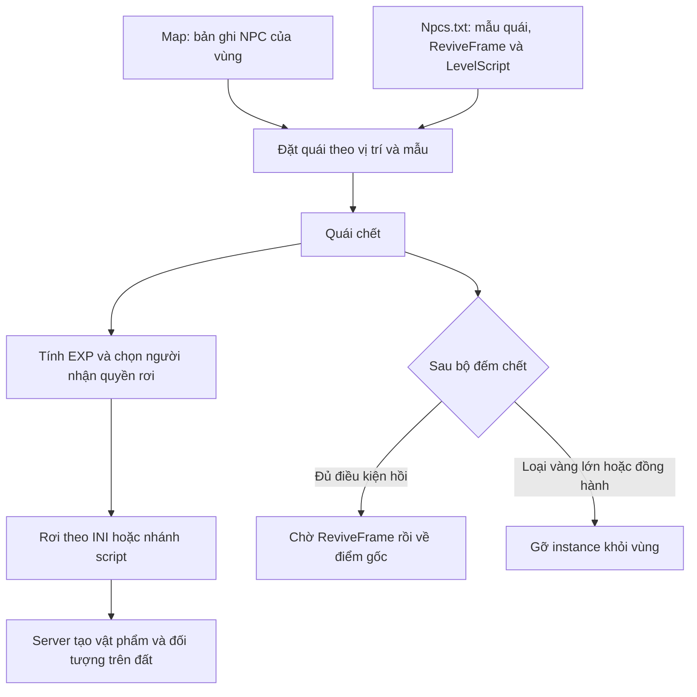

# TÓM TẮT 5 DÒNG
1. [THẤY] [NGUỒN] Bản ghi vùng đặt vị trí sinh; mẫu quái cấp bộ đếm hồi sinh. Khi hồi, quái trở về điểm gốc. `KNpcSet.cpp:533–536`, `KNpcTemplate.cpp:732`, `KNpc.cpp:13905`.
2. [THẤY] [NGUỒN] Mặc định khi đọc mẫu là 2.400 frame, khoảng 133,3 giây ở nhịp danh định 18 Hz; còn có giá trị khởi tạo và ghi đè bằng script. `KNpcTemplate.cpp:732`, `MultiServer/GameServer/KSOServer.cpp:90`, `KNpc.cpp:405`, `KNpc.h:1121–1122`.
3. [THẤY] [NGUỒN] Server có đường rơi theo bảng INI thường/vàng và đường gọi Lua. `RandRate` là trọng số một mục trên miền `RandRange`; số lượt và các bộ lọc ảnh hưởng kết quả mỗi lần hạ. `KSubWorld.cpp:886–901`, `KNpc.cpp:2483–2506`, `KNpc.cpp:11861–11900`, `KNpc.cpp:12617–12640`.
4. [THẤY] [NGUỒN] EXP gốc đến từ mẫu và script cấp quái; server xét người/đội gây sát thương, cự ly, hệ số và chênh cấp trước khi cộng EXP. `KNpcTemplate.cpp:877–884`, `KNpcDeathCalcExp.cpp:125–221`, `KPlayer.cpp:3099–3154`.
5. [CHƯA KIỂM] Không đo thời gian, EXP hay tỉ lệ rơi trong game; không build, chạy exe, VM hoặc dùng mạng. `HG-12.md` (task):27–30.

# HG-12 — Hiểu game: quái hồi sinh và vật phẩm rơi

Loại: khảo sát\
Chủ đề: Điểm sinh, bộ đếm hồi sinh, cách chọn vật phẩm và tính kinh nghiệm khi hạ quái.\
Từ khóa: quái, hồi sinh, respawn, ReviveFrame, rơi đồ, RandRange, RandRate, kinh nghiệm, EXP\
Trạng thái: DONE — đủ câu hỏi đọc tĩnh; chưa đối chiếu phiên đang chạy.\
Độ phủ: 4/4 câu hỏi (nguồn hồi sinh, thời gian, bảng rơi và tỉ lệ, kinh nghiệm); đối chiếu 2/2 sổ tay.\
Liên quan: [Sổ tay quái, NPC và bản đồ](SO-TAY-QUAI-NPC-BAN-DO.md), [Sổ tay kinh tế](SO-TAY-KINH-TE.md).\
Cần tôi quyết định: không

**Cách đọc:** [THẤY] = đối chiếu trực tiếp mã; [TÀI LIỆU] = dẫn lại sổ tay; [CHƯA KIỂM] = thiếu dữ liệu hoặc chưa chạy. Bằng chứng `file:dòng` dưới đây mặc định thuộc `Core/Src` dưới root server `C:/Jx1CocoV3/SwordOnline/SwordOnline/jxOnline/gameserver/Sources`; `MultiServer/` và `Engine/` tính từ root đó. `gamecore/` tính từ root client `C:/Jx1CocoV3/Folder/Client2912-20260116T044348Z-3-001/Client2912/Client/Classes`. Đây là hai bản source trên đĩa được task chỉ định. Tài liệu dùng UTF-8; các trích dẫn mã là tên kỹ thuật ASCII.

## Phạm vi và độ phủ

| Câu hỏi | Độ phủ | Bằng chứng chính |
|---|---|---|
| Hồi sinh theo bảng nào? | Đã phủ: điểm sinh từ vùng, thời gian từ mẫu, có nhánh Lua và nhánh gỡ instance | `KRegion.cpp:201`, `KNpcSet.cpp:535`, `KNpcTemplate.cpp:732`, `KNpc.cpp:2671`, `KNpc.cpp:13905` |
| Hồi bao lâu? | Đã phủ: hai mức mặc định trong mã, nhịp danh định và cách quy đổi; chưa đo từng quái | `KNpc.cpp:405`, `KNpcTemplate.cpp:732`, `MultiServer/GameServer/KSOServer.cpp:90` |
| Dùng bảng rơi nào, tỉ lệ tính thế nào? | Đã phủ: gắn bảng, trọng số, số lượt, bộ lọc và Lua | `KSubWorld.cpp:886`, `KNpcTemplate.cpp:547`, `KNpc.cpp:11765`, `KNpc.cpp:12617`, `ScriptFuns.cpp:7703` |
| Kinh nghiệm tính thế nào? | Đã phủ: EXP cơ sở, xét sát thương, chia đội và hiệu chỉnh | `KNpcTemplate.cpp:883`, `KNpcDeathCalcExp.cpp:125`, `KPlayer.cpp:2936`, `KPlayer.cpp:3099` |
| Đối chiếu hai sổ tay | Đã phủ: dữ liệu vùng và mẫu; kiểm kê bảng rơi và giới hạn kết luận | `SO-TAY-QUAI-NPC-BAN-DO.md:49–52`, `SO-TAY-KINH-TE.md:91–108` |
| Phiên game đang chạy | Chưa phủ: dữ liệu hiệu lực từng map/quái, thời gian, số đồ và EXP thực nhận | `SO-TAY-QUAI-NPC-BAN-DO.md:73–74`, `SO-TAY-KINH-TE.md:104–108` |

## Giải mã tên

| Tên gốc | Mã hóa | Chữ đúng | Nguồn file:dòng |
|---|---|---|---|
| `boss_tieu` | ASCII trong sổ tay | `boss_tieu` (ID ca khảo sát; chưa xác định tên hiển thị) | `SO-TAY-KINH-TE.md:103` |

Không trích tên hiển thị của quái, NPC, vật phẩm hay bản đồ từ dữ liệu GBK/TCVN3. `tongyong.ini` và `npcdroprate110.ini` là tên tệp kỹ thuật, giữ nguyên như nguồn.

## Sắp theo cấu trúc game

[THẤY] **Map → vùng → mẫu quái → lần chết → hồi sinh / EXP / đồ rơi.** Các ví dụ dưới đây gắn với các lớp đó thay vì sắp theo tên file. Chưa lập danh sách từng quái theo map vì phạm vi chỉ đọc luồng mã và hai sổ tay, không kiểm kê lại dữ liệu vùng. `KRegion.cpp:201`, `KNpcSet.cpp:533–536`, `KNpc.cpp:2472–2506`, `KNpc.cpp:2671–2698`.

## 1. Điểm sinh và thời gian hồi

- [TÀI LIỆU] Bản đồ đi từ danh mục map đến tệp vùng (`region_s.dat` hoặc dữ liệu vùng trong PAK); `Settings/Npcs.txt` chứa mẫu. Con số 94.098 bản ghi `shKind=0` trên 195 map là **điểm sinh được kiểm kê**, không phải số quái đang sống. `SO-TAY-QUAI-NPC-BAN-DO.md:43`, `SO-TAY-QUAI-NPC-BAN-DO.md:49–52`.
- [THẤY] Server đọc phần NPC của vùng rồi tạo quái theo tọa độ, ID mẫu và cấp. Cặp min/max hợp lệ của map có thể thay cấp trong bản ghi. `Revive()` đưa quái về tọa độ gốc và cho hoạt động trở lại. `KRegion.cpp:201–202`, `KRegion.cpp:652–661`, `KRegion.cpp:781–782`, `KNpcSet.cpp:533–536`, `KNpcSet.cpp:957`, `KNpc.cpp:13903–13936`.
- [THẤY] Sau giai đoạn chết (`DeathFrame`, mặc định khi đọc mẫu là 12), nhánh `OnDeath` gọi `DoRevive()` với NPC không phải đồng hành có `GetGoldType() <= 4`; loại lớn hơn 4 và đồng hành bị gỡ. Quái chờ hồi ở danh sách ngoài vùng nhưng vẫn được cập nhật; đến đủ `ReviveFrame`, server gọi `Revive()`. Mã có đọc `IsRevive` của mẫu, nhưng điều kiện trong nhánh `OnDeath` này xét loại NPC và loại vàng. `KNpcTemplate.cpp:662`, `KNpcTemplate.cpp:732–735`, `KNpc.cpp:2539–2543`, `KNpc.cpp:2571–2575`, `KNpc.cpp:2671–2698`, `KNpc.cpp:3394–3435`, `KNpc.cpp:6843–6849`, `KSubWorld.cpp:326–332`.
- [THẤY] Thời gian chờ ở nhịp danh định là **`ReviveFrame / 18` giây**, sau giai đoạn chết. Giá trị khởi tạo 1.080 frame tương ứng **60 giây**. Khi nạp mẫu, giá trị được chép vào quái; mặc định đọc trường là 2.400 frame, tương ứng **khoảng 133,3 giây**. Lua có thể đặt số frame khác. Callback `OnRevive` có thể đến từ script gắn trên quái hoặc khóa `<ID map>_NpcReviveScript`; mã gọi callback chưa cho biết nội dung script của từng map. `MultiServer/GameServer/KSOServer.cpp:90`, `MultiServer/GameServer/KSOServer.cpp:1441–1450`, `KNpc.cpp:405`, `KNpcTemplate.cpp:732`, `KNpc.cpp:11213`, `KNpc.h:1121–1122`, `ScriptFuns.cpp:19386–19416`, `KNpc.cpp:13924–13928`, `KNpc.cpp:13961–13977`.
- [CHƯA KIỂM] Không có một số giây chung đã kiểm cho mọi quái. Chưa đối chiếu giá trị thực của từng hàng mẫu, lịch sinh riêng của boss, callback Lua trên dữ liệu game hoặc nhịp vận hành. `KNpcTemplate.cpp:732`, `KNpc.cpp:13961–13977`.

## 2. Bảng rơi, trọng số và kết quả trên đất

- [THẤY] Cấu hình theo map có `<ID map>_NormalDropRate` và `<ID map>_GoldenDropRate`; `KSubWorld` điền `settings/mapdroprate/tongyong.ini` khi khóa tương ứng rỗng. Trong đường đọc vùng đã xem, hai chuỗi chỉ được chép vào bản ghi khi `shKind == 3`, còn `AddMapNpc` xét gắn bảng trong nhánh `kind_normal`, khi có chuỗi và qua bộ lọc `NpcsetID`. Vì vậy không suy rằng mọi quái thường nhận bảng ngay trong `AddMapNpc`. Có đường gắn bảng khác khi xử lý quái thường/vàng và từ Lua. `KCore.cpp:609`, `KSubWorld.cpp:886–901`, `KRegion.cpp:770–782`, `KNpcSet.cpp:569–571`, `KNpcSet.cpp:595–617`, `KNpcGold.cpp:258–278`, `KNpcGold.cpp:409–433`, `ScriptFuns.cpp:7690–7703`.
- [THẤY] `InitDropRate` kiểm đường dẫn có `.ini` rồi dùng bảng đã nạp hoặc nạp mới. Cột `DropRateFile` trong mẫu có lời đọc bị chú thích. Khi chết, nếu có người nhận và `m_DropScriptID`, mã gọi `DropRate` trước khi xét `DeathPunish`; `SetNpcDropScript` còn đặt cờ xóa bảng khi tới nhánh mặc định. `OnDeath` của action script là một đường gọi khác. `KNpcTemplate.cpp:512–551`, `KNpcTemplate.cpp:697–724`, `KNpc.cpp:2483–2506`, `KNpc.cpp:2618–2624`, `KNpc.cpp:11875–11881`, `ScriptFuns.cpp:13483–13490`.
- [THẤY] Bảng có `[Main]` (`Count`, `RandRange`, `nTypeNum`, thông số tiền và phẩm chất) và các mục đánh số `1..Count` (`Genre`, `Detail`, `Particular`, `RandRate`…). Mỗi lượt lấy một số từ `0` đến `RandRange − 1` khi miền dương; các `RandRate` xếp thành dải nối tiếp. Nếu số không nằm trong dải nào, lượt đó không chọn được mục. Sau khi đánh dấu một mục, lượt sau bỏ qua mục đó khi cộng dải. Với lượt đầu và giả định số ngẫu nhiên phân bố đều, tỷ phần chọn một mục có dải nằm trọn trong miền là `RandRate / RandRange`; đó là tỷ phần chọn mục trước khi tạo đồ. `KNpcTemplate.cpp:129–143`, `KNpcTemplate.cpp:164–212`, `Engine/Src/KRandom.cpp:68–94`, `KNpc.cpp:12617–12651`, `KNpc.cpp:12677`.
- [THẤY] Đường mặc định thử `nTypeNum` lượt (có thể bị `m_CurrentTreasure` thay), chặn theo `Count` rồi dùng 3 khi số lượt còn không dương. Tiền có vòng thử `MoneyRate` riêng. Map có thể chặn đồ; cấp món, may mắn và bộ lọc ảnh hưởng bước tạo. Tạo thành công thì đặt vật phẩm gần quái và gắn quyền nhặt; nhánh đòn cuối từ đồng hành có thể gắn cho chủ. Lua cũng có thể yêu cầu số lượt qua `ITEM_DropRateItem`, hoặc gọi `DropItem` riêng. `KNpc.cpp:11765–11788`, `KNpc.cpp:11861–11900`, `KNpc.cpp:12606–12615`, `KNpc.cpp:12679–12691`, `KNpc.cpp:12882–12886`, `KNpc.cpp:12912–12989`, `KNpc.cpp:11329`, `KNpc.cpp:11401–11412`, `ScriptFuns.cpp:7702–7703`, `ScriptFuns.cpp:25974–25978`.
- [TÀI LIỆU] Sổ kinh tế kiểm kê 201 INI, 59 đường dẫn chứa `BOSS`; đây là thống kê tệp. Ví dụ `npcdroprate110.ini` khai báo `Count=52`, `RandRange=1.000.000`, tổng trọng số 68.000. Nếu tất cả mục đều tham gia và giả định lượt đầu lý tưởng, phần miền có mục chiếm **6,8%**; chưa thể gọi đó là tỉ lệ vật phẩm xuất hiện mỗi lần hạ quái. Ca `boss_tieu` vẫn có đường `PickDropItem`/`DropItem` theo sổ tay dù đường nạp INI nhận một đối số `.lua`. `SO-TAY-KINH-TE.md:91–104`, `KNpc.cpp:12617–12640`.
- [CHƯA KIỂM] Chưa xác định bảng nào thực sự gắn cho từng quái/boss, Lua nào chạy hoặc tỉ lệ nhặt được ngoài thực tế. `SO-TAY-KINH-TE.md:102–108`.

## 3. Kinh nghiệm và đối chiếu client

- [THẤY] EXP gốc của mẫu là `ExpParam × Exp từ LevelScript / 100`, rơi về 10 nếu kết quả không dương. Khi đánh quái, server ghi sát thương có giới hạn bằng máu còn lại ở đòn kết liễu; người trong đội được gom về đội trưởng trong sổ sát thương. `KNpcTemplate.cpp:736–749`, `KNpcTemplate.cpp:877–884`, `KNpc.cpp:5683–5692`, `KNpcDeathCalcExp.cpp:79–122`.
- [THẤY] `CalcExp` xét từng mục sát thương hợp lệ. Với một đội, nó chọn người gần quái nhất trong ngưỡng; với người đi lẻ, mã so cự ly với ngưỡng. Mỗi mục đủ điều kiện có thể nhận `m_Experience × IsJinYan × nExpSale`, trừ khi map chặn EXP. `IsJinYan` có thể nhận khóa map `<ID map>_NpcExeSale` dương; `nExpSale` trong phép nhân đọc riêng từ cấu hình chung. Sát thương cao nhất chọn người trả về để xử lý quyền rơi, chứ EXP ở bước này không chia theo phần trăm sát thương. `KNpcDeathCalcExp.cpp:125–221`, `KSubWorld.cpp:863–872`, `KNpcSet.cpp:686–687`, `KNpc.cpp:2472–2506`.
- [THẤY] `AddExp` dùng cự ly **768 đơn vị game** để xét đồng đội cùng map quanh người đại diện. Với từ hai người đủ điều kiện, phần mỗi người trước hiệu chỉnh là `EXP đầu vào × (100 + 15 × số người) / 100 × cấp người đó / tổng cấp`, có sàn cho hệ số chia và làm tròn khi truyền số nguyên. Sau đó `AddSelfExp` áp `ServerExp + mission value 27`, chênh cấp, trạng thái nhân đôi và ngưỡng tích lũy. Ở nhánh chênh cấp thông thường, chênh tối đa 5 giữ nguyên, 6–15 dùng hệ số `(295 − 19 × chênh cấp) / 200`, trên 15 về 1; có nhánh riêng khi quái cấp từ 100 và người chơi không thấp cấp hơn. `KPlayer.cpp:63`, `KPlayer.cpp:2936–3058`, `KPlayer.cpp:3099–3154`.
- [THẤY] Trong client được chỉ định, gói chết đưa quái vào trạng thái chết, gói EXP cập nhật giá trị nhân vật và gói thêm đối tượng dựng vật phẩm/tiền từ dữ liệu server. Client cũng nhận `nReForm` khi khác 0, nhưng `OnRevive()` phía client không gọi `Revive()` theo bộ đếm như nhánh server. `gamecore/KProtocolProcess.cpp:508–512`, `gamecore/KProtocolProcess.cpp:569–581`, `gamecore/KProtocolProcess.cpp:2593–2594`, `gamecore/KProtocolProcess.cpp:2721–2766`, `gamecore/KNpc.cpp:2074–2077`.
- [CHƯA KIỂM] Chưa có số EXP thực nhận theo từng quái hoặc đội, giá trị cấu hình của phiên game, hay xác nhận source trùng bản server/client đang chạy. `SO-TAY-QUAI-NPC-BAN-DO.md:51`, `SO-TAY-KINH-TE.md:108`.

## Đã xác minh / Chưa xác minh

- **Đã xác minh:** đường nạp vùng, bộ đếm hồi, lựa chọn mục rơi và phân bổ EXP bằng source tại các dòng trên; kết luận hai sổ tay được giữ nguyên.
- **Chưa xác minh:** dữ liệu cụ thể mỗi map/quái, script thực được chạy, thời gian, tỉ lệ và EXP quan sát được. Giới hạn này cũng áp dụng cho phần đối chiếu client.

## Bàn giao

Báo cáo và sổ thông số: [HG-12](../REPORTS/HG-12.md). Tổng quan sẽ commit; chưa chạy kiểm thử game.
