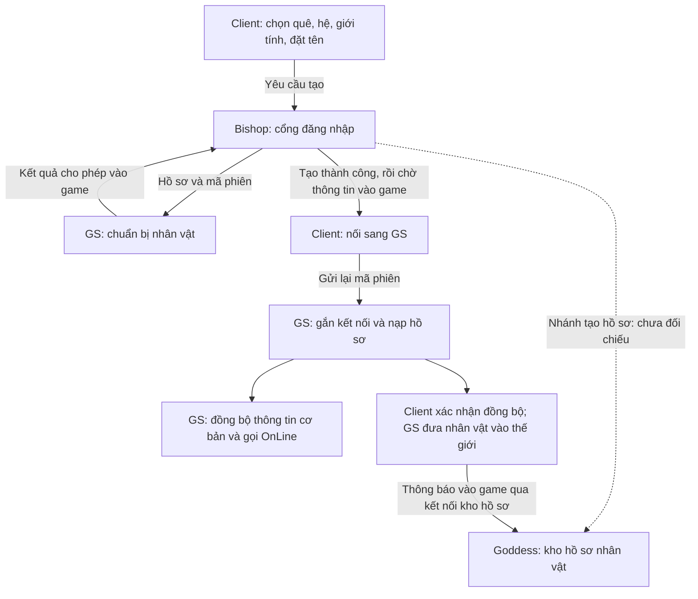

TÓM TẮT 1: [THẤY] Khi bấm tạo mới, client mở màn chọn quê rồi mới đến màn chọn ngũ hành, giới tính và đặt tên (`C/gameui/KuiSelPlayer_new.cpp:537-539`; `C/gameui/KuiSelNativePlace.cpp:439-448`; `C/gameui/KuiNewPlayer.cpp:616-646`).
TÓM TẮT 2: [THẤY] Client gửi yêu cầu tạo tới Bishop; khi được phép vào game, client mang mã phiên (GUID) sang GS để nhận đúng hồ sơ (`C/gameui/KuiNewPlayer.cpp:640-646,1164-1179`; `S/MultiServer/GameServer/KSOServer.cpp:5082-5087`).
TÓM TẮT 3: [THẤY] GS lấy cấp, chỉ số, vật phẩm và vị trí đăng nhập từ hồ sơ; mã quê trên màn tạo chưa đủ để suy ra nơi nhân vật xuất hiện (`S/Core/Src/KPlayerDBFuns.cpp:455-465,478-548,613-617,818-861`).
TÓM TẮT 4: [THẤY] GS gọi `OnLine` trong `online.lua` lúc đồng bộ thông tin cơ bản; GS gửi thông báo nhân vật vào game qua kết nối kho hồ sơ sau khi client phản hồi đồng bộ (`S/Core/Src/KPlayer.cpp:1035-1042`; `S/MultiServer/GameServer/KSOServer.cpp:3768-3771,3804-3812`).
TÓM TẮT 5: [CHƯA KIỂM] Có dữ liệu mẫu nhưng chưa chốt hồ sơ mới, NPC cấp đồ và nơi xuất hiện thực tế; không build, chạy game, exe, VM hoặc mạng (`G/Settings/player/NewPlayerIni00.ini:11-32`; `G/script/Utf8Script/npc/newplayer_get.lua:37-45,144-164`; `S/Core/Src/KPlayerDBFuns.cpp:478-548`).

# HG-16 — Hiểu sự kiện đăng nhập và khởi tạo nhân vật mới

- Loại: khảo sát
- Chủ đề: Từ màn chọn quê, hệ và giới tính đến lúc nhân vật xuất hiện trong thế giới game.
- Từ khóa: tạo nhân vật, ngũ hành, quê quán, KSelPlayer, KuiNewPlayer, Bishop, Goddess, online.lua, HG-16
- Trạng thái: PARTIAL — đã bổ sung cấu hình tân thủ Lua/INI; còn thiếu bằng chứng nối dữ liệu đó với nhánh tạo hồ sơ, NPC được gắn và điểm xuất hiện thực tế.
- Độ phủ: 6/6 nhóm có ghi nhận; 1/6 phủ đủ bằng mã trực tiếp ở mức khảo sát tĩnh, 5/6 phủ một phần.
- Liên quan: [A-02 — Luồng đăng nhập](../REPORTS/A-02-luong-dang-nhap.md), [Mục lục tri thức](MUC-LUC-TRI-THUC.md), [Báo cáo HG-16](../REPORTS/HG-16.md).
- Cần tôi quyết định: không.

Nhãn dùng trong tài liệu: **[THẤY]** = đã xác minh trong mã được giao; **[TÀI LIỆU]** = thông tin dẫn lại, ghi rõ xuất xứ; **[CHƯA KIỂM]** = thiếu nguồn hoặc chưa chạy. Sơ đồ tập trung vào hai đường truyền khác nhau: đăng nhập qua Bishop và kết nối trực tiếp từ client sang GS; đoạn chấm là phần chưa đối chiếu trực tiếp.

`C/` là `C:/Jx1CocoV3/Folder/Client2912-20260116T044348Z-3-001/Client2912/Client/Classes/`; `S/` là `C:/Jx1CocoV3/SwordOnline/SwordOnline/jxOnline/gameserver/Sources/`. Đây là hai bản mã trên đĩa nêu trong task, chưa đối chiếu với bản đang chạy.

## Phạm vi và độ phủ

| Phần | Độ phủ | Bằng chứng |
|---|---|---|
| Chọn hệ, giới tính và gửi yêu cầu tạo | Đã phủ | [THẤY] `C/gameui/KuiNewPlayer.cpp:40-47,624-646,824-828,873-899`. |
| Chỉ số khởi đầu | Một phần | [THẤY] GS đọc giá trị từ hồ sơ; 10 mẫu theo hệ/giới tính có trong `G/Settings/player/NewPlayerIni00.ini` đến `NewPlayerIni09.ini:20-23`. Chưa xác minh nhánh tạo hồ sơ nạp mẫu nào. `S/Core/Src/KPlayerDBFuns.cpp:455-456,608-617,682-691`. |
| Vật phẩm phát | Một phần | [THẤY] `newplayer_get.lua` có hàm thêm vật phẩm và cờ tác vụ chặn nhận lặp; chưa xác minh NPC nào đang gắn script hoặc đây là quà tạo nhân vật. `G/script/Utf8Script/npc/newplayer_get.lua:144-164,430-459,479-517`. |
| Bản đồ xuất phát | Một phần | [THẤY] Client gửi quê đã chọn; 10 mẫu ghi `irevivalid/x/y`, và `RevivePos.ini` có các nhóm vị trí. Chưa đối chiếu quy tắc chuyển quê thành nơi xuất hiện lần đầu. `C/gameui/KuiSelNativePlace.cpp:439-448`; `C/gameui/KuiNewPlayer.cpp:633-646`; `S/Core/Src/KPlayerDBFuns.cpp:478-548`; `G/Settings/player/NewPlayerIni00.ini:14-15`; `G/Settings/RevivePos.ini:18-22`. |
| Script đăng nhập và tân thủ | Một phần | [THẤY] `online.lua::OnLine` gọi `huanyin`; script `newplayer_get.lua` có các hàm cấp vật phẩm. [CHƯA KIỂM] Chưa chứng minh `newplayer_get` được gọi từ `OnLine` hay được gắn vào NPC đang dùng. `S/Core/Src/KPlayer.cpp:1036-1042`; `G/script/System/online.lua:11-17`; `G/script/Utf8Script/npc/newplayer_get.lua:8-18,144-164,430-459,479-517`. |
| Client → Bishop, GS và Goddess | Một phần | [THẤY] Hai đầu client/GS và đường GS báo kho hồ sơ. [TÀI LIỆU] Vai trò của Bishop/Goddess ở nhánh lấy hồ sơ cũ. `C/gameui/KSelPlayer.cpp:1176-1190`; `S/MultiServer/GameServer/KSOServer.cpp:3804-3812,3937-3992`; `JX1_OPS/REPORTS/A-02-luong-dang-nhap.md:109-112`. |

## Giải mã tên

| Tên gốc trong mã | Mã hóa tại chỗ dẫn | Chữ đúng | Nguồn file:dòng |
|---|---|---|---|
| `jin` / `金` | ASCII / UTF-8 | Kim (金) | `C/gameui/KuiNewPlayer.cpp:994` |
| `mu` / `木` | ASCII / UTF-8 | Mộc (木) | `C/gameui/KuiNewPlayer.cpp:994` |
| `shui` / `水` | ASCII / UTF-8 | Thủy (水) | `C/gameui/KuiNewPlayer.cpp:994` |
| `huo` / `火` | ASCII / UTF-8 | Hỏa (火) | `C/gameui/KuiNewPlayer.cpp:994` |
| `tu` / `土` | ASCII / UTF-8 | Thổ (土) | `C/gameui/KuiNewPlayer.cpp:994` |
| `man` / `男`; `girl` / `女` | ASCII / UTF-8 | Nam (男); nữ (女) | `C/gameui/KuiNewPlayer.cpp:995-997` |

[CHƯA KIỂM] Tên làng chưa có bảng đối chiếu; tên vật phẩm trong mẫu chỉ có mã, chưa tra bảng định danh. HG-16c bổ sung riêng tên trong menu Lua ở dưới, không coi tên menu là tên món thật được cấp. Tệp `KuiSelNativePlace.cpp` không qua kiểm tra UTF-8 nghiêm ngặt ở lượt trước; bằng chứng dùng định danh ASCII. Nguồn: `C/gameui/KuiSelNativePlace.cpp:396-411`; `S/Core/Src/KPlayerDBFuns.cpp:884-897`; `G/script/Utf8Script/npc/newplayer_get.lua:129-138`.

## Sắp theo cấu trúc game

| Nhóm trong game | Các phần đã xác định |
|---|---|
| Nhân vật → ngũ hành → giới tính | [THẤY] Theo thứ tự: 0 Kim, 1 Mộc, 2 Thủy, 3 Hỏa, 4 Thổ; mỗi hệ dùng hình nam hoặc nữ. Màn tạo mặc định Kim và nam. Đây là hệ ngũ hành, chưa phải tên môn phái. `C/gameui/KuiNewPlayer.cpp:40-47,824-828,873-899,994-997`; `S/Core/Src/KPlayerDBFuns.cpp:643-645,682-688`. |
| Nhân vật → chỉ số → dữ liệu đã lưu | [THẤY] Cấp, giới tính, điểm tiềm năng, điểm kỹ năng, sức mạnh, thân pháp, sinh khí, nội công và may mắn đều có trường trong hồ sơ. Số điểm thật của từng tổ hợp hệ/giới tính chưa kiểm. `S/Core/Src/KPlayerDBFuns.cpp:455-456,608-617`. |
| Hành trang → từng món trong hồ sơ | [THẤY] GS đọc loại, cấp, số lượng chồng và vị trí từng món. HG-16c bổ sung bản ghi `ITEM1` của 10 mẫu và các nhánh cấp trong Lua ở dưới; chưa nối chúng với hồ sơ thật. `S/Core/Src/KPlayerDBFuns.cpp:818-861,884-897`; `G/Settings/player/NewPlayerIni00.ini:61-83`; `G/script/Utf8Script/npc/newplayer_get.lua:144-164`. |
| Thế giới → quê chọn → điểm đăng nhập | [THẤY] Màn chọn quê đọc `Id`, `RevID`, `Name`; client chuyển tiếp `Id`. GS đặt nhân vật theo dữ liệu vị trí đã nạp. [CHƯA KIỂM] Chưa xếp theo làng vì thiếu bảng đối chiếu. `C/gameui/KuiSelNativePlace.cpp:396-405,439-448`; `S/Core/Src/KPlayerDBFuns.cpp:478-548`. |

## Từ màn chọn nhân vật đến lúc vào game

1. **Hai màn chọn nhân vật.** [THẤY] `Klogin::loadSuccess` mở `KuiSelPlayer_new`; lệnh mở `KSelPlayer` ở ngay đoạn này nằm trong chú thích. Cả hai có nhánh mở màn chọn quê khi tài khoản còn chỗ. Khi chọn một nhân vật đã có, cả hai gửi `c2s_dbplayerselect`; đây là yêu cầu lấy nhân vật cũ, tách với yêu cầu tạo mới. `C/gameui/Klogin.cpp:513-519,524-531`; `C/gameui/KSelPlayer.cpp:656-657,1176-1190`; `C/gameui/KuiSelPlayer_new.cpp:537-539,1163-1172`.
2. **Chọn quê, chọn hệ và gửi yêu cầu.** [THẤY] Màn quê dùng `NativePlaceList.ini` cho tiếng Trung, `NativePlaceList_vn.ini` ở nhánh còn lại. Lúc bấm tiếp, client lưu ID của dòng đã chọn rồi mở `KuiNewPlayer`. Gói `c2s_newplayer` mang tên, giới tính, hệ và `m_NativePlaceId`; màn tạo chờ kết quả. Nếu báo thành công, client đặt cờ tạo mới ở phía mình và chuyển sang chờ thông tin vào GS. `C/gameui/KuiSelNativePlace.h:30-31`; `C/gameui/KuiSelNativePlace.cpp:368-405,439-448`; `C/gameui/KuiNewPlayer.cpp:40-47,624-651,1039-1058`.
3. **Chuẩn bị hồ sơ và kết nối GS.** [TÀI LIỆU] A-02 ghi rằng với nhân vật đã có, Bishop hỏi Goddess lấy hồ sơ rồi gửi hồ sơ cùng GUID sang GS. Source Bishop/Goddess A-02 dẫn nằm ở root `gateway`, ngoài hai root HG-16; nhánh tạo hồ sơ mới chưa đối chiếu. [THẤY] GS nhận hồ sơ `TRoleData` và GUID từ cổng, gọi `AddCharacter`, rồi gửi kết quả cho phép lại cổng. Khi Bishop báo cho vào game, client nối đến GS theo thông tin được cấp và gửi GUID bằng `tagLogicLogin`; GS gọi `AttachPlayer` và bắt đầu nạp, đồng bộ. `JX1_OPS/REPORTS/A-02-luong-dang-nhap.md:70-71,109-112`; `S/MultiServer/GameServer/KSOServer.cpp:3865-3869,3937-3992,5044-5087,5127-5135`; `C/gameui/KuiNewPlayer.cpp:1022-1023,1084,1107,1149-1179`.
4. **Đặt nhân vật vào bản đồ.** [THẤY] GS ưu tiên bản đồ tạm nếu có, kế đến điểm hồi sinh nếu hồ sơ bật cờ dùng điểm hồi sinh; nếu không, đọc bản đồ và tọa độ vào game trong hồ sơ. Nếu bản đồ đó không tìm thấy trong danh sách GS, mã lấy cặp dự phòng từ `ServerConfig/PlayerRevPosId`. Giá trị khởi tạo trong mã là ID bản đồ 53, ID điểm 19; cấu hình có thể ghi đè và số đó không xác nhận làng tân thủ. Khi cần tra điểm, mã đọc `RevivePos.ini`. `S/Core/Src/KPlayerDBFuns.cpp:464-483,486-548`; `S/Core/Src/KGameglobalSet.cpp:26-27,124`; `S/Core/Src/KSubWorldSet.cpp:683-725`.
5. **Đọc chỉ số, hành trang và chạy móc đăng nhập.** [THẤY] GS nạp từng phần của hồ sơ. `KNewPlayerAttribute::Init` có bộ thông số theo 5 hệ, `NewPlayerGetBaseAttribute` lấy số từ bộ đó; đường đăng nhập đã đọc lấy số đã ghi trong hồ sơ. `SetLevel` cũng tra `NewPlayerIni%02d.ini` theo công thức `hệ × 2 + giới tính`, nhưng riêng hàm này chưa chứng minh nguồn tạo hồ sơ. Khi gói thông tin cơ bản được đưa vào bộ gửi thành công, GS gọi `OnLine` và truyền trạng thái thế giới, tên bản đồ, `m_IsFirstLogin`. Ở đường gateway đã đọc, lệnh gọi `AddCharacter` bỏ đối số cuối, nhận mặc định 1 từ khai báo giao diện, rồi chép vào biến. Chưa thể dùng riêng giá trị đó để kết luận script chỉ chạy một lần hoặc chỉ cho nhân vật mới. `S/Core/Src/CoreServerShell.h:201`; `S/Core/Src/CoreServerShell.cpp:451-479,496-509`; `S/Core/Src/KPlayerDBFuns.cpp:182-185,321-324,613-617`; `S/Core/Src/KPlayerSet.cpp:1568-1585`; `S/Core/Src/KPlayer.cpp:1036-1042,2487-2514,3377-3394`; `S/MultiServer/GameServer/KSOServer.cpp:3981`.
6. **GS báo cho kho hồ sơ.** [THẤY] Sau khi client trả lời đồng bộ, GS đưa nhân vật vào thế giới và gửi `tagRoleEnterGame` qua kết nối cơ sở dữ liệu. Khi lưu, GS có đường gửi gói `c2s_rolekfjhu_saveroleinfo` mang hồ sơ. [TÀI LIỆU] A-02 mô tả Goddess là phía xử lý kho hồ sơ; chưa xác minh trong HG-16 phía nhận hai gói này hay thứ tự ghi hồ sơ mới. `S/MultiServer/GameServer/KSOServer.cpp:3768-3771,3804-3812,4570,4604-4608,4630-4633`; `JX1_OPS/REPORTS/A-02-luong-dang-nhap.md:130-142`.

## Đối chiếu bổ sung lần 2 — ghi nhận lịch sử trước HG-16c

[TÀI LIỆU] Giữ nguyên các kết luận dưới đây cho phạm vi Sources ở lượt HG-16b. Các câu “chưa có/chưa đọc” mô tả thời điểm đó; phần HG-16c bên dưới bổ sung bản Lua/INI ServerNew, không thay bằng chứng cũ (`JX1_OPS/TASKS/HG-16c.md:48-49`).

- [THẤY] `KNewPlayerAttribute::Init` nạp tệp `BASE_ATTRIBUTE_FILE_NAME`, rồi đọc các nhóm `metal`, `wood`, `water`, `fire`, `earth` với khóa `Strength`, `Dexterity`, `Vitality`, `Engergy`, `Lucky`. Các giá trị mặc định trong lời gọi đọc là 0 hoặc `PLAYER_FIRST_LUCKY`; đây là giá trị dự phòng trong mã, không phải số liệu đã xác nhận của nhân vật mới. `S/Core/Src/KPlayerSet.cpp:1568-1585`.
- [THẤY] `NewPlayerGetBaseAttribute` chép các mảng chỉ số theo hệ vào nhân vật; chú thích ngay trên hàm ghi `没有调用` (không gọi). Tìm trong các tệp `.cpp` và `.h` của `Sources/Core/Src` chỉ thấy khai báo/định nghĩa và bản sao cũ, không thấy điểm gọi trong vùng này. Vì vậy không dùng hàm này làm bằng chứng rằng luồng tạo hiện gọi nó. `S/Core/Src/KPlayer.cpp:2485-2500`; `S/Core/Src/KPlayer.h:490`.
- [THẤY] `SetLevel` tạo tên tệp `NewPlayerIni%02d.ini` theo công thức `hệ × 2 + giới tính`, rồi đọc các khóa chỉ số trong nhóm `ROLE`. Nội dung tệp cấu hình không nằm trong phần Sources đã giao; đoạn này cũng chưa chứng minh `SetLevel` được gọi khi tạo hồ sơ mới. `S/Core/Src/KPlayer.cpp:3377-3394`.
- [CHƯA KIỂM] Đã tìm tên `online.lua`, `newplayer`, `NewPlayerIni*.ini` và `RevivePos.ini` trong phần Sources được giao nhưng không tìm thấy tệp tương ứng. Source chỉ cho biết GS gọi đường dẫn script `\\script\\system\\online.lua`; chưa có nội dung script hay dữ liệu cấu hình để chốt phát quà, điểm số, bản đồ đầu tiên hoặc cơ chế chỉ chạy một lần. `S/Core/Src/KPlayer.cpp:1036-1042`; `JX1_OPS/TASKS/HG-16b.md:23-35`.

## MỤC SỔ THÔNG SỐ

| Nhóm | Tên/hằng số | file:dòng | Giá trị | Đơn vị | Ảnh hưởng | Đổi an toàn | Nguồn đo |
|---|---|---|---|---|---|---|---|
| Chỉ số khởi tạo | Các nhóm thuộc tính theo hệ | `S/Core/Src/KPlayerSet.cpp:1570-1582` | Tên nhóm/khóa thấy trong mã; giá trị cấu hình chưa đọc. Giá trị dự phòng: 0; may mắn: `PLAYER_FIRST_LUCKY`. | Điểm thuộc tính | Dữ liệu chỉ số cơ sở được đọc khi nạp cấu hình. | CẨN THẬN — chưa có tệp cấu hình và kiểm chứng ảnh hưởng. | Đọc tĩnh mã nguồn; chưa đo runtime. |
| Điểm vào dự phòng | `PlayerInfo.mSubWorld`, `PlayerInfo.mReviveId`, `ServerConfig.PlayerRevPosId` | `S/Core/Src/KGameglobalSet.cpp:26-27,124` | Mặc định 53 và 19; cấu hình có thể ghi đè cả hai. | ID bản đồ, ID điểm hồi sinh | Điểm dự phòng khi GS cần dùng cấu hình này. Không xác nhận đây là làng tân thủ. | CẨN THẬN — chưa đối chiếu cấu hình triển khai và dữ liệu bản đồ. | Đọc tĩnh mã nguồn; chưa đo runtime. |
| Tệp chỉ số theo hệ/giới tính | Công thức chỉ số tệp `NewPlayerIni%02d.ini` | `S/Core/Src/KPlayer.cpp:3383-3394` | `hệ × 2 + giới tính`; nội dung các tệp chưa có trong Sources được giao. | Chỉ số tệp | Chọn tệp mà `SetLevel` đọc để lấy chỉ số trong nhóm `ROLE`. | CẨN THẬN — chưa xác nhận luồng tạo nhân vật gọi hàm này. | Đọc tĩnh mã nguồn; chưa đo runtime. |

## ĐỀ XUẤT TỐI ƯU

Không đề xuất thay đổi hoặc tối ưu mã trong khảo sát chỉ đọc này. Chưa có số đo runtime; các điểm chưa rõ cần đối chiếu bằng mã gateway, script và dữ liệu cấu hình đúng phiên bản trước khi cân nhắc thay đổi.

## Chưa kiểm

- [CHƯA KIỂM] Chưa đọc trực tiếp nhánh Bishop/Goddess tạo và lưu lần đầu; chưa xác định nơi tạo hồ sơ gốc và việc lưu xảy ra trước hay sau phản hồi tạo. Hai tệp gateway A-02 dẫn tới ở ngoài root task (`JX1_OPS/REPORTS/A-02-luong-dang-nhap.md:70-71`; `JX1_OPS/TASKS/HG-16.md:23-24`).
- [CHƯA KIỂM] Chưa có dữ liệu gốc để chốt chỉ số, vật phẩm phát, cấp ban đầu, tên bản đồ và tọa độ lần đầu. Các đường nạp và giá trị dự phòng đang thấy chỉ trả lời cách GS dùng hồ sơ (`S/Core/Src/KPlayerDBFuns.cpp:455-456,478-548,608-617,818-861`).
- [CHƯA KIỂM] Chưa thấy thân `script/system/online.lua`, chưa xác định đường dẫn/hàm của `newplayer` hoặc cơ chế chống phát quà lặp. Mã chỉ xác nhận chỗ gọi `OnLine` (`S/Core/Src/KPlayer.cpp:1036-1042`; `JX1_OPS/TASKS/HG-16.md:20,24`).
- [CHƯA KIỂM] Chưa build, chạy game, VM, exe, kết nối mạng hay đối chiếu bản đang triển khai. Nếu cần chốt dữ liệu tân thủ, bước tiếp theo là bổ sung phạm vi đọc tĩnh cho gateway và đúng bộ dữ liệu/script game (`JX1_OPS/TASKS/HG-16.md:24-29`).

## Bàn giao

Báo cáo [HG-16](../REPORTS/HG-16.md) ghi kết quả đối chiếu và hàng đề xuất cho mục lục. Tổng quan thực hiện commit.

liên quan: `JX1_OPS/DESIGN/MUC-LUC-TRI-THUC.md`, `JX1_OPS/REPORTS/A-02-luong-dang-nhap.md`, `JX1_OPS/REPORTS/HG-16.md`.

Kỹ năng đã dùng: jx1-retrofit, jx1-read-server, jx1-read-client, jx1-parameters, jx1-knowledge, jx1-report.

## Bổ sung tĩnh Lua/INI cho nhân vật mới (HG-16c)

Các nguồn dưới đây thuộc bản trên đĩa G = C:/Jx1CocoV3/Folder/ServerNew-20260116T043145Z-3-001/ServerNew/_bin_v2_/gs; chúng bổ sung bằng chứng cho cấu hình và script, không chứng minh cấu hình này đang được GS sử dụng.

### Đăng nhập và nhận vật phẩm là hai đường chưa nối được

[THẤY] GS gọi `OnLine` sau khi đóng gói thông tin cơ bản thành công; `OnLine` gọi `huanyin(nIsFirstLogin)`. Hàm `huanyin` áp trạng thái 963, đọc thời hạn qua `GetMaptimeInfo`, áp các trạng thái có điều kiện và ghi log khi cờ bằng 1. Trong thân `OnLine`/`huanyin` đã đọc không có lệnh gọi `newplayer_get.lua` hoặc `AddItem`; không coi cờ này là bằng chứng tạo nhân vật đúng một lần (`S/Core/Src/KPlayer.cpp:1036-1042`; `G/script/System/online.lua:11-17,57-93`).

[THẤY] Menu `main` có lựa chọn `LINGQUWUQI`, `LINGQUJIHUO`, `LUOPAN`; lựa chọn `XINSHOU` ở dòng 11 bị chú thích. `main` từ chối khi cấp dưới 10 trước khi mở menu, vì vậy đây không phải bằng chứng tự phát đồ ngay lúc tạo cấp 1 (`G/script/Utf8Script/npc/newplayer_get.lua:8-18,37-45`; `G/Settings/player/NewPlayerIni00.ini:26`).

[THẤY] Đường nhận vũ khí là `LINGQUWUQI` → chọn `#giveitem(0..9)` → `giveitem`. Hàm kiểm `GetPositionCount(3,4,0)>=1`, lấy hệ ngẫu nhiên 0–4, đặt `nLevel=10` và gọi `AddItem(0,nDetailType,nParticularType,...)`. Với lựa chọn 0–6, `nDetailType=0`; với 7–9, đặt 1 và trừ 7 khỏi mã đặc trưng. Chỉ khi kết quả thêm món >0 mới gọi `SetItemMapIdx(nItemIdx,120,1)`. Không suy nghĩa của các tham số 120/1 hoặc tên món thật khi chưa đối chiếu hàm tương ứng; trong thân `giveitem` không thấy kiểm cờ nhận một lần (`G/script/Utf8Script/npc/newplayer_get.lua:126-164`).

[THẤY] Hai nhánh quà khác dùng hai byte riêng của tác vụ 140: `XINSHOUA` kiểm tên nhập, kiểm byte 1, đặt cờ trước `AddItem(0,14,0,1,...)`; `LINGQUJIHUOA` kiểm tên và byte 2, gọi `AddItem(0,13,0,2,...)`, rồi đặt cờ ngoài khối kiểm kết quả >0. Cờ có thể được đặt dù thêm món thất bại; chưa có kiểm thử hành vi và chưa xác minh đường người chơi gọi được hai hàm này (`G/script/Utf8Script/npc/newplayer_get.lua:430-459,479-517`).

### Chỉ số mẫu theo hệ → giới tính

| Hệ | Giới tính (bsex) | Mẫu | Sức mạnh (ipower) | Thân pháp (iagility) | Sinh khí (iouter) | Nội công (iinside) | Nguồn |
|---|---:|---|---:|---:|---:|---:|---|
| Kim | 0 | NewPlayerIni00.ini | 35 | 25 | 25 | 15 | G/Settings/player/NewPlayerIni00.ini:11-23 |
| Kim | 1 | NewPlayerIni01.ini | 35 | 20 | 25 | 10 | G/Settings/player/NewPlayerIni01.ini:11-23 |
| Mộc | 0 | NewPlayerIni02.ini | 20 | 35 | 20 | 25 | G/Settings/player/NewPlayerIni02.ini:11-23 |
| Mộc | 1 | NewPlayerIni03.ini | 20 | 35 | 20 | 25 | G/Settings/player/NewPlayerIni03.ini:11-23 |
| Thủy | 0 | NewPlayerIni04.ini | 25 | 25 | 25 | 25 | G/Settings/player/NewPlayerIni04.ini:11-23 |
| Thủy | 1 | NewPlayerIni05.ini | 25 | 25 | 25 | 25 | G/Settings/player/NewPlayerIni05.ini:11-23 |
| Hỏa | 0 | NewPlayerIni06.ini | 30 | 20 | 30 | 20 | G/Settings/player/NewPlayerIni06.ini:11-23 |
| Hỏa | 1 | NewPlayerIni07.ini | 30 | 20 | 30 | 20 | G/Settings/player/NewPlayerIni07.ini:11-23 |
| Thổ | 0 | NewPlayerIni08.ini | 20 | 15 | 25 | 40 | G/Settings/player/NewPlayerIni08.ini:11-23 |
| Thổ | 1 | NewPlayerIni09.ini | 20 | 15 | 25 | 40 | G/Settings/player/NewPlayerIni09.ini:11-23 |

[THẤY] Mã giới tính 0 là nam, 1 là nữ theo mảng hình client. `SetLevel` chọn mẫu theo `hệ × 2 + giới tính`, rồi đọc bốn chỉ số trong `ROLE`; đây là một đường đọc mẫu đã thấy, chưa chứng minh hàm tạo hồ sơ gateway sử dụng nó. Bảng giữ nguyên số liệu, kể cả tổng bốn chỉ số của Kim nữ là 90 còn các mẫu khác là 100 (`C/gameui/KuiNewPlayer.cpp:994-997`; `S/Core/Src/KPlayer.cpp:3377-3409`; `G/Settings/player/NewPlayerIni00.ini:20-23` đến `G/Settings/player/NewPlayerIni09.ini:20-23`).

[THẤY] Cả 10 mẫu ghi cấp 1 (`ifightlevel`), tiền 100 (`imoney`), ba trường điểm chưa phân bổ bằng 0 và `iluck=0`. Đây là giá trị trong mẫu trên đĩa, không phải số đo sau đăng nhập (`G/Settings/player/NewPlayerIni00.ini:17-29` đến `G/Settings/player/NewPlayerIni09.ini:17-29`).
[THẤY] G/Settings/npc/player/NewPlayerBaseAttribute.ini:1-34 có năm nhóm metal, wood, water, fire, earth; mỗi nhóm đặt Strength, Dexterity, Vitality, Engergy bằng 0 và Lucky bằng 1. Chưa có bằng chứng cách tệp được ghép với các giá trị trên.
### Vật phẩm ghi sẵn trong mẫu — tách khỏi quà NPC

[THẤY] Cả 10 mẫu đã đối chiếu khai báo `ITEMS/COUNT=1` và có bản ghi `ITEM1`. Bảng liệt kê từng bản ghi theo hệ → giới tính; các bộ ba giữ đúng thứ tự `iequipclasscode / idetailtype / iparticulartype`. Đây là mã trong INI, chưa phải bảng tên vật phẩm hoặc bằng chứng nhân vật thật được cấp món đó.

| Hệ / giới tính | Mẫu | Bộ ba mã của ITEM1 | ilevel / iseries | Nguồn file:dòng |
|---|---|---|---|---|
| Kim nam | 00 | 0 / 0 / 4 | 1 / 0 | `G/Settings/player/NewPlayerIni00.ini:61-83` |
| Kim nữ | 01 | 0 / 0 / 4 | 1 / 0 | `G/Settings/player/NewPlayerIni01.ini:56-78` |
| Mộc nam | 02 | 0 / 1 / 1 | 1 / 0 | `G/Settings/player/NewPlayerIni02.ini:60-82` |
| Mộc nữ | 03 | 0 / 1 / 2 | 1 / 0 | `G/Settings/player/NewPlayerIni03.ini:60-82` |
| Thủy nam | 04 | 0 / 0 / 5 | 1 / 5 | `G/Settings/player/NewPlayerIni04.ini:60-82` |
| Thủy nữ | 05 | 0 / 0 / 5 | 1 / 0 | `G/Settings/player/NewPlayerIni05.ini:60-82` |
| Hỏa nam | 06 | 0 / 0 / 2 | 1 / 0 | `G/Settings/player/NewPlayerIni06.ini:60-82` |
| Hỏa nữ | 07 | 0 / 0 / 3 | 1 / 0 | `G/Settings/player/NewPlayerIni07.ini:60-82` |
| Thổ nam | 08 | 0 / 0 / 0 | 1 / 0 | `G/Settings/player/NewPlayerIni08.ini:60-82` |
| Thổ nữ | 09 | 0 / 0 / 1 | 1 / 0 | `G/Settings/player/NewPlayerIni09.ini:60-82` |

[THẤY] Mẫu 04 còn có dữ liệu tiếp sau `ITEM1` và nhóm `[ITEM3]`, trong khi `ITEMS/COUNT` vẫn là 1; chưa đối chiếu bộ đọc mẫu để kết luận nhóm thừa có được dùng hay không. Giữ nguyên cả `iseries=5` trong bản ghi của mẫu 04, không tự sửa về mã hệ 0–4 (`G/Settings/player/NewPlayerIni04.ini:60-82,94-125`).

### Điểm hồi sinh và điều kiện chọn nơi vào game

[THẤY] Cả 10 mẫu ghi `irevivalid=20`, `irevivalx=10`, `irevivaly=0`. Mã GS chép `irevivalid` thành ID bản đồ và `irevivalx` thành ID điểm, rồi gọi `GetRevivalPosFromId`; chữ “x” ở đây không có nghĩa tọa độ X (`G/Settings/player/NewPlayerIni00.ini:14-16` đến `G/Settings/player/NewPlayerIni09.ini:14-16`; `S/Core/Src/KPlayerDBFuns.cpp:464-474`).

[THẤY] Hàm tra dùng ID bản đồ làm tên nhóm, ID điểm làm khóa trong `RevivePos.ini`. Nhóm `[20]` có điểm 10 = `(113472,199232)`, 11 = `(110656,197888)`, 12 = `(108064,200512)`; `region=10,12` dùng khi ID điểm truyền vào âm để chọn ngẫu nhiên. Vì vậy cặp mẫu 20/10 tra được tọa độ trên, với điều kiện hồ sơ thật chứa cặp đó (`G/Settings/RevivePos.ini:18-22`; `S/Core/Src/KSubWorldSet.cpp:683-725`).

[THẤY] Tọa độ tra được chỉ là điểm hồi sinh: GS ưu tiên bản đồ tạm; nếu không có thì chỉ dùng điểm hồi sinh khi `cUseRevive` bật, còn lại lấy `ientergameid/x/y` của hồ sơ. Chưa nối được quê client chọn với các trường này hoặc tên làng của ID 20 (`S/Core/Src/KPlayerDBFuns.cpp:478-548`).

### Giải mã tên bổ sung

| Tên gốc | Mã hóa | Chữ đúng | Nguồn file:dòng |
|---|---|---|---|
| metal, wood, water, fire, earth | ASCII trong khóa INI | Kim (金), Mộc (木), Thủy (水), Hỏa (火), Thổ (土), đối chiếu mã hệ ở client | G/Settings/npc/player/NewPlayerBaseAttribute.ini:1,8,15,22,29; C/gameui/KuiNewPlayer.cpp:994 |
| `HuyÒn ThiÕt KiÕm` | TCVN3, đọc byte qua Windows-1252 | Huyền Thiết Kiếm | `G/script/Utf8Script/npc/newplayer_get.lua:129` |
| `Gi?lín ®ao` | TCVN3; dấu `?` đã mất thông tin | Gi?lớn đao — chưa giải mã phần `?` | `G/script/Utf8Script/npc/newplayer_get.lua:130` |
| `Kim C?Bæng` | TCVN3; dấu `?` đã mất thông tin | Kim C?Bổng — chưa giải mã phần `?` | `G/script/Utf8Script/npc/newplayer_get.lua:131` |
| `Ph?Thiªn KÝch` | TCVN3; dấu `?` đã mất thông tin | Ph?Thiên Kích — chưa giải mã phần `?` | `G/script/Utf8Script/npc/newplayer_get.lua:132` |
| `Ph?thiªn chïy` | TCVN3; dấu `?` đã mất thông tin | Ph?thiên chùy — chưa giải mã phần `?` | `G/script/Utf8Script/npc/newplayer_get.lua:133` |
| `Th«n nhËt tr¶m` | TCVN3, đọc byte qua Windows-1252 | Thôn nhật trảm | `G/script/Utf8Script/npc/newplayer_get.lua:134` |
| `Nøt Thiªn TriÒn Th?` | TCVN3; dấu `?` đã mất thông tin | Nứt Thiên Triền Th? — chưa giải mã phần `?` | `G/script/Utf8Script/npc/newplayer_get.lua:135` |
| `B?v­¬ng tiªu` | TCVN3; dấu `?` đã mất thông tin | B?vương tiêu — chưa giải mã phần `?` | `G/script/Utf8Script/npc/newplayer_get.lua:136` |
| `To¸i nguyÖt ®ao` | TCVN3, đọc byte qua Windows-1252 | Toái nguyệt đao | `G/script/Utf8Script/npc/newplayer_get.lua:137` |
| `Khæng T­íc Linh` | TCVN3, đọc byte qua Windows-1252 | Khổng Tước Linh | `G/script/Utf8Script/npc/newplayer_get.lua:138` |

[THẤY] Các tên trên là nguyên chuỗi trong menu, không phải tên đã tra từ mã `AddItem`. Tệp trộn lời Việt TCVN3 với chú thích Hán có thể đọc bằng GBK; không gán toàn tệp là UTF-8 chỉ vì thư mục mang tên `Utf8Script`. Những dấu `?` có trong bản đọc byte Windows-1252 được giữ nguyên, không đoán thêm chữ (`G/script/Utf8Script/npc/newplayer_get.lua:67-96,129-157`).

### Sắp theo cấu trúc game (bổ sung)

| Nhóm | Thứ tự / dữ liệu tĩnh | Giới hạn |
|---|---|---|
| Nhân vật → ngũ hành → giới tính | Kim 00/01; Mộc 02/03; Thủy 04/05; Hỏa 06/07; Thổ 08/09; trong mỗi cặp bsex=0/1 | Chỉ là thứ tự mẫu trên đĩa; không chứng minh mẫu được chọn lúc tạo |
| Nhân vật → chỉ số cơ bản | Sức mạnh / thân pháp / sinh khí / nội công theo bảng 10 mẫu trên | Chưa xác nhận đơn vị hay cách GS áp dụng ngoài dữ liệu hồ sơ |
| Nhân vật → hồi sinh | Các mẫu ghi ID bản đồ 20, ID điểm 10; `irevivaly=0` chưa thấy được dùng trong đoạn nạp đã đối chiếu | Cặp 20/10 tra được tọa độ; chưa xác minh nơi xuất hiện đầu tiên |
| NPC tân thủ → lựa chọn → vật phẩm | Menu vũ khí 0–9 → `giveitem`; hai nhánh quà riêng dùng byte 1/2 tác vụ 140 | Đã giải mã tên menu ở bảng trên; chưa tra tên món thật hoặc chứng minh tự động nhận |

## Mục sổ thông số (bổ sung)

| Nhóm | Tên/hằng số | file:dòng | Giá trị | Đơn vị | Ảnh hưởng | Đổi an toàn | Nguồn đo |
|---|---|---|---|---|---|---|---|
| Tân thủ | bsex, ifiveprop, ipower, iagility, iouter, iinside | G/Settings/player/NewPlayerIni00.ini:11-23 đến NewPlayerIni09.ini:11-23 | Theo bảng 5 hệ × 2 mã giới tính | Mã / điểm | Trường dữ liệu trong mẫu hồ sơ trên đĩa | CẨN THẬN | Đọc tĩnh; chưa xác minh mẫu được nạp lúc tạo |
| Tân thủ nền | Strength, Dexterity, Vitality, Engergy, Lucky | G/Settings/npc/player/NewPlayerBaseAttribute.ini:1-34 | Mỗi hệ: 0 / 0 / 0 / 0 / 1 | Điểm | Giá trị ghi trong cấu hình nền | CẨN THẬN | Đọc INI trên đĩa; chưa xác minh cách sử dụng |
| Điểm hồi sinh mẫu | irevivalid, irevivalx, irevivaly | `G/Settings/player/NewPlayerIni00.ini:14-16` đến `G/Settings/player/NewPlayerIni09.ini:14-16`; `S/Core/Src/KPlayerDBFuns.cpp:464-474` | 20 / 10 / 0 | ID bản đồ / ID điểm / trường chưa thấy dùng | Cặp tra vị trí hồi sinh | CẨN THẬN | Đọc tĩnh; chưa đối chiếu hồ sơ mới |
| Điểm hồi sinh cấu hình | Nhóm [20], region, khóa 10-12 | `G/Settings/RevivePos.ini:18-22`; `S/Core/Src/KSubWorldSet.cpp:683-725` | Khóa 10: 113472,199232; vùng chọn ngẫu nhiên 10–12 khi ID điểm âm | Tọa độ nội bộ; chưa quy đổi | Điểm hồi sinh theo bản đồ/khóa | CẨN THẬN | Đọc INI và mã tra; chưa chạy game |

Liên quan: `JX1_OPS/REPORTS/HG-16.md`, `JX1_OPS/REPORTS/XD-HG14.md`, `JX1_OPS/TASKS/HG-16c.md`, `JX1_OPS/REPORTS/HG-16c.md`.
