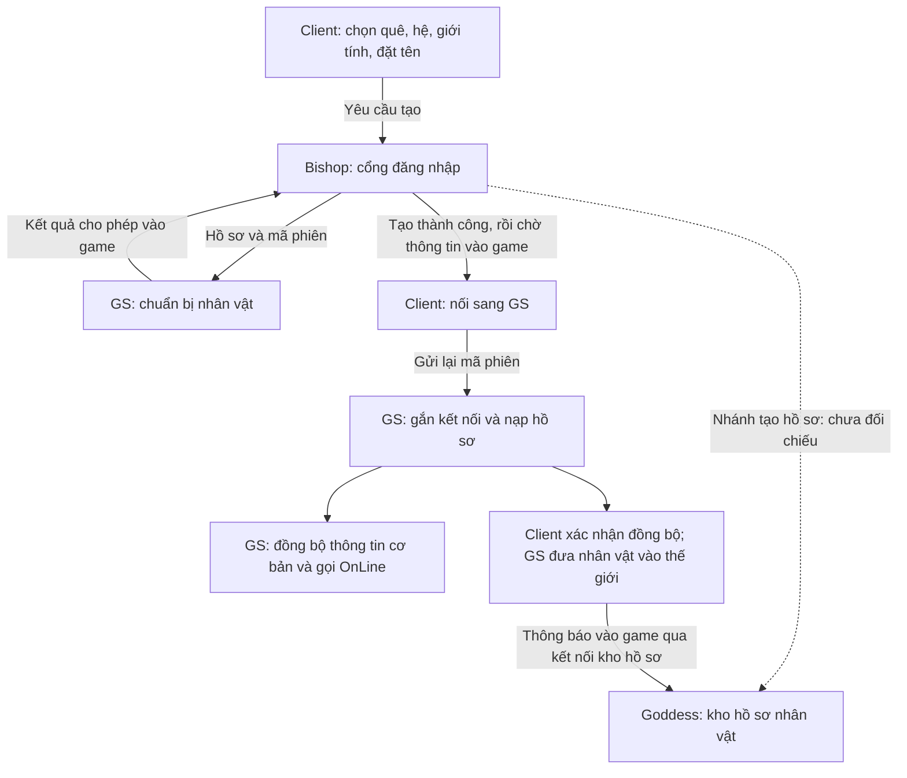

TÓM TẮT 1: [THẤY] Khi bấm tạo mới, client mở màn chọn quê rồi mới đến màn chọn ngũ hành, giới tính và đặt tên (`C/gameui/KuiSelPlayer_new.cpp:537-539`; `C/gameui/KuiSelNativePlace.cpp:439-448`; `C/gameui/KuiNewPlayer.cpp:616-646`).
TÓM TẮT 2: [THẤY] Client gửi yêu cầu tạo tới Bishop; khi được phép vào game, client mang mã phiên (GUID) sang GS để nhận đúng hồ sơ (`C/gameui/KuiNewPlayer.cpp:640-646,1164-1179`; `S/MultiServer/GameServer/KSOServer.cpp:5082-5087`).
TÓM TẮT 3: [THẤY] GS lấy cấp, chỉ số, vật phẩm và vị trí đăng nhập từ hồ sơ; mã quê trên màn tạo chưa đủ để suy ra nơi nhân vật xuất hiện (`S/Core/Src/KPlayerDBFuns.cpp:455-465,478-548,613-617,818-861`).
TÓM TẮT 4: [THẤY] GS gọi `OnLine` trong `online.lua` lúc đồng bộ thông tin cơ bản; GS gửi thông báo nhân vật vào game qua kết nối kho hồ sơ sau khi client phản hồi đồng bộ (`S/Core/Src/KPlayer.cpp:1035-1042`; `S/MultiServer/GameServer/KSOServer.cpp:3768-3771,3804-3812`).
TÓM TẮT 5: [CHƯA KIỂM] Chưa biết chỉ số và đồ được cấp lúc tạo, tên làng xuất phát, vai trò của `newplayer` hay hành vi thực tế; chỉ đọc tĩnh, chưa build hoặc chạy client, server, exe hay VM (`JX1_OPS/TASKS/HG-16.md:20-29`).

# HG-16 — Hiểu sự kiện đăng nhập và khởi tạo nhân vật mới

- Loại: khảo sát
- Chủ đề: Từ màn chọn quê, hệ và giới tính đến lúc nhân vật xuất hiện trong thế giới game.
- Từ khóa: tạo nhân vật, ngũ hành, quê quán, KSelPlayer, KuiNewPlayer, Bishop, Goddess, online.lua, HG-16
- Trạng thái: PARTIAL — có luồng client và GS; còn thiếu nguồn trực tiếp cho khâu tạo hồ sơ và dữ liệu tân thủ.
- Độ phủ: 6/6 nhóm có ghi nhận; 1/6 phủ đủ bằng mã trực tiếp ở mức khảo sát tĩnh, 5/6 phủ một phần.
- Liên quan: [A-02 — Luồng đăng nhập](../REPORTS/A-02-luong-dang-nhap.md), [Mục lục tri thức](MUC-LUC-TRI-THUC.md), [Báo cáo HG-16](../REPORTS/HG-16.md).
- Cần tôi quyết định: không.

Nhãn dùng trong tài liệu: **[THẤY]** = đã xác minh trong mã được giao; **[TÀI LIỆU]** = thông tin dẫn lại, ghi rõ xuất xứ; **[CHƯA KIỂM]** = thiếu nguồn hoặc chưa chạy. Sơ đồ tập trung vào hai đường truyền khác nhau: đăng nhập qua Bishop và kết nối trực tiếp từ client sang GS; đoạn chấm là phần chưa đối chiếu trực tiếp.

`C/` là `C:/Jx1CocoV3/Folder/Client2912-20260116T044348Z-3-001/Client2912/Client/Classes/`; `S/` là `C:/Jx1CocoV3/SwordOnline/SwordOnline/jxOnline/gameserver/Sources/`. Đây là hai bản mã trên đĩa nêu trong task, chưa đối chiếu với bản đang chạy.

## Phạm vi và độ phủ

| Phần | Độ phủ | Bằng chứng |
|---|---|---|
| Chọn hệ, giới tính và gửi yêu cầu tạo | Đã phủ | [THẤY] `C/gameui/KuiNewPlayer.cpp:40-47,624-646,824-828,873-899`. |
| Chỉ số khởi đầu | Một phần | [THẤY] GS đọc giá trị từ hồ sơ; chưa có các giá trị dùng khi tạo. `S/Core/Src/KPlayerDBFuns.cpp:455-456,608-617,682-691`. |
| Vật phẩm phát | Một phần | [THẤY] Có khâu nạp đồ từ hồ sơ; chưa biết món nào được cấp. `S/Core/Src/KPlayerDBFuns.cpp:321-324,818-861,884-897`. |
| Bản đồ xuất phát | Một phần | [THẤY] Client gửi quê đã chọn; GS có thứ tự chọn điểm vào game. Chưa đối chiếu quy tắc chuyển mã quê thành nơi đứng lần đầu. `C/gameui/KuiSelNativePlace.cpp:439-448`; `C/gameui/KuiNewPlayer.cpp:633-646`; `S/Core/Src/KPlayerDBFuns.cpp:478-548`. |
| Script đăng nhập và tân thủ | Một phần | [THẤY] Có điểm gọi `OnLine`. [CHƯA KIỂM] Chưa đọc được thân `online.lua` và chưa có bằng chứng gọi `newplayer`. `S/Core/Src/KPlayer.cpp:1036-1042`; `JX1_OPS/TASKS/HG-16.md:20,24`. |
| Client → Bishop, GS và Goddess | Một phần | [THẤY] Hai đầu client/GS và đường GS báo kho hồ sơ. [TÀI LIỆU] Vai trò của Bishop/Goddess ở nhánh lấy hồ sơ cũ. `C/gameui/KSelPlayer.cpp:1176-1190`; `S/MultiServer/GameServer/KSOServer.cpp:3804-3812,3937-3992`; `JX1_OPS/REPORTS/A-02-luong-dang-nhap.md:109-112`. |

## Giải mã tên

| Tên gốc trong mã | Mã hóa tại chỗ dẫn | Chữ đúng | Nguồn file:dòng |
|---|---|---|---|
| `jin` / `金` | ASCII / UTF-8 | Kim (金) | `C/gameui/KuiNewPlayer.cpp:994` |
| `mu` / `木` | ASCII / UTF-8 | Mộc (木) | `C/gameui/KuiNewPlayer.cpp:994` |
| `shui` / `水` | ASCII / UTF-8 | Thủy (水) | `C/gameui/KuiNewPlayer.cpp:994` |
| `huo` / `火` | ASCII / UTF-8 | Hỏa (火) | `C/gameui/KuiNewPlayer.cpp:994` |
| `tu` / `土` | ASCII / UTF-8 | Thổ (土) | `C/gameui/KuiNewPlayer.cpp:994` |
| `man` / `男`; `girl` / `女` | ASCII / UTF-8 | Nam (男); nữ (女) | `C/gameui/KuiNewPlayer.cpp:995-997` |

[CHƯA KIỂM] Tên làng và tên vật phẩm chưa có bảng dữ liệu gốc trong phạm vi đã đọc, nên chưa giải mã và chưa gán GBK/TCVN3 cho chúng. Tệp `KuiSelNativePlace.cpp` không qua kiểm tra UTF-8 nghiêm ngặt; phần dùng làm bằng chứng chỉ dựa vào định danh ASCII. Nguồn đọc tên quê: `C/gameui/KuiSelNativePlace.cpp:396-411`; nguồn nạp ID món: `S/Core/Src/KPlayerDBFuns.cpp:884-897`.

## Sắp theo cấu trúc game

| Nhóm trong game | Các phần đã xác định |
|---|---|
| Nhân vật → ngũ hành → giới tính | [THẤY] Theo thứ tự: 0 Kim, 1 Mộc, 2 Thủy, 3 Hỏa, 4 Thổ; mỗi hệ dùng hình nam hoặc nữ. Màn tạo mặc định Kim và nam. Đây là hệ ngũ hành, chưa phải tên môn phái. `C/gameui/KuiNewPlayer.cpp:40-47,824-828,873-899,994-997`; `S/Core/Src/KPlayerDBFuns.cpp:643-645,682-688`. |
| Nhân vật → chỉ số → dữ liệu đã lưu | [THẤY] Cấp, giới tính, điểm tiềm năng, điểm kỹ năng, sức mạnh, thân pháp, sinh khí, nội công và may mắn đều có trường trong hồ sơ. Số điểm thật của từng tổ hợp hệ/giới tính chưa kiểm. `S/Core/Src/KPlayerDBFuns.cpp:455-456,608-617`. |
| Hành trang → từng món trong hồ sơ | [THẤY] GS đọc loại, cấp, số lượng chồng và vị trí từng món. [CHƯA KIỂM] Chưa thể lập bảng từng món hoặc từng bộ đồ tân thủ vì chưa thấy nguồn cấp đồ. `S/Core/Src/KPlayerDBFuns.cpp:818-861,884-897`. |
| Thế giới → quê chọn → điểm đăng nhập | [THẤY] Màn chọn quê đọc `Id`, `RevID`, `Name`; client chuyển tiếp `Id`. GS đặt nhân vật theo dữ liệu vị trí đã nạp. [CHƯA KIỂM] Chưa xếp theo làng vì thiếu bảng đối chiếu. `C/gameui/KuiSelNativePlace.cpp:396-405,439-448`; `S/Core/Src/KPlayerDBFuns.cpp:478-548`. |

## Từ màn chọn nhân vật đến lúc vào game

1. **Hai màn chọn nhân vật.** [THẤY] `Klogin::loadSuccess` mở `KuiSelPlayer_new`; lệnh mở `KSelPlayer` ở ngay đoạn này nằm trong chú thích. Cả hai có nhánh mở màn chọn quê khi tài khoản còn chỗ. Khi chọn một nhân vật đã có, cả hai gửi `c2s_dbplayerselect`; đây là yêu cầu lấy nhân vật cũ, tách với yêu cầu tạo mới. `C/gameui/Klogin.cpp:513-519,524-531`; `C/gameui/KSelPlayer.cpp:656-657,1176-1190`; `C/gameui/KuiSelPlayer_new.cpp:537-539,1163-1172`.
2. **Chọn quê, chọn hệ và gửi yêu cầu.** [THẤY] Màn quê dùng `NativePlaceList.ini` cho tiếng Trung, `NativePlaceList_vn.ini` ở nhánh còn lại. Lúc bấm tiếp, client lưu ID của dòng đã chọn rồi mở `KuiNewPlayer`. Gói `c2s_newplayer` mang tên, giới tính, hệ và `m_NativePlaceId`; màn tạo chờ kết quả. Nếu báo thành công, client đặt cờ tạo mới ở phía mình và chuyển sang chờ thông tin vào GS. `C/gameui/KuiSelNativePlace.h:30-31`; `C/gameui/KuiSelNativePlace.cpp:368-405,439-448`; `C/gameui/KuiNewPlayer.cpp:40-47,624-651,1039-1058`.
3. **Chuẩn bị hồ sơ và kết nối GS.** [TÀI LIỆU] A-02 ghi rằng với nhân vật đã có, Bishop hỏi Goddess lấy hồ sơ rồi gửi hồ sơ cùng GUID sang GS. Source Bishop/Goddess A-02 dẫn nằm ở root `gateway`, ngoài hai root HG-16; nhánh tạo hồ sơ mới chưa đối chiếu. [THẤY] GS nhận hồ sơ `TRoleData` và GUID từ cổng, gọi `AddCharacter`, rồi gửi kết quả cho phép lại cổng. Khi Bishop báo cho vào game, client nối đến GS theo thông tin được cấp và gửi GUID bằng `tagLogicLogin`; GS gọi `AttachPlayer` và bắt đầu nạp, đồng bộ. `JX1_OPS/REPORTS/A-02-luong-dang-nhap.md:70-71,109-112`; `S/MultiServer/GameServer/KSOServer.cpp:3865-3869,3937-3992,5044-5087,5127-5135`; `C/gameui/KuiNewPlayer.cpp:1022-1023,1084,1107,1149-1179`.
4. **Đặt nhân vật vào bản đồ.** [THẤY] GS ưu tiên bản đồ tạm nếu có, kế đến điểm hồi sinh nếu hồ sơ bật cờ dùng điểm hồi sinh; nếu không, đọc bản đồ và tọa độ vào game trong hồ sơ. Nếu bản đồ đó không tìm thấy trong danh sách GS, mã lấy cặp dự phòng từ `ServerConfig/PlayerRevPosId`. Giá trị khởi tạo trong mã là ID bản đồ 53, ID điểm 19; cấu hình có thể ghi đè và số đó không xác nhận làng tân thủ. Khi cần tra điểm, mã đọc `RevivePos.ini`. `S/Core/Src/KPlayerDBFuns.cpp:464-483,486-548`; `S/Core/Src/KGameglobalSet.cpp:26-27,124`; `S/Core/Src/KSubWorldSet.cpp:683-725`.
5. **Đọc chỉ số, hành trang và chạy móc đăng nhập.** [THẤY] GS nạp từng phần của hồ sơ. `KNewPlayerAttribute::Init` có bộ thông số theo 5 hệ, `NewPlayerGetBaseAttribute` lấy số từ bộ đó; đường đăng nhập đã đọc lấy số đã ghi trong hồ sơ. `SetLevel` cũng tra `NewPlayerIni%02d.ini` theo công thức `hệ × 2 + giới tính`, nhưng riêng hàm này chưa chứng minh nguồn tạo hồ sơ. Khi gói thông tin cơ bản được đưa vào bộ gửi thành công, GS gọi `OnLine` và truyền trạng thái thế giới, tên bản đồ, `m_IsFirstLogin`. Ở đường gateway đã đọc, lệnh gọi `AddCharacter` bỏ đối số cuối, nhận mặc định 1 từ khai báo giao diện, rồi chép vào biến. Chưa thể dùng riêng giá trị đó để kết luận script chỉ chạy một lần hoặc chỉ cho nhân vật mới. `S/Core/Src/CoreServerShell.h:201`; `S/Core/Src/CoreServerShell.cpp:451-479,496-509`; `S/Core/Src/KPlayerDBFuns.cpp:182-185,321-324,613-617`; `S/Core/Src/KPlayerSet.cpp:1568-1585`; `S/Core/Src/KPlayer.cpp:1036-1042,2487-2514,3377-3394`; `S/MultiServer/GameServer/KSOServer.cpp:3981`.
6. **GS báo cho kho hồ sơ.** [THẤY] Sau khi client trả lời đồng bộ, GS đưa nhân vật vào thế giới và gửi `tagRoleEnterGame` qua kết nối cơ sở dữ liệu. Khi lưu, GS có đường gửi gói `c2s_rolekfjhu_saveroleinfo` mang hồ sơ. [TÀI LIỆU] A-02 mô tả Goddess là phía xử lý kho hồ sơ; chưa xác minh trong HG-16 phía nhận hai gói này hay thứ tự ghi hồ sơ mới. `S/MultiServer/GameServer/KSOServer.cpp:3768-3771,3804-3812,4570,4604-4608,4630-4633`; `JX1_OPS/REPORTS/A-02-luong-dang-nhap.md:130-142`.

## Đối chiếu bổ sung lần 2

- [THẤY] `KNewPlayerAttribute::Init` nạp tệp `BASE_ATTRIBUTE_FILE_NAME`, rồi đọc các nhóm `metal`, `wood`, `water`, `fire`, `earth` với khóa `Strength`, `Dexterity`, `Vitality`, `Engergy`, `Lucky`. Các giá trị mặc định trong lời gọi đọc là 0 hoặc `PLAYER_FIRST_LUCKY`; đây là giá trị dự phòng trong mã, không phải số liệu đã xác nhận của nhân vật mới. `S/Core/Src/KPlayerSet.cpp:1568-1585`.
- [THẤY] `NewPlayerGetBaseAttribute` chép các mảng chỉ số theo hệ vào nhân vật; chú thích ngay trên hàm ghi `没有调用` (không gọi). Tìm trong các tệp `.cpp` và `.h` của `Sources/Core/Src` chỉ thấy khai báo/định nghĩa và bản sao cũ, không thấy điểm gọi trong vùng này. Vì vậy không dùng hàm này làm bằng chứng rằng luồng tạo hiện gọi nó. `S/Core/Src/KPlayer.cpp:2485-2500`; `S/Core/Src/KPlayer.h:490`.
- [THẤY] `SetLevel` tạo tên tệp `NewPlayerIni%02d.ini` theo công thức `hệ × 2 + giới tính`, rồi đọc các khóa chỉ số trong nhóm `ROLE`. Nội dung tệp cấu hình không nằm trong phần Sources đã giao; đoạn này cũng chưa chứng minh `SetLevel` được gọi khi tạo hồ sơ mới. `S/Core/Src/KPlayer.cpp:3377-3394`.
- [CHƯA KIỂM] Đã tìm tên `online.lua`, `newplayer`, `NewPlayerIni*.ini` và `RevivePos.ini` trong phần Sources được giao nhưng không tìm thấy tệp tương ứng. Source chỉ cho biết GS gọi đường dẫn script `\\script\\system\\online.lua`; chưa có nội dung script hay dữ liệu cấu hình để chốt phát quà, điểm số, bản đồ đầu tiên hoặc cơ chế chỉ chạy một lần. `S/Core/Src/KPlayer.cpp:1036-1042`; `JX1_OPS/TASKS/HG-16b.md:23-35`.

## MỤC SỔ THÔNG SỐ

| Nhóm | Tên/hằng số | file:dòng | Giá trị | Đơn vị | Ảnh hưởng | Đổi an toàn | Nguồn đo |
|---|---|---|---|---|---|---|---|
| Chỉ số khởi tạo | Các nhóm thuộc tính theo hệ | `S/Core/Src/KPlayerSet.cpp:1570-1582` | Tên nhóm/khóa thấy trong mã; giá trị cấu hình chưa đọc. Giá trị dự phòng: 0; may mắn: `PLAYER_FIRST_LUCKY`. | Điểm thuộc tính | Dữ liệu chỉ số cơ sở được đọc khi nạp cấu hình. | CẨN THẬN — chưa có tệp cấu hình và kiểm chứng ảnh hưởng. | Đọc tĩnh mã nguồn; chưa đo runtime. |
| Điểm vào dự phòng | `PlayerInfo.mSubWorld`, `PlayerInfo.mReviveId`, `ServerConfig.PlayerRevPosId` | `S/Core/Src/KGameglobalSet.cpp:26-27,124` | Mặc định 53 và 19; cấu hình có thể ghi đè cả hai. | ID bản đồ, ID điểm hồi sinh | Điểm dự phòng khi GS cần dùng cấu hình này. Không xác nhận đây là làng tân thủ. | CẨN THẬN — chưa đối chiếu cấu hình triển khai và dữ liệu bản đồ. | Đọc tĩnh mã nguồn; chưa đo runtime. |
| Tệp chỉ số theo hệ/giới tính | Công thức chỉ số tệp `NewPlayerIni%02d.ini` | `S/Core/Src/KPlayer.cpp:3383-3394` | `hệ × 2 + giới tính`; nội dung các tệp chưa có trong Sources được giao. | Chỉ số tệp | Chọn tệp mà `SetLevel` đọc để lấy chỉ số trong nhóm `ROLE`. | CẨN THẬN — chưa xác nhận luồng tạo nhân vật gọi hàm này. | Đọc tĩnh mã nguồn; chưa đo runtime. |

## ĐỀ XUẤT TỐI ƯU

Không đề xuất thay đổi hoặc tối ưu mã trong khảo sát chỉ đọc này. Chưa có số đo runtime; các điểm chưa rõ cần đối chiếu bằng mã gateway, script và dữ liệu cấu hình đúng phiên bản trước khi cân nhắc thay đổi.

## Chưa kiểm

- [CHƯA KIỂM] Chưa đọc trực tiếp nhánh Bishop/Goddess tạo và lưu lần đầu; chưa xác định nơi tạo hồ sơ gốc và việc lưu xảy ra trước hay sau phản hồi tạo. Hai tệp gateway A-02 dẫn tới ở ngoài root task (`JX1_OPS/REPORTS/A-02-luong-dang-nhap.md:70-71`; `JX1_OPS/TASKS/HG-16.md:23-24`).
- [CHƯA KIỂM] Chưa có dữ liệu gốc để chốt chỉ số, vật phẩm phát, cấp ban đầu, tên bản đồ và tọa độ lần đầu. Các đường nạp và giá trị dự phòng đang thấy chỉ trả lời cách GS dùng hồ sơ (`S/Core/Src/KPlayerDBFuns.cpp:455-456,478-548,608-617,818-861`).
- [CHƯA KIỂM] Chưa thấy thân `script/system/online.lua`, chưa xác định đường dẫn/hàm của `newplayer` hoặc cơ chế chống phát quà lặp. Mã chỉ xác nhận chỗ gọi `OnLine` (`S/Core/Src/KPlayer.cpp:1036-1042`; `JX1_OPS/TASKS/HG-16.md:20,24`).
- [CHƯA KIỂM] Chưa build, chạy game, VM, exe, kết nối mạng hay đối chiếu bản đang triển khai. Nếu cần chốt dữ liệu tân thủ, bước tiếp theo là bổ sung phạm vi đọc tĩnh cho gateway và đúng bộ dữ liệu/script game (`JX1_OPS/TASKS/HG-16.md:24-29`).

## Bàn giao

Báo cáo [HG-16](../REPORTS/HG-16.md) ghi kết quả đối chiếu và hàng đề xuất cho mục lục. Tổng quan thực hiện commit.

liên quan: `JX1_OPS/DESIGN/MUC-LUC-TRI-THUC.md`, `JX1_OPS/REPORTS/A-02-luong-dang-nhap.md`, `JX1_OPS/REPORTS/HG-16.md`.

Kỹ năng đã dùng: jx1-retrofit, jx1-read-server, jx1-read-client, jx1-parameters, jx1-knowledge, jx1-report.
