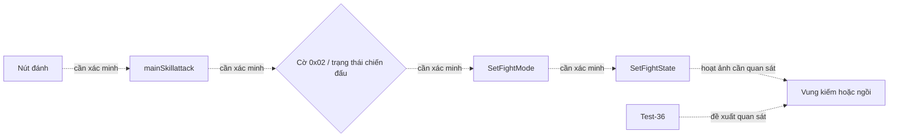

TÓM TẮT 1: [TÀI LIỆU] HG-02 yêu cầu giải thích nút đánh ngoài trạng thái chiến đấu và các điểm mainSkillattack, 0x02, SetFightMode, SetFightState (JX1_OPS/TASKS/HG-02.md:18-20).
TÓM TẮT 2: [THẤY] Bốn tệp mã nguồn task chỉ định không có trong worktree HG-02; chưa thể kết luận thứ tự gọi hoặc nguyên nhân nhân vật ngồi (JX1_OPS/TASKS/HG-02.md:23).
TÓM TẮT 3: [CHƯA KIỂM] Quan hệ giữa cờ 0x02, trạng thái chiến đấu và hoạt ảnh ngồi chỉ là giả thuyết đến khi có source thật (JX1_OPS/TASKS/HG-02.md:19,23).
TÓM TẮT 4: [TÀI LIỆU] Test-36 chỉ là đề xuất quan sát; không chạy game, VM, exe, build hoặc mạng (JX1_OPS/TASKS/HG-02.md:19,26-28).
TÓM TẮT 5: [CHƯA KIỂM] Đầu ra ở trạng thái PARTIAL; cần PM cung cấp đúng root/version source để hoàn tất (JX1_OPS/TASKS/HG-02.md:23).

# HG-02 — Hiểu game: trạng thái chiến đấu và nút đánh
Loại: tổng hợp
Chủ đề: Giải thích trạng thái chiến đấu, nút đánh và đề xuất quan sát trên Test-36.
Từ khóa: trạng thái chiến đấu, nút đánh, mainSkillattack, cờ 0x02, SetFightMode, SetFightState, Test-36
Trạng thái: PARTIAL — thiếu bốn tệp source nên chưa xác minh được luồng thực.
Độ phủ: 0/4 tệp mã nguồn được chỉ định; 1/1 đề xuất Test-36 được ghi ở mức tài liệu, chưa thực hiện.
Liên quan: JX1_OPS/TASKS/HG-02.md; JX1_OPS/DESIGN/MUC-LUC-TRI-THUC.md
Cần tôi quyết định: không

liên quan: JX1_OPS/TASKS/HG-02.md; mục lục tri thức hiện xếp phím tắt, nút và tự động chiến đấu ở JX1_OPS/DESIGN/MUC-LUC-TRI-THUC.md:13.

## Luồng cần đối chiếu
[TÀI LIỆU] Task nêu bốn điểm cần kiểm tra: `mainSkillattack`, cờ `0x02`, `SetFightMode` và `SetFightState` (JX1_OPS/TASKS/HG-02.md:19). Đây là danh sách điểm kiểm tra, chưa phải bằng chứng rằng chúng gọi nhau theo một thứ tự cụ thể.

[CHƯA KIỂM] Giả thuyết làm việc: nếu `mainSkillattack` được xử lý khi cờ `0x02` chưa biểu thị trạng thái chiến đấu, nhánh xử lý có thể không vào hoạt ảnh đánh và nhân vật rơi về hoạt ảnh ngồi. Cần đọc thân hàm, điều kiện cờ và caller/callee trong source thật để xác nhận hoặc bác bỏ; không dùng giả thuyết này làm kết luận runtime.

[CHƯA KIỂM] `SetFightMode` và `SetFightState` có thể là hai điểm chuyển/ghi trạng thái, nhưng vai trò, giá trị tham số và thứ tự thực thi chưa được xác minh vì không có `KNpcAI.cpp`, `KProtocolProcess.cpp`, `KNpc.cpp` hoặc `ScriptFuns.cpp` trong worktree.

## Đề xuất quan sát trên Test-36
[TÀI LIỆU] Chỉ đề xuất, không thực hiện: chuẩn bị một nhân vật đứng yên, ghi nhận hoạt ảnh ban đầu, bật trạng thái chiến đấu bằng thao tác gameplay đã được phê duyệt, nhấn nút đánh và quan sát có chuyển sang vung kiếm hay vẫn ngồi. Nếu có công cụ quan sát hợp lệ, ghi riêng trước/sau của trạng thái chiến đấu và cờ `0x02`; không sửa mã hoặc cấu hình.

[CHƯA KIỂM] Tiêu chí quan sát: (1) trạng thái chiến đấu đổi trước lần nhấn; (2) lần nhấn gọi được đường đánh; (3) hoạt ảnh vung kiếm xuất hiện. Ba điểm này chỉ là kế hoạch kiểm tra, chưa có số đo hay kết quả.

## Phạm vi và độ phủ
| Phần tử phạm vi | Độ phủ | Bằng chứng / giới hạn |
|---|---|---|
| `Folder/Client2912-.../Classes/gamecore/KNpcAI.cpp` | Chưa phủ | Đường dẫn task nêu tại JX1_OPS/TASKS/HG-02.md:23; tệp không tồn tại trong worktree HG-02. |
| `Folder/Client2912-.../Classes/gamecore/KProtocolProcess.cpp` | Chưa phủ | Đường dẫn task nêu tại JX1_OPS/TASKS/HG-02.md:23; tệp không tồn tại trong worktree HG-02. |
| `gameserver/Sources/Core/Src/KNpc.cpp` | Chưa phủ | Đường dẫn task nêu tại JX1_OPS/TASKS/HG-02.md:23; tệp không tồn tại trong worktree HG-02. |
| `gameserver/Sources/Core/Src/ScriptFuns.cpp` | Chưa phủ | Đường dẫn task nêu tại JX1_OPS/TASKS/HG-02.md:23; tệp không tồn tại trong worktree HG-02. |
| `mainSkillattack`, `0x02`, `SetFightMode`, `SetFightState` | Chưa phủ | Chỉ có tên trong mục tiêu task; chưa có thân hàm, caller/callee hoặc giá trị runtime. |
| Đề xuất quan sát Test-36 | Đã ghi đề xuất | Không chạy theo giới hạn task; chưa có kết quả thực nghiệm. |

## Giải mã tên
| Tên gốc | Mã hóa | Chữ đúng / diễn giải | Nguồn file:dòng |
|---|---|---|---|
| `mainSkillattack` | ASCII, đọc như UTF-8 | tên định danh; task gọi là đường nút đánh | JX1_OPS/TASKS/HG-02.md:19 |
| `0x02` | ASCII, số hexadecimal | cờ được task yêu cầu đối chiếu; ý nghĩa bit chưa giải mã | JX1_OPS/TASKS/HG-02.md:19 |
| `SetFightMode` | ASCII, đọc như UTF-8 | định danh có nghĩa đặt chế độ chiến đấu; vai trò thực chưa kiểm | JX1_OPS/TASKS/HG-02.md:19 |
| `SetFightState` | ASCII, đọc như UTF-8 | định danh có nghĩa đặt trạng thái chiến đấu; vai trò thực chưa kiểm | JX1_OPS/TASKS/HG-02.md:19 |
| `Test-36` | ASCII, đọc như UTF-8 | tên môi trường kiểm tra được task nêu; chưa chạy | JX1_OPS/TASKS/HG-02.md:19 |

## Sắp theo cấu trúc game
| Tầng cấu trúc | Thành phần | Trạng thái |
|---|---|---|
| Ý định người chơi / nút đánh | `mainSkillattack` | Tài liệu task; chưa có code UI hoặc caller. |
| Cờ trạng thái | `0x02` | Tài liệu task; chưa biết bit thuộc enum/field nào. |
| Chuyển chế độ | `SetFightMode` | Tài liệu task; chưa biết điểm gọi. |
| Ghi trạng thái | `SetFightState` | Tài liệu task; chưa biết điều kiện và tham số. |
| Kiểm chứng thực nghiệm | Test-36 | Chỉ đề xuất; chưa chạy. |

## Sơ đồ quan hệ cần xác minh

## Đã xác minh
- [THẤY] Worktree không có thư mục `Folder/` và không có bốn tên tệp nguồn khi tìm trong các thư mục mã đã định vị; không có source để đọc tĩnh.
- [TÀI LIỆU] Mục tiêu, danh sách nguồn, giới hạn không chạy và yêu cầu Test-36 được ghi trong JX1_OPS/TASKS/HG-02.md:18-29.
- [TÀI LIỆU] Mục lục tri thức yêu cầu tài liệu mới có dòng liên quan và ghi mức chắc; JX1_OPS/DESIGN/MUC-LUC-TRI-THUC.md:3-5.

## Chưa xác minh
- Ý nghĩa thật của bit `0x02`, giá trị các trạng thái và thứ tự caller/callee.
- Nguyên nhân chính xác khiến nhân vật ngồi khi nhấn nút đánh ngoài trạng thái chiến đấu.
- Kết quả quan sát vung kiếm trên Test-36.
- Build, exe, VM, mạng và runtime đều chưa chạy theo phạm vi task.

## Phát hiện khi chuẩn hóa
- Bốn đường dẫn nguồn trong task không tồn tại tại worktree HG-02; vì vậy báo cáo giữ nguyên mức `PARTIAL` và không tự suy kết luận.
- `D:\JX-wt\HG-02.nhip` không ghi được do quyền sandbox (Access denied); các mốc nhịp được nêu trong báo cáo này nhưng không thay thế được tệp ngoài worktree.
- Không sửa mã nguồn, không chạy VM/exe/mạng và không thay đổi kết luận cũ.

## Bàn giao
- File đầu ra: `JX1_OPS/DESIGN/HIEU-TRANG-THAI-CHIEN-DAU.md`.
- Test thực chạy: chưa chạy; chỉ kiểm tra tĩnh sự tồn tại đường dẫn và soạn tài liệu.
- Bước tiếp theo: PM cung cấp root/version source đúng với task để đọc bốn tệp, xác minh caller/callee, rồi cập nhật các mục CHƯA KIỂM.
- Trạng thái: PARTIAL.

Kỹ năng đã dùng: jx1-retrofit, jx1-read-server, jx1-read-client, jx1-parameters, jx1-knowledge, jx1-report.
Đề xuất bổ sung mục lục: thêm HG-02 vào nhóm “Phím tắt, nút, tự động chiến đấu” sau khi source được đối chiếu.
