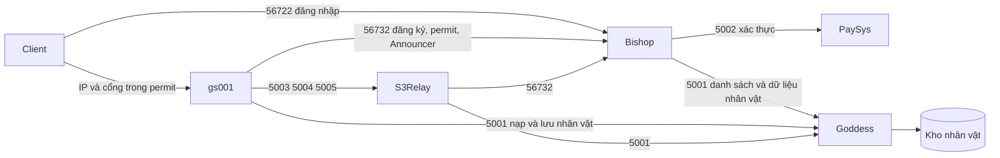
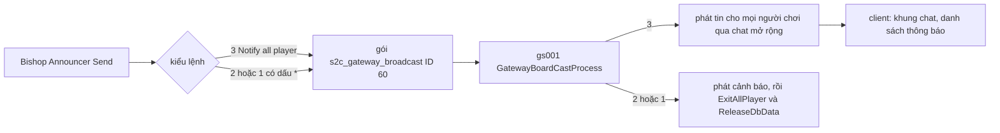
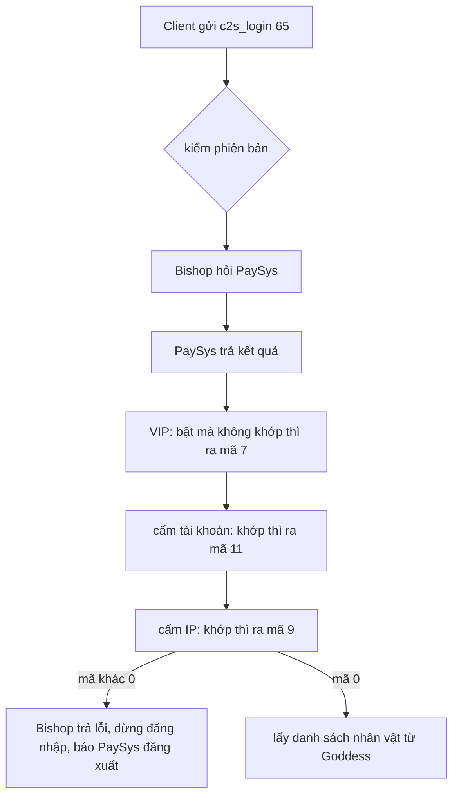
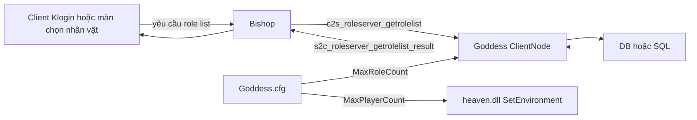

# Nút của các exe server tác động tới server và client thế nào

Tổng hợp từ 6 báo cáo đọc tĩnh N-01..N-06 (#164, gộp ở #165). **Không có phép thử nào ở đợt này**: không chạy exe, không VM, không client. Nhãn: [NGUỒN file:dòng] = đọc từ mã nguồn; [TÀI LIỆU] = kết quả đã ghi ở tài liệu trước (#161/#162); [GIẢ THUYẾT] = suy ra, chưa kiểm; "chưa kiểm" = không có bằng chứng. Mã nguồn có thể không khớp exe đang chạy (chưa đối chiếu binary lần nào).

Bốn câu hỏi cho mỗi nút: (1) ghi vào đâu; (2) exe nào nhận và làm gì; (3) tác động lên server; (4) tác động lên client. Bảng đầy đủ từng nút nằm ở báo cáo gốc (đường dẫn ở đầu mỗi nhóm). Các tên tắt trong ngoặc: B = Bishop, G = Goddess, GS = gs001, O = client.

## 0. Bức tranh chung

Điểm dễ hiểu sai [NGUỒN N-06 §3]: đây **không** phải chuỗi nối tiếp. Client chỉ nói chuyện với Bishop lúc đăng nhập và chọn nhân vật, rồi nhận permit (IP và cổng của GS) để nối thẳng vào gs001. GS có năm đầu ra riêng: tới Bishop (56732), Goddess (5001) và ba dịch vụ của S3Relay (5003 transfer, 5004 chat, 5005 bang hội). S3Relay cũng nối Bishop và Goddess. Cổng 56732 là cổng Bishop nghe GS/Relay, không phải cổng chơi của client; 51189 chỉ là giá trị lịch sử trong tài liệu.

## 1. Bishop Announcer (báo cáo `REPORTS/N-01.md`)

Ba lựa chọn, nút Send mặc định là kiểu 3.

| Lựa chọn | Ghi/gửi đi đâu | Server (gs001) | Client |
|---|---|---|---|
| Notify all player (kiểu 3) | Không ghi cfg/DB. Nội dung ô nhập đóng vào gói ID 60 gửi một GS hoặc mọi GS [NGUỒN GameServer.cpp:1581-1628] | Phát tin cho mọi người chơi online; mã còn đặt lại `m_nGameLoop` và `m_Timer` trước khi phát (tác động chưa đo) [NGUỒN KSOServer.cpp:4276-4345] | Nhận qua gói chat mở rộng (ID 251, tiểu gói 33) vào khung chat; có nhánh đưa vào danh sách thông báo tùy kênh và nhãn bản địa. Mã không cho thấy banner giữa màn hình [NGUỒN KProtocolProcess.cpp:4303-4312; Kuiplayerfun.cpp:3338-3363] |
| Notify game server to close safely * (kiểu 2) | Cùng đường, có cờ lưu Pai Shop | Phát cảnh báo, **đưa toàn bộ người chơi thoát** và giải phóng dữ liệu DB. Mã không thấy lệnh dừng tiến trình, nên chữ "close safely" không chứng minh GS tự tắt [NGUỒN KSOServer.cpp:4312-4332] | Nhận tin rồi bị ngắt; có kịp thấy tin trước khi ngắt hay không: chưa kiểm |
| Notify and warning all player to quit * (kiểu 1) | Như trên | Gần như y hệt kiểu 2 [NGUỒN KSOServer.cpp:4290-4310] | Như trên |

[TÀI LIỆU] #161: bấm Notify all player một câu thử không lỗi và gs001 vẫn chạy; chưa ai xác nhận người chơi thật nhận được tin. Hai kiểu có dấu * chưa bấm bao giờ và không nên bấm khi chưa có người duyệt vì chúng đuổi người chơi.

## 2. Bishop: lọc tài khoản, VIP, cấm IP, giới hạn mở nhiều client (báo cáo `REPORTS/N-02.md`)

Các danh sách này chặn **sau** khi PaySys xác thực xong và **trước** khi lấy danh sách nhân vật. Chúng không ngăn kết nối TCP và không tránh lượt hỏi PaySys [NGUỒN GamePlayer.cpp:734-738, 1016-1043].

| Nút/ô | Ghi vào đâu | Hiệu quả server | Client thấy gì |
|---|---|---|---|
| Filter account list | `accforbitlist.cfg` khi bấm nút nhỏ "live" (= Save), ngoài ra chỉ nằm trên màn hình [TÀI LIỆU #162] | Khớp **chuỗi con** (strstr, phân biệt hoa thường), không phải so chính xác hay dải IP [NGUỒN GamePlayer.cpp:1194-1207] | Mã 11 (đóng băng tài khoản), về màn nhập tài khoản [NGUỒN Klogin.cpp:973-977] |
| VIP | `acclist_vip.cfg` | Bật mà tài khoản không có trong danh sách thì bị loại | Mã 7 "không trong danh sách", về màn nhập [NGUỒN Klogin.cpp:995-999] |
| Filter IP list | `ipforbitlist.cfg` (trên VM thử chưa có tệp này) | Khớp chuỗi con trên IP | Mã 9 không có nhánh riêng, rơi vào lỗi đăng nhập chung (G_LOGIN_FAIL); chưa rõ người chơi phải thao tác lại hay chờ [NGUỒN Klogin.cpp:1001-1009] |
| Giới hạn mở nhiều client | Chỉ gửi số `nForbitopennum`; đoạn đếm phía Bishop bị comment, đoạn nhận phía client rỗng | Hiện gần như không có tác dụng chặn [NGUỒN GamePlayer.cpp:1324-1377; Klogin.cpp:923-925] | Không thấy gì |
| Unrestricted | Cửa riêng sau khi chọn nhân vật | Từ chối thì gói 52 báo bận | Hiện G_NEW_PLAYER_INVALID_BUSY, không dùng mã 7/9/11 [NGUỒN GameServer.cpp:1045-1063; KuiSelPlayer_new.cpp:993-1004] |

Mã lỗi thật là phép OR giữa kết quả PaySys và mã lọc, không phải hằng số riêng (ví dụ thành công 1 OR 8 = 9). Chưa thử cái nào trên client thật; câu chữ tiếng Việt cuối cùng nằm trong bảng ngôn ngữ nạp động, chưa kiểm.

## 3. Bishop: Birth role setting, Reset character rebirth m, Send to client to detect ve

**Chưa có kết quả.** Báo cáo N-03 mới viết dở lúc gộp (chưa xong, chưa đối chiếu mã). Chỉ có ghi nhận sẵn: [TÀI LIỆU #162] bật "turn on", Cap=2, Silver=100, gold=1 rồi bấm save setting thì `Bishop.cfg` **không đổi**, tức giá trị chỉ nằm trong bộ nhớ Bishop; tác dụng khi tạo nhân vật mới chưa thử. Sẽ bổ sung khi N-03 xong.

## 4. Goddess: Max char create, MAX Player, danh sách nhân vật (báo cáo `REPORTS/N-04.md`)

- **Max char create (MaxRoleCount).** Ghi vào `Goddess.cfg`, nạp vào biến `g_nMaxRoleCount` rồi truyền vào lớp DB; khi tạo nhân vật mới mà số vai đã đạt ngưỡng thì Goddess từ chối và trả kết quả tạo vai về Bishop [NGUỒN Goddess.cpp:71, 1422-1426, 1521-1561; IDBRoleServer.cpp:187-189, 688-696, 812-826; ClientNode.cpp:407-461]. [TÀI LIỆU #161] đặt 3→4→3 ghi cfg đúng; **chưa tạo được nhân vật thứ 4** (cần client). Đáng chú ý: **Bishop cố định tối đa 3 vai** (`s_nRoleListCount=3`, GamePlayer.cpp:61) và client cũng kẹp về 3, nên nâng lên 4 ở Goddess chưa chắc hiện ra cho người chơi.
- **MAX Player.** Ô bị khóa (WS_DISABLED) trong giao diện; giá trị đọc từ cfg và truyền vào `heaven.dll` qua `SetEnvironment` [NGUỒN Goddess.rc:79-81; Goddess.cpp:1443-1451]. Có là giới hạn cứng hay không: chưa kiểm (chưa đọc heaven.dll).
- **Danh sách nhân vật ở màn chọn.** Goddess lọc theo tài khoản và khu (`isWaiGua == nThisServer`) và chỉ trả tên, giới tính, hệ phái, cấp; Bishop chuyển gói nguyên vẹn; client dựng màn chọn bằng `KuiSelPlayer_new` (bản cũ `KSelPlayer`) [NGUỒN IDBRoleServer.cpp:923-975; GamePlayer.cpp:1404-1505; Klogin.cpp:1033-1075].

## 5. Goddess: Add Money, EnterMap, Remove Role, Backup, Pause, Restart (báo cáo `REPORTS/N-05.md`)

**Chưa hoàn tất.** N-05 còn đang chạy lúc gộp; bản nháp ghi: nhân vật nằm trong kho DB/SQL của Goddess; GS gửi gói lưu nhân vật về Goddess; Add Money và EnterMap sửa nhân vật **offline** trực tiếp trong DB và **không** gửi gói quản trị nào tới client; tác động lên người đang chơi chưa đo. [NGUỒN nháp N-05; KPlayerDBFuns.cpp:59-94; IDBRoleServer.cpp:985-1021, 1376-1408]. Bổ sung đầy đủ khi N-05 xong. Kết quả thật đã có: [TÀI LIỆU #161/#162] Add Money +1000 bạc cho nhân vật offline có đọc được ở tệp backup `.txt`; Restart Goddess **không** hồi phục sau 90 giây và Bishop mất nối DB nên phải bấm Reconnect DB.

## 6. Liên kết tổng và thứ tự bật/tắt (báo cáo `REPORTS/N-06.md`)

Sơ đồ ở mục 0; bảng 14 luồng (L01–L14) cùng cổng nằm ở N-06 §3.

- **Bật** [GIẢ THUYẾT]: thứ tự đã dùng SQL → PaySys → Goddess → S3Relay → Bishop → GS vẫn là đường đã chạy được. Nên chờ từng thành phần thật sự sẵn sàng (có listener đúng cổng, nối được phụ thuộc) chứ không chỉ nhìn cửa sổ; SvrFPS 18/18 hay Online=0 không thay cho các điều kiện này.
- **Tắt** [GIẢ THUYẾT]: giữ Goddess, Bishop, PaySys và Relay sống cho tới khi GS lưu xong và đọc lại được nhân vật; đóng GS trước, rồi Relay, Bishop, Goddess (sau khi không còn writer và đã kiểm backup), PaySys, SQL. Chưa có nút nào được chứng minh là "dừng GS an toàn": hai kiểu Announcer dấu * gọi `ExitAllPlayer`/`ReleaseDbData` nhưng `SetRunningStatus(FALSE)` bị comment [NGUỒN KSOServer.cpp:4290-4332].
- **Goddess bị khởi lại ngoài kế hoạch:** ghi sự cố, bấm Reconnect DB ở Bishop (đừng bấm Reconnect Pay), rồi kiểm riêng GS, Relay và client. Close Goddess chờ luồng 50 giây rồi có nhánh `TerminateThread` [NGUỒN Goddess.cpp:1493-1501].
- **S3Relay root cổng 7777:** có dự án `S3RelayServer` trong mã nguồn (đọc `relay_setup.ini [Local] port`, mặc định 7777) nhưng chưa biết exe triển khai có dùng không; vẫn **không chạy** `S3RelayServer.exe` [NGUỒN S3RELAYSERVER/main.cpp:100-109,186-197].

## Điều chưa kiểm tra (tất cả cần client thật hoặc đối chiếu binary)

1. Mã nguồn khớp exe/APK đang chạy hay không (chưa đối chiếu lần nào).
2. Tin Notify all player có hiện ra ở client và hiện ở đâu.
3. Mã lỗi/thông báo thật người chơi thấy khi bị lọc tài khoản/VIP/IP, nhất là mã 9.
4. Tạo nhân vật thứ 4 khi MaxRoleCount=4 (Bishop và client cùng kẹp ở 3).
5. Birth role setting có áp lên nhân vật mới tạo không (N-03 chưa xong).
6. Tác động của Add Money/EnterMap lên người đang chơi; dữ liệu được nạp thế nào lúc đăng nhập lại (N-05 chưa xong).
7. Chuỗi tắt an toàn GS và cổng root 7777.

## Muốn xác nhận trên client thật thì cần gì

**Cần**: LDPlayer với APK đã có (ghi phiên bản và SHA-256 của APK, của Bishop/Goddess/gs001), VM thử JX-Test-36 đã dựng, hai tài khoản chuyên dùng để thử (bí danh TEST-A và TEST-B; mật khẩu do chủ cấp lúc chạy, không ghi vào tệp nào), sao lưu cfg và DB trước từng ca, và duyệt riêng của chủ cho mỗi ca đổi trạng thái. Không dùng tài khoản thật. Ca nào cũng chỉ trên VM thử, không đụng Main VM.

| Ca | Thao tác | Quan sát | Rủi ro |
|---|---|---|---|
| C01 | TEST-A đăng nhập, chọn khu, chọn nhân vật, vào thế giới (chưa đổi gì) | 5 mốc giao diện, nối 56722 rồi permit tới GS | thấp |
| C02 | Đăng nhập sai mật khẩu, thiếu quyền chơi, khác phiên bản | mã lỗi PaySys/Bishop và câu báo ở client | thấp |
| C04 | Notify all player một câu ASCII, hai client online | có hiện, hiện ở đâu, có ngắt không | thấp; nhánh này reset GameLoop |
| C05 | Notify all player câu tiếng Việt có dấu | chữ có vỡ không | thấp |
| L1 | Đưa `zz_test_acc` vào Filter account rồi đăng nhập bằng đúng tên đó | mã 11 và câu báo thật; bỏ ra thì vào lại được | thấp, hoàn tác bằng nút "live" |
| L2 | Tương tự cho VIP (bật rồi dùng tài khoản ngoài danh sách) và IP | mã 7 và mã 9 | trung bình: bật nhầm VIP sẽ khóa mọi tài khoản ngoài danh sách |
| M1 | MaxRoleCount=4, tạo nhân vật thứ 4 từ client | Bishop/client có cho tạo không | trung bình: tạo thêm dữ liệu nhân vật; đặt lại 3 và xóa nhân vật thử |
| B1 | Birth role setting bật, rồi tạo nhân vật mới | cấp/bạc/vàng của nhân vật mới (chờ N-03) | trung bình |
| A1 | Add Money cho nhân vật offline rồi đăng nhập bằng client | số bạc thấy ở client | trung bình, ghi trước/sau |
| S1 | Thoát, lưu, vào lại; sau đó mới thử Goddess mất kết nối rồi Reconnect DB | dữ liệu đọc lại đúng | cao hơn; phải làm sau S1 đạt và có sao lưu |
| X1 | Hai kiểu Announcer dấu * | thứ tự báo, đuổi người chơi, lưu | **rất cao**: đuổi người chơi, giải phóng DB; chỉ làm khi có sao lưu và duyệt riêng |

Danh sách đầy đủ 13 ca (C01–C13) kèm tiêu chí đạt nằm ở N-06 §7. **Không ca nào đã chạy; chờ đại vương duyệt.**
