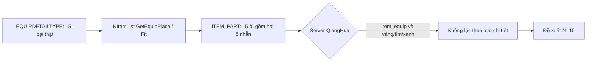

## TÓM TẮT 5 DÒNG

1. [THẤY] Enum `EQUIPDETAILTYPE` có 15 loại chi tiết và enum `ITEM_PART` có 15 ô mặc trước sentinel.
2. [THẤY] `GetEquipPlace/Fit` ánh xạ đủ các loại vào ô; nhẫn dùng hai ô `ring1/ring2`.
3. [THẤY] `QiangHua` kiểm `item_equip` cùng GoldId/tím/xanh và không lọc theo detail type; [ĐỀ XUẤT] N=15.
4. [CHƯA KIỂM] Item cụ thể, config đang nạp, UI/runtime và tên hiển thị `yinjian`/`shiping`.
5. [THẤY] Chỉ đọc tĩnh, không build/exe/VM/mạng; báo cáo liên quan H-03 và mục kết quả task đã cập nhật.

# QH-01 — Ô trang bị và phạm vi cường hóa

Loại: khảo sát
Chủ đề: Đối chiếu enum loại trang bị với các ô mặc và cổng cường hóa server.
Từ khóa: ô mặc, trang bị, cường hóa, EQUIPDETAILTYPE, ITEM_PART, KItemList::Fit, QiangHua, N=15
Trạng thái: DONE cho khảo sát tĩnh; giới hạn runtime và danh mục item cụ thể chưa kiểm.
Độ phủ: [THẤY] 15/15 ô mặc được đối chiếu; [ĐỀ XUẤT] hỗ trợ đủ 15 ô theo cổng loại item hiện có.
Liên quan: H-03-cuong-hoa.md; JX1_OPS/DESIGN/MUC-LUC-TRI-THUC.md; JX1_OPS/TASKS/QH-01.md.
Cần tôi quyết định: không

## Kết luận

**[THẤY] `EQUIPDETAILTYPE` có 15 loại và `ITEM_PART` có 15 ô. [ĐỀ XUẤT] N = 15 ô mặc; cho phép cường hóa ở cả 15 ô**: mũ, thân, đai lưng, vũ khí, giày, bao cổ tay, bùa, hai ô nhẫn, ngọc bội, ngựa, mặt nạ, áo choàng, `yinjian`, phụ kiện (`equip_shiping`, nhãn tiếng Việt chưa xác nhận). [THẤY] Các dòng dưới lấy từ enum và mapping tĩnh. [CHƯA KIỂM] Không có xác nhận item cụ thể đang bán hoặc dùng trong runtime.

[THẤY] Cổng server `KItemList::QiangHua` chỉ kiểm item thuộc `item_equip` và có `GoldId`, hoặc `IsPurple`, hoặc `IsBlue`; không xét `EQUIPDETAILTYPE` hay ô đang mặc. Vì vậy mã hiện tại không có nhánh loại riêng một trong 15 ô. Đây là kết luận về điều kiện source đã đọc, không phải xác nhận UI/runtime cho từng loại item. (`D:\JX-source\server\jxOnline\gameserver\Sources\Core\Src\KItemList.cpp:5393-5398`.)

## Phạm vi và độ phủ

[THẤY] Enum client liệt kê 15 hằng số `ITEM_PART`, trong đó `itempart_num` là mốc cuối; các giá trị ô là 0–14 (`GameDataDef.h:211-229`). Server enum có 15 loại trang bị thực và sentinel `equip_detailnum` (`KItem.h:85-103`). `GetEquipPlace`/`Fit` ánh xạ loại chi tiết; nhẫn có thể đặt ở `ring1` hoặc `ring2` (`KItemList.cpp:2462-2655`).

| Ô mặc | Loại chi tiết (`EQUIPDETAILTYPE`) | Cường hóa theo cổng server | Độ phủ và nguồn |
|---|---|---|---|
| Đầu / mũ | `equip_helm` | [THẤY] Có điều kiện item | Đã đối chiếu; `KItemList.cpp:2474-2476`, `2525-2655` |
| Thân | `equip_armor` | [THẤY] Có điều kiện item | Đã đối chiếu; `KItemList.cpp:2471-2473`, `2525-2655` |
| Đai lưng | `equip_belt` | [THẤY] Có điều kiện item | Đã đối chiếu; `KItemList.cpp:2486-2488`, `2525-2655` |
| Vũ khí | `equip_meleeweapon`, `equip_rangeweapon` | [THẤY] Có điều kiện item | Hai loại cùng vào một ô; `KItemList.cpp:2467-2470`, `2525-2655` |
| Chân / giày | `equip_boots` | [THẤY] Có điều kiện item | Đã đối chiếu; `KItemList.cpp:2477-2479`, `2525-2655` |
| Cổ tay | `equip_cuff` | [THẤY] Có điều kiện item | Đã đối chiếu; `KItemList.cpp:2489-2491`, `2525-2655` |
| Bùa | `equip_amulet` | [THẤY] Có điều kiện item | Đã đối chiếu; `KItemList.cpp:2483-2485`, `2525-2655` |
| Nhẫn 1 | `equip_ring` | [THẤY] Có điều kiện item | Loại nhẫn; ô mặc mặc định là `ring1`; `KItemList.cpp:2480-2482`, `2552-2554` |
| Nhẫn 2 | `equip_ring` | [THẤY] Có điều kiện item | `Fit` nhận `ring2`; `KItemList.cpp:2552-2554`, `2620-2622` |
| Ngọc bội / mặt dây | `equip_pendant` | [THẤY] Có điều kiện item | Đã đối chiếu; `KItemList.cpp:2492-2494`, `2525-2655` |
| Ngựa | `equip_horse` | [THẤY] Có điều kiện item | Đã đối chiếu; `KItemList.cpp:2495-2497`, `2525-2655` |
| Mặt nạ | `equip_mask` | [THẤY] Có điều kiện item | Đã đối chiếu; `KItemList.cpp:2498-2500`, `2525-2655` |
| Áo choàng | `equip_pifeng` | [THẤY] Có điều kiện item | Đã đối chiếu; `KItemList.cpp:2501-2503`, `2525-2655` |
| `yinjian` | `equip_yinjian` | [THẤY] Có điều kiện item | Ô riêng có trong ánh xạ; tên gọi trong game chưa xác nhận; `KItemList.cpp:2504-2506`, `2525-2655` |
| Ô `shiping` | `equip_shiping` | [THẤY] Có điều kiện item | Ô riêng có trong ánh xạ; `KItemList.cpp:2507-2509`, `2525-2655` |

**[THẤY] Quy tắc “có điều kiện item”**: server yêu cầu `item_equip` và một trong ba điều kiện `GetGoldId()>0`, `IsPurple()>0`, `IsBlue()` tại `KItemList.cpp:5393-5398`. Đoạn này không ràng buộc item phải đang ở trên nhân vật. Lua wrapper chuyển ba tham số tới cùng API tại `ScriptFuns.cpp:7926-7935`. [THẤY] Client có phần điều kiện tương ứng ở `gamecore/KItemList.cpp:2988-2997`, nhưng đoạn đọc được không thực hiện xử lý nâng cấp; không dùng nó thay bằng chứng server.

## Giải mã tên

Các tên gốc trong bảng là identifier ASCII, không phải chuỗi hiển thị trong game. Nhãn Việt dưới đây giải nghĩa theo từ của identifier; giữ nguyên identifier. `equip_yinjian` chưa xác định được tên hiển thị chính thức.

| Tên gốc | Mã hóa | Nghĩa tiếng Việt / ghi chú | Nguồn file:dòng |
|---|---|---|---|
| `equip_meleeweapon` | ASCII | vũ khí cận chiến | Server `KItem.h:87`; client `gamecore/KItem.h:54` |
| `equip_rangeweapon` | ASCII | vũ khí tầm xa | Server `KItem.h:88`; client `gamecore/KItem.h:55` |
| `equip_armor` | ASCII | giáp thân | Server `KItem.h:89`; client `gamecore/KItem.h:56` |
| `equip_ring` | ASCII | nhẫn | Server `KItem.h:90`; client `gamecore/KItem.h:57` |
| `equip_amulet` | ASCII | bùa / amulet | Server `KItem.h:91`; client `gamecore/KItem.h:58` |
| `equip_boots` | ASCII | giày | Server `KItem.h:92`; client `gamecore/KItem.h:59` |
| `equip_belt` | ASCII | đai lưng | Server `KItem.h:93`; client `gamecore/KItem.h:60` |
| `equip_helm` | ASCII | mũ | Server `KItem.h:94`; client `gamecore/KItem.h:61` |
| `equip_cuff` | ASCII | bao cổ tay | Server `KItem.h:95`; client `gamecore/KItem.h:62` |
| `equip_pendant` | ASCII | ngọc bội / mặt dây | Server `KItem.h:96`; client `gamecore/KItem.h:63` |
| `equip_horse` | ASCII | ngựa | Server `KItem.h:97`; client `gamecore/KItem.h:64` |
| `equip_mask` | ASCII | mặt nạ | Server `KItem.h:98`; client `gamecore/KItem.h:65` |
| `equip_pifeng` | ASCII | áo choàng | Server `KItem.h:99`; client `gamecore/KItem.h:66` |
| `equip_yinjian` | ASCII | `yinjian`; chưa xác minh tên Việt hiển thị | Server `KItem.h:100`; client `gamecore/KItem.h:67` |
| `equip_shiping` | ASCII | nghĩa dự kiến là phụ kiện/trang sức; tên UI [CHƯA KIỂM] | Server `KItem.h:101`; client `gamecore/KItem.h:68` |
| `equip_detailnum` | ASCII | sentinel đếm loại, không phải ô mặc | Server `KItem.h:102`; client `gamecore/KItem.h:69` |

Tên ô mặc `itempart_head`…`itempart_shiping` cũng là identifier ASCII. Enum client đặt `itempart_num` sau 15 ô tại `GameDataDef.h:211-229`. [CHƯA KIỂM] Không tìm thấy bảng chuỗi hiển thị của client/server trong các nguồn task liệt kê; nhãn Việt không được coi là văn bản UI đã kiểm.

| Tên gốc ô mặc | Mã hóa | Nghĩa tiếng Việt / ghi chú | Nguồn file:dòng |
|---|---|---|---|
| `itempart_head` | ASCII | ô đầu / mũ | Client `GameDataDef.h:213` |
| `itempart_body` | ASCII | ô thân | Client `GameDataDef.h:214` |
| `itempart_belt` | ASCII | ô đai lưng | Client `GameDataDef.h:215` |
| `itempart_weapon` | ASCII | ô vũ khí | Client `GameDataDef.h:216` |
| `itempart_foot` | ASCII | ô chân / giày | Client `GameDataDef.h:217` |
| `itempart_cuff` | ASCII | ô cổ tay | Client `GameDataDef.h:218` |
| `itempart_amulet` | ASCII | ô bùa | Client `GameDataDef.h:219` |
| `itempart_ring1` | ASCII | ô nhẫn thứ nhất | Client `GameDataDef.h:220` |
| `itempart_ring2` | ASCII | ô nhẫn thứ hai | Client `GameDataDef.h:221` |
| `itempart_pendant` | ASCII | ô ngọc bội / mặt dây | Client `GameDataDef.h:222` |
| `itempart_horse` | ASCII | ô ngựa | Client `GameDataDef.h:223` |
| `itempart_mask` | ASCII | ô mặt nạ | Client `GameDataDef.h:224` |
| `itempart_pifeng` | ASCII | ô áo choàng | Client `GameDataDef.h:225` |
| `itempart_yinjian` | ASCII | `yinjian`; tên hiển thị chưa xác minh | Client `GameDataDef.h:226` |
| `itempart_shiping` | ASCII | ô phụ kiện; tên hiển thị chưa xác minh | Client `GameDataDef.h:227` |
| `itempart_num` | ASCII | sentinel đếm ô; không phải ô trang bị | Client `GameDataDef.h:228` |

## Sắp theo cấu trúc game

| Nhóm cấu trúc | Các ô / loại | Bằng chứng file:dòng |
|---|---|---|
| [THẤY] Đồ nhân vật chính | đầu (`equip_helm`), thân (`equip_armor`), đai lưng (`equip_belt`), vũ khí (`equip_meleeweapon` / `equip_rangeweapon`), chân (`equip_boots`), cổ tay (`equip_cuff`) | Server `KItemList.cpp:2467-2491`; client `GameDataDef.h:213-228` |
| [THẤY] Trang sức đeo | bùa (`equip_amulet`), nhẫn 1 và 2 (`equip_ring`), ngọc bội (`equip_pendant`) | Server `KItemList.cpp:2480-2494`, `2552-2554`; client `GameDataDef.h:213-228` |
| [THẤY] Vật phẩm ô riêng | ngựa (`equip_horse`), mặt nạ (`equip_mask`), áo choàng (`equip_pifeng`), `yinjian` (`equip_yinjian`), phụ kiện (`equip_shiping`; nhãn tiếng Việt chưa xác nhận) | Server `KItemList.cpp:2495-2509`; client `GameDataDef.h:213-228` |

[THẤY] Thứ tự nhóm chỉ để đọc; thứ tự index thật là enum `ITEM_PART` tại client `GameDataDef.h:213-228`. Không suy ra thứ tự giao diện từ cách nhóm bảng này.

## Mục sổ thông số

| Nhóm | Tên/hằng số | file:dòng | Giá trị | Đơn vị | Ảnh hưởng | Đổi an toàn | Nguồn đo |
|---|---|---|---|---|---|---|---|
| Ô mặc | `itempart_num` | Client `GameDataDef.h:211-229` | 15 ô (index 0–14; sentinel = 15) | ô | Kích thước/số phần tử liên quan tới mặc trang bị | CẨN THẬN | Đọc enum tĩnh |
| Điều kiện cường hóa | `QiangHuaRank` phần tử `[2]` | Server `KItemList.cpp:5425-5433` | Chưa đọc giá trị cấu hình trong root task | cấp cường hóa | Trần được API dùng để từ chối khi đạt giới hạn | CẨN THẬN | Đọc cách lấy cấu hình; chưa đọc được giá trị runtime/config |
| Cấp trên item | `nEnChance` trong `KItem::EnChance` | Server `KItem.cpp:3800-3818` | kẹp từ 0 đến 30 | cấp | Mức ghi lên item trong helper này; không xác định danh mục slot | CẨN THẬN | Đọc source tĩnh |

## Đề xuất tối ưu

1. Dùng cùng điều kiện `item_equip` + phẩm chất mà server đã có cho cả 15 ô; không thêm ngoại lệ theo detail type khi chưa có yêu cầu thiết kế khác.
2. Nếu UI cần danh sách lọc theo ô, dùng ánh xạ `GetEquipPlace` và `Fit`; giữ hai ô nhẫn thành hai vị trí dù chỉ có một `equip_ring`.
3. Kiểm tra riêng các item cụ thể của `equip_yinjian` và `equip_shiping` trong bảng item/config được phê duyệt trước khi chốt tên hiển thị hoặc độ phủ sản phẩm. Lượt này chưa xác minh bộ dữ liệu item.

## Đã xác minh

- Server enum `EQUIPDETAILTYPE` có các hằng từ `equip_meleeweapon` đến `equip_shiping`, theo sau bởi sentinel `equip_detailnum`: `D:\JX-source\server\jxOnline\gameserver\Sources\Core\Src\KItem.h:85-103`.
- Client enum vị trí có 15 ô trước sentinel `itempart_num`: `D:\JX-source\client\Classes\gamecore\GameDataDef.h:211-229`.
- Server ánh xạ chi tiết sang vị trí trong `KItemList::GetEquipPlace` và `KItemList::Fit`; nhẫn nhận hai vị trí ở `KItemList.cpp:2462-2655`.
- Predicate item của `KItemList::QiangHua`: `KItemList.cpp:5393-5398`; API Lua gọi nó tại `ScriptFuns.cpp:7926-7935`.

## Chưa xác minh

- Giá trị config đang được nạp cho `QiangHuaRank`, danh mục item thật, tên hiển thị của `equip_yinjian`, và có loại item nào đang bị Lua/UI ngoài phạm vi source giới hạn hay không.
- Hành vi UI, lưu dữ liệu, server đang chạy, cường hóa thực tế và binary. Chỉ đọc tĩnh; không build, exe, VM hoặc mạng.
- Enum ITEM_PART phía server được tham chiếu trong mã server, nhưng bản khai báo mà lượt này đọc trực tiếp nằm ở client `GameDataDef.h`; không xác nhận hai bản build/nhánh đồng nhất ngoài phần mapping source đã đối chiếu.

## Bàn giao

- Trạng thái khảo sát: DONE cho câu hỏi ô mặc và điều kiện cổng cường hóa trong source đã chỉ định.
- Không commit/stage theo yêu cầu; tổng quan commit do PM thực hiện.
- Không ghi được `D:\JX-wt\QH-01.nhip`: thao tác ghi ngay khi bắt đầu bị hệ thống trả `Access is denied`; không thử vượt quyền. Các mốc nhịp không có tệp ghi nhận.
- `rg` không có trong PATH; đã chuyển sang `Select-String` và đọc từng đoạn tối đa khoảng 400 dòng. Không chạy test/build vì không được phép và không cần cho kết luận tĩnh.
- Kỹ năng đã dùng: jx1-retrofit, jx1-read-server, jx1-read-client, jx1-parameters, jx1-knowledge, jx1-report.
- Hàng đề nghị PM gộp vào `JX1_OPS/DESIGN/MUC-LUC-TRI-THUC.md`: `| Ô trang bị/cường hóa | JX1_OPS/DESIGN/QH-01-O-TRANG-BI.md | KItemList::Fit, GetEquipPlace, QiangHua | Khảo sát tĩnh; N=15; H-03-cuong-hoa.md |`

liên quan: H-03-cuong-hoa.md; JX1_OPS/DESIGN/MUC-LUC-TRI-THUC.md; JX1_OPS/TASKS/QH-01.md.
