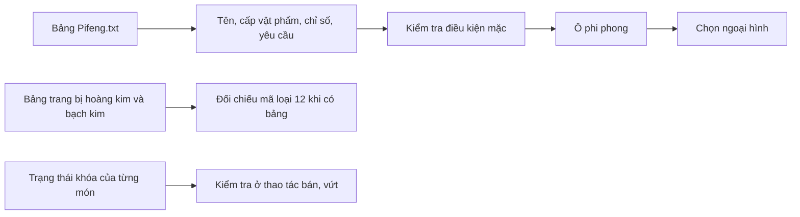

TÓM TẮT 1 [NGUỒN] — [THẤY] Phi phong có mã `equip_pifeng = 12` và mặc ở ô `itempart_pifeng`. `S/KItem.h:87–99`, `S/KItemList.cpp:2501–2502`.
TÓM TẮT 2 [CHƯA KIỂM] — K chưa xác định vì thiếu `Pifeng.txt` và các bảng liên quan trong nguồn được giao. `S/KBasPropTbl.CPP:16,36–41,801`.
TÓM TẮT 3 [NGUỒN] — [THẤY] Mã đọc tên, cấp vật phẩm, chỉ số cơ bản và yêu cầu mặc từ từng dòng dữ liệu. `S/KBasPropTbl.CPP:1353–1399`.
TÓM TẮT 4 [NGUỒN] — [THẤY] Kiểm tra mặc theo ô và yêu cầu của món. Khóa vật phẩm có đường xử lý riêng. `S/KItemList.cpp:1153–1180,10965–10985`.
TÓM TẮT 5 [CHƯA KIỂM] — Chỉ đọc tĩnh theo `JX1_OPS/TASKS/QH-02.md:24`. Chưa chạy build, exe, VM hay kiểm tra trong game.

# QH-02 — Phi phong: số cấp, chỉ số và khóa

Loại: khảo sát\
Chủ đề: Xác định các cấp phi phong và điều kiện sử dụng của từng món.\
Từ khóa: phi phong, áo choàng, 披风, pifeng, equip_pifeng, Pifeng.txt, cấp vật phẩm, khóa vật phẩm\
Trạng thái: PARTIAL — đã lần mã server và client, còn thiếu dữ liệu để chốt K.\
Độ phủ: 4/7 hạng mục khảo sát tĩnh đã phủ. Số cấp và số món chưa đếm được vì thiếu bảng dữ liệu.\
Liên quan: `JX1_OPS/TASKS/QH-02.md`, `JX1_OPS/REPORTS/QH-02.md`, `JX1_OPS/DESIGN/MUC-LUC-TRI-THUC.md:12`.\
Cần tôi quyết định: có — chỉ định bản Settings và script đọc tĩnh đúng phiên bản.

## Phạm vi và độ phủ

Trong các dẫn chiếu, `S/` là `D:/JX-source/server/jxOnline/gameserver/Sources/Core/Src/`, `C/` là `D:/JX-source/client/Classes/`. Đã dùng thêm `D:/JX-source/server/jxOnline/gameserver/Headers/` để định vị khai báo. Các root được nêu trong `JX1_OPS/TASKS/QH-02.md:21`. Nguồn không ghim revision. Độ phủ tính theo hạng mục khảo sát.

| Phạm vi | Độ phủ | Căn cứ |
|---|---|---|
| Đường nạp trang bị phi phong cơ bản trên server và client | Đã phủ [THẤY] | `S/KBasPropTbl.CPP:16,38,159,801`, `C/gamecore/KBasPropTbl.CPP:16,38,830` |
| Bảng trang bị chung cần lọc cùng mã loại 12 | Đã phủ [THẤY] ở mức định vị | `S/KBasPropTbl.CPP:36,41,1486,1636` |
| Cơ chế kiểm tra khi mặc và ô trang bị | Đã phủ [THẤY] | `S/KItemList.cpp:1153–1180,2576–2578,5599–5601`, `C/gamecore/KItemList.cpp:869–893` |
| Cơ chế khóa chung và đường chọn ngoại hình | Đã phủ [THẤY] | `S/KItem.h:413–460`, `S/KItemList.cpp:1673–1703,10965–10985`, `C/gamecore/KItemList.cpp:1290–1317` |
| Danh mục từng món, cấp và K | Chưa phủ [CHƯA KIỂM] | Thiếu nội dung các bảng ở `S/KBasPropTbl.CPP:36,38,41,801` |
| Tên gốc, chỉ số và ngưỡng mặc của từng món | Chưa phủ [CHƯA KIỂM] | Thiếu các dòng dữ liệu tương ứng với bộ đọc tại `S/KBasPropTbl.CPP:1353–1399` |
| Trạng thái khóa khi cấp/nhận và điều kiện bổ sung theo từng món | Chưa phủ [CHƯA KIỂM] | Chưa có Settings/script để đối chiếu trạng thái của từng món với `S/KItem.h:413–460` |

## Giải mã tên

| Tên gốc | Mã hóa | Chữ đúng | Nguồn file:dòng |
|---|---|---|---|
| 披风 | GBK (đọc chú thích server bằng CP936) | Phi phong, áo choàng (披风) | `S/KBasPropTbl.CPP:38` |
| `Mantle` | ASCII, tương thích UTF-8 | Áo choàng, tên ô của giao diện | `C/gameui/KuiRoleState.cpp:58` |
| `Ao choang` | ASCII, tương thích UTF-8 | Áo choàng, tên loại trên giao diện tiếng Việt | `C/vn/gameui/KuiItemdescVN.cpp:1130` |
| Tên từng phi phong | Chưa giải mã | Chưa có chuỗi gốc để đọc hoặc xác định mã hóa | `S/KBasPropTbl.CPP:1353` chỉ xác nhận trường tên |

## Sắp theo cấu trúc game

| Nhóm trong game | Dữ liệu đã thấy | Từng món theo cấp |
|---|---|---|
| Phi phong cơ bản | [THẤY] `Pifeng.txt`, `S/KBasPropTbl.CPP:38,71,159` | [CHƯA KIỂM] Thiếu bảng. Cần nhóm theo loại con rồi xếp theo cấp vật phẩm. |
| Trang bị hoàng kim | [THẤY] Bảng `GoldItem.txt` có cột loại chi tiết, `S/KBasPropTbl.CPP:36,1486,1607` | [CHƯA KIỂM] Chưa biết có dòng mã 12. |
| Trang bị bạch kim | [THẤY] Bảng `platinaequip.txt` có cột loại chi tiết, `S/KBasPropTbl.CPP:41,1636,1761` | [CHƯA KIỂM] Chưa biết có dòng mã 12. |

## Số cấp K và chỉ số

- [THẤY] Server ghép đường dẫn `settings/item/004/Pifeng.txt`. Client có thêm tiền tố `update10` và đọc `update10/settings/item/004/Pifeng.txt`. Hai đường dẫn lấy từ mã của từng bên. `S/KBasPropTbl.CPP:16,38,801–802`, `C/gamecore/KBasPropTbl.CPP:16,38,830`.
- [THẤY] `GetPifengRecordNumber()` trả số bản ghi trong bảng. Bộ nạp dùng số dòng trừ một dòng tiêu đề. Khi lấy trang bị cơ bản, mã dùng vị trí `loại_con × 10 + cấp_vật_phẩm − 1`. Số `10` là bước giữa các loại con trong phép tra dòng. K cần đếm từ danh mục thực tế và có thể khác số dòng khi nhiều món cùng cấp. `S/KBasPropTbl.CPP:634–636,809–818,1420–1424`, `S/KItemGenerator.CPP:662–710`, `C/gamecore/KItemGenerator.CPP:775,823–824`.
- [THẤY] Mỗi bản ghi cơ bản có tên, mã loại, loại con, giá, cấp vật phẩm, tối đa 7 ô chỉ số cơ bản (mã, nhỏ nhất, lớn nhất) và 6 ô yêu cầu mặc (mã, ngưỡng). Khi tạo món, `SetAttrib_CBR` chép thông tin chung rồi thiết lập chỉ số và yêu cầu. Mã cũng có nhánh sinh thuộc tính phép cho trang bị thường. `S/KBasPropTbl.CPP:1353–1399`, `S/KItem.cpp:456–466,728–742,774`, `S/KItemGenerator.CPP:367–380`.
- [CHƯA KIỂM] **K chưa xác định.** Tìm theo tên thư mục và tên/đuôi tệp trong `D:/JX-source` không thấy `Settings`, thư mục Lua hay các bảng cần đọc. Chưa có số món, tên riêng, chỉ số hay ngưỡng của cấp nào. Mục tiêu chốt K được ghi tại `JX1_OPS/TASKS/QH-02.md:17` và các bảng dự kiến lấy từ `S/KBasPropTbl.CPP:16,36–41`.

## Điều kiện mặc và khóa

- [THẤY] Mặc phi phong dùng đúng ô `itempart_pifeng`. Khi đổi đồ, server gọi `CanEquip` trước `Equip`. `CanEquip` kiểm tra đúng loại vật phẩm, đúng ô nếu được chỉ định và lần lượt xét các yêu cầu của món. `EnoughAttrib` có các nhánh cho cấp nhân vật, điểm thuộc tính, môn phái, ngũ hành, giới tính, kỹ năng và trùng sinh. Cấp nhân vật tối thiểu lấy từ yêu cầu `magic_requirelevel`. Cấp vật phẩm lấy từ trường `m_nLevel`. `S/KItemList.cpp:1153–1180,1229–1304,2576–2578,5599–5601`, `S/KItem.cpp:741`, `C/gamecore/KItemList.cpp:869–893`.
- [THẤY] `CanEquip` có ghi chú về khóa hồn, phần này nằm trong chú thích. `LockItemBind` xử lý khóa/mở dùng chung. Khi đồng bộ món đang khóa, server gửi giá bán bằng `0`. Giao diện client dừng thao tác vứt khi `IsLockItem()` đúng. Mã còn có cờ buộc riêng `nIsBang`, được truyền vào khi tạo trang bị trong một nhánh cửa hàng. Danh sách trường của `Pifeng.txt` trong bộ đọc cơ bản không có cột `LockItem`. [CHƯA KIỂM] Từng phi phong nhận được với trạng thái khóa/buộc nào và script có thêm điều kiện gì. `S/KItemList.cpp:1176–1177,4544,4578–4583,10965–10985`, `S/KItem.h:291–292,413–460`, `S/KItemGenerator.CPP:384–392`, `S/KBasPropTbl.CPP:1351–1408`, `C/vn/gameui/KuiItemdescVN.cpp:2565–2574`.
- [THẤY] Đường ngoại hình có mã ưu tiên riêng, tra `PiFengRes.txt` hoặc chọn theo cấp, tùy nhánh. Hàm Lua `SetPifeng` và `ReSetPifeng` đổi trường hiển thị `m_PifengType`. Ngưỡng `10` và phép `% 10` trong đường này điều khiển ngoại hình. `S/KItemList.cpp:1673–1703`, `S/ScriptFuns.cpp:24985–24996,25012–25020`, `C/gamecore/KItemList.cpp:1290–1317`, `C/gamecore/CoreUseNameDef.h:128`.

## Đã xác minh / Chưa xác minh

- Đã xác minh [THẤY] bằng mã được chỉ định: mã loại, bảng nạp, công thức tra dòng, dạng dữ liệu chỉ số, kiểm tra mặc, trạng thái khóa chung và nhánh ngoại hình. Các dẫn chiếu nằm ở từng mục trên.
- [TÀI LIỆU] Mục lục hiện xếp `KItem.cpp` và `Core/Src` ở nhóm trang bị. Đây là liên kết tra cứu. `JX1_OPS/DESIGN/MUC-LUC-TRI-THUC.md:12`.
- Chưa xác minh [CHƯA KIỂM] danh mục theo cấp, K, số liệu từng dòng, trạng thái khóa từng món, cặp dữ liệu server/client và hành vi trong game. Chưa chạy build, exe, VM, mạng hoặc kiểm thử game theo `JX1_OPS/TASKS/QH-02.md:24`.

## Bàn giao

Khi có bản Settings/script đúng phiên bản, đối chiếu `Pifeng.txt` của hai bên, lọc cùng mã loại `12` trong các bảng trang bị chung, kiểm tra script cấp/nhận và ghi số món riêng với số cấp phân biệt K. Chi tiết nguồn thiếu và sổ thông số ở `JX1_OPS/REPORTS/QH-02.md`. Tổng quan thực hiện commit.
