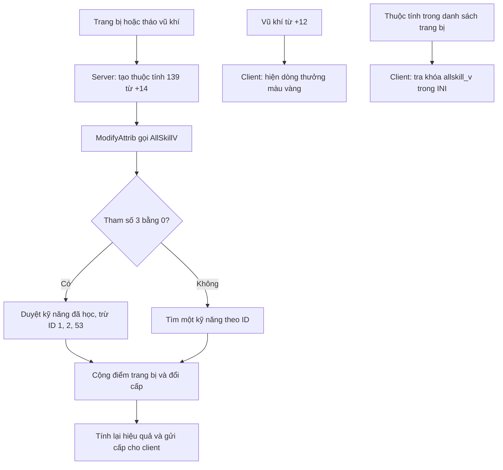

TÓM TẮT 1 [NGUỒN][THẤY]: `magic_allskill_v` (ID 139, khóa `allskill_v`) tăng cấp kỹ năng đang có cấp dương, trừ ID 1, 2, 53 khi cộng hàng loạt (`S/KMagicAttrib.h:154`, `S/KNpcAttribModify.cpp:743`).
TÓM TẮT 2 [NGUỒN][THẤY]: Server thực sự đổi cấp qua `IncreaseLevel`; `m_Currentskillenhance` và `ReEnChance` xử lý phần cộng hiệu quả riêng (`S/KSkillList.cpp:186`, `S/KItemList.cpp:1832`, `S/KSkillList.cpp:1009`).
TÓM TẮT 3 [NGUỒN][THẤY]: Với vũ khí +12 hoặc +13, tooltip ghi +1 nhưng nhánh cường hóa server chưa cấp thưởng; server bắt đầu ở +14 (`C/gameui/KuiItemdesc.cpp:235`, `S/KItem.cpp:183`).
TÓM TẮT 4 [CHƯA KIỂM]: Đã xác minh tên khóa Settings từ mã, chưa có tệp INI hoặc bảng vật phẩm để xác minh nguyên văn mẫu và bản ghi cấu hình (`S/KMagicDesc.cpp:9`, `C/gamecore/KMagicDesc.cpp:11`).
TÓM TẮT 5 [CHƯA KIỂM]: Chỉ khảo sát tĩnh; chưa chạy build, game, exe, VM hoặc kiểm thử qua mạng (`JX1_OPS/TASKS/QH-03.md:22`).

# QH-03 — Thuộc tính +N tất cả kỹ năng

Loại: khảo sát  
Chủ đề: Cách cộng cấp kỹ năng, phạm vi áp dụng và dòng mô tả vũ khí.  
Từ khóa: tất cả kỹ năng, cường hóa, `magic_allskill_v`, `allskill_v`, ID 139, `AllSkillV`, `ReEnChance`, tooltip  
Trạng thái: PARTIAL – đã xác minh đường đi trong mã, thiếu dữ liệu Settings thực tế.  
Độ phủ: Đã phủ 4 trên 5 hạng mục khảo sát tĩnh; hạng mục Settings có tên và ID từ mã, chưa có tệp cấu hình để đối chiếu.  
Liên quan: [Task QH-03](../TASKS/QH-03.md), [báo cáo QH-03](../REPORTS/QH-03.md), [mục lục tri thức](MUC-LUC-TRI-THUC.md#L12).  
Cần tôi quyết định: có, nếu mở task riêng để thống nhất ngưỡng thưởng và tooltip.

## Phạm vi và độ phủ

Quy ước nguồn: `S/` là `D:/JX-source/server/jxOnline/gameserver/Sources/Core/Src/`; `C/` là `D:/JX-source/client/Classes/`. Task không ghim phiên bản của hai cây nguồn này (`JX1_OPS/TASKS/QH-03.md:19`). THẤY là đã đối chiếu mã; TÀI LIỆU là phạm vi hoặc thông tin từ tài liệu; CHƯA KIỂM là chưa có bằng chứng trực tiếp.

| Hạng mục | Độ phủ | Bằng chứng |
|---|---|---|
| Mã thuộc tính và đường gọi `ModifyAttrib` | Đã phủ [THẤY] | `S/KMagicAttrib.h:154`, `S/KNpc.cpp:4458`, `S/KNpcAttribModify.cpp:120`, `S/KNpcAttribModify.cpp:322` |
| Cấp kỹ năng và phạm vi áp dụng | Đã phủ [THẤY] | `S/KNpcAttribModify.cpp:687`, `S/KNpcAttribModify.cpp:743`, `S/KSkillList.cpp:186` |
| `m_Currentskillenhance`, `KItemList.cpp:1832`, `ReEnChance` | Đã phủ [THẤY] | `S/KNpcAttribModify.cpp:3577`, `S/KItemList.cpp:1820`, `S/KSkillList.cpp:1009` |
| Tooltip trang bị | Đã phủ [THẤY] | `C/gameui/KuiItemdesc.cpp:235`, `C/gameui/KuiItemdesc.cpp:1244`, `C/gamecore/KItem.cpp:2449` |
| Tên, ID và dữ liệu Settings | Chưa phủ đủ [CHƯA KIỂM] | Có ánh xạ trong `S/KMagicDesc.cpp:162` và `C/gamecore/KMagicDesc.cpp:163`; chưa có các tệp được `S/KMagicDesc.cpp:9` và `C/gamecore/KMagicDesc.cpp:11` nêu |

## Giải mã tên

| Tên gốc | Mã hóa | Chữ đúng | Nguồn |
|---|---|---|---|
| `magic_allskill_v`, `allskill_v` | ASCII | Cộng cấp kỹ năng | [THẤY] `S/KMagicAttrib.h:154`, `S/KMagicDesc.cpp:162`, `C/gamecore/KMagicDesc.cpp:163` |
| `加技能 等级` | GBK | 加技能 等级 (cộng cấp kỹ năng) | [THẤY] Chú thích tại `S/KMagicAttrib.h:154`, đọc theo CP936 |
| `+%d tất cả kỹ năng vốn có` | UTF-8 | `+N tất cả kỹ năng vốn có` | [THẤY] `C/gameui/KuiItemdesc.cpp:239`, `C/gameui/KuiItemdesc.cpp:1248` |
| Kỹ năng ID `1`, `2`, `53` | ID số | Chưa giải mã tên; chưa có bảng kỹ năng để đối chiếu | [CHƯA KIỂM] `S/KNpcAttribModify.cpp:765` |

## Sắp theo cấu trúc game

| Nhóm trong game | Khi nào được cộng | Bằng chứng |
|---|---|---|
| Nhân vật → kỹ năng đang có cấp dương | Nhánh hàng loạt dùng chung cho danh sách nhân vật; điều kiện không lọc theo phái, nhánh hay cấp học. Không mở kỹ năng mới; loại ID 1, 2, 53. | [THẤY] `S/KNpcAttribModify.cpp:635`, `S/KNpcAttribModify.cpp:743`, `S/KNpcAttribModify.cpp:765` |
| Nhân vật → một kỹ năng có ID | Khi tham số 3 khác 0, tìm theo trị tuyệt đối của ID và chỉ cộng nếu tìm thấy kỹ năng đang có cấp dương. | [THẤY] `S/KNpcAttribModify.cpp:687`, `S/KNpcAttribModify.cpp:711` |
| Trang bị → vũ khí cận chiến hoặc tầm xa | Nhánh thưởng cường hóa tạo thuộc tính hàng loạt. Các loại trang bị khác không đi vào nhánh này. | [THẤY] `S/KItem.cpp:183`, `S/KItem.cpp:272` |

## Tăng cấp và tính lại hiệu quả

- [THẤY] Khi áp dụng thuộc tính trang bị, `KNpc::ModifyAttrib` chuyển dữ liệu sang `KNpcAttribModify::ModifyAttrib`. Hàm này tra bảng xử lý theo `nAttribType`, rồi gọi `AllSkillV` cho `magic_allskill_v`. Nhánh cường hóa tạo thuộc tính với `nValue[2] = 0`; khi tháo, server tạo cùng thuộc tính với số cấp mang dấu âm (`S/KItemList.cpp:1758`, `S/KItemList.cpp:2114`, `S/KItem.cpp:183`, `S/KItem.cpp:272`, `S/KNpc.cpp:4458`, `S/KNpcAttribModify.cpp:120`, `S/KNpcAttribModify.cpp:322`).
- [THẤY] Trong nhánh hàng loạt, `QeuipAddPoint` ghi số điểm thêm vào `mAddPoint`; sau đó server gọi `IncreaseLevel` với `nValue[0]`. Hàm này cộng trực tiếp vào `SkillLevel` và `CurrentSkillLevel`, chặn trong khoảng từ 0 đến `MAX_SKILLLEVEL - 1`, rồi tra lại dữ liệu kỹ năng ở cấp hiện tại. Slot không hợp lệ hoặc ID vượt số kỹ năng bị từ chối. Vì có chặn trần, `+N` là lượng cộng yêu cầu, không bảo đảm mọi cấp đều tăng đúng N (`S/KNpcAttribModify.cpp:765`, `S/KNpcAttribModify.cpp:778`, `S/KSkillList.h:174`, `S/KSkillList.cpp:186`, `S/KSkillList.cpp:226`).
- [THẤY] Server tạo bản tin `s2c_playerskilllevel` cho từng kỹ năng qua bộ lọc và đi vào nhánh cập nhật. `AllSkillV` phía client chỉ gọi `QeuipAddPoint`; với kỹ năng đã có trong danh sách, trình nhận bản tin gọi `SetLevel` rồi cập nhật điểm cộng. Đây là đường đồng bộ trong mã, chưa quan sát gói tin thực tế (`S/KNpcAttribModify.cpp:778`, `C/gamecore/KNpcAttribModify.cpp:710`, `C/gamecore/KProtocolProcess.cpp:98`, `C/gamecore/KProtocolProcess.cpp:1273`, `C/gamecore/KProtocolProcess.cpp:1301`).
- [THẤY] `ReEnChance` xóa `EnChance` và `nTempEnChance`, rồi lấy dữ liệu theo `CurrentSkillLevel` để tính lại hiệu quả. `IncreaseLevel` gọi hàm này sau khi có dữ liệu cấp mới. Riêng `magic_skill_enhance` cộng vào `m_Currentskillenhance`; `KItemList::ReSkillEnhance` tại dòng 1832 dùng giá trị đó để gọi `AddEnChance` cho kỹ năng đánh trái đang chọn và có cấp dương. Những lời gọi `KItemList::ReSkillEnhance` tại các chỗ mặc/tháo được tìm thấy đang là chú thích. Đường `KNpc::NewSetNpcEnChance` gọi `ReEnChance` rồi áp lại cộng hiệu quả riêng. Hai cơ chế chạm các trường khác nhau: `AllSkillV` đổi cấp, còn `AddEnChance` đổi `EnChance` (`S/KSkillList.cpp:255`, `S/KSkillList.cpp:1009`, `S/KSkillList.h:195`, `S/KNpcAttribModify.cpp:182`, `S/KNpcAttribModify.cpp:3577`, `S/KItemList.cpp:1511`, `S/KItemList.cpp:1816`, `S/KItemList.cpp:1820`, `S/KItemList.cpp:2047`, `S/KItemList.cpp:2264`, `S/KNpc.cpp:17243`).

## Tên Settings và dòng tooltip

- [THẤY] `magic_allskill_v` có giá trị **139** ở cả hai enum. Đếm từ phần tử đầu có giá trị 0 và kiểm chéo với vị trí 139 của `allskill_v` trong cả hai bảng chuỗi; 154 là số dòng header server. `g_MagicID2String` lấy khóa theo chỉ số; `g_String2MagicID` tra ngược từ tên (`S/KMagicAttrib.h:6`, `S/KMagicAttrib.h:154`, `C/gamecore/KMagicAttrib.h:152`, `S/KMagicDesc.cpp:162`, `S/KMagicDesc.cpp:858`, `C/gamecore/KMagicDesc.cpp:163`, `C/gamecore/KMagicDesc.cpp:986`).
- [THẤY] Với thuộc tính nằm trong danh sách thuộc tính của trang bị, client gọi `KMagicDesc::GetDesc`, đọc khóa `[Descript]` → `allskill_v`, dịch mẫu và thay tham số khi định dạng. Ví dụ, nếu mẫu dùng `#d1` thì số lấy từ `nValue[0]`. Chuỗi rỗng không được thêm vào phần mô tả. Mã server chỉ tới `settings/MagicDesc.Ini`; client nạp `settings/MagicDesc_mobile.Ini`, còn nhánh chọn `MagicDesc_mobile_vn.Ini` nằm trong chú thích (`S/KMagicDesc.cpp:9`, `S/KMagicDesc.cpp:372`, `C/gamecore/KMagicDesc.cpp:11`, `C/gamecore/KMagicDesc.cpp:375`, `C/gamecore/KMagicDesc.cpp:710`, `C/gamecore/KMagicDesc.cpp:761`, `C/gamecore/KMagicDesc.cpp:849`, `C/gamecore/KItem.cpp:2449`).
- [THẤY] Dòng thưởng cường hóa là nhãn vàng được tạo trực tiếp trong cả hai đoạn dựng tooltip, không cần khóa INI. Nó hiện `+1 tất cả kỹ năng vốn có` từ +12 đến +14 và `+2 tất cả kỹ năng vốn có` từ +15. Nhánh ghép mô tả `KItem::GetDesc` cũng dùng cùng ngưỡng, nhưng chuỗi trong nhánh đó không dấu (`C/gameui/KuiItemdesc.cpp:235`, `C/gameui/KuiItemdesc.cpp:1244`, `C/gamecore/KItem.cpp:2503`).
- [CHƯA KIỂM] Tìm theo tên tệp dưới `D:/JX-source` không thấy `MagicDesc*.ini` hoặc `GoldMagic.txt` để đối chiếu nguyên văn `[Descript] allskill_v` và bản ghi vật phẩm. Vì vậy, ID và tên khóa được xác minh từ mã, không phải từ một bản Settings đang được game sử dụng (`S/KMagicDesc.cpp:9`, `C/gamecore/KMagicDesc.cpp:11`).

## Mục sổ thông số

| Nhóm | Tên/hằng số | Nguồn `file:dòng` | Giá trị | Đơn vị | Ảnh hưởng | Đổi an toàn | Nguồn đo |
|---|---|---|---|---|---|---|---|
| Thuộc tính | `magic_allskill_v` | `S/KMagicAttrib.h:154`, `C/gamecore/KMagicDesc.cpp:163` | 139 | ID | Ánh xạ hàm và tên | KHÔNG – phải giữ ánh xạ đồng bộ | [THẤY] Đếm enum và bảng chuỗi |
| Thuộc tính | `nValue[0]`, `nValue[2]` | `S/KNpcAttribModify.cpp:687`, `S/KNpcAttribModify.cpp:765` | Cấp cộng có dấu; 0 = hàng loạt, khác 0 = trị tuyệt đối của ID | Cấp; ID | Chọn lượng cộng và đối tượng | CẨN THẬN | [THẤY] Đọc tĩnh |
| Kỹ năng | `MAX_NPCSKILL`, giới hạn cấp | `S/KSkillList.h:6`, `S/KSkillList.cpp:194` | 80 vị trí, vòng cộng từ 1 đến 79; cấp từ 0 đến `MAX_SKILLLEVEL - 1` | Vị trí; cấp | Giới hạn danh sách và cấp sau khi cộng | CẨN THẬN | [THẤY] Đọc tĩnh; chưa đo lúc chạy |
| Vũ khí | Ngưỡng cường hóa server | `S/KItem.cpp:183`, `S/KItem.cpp:272` | +14 → +1; từ +15 → +2; tháo dùng dấu âm tương ứng | Mức cường hóa; cấp kỹ năng | Quyết định mức thưởng áp dụng | CẨN THẬN | [THẤY] Đọc tĩnh |
| Tooltip | Ngưỡng hiển thị client | `C/gameui/KuiItemdesc.cpp:235`, `C/gameui/KuiItemdesc.cpp:1244` | +12 đến +14 → +1; từ +15 → +2 | Mức cường hóa; cấp kỹ năng | Quyết định dòng mô tả | CẨN THẬN | [THẤY] Đọc tĩnh |

## Đã xác minh / Chưa xác minh

- [THẤY] Đã đối chiếu enum và bảng chuỗi của hai phía, điều kiện cộng/trừ, điểm cộng, thay đổi cấp, tính lại hiệu quả và nhánh dựng dòng tooltip (`S/KNpcAttribModify.cpp:632`, `S/KSkillList.cpp:186`, `C/gameui/KuiItemdesc.cpp:235`).
- [TÀI LIỆU] Chỉ đọc tĩnh theo task. Không chạy build, game, exe, VM, mạng hay test mặc/tháo trang bị (`JX1_OPS/TASKS/QH-03.md:22`).
- [CHƯA KIỂM] Chưa đối chiếu bản Settings triển khai, ảnh UI, giá trị lưu sau tháo đồ hay gói đồng bộ thực tế (`C/gamecore/KMagicDesc.cpp:375`, `S/KItem.cpp:272`, `S/KNpcAttribModify.cpp:787`).

## Bàn giao

Không commit hoặc push theo yêu cầu; Tổng quan gộp tài liệu. Hàng đề xuất cho `MUC-LUC-TRI-THUC.md`: `Trang bị → Cường hóa → +N cấp kỹ năng | QH-03 | magic_allskill_v (139), allskill_v | khảo sát tĩnh, thiếu Settings`. Đề xuất chỉ mục dùng cùng các trường khối thông tin và độ phủ bên trên.

Kỹ năng đã dùng: `jx1-retrofit`, `jx1-read-server`, `jx1-read-client`, `jx1-parameters`, `jx1-knowledge`, `jx1-report`.

## Phát hiện khi chuẩn hóa

[THẤY] Với vũ khí +12 hoặc +13, tooltip có thể báo **+1** theo điều kiện trong mã client, trong khi server không tạo thuộc tính thưởng cường hóa ở hai mức đó. Từ +14 hai nhánh cùng cho +1 và từ +15 cùng cho +2. Chú thích server ở phần tính lại cường hóa cũng nhắc +12, nhưng điều kiện đang chạy của nhánh mặc/tháo là +14 (`C/gameui/KuiItemdesc.cpp:235`, `S/KItem.cpp:183`, `S/KItem.cpp:272`, `S/KItem.cpp:3781`).

Đề xuất tối ưu: chốt ngưỡng dự kiến trước khi tạo task riêng để đồng bộ mô tả với server. Nếu được duyệt kiểm thử sau, đối chiếu vũ khí +12, +13, +14, +15 khi mặc và tháo; so cả dòng tooltip và cấp kỹ năng đủ điều kiện. Chưa thực hiện kiểm thử này.
