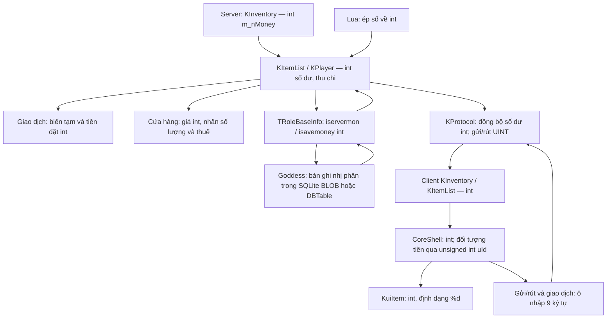

TÓM TẮT 1 [NGUỒN][THẤY] Đã lần đường tiền túi/rương/giao dịch qua server, gói tin, bản ghi Goddess và client; còn thiếu dữ liệu Settings/script nên trạng thái PARTIAL (S/KInventory.h:10; SL/S3DBInterface.h:107; C/KInventory.h:10).
TÓM TẮT 2 [NGUỒN][THẤY] Số dư, tham số, giá, biến tạm và giao diện có nhiều điểm 32 bit; đổi riêng m_nMoney hoặc cột SQL không đủ (S/KItemList.h:135; SH/KProtocol.h:1177; UI/KuiItem.h:116; G/sqlitel_db.cpp:1089).
TÓM TẮT 3 [NGUỒN][TÀI LIỆU] Đề xuất ít đụng: số dư và phép tính dùng Money64; giữ giá món/lệnh giao dịch 32 bit có trần; nâng bản ghi lưu và đồng bộ số dư theo phiên bản (mục 7, căn cứ SH/KProtocol.h:1313; SL/S3DBInterface.h:184).
TÓM TẮT 4 [CHƯA KIỂM] Chưa có goods.txt, buysell.txt, loggiaodich.lua trong D:/JX-source; chưa chứng minh toàn bộ caller ngoài các nhánh đã ghi, ABI của binary hay cấu hình DB đang dùng (S/KBuySell.cpp:89; S/KPlayer.cpp:6956; G/IDBRoleServer.cpp:681).
TÓM TẮT 5 [CHƯA KIỂM] Không build/test game, exe, VM hoặc mạng; không sửa source, cấu hình hay kết luận cũ; chưa commit/push theo yêu cầu, PM nhận tài liệu và quyết định phạm vi triển khai (JX1_OPS/TASKS/QH-04.md).

# QH-04 — Chuỗi kiểu dữ liệu tiền và phương án mở 64 bit

Loại: khảo sát
Chủ đề: Theo dấu tiền của nhân vật từ bộ nhớ tới lưu trữ, đồng bộ, giao dịch và cửa hàng.
Từ khóa: tiền, ngân lượng, số dư, KInventory, KProtocol, Goddess, KuiItem, giao dịch, Money64, tràn số
Trạng thái: PARTIAL — đường chính và đề xuất đã có; thiếu dữ liệu Settings/script và chưa chứng minh kiểm kê mọi caller/nhánh phụ.
Độ phủ: 8/9 nhóm có đối chiếu source; nhóm dữ liệu Settings/script chưa phủ; số lượng mọi điểm 32 bit toàn dự án chưa đếm được.
Liên quan: JX1_OPS/TASKS/QH-04.md; JX1_OPS/DESIGN/CHUAN-BAO-CAO.md; JX1_OPS/REPORTS/QH-04.md.
Cần tôi quyết định: có — khi mở task triển khai, chọn chỉ số dư 64 bit hay cả số tiền từng giao dịch/giá món 64 bit; khảo sát này không cấp quyền sửa/chạy.

## 1. Nguồn, cách đọc và nhãn bằng chứng

- [THẤY] = đã mở dòng source hiện tại trên đĩa. [TÀI LIỆU] = phân tích/đề xuất từ những dòng được dẫn, chưa triển khai. [CHƯA KIỂM] = thiếu dữ liệu hoặc chưa chạy kiểm chứng. Không dùng source để khẳng định hành vi binary đang chạy.
- Nguồn là các root trong task, quan sát ngày 20/11/2026; task không ghim commit source. Không đồng nhất source này với production/APK. Worktree tài liệu ở nhánh `task/QH-04`, sạch tại lần kiểm tra đầu.
- Danh sách đọc được lập từ mục Nguồn: bắt đầu ở KInventory, KItemList, KProtocol, KPlayerDBFuns, KPlayerTrade, KBuySell và KuiItem; chỉ thêm file có include/call/trường liên quan. Không đọc toàn bộ thư mục hay báo cáo cũ. Các đoạn đọc dưới khoảng 400 dòng/lần.
- Không nạp map/Graphify/mục lục ngoài danh sách Nguồn: giới hạn đọc cụ thể Q-51 trong prompt ưu tiên hơn bước tra cứu mặc định của skill. Không tạo lại graph hay script phụ. Skill retrofit chỉ áp dụng cấu trúc và nguyên tắc giữ kết luận; hai đầu ra chưa tồn tại nên không có bản cũ để sửa.
- Mã nhận dạng trong trích dẫn là ASCII. Source có phần chú thích cũ hiển thị sai khi đọc bằng code page mặc định; kết luận chỉ dựa trên khai báo/lệnh ASCII, không suy tên game từ chữ lỗi. Tài liệu đầu ra UTF-8 không BOM.

Các bí danh sau là đường dẫn đầy đủ; ví dụ `S/KInventory.h:10` nghĩa là file dưới root S, dòng 10.

| Bí danh | Root nguồn |
|---|---|
| S | D:/JX-source/server/jxOnline/gameserver/Sources/Core/Src |
| SH | D:/JX-source/server/jxOnline/gameserver/Headers |
| SL | D:/JX-source/server/jxOnline/gameserver/lib |
| E | D:/JX-source/server/jxOnline/gameserver/Sources/Engine/Src |
| H | D:/JX-source/server/jxOnline/header |
| C | D:/JX-source/client/Classes/gamecore |
| UI | D:/JX-source/client/Classes/gameui |
| G | D:/JX-source/server/jxOnline/gateway/Sources/MultiServer/Goddess |
| GL | D:/JX-source/server/jxOnline/gateway/Lib |

Danh mục file đã dùng làm bằng chứng (chỉ đọc đoạn/khớp cần thiết): S/{KInventory.h/.cpp, KItemList.h/.cpp, KPlayer.h/.cpp, KPlayerDBFuns.cpp, KPlayerTrade.h/.cpp, KBuySell.h/.cpp, KItem.h/.cpp, KItemGenerator.h, KProtocol.cpp, KProtocolProcess.cpp, KSellItem.cpp, ScriptFuns.cpp}; SH/{KProtocol.h, S3DBInterface.h}; SL/S3DBInterface.h; E/KTabFile.h/.cpp; H/CoreUseNameDef.h; C/{KInventory.h/.cpp, KItemList.h/.cpp, KPlayer.cpp, KPlayerTrade.h, KBuySell.h/.cpp, KItem.h, KProtocol.h/.cpp, KProtocolProcess.cpp, CoreShell.h/.cpp, GameDataDef.h, CoreUseNameDef.h, KSellItem.cpp}; UI/{KuiItem.h/.cpp, KuigetMoney.h/.cpp, KuiPlayerTrade.h/.cpp, KuiShop.cpp, KuiSuperShop.cpp}; G/{IDBRoleServer.h/.cpp, sqlitel_db.cpp, Goddess.dsp/.vcxproj}; GL/S3DBInterface.h. Có tìm symbol trong KNewProtocolProcess.cpp, KSellItem.h, CoreObjGenreDef.h, UI/KuiPlayerShop.cpp và file DB liên quan để định vị; không xem chúng là bằng chứng cho đường chính nếu không có trích dẫn bên dưới.

## 2. Sơ đồ tiền chính

[THẤY] Sơ đồ biểu diễn các liên kết source, không biểu diễn một phiên chạy đã đo: S/KItemList.cpp:3522; S/KPlayerDBFuns.cpp:1523; G/IDBRoleServer.cpp:760; C/KPlayer.cpp:4795; C/CoreShell.cpp:2346; UI/KuiItem.cpp:1632.

## 3. Phạm vi và độ phủ

| Nhóm theo cấu trúc game | Độ phủ | Bằng chứng / giới hạn |
|---|---|---|
| 1. Tiền túi/rương trong server | Đã phủ đường chính | [THẤY] S/KInventory.h:10; S/KItemList.cpp:3368; S/KPlayer.cpp:7334 |
| 2. Đồng bộ khi vào game và khi tiền đổi | Đã phủ khai báo, gửi/nhận, bảng kích thước | [THẤY] SH/KProtocol.h:1313; S/KPlayer.cpp:1031; C/KPlayer.cpp:5030; C/KProtocol.cpp:72 |
| 3. Gửi/rút tiền rương | Đã phủ UI → lệnh → server | [THẤY] UI/KuigetMoney.cpp:235; C/CoreShell.cpp:3907; C/KProtocol.cpp:690; S/KProtocolProcess.cpp:6135 |
| 4. Lưu/nạp Goddess | Đã phủ trường tiền, bản ghi và nhánh BLOB/DBTable | [THẤY] SL/S3DBInterface.h:107; GL/S3DBInterface.h:108; G/IDBRoleServer.cpp:492; G/IDBRoleServer.cpp:876 |
| 5. Client KInventory/KuiItem | Đã phủ đường số dư và hiển thị | [THẤY] C/KInventory.h:10; C/CoreShell.h:1065; UI/KuiItem.cpp:1632 |
| 6. Giao dịch hai người | Đã phủ tiền đặt, bản sao, tính tiền kết thúc và log | [THẤY] S/KPlayerTrade.h:29; S/KPlayer.cpp:6819; S/KPlayer.cpp:6947; UI/KuiPlayerTrade.cpp:1165 |
| 7. Cửa hàng NPC, bán lại, sửa đồ, quầy người chơi | Đã phủ kiểu giá và đường thu/chi chính | [THẤY] S/KBuySell.cpp:390; S/KItem.cpp:3648; S/KProtocolProcess.cpp:8876; SL/S3DBInterface.h:256 |
| 8. Biên script/API và trường tiền phụ trong KProtocol | Đã phủ điểm nối; chưa lần hết hệ thống phụ | [THẤY] S/ScriptFuns.cpp:20150; S/KPlayer.h:459; SH/KProtocol.h:2816; SH/KProtocol.h:2484 |
| 9. Dữ liệu Settings và script Lua thực tế | Chưa phủ | [CHƯA KIỂM] Tìm đúng tên dưới D:/JX-source không có goods.txt, buysell.txt, loggiaodich.lua. Đường tham chiếu: H/CoreUseNameDef.h:123; S/KPlayer.cpp:6956. |

[CHƯA KIỂM] Đây chưa phải kiểm kê mọi điểm 32 bit của toàn game. Chưa lần toàn bộ nhặt/rơi tiền, bang hội, bảng xếp hạng, ký gửi, callback và mọi script phụ. Đã đánh dấu các biên nhìn thấy để không bỏ chúng khi triển khai; không lấy số hàng bảng làm tổng số điểm ép kiểu. Căn cứ các nhánh phụ: SH/KProtocol.h:756; SH/KProtocol.h:2491; SH/KProtocol.h:3589; SH/KProtocol.h:3659.

### Giải mã tên

| Tên gốc | Mã hóa | Chữ đúng UTF-8 / nghĩa trong báo cáo | Nguồn |
|---|---|---|---|
| KInventory / m_nMoney | ASCII, giữ nguyên | Kho tiền của từng ngăn; không phải tên NPC/vật phẩm | [THẤY] S/KInventory.h:10 |
| room_equipment / room_repository / room_trade / room_trade1 | ASCII, giữ nguyên | Tiền túi / rương / phía mình / phía đối tác trong giao dịch | [THẤY] S/KItemList.cpp:3526; C/KPlayer.cpp:4891 |
| Goddess / TRoleBaseInfo | ASCII, giữ nguyên | Thành phần lưu nhân vật / thông tin nền của nhân vật | [THẤY] G/IDBRoleServer.cpp:597; SL/S3DBInterface.h:80 |
| Ngan luong | ASCII, giữ nguyên | Ngân lượng; chưa xác minh quy đổi sang “vạn” hay đơn vị UI khác | [THẤY] S/KBuySell.cpp:515; [CHƯA KIỂM] không có bảng quy đổi trong nguồn đã đọc |
| moneyunit_money / moneyunit_moneya / moneyunit_xu | ASCII, giữ nguyên | Hai nhánh trả qua Pay và nhánh trả qua PayXu; không gộp ngân lượng với Xu | [THẤY] S/KBuySell.cpp:512; S/KBuySell.cpp:517; C/GameDataDef.h:231 |

[TÀI LIỆU] Không có tên riêng kỹ năng, trang bị, NPC hay bản đồ được đưa vào nội dung khảo sát. Không cần suy giải GBK/TCVN3 cho định danh ASCII; không thay chữ lỗi trong source. Cấu trúc sắp xếp: tiền nhân vật → đồng bộ/lưu trữ → giao dịch → cửa hàng → API ngoài (các nguồn trong bảng độ phủ).

## 4. Sổ các điểm 32 bit trên đường chính

[TÀI LIỆU] “32 bit” bên dưới chỉ các khai báo `int`, `unsigned int`, `UINT` theo ABI Win32/client thông dụng mà task đang khảo sát; không phải kết quả chạy sizeof. Project Goddess có cấu hình WIN32 (G/Goddess.dsp:46). Khi triển khai phải chứng minh `sizeof`/kiểu nền cho từng target; không dùng `long` để thay vì độ rộng phụ thuộc ABI.

### 4.1. Tiền túi/rương, hàm thu chi và giá trị trung gian

| Điểm | Kiểu và phép tính nhìn thấy | Nguồn | Hệ quả khi mở số dư |
|---|---|---|---|
| Ô tiền gốc server | int m_nMoney; AddMoney(int); GetmServer trả int; SetClientMon(int) | [THẤY] S/KInventory.h:10; S/KInventory.h:38; S/KInventory.h:42 | [TÀI LIỆU] Phải đổi cả ô chứa, tham số và getter. |
| Kiểm tra cộng tiền | m_nMoney + nMoney < 0 rồi += | [THẤY] S/KInventory.cpp:368 | [TÀI LIỆU] Có phép cộng signed trước khi kiểm; đây không phải bảo vệ tràn hợp lệ trong C++. |
| Tiền qua KItemList | ExchangeMoney(int), GetMoneyAmount/GetEquipmentMoney trả int; AddmServer, CostMoney, DecMoney, SetRoomMoney, GetsMon dùng int | [THẤY] S/KItemList.h:119; S/KItemList.h:135; S/KItemList.h:142 | [TÀI LIỆU] Chỉ đổi KInventory vẫn bị thu hẹp qua API. |
| Tổng túi + rương | Cộng hai getter trong biểu thức int | [THẤY] S/KItemList.cpp:3368; C/KItemList.cpp:2619 | [TÀI LIỆU] Tổng có thể vượt trần dù từng ngăn chưa vượt. |
| Gửi/rút | nMoney int; lấy ra ngăn nguồn, cộng ngăn đích, hoàn lại nếu ngăn đích từ chối | [THẤY] S/KItemList.cpp:3329; S/KItemList.cpp:3341 | [TÀI LIỆU] Kiểm trước cả hai số dư và chỉ ghi khi toàn bộ chuyển tiền hợp lệ. |
| Thu/chi và trả trước | Pay/Earn/PrePay nhận int; GetMoney trả int; m_nPrePayMoney int | [THẤY] S/KPlayer.cpp:7334; S/KPlayer.cpp:7350; S/KPlayer.cpp:7381; S/KPlayer.cpp:7398; S/KPlayer.h:290 | [TÀI LIỆU] Khoản giữ trước/hoàn tiền phải cùng miền với API được mở. |
| Client kho tiền | int m_nMoney, AddmClient(int), getter/setter int; kiểm cộng tương tự server | [THẤY] C/KInventory.h:10; C/KInventory.h:35; C/KInventory.cpp:324 | [TÀI LIỆU] Client cần chứa số dư mới, kể cả khi mỗi lệnh vẫn có trần 32 bit. |
| Client danh sách ngăn | Getter, tổng, chuyển, thu/chi, SetClient/SetRoomMoney nhận/trả int | [THẤY] C/KItemList.h:103; C/KItemList.h:119; C/KItemList.h:126; C/KItemList.cpp:2717 | [TÀI LIỆU] Cần tránh cả thu hẹp lẫn cộng tràn ở bản sao client. |

### 4.2. KProtocol và kích thước gói

| Gói/biên | Server | Client | Điều cần đổi hoặc giữ trần |
|---|---|---|---|
| PLAYER_FS_MONEY_SYNC | int m_nMoney1/2/3, SH/KProtocol.h:1177 | int m_nMoney1/2/3, C/KProtocol.h:1122 | [THẤY] Số dư túi/rương/giao dịch. [TÀI LIỆU] Cần gói số dư 64 bit. |
| CURPLAYER_SYNC | int m_nMoney1/2, SH/KProtocol.h:1313 | int m_nMoney1/2, C/KProtocol.h:1258 | [THẤY] Đồng bộ lúc vào game; gửi S/KPlayer.cpp:1031, nhận C/KPlayer.cpp:5030. [TÀI LIỆU] Không chỉ sửa gói tiền tăng/giảm. |
| TRADE_MOVE_MONEY_COMMAND | int m_nMoney, SH/KProtocol.h:2118 | int m_nMoney, C/KProtocol.h:1989 | [THẤY] Tiền yêu cầu đặt vào giao dịch. [TÀI LIỆU] Có thể giữ 32 bit ở mức mở số dư, phải kiểm trần ở server. |
| TRADE_MONEY_SYNC | int m_nMoney, SH/KProtocol.h:2124 | int m_nMoney, C/KProtocol.h:1995 | [THẤY] Tiền đối tác đặt; C/KPlayer.cpp:4887. [TÀI LIỆU] Giữ cùng miền với lệnh đặt tiền hoặc nâng cả đôi. |
| STORE_MONEY_COMMAND | UINT m_dwMoney, SH/KProtocol.h:2151 | UINT m_dwMoney, C/KProtocol.h:2022 | [THẤY] C/KProtocol.cpp:690 nhận int rồi gán UINT; S/KProtocolProcess.cpp:6135 đưa vào ExchangeMoney(int). [TÀI LIỆU] unsigned không làm đường chuyển tiền có miền 64 bit. |
| Bảng kích thước và packing | pack(1), SH/KProtocol.h:18; sizeof gói, S/KProtocol.cpp:74; S/KProtocol.cpp:223; S/KProtocol.cpp:239 | pack(1), C/KProtocol.h:10; C/KProtocol.cpp:20; C/KProtocol.cpp:72; C/KProtocol.cpp:89 | [THẤY] Gói gửi theo sizeof, S/KItemList.cpp:3529; C/KProtocol.cpp:702. [TÀI LIỆU] Sửa field làm đổi hợp đồng byte; cả hai phía và bộ tách gói phải đồng bộ. |

[TÀI LIỆU] Tính trên giấy với BYTE=1, int/UINT=4 và pack(1): PLAYER_FS_MONEY_SYNC hiện 13 byte, nếu đổi cả ba trường thành int64_t thì 25 byte; hai gói trade hiện 5 byte, nâng trường tiền thì 9 byte; STORE_MONEY_COMMAND hiện 6 byte, nâng tiền thì 10 byte. CURPLAYER_SYNC tăng 8 byte nếu chỉ nâng hai trường tiền. Đây là tính suy ra từ khai báo ở bảng, chưa đo layout/sizeof của binary.

### 4.3. Lưu và nạp Goddess

| Điểm 32 bit / hợp đồng | Bằng chứng | Ý nghĩa |
|---|---|---|
| Trường lưu số dư | [THẤY] SL/S3DBInterface.h:107, SL/S3DBInterface.h:108 và GL/S3DBInterface.h:107, GL/S3DBInterface.h:108 đều khai báo int isavemoney/iservermon | [TÀI LIỆU] Hai bản header lưu trữ phải thống nhất khi nâng tiền. iclientx là nhánh Xu riêng, không tự mở theo. |
| Biến nạp | [THẤY] S/KPlayerDBFuns.cpp:641 có int nSave; S/KPlayerDBFuns.cpp:693 đọc isavemoney; S/KPlayerDBFuns.cpp:699 có int nServer; S/KPlayerDBFuns.cpp:701 đọc iservermon; S/KPlayerDBFuns.cpp:702 SetClient | [TÀI LIỆU] Đổi trường lưu mà giữ biến tạm int vẫn mất miền giá trị. |
| Biến ghi | [THẤY] S/KPlayerDBFuns.cpp:1523 có int nServer/nSave/nClient; S/KPlayerDBFuns.cpp:1526 lấy tiền túi; S/KPlayerDBFuns.cpp:1528 lấy tiền rương; S/KPlayerDBFuns.cpp:1529, S/KPlayerDBFuns.cpp:1530 gán vào BaseInfo | [TÀI LIỆU] Phải đổi theo đường đọc lẫn đường ghi, giữ tách Xu. |
| Bố cục bản ghi | [THẤY] SL/S3DBInterface.h:15 pack(1); SL/S3DBInterface.h:184 TRoleData chứa BaseInfo, dwVersion và các offset/length; S/KPlayerDBFuns.cpp:1727 tính dwDataLen | [TÀI LIỆU] BaseInfo dài thêm sẽ dịch dữ liệu tiếp theo. Không ghi bản 64 bit rồi đọc bằng layout cũ. Không tự đổi mọi offset/length sang 64 bit vì chúng là độ dài byte, không phải tiền. |
| Header dễ đọc nhầm | [THẤY] S/KPlayerDBFuns.cpp:8 dùng SL khi không _STANDALONE; nhánh khác include S3DBInterface.h; SH/S3DBInterface.h:49, SH/S3DBInterface.h:50 lại có int isavemoney/imoney | [TÀI LIỆU] Header cùng tên không đồng nghĩa cùng layout. G/IDBRoleServer.h:14 include theo tên; G/Goddess.vcxproj:123 và G/Goddess.dsp:46 có lib trước Headers. [CHƯA KIỂM] Chưa xác minh đường include thực của mọi cấu hình build. |
| SQL thực lưu BLOB | [THẤY] G/IDBRoleServer.cpp:492 nạp SelectBlobData; G/IDBRoleServer.cpp:681 chọn DATA_KIND_SQL; G/IDBRoleServer.cpp:760 ghi updateBlobData_n; G/sqlitel_db.cpp:539 tạo StudentBlob blob; G/sqlitel_db.cpp:1089 bind nguyên dữ liệu | [TÀI LIỆU] Không có bằng chứng một cột money cần ALTER BIGINT trong nhánh này; giới hạn nằm trong bytes của bản ghi. Không suy từ tên “SQL” thành MySQL. |
| DBTable | [THẤY] G/IDBRoleServer.cpp:876 add pRoleBuffer với dwDataLen | [TÀI LIỆU] Đường này cũng giữ bản ghi nhị phân; chuyển đổi dữ liệu phải bao gồm nó. [CHƯA KIỂM] Chưa đọc định dạng vật lý/cache/backup đầy đủ. |
| Goddess tự sửa tiền | [THẤY] G/IDBRoleServer.cpp:725, G/IDBRoleServer.cpp:729 tiền đổi tên int, trừ iservermon tại G/IDBRoleServer.cpp:733; nhánh DB tương ứng G/IDBRoleServer.cpp:844, G/IDBRoleServer.cpp:852; AddMoneyRoleCount(int nMoneyCount) tại G/IDBRoleServer.cpp:985, cộng tại G/IDBRoleServer.cpp:1000 | [TÀI LIỆU] Goddess không chỉ chép BLOB; các phép cộng/trừ này cần biết phiên bản và miền số dư. |
| Giá quầy được lưu cùng đồ | [THẤY] int itradeprice tại SL/S3DBInterface.h:256, GL/S3DBInterface.h:255; S/KPlayerDBFuns.cpp:1099 nạp và S/KPlayerDBFuns.cpp:1702 ghi GetTradePrice | [TÀI LIỆU] Chỉ cần đổi khi mở cả giá món; mức số dư 64 bit có thể giữ giá này 32 bit có trần. |

### 4.4. UI, giao dịch hai người và nhật ký

| Điểm | Bằng chứng 32 bit | Hệ quả |
|---|---|---|
| API lấy số dư | [THẤY] C/CoreShell.h:1065 GetGameData trả int; C/CoreShell.cpp:821, C/CoreShell.cpp:823 nRet int; C/CoreShell.cpp:2346 lấy GetsMon | [TÀI LIỆU] Đổi kho tiền mà giữ API này sẽ thu hẹp ngay trước UI. Nên thêm API tiền có dữ liệu đầu ra riêng. |
| Đối tượng tiền dùng chung ID đồ | [THẤY] C/GameDataDef.h:843 KUiGameObject có unsigned int uId; C/KItemList.cpp:2723 gán tiền rương vào uId; C/KPlayer.cpp:4896 gán tiền đối tác vào uId | [TÀI LIỆU] Không đổi toàn bộ uId thành 64 bit; thêm payload tiền riêng để tránh lan sang mọi đồ vật/UI. |
| KuiItem | [THẤY] UI/KuiItem.h:116 m_nMoney int; UI/KuiItem.cpp:1632 đọc số dư, UI/KuiItem.cpp:1637 in %d; UI/KuiItem.cpp:563 truyền vào KuigetMoney::create | [TÀI LIỆU] Đổi trường lưu, đường lấy tiền, formatter và tham số số dư truyền tiếp. |
| Hộp gửi/rút | [THẤY] UI/KuigetMoney.h:22 create nhận nMoney/nMaxMoney int; UI/KuigetMoney.h:62 seveMoney unsigned int; UI/KuigetMoney.cpp:108 giới hạn 9 ký tự; UI/KuigetMoney.cpp:235 nMoney unsigned int, UI/KuigetMoney.cpp:239 g_Atoui; C/CoreShell.cpp:3907 gán nParam sang int | [TÀI LIỆU] Có thể giữ trần mỗi lệnh, nhưng số dư đầu vào/hiển thị phải 64 bit; cần kiểm đổi dấu tại biên unsigned → int. |
| Bản sao khi trade | [THẤY] S/KPlayerTrade.h:29, S/KPlayerTrade.h:30 hai int backup, S/KPlayerTrade.h:39 StartTrade nhận tiền int; C/KPlayerTrade.h:24, C/KPlayerTrade.h:25, C/KPlayerTrade.h:32 tương ứng; C/KPlayer.cpp:4811, C/KPlayer.cpp:4952 ghi/khôi phục | [TÀI LIỆU] Backup tiền túi/rương phải 64 bit, nếu không hủy giao dịch có thể phục hồi giá trị đã thu hẹp. |
| Tiền yêu cầu và quyết toán | [THẤY] S/KPlayer.cpp:6647 nMoney int, S/KPlayer.cpp:6649 kiểm tiền đặt; S/KPlayer.cpp:6819 nSM1/nSM2/nDM1/nDM2 int; S/KPlayer.cpp:6826 và S/KPlayer.cpp:6832 cộng/trừ trước khi kiểm; S/KPlayer.cpp:6949, S/KPlayer.cpp:6960 gọi Earn/Pay | [TÀI LIỆU] Chuyển cả số dư/biểu thức sang miền rộng, tính trước hai số dư kết quả, rồi mới ghi. Chưa chứng minh giao dịch nguyên tử/lưu bền. |
| UI trade | [THẤY] UI/KuiPlayerTrade.h:113, UI/KuiPlayerTrade.h:117, UI/KuiPlayerTrade.h:118 dùng int; .cpp:345 ô 9 ký tự; UI/KuiPlayerTrade.h:1165 parse sang int, UI/KuiPlayerTrade.h:1168 cộng, UI/KuiPlayerTrade.h:1179 in %u, UI/KuiPlayerTrade.h:1193 truyền tiền qua uId | [TÀI LIỆU] Giữ trần tiền đặt vẫn phải mở số dư cầm theo và số dư sau điều chỉnh; không ép số dư lớn qua uId. |
| Log tiền giao dịch | [THẤY] S/KPlayer.cpp:6956, S/KPlayer.cpp:6965 truyền nDM1/nSM1 vào ExecuteScript4; S/KPlayer.h:459 nhận các tham số int | [TÀI LIỆU] Khi số dư mở 64 bit, log cũng phải nhận đúng số. Có overload chuỗi ở S/KPlayer.h:460 nhưng cần hợp đồng Lua tương ứng. [CHƯA KIỂM] loggiaodich.lua không có để đối chiếu. |

### 4.5. Cửa hàng và biên script

| Nhánh | Điểm 32 bit / phép tính | Bằng chứng |
|---|---|---|
| Giá hàng NPC | nPrice/nPriceXu int trong bộ tạo hàng; GetInteger đọc cột 6/7; KItem giữ nPrice, nTradePrice, uPrice int | [THẤY] S/KBuySell.h:15; S/KBuySell.cpp:118; S/KItem.h:126; C/KBuySell.h:15; C/KBuySell.cpp:106; C/KItem.h:92 |
| Đọc Settings | GetInteger(..., int *pnValue), atoi; đường buysell.txt/goods.txt | [THẤY] E/KTabFile.h:61; E/KTabFile.cpp:681; E/KTabFile.cpp:687; H/CoreUseNameDef.h:123; C/CoreUseNameDef.h:116. [CHƯA KIỂM] Không có hai tệp dữ liệu. |
| Mua số lượng và thuế | int nSerPrice, nBei; int nNewPrice = nSerPrice*nBei; float(...) đặt sau phép nhân/chia int | [THẤY] S/KBuySell.cpp:294; S/KBuySell.cpp:331; S/KBuySell.cpp:350; S/KBuySell.cpp:355; S/KBuySell.cpp:390; S/KBuySell.cpp:394; S/KBuySell.cpp:514. [TÀI LIỆU] Ép rộng trước phép nhân và kiểm tràn; giữ cách làm tròn cũ cho miền cũ. |
| Bán lại NPC | nMoney int lấy GetPrice rồi chia BUY_SELL_SCALE=4; Earn, sau đó xóa đồ | [THẤY] S/KBuySell.h:4; S/KBuySell.cpp:627; S/KBuySell.cpp:636; S/KBuySell.cpp:645. [TÀI LIỆU] Kiểm kết quả tăng tiền trước khi xóa đồ; chưa thử trường hợp tràn/từ chối. |
| Sửa đồ | GetRepairPrice trả int, biến nRepairPrice int; biểu thức nhiều phép nhân/chia dựa trên nPrice | [THẤY] S/KItem.cpp:3648; S/KItem.cpp:3665; S/KItem.cpp:3666; S/KProtocolProcess.cpp:6271. [TÀI LIỆU] Mở các trung gian, không đổi quy tắc làm tròn một cách ngầm định. |
| Đặt giá quầy | PLAYER_SET_PRICE.m_Price int; handler SetTradePrice; ITEM_SYNC.m_TradePrice int; SViewSellItemInfo.m_uPrice UINT | [THẤY] SH/KProtocol.h:3557; S/KProtocolProcess.cpp:7989; SH/KProtocol.h:1039; SH/KProtocol.h:3412; C/KProtocol.h:3358; C/KProtocol.h:990; C/KProtocol.h:3255 |
| Mua quầy | int nPrice; so số dư rồi Pay; người bán Earn; thuế nPrice*.../100 rồi float | [THẤY] S/KProtocolProcess.cpp:8876; S/KProtocolProcess.cpp:8889; S/KProtocolProcess.cpp:8924; S/KProtocolProcess.cpp:8956; S/KProtocolProcess.cpp:8959; S/KProtocolProcess.cpp:8961. [TÀI LIỆU] Cần kiểm cả phía nhận tiền trước khi chuyển/xóa đồ; chưa xác minh khả năng hoàn tác/runtime. |
| Bản sao quầy client | Nhận giá từ gói rồi SetPrice/nPrice, nhánh liên quan SetTradePrice | [THẤY] C/KSellItem.cpp:441; C/KSellItem.cpp:458; C/KSellItem.cpp:655; C/KSellItem.cpp:659; C/KItem.h:199; C/KItem.h:483. [TÀI LIỆU] Nếu mở giá từng món phải sửa cả dữ liệu lưu lẫn các gói mô tả món. |
| Lua GetCash/Pay/Earn/PrePay | GetCash đẩy GetsMon; Pay/Earn/PrePay ép Lua_ValueToNumber thành int | [THẤY] S/ScriptFuns.cpp:20137; S/ScriptFuns.cpp:20150; S/ScriptFuns.cpp:20186; S/ScriptFuns.cpp:20219; đăng ký S/ScriptFuns.cpp:26334, S/ScriptFuns.cpp:26335, S/ScriptFuns.cpp:26338, S/ScriptFuns.cpp:26340 |
| Hoàn tiền/ký gửi/GM | LuaReTurnMoneyInMap có int nMoney; ký gửi nMoneyVal int, tổng nReg UINT; GM ép sang int verX | [THẤY] S/ScriptFuns.cpp:18271; S/ScriptFuns.cpp:891; S/ScriptFuns.cpp:884; S/ScriptFuns.cpp:893; S/ScriptFuns.cpp:20670; SH/KProtocol.h:1872. [TÀI LIỆU] Giữ API cũ có trần, thêm API 64 riêng khi cần; không đổi tất cả điểm/exp/Xu theo. |

## 5. Các biên phụ đã nhìn thấy, chưa khẳng định phủ toàn bộ

| Nhóm | Trường hẹp tìm thấy trong KProtocol | Hướng xử lý khi triển khai |
|---|---|---|
| Tiền rơi/đối tượng | [THẤY] int m_nMoneyNum, SH/KProtocol.h:756; C/KProtocol.h:747 | [TÀI LIỆU] Có thể giữ số tiền mỗi đối tượng 32 bit; cộng vào số dư rộng có kiểm. [CHƯA KIỂM] Chưa lần đầy đủ phát sinh/nhặt/rơi tiền. |
| Bảng xếp hạng | [THẤY] TRoleList.nValue int, SH/KProtocol.h:2484; MoneyStat/MoneyStatBySect/SectMoneyMost tại SH/KProtocol.h:2491, SH/KProtocol.h:2497, SH/KProtocol.h:2503 | [TÀI LIỆU] Không đưa số dư 64 qua nValue int. Nâng gói bảng tiền hoặc ghi rõ chưa hỗ trợ, không ép cụt hay xếp hạng sai. |
| Bang hội | [THẤY] SH/KProtocol.h:2816, SH/KProtocol.h:2817, SH/KProtocol.h:2833, SH/KProtocol.h:3058, SH/KProtocol.h:3094, SH/KProtocol.h:3112, SH/KProtocol.h:3151, SH/KProtocol.h:3589 đều có UINT tiền; client tương ứng C/KProtocol.h:2658, C/KProtocol.h:2659, C/KProtocol.h:2675, C/KProtocol.h:2901, C/KProtocol.h:2920, C/KProtocol.h:2938, C/KProtocol.h:3005, C/KProtocol.h:3390 | [TÀI LIỆU] Chưa mở quỹ bang trong mức số dư nhân vật. Mọi khoản chuyển qua biên phải có giới hạn và kiểm số dư cả hai phía. [CHƯA KIỂM] Chưa khảo sát server bang/relay. |
| Ký gửi/giá mô tả/callback | [THẤY] SH/KProtocol.h:1361 iSellPrice int; SH/KProtocol.h:3450 m_uPrice UINT; SH/KProtocol.h:3659 nPrice int; client SH/KProtocol.h:1306, SH/KProtocol.h:3460 có trường tương ứng | [TÀI LIỆU] Không gộp với số dư. Khi mở giá món cần lần tiếp hệ thống này; có gói server/client khác nhau, không suy tương thích chỉ từ tên. |

## 6. Mục sổ thông số

| Nhóm | Tên/hằng số | file:dòng | Giá trị | Đơn vị | Ảnh hưởng | Đổi an toàn | Nguồn đo |
|---|---|---|---|---|---|---|---|
| Số dư | int m_nMoney | [THẤY] S/KInventory.h:10; C/KInventory.h:10 | 32 bit theo giả định ABI đã nêu; miền signed toán học -2.147.483.648..2.147.483.647 | số nguyên; tên đơn vị chưa quy đổi | Setter loại âm; trần số dương phụ thuộc kiểu | KHÔNG đổi riêng trường | Đọc tĩnh; chưa đo sizeof/runtime |
| Gửi/rút | UINT m_dwMoney | [THẤY] SH/KProtocol.h:2151; S/KItemList.h:119 | 32 bit unsigned theo ABI; sau đó đi qua int | số tiền/lệnh | Không được coi 4.294.967.295 là trần sử dụng an toàn của cả chuỗi | CẨN THẬN | Đọc tĩnh, miền số suy ra |
| UI | setMaxLength | [THẤY] UI/KuigetMoney.cpp:108; UI/KuiPlayerTrade.cpp:345 | 9 | ký tự nhập | Giới hạn UI riêng, không phải luật tiền trên server | CẨN THẬN | Đọc tĩnh, chưa thử UI |
| Bán NPC | BUY_SELL_SCALE | [THẤY] S/KBuySell.h:4; S/KBuySell.cpp:628 | 4 | hệ số chia giá | Giá bán lại, còn chặn tối thiểu 1 tại S/KBuySell.cpp:630 | CẨN THẬN | Đọc tĩnh; không đổi cân bằng game |
| Lưu nhân vật | Ngưỡng dwDataLen | [THẤY] G/IDBRoleServer.cpp:602 | từ 128×1024 trở lên bị từ chối | byte/bản ghi | Không phải trần tiền; thêm field cần tính lại kích thước | CẨN THẬN | Đọc tĩnh, chưa thử lưu |
| Phí đổi tên | RoleChangeMoney mặc định | [THẤY] G/IDBRoleServer.cpp:729; G/IDBRoleServer.cpp:848 | 50.000 | số tiền theo nKind | Goddess tự trừ tiền ngoài đường KInventory | CẨN THẬN | Mặc định source; không đọc Goddess.cfg, chưa biết cấu hình chạy |
| Đề xuất | Money64 | [TÀI LIỆU] căn cứ S/KInventory.h:10; SL/S3DBInterface.h:107 | int64_t; trần sản phẩm phải được chốt, không mặc nhiên dùng toàn miền | số nguyên tiền | Tránh float, kiểm trước cộng/nhân và đổi kiểu | CẨN THẬN | Đề xuất; chưa triển khai/đo |

## 7. Đề xuất tối ưu: mở ít nhất nhưng đủ một chuỗi khép kín

### 7.1. Mức A — số dư 64 bit, giá món và mỗi lệnh vẫn có trần 32 bit

[TÀI LIỆU] Đây là phương án ít đụng được đề xuất trước. Nó đáp ứng giữ tiền túi/rương vượt INT32_MAX, nhưng **không** cho phép một lần giao dịch/giá món vượt trần cũ. Căn cứ tách số dư với giá/lệnh: S/KItemList.h:135; SH/KProtocol.h:2118; SH/KProtocol.h:2151; S/KItem.h:126.

1. Dùng một kiểu chung `Money = int64_t` cho số dư, getter/setter, backup và biến trung gian đi qua tiền. Đổi KInventory, KItemList, KPlayer, KPlayerTrade ở cả server/client; các biến nServer/nSave khi lưu/nạp và Goddess khi sửa số dư. Không thay toàn bộ int, UINT hay ID đồ. Căn cứ: S/KInventory.h:38; S/KItemList.h:135; S/KPlayer.h:290; C/KPlayerTrade.h:24; G/IDBRoleServer.cpp:1000.
2. Giữ delta 32 bit trên các gói trade/gửi-rút hiện có, giới hạn server trong 0..INT32_MAX và theo luật nghiệp vụ; UI 9 ký tự có thể giữ như giới hạn từng lệnh. Chuyển delta sang Money trước khi tính; không cast số dư xuống int để so. Khoản tiền lớn gửi/rút bằng nhiều lệnh độc lập, không giả định một nhóm lệnh là giao dịch nguyên tử. Căn cứ: SH/KProtocol.h:2118; SH/KProtocol.h:2151; S/KPlayer.cpp:6649; UI/KuigetMoney.cpp:108.
3. Nâng đường **số dư** tới client: PLAYER_FS_MONEY_SYNC và CURPLAYER_SYNC; sửa bảng độ dài/serializer/handler hai phía. Có thể nâng phiên bản giao thức và triển khai đồng bộ một đợt để ít nhánh code; bắt buộc từ chối client cũ trước khi gửi layout mới. Nếu phải chạy lẫn phiên bản thì thêm gói V2 có thương lượng khả năng; không gửi struct rộng hơn dưới mã gói cũ cho client cũ. Căn cứ: S/KProtocol.cpp:23; S/KProtocol.cpp:74; C/KProtocol.cpp:20; S/KItemList.cpp:3529.
4. Thêm đường UI tiền riêng: lấy số dư Money bằng đầu ra có kiểu rõ, đưa tiền rương/tiền đối tác qua payload tiền; cập nhật KuiItem, tiền cầm theo/backup trade và đối số số dư vào hộp gửi-rút. Giữ ABI GetGameData/uId cho phần khác để giảm lan sửa. Formatter số dư dùng cách in int64_t phù hợp toolchain; giữ parser tiền đặt có kiểm trần. Căn cứ: C/CoreShell.h:1065; C/GameDataDef.h:843; C/KItemList.cpp:2723; UI/KuiItem.cpp:1637; UI/KuiPlayerTrade.cpp:1168.
5. Nâng hai trường số dư trong bản ghi lưu bằng định dạng V2 có version/length rõ ràng, cập nhật cả SL và GL, writer/reader và offset. Bộ chuyển đổi đọc layout V1 nguyên vẹn, mở rộng giá trị không âm sang V2, tính lại offset/length; không diễn giải bytes cũ bằng struct mới. Dù đã có dwVersion, chưa thấy hợp đồng chọn version nên phải xác minh trước khi dùng nó. Giữ itradeprice 32 bit ở mức A để không phải đổi toàn bộ dữ liệu đồ. Căn cứ: SL/S3DBInterface.h:184; GL/S3DBInterface.h:186; S/KPlayerDBFuns.cpp:1727; SL/S3DBInterface.h:256; G/IDBRoleServer.cpp:876.
6. Giữ giá món 32 bit nhưng tính tiền mua, sửa đồ và thuế bằng số nguyên rộng ngay từ toán hạng đầu, kiểm tràn từng bước, giữ thứ tự chia/làm tròn cũ khi kết quả cũ hợp lệ. Chốt hai số dư kết quả trước khi chuyển đồ; không bỏ qua thất bại Earn/Pay. Căn cứ: S/KBuySell.cpp:350; S/KBuySell.cpp:390; S/KBuySell.cpp:514; S/KBuySell.cpp:636; S/KItem.cpp:3666; S/KProtocolProcess.cpp:8924; S/KProtocolProcess.cpp:8959.
7. Giữ API Lua trả/nhận delta cũ có giới hạn; thêm GetCash64/Pay64/Earn64 nếu cần, ưu tiên chuỗi thập phân có kiểm khi chưa xác minh kiểu số Lua đủ chính xác. **GetCash và log là số dư**, nên với nhân vật giàu phải chuyển sang đường mới hoặc trả lỗi có nghĩa, không âm thầm ép xuống int. Sửa hợp đồng log giao dịch nhận số dư rộng, bao gồm script thiếu hiện tại. Căn cứ: S/ScriptFuns.cpp:20137; S/ScriptFuns.cpp:20150; S/ScriptFuns.cpp:20186; S/KPlayer.h:459; S/KPlayer.cpp:6956. [CHƯA KIỂM] Chưa xác minh typedef Lua_Number và nội dung script, không khẳng định mức chính xác của Lua đang dùng.
8. Trước cho số dư vượt 32 bit, rà/kiểm biên bảng xếp hạng, bang hội, rơi tiền, GM, ký gửi và callback ở mục 5. Nhánh chưa nâng phải bị giới hạn/từ chối rõ; tính năng cần số dư đầy đủ phải nâng tương ứng. Không coi việc giữ một gói delta 32 bit là cho phép ép số dư 64 xuống gói đó. Căn cứ: SH/KProtocol.h:2484; SH/KProtocol.h:2816; SH/KProtocol.h:3589; SH/KProtocol.h:3659; S/ScriptFuns.cpp:20670.

### 7.2. Mức B — mở cả từng giao dịch và giá món 64 bit

[TÀI LIỆU] Nếu sản phẩm cần trao >INT32_MAX trong một lần hoặc đặt giá món vượt mức đó, mức A không đủ. Ngoài mức A, nâng TRADE_MOVE_MONEY_COMMAND/TRADE_MONEY_SYNC/STORE_MONEY_COMMAND; giá đồ trong KItem/KBuySell/KSellItem, các gói ITEM_SYNC/PLAYER_SET_PRICE/SViewSellItemInfo và giá ký gửi/callback; itradeprice trong bản ghi đồ; parser Settings/Lua và UI nhập tiền. Các nút bắt buộc: SH/KProtocol.h:2118; SH/KProtocol.h:2124; SH/KProtocol.h:2151; SH/KProtocol.h:1039; SH/KProtocol.h:3557; SH/KProtocol.h:3412; SH/KProtocol.h:1361; SH/KProtocol.h:3659; SL/S3DBInterface.h:256; E/KTabFile.cpp:687; UI/KuigetMoney.cpp:239. Không thể chỉ thay %d hoặc tăng độ dài ô nhập.

[TÀI LIỆU] Không chọn cách đổi int thành unsigned int: nó không tăng số bit, vẫn đụng kiểm âm, ép kiểu và layout; cũng không chọn dùng float/double để chứa tiền. Quy tắc kiểm thêm tiền nên ở dạng kiểm giới hạn **trước** khi cộng (ví dụ amount > cap - balance sau khi đã xác nhận balance trong miền), trừ tiền kiểm amount <= balance; nhân kiểm giới hạn trước khi nhân. Căn cứ lỗi cấu trúc biểu thức: S/KInventory.cpp:370; S/KBuySell.cpp:390; S/KPlayer.cpp:6826.

### 7.3. Chuyển đổi, hoàn tác và phép thử cần có ở task sau

[TÀI LIỆU] Chuyển đổi trên bản sao dữ liệu, giữ bản V1; so số dư từng nhân vật/tổng tiền trước-sau; thử nạp-lưu-nạp V1→V2 và cả nhánh SQL/DBTable đang dùng; kiểm kích thước/offset và quy tắc CRC thực tế. Source có phần CRC bị comment trong G/IDBRoleServer.cpp:622 và S/KPlayerDBFuns.cpp:87, nên không được nhận CRC đã hoạt động. Sau khi phát sinh số dư vượt 32 bit, rollback binary V1 trực tiếp sẽ không an toàn: phải quay về bản sao trước chuyển đổi hoặc có bộ hạ định dạng được kiểm và xử lý rõ số dư vượt trần. Không cắt ngọn/clamp tiền để hoàn tác.

| Phép thử đề xuất, CHƯA CHẠY | Kết quả cần đạt | Căn cứ nguồn rủi ro |
|---|---|---|
| 0, 1, INT32_MAX-1, INT32_MAX, INT32_MAX+1, trần Money do sản phẩm chọn; âm/ngoài miền | Không mất tiền, không đổi dấu; lỗi trước khi thay đổi trạng thái | S/KInventory.cpp:370; S/KInventory.h:42 |
| Hai ngăn từng hợp lệ nhưng tổng >INT32_MAX | Tổng/so sánh/UI/lưu đều đúng | S/KItemList.cpp:3370; C/KItemList.cpp:2620 |
| Gửi/rút vào ngăn sát trần; hủy trade; hai người sát trần cùng xác nhận | Bảo toàn tổng tiền, backup đúng, không chuyển đồ khi cộng tiền thất bại | S/KItemList.cpp:3341; C/KPlayer.cpp:4952; S/KPlayer.cpp:6826 |
| Giá×số lượng/thuế/sửa đồ sát trần; bán khi người nhận không thể nhận thêm | Phép tính nguyên chính xác theo quy tắc đã chốt; tiền và đồ cùng thành công hoặc cùng giữ lại | S/KBuySell.cpp:390; S/KBuySell.cpp:636; S/KItem.cpp:3666; S/KProtocolProcess.cpp:8959 |
| Client cũ/mới; gói ngắn/dài; vào game rồi đồng bộ tăng/giảm | Chặn phiên bản không tương thích; không lệch packet | SH/KProtocol.h:18; S/KProtocol.cpp:74; C/KProtocol.cpp:20 |
| V1/V2; đổi tên; cộng offline; restore bản sao | Đọc đúng số dư, offset và giới hạn bản ghi; không mất khả năng phục hồi | SL/S3DBInterface.h:184; G/IDBRoleServer.cpp:602; G/IDBRoleServer.cpp:733; G/IDBRoleServer.cpp:1000 |
| GetCash/log, bang hội/xếp hạng/ký gửi/GM | Không ép cụt, không âm, không lệch log; nhánh chưa hỗ trợ trả lỗi rõ | S/ScriptFuns.cpp:20137; S/KPlayer.cpp:6956; SH/KProtocol.h:2484; SH/KProtocol.h:3589 |

## 8. Đã xác minh / Chưa xác minh

**ĐÃ XÁC MINH — THẤY:** các khai báo và phép gán/tính trong bảng mục 4; tiền đi qua cả CURPLAYER_SYNC lúc vào game, không chỉ gói cập nhật (S/KPlayer.cpp:1031; C/KPlayer.cpp:5030); Goddess có nhánh BLOB và DBTable (G/IDBRoleServer.cpp:760; G/IDBRoleServer.cpp:876); số dư UI vẫn int và tiền rương đi qua uId (UI/KuiItem.h:116; C/KItemList.cpp:2723). Đây là đối chiếu tĩnh, không phải test game.

**CHƯA XÁC MINH:** dữ liệu goods.txt/buysell.txt/loggiaodich.lua; số lượng mọi caller toàn dự án; đúng binary/ABI/include-path của từng bản build; backend g_dataType khi chạy; dữ liệu/backup thật, Lua_Number, nguyên tử giao dịch, overflow có xảy ra thực tế hay không. Không có build/test game, exe, VM, mạng hay đo runtime nào được chạy, đúng phạm vi task.

Kiểm tra tài liệu thực chạy: kiểm Git status/branch đầu lượt; tìm symbol/đọc dòng bằng PowerShell; tìm đích danh ba file thiếu; kiểm UTF-8 không BOM, khối bắt buộc, đường dẫn/dòng trích dẫn và diff tài liệu trước bàn giao. Kết quả chi tiết ở JX1_OPS/REPORTS/QH-04.md. Không ghi test nguồn đạt khi chưa biên dịch/chạy.

## 9. Phát hiện khi chuẩn hóa và giới hạn thao tác

- [THẤY] SH/S3DBInterface.h:49 và SL/S3DBInterface.h:107 là hai layout khác; không dùng header cũ imoney để kết luận đường iservermon. Goddess cũng có bản Headers cũ; đề xuất phải kiểm include thực trước triển khai (G/Goddess.vcxproj:123).
- [THẤY] Đoạn hiển thị tiền trong UI/KuiShop.cpp:494 và UI/KuiSuperShop.cpp:473 nằm trong block comment; không dùng chúng làm bằng chứng UI đang chạy. Tương tự phần cộng quỹ thuế ở S/KProtocolProcess.cpp:8943 là comment, tách khỏi phép thuế người bán đang nằm tại S/KProtocolProcess.cpp:8959.
- Không có kết luận cũ bị thay: cả file DESIGN và REPORT chưa tồn tại khi bắt đầu. Không tạo chỉ mục TSV ngoài vung_file; đề xuất hàng mục lục ở báo cáo bàn giao để PM gộp.
- `rg` không có trên máy: chuyển một lần sang Select-String/Get-ChildItem có lọc tên. Include tương đối của CoreUseNameDef.h trỏ tới gameserver/header không có; đã đối chiếu bản H/CoreUseNameDef.h:123 và C/CoreUseNameDef.h:116, không khẳng định include build đã giải quyết.
- Ghi `D:/JX-wt/QH-04.nhip` bị UnauthorizedAccessException vì nằm ngoài root ghi; không đổi quyền, không xin vượt sandbox. Mốc công việc được ghi trong REPORT thay thế, không nhận file nhịp ngoài đã cập nhật.

## 10. Bàn giao

Trạng thái PARTIAL; đầu ra khảo sát và phương án đã viết. PM cần cung cấp đúng bộ Settings/script và giao tiếp nhánh phụ nếu yêu cầu chốt “mọi chỗ 32 bit”, sau đó chốt mức A/B trước mở task sửa mã. Không commit/push theo yêu cầu; chưa có SHA mới. Không sửa source/game/BAI_HOC/mục lục gốc, không phát thông báo ra ngoài.

Kỹ năng đã dùng: jx1-retrofit, jx1-read-server, jx1-read-client, jx1-parameters, jx1-knowledge, jx1-report (đã nạp từ .agents/skills; chỉ áp dụng trong giới hạn prompt).
