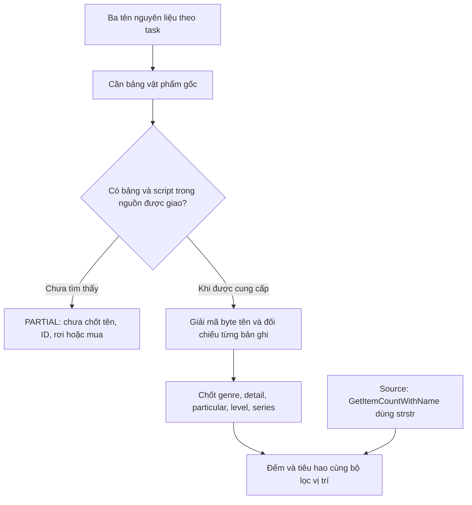

TÓM TẮT 1 [NGUỒN] [THẤY] PARTIAL: đã khảo sát mã đếm và bộ nạp vật phẩm; chưa chốt được dữ liệu của 3 loại thủy tinh trong task (S/KItemList.cpp:10328-10361; JX1_OPS/TASKS/QH-05.md:17).
TÓM TẮT 2 [NGUỒN] [THẤY] Server trỏ tới settings/item/004/mine.txt và questkey.txt; client trỏ tới update10/settings/item/004 với cùng tên bảng (S/KBasPropTbl.CPP:16-18; C/KBasPropTbl.CPP:16-18).
TÓM TẮT 3 [NGUỒN] [THẤY] GetItemCountWithName đếm theo chuỗi con, không lọc vị trí trong hàm; đếm nguyên liệu nên dùng bộ định danh và vị trí rõ ràng (S/KItemList.cpp:10328-10343,10504-10530).
TÓM TẮT 4 [CHƯA KIỂM] Chưa có byte tên GBK/TCVN3, genre/detail/particular/level, nguồn rơi/mua hoặc vật phẩm thay thế được chứng minh có sẵn; các bảng đích và Lua không tìm thấy trong root nguồn được giao (nhật ký L01-L03 bên dưới; JX1_OPS/TASKS/QH-05.md:21).
TÓM TẮT 5 [CHƯA KIỂM] Chỉ đọc tĩnh; không chạy build, game/exe, VM, mạng hoặc kiểm thử runtime, đúng JX1_OPS/TASKS/QH-05.md:24.

# QH-05 — Thủy tinh hồng, lục, lam: tên, định danh và cách đếm nguyên liệu

Loại: khảo sát
Chủ đề: Xác định dữ liệu cần có để chọn ba loại thủy tinh làm nguyên liệu cường hóa.
Từ khóa: thủy tinh hồng, thủy tinh lục, thủy tinh lam, GetItemCountWithName, GetItemCount, CountBagItemExact, mine.txt, questkey.txt, GBK, TCVN3
Trạng thái: PARTIAL — đã đối chiếu cơ chế trong source; thiếu bảng vật phẩm và script để chốt dữ liệu.
Độ phủ: đã xác minh 1/1 hàm đếm tên được hỏi và 2/2 bộ nạp server/client; xác định đầy đủ 0/3 loại vật phẩm; tổng số bản ghi vật phẩm chưa đếm được vì thiếu bảng.
Liên quan: JX1_OPS/TASKS/QH-05.md; JX1_OPS/REPORTS/QH-05.md; JX1_OPS/DESIGN/CHUAN-BAO-CAO.md
Cần tôi quyết định: có — PM cần cung cấp hoặc chỉ định bản sao Settings/script trong phạm vi đọc được phép trước khi chốt nguyên liệu.
liên quan: JX1_OPS/TASKS/QH-05.md; JX1_OPS/REPORTS/QH-05.md.

## Nguồn và cách đọc bằng chứng

[TÀI LIỆU] Phạm vi lấy từ `JX1_OPS/TASKS/QH-05.md:17-24`. `S/` viết tắt cho `D:\JX-source\server\jxOnline\gameserver\Sources\Core\Src\`; `C/` viết tắt cho `D:\JX-source\client\Classes\gamecore\`. Mọi dẫn chứng `S/tệp:dòng`, `C/tệp:dòng` bên dưới đều mở rộng theo hai root này.

[THẤY] Đây là bản mã có trên đĩa ngày 20/11/2026; task không ghim commit nguồn. Không suy bản mã này là bản đang chạy. Dòng source được đối chiếu trực tiếp, không lấy số dòng từ bản đồ làm bằng chứng. Task chỉ định root tại `JX1_OPS/TASKS/QH-05.md:21`.

[TÀI LIỆU] Nhãn `THẤY` chỉ điều quan sát được từ mã/lệnh đọc tĩnh; `TÀI LIỆU` là yêu cầu hoặc đề xuất chưa triển khai; `CHƯA KIỂM` là phần chưa đủ bằng chứng. `THẤY` không có nghĩa là đã chạy game (`JX1_OPS/TASKS/QH-05.md:24`).

## Phạm vi và độ phủ

| Phần tử của phạm vi | Đã phủ / chưa phủ | Bằng chứng và giới hạn |
|---|---|---|
| Thủy tinh hồng | [CHƯA KIỂM] Chưa phủ dữ liệu vật phẩm | Có tên yêu cầu tại task:17; chưa có dòng bảng để giải mã hoặc lấy ID; L01-L03. |
| Thủy tinh lục | [CHƯA KIỂM] Chưa phủ dữ liệu vật phẩm | Có tên yêu cầu tại task:17; chưa có dòng bảng để giải mã hoặc lấy ID; L01-L03. |
| Thủy tinh lam | [CHƯA KIỂM] Chưa phủ dữ liệu vật phẩm | Có tên yêu cầu tại task:17; chưa có dòng bảng để giải mã hoặc lấy ID; L01-L03. |
| Bảng vật phẩm server | [THẤY] Đã phủ bộ nạp; chưa phủ bản ghi | S/KBasPropTbl.CPP:16-18,857-894,991-1028; bảng đích không tìm thấy. |
| Đối chiếu client | [THẤY] Đã phủ đường dẫn và hàm tạo tương ứng | C/KBasPropTbl.CPP:16-18; C/KItemGenerator.CPP:3735-3744,3878-3888; chưa có bảng client. |
| Nguồn rơi | [THẤY] Đã phủ cách đọc bảng rơi; chưa phủ vật phẩm cụ thể | S/KNpcTemplate.cpp:34-44,95-112; thiếu cấu hình và script gắn từng vật phẩm. |
| Nguồn mua | [THẤY] Đã phủ cách đọc hàng hóa/cửa hàng; chưa phủ hàng cụ thể | S/KBuySell.cpp:83-117,166-177,223-225; thiếu bảng và chỗ mở shop. |
| Đếm tên và đếm bộ ID | [THẤY] Đã phủ mã hàm và đăng ký Lua | S/ScriptFuns.cpp:14415-14424,25994,26075,26077; S/KItemList.cpp:10328-10361,10504-10530. |
| Vật phẩm thay thế có sẵn | [CHƯA KIỂM] Chưa chốt được ứng viên có dữ liệu | Thiếu cùng các bảng trên; không dùng enum hoặc chú thích source để nhận có hàng trong game. |

[TÀI LIỆU] `task:17` trong bảng là `JX1_OPS/TASKS/QH-05.md:17`; ba tên là toàn bộ danh sách yêu cầu, không phải kết quả tìm được trong Settings.

## Giải mã tên

| Tên gốc | Mã hóa | Chữ đúng UTF-8 | Nguồn file:dòng |
|---|---|---|---|
| [CHƯA KIỂM] Chưa thu được byte tên vật phẩm gốc | Chưa biết; chưa có mẫu để xác định GBK hay TCVN3 | Thủy tinh hồng — chỉ là tên yêu cầu, chưa phải tên đã giải mã | JX1_OPS/TASKS/QH-05.md:17; bảng cần lấy: S/KBasPropTbl.CPP:16-18 |
| [CHƯA KIỂM] Chưa thu được byte tên vật phẩm gốc | Chưa biết; chưa có mẫu để xác định GBK hay TCVN3 | Thủy tinh lục — chỉ là tên yêu cầu, chưa phải tên đã giải mã | JX1_OPS/TASKS/QH-05.md:17; bảng cần lấy: S/KBasPropTbl.CPP:16-18 |
| [CHƯA KIỂM] Chưa thu được byte tên vật phẩm gốc | Chưa biết; chưa có mẫu để xác định GBK hay TCVN3 | Thủy tinh lam — chỉ là tên yêu cầu, chưa phải tên đã giải mã | JX1_OPS/TASKS/QH-05.md:17; bảng cần lấy: S/KBasPropTbl.CPP:16-18 |

[THẤY] Các đoạn chú thích Hán của bộ nạp đọc được bằng GBK/CP936, ví dụ `S/KBasPropTbl.CPP:95-118`. Điều này chỉ xác nhận cách đọc đoạn source đó; không xác nhận mã hóa tên trong bảng đang thiếu.

[CHƯA KIỂM] Không tự đặt tên Hán, không chuyển tên Việt trong task sang GBK rồi coi đó là tên gốc. Windows-1252 ở lượt tìm tên chỉ dùng để nhìn chuỗi byte kiểu văn bản Việt cũ, không phải bộ giải mã TCVN3. Chưa có mẫu tên để thực hiện giải mã và đối chiếu thực tế (L01-L03; `JX1_OPS/TASKS/QH-05.md:17`).

## Sắp theo cấu trúc game

[TÀI LIỆU] Sắp theo công dụng `nguyên liệu cường hóa → hồng / lục / lam → từng bản ghi`, đúng danh sách tại `JX1_OPS/TASKS/QH-05.md:17`. Nhánh bảng `mine` hay `questkey` của từng màu chưa xác định; không gán thể loại theo tên gọi.

| Nhóm → nguyên liệu | genre | detail | particular | level | Cách rơi / mua |
|---|---|---|---|---|---|
| Nguyên liệu cường hóa → hồng | [CHƯA KIỂM] Chưa biết | Chưa biết | Chưa biết | Chưa biết | Chưa có dòng dữ liệu; task:17; L01-L03 |
| Nguyên liệu cường hóa → lục | [CHƯA KIỂM] Chưa biết | Chưa biết | Chưa biết | Chưa biết | Chưa có dòng dữ liệu; task:17; L01-L03 |
| Nguyên liệu cường hóa → lam | [CHƯA KIỂM] Chưa biết | Chưa biết | Chưa biết | Chưa biết | Chưa có dòng dữ liệu; task:17; L01-L03 |

[CHƯA KIỂM] Các ô chưa biết không phải 0. Chưa đủ cơ sở khẳng định ba loại này không tồn tại, cũng chưa đủ cơ sở đưa một ID vào script cường hóa. Nguồn thiếu được định vị bởi `S/KBasPropTbl.CPP:16-18` và nhật ký L01-L03.

## Bảng nào chứa tên và bộ định danh?

[THẤY] Server ghép đường dẫn `\settings\item\004` với tên bảng rồi nạp từ tài nguyên; không có danh mục tên vật phẩm nhúng trong đoạn bộ nạp đã kiểm (`S/KBasPropTbl.CPP:16-18,790-810`). Client có tiền tố khác là `\update10\settings\item\004` (`C/KBasPropTbl.CPP:16-18`). Đây là đường dẫn tài nguyên trong mã, không phải bằng chứng về thư mục runtime đang chạy.

| Nhánh dữ liệu | Những trường cần đối chiếu | Bằng chứng |
|---|---|---|
| [THẤY] mine.txt | Tên, genre, detail, particular là 4 cột đầu; level ở cột 12, có trường cho phép cộng dồn ở cột 13 | S/KBasPropTbl.CPP:865-879 |
| [THẤY] questkey.txt | Tên, genre, detail là 3 cột đầu; có level và trường cộng dồn; phép gán vật phẩm đặt particular bằng 0 | S/KBasPropTbl.CPP:998-1021; S/KItem.cpp:1180-1196 |
| [THẤY] Mã loại chung | item_mine = 2, item_task = 4 theo enum; chưa gán hai giá trị này cho bất cứ màu nào | S/KItem.h:61-70 |

[THẤY] Phân biệt số thứ tự bản ghi với bộ định danh của vật phẩm trong túi: `GetMine(i)` lấy bản ghi theo chỉ số, và bộ đọc cộng 2 để bỏ dòng tiêu đề, trong khi phép gán mine lấy genre/detail/particular từ nội dung bản ghi (`S/KBasPropTbl.CPP:95-118,665-667,904-913`; `S/KItem.cpp:932-945`). Không lấy số dòng bảng thay thẳng cho bộ ID dùng để đếm.

[THẤY] Level của vật phẩm tạo ra có thể được gán từ tham số tạo, sau khi sao chép bảng. Cả nhánh mine và quest đều làm vậy trên server; client có thao tác tương ứng (`S/KItemGenerator.CPP:3608-3615,3740-3749`; `C/KItemGenerator.CPP:3735-3744`). Vì vậy cần đối chiếu cả nơi cấp vật phẩm, không chỉ đọc level của bảng.

## Cách rơi và cách mua

[THẤY] Bảng rơi được đọc từ tệp cấu hình; từng mục có `Genre`, `Detail`, `Particular`, `RandRate`, giới hạn level và số cộng dồn (`S/KNpcTemplate.cpp:34-44,95-112`). Ngoài ra có nhánh gọi script `DropRate` khi NPC mang mã script rơi (`S/KNpc.cpp:2485-2487`). Đây chỉ là cơ chế chung.

[THẤY] Cửa hàng nạp hai nguồn `BUYSELL_FILE` và `GOODS_FILE`. Hàng hóa lấy genre/detail/particular/series/level, sau đó danh sách shop tham chiếu hàng theo bảng (`S/KBuySell.cpp:83-117,223-225`). Nhánh mine gọi `Gen_MineShop` bằng particular của dòng hàng; nhánh quest gọi `Gen_QuestShop` bằng detail (`S/KBuySell.cpp:166-177`).

[CHƯA KIỂM] Chưa chốt được quái, bản đồ, tỷ lệ, shop, tiền hay giá mua của cả ba màu. Chưa xác định đường dẫn thực của hai macro shop trong phạm vi đã đọc; tên `buysell.txt`/`goods.txt` ở L02 chỉ là tên lọc thử, không phải đường dẫn macro đã xác minh. Không suy giá hay nơi mua từ việc source có hàm cửa hàng (`S/KBuySell.cpp:89-117`; L01-L03).

## Có dùng GetItemCountWithName được không?

[THẤY] Có API Lua `GetItemCountWithName`, đã đăng ký và gọi sang `KItemList::GetCountWithName` (`S/ScriptFuns.cpp:14415-14424,25994`). Hàm này cộng `GetStackNum()` khi tên chứa chuỗi được truyền vào: dùng `strstr`, không so tên đầy đủ và không có bộ lọc vị trí trong thân hàm (`S/KItemList.cpp:10328-10343`).

[TÀI LIỆU] Kết luận sử dụng: đếm được bằng tên nếu chấp nhận chuỗi con, dùng đúng byte tên phía server và phạm vi chứa đồ của hàm. Để kiểm nguyên liệu cường hóa, nên chọn bộ ID đầy đủ cùng vị trí hợp lệ sau khi có bảng, nhằm tránh đếm lẫn các tên chứa nhau. Đây là đề xuất từ phép so chuỗi/bộ lọc đã thấy, chưa triển khai (`S/KItemList.cpp:10337-10339,10514-10527`).

| API / cách đếm | Hành vi đã đọc | Điều cần tránh |
|---|---|---|
| [THẤY] GetItemCountWithName(name) | So chuỗi con theo byte, cộng số cộng dồn; không lọc nơi chứa trong hàm | Không coi đây là phép khớp tên đầy đủ hoặc phép chỉ đếm túi; S/KItemList.cpp:10328-10343 |
| [THẤY] GetItemCount(room, genre, detail, particular, level, series [, player]) | Lua nhận tham số theo thứ tự này; C++ khớp chính xác genre/detail/particular; lọc level/series khi lớn hơn -1 | Truyền đủ bộ ID và vị trí đã xác minh; -1 không phải wildcard particular; S/ScriptFuns.cpp:10317-10345; S/KItemList.cpp:10514-10527 |
| [THẤY] CalcItemCount(room, genre, detail, particular, level [, player]) | Wrapper đặt series = -1 rồi gọi cùng hàm đếm | Tham số thứ 6 là player dự phòng khi thiếu ngữ cảnh người chơi, không phải series; S/ScriptFuns.cpp:10280-10313 |
| [THẤY] CountBagItemExact(name) | Wrapper gọi QhCountExact; dùng strcmp, loại pos_equip; số cộng dồn không dương được tính 1 | Tên hàm/chú thích nói túi, nhưng mã không giới hạn riêng pos_equiproom; S/ScriptFuns.cpp:10917-10927,26041; S/KItemList.cpp:10347-10361 |

[THẤY] Bộ lọc vị trí của cách đếm ID chỉ áp dụng khi `room >= pos_hand && room < pos_count`; truyền ngoài khoảng sẽ không lọc nơi chứa (`S/KItemList.cpp:10518-10519`). Chưa xác minh giá trị số của enum vị trí trong phạm vi đọc, nên không đưa số room giả định.

[CHƯA KIỂM] Chưa có tên gốc và bộ ID của ba màu để thử một lời gọi thật. Chưa đối chiếu toàn bộ đường tiêu hao với cách đếm; khi triển khai phải dùng cùng bộ lọc, và vẫn cần kiểm thử trong nhiệm vụ khác được duyệt (`JX1_OPS/TASKS/QH-05.md:17,24`; `S/KItemList.cpp:10514-10527`).

## Vật phẩm thay thế

[CHƯA KIỂM] Chưa chứng minh ba màu không có trong dữ liệu, vì dữ liệu chưa được cung cấp. Cũng chưa thể đề xuất một vật phẩm thay thế và nhận nó là “có sẵn”. Enum, hàm tạo hoặc chú thích chỉ chứng minh loại được hỗ trợ, không chứng minh bản ghi vật phẩm tồn tại (`S/KItem.h:61-70`; `S/KBasPropTbl.CPP:790-810`).

[TÀI LIỆU] Phương án chờ dữ liệu: ưu tiên một bản ghi mine hoặc quest đã tồn tại, có tên riêng, bộ ID không lẫn, có nguồn nhận được xác minh và không mang công dụng nhiệm vụ đang dùng. PM chọn ứng viên sau khi bổ sung bảng; báo cáo này chưa chốt tên hay ID thay thế (`S/KBasPropTbl.CPP:865-879,998-1021`; `JX1_OPS/TASKS/QH-05.md:17`).

## MỤC SỔ THÔNG SỐ

| Nhóm | Tên/hằng số | file:dòng | Giá trị | Đơn vị | Ảnh hưởng | Đổi an toàn (CÓ/CẨN THẬN/KHÔNG) | Nguồn đo |
|---|---|---|---|---|---|---|---|
| [THẤY] Loại chung | item_mine / item_task | S/KItem.h:61-70 | 2 / 4; chưa gán cho ba màu | Mã loại | Phân nhánh vật phẩm | KHÔNG — không đổi enum để chọn nguyên liệu | Đọc tĩnh |
| [THẤY] Bảng mine | genre/detail/particular/level | S/KBasPropTbl.CPP:867-878 | Cột 2/3/4/12 | Cột bảng, từ 1 | Đối chiếu định danh | CẨN THẬN — chưa có dòng thật | Đọc tĩnh bộ nạp |
| [THẤY] Chỉ số bản ghi | nRow += 2 | S/KBasPropTbl.CPP:95-118 | Chỉ số bản ghi + 2 | Dòng vật lý, từ 1 | Tránh nhầm số dòng với ID | KHÔNG — không sửa bộ nạp | Đọc tĩnh |
| [THẤY] Lọc đếm ID | level / series | S/KItemList.cpp:10521-10525 | -1 bỏ lọc; > -1 so bằng | Giá trị lọc | Phân biệt biến thể | CẨN THẬN — cần bảng/nơi cấp vật phẩm | Đọc tĩnh |
| [THẤY] Lọc vị trí | room | S/KItemList.cpp:10518-10519 | Trong [pos_hand, pos_count) mới áp dụng | Mã vị trí | Tránh tính nhầm nơi chứa | CẨN THẬN — chưa chốt giá trị số | Đọc tĩnh |
| [CHƯA KIỂM] Ba màu | genre/detail/particular/level | JX1_OPS/TASKS/QH-05.md:17; S/KBasPropTbl.CPP:16-18 | Chưa biết, không ghi 0 | Bộ định danh | Khóa nguyên liệu | CẨN THẬN — chưa được triển khai | Chưa có bảng |
| [CHƯA KIỂM] Cấp nguyên liệu | Tỷ lệ rơi / giá mua | S/KNpcTemplate.cpp:99-112; S/KBuySell.cpp:113-118 | Chưa biết | Tỷ lệ / tiền | Cân bằng nguyên liệu | CẨN THẬN — chưa có cấu hình | Chưa đo runtime |

## Nhật ký tìm nguồn và giới hạn

[THẤY] Đã kiểm tra các root được task chỉ định, chỉ tìm theo tên tệp/chủ đề liên quan. Không dùng mạng, không đọc khóa/mật khẩu; lệnh đọc bảng và source không chạy mã game (`JX1_OPS/TASKS/QH-05.md:21-24`).

| Mã | Lệnh/phạm vi thực chạy ngày 20/11/2026 | Kết quả |
|---|---|---|
| L01 | [THẤY] Lọc tên thư mục Settings/settings/script/scripts/gs/graphify-out dưới server/jxOnline/gameserver và client | 0 thư mục khớp; không có bảng/graph để đọc theo các đường dẫn này. |
| L02 | [THẤY] Với từng tên mine.txt, questkey.txt, ItemMine.txt, ItemQuest.txt, buysell.txt, goods.txt và *.lua: Get-ChildItem -LiteralPath D:\JX-source -File -Recurse -Filter tên | Mỗi mẫu: 0 tệp. Không mở bảng hay script chưa tồn tại; không diễn giải là “vật phẩm không tồn tại”. |
| L03 | [THẤY] Test-Path bốn đường dẫn bảng mine/questkey ở gameserver/Settings/item/004 và client/update10/settings/item/004 | Cả 4 trả False. Chỉ là vị trí ứng viên trong bản sao nguồn, không phải root runtime đã xác minh. |
| L04 | [THẤY] Lọc 62 tệp .cpp/.h tên có item, basprop, scriptfuns, luafuns, compound, wengamg, qiang, qh ở S, C, client/Classes/gameui và gamescene; tìm tên ở UTF-8, GBK/CP936, Windows-1252 | 0 kết quả theo tập mẫu tên bên dưới; không nhận độ phủ toàn bộ tài nguyên game. |
| L05 | [THẤY] Select-String định vị symbol; đọc từng đoạn source có đánh số dòng, dưới khoảng 400 dòng/lượt | Đối chiếu trực tiếp các dẫn chứng trong báo cáo; không build hay chạy game. |

[THẤY] Tập mẫu L04: `水晶`, `水精`, `Thủy tinh`/`Thuỷ tinh`, `ThuyTinh` và dạng tách bởi khoảng trắng/gạch dưới/gạch nối, `Thñy tinh`, `crystal`, `shuijing` và dạng tách tương tự; không phân biệt hoa/thường theo regex. Đây là từ khóa tìm kiếm, không phải tên Hán/TCVN3 đã tìm thấy trong bảng (L04; mục tiêu `JX1_OPS/TASKS/QH-05.md:17`).

[TÀI LIỆU] Danh sách source cần đọc được thu hẹp từ mục Nguồn và symbol liên quan: server `KItemList.cpp/.h`, `ScriptFuns.cpp`, `KItem.h/.cpp`, `KBasPropTbl.CPP/.h`, `KItemGenerator.CPP/.h`, `KBuySell.cpp/.h`, `KNpcTemplate.cpp/.h`, đoạn `KNpc.cpp` nêu trên; client `KBasPropTbl.CPP`, các đoạn `KItemGenerator.CPP`. Các tệp item/Lua/drop/sell khác chỉ dùng định vị có lọc, không đọc toàn thân; mục Nguồn gốc: `JX1_OPS/TASKS/QH-05.md:21`.

## ĐỀ XUẤT TỐI ƯU

[TÀI LIỆU] PM cung cấp bản sao hai bảng vật phẩm phía server và client, bảng hàng hóa/shop tương ứng, cấu hình rơi và script cấp/mua liên quan. Chỉ đọc các dòng có ba vật phẩm và phần gọi chúng, giữ byte tên gốc, rồi bổ sung đúng báo cáo này; không cần làm lại phần đếm đã có bằng chứng (`S/KBasPropTbl.CPP:16-18`; `C/KBasPropTbl.CPP:16-18`; `S/KBuySell.cpp:89-117`; `S/KNpcTemplate.cpp:95-112`).

[TÀI LIỆU] Khi đủ dữ liệu, chốt bộ genre/detail/particular/level/series và enum vị trí trước; dùng cùng bộ lọc cho kiểm số lượng và tiêu hao. Chưa đổi API, cấu hình, source hoặc công thức cường hóa trong nhiệm vụ này (`S/ScriptFuns.cpp:10317-10345`; `S/KItemList.cpp:10514-10527`; `JX1_OPS/TASKS/QH-05.md:24`).

## Đã xác minh / Chưa xác minh

[THẤY] Đã xác minh bằng đọc tĩnh: đường dẫn bộ nạp hai phía; cấu trúc trường mine/quest; phân biệt chỉ số bản ghi và bộ ID; GetItemCountWithName dùng chuỗi con; GetItemCount có bộ lọc ID/vị trí; CountBagItemExact dùng tên đầy đủ nhưng không lọc riêng túi. Bằng chứng nằm ở từng dòng source phía trên, đặc biệt `S/KItemList.cpp:10328-10361,10504-10530`.

[CHƯA KIỂM] Chưa xác minh: byte tên và bộ ID của 3 màu, sự tồn tại trong dữ liệu thật, rơi/mua, vật phẩm thay thế có sẵn, binary đang dùng, số lượng trong game, tính đúng của tiêu hao. Không chạy build, game/exe, VM hoặc mạng vì task không cho phép (`JX1_OPS/TASKS/QH-05.md:17,24`).

## Phát hiện khi chuẩn hóa

[TÀI LIỆU] Đây là tài liệu mới; không sửa báo cáo hoặc kết luận cũ. Chỉ dùng khung chuẩn của jx1-retrofit cho thông tin, độ phủ, sơ đồ và giải mã tên; các giới hạn dữ liệu được ghi công khai theo `JX1_OPS/DESIGN/CHUAN-BAO-CAO.md`.

## Bàn giao

[TÀI LIỆU] Trạng thái PARTIAL; PM bổ sung bản sao Settings/script để hoàn tất dữ liệu, rồi duyệt riêng nếu cần kiểm thử runtime. Không yêu cầu commit, nên không stage/commit/push; chưa có SHA. Báo cáo bàn giao: `JX1_OPS/REPORTS/QH-05.md`; kết quả ghi tại `JX1_OPS/TASKS/QH-05.md`.

[THẤY] Tạo nhịp tại `D:\JX-wt\QH-05.nhip` bị từ chối quyền ghi do nằm ngoài writable root. Không thay quyền hay ghi đường vòng; mốc tiến độ và lỗi được giữ trong báo cáo bàn giao. Đây là giới hạn thao tác, không phải chứng cứ về vật phẩm.

Kỹ năng đã dùng: jx1-retrofit, jx1-read-server, jx1-read-client, jx1-parameters, jx1-knowledge, jx1-report.

