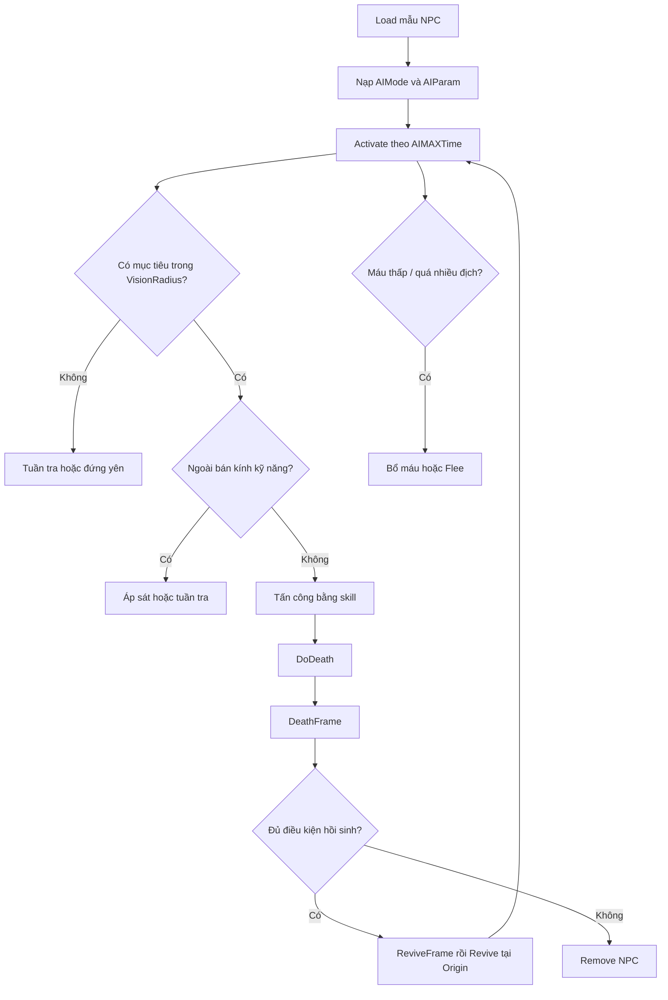

# TÓM TẮT 5 DÒNG
1. [TÀI LIỆU] Đã mô tả vòng AI quái: lập lịch AIMode, tìm mục tiêu, áp sát/đánh, tuần tra và giữ bán kính hoạt động. `C:/Jx1CocoV3/SwordOnline/SwordOnline/jxOnline/gameserver/Sources/Core/Src/KNpcAI.cpp:91–134,3134–3159,3789–3900`.
2. [TÀI LIỆU] Tầm nhìn/bán kính hoạt động mặc định 40/30; tầm đánh hiện tại lấy từ skill, và ngưỡng xa nhất lưu dạng bình phương. `C:/Jx1CocoV3/SwordOnline/SwordOnline/jxOnline/gameserver/Sources/Core/Src/KNpcTemplate.cpp:693–694`; `C:/Jx1CocoV3/SwordOnline/SwordOnline/jxOnline/gameserver/Sources/Core/Src/KNpc.cpp:7045–7066,11187–11201`.
3. [TÀI LIỆU] `Flee` đi ngược hướng đối thủ; mode 2, 3, 5, 6 có nhánh bỏ chạy theo điều kiện máu/xác suất. `C:/Jx1CocoV3/SwordOnline/SwordOnline/jxOnline/gameserver/Sources/Core/Src/KNpcAI.cpp:3213–3224,4109–4125,4822–4838,5045–5059`.
4. [TÀI LIỆU] Quái chết qua DeathFrame, chờ ReviveFrame rồi hồi sinh tại Origin; loại vàng > 4 bị xóa ở nhánh đã đọc. `C:/Jx1CocoV3/SwordOnline/SwordOnline/jxOnline/gameserver/Sources/Core/Src/KNpc.cpp:2538–2547,2660–2687,3375–3435,13900–13937`.
5. [CHƯA KIỂM] Báo cáo đối chiếu ghi 94.098 spawn trên 195 map; chưa có tọa độ từng map và chưa chạy build/exe/VM/game. `JX1_OPS/DESIGN/SO-TAY-QUAI-NPC-BAN-DO.md:3,35`; nhịp ngoài worktree bị chặn.

# SO-27 — Sổ tay AI quái, tầm đánh và hồi sinh
Loại: khảo sát
Chủ đề: Giải thích AI quái cho người không lập trình, từ mẫu NPC và tham số đến đuổi, đánh, bỏ chạy, chết, hồi sinh và điểm sinh theo bản đồ.
Từ khóa: AI quái, NPC, AIMode, AIParam, VisionRadius, AttackRadius, ReviveFrame, spawn, hồi sinh, KNpcAI
Trạng thái: PARTIAL — hoàn tất khảo sát tĩnh và đối chiếu báo cáo; còn thiếu bảng tọa độ spawn từng map và kiểm runtime.
Độ phủ: đã phủ 6 trên 7 chủ điểm (đuổi, đánh, bỏ chạy, hồi sinh, tham số/tầm, đối chiếu spawn-map); tọa độ chi tiết từng map chưa phủ.
Liên quan: `JX1_OPS/DESIGN/SO-TAY-QUAI-NPC-BAN-DO.md`, `JX1_OPS/DESIGN/MUC-LUC-TRI-THUC.md`, `JX1_OPS/TASKS/SO-27.md`
Cần tôi quyết định: không

## Phạm vi và độ phủ

| Phần tử phạm vi | Kết quả | Mức phủ | Nguồn |
|---|---|---|---|
| Quái đuổi/tìm mục tiêu | `[THẤY]` Lấy mục tiêu gần nhất theo quan hệ địch, lọc mục tiêu chết/ẩn; giữ mục tiêu trong tầm nhìn | Đã phủ mã xử lý; `[CHƯA KIỂM]` chưa đo runtime | `C:/Jx1CocoV3/SwordOnline/SwordOnline/jxOnline/gameserver/Sources/Core/Src/KNpcAI.cpp:2621–2682,3789–3812` |
| Quái đánh | `[THẤY]` Nếu khoảng cách ≤ `m_CurrentAttackRadius` và trong tầm nhìn thì gửi `do_skill`; ngoài tầm thì `do_walk` áp sát | Đã phủ | `C:/Jx1CocoV3/SwordOnline/SwordOnline/jxOnline/gameserver/Sources/Core/Src/KNpcAI.cpp:2962–2987` |
| Quái bỏ chạy | `[THẤY]` `Flee` tính điểm đối xứng qua đối thủ rồi gửi `do_walk`; AI máu thấp có thể chọn nhánh này | Đã phủ nhánh; `[CHƯA KIỂM]` chưa đo xác suất thực tế | `C:/Jx1CocoV3/SwordOnline/SwordOnline/jxOnline/gameserver/Sources/Core/Src/KNpcAI.cpp:3213–3224,4109–4125` |
| Tham số AI | `[THẤY]` `AIMode`, `AIParam1..9`, `ActiveRadius`, `VisionRadius`, `ReviveFrame`, `IsRevive` được đọc từ bảng NPC | Đã phủ mã đọc và copy vào instance | `C:/Jx1CocoV3/SwordOnline/SwordOnline/jxOnline/gameserver/Sources/Core/Src/KNpcTemplate.cpp:676–694,732–735`; `C:/Jx1CocoV3/SwordOnline/SwordOnline/jxOnline/gameserver/Sources/Core/Src/KNpc.cpp:11178–11214` |
| Tầm nhìn/tầm đánh | `[THẤY]` Tầm nhìn lọc bằng khoảng cách; tầm đánh dùng bán kính skill hiện hành; ngưỡng xa nhất được bình phương hóa | Đã phủ logic; `[CHƯA KIỂM]` chưa có đơn vị runtime chuẩn hóa | `C:/Jx1CocoV3/SwordOnline/SwordOnline/jxOnline/gameserver/Sources/Core/Src/KNpcAI.cpp:3009–3014,3878–3900`; `C:/Jx1CocoV3/SwordOnline/SwordOnline/jxOnline/gameserver/Sources/Core/Src/KNpc.cpp:7045–7066` |
| Chết/hồi sinh | `[THẤY]` `DoDeath` đặt trạng thái chết và `DeathFrame`; `OnDeath` gọi `DoRevive` cho NPC chiến đấu đủ điều kiện | Đã phủ luồng | `C:/Jx1CocoV3/SwordOnline/SwordOnline/jxOnline/gameserver/Sources/Core/Src/KNpc.cpp:2421–2543,2571–2687` |
| Điểm sinh theo map | `[THẤY]` `Revive` đổi `OriginX/Y` sang region/map rồi `AddRef`; `[TÀI LIỆU]` báo cáo tổng hợp có 94.098 spawn trên 195 map | Tổng số đã đối chiếu; `[CHƯA KIỂM]` tọa độ từng map chưa trích | `C:/Jx1CocoV3/SwordOnline/SwordOnline/jxOnline/gameserver/Sources/Core/Src/KNpc.cpp:13900–13917`; `JX1_OPS/DESIGN/SO-TAY-QUAI-NPC-BAN-DO.md:3,35` |

## Cách đọc cho người không lập trình

- **[TÀI LIỆU] Mẫu NPC:** `KNpcTemplate::InitNpcBaseData` đọc các cột trong bảng NPC. `AIMode` chọn kiểu hành vi, `AIParam1..9` là các ngưỡng/xác suất của kiểu đó, còn `VisionRadius` và `ActiveRadius` giới hạn nơi quái phát hiện và nơi quái được phép hoạt động. `C:/Jx1CocoV3/SwordOnline/SwordOnline/jxOnline/gameserver/Sources/Core/Src/KNpcTemplate.cpp:674–694`.
- **[TÀI LIỆU] Nhịp chạy AI:** mỗi lần `Activate`, server chỉ xử lý khi đến `m_NextAITime`, rồi cộng `m_AIMAXTime` cho lần kế tiếp và rẽ vào `AIMode`. `C:/Jx1CocoV3/SwordOnline/SwordOnline/jxOnline/gameserver/Sources/Core/Src/KNpcAI.cpp:91–134`.
- **[TÀI LIỆU] Mode đang được gọi:** Activate hiện điều phối AIMode 0–6; các nhánh 7–10 hiện nằm trong comment của switch, không được gọi qua nhánh này. Phía client có một nhánh riêng cho AIMode > 10, chủ yếu xử lý hoạt ảnh. C:/Jx1CocoV3/SwordOnline/SwordOnline/jxOnline/gameserver/Sources/Core/Src/KNpcAI.cpp:96–133; C:/Jx1CocoV3/Folder/Client2912-20260116T044348Z-3-001/Client2912/Client/Classes/gamecore/KNpcAI.cpp:70–84,89–137.
- **[TÀI LIỆU] Giữ khu vực:** nếu quái đi quá `ActiveRadius`, bán kính hiện hành bị thu nhỏ và quái được lệnh đi về `OriginX/OriginY`. `C:/Jx1CocoV3/SwordOnline/SwordOnline/jxOnline/gameserver/Sources/Core/Src/KNpcAI.cpp:3134–3159`.
- **[TÀI LIỆU] Tìm địch:** `GetNearestNpc` chia bán kính nhìn theo kích thước ô, duyệt vùng lân cận hình elip và bỏ mục tiêu đang ẩn. `C:/Jx1CocoV3/SwordOnline/SwordOnline/jxOnline/gameserver/Sources/Core/Src/KNpcAI.cpp:2621–2642,2675–2682`.
- **[TÀI LIỆU] Đánh/áp sát:** `FollowAttack` so khoảng cách với `m_CurrentAttackRadius`; đủ gần thì gửi skill, chưa đủ thì đi tới vị trí địch. `C:/Jx1CocoV3/SwordOnline/SwordOnline/jxOnline/gameserver/Sources/Core/Src/KNpcAI.cpp:2962–2987`.
- **[TÀI LIỆU] Bỏ chạy:** nhánh `Flee` đi ngược hướng đối thủ. AI kiểu hồi máu/hoảng sợ gọi nhánh này khi tỷ lệ máu thấp và phép thử xác suất không chọn skill hồi máu. `C:/Jx1CocoV3/SwordOnline/SwordOnline/jxOnline/gameserver/Sources/Core/Src/KNpcAI.cpp:3213–3224,4109–4125`.
- **[TÀI LIỆU] AIMode 5 (`ProcessAIType05`):** khi máu thấp hơn ngưỡng `AIParam[1]` và phép thử `AIParam[2]` thành công, quái có thể dùng skill 1 hoặc bỏ chạy; giới hạn hồi máu đọc từ `AIParam[9]`. `C:/Jx1CocoV3/SwordOnline/SwordOnline/jxOnline/gameserver/Sources/Core/Src/KNpcAI.cpp:4663,4822–4838`.

[CHƯA KIỂM] `IsRevive` được đọc vào `m_IsRevive`, nhưng nhánh `OnDeath` đã kiểm tra ở đây quyết định theo loại vàng; chưa thấy cột này làm điều kiện chung. Mã `KNpcSet` còn dùng `m_IsRevive` trong dữ liệu chủ đồng bạn, nên không diễn giải cột thành công tắc hồi sinh toàn cục. `C:/Jx1CocoV3/SwordOnline/SwordOnline/jxOnline/gameserver/Sources/Core/Src/KNpcTemplate.cpp:732–735`; `C:/Jx1CocoV3/SwordOnline/SwordOnline/jxOnline/gameserver/Sources/Core/Src/KNpc.cpp:2670–2687,11214`; `C:/Jx1CocoV3/SwordOnline/SwordOnline/jxOnline/gameserver/Sources/Core/Src/KNpcSet.cpp:828,843,879,888`.

**[TÀI LIỆU] Đối chiếu client:** nhánh client trong `KNpcAI::Activate` xử lý `AIMode > 10` cho hoạt ảnh NPC; hàm `FollowAttack` phía client so với `m_CurrentAttackRadius - ATTACK_RADIUS_OFFSET`, khác nhánh server. Dùng mã server để giải thích quyết định AI; khác biệt mã nguồn client không xác nhận hành vi thực tế khi chạy. `C:/Jx1CocoV3/Folder/Client2912-20260116T044348Z-3-001/Client2912/Client/Classes/gamecore/KNpcAI.cpp:58–84,89–137,3083–3109,3131–3136`.

## Hồi sinh và điểm sinh

- **[TÀI LIỆU] Chết:** `DoDeath` đặt `m_Doing=do_death`, dừng xử lý AI và dùng `m_DeathFrame` làm số frame chết. `C:/Jx1CocoV3/SwordOnline/SwordOnline/jxOnline/gameserver/Sources/Core/Src/KNpc.cpp:2538–2547`.
- **[TÀI LIỆU] Quyết định hồi sinh:** sau khi chạy script chết, `OnDeath` gọi `DoRevive` cho NPC chiến đấu không phải đồng bạn khi loại vàng ≤ 4; loại vàng > 4 bị xóa khỏi region và `NpcSet`. `C:/Jx1CocoV3/SwordOnline/SwordOnline/jxOnline/gameserver/Sources/Core/Src/KNpc.cpp:2660–2687`.
- **[TÀI LIỆU] Thời gian chờ:** `DoRevive` đặt trạng thái `do_revive`, lấy `m_ReviveFrame` làm tổng frame, giảm tham chiếu region và đưa NPC vào danh sách chờ hồi sinh; `OnRevive` gọi `Revive` khi `WaitForFrame` hoàn tất. `C:/Jx1CocoV3/SwordOnline/SwordOnline/jxOnline/gameserver/Sources/Core/Src/KNpc.cpp:3375–3435,6843–6849`.
- **[TÀI LIỆU] Điểm gốc:** `Revive` gọi `Mps2Map(m_OriginX,m_OriginY,...)`, gán region/tọa độ, `AddRef`, bật lại `m_ProcessAI` và `m_ProcessState`. `C:/Jx1CocoV3/SwordOnline/SwordOnline/jxOnline/gameserver/Sources/Core/Src/KNpc.cpp:13900–13937`.
- **[TÀI LIỆU] Script theo map:** nếu NPC thường có script rơi đồ, hàm hồi sinh đọc khóa `<map>_NpcReviveScript`; chỉ khi chuỗi có `.lua` mới gọi `OnRevive`. `C:/Jx1CocoV3/SwordOnline/SwordOnline/jxOnline/gameserver/Sources/Core/Src/KNpc.cpp:13961–13977`.
- **[CHƯA KIỂM]** Chưa thể kết luận một map cụ thể có nạp thành công, mọi điểm spawn có tồn tại runtime, hay `ReviveFrame` tương ứng bao nhiêu giây, vì chưa có phép đo tick/frame khi chạy.

## Đối chiếu báo cáo bản đồ quái

- **[TÀI LIỆU]** Báo cáo đối chiếu ghi catalog 993 ID map, 1.412 mẫu `Kind=0`, 958 mẫu NPC `Kind=3`, và 94.098 bản ghi spawn `Kind=0` trên 195 map; đây là kiểm kê tĩnh, không phải số quái đang sống. `JX1_OPS/DESIGN/SO-TAY-QUAI-NPC-BAN-DO.md:2–3,30–35`.
- **[TÀI LIỆU]** Báo cáo cũng phân biệt `MapList`, `WorldSet`, `.wor`, dữ liệu vùng và bản ghi spawn; vì vậy con số spawn theo 195 map không tự xác nhận mọi map đã tải thành công. `JX1_OPS/DESIGN/SO-TAY-QUAI-NPC-BAN-DO.md:14,18,35,41–43,69`.
- **[CHƯA KIỂM]** Chưa ghép được từng `NpcSettingIdx` với từng tọa độ spawn/map trong phạm vi đọc lần này; cần PM giao thêm nguồn dữ liệu vùng nếu muốn bảng tọa độ đầy đủ.

## MỤC SỔ THÔNG SỐ

| Nhóm | Tên/hằng số | file:dòng | Giá trị | Đơn vị | Ảnh hưởng | Đổi an toàn | Nguồn đo |
|---|---|---|---:|---|---|---|---|
| AI | `AIMode` | `C:/Jx1CocoV3/SwordOnline/SwordOnline/jxOnline/gameserver/Sources/Core/Src/KNpcTemplate.cpp:676` | 0 mặc định | kiểu | Chọn nhánh xử lý AI | CẨN THẬN | `[THẤY]` đọc tĩnh |
| AI | `AIParam1..9` | `C:/Jx1CocoV3/SwordOnline/SwordOnline/jxOnline/gameserver/Sources/Core/Src/KNpcTemplate.cpp:677–685` | 0 mặc định | tùy kiểu, thường %/ngưỡng | Tuần tra, chọn skill, máu thấp, bỏ chạy | CẨN THẬN | `[THẤY]` đọc tĩnh |
| Vùng | `ActiveRadius` | `C:/Jx1CocoV3/SwordOnline/SwordOnline/jxOnline/gameserver/Sources/Core/Src/KNpcTemplate.cpp:693` | 30 mặc định | đơn vị nội bộ, chưa quy đổi | Giới hạn vùng hoạt động và đường về điểm gốc | CẨN THẬN | `[THẤY]` đọc tĩnh |
| Nhìn | `VisionRadius` | `C:/Jx1CocoV3/SwordOnline/SwordOnline/jxOnline/gameserver/Sources/Core/Src/KNpcTemplate.cpp:694` | 40 mặc định | đơn vị nội bộ, chưa quy đổi | Phạm vi tìm mục tiêu | CẨN THẬN | `[THẤY]` đọc tĩnh |
| Hồi sinh | `ReviveFrame` | `C:/Jx1CocoV3/SwordOnline/SwordOnline/jxOnline/gameserver/Sources/Core/Src/KNpcTemplate.cpp:732` | 2400 mặc định | frame nội bộ | Thời gian chờ hồi sinh | CẨN THẬN | `[THẤY]` đọc tĩnh |
| Hồi sinh | `IsRevive` | `C:/Jx1CocoV3/SwordOnline/SwordOnline/jxOnline/gameserver/Sources/Core/Src/KNpcTemplate.cpp:733–735` | 1 mặc định trong template | cột/cờ dữ liệu | Được nạp vào `m_IsRevive`; tác dụng với nhánh hồi sinh quái thường chưa xác nhận | CẨN THẬN | `[THẤY]` đọc tĩnh |
| Chết | `m_DeathFrame` | `C:/Jx1CocoV3/SwordOnline/SwordOnline/jxOnline/gameserver/Sources/Core/Src/KNpc.cpp:2540–2544` | lấy từ template | frame nội bộ | Số frame giữ trạng thái chết | CẨN THẬN | `[THẤY]` đọc tĩnh |
| Đánh | `m_CurrentAttackRadius` | `C:/Jx1CocoV3/SwordOnline/SwordOnline/jxOnline/gameserver/Sources/Core/Src/KNpc.cpp:7061–7066` | lấy từ skill | đơn vị bản đồ nội bộ | Khoảng cách đủ để gửi skill | CẨN THẬN | `[THẤY]` đọc tĩnh |
| AI | `m_AiParam[MAX_AI_PARAM-1]` | `C:/Jx1CocoV3/SwordOnline/SwordOnline/jxOnline/gameserver/Sources/Core/Src/KNpc.cpp:11187–11201` | bình phương bán kính skill lớn nhất | bình phương đơn vị bản đồ | Ngưỡng xác định địch ngoài mọi tầm skill | CẨN THẬN | `[THẤY]` đọc tĩnh |

[CHƯA KIỂM] Không suy đổi frame sang giây khi chưa biết tick thực tế. Không sửa bảng NPC, cấu hình hay mã nguồn trong task này. `KNpcTemplate.cpp` đọc `AIParam1..9` vào slot 0..8; `LoadDataFromTemplate` chép các slot đó rồi ghi slot 9 thành bình phương tầm kỹ năng lớn nhất. Trong vài mode, `pAIParam[9]` đồng thời được dùng làm giới hạn lượt hồi máu. Đây là điểm giao nhau trong mã nguồn; chưa đủ căn cứ kết luận lỗi hay ý nghĩa giá trị ở dữ liệu NPC. `C:/Jx1CocoV3/SwordOnline/SwordOnline/jxOnline/gameserver/Sources/Core/Src/KNpc.cpp:11187–11201`; `C:/Jx1CocoV3/SwordOnline/SwordOnline/jxOnline/gameserver/Sources/Core/Src/KNpcAI.cpp:4114,4827`.

## Giải mã tên

| Tên gốc | Mã hóa | Chữ đúng (UTF-8) | Nguồn file:dòng |
|---|---|---|---|
| `KNpcAI` | tên mã ASCII | AI NPC | `C:/Jx1CocoV3/SwordOnline/SwordOnline/jxOnline/gameserver/Sources/Core/Src/KNpcAI.cpp:48–134` |
| `VisionRadius` | tên cột ASCII | bán kính tầm nhìn | `C:/Jx1CocoV3/SwordOnline/SwordOnline/jxOnline/gameserver/Sources/Core/Src/KNpcTemplate.cpp:694` |
| `ActiveRadius` | tên cột ASCII | bán kính hoạt động | `C:/Jx1CocoV3/SwordOnline/SwordOnline/jxOnline/gameserver/Sources/Core/Src/KNpcTemplate.cpp:693` |
| `ReviveFrame` | tên cột ASCII | số frame hồi sinh | `C:/Jx1CocoV3/SwordOnline/SwordOnline/jxOnline/gameserver/Sources/Core/Src/KNpcTemplate.cpp:732` |
| `NpcReviveScript` | hậu tố khóa ASCII | script hồi sinh quái theo map | `C:/Jx1CocoV3/SwordOnline/SwordOnline/jxOnline/gameserver/Sources/Core/Src/KNpc.cpp:13965–13977` |
| `kind_normal` | hằng ASCII | quái chiến đấu thường | `C:/Jx1CocoV3/SwordOnline/SwordOnline/jxOnline/gameserver/Sources/Core/Src/KNpc.cpp:2438–2443` |
| `kind_dialoger` | hằng ASCII | NPC đối thoại | `C:/Jx1CocoV3/SwordOnline/SwordOnline/jxOnline/gameserver/Sources/Core/Src/KNpcAI.cpp:3050–3056` |
| `kind_partner` | hằng ASCII | đồng bạn | `C:/Jx1CocoV3/SwordOnline/SwordOnline/jxOnline/gameserver/Sources/Core/Src/KNpc.cpp:2671–2687` |

Không có tên Hán của quái, bản đồ hoặc NPC chức năng trong các đoạn nguồn đã mở; không tự dịch tên chưa thấy.

## Sắp theo cấu trúc game

1. [TÀI LIỆU] **Template NPC**: `AIMode`, `AIParam`, tầm nhìn, bán kính hoạt động, tốc độ, `ReviveFrame`, `IsRevive` được đọc từ bảng template. `C:/Jx1CocoV3/SwordOnline/SwordOnline/jxOnline/gameserver/Sources/Core/Src/KNpcTemplate.cpp:676–694,732–735`.
2. [TÀI LIỆU] **Instance NPC**: `LoadDataFromTemplate` chép các tham số vào NPC cụ thể, đồng thời tính ngưỡng xa nhất từ bán kính skill. `C:/Jx1CocoV3/SwordOnline/SwordOnline/jxOnline/gameserver/Sources/Core/Src/KNpc.cpp:11178–11214`.
3. [TÀI LIỆU] **Vòng AI**: `Activate` → giữ vùng → tìm địch → áp sát/đánh hoặc tuần tra/bỏ chạy. `C:/Jx1CocoV3/SwordOnline/SwordOnline/jxOnline/gameserver/Sources/Core/Src/KNpcAI.cpp:48–134,3134–3159,3789–3812`.
4. [TÀI LIỆU] **Vòng chết**: `DoDeath` → `DeathFrame` → script chết → điều kiện `DoRevive` hoặc xóa NPC. `C:/Jx1CocoV3/SwordOnline/SwordOnline/jxOnline/gameserver/Sources/Core/Src/KNpc.cpp:2421–2547,2571–2687`.
5. [TÀI LIỆU] **Vòng hồi sinh**: `ReviveFrame` → `Revive` tại `OriginX/Y` → region/map → script `NpcReviveScript` → bật AI. `C:/Jx1CocoV3/SwordOnline/SwordOnline/jxOnline/gameserver/Sources/Core/Src/KNpc.cpp:3375–3435,13900–13977`.
6. [TÀI LIỆU] **Dữ liệu bản đồ**: catalog/map list → world set → `.wor`/region → bản ghi spawn; báo cáo đối chiếu cung cấp tổng 195 map, chưa có bảng tọa độ từng map. `JX1_OPS/DESIGN/SO-TAY-QUAI-NPC-BAN-DO.md:14,35,41–43,69`.

## Đã xác minh / Chưa xác minh

### Đã xác minh

- Đọc tĩnh đúng root server được task chỉ định; các dòng nêu trong báo cáo là dòng hiện tại của `KNpcAI.cpp`, `KNpc.cpp`, `KNpcTemplate.cpp`.
- Đối chiếu với `SO-TAY-QUAI-NPC-BAN-DO.md` cho tổng catalog, template và spawn; giữ nguyên giới hạn “kiểm kê tĩnh”.
- Kiểm tra UTF-8 đầu ra bằng cách ghi file không BOM; không sửa mã nguồn, cấu hình, VM, exe hoặc mạng.

### Chưa xác minh

- Chưa chạy game/build/exe/VM; chưa đo tick, giây, FPS, xác suất thực tế hoặc nạp map runtime.
- Chưa trích bảng tọa độ spawn theo từng map; tổng 94.098/195 map chỉ là số liệu từ báo cáo đối chiếu.
- Chưa kiểm tra được nhịp ngoài worktree: ghi `D:\JX-wt\SO-27.nhip` bị từ chối quyền filesystem; không bypass quyền.

## Phát hiện khi chuẩn hóa

- Tệp đầu ra mới nên trạng thái `PARTIAL` để lộ rõ khoảng trống tọa độ spawn và runtime; không có kết luận cũ nào bị thay đổi.
- Nguồn C++ có comment GBK; các tên mã ASCII được giữ nguyên, không suy diễn chữ Hán chưa thấy trong đoạn đã mở.

## Bàn giao

Không commit theo yêu cầu task; không push. PM cần đọc file này, quyết định có giao bổ sung dữ liệu vùng để lập bảng tọa độ spawn hay không, và gộp dòng sau vào `JX1_OPS/DESIGN/MUC-LUC-TRI-THUC.md`:

| Chủ đề | Tài liệu | Nội dung | Độ chắc |
|---|---|---|---|
| AI quái, tầm nhìn, tầm đánh, bỏ chạy, hồi sinh | `DESIGN/SO-TAY-AI-QUAI.md` | Luồng `KNpcAI`/`KNpc`, tham số template và giới hạn spawn-map | khảo sát tĩnh; chưa có runtime |

Kỹ năng đã dùng: `jx1-retrofit`, `jx1-read-server`, `jx1-read-client`, `jx1-parameters`, `jx1-knowledge`, `jx1-report`.