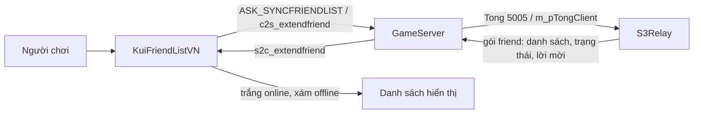

TÓM TẮT 1: [NGUỒN] [THẤY] Client có giao diện nhóm bạn, kẻ địch và danh sách đen; mỗi quan hệ giữ tên và trạng thái để hiển thị (C/vn/gameui/KuiFriendListVN.cpp:26-35,38-105).
TÓM TẮT 2: [NGUỒN] [THẤY] Mở danh sách gửi yêu cầu đồng bộ đầy đủ; GameServer định tuyến gói c2s_extendfriend sang Tong và đóng gói phản hồi về client (C/vn/gameui/KuiFriendListVN.cpp:253-281; S/MultiServer/GameServer/KSOServer.cpp:3608-3628).
TÓM TẮT 3: [NGUỒN] [THẤY] Giao thức có lời mời, đồng ý/từ chối, gom nhóm, xóa bạn, đồng bộ danh sách và thông báo trạng thái (C/gamecore/KTongProtocol.h:97-114,158-228).
TÓM TẮT 4: [TÀI LIỆU] [THẤY] SO-TAY-S3RELAY mô tả Tong 5005 là đường bạn bè và S3Relay là đầu mối chuyển tiếp; cổng hiệu lực vẫn [CHƯA KIỂM] (REF/SO-TAY-S3RELAY.md:1-5,93-112).
TÓM TẮT 5: [CHƯA KIỂM] Chưa chạy build, exe, VM, mạng; chưa xác minh cấu hình triển khai, giới hạn danh sách hoặc thông báo runtime.

# SO-28 — Sổ tay bạn bè, danh sách đen và trạng thái online

Loại: khảo sát
Chủ đề: Cách client hiển thị quan hệ, gửi yêu cầu qua GameServer–S3Relay và cập nhật trạng thái online/offline.
Từ khóa: bạn bè, friend, blacklist, danh sách đen, online, offline, Tong 5005, S3Relay, c2s_extendfriend
Trạng thái: DONE, khảo sát tĩnh theo phạm vi task; runtime chưa kiểm.
Độ phủ: đã phủ 6 trên 6 nhóm: giao diện, thêm/xóa, blacklist, online/offline, thông báo, đường gói.
Liên quan: SO-TAY-S3RELAY.md; K-01-ban-do-truyen-tin-hieu.md; A-01-ban-do-tien-trinh.md.
Cần tôi quyết định: không.

## Phạm vi và độ phủ

| Phần tử | Độ phủ | Bằng chứng |
|---|---|---|
| Hiển thị bạn/kẻ địch/danh sách đen | Đã phủ tĩnh | [THẤY] C/vn/gameui/KuiFriendListVN.cpp:26-35,368-399 |
| Thêm bạn và chống trùng trong giao diện | Đã phủ tĩnh | [THẤY] C/vn/gameui/KuiFriendListVN.cpp:108-144 |
| Xóa bạn | Đã phủ tĩnh | [THẤY] C/vn/gameui/KuiFriendListVN.cpp:605-614; C/gamecore/KProtocolProcess.cpp:4482-4486 |
| Thêm/xóa danh sách đen | Phủ một phần | [THẤY] hàm thêm cục bộ C/vn/gameui/KuiFriendListVN.cpp:146-155; [CHƯA KIỂM] luồng yêu cầu/lưu |
| Mời, đồng ý/từ chối | Đã phủ tĩnh | [THẤY] C/gamecore/KProtocolProcess.cpp:4375-4427 |
| Đồng bộ theo nhóm | Đã phủ tĩnh | [THẤY] C/gamecore/KProtocolProcess.cpp:4430-4462; C/gamecore/KTongProtocol.h:158-197 |
| Online/offline | Đã phủ tĩnh | [THẤY] C/gamecore/KTongProtocol.h:200-206; C/gamecore/KProtocolProcess.cpp:4464-4468; C/vn/gameui/KuiFriendListVN.cpp:402-440 |
| Thông báo cho người chơi | Đã phủ tĩnh | [THẤY] C/gamecore/KProtocolProcess.cpp:4382-4397,4402-4427 |
| Định tuyến GS ⇄ Tong/S3Relay | Đã phủ tĩnh | [THẤY] S/MultiServer/GameServer/KSOServer.cpp:3610-3628,1721-1765 |
| Cổng và tiến trình S3Relay thực tế | Chưa phủ | [CHƯA KIỂM] REF/SO-TAY-S3RELAY.md:93-112 |

## Giải mã tên

| Tên gốc | Mã hóa | Chữ đúng / nghĩa | Nguồn file:dòng |
|---|---|---|---|
| friend | ASCII | Bạn bè | C/gamecore/KTongProtocol.h:16 |
| blacklist | ASCII | Danh sách đen | C/gamecore/KTongProtocol.h:17 |
| killer | ASCII | Kẻ địch/người hạ gục | C/gamecore/KTongProtocol.h:18 |
| Tong | ASCII | Bang hội; tên dịch vụ quan hệ | C/gamecore/KTongProtocol.h:20-22; S/MultiServer/GameServer/KSOServer.cpp:3615-3622 |
| stateOffline, stateOnline | ASCII | Trạng thái offline/online | C/gamecore/KTongProtocol.h:200 |
| KuiFriendListVN | ASCII | Màn hình danh sách quan hệ bản Việt | C/vn/gameui/KuiFriendListVN.cpp:240-264 |
| S3Relay | ASCII | Dịch vụ chuyển tiếp | REF/SO-TAY-S3RELAY.md:1-5 |
| c2s_extendfriend, s2c_extendfriend | ASCII | Gói quan hệ client→server và server→client | S/MultiServer/GameServer/KSOServer.cpp:1739-1759,3610-3628 |

Không có tên kỹ năng, trang bị, NPC hoặc địa danh trong phạm vi. Chú thích Hán trong source hiển thị lỗi khi đọc UTF-8; không dùng chúng làm kết luận. Tên mã trong bảng là ASCII. Mã hóa tên nhân vật chưa được đo ở runtime.

## Sắp theo cấu trúc game

| Cấu trúc | Diễn giải | Bằng chứng |
|---|---|---|
| Quan hệ → Bạn bè | Danh sách bạn được đồng bộ theo nhóm; tên và trạng thái nằm trong m_brothers, hiển thị ở trang 2. | [THẤY] C/vn/gameui/KuiFriendListVN.cpp:33,44-64,368-377 |
| Quan hệ → Kẻ địch | Nhóm killer vào m_pks, hiển thị ở trang 3. | [THẤY] C/vn/gameui/KuiFriendListVN.cpp:86-105,378-387 |
| Quan hệ → Danh sách đen | Nhóm blacklist vào m_blackList, hiển thị ở trang 5. | [THẤY] C/vn/gameui/KuiFriendListVN.cpp:65-85,388-396 |
| Quan hệ → Trạng thái | Trạng thái 0/1 cập nhật theo tên; online dùng chữ trắng, offline dùng xám. | [THẤY] C/gamecore/KProtocolProcess.cpp:4464-4468; C/vn/gameui/KuiFriendListVN.cpp:198-237,402-411 |
| Thao tác → Thêm/xóa | Chấp nhận lời mời gọi AddFriend; nút xóa gọi GOI_CHAT_FRIEND_DELETE. | [THẤY] C/gamecore/KProtocolProcess.cpp:4409-4415; C/vn/gameui/KuiFriendListVN.cpp:605-614 |
| Mạng → Tong 5005 | GameServer chọn m_pTongClient cho c2s_extendfriend; relay trả gói về người chơi hợp lệ. | [THẤY] S/MultiServer/GameServer/KSOServer.cpp:1721-1765,3610-3628 |

## Thân báo cáo

### 1. Mở danh sách và tải dữ liệu

[THẤY] Khi mở cửa sổ, client tạo ASK_SYNCFRIENDLIST, đặt họ giao thức pf_friend, mã yêu cầu friend_c2s_asksyncfriendlist, bật cờ tải đầy đủ rồi gửi lên server. Kẻ địch và danh sách hiện tại được xóa trước khi nạp lại (C/vn/gameui/KuiFriendListVN.cpp:253-284). Đây là bằng chứng từ mã, chưa chứng minh máy chủ luôn trả đủ dữ liệu.

[THẤY] Gói trả về dùng specGroup, specRole, specOver. Client đọc tên nhóm, từng tên và byte trạng thái, rồi gọi AddList để phân loại (C/gamecore/KTongProtocol.h:158-166; C/gamecore/KProtocolProcess.cpp:4430-4462). Tên trong danh sách và trạng thái online là hai thông tin riêng: tên đến từ đồng bộ danh sách, trạng thái từ byte đi kèm hoặc gói cập nhật riêng.

### 2. Thêm, chấp nhận và xóa bạn

[THẤY] Lời mời đến thành thông báo hệ thống mang tên người mời và kiểu xác nhận. Khi phản hồi là đồng ý, client thêm người kia vào m_brothers và hiển thị thành công; từ chối chỉ hiển thị thông báo (C/gamecore/KProtocolProcess.cpp:4378-4427). AddFriend chống trùng tên (C/vn/gameui/KuiFriendListVN.cpp:108-144).

[THẤY] Nút xóa gọi GOI_CHAT_FRIEND_DELETE với tên đã chọn (C/vn/gameui/KuiFriendListVN.cpp:605-614). Giao thức định nghĩa ERASE_FRIEND và ERASE_FRIEND_SYNC chứa tên nhân vật (C/gamecore/KTongProtocol.h:169-177); client nhận gói rồi gọi EraseFriend (C/gamecore/KProtocolProcess.cpp:4482-4486). [CHƯA KIỂM] Chưa xác minh nhánh S3Relay ghi quan hệ xuống dữ liệu.

### 3. Danh sách đen và ảnh hưởng đến chat

[THẤY] Client có nhóm blacklist, hàm thêm cục bộ và trang hiển thị riêng (C/vn/gameui/KuiFriendListVN.cpp:65-85,146-155,388-396). GameServer nhận bản đồng bộ blacklist, gom tên rồi gọi SyncBlackList (S/MultiServer/GameServer/KSOServer.cpp:2763-2784).

[THẤY] Khi phát chat nhóm, GameServer bỏ qua người bị chặn trước khi gửi; với tin riêng, nếu người gửi nằm trong danh sách đen thì dừng (S/MultiServer/GameServer/KSOServer.cpp:2814-2833,2862-2876). [CHƯA KIỂM] Chưa khẳng định mọi loại thông báo khác cũng bị lọc như vậy.

[CHƯA KIỂM] Không xác minh được đường thao tác thêm blacklist tới nơi lưu. Phần nhận friend_c2s_groupfriend ở client đang bị comment (C/gamecore/KProtocolProcess.cpp:4487-4491); không suy từ đó rằng server không có một đường xử lý khác.

### 4. Online/offline và thông báo

[THẤY] Giao thức quy ước stateOffline=0, stateOnline=1; FRIEND_STATE có byte trạng thái và chuỗi tên (C/gamecore/KTongProtocol.h:200-206). Client lặp qua từng tên, gọi SyncState để cập nhật bạn bè, kẻ địch và blacklist (C/gamecore/KProtocolProcess.cpp:4464-4468; C/vn/gameui/KuiFriendListVN.cpp:198-237). Khi vẽ, online dùng chữ trắng, offline dùng xám (C/vn/gameui/KuiFriendListVN.cpp:402-440). Đây là quy ước trong source, không phải số đo thời gian thực.

[THẤY] Thông báo lời mời, đồng ý và từ chối dùng KSystemMessage, loại SMT_FRIEND và kiểu xác nhận tương ứng (C/gamecore/KProtocolProcess.cpp:4382-4397,4402-4427). [CHƯA KIỂM] Chưa kiểm văn bản bản dịch cuối cùng và tình huống người nhận offline.

### 5. Đường gói GS ⇄ S3Relay ⇄ client

[THẤY] GameServer phân loại gói relay; c2s_extendfriend được đưa tới m_pTongClient. Gói chỉ được gửi khi kết nối Tong, chỉ số người chơi và kích thước hợp lệ (S/MultiServer/GameServer/KSOServer.cpp:3608-3630). Chiều ngược lại, GameServer nhận dạng gói relay passtosomeone/passtobevy, đóng gói thành s2c_extendfriend và gửi cho một hay nhiều người hợp lệ (S/MultiServer/GameServer/KSOServer.cpp:1721-1765).

[TÀI LIỆU] SO-TAY-S3RELAY đối chiếu rằng Tong 5005 phụ trách bạn bè và bang hội, còn S3Relay là đầu mối chuyển tiếp; tài liệu cũng nói cổng và tiến trình thực tế chưa được kiểm (REF/SO-TAY-S3RELAY.md:1-5,93-112). Sơ đồ mô tả luồng trong source/tài liệu, không xác nhận hệ thống đang chạy.

## Mục sổ thông số

| Nhóm | Tên/hằng số | file:dòng | Giá trị | Đơn vị | Ảnh hưởng | Đổi an toàn | Nguồn đo |
|---|---|---|---:|---|---|---|---|
| Giao thức | stateOffline, stateOnline | C/gamecore/KTongProtocol.h:200 | 0, 1 | mã trạng thái | Trạng thái hiển thị | KHÔNG | đọc tĩnh |
| Giao thức | defTONG_PROTOCOL_SERVER_NUM | C/gamecore/KTongProtocol.h:13 | 255 | số mục compile-time | Kích thước bảng protocol | KHÔNG | đọc tĩnh |
| Kết nối | Tong | S/MultiServer/GameServer/KSOServer.cpp:308,3615-3622 | 5005 | cổng mặc định trong mã | Đường bạn bè/bang | CẨN THẬN | đọc tĩnh; chưa đo runtime |
| Gói | ASK_SYNCFRIENDLIST.full | C/vn/gameui/KuiFriendListVN.cpp:273-279 | true | cờ | Yêu cầu nạp đầy đủ | KHÔNG | đọc tĩnh |

## Đã xác minh / Chưa xác minh

### Đã xác minh

- [THẤY] Phân loại giao diện và trạng thái: C/vn/gameui/KuiFriendListVN.cpp:26-105,198-237,368-440.
- [THẤY] Gói đồng bộ và cấu trúc friend: C/vn/gameui/KuiFriendListVN.cpp:266-281; C/gamecore/KTongProtocol.h:97-114,158-228.
- [THẤY] Nhận lời mời, đồng ý/từ chối, trạng thái và xóa: C/gamecore/KProtocolProcess.cpp:4368-4491.
- [THẤY] GameServer định tuyến Tong và phát gói về client: S/MultiServer/GameServer/KSOServer.cpp:1721-1765,3608-3630.
- [THẤY] Lọc blacklist cho chat nhóm/tin riêng: S/MultiServer/GameServer/KSOServer.cpp:2763-2784,2814-2833,2862-2876.
- [TÀI LIỆU] Vai trò S3Relay/Tong 5005: REF/SO-TAY-S3RELAY.md:1-5,93-112.

### Chưa xác minh

- [CHƯA KIỂM] Cấu hình/cổng hiệu lực; không chạy exe, build, VM hoặc mạng.
- [CHƯA KIỂM] S3Relay có lưu quan hệ, blacklist, lời mời chờ hay phát lại lúc đăng nhập.
- [CHƯA KIỂM] Giới hạn số bạn, số mục blacklist, độ trễ và mất gói.
- [CHƯA KIỂM] Mọi thông báo ngoài tin riêng/kênh chat có bị blacklist lọc hay không.
- [CHƯA KIỂM] Bản dịch UTF-8/GBK cuối cùng của chuỗi hiển thị.

## Phát hiện khi khảo sát

[THẤY] Trong EraseFriend, nhánh duyệt blacklist tìm thấy tên rồi gọi m_pks.erase(it), thay vì xóa từ m_blackList (C/vn/gameui/KuiFriendListVN.cpp:185-196). Đây là điểm cần kiểm thử/review trong một task sửa lỗi riêng; SO-28 không sửa source.

[CHƯA KIỂM] Một số khai báo blacklist trong header bị comment (C/gamecore/KTongProtocol.h:179-182,230-234), trong khi GameServer có nhánh friend_s2c_syncblacklist (S/MultiServer/GameServer/KSOServer.cpp:2763-2784). Chưa đủ bằng chứng để chọn một đường làm hành vi runtime.

## Bàn giao

- Đầu ra khảo sát: JX1_OPS/DESIGN/SO-TAY-BAN-BE-ONLINE.md.
- Không build, chạy exe, VM hoặc mạng; không sửa mã nguồn.
- Đề xuất mục lục tri thức: “Bạn bè, blacklist, online/offline — SO-28 — khảo sát tĩnh”.
- Không commit theo yêu cầu task; PM gộp mục lục và quyết định task riêng cho điểm bất thường.

Nguồn: C = C:/Jx1CocoV3/Folder/Client2912-20260116T044348Z-3-001/Client2912/Client/Classes; S = C:/Jx1CocoV3/SwordOnline/SwordOnline/jxOnline/gameserver/Sources; REF = D:/jx1-ops-wt/JX1_OPS/DESIGN.

Kỹ năng đã dùng: jx1-retrofit, jx1-read-server, jx1-read-client, jx1-parameters, jx1-knowledge, jx1-report
