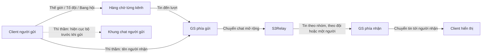

**TÓM TẮT 5 DÒNG**
1. **[THẤY]** Client có kênh Thế giới, Tổ đội, Bang hội và Thì thầm; người nhận tùy kênh và có thể là một người. (`CL/gameui/Kuiplayerfun.cpp:808`, `:922`, `:979`, `:1036`)
2. **[THẤY]** Client gửi tới máy chủ game (GS); GS chuyển chat mở rộng tới S3Relay, nhận tin trả về rồi chuyển cho client người nhận. (`CL/gamecore/CoreShell.cpp:104–107`; `GS/MultiServer/GameServer/KSOServer.cpp:3613–3619`, `:3683–3688`, `:1553–1556`, `:2790–2833`, `:2848–2876`)
3. **[THẤY]** Ô nhập đặt mức 256; lúc gửi, client tính số byte và xử lý ký tự điều khiển. Giới hạn nhập và trường độ dài của gói tin là hai chuyện khác nhau. (`CL/gamescene/KgameWorld.cpp:1620`, `:3735–3737`, `:3826`; `CL/gamecore/KProtocol.h:2439–2452`)
4. **[THẤY]** Tin gửi vào kênh có hàng chờ theo cấu hình từng kênh, tối đa 10 tin chờ; Thì thầm đi thẳng từ nút gửi sang hàm gửi riêng. (`CL/gameui/Kuiplayerfun.cpp:224–232`, `:2920–2942`; `CL/gamescene/KgameWorld.cpp:3883–3931`)
5. **[CHƯA KIỂM]** Chỉ đọc mã và tài liệu: chưa build, chạy exe, VM hay kết nối mạng; chưa đo tốc độ gửi, độ dài thực nhận hoặc bộ lọc từ cấm của Relay. (`JX1_OPS/TASKS/SO-22.md:26–29`)

# SO-22 — Sổ tay hiểu game: kênh chat và tin nhắn

Loại: khảo sát  
Chủ đề: Người chơi gửi cho ai, tin đi qua đâu và các lớp kiểm tra trước khi hiển thị.  
Từ khóa: Thế giới, Tổ đội, Bang hội, Thì thầm, S3Relay, c2s_extendchat, SendMsgInterval  
Trạng thái: DONE — hoàn tất khảo sát tĩnh theo hai cây nguồn đã duyệt.  
Độ phủ: 7/7 hạng mục trong bảng dưới; phạm vi phụ thuộc bản chạy ghi ở mục Chưa kiểm.  
Liên quan: [Truyền tải và exe server](TRUYEN-TAI-VA-EXE-SERVER.md), [Báo cáo SO-22](../REPORTS/SO-22.md).  
Cần tôi quyết định: không.

## Phạm vi và độ phủ

**Cách đọc:** `[THẤY]` = đối chiếu mã hiện tại; `[TÀI LIỆU]` = đối chiếu tài liệu có sẵn; `[CHƯA KIỂM]` = chưa đủ bằng chứng hoặc chưa thử. `CL/` là đường dẫn tương đối dưới cây `Client2912/Client/Classes` trong task; `GS/` là đường dẫn tương đối dưới cây `jxOnline/gameserver/Sources`. Hai nguồn đầy đủ được ghi tại `JX1_OPS/TASKS/SO-22.md:24`. Tài liệu này là UTF-8; tên mã gốc trong bảng là ASCII. Chỉ dẫn các đoạn đã đọc, không lấy chữ lỗi trong comment cũ để diễn giải.

| Hạng mục | Độ phủ | Bằng chứng chính |
|---|---|---|
| Thế giới | Đã phủ giao diện và đường nhận ở GS | **[THẤY]** `CL/gameui/Kuiplayerfun.cpp:808`; `GS/MultiServer/GameServer/KSOServer.cpp:1697–1699`, `:2799–2833` |
| Tổ đội | Đã phủ giao diện và nhánh phát cho đội | **[THẤY]** `CL/gameui/Kuiplayerfun.cpp:922`; `GS/MultiServer/GameServer/KSOServer.cpp:1664–1694`; `GS/Core/Src/CoreServerShell.cpp:2782–2812` |
| Bang hội | Đã phủ giao diện và đường nhận theo danh sách | **[THẤY]** `CL/gameui/Kuiplayerfun.cpp:1036`; `GS/MultiServer/GameServer/KSOServer.cpp:1697–1699`, `:2814–2833` |
| Thì thầm | Đã phủ việc nhập tên, gửi và nhận | **[THẤY]** `CL/gamescene/KgameWorld.cpp:3060–3099`, `:3931–3939`; `GS/MultiServer/GameServer/KSOServer.cpp:2848–2876` |
| Độ dài và ký tự | Đã phủ giới hạn nhập, độ dài gói, xử lý ký tự và kiểm tra của đường cũ | **[THẤY]** `CL/gamescene/KgameWorld.cpp:1620`, `:3735–3737`, `:13117–13127`; `CL/gamecore/KProtocol.h:2439–2452`; `GS/Core/Src/KPlayerChat.cpp:423–438` |
| Gửi và nhận qua Relay | Đã phủ hai đầu GS và chỗ client hiển thị | **[THẤY]** `GS/MultiServer/GameServer/KSOServer.cpp:1553–1556`, `:3592–3688`; `CL/gamecore/KProtocolProcess.cpp:4292–4312` |
| Tần suất | Đã phủ hàng chờ client, nhánh Thì thầm và bộ đếm của đường cũ | **[THẤY]** `CL/gameui/Kuiplayerfun.cpp:224–232`, `:2920–3021`; `CL/gamescene/KgameWorld.cpp:3931`; `GS/Core/Src/KPlayerChat.h:21` |

## Giải mã tên

| Tên gốc | Mã hóa | Chữ đúng (UTF-8) | Nguồn file:dòng |
|---|---|---|---|
| `CH_WORLD` | ASCII, mã kênh | Thế giới | **[THẤY]** `CL/gameui/Kuiplayerfun.cpp:360`, `:808` |
| `CH_TEAM` | ASCII, mã kênh | Tổ đội | **[THẤY]** `CL/gameui/Kuiplayerfun.cpp:373`, `:922` |
| `CH_TONG` | ASCII, mã kênh | Bang hội | **[THẤY]** `CL/gameui/Kuiplayerfun.cpp:399`, `:1036` |
| `CH_JABBER` | ASCII, mã kênh | Thì thầm (mật, chat riêng) | **[THẤY]** `CL/gameui/Kuiplayerfun.cpp:386`, `:979`; `CL/gamescene/KgameWorld.cpp:3931` |
| `S3Relay` | ASCII, tên thành phần | Trạm chuyển tiếp chat | **[TÀI LIỆU]** `JX1_OPS/DESIGN/TRUYEN-TAI-VA-EXE-SERVER.md:33` |

## Sắp theo cấu trúc game: từ kênh chung đến tin riêng

| Kênh | Người nhận và cách chuyển tin |
|---|---|
| **Thế giới** | **[THẤY]** Client chọn `CH_WORLD`. Ở đầu nhận, GS có nhánh `chat_groupman` dùng chung cho Thế giới, Thành thị và Bang hội: chuyển tin đến danh sách người nhận đi kèm, bỏ qua người đã chặn người gửi. `CL/gameui/Kuiplayerfun.cpp:808`; `GS/MultiServer/GameServer/KSOServer.cpp:1697–1699`, `:2799–2833`. |
| **Tổ đội** | **[THẤY]** Client chọn `CH_TEAM`. Khi nhận `chat_relegate` với đích là đội, GS tìm đội theo mã và gửi cho đội trưởng cùng các thành viên hợp lệ, có kiểm tra danh sách chặn. Đội trưởng và thành viên dùng hai lệnh gửi khác nhau trong mã. `CL/gameui/Kuiplayerfun.cpp:922`; `GS/MultiServer/GameServer/KSOServer.cpp:1664–1694`; `GS/Core/Src/CoreServerShell.cpp:2782–2812`. |
| **Bang hội** | **[THẤY]** Client chọn `CH_TONG`; đầu nhận ở GS ghi nhận Bang hội trong nhánh `chat_groupman`. Lõi GS còn có nhánh lọc theo mã bang, nhưng bộ chuyển `chat_relegate` đã đọc không liệt kê đích bang, nên không dùng nhánh lõi đó để giải thích đường đang lần. `CL/gameui/Kuiplayerfun.cpp:1036`; `GS/MultiServer/GameServer/KSOServer.cpp:1670–1683`, `:1697–1699`; `GS/Core/Src/CoreServerShell.cpp:2849–2866`. |
| **Thì thầm** | **[THẤY]** Ô nhập dùng dạng `/Tên: nội dung`. Client gửi tên đích trong tin riêng; GS phía nhận kiểm tra đúng nhân vật và danh sách chặn trước khi chuyển. Client người gửi tự hiện tin trước khi gọi gửi gói, nên thấy dòng tin của mình chưa chứng minh người bên kia đã nhận. `CL/gamescene/KgameWorld.cpp:3745–3769`, `:3931–3939`, `:3087–3124`; `GS/MultiServer/GameServer/KSOServer.cpp:2848–2876`. |

## Tin đi qua đâu

- **[THẤY]** Với tin theo kênh, client tra mã kênh đã mở rồi lấy tin đến lượt từ hàng chờ. Cả tin theo kênh và tin riêng đều đi bằng gói chat mở rộng (`c2s_extendchat`); client gửi gói này tới GS qua kết nối game. `CL/gamecore/KProtocolProcess.cpp:4282–4286`; `CL/gamescene/KgameWorld.cpp:13250–13255`, `:3861–3872`, `:5483–5486`, `:5514–5517`, `:3012–3053`, `:3060–3074`, `:3123–3124`; `CL/gamecore/CoreShell.cpp:104–107`.
- **[THẤY]** GS chuyển gói qua kết nối chat (`m_pChatClient`), kèm thông tin nhận diện người gửi. Với tin kênh có mã kênh khác 0, GS gọi `PayForSpeech`: kiểm tra điều kiện như bị cấm chat hoặc đang ủy thác và, tùy loại phí, kiểm cấp hoặc trừ tài nguyên trước khi chuyển. Đây là kiểm tra quyền nói và chi phí. `GS/MultiServer/GameServer/KSOServer.cpp:3613–3619`, `:3634–3656`, `:3683–3688`; `GS/Core/Src/CoreServerShell.cpp:3733–3816`.
- **[THẤY]** GS phía nhận lấy gói trả về trên kết nối chat, chọn cách phát theo gói, rồi chuyển tới client. Client tách tin kênh và tin riêng từ `s2c_extendchat` để đưa vào đúng chỗ hiển thị. `GS/MultiServer/GameServer/KSOServer.cpp:1553–1556`, `:1664–1705`, `:2803–2833`, `:2869–2876`; `CL/gamecore/KProtocolProcess.cpp:204`, `:4292–4312`; `CL/gamescene/KgameWorld.cpp:13172–13184`, `:13210–13215`.
- **[TÀI LIỆU]** Bản đồ truyền tải xác định S3Relay phục vụ chat và liên lạc xã hội; sơ đồ ở trên mô tả đường của chat mở rộng. `JX1_OPS/DESIGN/TRUYEN-TAI-VA-EXE-SERVER.md:5`, `:33`, `:77`.

## Độ dài, ký tự và tần suất

- **[THẤY]** Ô nhập đặt `setMaxLength(256)`. Khi gửi, `strlen` đo số byte; `sentlen` trong gói tin thường và tin riêng là một byte (biểu diễn 0–255). Hai con số thuộc hai lớp khác nhau, nên chưa thể gọi một trong hai là số chữ tiếng Việt tối đa người nhận đọc được. `CL/gamescene/KgameWorld.cpp:1620`, `:3735–3737`, `:3044–3046`, `:3894–3899`, `:3098–3099`; `CL/gamecore/KProtocol.h:2439–2452`.
- **[THẤY]** Client gọi `TEncodeText` trước khi gửi: chuẩn hóa xuống dòng, xử lý dấu `<` như dấu mở mã định dạng và bỏ một số byte điều khiển. Hai nhánh biên dịch xử lý byte cao khác nhau (hai byte với `WIN32`, ba byte ở nhánh còn lại); không xem đây là bộ kiểm tra UTF-8 đầy đủ. Khi nhận tin kênh, client gỡ thêm mã xuống dòng, màu, viền và ảnh nhúng trước khi hiển thị. `CL/gamescene/KgameWorld.cpp:3826`, `:3894–3899`, `:13117–13127`, `:13172–13184`; `CL/engine/Text.cpp:610–727`.
- **[THẤY]** Tin vào kênh được xếp hàng riêng theo kênh. Client đọc `SendMsgInterval` (mili giây) và `SendMsgNum` từ `UiPlayerFunVN.ini`; số chỗ chờ sau xử lý nằm trong khoảng 1–10. Mã chỉ lấy tin đã tới thời điểm gửi; giao diện có nhánh báo phải chờ hoặc không xếp được. Ở đường nút gửi đã đọc, Thì thầm gọi hàm gửi riêng, không qua hàng này. `CL/gameui/Kuiplayerfun.cpp:169–181`, `:224–232`, `:2920–2986`; `CL/gameui/Kuiplayerfun.h:71–72`; `CL/gamescene/KgameWorld.cpp:3129–3169`, `:3931`.
- **[THẤY]** GS còn có đường chat cũ (`c2s_playersendchat`) với kiểm tra độ dài câu, phần đầu tin và kích thước khai báo. Một số nhánh so bộ đếm với `CHAT_SPEED = 20`; bộ đếm tăng mỗi lần gọi `TimerAdd`. Ngưỡng này thuộc đường cũ, không phải 20 giây hay giới hạn của chat qua Relay. `GS/Core/Src/KProtocolProcess.cpp:232`, `:5682–5684`; `GS/Core/Src/KPlayer.cpp:343`, `:5390–5392`; `GS/Core/Src/KPlayerChat.cpp:423–451`, `:587–622`, `:1540–1542`; `GS/Core/Src/KPlayerChat.h:21`.

## Chưa kiểm

- **[CHƯA KIỂM]** Luật chọn danh sách của Relay: “Thế giới” phủ tới cụm nào, điều kiện liên GS của từng kênh, và tình huống người nhận Thì thầm ngoại tuyến. Nguồn trong phạm vi chỉ cho thấy GS chuyển đi và xử lý gói trả về. `GS/MultiServer/GameServer/KSOServer.cpp:1664–1705`, `:2790–2876`, `:3683–3688`.
- **[CHƯA KIỂM]** Client đặt cờ `filter` khi đóng gói tin kênh; chưa có bằng chứng Relay thực thi bộ lọc từ cấm nào hoặc có giới hạn tốc độ/độ dài riêng. Chưa đối chiếu giá trị cụ thể của các ngưỡng độ dài ở header ngoài cây GS được giao. `CL/gamescene/KgameWorld.cpp:3023–3027`; `GS/MultiServer/GameServer/KSOServer.cpp:3634–3688`; `GS/Core/Src/KPlayerChat.cpp:30–32`, `:423–438`.
- **[CHƯA KIỂM]** Giá trị `SendMsgInterval`, `SendMsgNum` và mức phí từng kênh ở bản cài; độ dài thực nhận với chữ có dấu hoặc biểu tượng; độ trễ, trạng thái gửi và tốc độ thực tế. Không suy từ cấu hình mặc định hay từ thông báo hiện cục bộ. `CL/gameui/Kuiplayerfun.cpp:169–181`, `:224–232`; `CL/gamecore/KProtocolProcess.cpp:4282–4286`; `CL/gamescene/KgameWorld.cpp:3114–3124`, `:3894–3899`.
