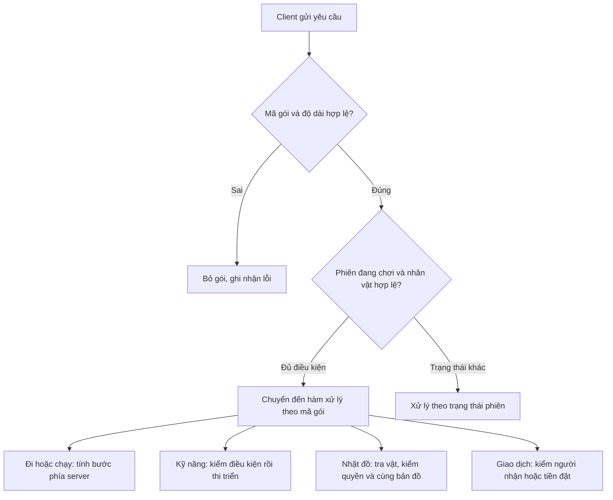

TÓM TẮT 1/5 [NGUỒN] [THẤY] Server kiểm mã gói, độ dài và trạng thái phiên trước khi chuyển gói thao tác vào game. `GS/Core/Src/CoreServerShell.cpp:2254`, `GS/MultiServer/GameServer/KSOServer.cpp:3730`, `GS/MultiServer/GameServer/KSOServer.cpp:3744`.
TÓM TẮT 2/5 [NGUỒN] [THẤY] Client gửi đích đi hoặc chạy. Server lấy tốc độ từ nhân vật và tính từng bước. `GS/Core/Src/KProtocolProcess.cpp:5436`, `GS/Core/Src/KNpc.cpp:3521`, `GS/Core/Src/KNpc.cpp:6347`.
TÓM TẮT 3/5 [NGUỒN] [THẤY] Server kiểm kỹ năng đã học, thời gian hồi và điều kiện thi triển. Phép so tầm nhắm mục tiêu trong một hàm chỉ biên dịch ở client. `GS/Core/Src/KNpc.cpp:1320`, `GS/Core/Src/KNpc.cpp:3673`, `GS/Core/Src/KSkills.cpp:339`.
TÓM TẮT 4/5 [NGUỒN] [THẤY] Nhặt đồ có kiểm ID, quyền nhặt và cùng bản đồ. Điều kiện cự ly trong hàm nhặt nằm trong chú thích. `GS/Core/Src/KPlayer.cpp:5667`, `GS/Core/Src/KPlayer.cpp:5671`, `GS/Core/Src/KPlayer.cpp:5735`, `GS/Core/Src/KPlayer.cpp:5754`.
TÓM TẮT 5/5 [CHƯA KIỂM] Chỉ đọc mã nguồn. Chưa build, chạy test game, exe, VM hay kết nối mạng. Phiên bản và hành vi khi chạy chưa được xác minh.

# SO-33 — Sổ tay kiểm tra gói tin và chống gian lận ở server

Loại: khảo sát\
Chủ đề: Server kiểm gì khi client yêu cầu đi, chạy, dùng kỹ năng, nhặt đồ hoặc giao dịch.\
Từ khóa: gói tin, chống gian lận, gs001, đi bộ, chạy, c2s_npcskill, nhặt đồ, giao dịch, CheckProtocolSize.\
Trạng thái: DONE — đã đối chiếu tĩnh các nhóm thao tác đã chọn.\
Độ phủ: 5/5 nhóm khảo sát bên dưới, gồm cửa nhận chung và bốn nhóm thao tác. Tổng số gói của game ngoài mẫu chưa đếm.\
Liên quan: [K-01](../REPORTS/K-01-ban-do-truyen-tin-hieu.md), [chuẩn báo cáo](CHUAN-BAO-CAO.md), [SO-33](../REPORTS/SO-33.md).\
Cần tôi quyết định: không.

## Phạm vi và độ phủ

| Nhóm | Độ phủ | Điều đã đối chiếu |
|---|---|---|
| Cửa nhận chung | Đã phủ | [THẤY] Mã gói, độ dài, chỉ mục theo kết nối, trạng thái phiên và chọn hàm xử lý. `GS/MultiServer/GameServer/KSOServer.cpp:3721`, `GS/MultiServer/GameServer/KSOServer.cpp:3730`, `GS/Core/Src/KProtocolProcess.cpp:349`. |
| Di chuyển | Đã phủ | [THẤY] Đi và chạy thường, từ đích client gửi đến bước server tính. `CL/gamecore/KProtocol.cpp:186`, `CL/gamecore/KProtocol.cpp:214`, `GS/Core/Src/KNpc.cpp:6333`. |
| Chiến đấu | Đã phủ | [THẤY] Yêu cầu dùng kỹ năng thường, từ nhận mục tiêu đến kiểm điều kiện thi triển. `GS/Core/Src/KProtocolProcess.cpp:5581`, `GS/Core/Src/KNpc.cpp:3609`. |
| Nhặt đồ và tiền rơi | Đã phủ | [THẤY] Tra vật, quyền nhặt, bản đồ, khoảng cách và các nhánh nhận vật/tiền. `GS/Core/Src/KPlayer.cpp:5662`, `GS/Core/Src/KPlayer.cpp:5734`, `GS/Core/Src/KPlayer.cpp:5811`. |
| Giao dịch giữa người chơi | Đã phủ | [THẤY] Mẫu mở lời mời và đặt tiền. `GS/Core/Src/KPlayer.cpp:6605`, `GS/Core/Src/KPlayer.cpp:6640`. |
| Nhánh ngoài mẫu | Chưa phủ | [CHƯA KIỂM] Nhảy, kỹ năng đặc biệt, sát thương từng kỹ năng, cửa hàng, hoàn tất giao dịch và các gói khác. Bảng đăng ký còn các loại khác tại `GS/Core/Src/KProtocolProcess.cpp:208`, `GS/Core/Src/KProtocolProcess.cpp:237`, `GS/Core/Src/KProtocolProcess.cpp:255`. |

## Giải mã tên

Sổ tay dùng tên nhóm thao tác và định danh mã nguồn. Không có tên riêng của kỹ năng, trang bị, quái, NPC hay bản đồ cần giải mã.

| Tên gốc | Mã hóa | Chữ đúng | Nguồn file:dòng |
|---|---|---|---|
| `c2s_npcwalk`, `c2s_npcrun` | ASCII | Đi bộ, chạy | `GS/Core/Src/KProtocolProcess.cpp:213`, `GS/Core/Src/KProtocolProcess.cpp:214` |
| `c2s_npcskill` | ASCII | Dùng kỹ năng | `GS/Core/Src/KProtocolProcess.cpp:215` |
| `c2s_playerpickupitem` | ASCII | Nhặt đồ hoặc tiền rơi | `GS/Core/Src/KProtocolProcess.cpp:236`, `GS/Core/Src/KPlayer.cpp:5889` |
| `c2s_tradeapplystart`, `c2s_trademovemoney` | ASCII | Mời giao dịch, đặt tiền giao dịch | `GS/Core/Src/KProtocolProcess.cpp:253`, `GS/Core/Src/KProtocolProcess.cpp:254` |

## Sắp theo cấu trúc game

Cửa nhận chung → di chuyển → chiến đấu → nhặt đồ và tiền rơi → giao dịch. Phần chiến đấu khảo sát quy tắc dùng chung trước khi phân theo kỹ năng, nên không có dữ liệu theo phái, nhánh hay cấp học.

Các dẫn chứng có tiền tố `GS/` trỏ vào `C:/Jx1CocoV3/SwordOnline/SwordOnline/jxOnline/gameserver/Sources`. Tiền tố `CL/` trỏ vào `C:/Jx1CocoV3/Folder/Client2912-20260116T044348Z-3-001/Client2912/Client/Classes` (bản cây nguồn Client2912). Tài liệu dùng UTF-8 không BOM. Dẫn chứng dựa trên câu lệnh và định danh ASCII trong mã, không dùng các chú thích cũ có chữ hiển thị lỗi.

- **[THẤY]** Đã đọc câu lệnh tại đúng cây nguồn của task.
- **[TÀI LIỆU]** Ghi nhận từ báo cáo liên quan, giữ theo phạm vi nguồn của báo cáo đó.
- **[CHƯA KIỂM]** Chưa có đủ căn cứ tĩnh hoặc chưa chạy game để xác nhận.

### Cửa nhận chung

- **[THẤY] Mã và độ dài.** Server nhận dữ liệu có kích thước khác 0 từ vòng đọc kết nối. Hàm kiểm tra so mã với dải dành cho gói gửi vào game server rồi so kích thước thực với kích thước mong đợi. Đi, chạy, dùng kỹ năng, nhặt đồ và hai thao tác giao dịch trong mẫu có cỡ cố định theo bảng. Gói trượt kiểm tra làm tăng bộ đếm lỗi và có nhánh yêu cầu ngắt kết nối khi đạt ngưỡng. `GS/MultiServer/GameServer/KSOServer.cpp:1598`, `GS/Core/Src/CoreServerShell.cpp:2254`, `GS/Core/Src/CoreServerShell.cpp:2274`, `GS/Core/Src/KProtocol.cpp:182`, `GS/Core/Src/KProtocol.cpp:205`, `GS/Core/Src/KProtocol.cpp:222`, `GS/MultiServer/GameServer/KSOServer.cpp:3729`.
- **[THẤY] Phiên và nhân vật.** Server lấy chỉ mục người chơi từ trạng thái kết nối. Các gói thao tác thường đi tiếp ở trạng thái đang chơi. Lớp người chơi còn xét có kết nối, có ID và chưa chuyển server. Sau đó bảng mã gói gọi đúng hàm nếu có đăng ký. Câu kiểm tra biên tại `KPlayerSet` dùng hai điều kiện loại trừ nhau, nên riêng câu đó không xác nhận được chỉ mục hợp lệ. Nguồn của chỉ mục vẫn là trạng thái do server giữ. `GS/MultiServer/GameServer/KSOServer.cpp:3721`, `GS/MultiServer/GameServer/KSOServer.cpp:3744`, `GS/MultiServer/GameServer/KSOServer.cpp:3761`, `GS/Core/Src/CoreServerShell.cpp:521`, `GS/Core/Src/KPlayerSet.cpp:1258`, `GS/Core/Src/KProtocolProcess.cpp:349`.
- **[THẤY] Nhịp đọc gói.** Vòng nhận có ngưỡng số lần đọc theo người chơi nếu cấu hình đặt số dương. Bộ đếm tăng sau mỗi gói có dữ liệu. Đây là giới hạn trong một lượt đọc. Ở hai hàm nhận đi và chạy chưa thấy bộ đếm tần suất riêng cho loại thao tác. `GS/MultiServer/GameServer/KSOServer.cpp:743`, `GS/MultiServer/GameServer/KSOServer.cpp:1591`, `GS/Core/Src/KProtocolProcess.cpp:5436`, `GS/Core/Src/KProtocolProcess.cpp:5452`.

### Di chuyển

- **[THẤY] Lệnh đến.** Client gửi đích đi hoặc chạy. Ở nhánh di chuyển từ thao tác chỉ hướng, client dùng bộ đếm để chờ đủ lượt trước khi gửi. Hai hàm nhận của server đưa tọa độ âm về 0 rồi ghi lệnh cho nhân vật theo phiên. Trong chính hai hàm này chưa thấy phép so đích với vị trí hiện tại để từ chối yêu cầu quá xa. `CL/gamecore/KProtocol.cpp:186`, `CL/gamecore/KProtocol.cpp:214`, `CL/gamecore/CoreShell.cpp:5034`, `CL/gamecore/CoreShell.cpp:5093`, `CL/gamecore/CoreShell.cpp:5103`, `GS/Core/Src/KProtocolProcess.cpp:5436`, `GS/Core/Src/KProtocolProcess.cpp:5452`.
- **[THẤY] Bước di chuyển.** Lệnh ghi đè ô lệnh hiện tại và được xử lý trong lượt cập nhật nhân vật. Đi hoặc chạy đặt đích. Lúc tiến bước, server lấy tốc độ hiện tại của nhân vật. Hết thể lực thì nhánh chạy dùng tốc độ đi. Hàm tính bước giới hạn tốc độ theo bề rộng ô bản đồ, gọi tìm đường và hoàn tác bước nếu rơi khỏi vùng hợp lệ. Kiểm chướng ngại có nhánh theo trạng thái tìm đường, nên độ phủ va chạm còn tùy nhánh. `GS/Core/Src/KNpc.cpp:6604`, `GS/Core/Src/KNpc.cpp:1000`, `GS/Core/Src/KNpc.cpp:1311`, `GS/Core/Src/KNpc.cpp:4232`, `GS/Core/Src/KNpc.cpp:4281`, `GS/Core/Src/KNpc.cpp:3521`, `GS/Core/Src/KNpc.cpp:3543`, `GS/Core/Src/KNpc.cpp:6342`, `GS/Core/Src/KNpc.cpp:6363`, `GS/Core/Src/KNpc.cpp:6445`, `GS/Core/Src/KNpcFindPath.cpp:102`, `GS/Core/Src/KNpcFindPath.cpp:113`.
- **[TÀI LIỆU]** K-01 mô tả cơ chế hàng lệnh và nhịp mô phỏng trên cây nguồn khác. Mẫu tại đường dẫn của SO-33 ghi vào `m_Command`. Các số nhịp trong K-01 giữ nguyên phạm vi nguồn cũ. `JX1_OPS/REPORTS/K-01-ban-do-truyen-tin-hieu.md:25`, `JX1_OPS/REPORTS/K-01-ban-do-truyen-tin-hieu.md:130`, `JX1_OPS/REPORTS/K-01-ban-do-truyen-tin-hieu.md:131`, `GS/Core/Src/KNpc.cpp:6604`.

### Chiến đấu

- **[THẤY] ID và loại mục tiêu.** Yêu cầu mang mã kỹ năng và thông tin mục tiêu. Server kiểm dải mã kỹ năng. Với mục tiêu là nhân vật, server tra ID ở vùng hiện tại và tối đa tám vùng liền kề, sau đó hàm kiểm thi triển xét quan hệ với mục tiêu theo loại kỹ năng. Khi xử lý lệnh, server tìm kỹ năng trong danh sách của chính nhân vật. `CL/gamecore/KProtocol.cpp:237`, `GS/Core/Src/KProtocolProcess.cpp:5581`, `GS/Core/Src/KPlayer.cpp:2425`, `GS/Core/Src/KNpc.cpp:1320`, `GS/Core/Src/KSkills.cpp:235`.
- **[THẤY] Trạng thái, hồi chiêu và tài nguyên.** Hàm thi triển trả về nếu đang tung chiêu, đang chịu đòn hoặc nhân vật người chơi chưa ở chế độ chiến đấu. Mã kiểm cấp kỹ năng và mốc hồi theo đồng hồ thế giới, có mốc riêng cho nhánh cưỡi ngựa. Một số kỹ năng xét vũ khí và trạng thái cưỡi theo thuộc tính của chiêu. Chi phí dùng tài nguyên hiện tại của nhân vật, có ngoại lệ theo cờ của bản đồ. `GS/Core/Src/KNpc.cpp:3615`, `GS/Core/Src/KNpc.cpp:3620`, `GS/Core/Src/KNpc.cpp:3647`, `GS/Core/Src/KNpc.cpp:3681`, `GS/Core/Src/KSkillList.cpp:884`, `GS/Core/Src/KSkills.cpp:284`, `GS/Core/Src/KSkills.cpp:318`, `GS/Core/Src/KNpc.cpp:6711`, `GS/Core/Src/KNpc.cpp:6773`.
- **[THẤY] Cự ly.** Tra mục tiêu theo vùng là bộ lọc vị trí thô. Lúc chuẩn bị đồng bộ thi triển trên mục tiêu, server còn kiểm mục tiêu cùng thế giới. Phép so cự ly với bán kính tấn công của kỹ năng chỉ nhắm mục tiêu nằm trong nhánh biên dịch client ở `CanCastSkill`. Các nhánh sinh đòn và tính trúng đòn cần đối chiếu riêng để xác định tầm tác dụng cuối cùng. `GS/Core/Src/KPlayer.cpp:2425`, `GS/Core/Src/KNpc.cpp:3707`, `GS/Core/Src/KSkills.cpp:339`, `GS/Core/Src/KSkills.cpp:1024`.

### Nhặt đồ và tiền rơi

- **[THẤY] ID, trạng thái và quyền.** Server chặn nhặt trong lúc giao dịch. Tiếp đó server tra ID vật rơi, xét quyền của người nhặt theo chủ vật và tổ đội, rồi loại vật bị hệ thống cấm nhặt. Nhánh thêm vật vào túi kiểm chỗ trống và dùng ô do server tìm. Tiền được lấy theo giá trị trên vật rơi mà server quản lý. `CL/gamecore/KPlayer.cpp:2170`, `GS/Core/Src/KProtocolProcess.cpp:5713`, `GS/Core/Src/KPlayer.cpp:5667`, `GS/Core/Src/KPlayer.cpp:5671`, `GS/Core/Src/KPlayer.cpp:5691`, `GS/Core/Src/KPlayer.cpp:5727`, `GS/Core/Src/KPlayer.cpp:5829`, `GS/Core/Src/KPlayer.cpp:5870`, `GS/Core/Src/KPlayer.cpp:5889`.
- **[THẤY] Cự ly.** `ServerPickUpItem` đang kiểm cùng bản đồ và vẫn lấy vị trí của hai bên. Đoạn từ chối theo khoảng cách đã được bọc trong chú thích. Trong phần còn lại của hàm, đường nhận vật và tiền không có phép so khoảng cách tương đương. Kịch bản của vật và hành vi khi chạy chưa kiểm. `GS/Core/Src/KPlayer.cpp:5735`, `GS/Core/Src/KPlayer.cpp:5754`, `GS/Core/Src/KPlayer.cpp:5763`, `GS/Core/Src/KPlayer.cpp:5771`, `GS/Core/Src/KPlayer.cpp:5811`, `GS/Core/Src/KPlayer.cpp:5902`.

### Giao dịch giữa người chơi

- **[THẤY] Mời giao dịch.** Server xét cờ cấm giao dịch và trạng thái của người mời, tra người nhận bằng ID trong vùng hiện tại và vùng kề, sau đó kiểm người nhận có mở giao dịch. Nhánh mời dùng vùng để giới hạn và chưa thấy so thêm một cự ly cụ thể. `GS/Core/Src/KProtocolProcess.cpp:5812`, `GS/Core/Src/KPlayer.cpp:6605`, `GS/Core/Src/KPlayer.cpp:6614`, `GS/Core/Src/KPlayer.cpp:6618`, `GS/Core/Src/KPlayer.cpp:2361`.
- **[THẤY] Đặt tiền.** Server chỉ xử lý nếu đang giao dịch và giao dịch chưa khóa. Số tiền âm hoặc vượt tiền trong hành trang được đưa về 0 trước khi cập nhật tiền đặt. `GS/Core/Src/KProtocolProcess.cpp:5817`, `GS/Core/Src/KPlayer.cpp:6640`, `GS/Core/Src/KPlayer.cpp:6649`.

## Đã xác minh / Chưa xác minh

Đã xác minh tĩnh việc đăng ký và chuyển gói, hàm kiểm ở server, nhánh chỉ biên dịch cho client và khối đã chú thích. Xem dẫn chứng theo từng thao tác ở trên.

## Chưa kiểm

- **[CHƯA KIỂM]** Binary đang chạy có khớp cây nguồn, giá trị cấu hình thực, tần suất gửi/nhận đo được và việc ngắt kết nối thực tế. Nguồn định vị `GS/MultiServer/GameServer/KSOServer.cpp:743`, `GS/MultiServer/GameServer/KSOServer.cpp:761`, `GS/MultiServer/GameServer/KSOServer.cpp:3733`.
- **[CHƯA KIỂM]** Tầm trúng theo từng kỹ năng, va chạm theo mọi trạng thái tìm đường, kiểm bổ sung trong kịch bản nhặt đồ và các nhánh sau lời mời giao dịch. Nguồn định vị `GS/Core/Src/KSkills.cpp:1024`, `GS/Core/Src/KNpcFindPath.cpp:102`, `GS/Core/Src/KPlayer.cpp:5771`, `GS/Core/Src/KProtocolProcess.cpp:5822`.
- **[CHƯA KIỂM]** Chưa build, chạy test game, exe, VM hay kết nối mạng theo phạm vi SO-33.

## Bàn giao

Sổ thông số, giới hạn xác minh và mục lục đề nghị nằm trong [báo cáo SO-33](../REPORTS/SO-33.md). Tổng quan phụ trách commit.
