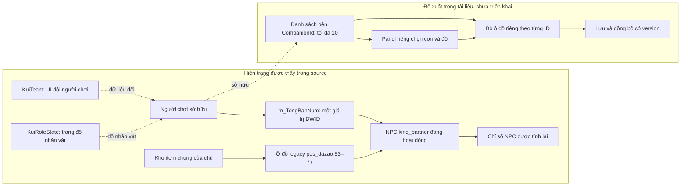

TÓM TẮT 1: [THẤY] Đồng bạn được tạo phía server như NPC kiểu kind_partner và gắn với người chơi sở hữu (KNpcSet.cpp:858–893).
TÓM TẮT 2: [THẤY] Trường m_TongBanNum giữ một DWID; đồ legacy dùng nhóm vị trí 53–77, còn ánh xạ ô mới chưa được triển khai (KNpc.h:398; KNpc.cpp:7265–7342).
TÓM TẮT 3: [TÀI LIỆU] Thiết kế đề xuất roster 10 con và 10 ô đồ/con; đây không phải số lượng đã xác minh đang chạy (JX1_OPS/REPORTS/A-14-hao-huu-trang-bi-thiet-ke.md:22,114).
TÓM TẮT 4: [THẤY]/[CHƯA KIỂM] Client có UI đội và trang nhân vật, nhưng chưa có bằng chứng panel riêng của đồng bạn hay ngoại hình đổi theo đồ (JX1_OPS/REPORTS/F-01-client-hao-huu-ui-ngoai-hinh.md:19–28; JX1_OPS/REPORTS/A-12-hao-huu-mac-do.md:79–85).
TÓM TẮT 5: [CHƯA KIỂM] Chưa kiểm runtime, lưu DB trọn vòng, build, gói/ảnh ngoại hình; phạm vi được đối chiếu tĩnh từ báo cáo và source đã nêu.

# SO-09 — Sổ tay hiểu game: đồng bạn và thú cưỡi

Loại: tổng hợp
Chủ đề: Giải thích đồng bạn, các loại ô hiện có, đồ và chỉ số, UI client cùng giới hạn bằng chứng.
Từ khóa: đồng bạn, hảo hữu, companion, 同伴, kind_partner, m_TongBanNum, pos_dazao, room_equipmentex, CompanionId
Trạng thái: DONE — hoàn tất sổ tay khảo sát tĩnh; chưa xác nhận runtime.
Độ phủ: đã phủ 5/5 báo cáo nền theo câu hỏi SO-09; từng ranh giới chưa biết được đánh dấu.
Liên quan: A-08b, A-09, A-12, A-14, F-01; JX1_OPS/DESIGN/CHUAN-BAO-CAO.md
Cần tôi quyết định: không

## Nguồn và nhãn

Nguồn mã được giao: S/ = C:/Jx1CocoV3/SwordOnline/SwordOnline/jxOnline/gameserver/Sources/; C/ = C:/Jx1CocoV3/Folder/Client2912-20260116T044348Z-3-001/Client2912/Client/Classes/. Các dẫn chiếu báo cáo giữ nguyên nguồn/phiên bản mà báo cáo đó nêu; nội dung gián tiếp được ghi [TÀI LIỆU], không nâng thành kiểm chứng source canonical.
[THẤY] = đoạn source hiện tại đã mở và đối chiếu; [TÀI LIỆU] = kết luận/đề xuất có trong báo cáo nền; [CHƯA KIỂM] = chưa có bằng chứng đủ hoặc chưa được chạy. Source là bằng chứng đọc tĩnh, không phải bằng chứng hành vi trong bản đang chạy.
## Sơ đồ quan hệ chính

Sơ đồ tách trạng thái hiện có khỏi phương án đề xuất: một DWID phiên không đại diện roster bền; UI đội không tự trở thành UI quản lý đồng bạn. [THẤY] server tạo NPC và gắn DWID chủ tại S/KNpcSet.cpp:858–893; [TÀI LIỆU] thiết kế roster/ID mới ở JX1_OPS/REPORTS/A-14-hao-huu-trang-bi-thiet-ke.md:93–114; [TÀI LIỆU] ranh giới UI ở JX1_OPS/REPORTS/F-01-client-hao-huu-ui-ngoai-hinh.md:19–30.

## Phạm vi và độ phủ

| Phần tử phạm vi | Kết quả |
|---|---|
| A-08b — bản chất, sở hữu, AI, skill/EXP/thân mật | Đã phủ. [THẤY] loại NPC và liên kết chủ ở S/KNpcSet.cpp:858–893. [THẤY] AI tìm chủ, ghi DWID lên chủ, theo chủ hoặc đánh khi chủ ở chế độ chiến đấu ở S/KNpcAI.cpp:3294–3337,3393–3418. [CHƯA KIỂM] mức/EXP hoàn chỉnh, thân mật, callback death runtime: JX1_OPS/REPORTS/A-08b-dong-ban.md:38–68. |
| A-09 — số ô/roster nhiều đồng bạn | Đã phủ. [THẤY] một trường UINT lưu DWID, không phải count, ở S/KNpc.h:398; cập nhật lúc tick ở S/KNpcAI.cpp:3303; tra DWID để mặc đồ ở S/KItemList.cpp:1380–1394. [TÀI LIỆU] active[4] là đề xuất, không phải trạng thái hiện có, ở JX1_OPS/REPORTS/A-09-dong-ban-nhieu-slot.md:46,85–87. |
| A-12 — đồ legacy và tác dụng chỉ số | Đã phủ. [THẤY] vị trí/nhóm legacy 53–77 ở S/KNpc.cpp:7265–7342 và ghi item vào pos_dazao ở S/KItemList.cpp:1417–1421. [TÀI LIỆU] phạm vi chỉ số được hỗ trợ và các giới hạn ở JX1_OPS/REPORTS/A-12-hao-huu-mac-do.md:47–75. |
| A-14 — thiết kế cho roster nhiều con | Đã phủ dưới nhãn đề xuất. [TÀI LIỆU] mục tiêu 10 con/10 bộ độc lập, nhưng ID, schema, slot là hợp đồng mới, chưa có theo thiết kế đó trong source: JX1_OPS/REPORTS/A-14-hao-huu-trang-bi-thiet-ke.md:22,93–116. |
| Thú cưỡi | Chưa khảo sát hệ thống thú cưỡi trong task này: câu hỏi cụ thể và năm nguồn được chỉ định tập trung vào đồng bạn; không suy ra cơ chế thú cưỡi từ dữ liệu đồng bạn (JX1_OPS/TASKS/SO-09.md:18–23). |
| F-01 — UI chọn con, trang đồ và ngoại hình | Đã phủ. [THẤY] mẫu UI đội và trang nhân vật ở C/gameui/KuiTeam.cpp:182–216,557–566; C/gameui/KuiRoleState.cpp:2208–2223. [CHƯA KIỂM] panel chuyên biệt và ngoại hình từng model ở JX1_OPS/REPORTS/F-01-client-hao-huu-ui-ngoai-hinh.md:19–30,66. |

## Đồng bạn là gì?

[THẤY] AddTongBan kiểm tra chủ là NPC người chơi, tạo một NPC server, đặt kind_partner và lưu quan hệ tới DWID/index người chủ. Cách gọi này mô tả một thực thể NPC do nhân vật sở hữu, không phải tài khoản người chơi thứ hai (S/KNpcSet.cpp:858–893).

[THẤY] AI partner tra chủ, cập nhật m_TongBanNum trên chủ, bám theo khi chủ không chiến đấu hoặc ở quá xa; nếu có mục tiêu gần thì chọn một trong bốn ô skill rồi gọi nhánh đuổi/đánh (S/KNpcAI.cpp:3294–3337,3393–3418). Đây là mô tả nhánh source; không xác nhận mọi skill hoạt động ngoài runtime.

[CHƯA KIỂM] Gói game thực tế đang nạp nhánh source này, hành vi sau khi chủ chết/offline/chuyển map, khôi phục sau đăng nhập và đầy đủ kỹ năng/kinh nghiệm. Nền: JX1_OPS/REPORTS/A-08b-dong-ban.md:38–68; phần khung skill partner C++ hiện còn trong comment ở S/KPartnerSkill.cpp:2–32.

## Có mấy slot?

Cần phân biệt ba loại “slot”:

| Loại ô | Kết quả |
|---|---|
| Dấu đồng bạn đang gọi trên chủ | [THẤY] m_TongBanNum là một trường UINT chứa DWID, được AI ghi bằng DWID của chính NPC; một giá trị đó không phải bộ đếm roster (S/KNpc.h:398; S/KNpcAI.cpp:3303; JX1_OPS/REPORTS/A-09-dong-ban-nhieu-slot.md:46). Báo cáo A-08b mô tả đường triệu hồi gốc kiểm một con đang gọi; không suy từ riêng trường này rằng mọi đường gọi đều giới hạn cứng một con (JX1_OPS/REPORTS/A-08b-dong-ban.md:22–37). |
| Ô đồ legacy | [THẤY] vùng số 53–77 có 25 vị trí mã hóa: năm nhóm, mỗi nhóm năm. ReCalcNpcEquip chọn nhóm theo cấu hình/template hoặc vị trí được truyền và quét năm ô nhóm đó; không phải 25 món cùng mặc trên một con (S/KNpc.cpp:7265–7342; JX1_OPS/REPORTS/A-12-hao-huu-mac-do.md:34–43). [CHƯA KIỂM] tên chính thức của từng ô trong mỗi nhóm; A-12 không xác nhận ánh xạ mũ/áo/vũ khí từng số (JX1_OPS/REPORTS/A-12-hao-huu-mac-do.md:43). |
| Roster và bộ đồ mới | [TÀI LIỆU] A-14 đề xuất roster tối đa 10 con và 10 ô đồ thường cho từng con, tức tối đa 100 vị trí item trong thiết kế; chưa phải tính năng hiện có (JX1_OPS/REPORTS/A-14-hao-huu-trang-bi-thiet-ke.md:22,114). [TÀI LIỆU] A-09 nêu active[4] như một phương án quản lý đồng thời, không phải quyết định hoặc giới hạn runtime (JX1_OPS/REPORTS/A-09-dong-ban-nhieu-slot.md:85). Số con hoạt động đồng thời trong thiết kế SO-09 chưa được chốt. |

## Trang bị và chỉ số

[THẤY] room_equipmentex là vùng kho item phụ của người chơi. Nó không phải mười bộ đồ cho mười đồng bạn. Mã client đặt tên vùng này và pos_equiproomex; đối chiếu A-12 cũng phân biệt kho chung với item đang mặc (C/gamecore/GameDataDef.h:250–272; JX1_OPS/REPORTS/A-12-hao-huu-mac-do.md:32–37).

[THẤY] Nhánh TonEquip lấy NPC đang gọi từ m_TongBanNum; nếu không tìm được NPC thì trả thất bại. Khi mặc, item được ghi vào pos_dazao, X là vị trí 53–77, Y=0; magic của item được áp vào NPC rồi gọi tính lại chỉ số (S/KItemList.cpp:1380–1394,1417–1421,1451–1481). Do đó nhánh này gắn đồ với NPC đang hoạt động và vị trí legacy của chủ, không có khóa CompanionId riêng (JX1_OPS/REPORTS/A-12-hao-huu-mac-do.md:29–45; JX1_OPS/REPORTS/A-14-hao-huu-trang-bi-thiet-ke.md:93–114).

[THẤY] Một phần bonus như máu tối đa, phòng thủ và sát thương vật lý có handler NPC trong source. [THẤY] Các handler STR/DEX/VIT/ENG gọi vào KPlayer hoặc bỏ qua loại không phải player; handler AllSkillV cũng thoát với NPC không phải player. Vì thế không nên hiểu “đồ tăng mọi chỉ số nhân vật” là đúng cho đồng bạn (JX1_OPS/REPORTS/A-12-hao-huu-mac-do.md:47–64; S/KNpcAttribModify.cpp:632–636,1307–1315).

[CHƯA KIỂM] Tác dụng của mọi thuộc tính/skill, damage cuối cho từng loại vũ khí, cộng dồn buff, công thức tăng trưởng, điều kiện mặc theo chính chỉ số đồng bạn và việc áp lại stats sau khi load DB. A-14 đề xuất context chỉ số riêng cho từng ID và phép kiểm đồ riêng; đó là thiết kế, chưa triển khai (JX1_OPS/REPORTS/A-14-hao-huu-trang-bi-thiet-ke.md:24–52).

## UI client

[THẤY] Client có KuiTeam với danh sách thành viên đội và người chơi quanh đó; KgameWorld mở cửa sổ đội và quản lý callback đóng. Đây là UI đội người chơi, không phải roster đồng bạn (C/gameui/KuiTeam.cpp:182–216,557–566; C/gamescene/KgameWorld.cpp:2506–2518; JX1_OPS/REPORTS/F-01-client-hao-huu-ui-ngoai-hinh.md:19–28).

[THẤY] KuiRoleState.UpdateAllEquips lấy GDI_EQUIPMENT của ngữ cảnh nhân vật và cập nhật các ô đồ người chơi. Vùng kho đồng bạn có enum riêng, nhưng điều đó chưa chứng minh màn hình quản lý đồ theo từng companion ID (C/gameui/KuiRoleState.cpp:2208–2223; C/gamecore/GameDataDef.h:250–272; JX1_OPS/REPORTS/F-01-client-hao-huu-ui-ngoai-hinh.md:32–47).

[CHƯA KIỂM] Chưa thấy bằng chứng trong phạm vi báo cáo F-01 về panel roster chuyên biệt, chọn con để xem đồ, gửi/nhận lệnh mặc đồ riêng, hoặc giao diện 10 con. Báo cáo F-01 giới hạn tìm kiếm trong một tập gameui/*.cpp,*.h; chưa phủ resource UI, Lua, nhánh client khác hay binary (JX1_OPS/REPORTS/F-01-client-hao-huu-ui-ngoai-hinh.md:28,66).

[CHƯA KIỂM] NPC renderer có khả năng xử lý part ngoại hình không đồng nghĩa đồ legacy được gửi và áp hình. Chưa xác nhận ngoại hình từng model, sprite/PAK, animation, viewer mới hoặc sau đổi map (JX1_OPS/REPORTS/A-12-hao-huu-mac-do.md:79–85; JX1_OPS/REPORTS/F-01-client-hao-huu-ui-ngoai-hinh.md:60–66).

## Giải mã tên

| Tên gốc | Mã hóa | Chữ/ý nghĩa đọc được | Nguồn |
|---|---|---|---|
| 同伴 | GBK (tên Hoa ngữ trong báo cáo nền) | Đồng bạn | JX1_OPS/REPORTS/A-08b-dong-ban.md:7 |
| AddTongBan | ASCII | Tạo NPC đồng bạn và gắn chủ | S/KNpcSet.cpp:858–893 |
| kind_partner | ASCII | Kiểu NPC đồng bạn | S/KNpcSet.cpp:882 |
| m_TongBanNum | ASCII | Trường chứa DWID NPC đang gọi | S/KNpc.h:398 |
| DWID | ASCII (viết tắt) | Mã định danh NPC trong phiên | S/KNpcAI.cpp:3303 |
| ReCalcNpcEquip | ASCII | Tính lại đồ legacy của NPC | S/KNpc.cpp:7265–7342 |
| TonEquip | ASCII | Nhánh mặc đồ đồng bạn legacy | S/KItemList.cpp:1374–1481 |
| pos_dazao | ASCII | Vị trí lưu item đồng bạn legacy | S/KItemList.cpp:1417–1421 |
| room_equipmentex | ASCII | Vùng kho item phụ của chủ | C/gamecore/GameDataDef.h:250 |
| pos_equiproomex | ASCII | Vị trí item trong kho phụ | C/gamecore/GameDataDef.h:272 |
| KuiTeam | ASCII | UI quản lý đội người chơi | C/gameui/KuiTeam.cpp:182–216 |
| KgameWorld | ASCII | Lớp mở cửa sổ đội | C/gamescene/KgameWorld.cpp:2506–2518 |
| KuiRoleState | ASCII | UI trạng thái/trang bị nhân vật | C/gameui/KuiRoleState.cpp:2208–2223 |
| GDI_EQUIPMENT | ASCII | Mã truy vấn đồ nhân vật | C/gameui/KuiRoleState.cpp:2212–2223 |
| AllSkillV | ASCII | Handler modifier kỹ năng toàn cục | S/KNpcAttribModify.cpp:632–636 |
| STR, DEX, VIT, ENG | ASCII | Strength, Dexterity, Vitality, Energy; bốn nhóm điểm | JX1_OPS/REPORTS/A-12-hao-huu-mac-do.md:57–64 |
| CompanionId | ASCII, tên trường trong thiết kế | Mã định danh bền được đề xuất cho từng con; chưa tồn tại theo thiết kế này | JX1_OPS/REPORTS/A-14-hao-huu-trang-bi-thiet-ke.md:22,100–110 |
| active[4] | ASCII, tên mảng trong đề xuất | Bốn ô hoạt động đề xuất, chưa triển khai | JX1_OPS/REPORTS/A-09-dong-ban-nhieu-slot.md:85 |
| head, body, belt, weapon, foot, cuff, amulet, ring1, ring2, pendant | ASCII, tên ô trong thiết kế | Mũ, thân/giáp, đai, vũ khí, giày, cổ tay, bùa, nhẫn 1, nhẫn 2, mặt dây; tất cả là tên ví dụ trong đề xuất | JX1_OPS/REPORTS/A-14-hao-huu-trang-bi-thiet-ke.md:114 |
## Sắp theo cấu trúc game

Trình bày theo quan hệ thực thể và luồng dữ liệu, không theo thứ tự năm báo cáo: (1) người chơi sở hữu → (2) NPC partner đang gọi và mã DWID phiên → (3) item trong kho/chỗ legacy → (4) modifier được áp vào NPC → (5) màn hình client và dữ liệu gửi đồng bộ. Roster CompanionId và trang đồ riêng được đặt cạnh nơi chúng sẽ nối vào luồng, có nhãn đề xuất để không trộn với source hiện có (S/KNpcSet.cpp:858–893; S/KItemList.cpp:1380–1481; JX1_OPS/REPORTS/A-14-hao-huu-trang-bi-thiet-ke.md:93–114; JX1_OPS/REPORTS/F-01-client-hao-huu-ui-ngoai-hinh.md:19–47).

## Đề xuất tối ưu

[ĐỀ XUẤT] Nếu triển khai tiếp, trước tiên chốt hợp đồng roster bền tách biệt DWID phiên, trạng thái active và số ô được phê duyệt; sau đó nối bộ đồ tới đúng ID đồng bạn. Thứ tự này xử lý điểm nghẽn được ghi trong A-09 và A-14; chưa có thay đổi source hoặc đo kiểm (JX1_OPS/REPORTS/A-09-dong-ban-nhieu-slot.md:46,85–87; JX1_OPS/REPORTS/A-14-hao-huu-trang-bi-thiet-ke.md:93–116).

## Mục sổ thông số

| Nhóm | Tên/tham số | file:dòng | Giá trị | Đơn vị | Ảnh hưởng | Đổi an toàn | Nguồn đo |
|---|---|---|---|---|---|---|---|
| Sở hữu/active | m_TongBanNum | S/KNpc.h:398; S/KNpcAI.cpp:3303 | Một trường UINT lưu DWID NPC | DWID | Tìm NPC đang gọi; không phải count hay khóa bền | CẨN THẬN | Đọc tĩnh; chưa đo runtime |
| Trang bị legacy | pos_dazao, X | S/KItemList.cpp:1417–1421; S/KNpc.cpp:7301–7342 | 53–77; 5 nhóm × 5 ô | index item | Chọn nhóm legacy để tính lại thuộc tính; mỗi lần quét một nhóm năm | CẨN THẬN | Đọc tĩnh; chưa đo runtime |
| Thiết kế roster | 10 CompanionId × 10 ô | JX1_OPS/REPORTS/A-14-hao-huu-trang-bi-thiet-ke.md:22,114 | 10 con, tối đa 100 vị trí đồ | slot đề xuất | Dung lượng logic mục tiêu, phụ thuộc thay đổi server/DB/client | CẨN THẬN | Đề xuất tài liệu, chưa đo/triển khai |

## Đã xác minh / Chưa xác minh

**Đã xác minh tĩnh**

- S/KNpcSet.cpp:858–893 — AddTongBan, tạo NPC partner và gắn thông tin chủ.
- S/KNpc.h:398; S/KNpcAI.cpp:3303 — trường m_TongBanNum và nhánh AI ghi DWID.
- S/KItemList.cpp:1380–1394,1417–1421,1451–1481; S/KNpc.cpp:7265–7342 — chọn NPC active, lưu vị trí đồ legacy, áp magic và chọn nhóm vị trí khi tính lại.
- S/KNpcAttribModify.cpp:632–636,1307–1315 — giới hạn AllSkillV và một handler điểm cơ bản; các nhóm khác được tổng hợp từ JX1_OPS/REPORTS/A-12-hao-huu-mac-do.md:57–64.
- C/gamecore/GameDataDef.h:250–272; C/gameui/KuiTeam.cpp:182–216,557–566; C/gameui/KuiRoleState.cpp:2208–2223; C/gamescene/KgameWorld.cpp:2506–2518 — vùng item và UI client nêu trên.
- Tài liệu A-08b, A-09, A-12, A-14, F-01 được đối chiếu; mọi số roster/UI mới được ghi là đề xuất hoặc chưa kiểm.

**Chưa xác minh**

Runtime/binary/PAK đang chạy, số đồng bạn active được toàn bộ đường gọi cho phép, vòng đời DB, UI theo CompanionId, ngoại hình, toàn bộ modifier/skill, điều kiện trang bị theo thuộc tính của con và hiệu năng. Không build/test, không chạy VM/exe, không kết nối mạng hoặc server theo phạm vi SO-09.

Liên quan: JX1_OPS/REPORTS/A-08b-dong-ban.md; A-09-dong-ban-nhieu-slot.md; A-12-hao-huu-mac-do.md; A-14-hao-huu-trang-bi-thiet-ke.md; F-01-client-hao-huu-ui-ngoai-hinh.md.

## Kiểm chứng và bàn giao

- Đã kiểm tra tĩnh trực tiếp các đoạn source có trong phần “Đã xác minh tĩnh” và đối chiếu năm báo cáo nền; không sửa mã nguồn.
- Không chạy game, exe, VM, build, DB hoặc mạng; đây không phải kiểm thử runtime. rg không sẵn có, đã thay bằng tìm kiếm có giới hạn trên các file task chỉ định. Lần đọc chuẩn Markdown ban đầu hiển thị lỗi mã hóa, đọc UTF-8 lại để xác nhận nội dung.
- Không ghi được D:/JX-wt/SO-09.nhip: thao tác ghi ngoài worktree bị hệ thống quyền từ chối. Không thử vượt quyền.
- Không stage/commit/push theo yêu cầu; không có SHA. Bước tiếp theo chỉ khi được duyệt phạm vi: tạo JX1_OPS/REPORTS/SO-09.md theo yêu cầu caller.
- Kỹ năng đã dùng: jx1-retrofit, jx1-read-server, jx1-read-client, jx1-parameters, jx1-knowledge, jx1-report.

