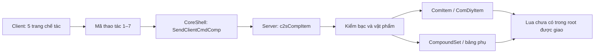

## TÓM TẮT 5 DÒNG
1. [THẤY] Client trong task có 5 trang chế tác và gửi mã thao tác 1–7 (KuiCompoundItem.cpp:167-451,1016-1129).
2. [THẤY] Server đọc phí, kiểm tra vật phẩm và chuyển các nhánh chính đến hàm Lua (KProtocolProcess.cpp:6379-6810; KPlayer.cpp:11389-11425).
3. [CHƯA KIỂM] Nội dung Lua và giá trị bảng công thức/CompoundSet không có trong root nguồn được task giao.
4. [TÀI LIỆU] Cường hóa +N được tách khỏi phạm vi; đối chiếu HIEU-CAP-CUONG-HOA-LUA.md:1-5.
5. [CHƯA KIỂM] Chỉ đọc tĩnh; không chạy build, exe, VM hay mạng.

# SO-30 — Sổ tay hiểu game: ghép, tách và nâng đồ

Loại: tổng hợp
Chủ đề: Luồng ghép, tách, nâng vật phẩm và khảm từ giao diện tới xử lý server.
Từ khóa: SO-30, ghép đồ, tách thuộc tính, Huyền tinh, khảm, đồ phổ, CompoundSet
Trạng thái: PARTIAL — đã đối chiếu UI và handler; thiếu nội dung Lua cùng giá trị bảng.
Độ phủ: 5/5 trang UI; 7/7 mã thao tác chính; mã mở rộng 8–12 mới biết điểm gọi.
Liên quan: JX1_OPS/DESIGN/HIEU-CAP-CUONG-HOA-LUA.md; JX1_OPS/DESIGN/SO-TAY-TRANG-BI.md; JX1_OPS/REPORTS/SO-03.md.
Cần tôi quyết định: có — nếu cần công thức và phí chính xác, cần task cho phép thêm root chứa Lua và Settings.

## Cách đọc

Nguồn đọc: client root C:/Jx1CocoV3/Folder/Client2912-20260116T044348Z-3-001/Client2912/Client/Classes; server root C:/Jx1CocoV3/SwordOnline/SwordOnline/jxOnline/gameserver/Sources. Các file:dòng source dưới đây tương đối các root này.

[THẤY] Nhãn THẤY chỉ xác nhận nhánh lệnh trong source, không xác nhận binary hay máy chủ chạy. Khi thiếu bảng hoặc Lua, điều kiện và giá trị cuối cùng được ghi CHƯA KIỂM.

## Luồng chính

[THẤY] Client gắn mã trang 1–5; trang hợp thành có ba thao tác con, rồi gửi mã 1–3. Tách, chế tạo, khảm và đồ phổ gửi 4–7 (C:/Jx1CocoV3/Folder/Client2912-20260116T044348Z-3-001/Client2912/Client/Classes/gameui/KuiCompoundItem.cpp:167-168,217-242,268-269,334-337,386-389,448-451,1016-1129).

[THẤY] CoreShell chuyển các lệnh GOI_COMPITEM_COM, DISTILL, FORGE, ENCHASE và ALTAL thành mã 1–7; handler c2sCompItem phân nhánh theo bKind (C:/Jx1CocoV3/SwordOnline/SwordOnline/jxOnline/gameserver/Sources/Core/Src/CoreShell.cpp:4687-4735; KProtocolProcess.cpp:6379-6386).

## Phạm vi và độ phủ

| Thứ tự UI | Tác vụ | Mức phủ |
|---:|---|---|
| 1 | Hợp thành/tinh luyện; nâng Huyền tinh; nâng quặng thuộc tính (1–3) | Đã thấy mã và lời gọi ComItem; Lua chưa kiểm. |
| 2 | Tách thuộc tính từ đồ lam (4) | Đã thấy bạc, điều kiện ngũ hành và nguyên liệu phụ; bảng/Lua chưa kiểm. |
| 3 | Chế tạo/đục lỗ đồ tím (5) | Đã thấy phí và lời gọi ComDiyItem; luật chế tạo chưa kiểm. |
| 4 | Khảm đồ tím (6) | Đã thấy phí, kiểm tra đầu vào, bảng phụ và nhánh ngẫu nhiên; xác suất chưa kiểm. |
| 5 | Đồ phổ (7) | Đã thấy tám ID, phí và lời gọi Lua; bảng công thức chưa kiểm. |
| Mở rộng | Handler 8–12 | Đã thấy nhánh văn cương, linh hợp, dung hợp, nhận biết; chưa nối với UI và Lua. |
| Ngoài phạm vi | Cường hóa +N | Không khảo sát cơ chế này. |

[THẤY] UI yêu cầu tối thiểu 3 vật phẩm cho hợp thành/khảm, 2 cho chế tạo và 3 đầu vào chính cho tách; đồ phổ đòi ID 0–7. Đây là kiểm tra client, không thay kiểm tra server (KuiCompoundItem.cpp:1016-1129).

## Sắp theo cấu trúc game

1. Hợp thành: ba thao tác nguyên liệu (KuiCompoundItem.cpp:217-242; KProtocolProcess.cpp:6387-6542).
2. Tách thuộc tính từ trang bị lam (KProtocolProcess.cpp:6543-6643).
3. Chế tạo lỗ cho trang bị tím (KProtocolProcess.cpp:6644-6670).
4. Khảm trang bị tím (KProtocolProcess.cpp:6671-6765).
5. Đồ phổ: vật phẩm, đồ phổ và nguyên liệu phụ (KProtocolProcess.cpp:6766-6810).

[CHƯA KIỂM] Thứ tự trên là thứ tự trang UI; không có danh sách công thức đầy đủ để xếp theo từng loại trang bị.

## Giải mã tên

Chú thích Hán được đọc theo GBK; tên hàm và mã lệnh C++ là ASCII.

| Tên gốc | Mã hóa | Cách đọc trong sổ tay | Nguồn |
|---|---|---|---|
| 提炼 / 提取 | GBK | Chiết luyện / tách | CoreShell.cpp:4687,4709; KProtocolProcess.cpp:6387,6543 |
| 打造 / 镶嵌 | GBK | Chế tạo / khảm | CoreShell.cpp:4716,4723; KProtocolProcess.cpp:6644,6671 |
| 图谱 | GBK | Đồ phổ | CoreShell.cpp:4730; KProtocolProcess.cpp:6766 |
| 玄晶 / 属性矿石 | GBK | Huyền tinh / quặng thuộc tính | KProtocolProcess.cpp:6425,6481 |
| 蓝装 / 紫装 | GBK | Trang bị lam / trang bị tím | KProtocolProcess.cpp:6543,6644,6671 |
| 熔炼纹钢 / 提炼纹钢 | GBK | Luyện / tách Văn Cương | CoreShell.cpp:4657,4663 |
| 宝石灵合 / 融合 / 辨识蓝装 | GBK | Linh hợp bảo thạch / dung hợp / nhận biết đồ lam | CoreShell.cpp:4669-4681 |
| GOI_COMPITEM_COM / c2sCompItem / CompoundSet | ASCII | Mã thao tác / handler / nhóm cấu hình | CoreShell.cpp:4687; KProtocolProcess.cpp:6379-6393 |

## Cơ chế đã thấy trong source

### Hợp thành và nâng nguyên liệu

[THẤY] Nhánh 1–3 tìm ba ID, đọc CompoundSet.CompoundMoney, kiểm tra bạc và gọi Pay; sau đó gọi ComItem theo loại 1–3 (KProtocolProcess.cpp:6387-6542).

[THẤY] ComItem chuyển tên người chơi, bản đồ, loại thao tác và ba ID tới orecomp.lua/maincompore (KPlayer.cpp:11389-11397). [CHƯA KIỂM] Không tìm thấy script này trong root server được task giao; công thức và tiêu hao cuối chưa xác minh.

### Tách và khảm

[THẤY] Nhánh tách đọc DistillMoney. Nguyên liệu phụ được so theo genre/detail/particular với cột Distill và Distill_value trong g_CompEquip; điểm cộng vào nMin. DistillRank và g_Random điều khiển nhánh thất bại (KProtocolProcess.cpp:6551-6605). Không thể chuyển công thức này thành tỷ lệ phần trăm khi chưa kiểm định nghĩa g_Random và bảng.

[THẤY] Khi phép thử tách thất bại, code xóa ID vật phẩm đã tìm; khi qua bước đó, xóa nguyên liệu phụ rồi gọi ComDiyItem loại 1 (KProtocolProcess.cpp:6605-6633). Loại 1 gọi itemcomp.lua/maincompitem (KPlayer.cpp:11400-11414).

[THẤY] Nhánh khảm đọc EnchaseMoney, kiểm tra ba vật phẩm chính và điều kiện hệ/ngũ hành, tra nguyên liệu phụ ở cột Enchase/Enchase_value rồi dùng EnchaseRank và g_Random trước ComDiyItem loại 3 (KProtocolProcess.cpp:6671-6765).

### Chế tạo và đồ phổ

[THẤY] Chế tạo đọc ForgeMoney rồi gọi ComDiyItem loại 2, vốn chuyển sang itemcomp.lua/maincompitem (KProtocolProcess.cpp:6644-6669; KPlayer.cpp:11415-11425). [CHƯA KIỂM] Không có Lua để xác nhận đầy đủ nguyên liệu, số lỗ hoặc xử lý thất bại.

[THẤY] Đồ phổ đọc AtlasMoney, cần tám ID đầu vào; nhánh thực hiện trừ bạc và gọi altscomp.lua/mainaltscomp, còn xem trước gọi yulanaltscomp (KProtocolProcess.cpp:6783-6810). g_CompAtlas và g_CompEquip được nạp từ GAME_ATLAS_FILE/GAME_COMP_FILE (KCore.cpp:706-708). [CHƯA KIỂM] Chưa đối chiếu macro với đường dẫn hay bảng thực.

### Handler mở rộng

[THẤY] Mã 8–12 có nhánh văn cương, tách/luyện văn cương, linh hợp bảo thạch, dung hợp, nhận biết. Một số gọi fusioncomp.lua; dung hợp đọc OpenAttrib, MinLuckyLevel, RongHeMoney và bảng phụ RongHe (KProtocolProcess.cpp:7136-7515). [CHƯA KIỂM] Chưa lần ngược các mã này tới trang UI hoặc nội dung script.

## Mục sổ thông số

| Khóa | Nguồn | Giá trị | Ảnh hưởng / đổi an toàn |
|---|---|---|---|
| CompoundMoney | KProtocolProcess.cpp:6393,6431,6487 | Chưa đọc bảng; mặc định lời gọi là 0 | Bạc; CẨN THẬN |
| DistillMoney / DistillRank | KProtocolProcess.cpp:6552,6598 | Chưa đọc bảng | Bạc và tham số ngẫu nhiên; CẨN THẬN |
| ForgeMoney | KProtocolProcess.cpp:6649 | Chưa đọc bảng | Bạc; CẨN THẬN |
| EnchaseMoney / EnchaseRank | KProtocolProcess.cpp:6680,6727 | Chưa đọc bảng | Bạc và tham số ngẫu nhiên; CẨN THẬN |
| AtlasMoney | KProtocolProcess.cpp:6784 | Chưa đọc bảng | Bạc; CẨN THẬN |
| RongHeMoney / MinLuckyLevel | KProtocolProcess.cpp:7367-7386 | Chưa đọc bảng | Bạc, ngưỡng may mắn/cấp; CẨN THẬN |
| GAME_COMP_FILE / GAME_ATLAS_FILE | KCore.cpp:706-708 | Macro/đường dẫn chưa xác minh | Bảng nguyên liệu/công thức; CẨN THẬN |

[CHƯA KIỂM] Số 0 trong GetInteger là giá trị mặc định của hàm đọc, không chứng minh thao tác miễn phí.

## Đối chiếu cường hóa

[TÀI LIỆU] HIEU-CAP-CUONG-HOA-LUA.md bàn về SetItemEnChance và đồng bộ thuộc tính +N; không cung cấp phí/công thức cho các trang chế tác SO-30 (JX1_OPS/DESIGN/HIEU-CAP-CUONG-HOA-LUA.md:1-5). Giữ cường hóa tách khỏi tách, nâng Huyền tinh và khảm.

## Đã xác minh

- [THẤY] 5 trang client gửi mã 1–7 (KuiCompoundItem.cpp:167-451,1016-1129).
- [THẤY] Server kiểm phí/đầu vào, tra bảng phụ và gọi các nhánh Lua (KProtocolProcess.cpp:6379-6810).
- [THẤY] ComItem/ComDiyItem nêu rõ tên script và hàm đích (KPlayer.cpp:11389-11425).
## Chưa kiểm

- [CHƯA KIỂM] Không tìm thấy orecomp.lua, itemcomp.lua, altscomp.lua, fusioncomp.lua dưới root .../gameserver/Sources; không đọc ngoài root được giao.
- [CHƯA KIỂM] Chưa đọc giá trị CompoundSet, dữ liệu GAME_COMP_FILE/GAME_ATLAS_FILE, xác suất, runtime hoặc liên kết UI cho mã 8–12.
- [CHƯA KIỂM] Không chạy build/test/exe/VM/mạng.
- [CHƯA KIỂM] Tệp nhịp D:\JX-wt\SO-30.nhip ngoài vùng ghi; hệ thống từ chối tạo tệp.

## Bàn giao

PARTIAL. Muốn xác minh chi tiết công thức/chi phí, cần task cho phép root chứa bốn Lua và dữ liệu Settings. Không sửa mã, không chạy build/exe/VM/mạng, không commit.

Liên quan: JX1_OPS/DESIGN/HIEU-CAP-CUONG-HOA-LUA.md; JX1_OPS/DESIGN/SO-TAY-TRANG-BI.md; JX1_OPS/REPORTS/SO-03.md.

Đề xuất dòng mục lục để PM gộp: SO-30 | sổ tay | Ghép, tách, nâng và khảm đồ | ghép đồ, Huyền tinh, khảm, đồ phổ, CompoundSet | PARTIAL (Lua/bảng chưa đọc) | 5/5 trang client, mã 1–7; mã 8–12 chưa lần UI | HIEU-CAP-CUONG-HOA-LUA, SO-TAY-TRANG-BI, SO-03.

Kỹ năng đã dùng: jx1-retrofit (định dạng), jx1-read-server, jx1-read-client, jx1-parameters, jx1-knowledge, jx1-report.
