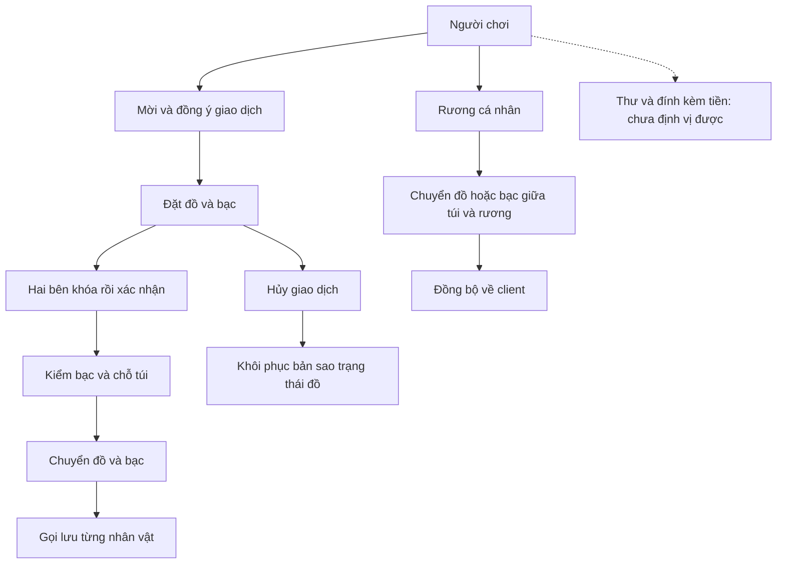

TÓM TẮT 1: [NGUỒN][THẤY] Giao dịch trực tiếp đi qua mời, đồng ý, đặt đồ/bạc, khóa và xác nhận; đây là kết quả đọc mã, chưa chạy game. `S/KPlayer.cpp:6605–6653,6724–6845,7054–7115`.
TÓM TẮT 2: [NGUỒN][THẤY] Rương giữ vật phẩm và bạc riêng với túi; gửi/rút bạc chuyển giữa hai ngăn của chính nhân vật. `S/KProtocolProcess.cpp:6135–6142`; `S/KPlayerDBFuns.cpp:1522–1531,1651–1653`.
TÓM TẮT 3: [NGUỒN][THẤY] Có kiểm số bạc, chỗ túi, ID/vị trí đồ và phục hồi khi hủy; các lớp này chưa chứng minh chống nhân đồ hoàn chỉnh. `S/KPlayer.cpp:6819–6845`; `S/KItemList.cpp:8248–8289`; `S/KPlayer.cpp:5920–6002`.
TÓM TẮT 4: [CHƯA KIỂM] Chưa xác minh thư/đính kèm tiền, giới hạn server, mất kết nối và lưu đồng thời hai nhân vật; không diễn giải thiếu kết quả tìm kiếm thành không có chức năng. Xem mục 7–8 và nhật ký rà nguồn ở báo cáo `JX1_OPS/REPORTS/SO-26.md:78–108`.
TÓM TẮT 5: [CHƯA KIỂM] Không build, test runtime, chạy exe, VM hoặc mạng; chỉ đọc nguồn và viết tài liệu theo `JX1_OPS/TASKS/SO-26.md:19–26`.

# SO-26 — Sổ tay giao dịch, kho và phạm vi thư
Loại: khảo sát
Chủ đề: Hiểu cách hai người trao đồ/bạc, cất đồ và gửi/rút bạc ở rương; nhận diện giới hạn của bằng chứng chống nhân đồ và thư.
Từ khóa: giao dịch, trade, rương, room_repository, bạc, storemoney, gói tin, chống nhân đồ, mail
Trạng thái: PARTIAL — đã viết đủ phần khảo sát tĩnh giao dịch/kho; luồng thư chưa định vị, những hành vi chưa chứng minh được ghi CHƯA KIỂM.
Độ phủ: 6/7 mảng có bằng chứng mã trực tiếp; thư đã rà giới hạn nhưng chưa định vị được luồng xử lý.
Liên quan: `JX1_OPS/DESIGN/SO-TAY-KINH-TE.md`; `JX1_OPS/DESIGN/HIEU-GIAO-DICH-KHO-DO.md`; `JX1_OPS/REPORTS/SO-26.md`.
Cần tôi quyết định: không — mọi thử nghiệm chạy thật cần một task có quyền riêng.

## Nguồn và cách đọc

- **[THẤY]** = đã mở đoạn mã được dẫn; chỉ xác minh snapshot trên đĩa. **[TÀI LIỆU]** = dẫn lại tài liệu có sẵn. **[CHƯA KIỂM]** = chưa đủ bằng chứng hoặc chưa thử hành vi. Hai nhãn đầu không chứng minh binary đang triển khai. Phạm vi đọc: `JX1_OPS/TASKS/SO-26.md:19–26`.
- **[THẤY]** `S/` viết tắt cho `C:/Jx1CocoV3/SwordOnline/SwordOnline/jxOnline/gameserver/Sources/Core/Src/`; ví dụ `S/KPlayer.cpp:6640` là dòng 6640 của tệp nguồn server đó. `C/` viết tắt cho `C:/Jx1CocoV3/Folder/Client2912-20260116T044348Z-3-001/Client2912/Client/Classes/`. Hai root đúng nguồn task cho phép: `JX1_OPS/TASKS/SO-26.md:25`.
- **[TÀI LIỆU]** Tài liệu đầu ra dùng UTF-8 không BOM. Khi đọc nguồn, dùng tên hàm/hằng số ASCII và câu lệnh đang hoạt động làm bằng chứng; không lấy chú thích Hán/Việt đang hiển thị sai mã làm tên game đã giải mã. Yêu cầu mã hóa: `JX1_OPS/DESIGN/CHUAN-BAO-CAO.md:29`.

## Sơ đồ chính

**[THẤY]** Luồng khái quát từ `S/KPlayer.cpp:6605–6653,6724–6845,6947–7037,7054–7115`; `S/KProtocolProcess.cpp:6135–6142`; `S/KItemList.cpp:3338–3361`. Nhánh thư là giới hạn khảo sát, không phải đường xử lý đã tìm thấy.

## Phạm vi và độ phủ

| Mảng của task | Độ phủ | Bằng chứng / giới hạn |
|---|---|---|
| Giao dịch trực tiếp | [THẤY] Đã phủ tĩnh | Mời, trả lời, đặt bạc, khóa, xác nhận, hủy: `S/KPlayer.cpp:6605–6653,6724–6845,7054–7115`. |
| Kho cá nhân/rương và chuyển đồ | [THẤY] Đã phủ tĩnh | Ngăn kho được tạo riêng; nhánh chuyển đồ thông thường chặn khi đang trade: `S/KItemList.cpp:1050–1057,5734–5785`. |
| Gửi/rút bạc | [THẤY] Đã phủ tĩnh | Chọn hướng và chuyển giữa hai ngăn của nhân vật: `S/KProtocolProcess.cpp:6135–6142`; `S/KItemList.cpp:3329–3361`. |
| Gói tin và giới hạn | [THẤY] Đã phủ tĩnh có giới hạn | Định tuyến server và khai báo client; kích thước server/binary chưa chốt: `S/KProtocolProcess.cpp:237,251–255,270–272,303`; `C/gamecore/GameDataDef.h:79–90`. |
| Kiểm tra chống nhân đồ | [THẤY] Đã phủ các lớp chặn và điểm cần thử | ID/vị trí, khay khóa, túi nhận, hoàn tác: `S/KPlayer.cpp:5920–6002,6034–6041,6799–6845`; `S/KItemList.cpp:8248–8289,8751–8859`. |
| Lưu và đối chiếu kinh tế | [THẤY]/[TÀI LIỆU] Đã phủ tĩnh | Lưu hai nhân vật và phân biệt bạc túi/rương/XU: `S/KPlayer.cpp:7027–7037`; `S/KPlayerDBFuns.cpp:1522–1531`; `JX1_OPS/DESIGN/SO-TAY-KINH-TE.md:33–41`. |
| Thư, gửi tiền/đồ qua thư | [CHƯA KIỂM] Chưa phủ hành vi | Rà 8 tệp có chọn lọc, không có kết quả cho nhóm tên mail/letter đã dùng; không phải kiểm kê toàn hệ thống. Nhật ký lệnh và danh sách tệp: `JX1_OPS/REPORTS/SO-26.md:78–94`. |

## Giải mã tên

| Tên gốc | Mã hóa | Chữ đúng UTF-8 | Nguồn file:dòng |
|---|---|---|---|
| `room_equipment` | ASCII; không phải tên Hán/TCVN3 | Ngăn túi mang theo, theo cách dùng trong mã | [THẤY] `S/KItemList.cpp:3380–3382`. |
| `room_repository` | ASCII; không phải tên Hán/TCVN3 | Ngăn rương; không đổi tên định danh gốc | [THẤY] `S/KProtocolProcess.cpp:6139–6142`. |
| `room_trade` | ASCII; không phải tên Hán/TCVN3 | Khay giao dịch; không đổi tên định danh gốc | [THẤY] `S/KPlayer.cpp:6821–6825`. |
| Không phát sinh tên riêng của vật phẩm, kỹ năng, NPC, quái hoặc bản đồ | Không áp dụng | Không có tên riêng game cần giải mã GBK/TCVN3 trong sổ tay này | [TÀI LIỆU] Yêu cầu bảng tên: `JX1_OPS/DESIGN/CHUAN-BAO-CAO.md:19`. |

## Sắp theo cấu trúc game

**[THẤY]/[TÀI LIỆU]** Nội dung đi theo thao tác người chơi: người chơi ↔ người chơi → rương cá nhân → bạc gửi/rút → gói tin và giới hạn → bảo toàn đồ/tiền → thư chưa định vị. Thứ tự này bám các đường xử lý đã tìm được, không xếp theo tên tệp. Nguồn định tuyến: `S/KProtocolProcess.cpp:237,251–255,270–272,303`; phạm vi task: `JX1_OPS/TASKS/SO-26.md:19–26`.

## 1. Hai người giao dịch trực tiếp như thế nào?

1. **[THẤY] Mời và trả lời:** server tìm người ở quanh bằng `FindAroundPlayer`, yêu cầu người nhận đang mở nhận giao dịch. Khi trả lời, server kiểm tra người mời hợp lệ và lời mời đang trỏ về đúng người trả lời, rồi mới tạo trạng thái trade ở cả hai bên. `S/KPlayer.cpp:6611–6632,7060–7068,7083–7114`.
2. **[THẤY] Đặt đồ/bạc:** giao diện có thao tác đưa đồ vào khay và nhập bạc; số bạc gửi lên server phải nằm từ 0 đến bạc trong túi, ngoài miền bị đổi thành 0. Khi phía mình đã khóa, hàm đặt bạc từ chối thay đổi. `C/gameui/KuiPlayerTrade.cpp:335–345,488`; `S/KPlayer.cpp:6640–6653`.
3. **[THẤY] Đồ có điều kiện riêng:** đường chuyển nhanh vào khay kiểm tra đồ ràng buộc, hạn chế bản đồ hoặc có năm hạn dùng; nhánh này còn kiểm tra ngoại lệ qua `CheckCanTradeName` cho cả hai phía. Không đọc danh sách tài khoản ngoại lệ. `S/KItemList.cpp:8827–8847`.
4. **[THẤY] Khóa rồi xác nhận:** khóa đặt lại cờ xác nhận; mở khóa đặt lại khóa/xác nhận của hai phía. Chỉ khi hai bên khóa và bên kia đã xác nhận thì thao tác xác nhận còn lại mới đi tiếp. Nút khóa trên giao diện gọi một yêu cầu riêng với nút hoàn tất. `S/KPlayer.cpp:6734–6766,6796–6815`; `C/gameui/KuiPlayerTrade.cpp:385–410`.
5. **[THẤY] Kiểm trước khi chuyển:** server tính lại số bạc sau trao đổi của hai phía và mô phỏng xếp đồ vào từng túi. Túi nhận thiếu chỗ thì đặt lại cờ xác nhận, đồng bộ trạng thái và dừng. `S/KPlayer.cpp:6819–6845,6895–6930`; `S/KItemList.cpp:8555–8614`.
6. **[THẤY] Hoàn tất:** bạc được chuyển theo phần chênh lệch hai lời chào; vật phẩm được bỏ khỏi danh sách bên giao và thêm vào danh sách bên nhận. Sau đó mã gọi lưu từng nhân vật. `S/KPlayer.cpp:6947–6965,6975–7037`.
7. **[THẤY] Hủy:** hai bên được gọi phục hồi bản sao vị trí/danh sách đồ rồi xóa khay trade. Đây là đường hủy có trong mã; chưa chứng minh mọi trường hợp mất kết nối đều đi qua đường này. `S/KPlayer.cpp:6768–6794`; `S/KItemList.cpp:8248–8289`.

## 2. Cất và lấy đồ ở rương

- **[THẤY]** Túi, rương chính, ba ngăn mở rộng và ngăn phụ được khởi tạo thành các ngăn riêng. Mã khởi tạo không chứng minh nhân vật nào cũng được mở đủ mọi ngăn. `S/KItemList.cpp:1050–1057`.
- **[THẤY]** Ở nhánh chuyển đồ rương thông thường, server từ chối khi đang giao dịch, tìm món tại ô nguồn, nhấc món và thử đặt/ghép món. Nếu nhánh đặt món đang cầm thất bại, có lời gọi đặt lại món cũ về ô rương. Đây là kết luận cho nhánh đã dẫn, không áp cho tất cả kiểu chuyển. `S/KItemList.cpp:5734–5785`.
- **[THẤY]** Bản ghi đồ khi lưu có ngăn và tọa độ `ilocal/ix/iy`. Điều này cho biết nơi ghi vị trí, chưa chứng minh dữ liệu đã được cơ sở dữ liệu nhận và ghi bền. `S/KPlayerDBFuns.cpp:1618–1653`.
- **[CHƯA KIỂM]** Chưa xác nhận đầy đủ điều kiện đứng gần nơi mở rương, quyền mở ngăn mở rộng hoặc quyền mở/rút qua mọi đường gọi. Trong riêng hàm chuyển bạc, đoạn kiểm `m_CUnlocked` đang bị chú thích; không dùng đoạn này làm bằng chứng kho đã được bảo vệ bởi khóa. `S/KItemList.cpp:3333–3336`; `S/KProtocolProcess.cpp:6135–6142`.

## 3. “Gửi tiền” là gửi vào đâu?

| Người chơi muốn làm | Điều tìm thấy | Nguồn |
|---|---|---|
| Cất bạc vào rương của mình | [THẤY] Gói chọn hướng 0 chuyển từ túi sang rương của `Player[nIndex]`. | `S/KProtocolProcess.cpp:6135–6142`; `C/gamecore/KItemList.cpp:2610–2613`. |
| Rút bạc về túi | [THẤY] Gói chọn hướng 1 chuyển từ rương về túi; server xử lý mọi giá trị hướng khác 0 theo nhánh rút. | `S/KProtocolProcess.cpp:6139–6142`; `C/gamecore/KProtocol.cpp:597–609`. |
| Đưa bạc cho người khác | [THẤY] Có đường chào bạc trong giao dịch trực tiếp, rồi chuyển phần chênh lệch khi hoàn tất. | `S/KPlayer.cpp:6640–6653,6947–6965`. |
| Gửi XU trực tiếp hoặc gửi bạc/đồ qua thư | [CHƯA KIỂM] Chưa tìm được đường tương ứng trong phạm vi rà; không gộp với gửi/rút rương. | `JX1_OPS/DESIGN/SO-TAY-KINH-TE.md:35`; `JX1_OPS/REPORTS/SO-26.md:78–94`. |

- **[THẤY]** Hàm đổi ngăn từ chối số âm, thử trừ ngăn nguồn, thử cộng ngăn đích; nếu cộng không được thì cộng trả lại nguồn. Sau đó server gửi đồng bộ bạc. `S/KItemList.cpp:3338–3361`.
- **[THẤY]** Cửa sổ nhập tiền gửi yêu cầu qua lõi client; lõi giới hạn lượng yêu cầu theo số bạc nguồn client đang biết. Đây là xử lý phía client, không thay cho kiểm tra server. `C/gameui/KuigetMoney.cpp:235–248`; `C/gamecore/CoreShell.cpp:3903–3932`.
- **[THẤY]/[TÀI LIỆU]** Bạc trong túi, bạc rương và XU được ghi riêng. Hàm tổng bạc cộng túi với rương; hàm trả bạc thông thường kiểm và trừ túi. Kết quả phù hợp sổ tay kinh tế, không đổi kết luận cũ. `S/KPlayerDBFuns.cpp:1526–1531`; `S/KItemList.cpp:3368–3375,3421–3433`; `S/KPlayer.cpp:7334–7347`; `JX1_OPS/DESIGN/SO-TAY-KINH-TE.md:33–41`.

## 4. Gói tin: client xin thao tác, server quyết định

**[THẤY]** Bảng dưới mô tả tên và chức năng trong nguồn; không công bố opcode số hay kích thước gói trên đường truyền vì chưa đối chiếu đủ header server/binary. Định tuyến: `S/KProtocolProcess.cpp:237,251–255,270–272,303`; cấu trúc client: `C/gamecore/KProtocol.h:1964–2023`.

| Thao tác | Tên gói / dữ liệu có trong mã | Bằng chứng |
|---|---|---|
| Mở/đóng trạng thái nhận trade | [THẤY] `c2s_tradeapplystateopen`, `c2s_tradeapplystateclose` | `S/KProtocolProcess.cpp:251–252`; `S/KPlayer.cpp:6563–6597`. |
| Gửi lời mời / trả lời | [THẤY] `c2s_tradeapplystart`, `c2s_tradereplystart`; client dùng ID đối tượng/đối tác và lựa chọn đồng ý | `S/KProtocolProcess.cpp:253,272`; `C/gamecore/KProtocol.h:1964–1984`. |
| Chào bạc | [THẤY] `c2s_trademovemoney`; cấu trúc client có `int m_nMoney` | `S/KProtocolProcess.cpp:254`; `C/gamecore/KProtocol.h:1986–1990`. |
| Khóa, xác nhận, hủy | [THẤY] `c2s_tradedecision`; server xử lý 0=hủy, 1=xác nhận, 2=khóa, 3=mở khóa, 4=hủy xác nhận | `S/KProtocolProcess.cpp:255`; `S/KPlayer.cpp:6734–6799`. |
| Di chuyển đồ | [THẤY] Hai đường `c2s_playermoveitem` và `c2s_playerAutoMoveitem` có handler riêng | `S/KProtocolProcess.cpp:237,303,5697–5703`; `S/KPlayer.cpp:5916–6002,6018–6048`. |
| Gửi/rút bạc rương | [THẤY] `c2s_storemoney`; client khai báo `BYTE m_byDir`, `UINT m_dwMoney`; cấu trúc này không có trường người nhận khác | `C/gamecore/KProtocol.h:2018–2023`; `S/KProtocolProcess.cpp:270,6135–6142`. |
| Phản hồi trade | [THẤY] `s2c_tradeapplystart`, `s2c_tradepressoksync`, `s2c_tradedecision` báo lời mời, khóa/xác nhận, hoàn tất/hủy | `S/KPlayer.cpp:6627–6632,6782–6786,6934–6938,7122–7139`. |

## 5. MỤC SỔ THÔNG SỐ

| Nhóm | Tên/hằng số | file:dòng | Giá trị | Đơn vị | Ảnh hưởng | Đổi an toàn | Nguồn đo |
|---|---|---|---|---|---|---|---|
| Giao dịch | Miền bạc chào | `S/KPlayer.cpp:6640–6653` | [THẤY] 0 đến bạc túi; ngoài miền đổi thành 0; khóa thì từ chối đổi | Bạc | Tiền trong lời chào | CẨN THẬN | Đọc tĩnh server; chưa đo runtime |
| Giao dịch | Mã quyết định | `S/KPlayer.cpp:6734–6799` | [THẤY] 0/1/2/3/4 như bảng gói tin; nhánh hủy dùng điều kiện `<=0` | Mã thao tác | Chuyển trạng thái trade | KHÔNG | Không đổi riêng client/server; không cấp quyền sửa |
| Client: túi | `EQUIPMENT_ROOM_WIDTH/HEIGHT` | `C/gamecore/GameDataDef.h:79–81` | [THẤY] 5 × 6 = 30 | Ô lưới | Hằng số client; không phải 30 món mọi kích cỡ | CẨN THẬN | Đọc tĩnh client; không suy sang server |
| Client: một ngăn rương | `REPOSITORY_ROOM_WIDTH/HEIGHT` | `C/gamecore/GameDataDef.h:83–85` | [THẤY] 5 × 6 = 30 | Ô lưới/ngăn | Công thức tổng dùng hệ số 5; chưa chứng minh mở đủ ngăn | CẨN THẬN | Đọc tĩnh client; quyền sử dụng chưa kiểm |
| Client: khay trade | `TRADE_ROOM_WIDTH/HEIGHT` | `C/gamecore/GameDataDef.h:87–90` | [THẤY] 6 × 2 = 12 | Ô lưới | Đồ nhiều ô làm giảm số món đặt được | CẨN THẬN | Đọc tĩnh client; kích thước server chưa chốt |
| Client: nhập bạc | `setMaxLength` | `C/gameui/KuigetMoney.cpp:108–110`; `C/gameui/KuiPlayerTrade.cpp:345` | [THẤY] 9 | Ký tự nhập | Giới hạn giao diện; không phải trần số dư server | CẨN THẬN | Đọc tĩnh client |
| Server: gửi/rút bạc | `ExchangeMoney` / `AddMoney` | `S/KItemList.cpp:3329–3361`; `S/KInventory.cpp:368–373` | [THẤY] Từ chối đầu vào âm; phép cộng số dư không được âm; có hoàn nguồn khi cộng đích thất bại | Bạc | Chưa có trần kinh tế tường minh trong hàm cộng đã đọc | CẨN THẬN | Đọc tĩnh; an toàn tràn số chưa kiểm |

**[CHƯA KIỂM]** Không lấy miền kiểu `int`/`UINT`, giới hạn 9 ký tự hay các số trong chú thích cũ làm trần tiền/kích thước đang chạy. Header client có số đang hoạt động khác số trong chú thích; server bao gồm `../../../header/GameDataDef.h`, ngoài root `Sources` được giao, nên chưa mở header ấy. `C/gamecore/GameDataDef.h:79–90`; `S/KItem.h:15`; phạm vi đọc `JX1_OPS/TASKS/SO-26.md:25`.

## 6. Chống nhân đồ: đã có gì, còn phải kiểm gì?

| Lớp bảo vệ | Điều nhìn thấy | Giới hạn của kết luận |
|---|---|---|
| Đúng món, đúng ô | [THẤY] Chuyển nhanh tìm ID trong danh sách nhân vật, kiểm mục danh sách, so ngăn và tọa độ nguồn | [CHƯA KIỂM] Không coi các kiểm này là chứng minh mọi gói giả/lặp đều bị chặn. `S/KPlayer.cpp:5920–6002`. |
| Khóa lời chào | [THẤY] Đặt bạc bị chặn khi khóa; chuyển đồ thường kiểm khóa khi vị trí nhấn là khay trade | [CHƯA KIỂM] Chuyển nhanh là đường khác, cần kiểm riêng như bên dưới. `S/KPlayer.cpp:6642–6645,6034–6041`; `S/KProtocolProcess.cpp:5697–5703`. |
| Đủ chỗ nhận | [THẤY] Mô phỏng xếp đồ trước khi trao | [CHƯA KIỂM] Chưa thử đồ nhiều ô, xếp chồng, đầy túi hoặc thao tác xen kẽ. `S/KPlayer.cpp:6840–6845,6895–6930`; `S/KItemList.cpp:8555–8614`. |
| Hủy/hoàn lại | [THẤY] Có sao lưu/phục hồi đồ khi hủy trade; gửi/rút bạc có hoàn nguồn khi cộng đích thất bại | [CHƯA KIỂM] Không áp kết luận hoàn tác cho mọi lỗi/đường chuyển. `S/KItemList.cpp:8248–8289,3341–3346`. |
| Lưu dữ liệu | [THẤY] Gọi `Save` rồi `SavePlayerData(false)` riêng từng nhân vật | [CHƯA KIỂM] Chưa chứng minh hai lần lưu cùng thành công hoặc cùng thất bại. `S/KPlayer.cpp:7027–7037`; `S/KPlayerDBFuns.cpp:44–49,82–118`. |

- **[THẤY] Điểm cần rà soát về khóa:** kiểm `CheckTrading` trong handler chuyển nhanh đang bị chú thích. Đường chuyển nhanh cho phép lấy ngăn trade làm nguồn; hàm chuyển có kiểm `nIsLock` của món, nhưng phần đã đọc không thấy kiểm `m_nTradeLock` hay đặt lại xác nhận của hai phía. Khóa món và khóa lời chào là hai trường khác nhau. `S/KProtocolProcess.cpp:5697–5703`; `S/KPlayer.cpp:5916–6002`; `S/KItemList.cpp:8095–8153,8795–8799,8827–8847,8965–9099`.
- **[CHƯA KIỂM]** Từ dấu hiệu trên chưa kết luận có thể đổi lời chào sau khóa hoặc nhân đồ. Cần thử tính bất biến của khay và trạng thái xác nhận trong môi trường thử được duyệt; kết luận cũ cũng chỉ nêu khả năng cần thử. `JX1_OPS/DESIGN/HIEU-GIAO-DICH-KHO-DO.md:82,112–115`.
- **[THẤY] Điểm cần rà soát về lưu:** thông báo hoàn tất nằm trước đoạn chuyển/lưu, còn việc gửi dữ liệu lưu phụ thuộc kết nối dữ liệu; hai nhân vật được lưu lần lượt. Không thấy cam kết lưu nguyên tử ở đoạn này. `S/KPlayer.cpp:6934–6938,6947–7037`; `S/KPlayerDBFuns.cpp:44–49,90–118`.
- **[CHƯA KIỂM]** Chưa chứng minh cách xử lý server tắt đột ngột, lỗi một lần lưu, gửi lặp yêu cầu hoặc nhận lại gói cũ. Có lời gọi lưu không đồng nghĩa dữ liệu đã ghi bền, và chưa kết luận tầng lưu bên ngoài không có cơ chế bổ sung. `S/KPlayer.cpp:7027–7037`; `S/KPlayerDBFuns.cpp:44–118`.
- **[THẤY] Điểm cần rà soát về lỗi đặt đồ:** đường chuyển nhanh nhấc món ở nguồn rồi thử đặt đích; tại nhánh đặt đích thất bại, hàm trả lỗi ngay, không có lời gọi đặt lại nguồn ngay trong nhánh ấy. Đây là điểm kiểm tính bảo toàn vị trí, không phải bằng chứng đã mất/nhân đồ. `S/KItemList.cpp:8849–8859`.
- **[CHƯA KIỂM]** Phép cộng/trừ tiền dùng kiểu `int` tại các đoạn đã đọc; chưa có thử biên hoặc chứng minh tránh tràn số. Không suy phép kiểm kết quả âm thành chống tràn chắc chắn. `S/KInventory.cpp:368–373`; `S/KPlayer.cpp:6819–6836`; `C/gamecore/KProtocol.h:1986–1990,2018–2023`.

## 7. Thư: ranh giới đã khảo sát

- **[THẤY]** Đã rà tên tệp ở `C/gamecore`, `C/gameui` và tên thư mục trực tiếp dưới server `Sources/MultiServer` theo mail/letter/post; không có ứng viên thư. Tìm nội dung bằng nhóm từ mail/letter trong 8 tệp cụ thể cũng cho 0 kết quả mỗi tệp. Đây chỉ là kết quả lệnh, không phải bằng chứng vắng toàn hệ thống. Lệnh và tám tệp được ghi trong `JX1_OPS/REPORTS/SO-26.md:78–94`.
- **[CHƯA KIỂM]** Chưa định vị hộp thư, gửi/nhận thư, đính kèm đồ/bạc, trả lại, hết hạn, phí, hạn mức và nhận một lần. Chưa biết có tầng script hoặc dịch vụ khác thực hiện hay không; không tự mở rộng ra ngoài nguồn task. Giới hạn đối chiếu: `JX1_OPS/TASKS/SO-26.md:25` và kết quả rà tám tệp nêu trên.
- **[THẤY]** Gói gửi/rút rương đã đọc không có trường địa chỉ người nhận; handler tác động hai ngăn của chính người gửi yêu cầu. Vì vậy, mô tả ở mục 3 là gửi vào rương, chưa phải gửi qua thư. `C/gamecore/KProtocol.h:2018–2023`; `S/KProtocolProcess.cpp:6135–6142`.

## 8. Đã xác minh / Chưa kiểm

### Đã xác minh bằng đọc tĩnh

- **[THẤY]** Định tuyến và trạng thái trade, chào bạc, kiểm chỗ, chuyển và hủy có trong snapshot nguồn nêu ở các mục 1–6. Mốc kiểm chính: `S/KProtocolProcess.cpp:237,251–255,270–272,303`; `S/KPlayer.cpp:6605–7115`; `S/KItemList.cpp:3329–3361,8248–8289,8555–8614`.
- **[THẤY]** Vị trí lưu bạc túi/rương/XU và tọa độ đồ được đối chiếu trực tiếp; không mở dữ liệu tài khoản thật. `S/KPlayerDBFuns.cpp:1522–1531,1618–1653`.
- **[TÀI LIỆU]** Giữ phân biệt các loại tiền và giới hạn cũ; không sửa `SO-TAY-KINH-TE.md` hay `HIEU-GIAO-DICH-KHO-DO.md`. Các điểm chống nhân đồ vẫn là việc cần kiểm thử như tài liệu nền. `JX1_OPS/DESIGN/SO-TAY-KINH-TE.md:33–41,108–110`; `JX1_OPS/DESIGN/HIEU-GIAO-DICH-KHO-DO.md:80–84,110–115`.

### Chưa kiểm

- **[CHƯA KIỂM]** Toàn bộ runtime, độ khớp source/binary, lỗi mạng/lưu, độ bền sau đăng nhập lại, opcode/kích thước gói chính xác và an toàn tràn số. Nguồn chỉ cho thấy các vị trí cần kiểm: `S/KPlayer.cpp:6819–6836,6934–7037`; `S/KPlayerDBFuns.cpp:44–118`.
- **[CHƯA KIỂM]** Kích thước/ngăn kho được mở trên server, quyền truy cập kho qua mọi đường gọi và hành vi thay khay sau khóa. `S/KItem.h:15`; `S/KItemList.cpp:3333–3336,8095–8153,8827–8859`.
- **[CHƯA KIỂM]** Thư và toàn bộ vòng đời đính kèm như mục 7; chưa có nguồn đủ để mô tả tính năng. Nhật ký rà: `JX1_OPS/REPORTS/SO-26.md:78–94`.

## 9. Bàn giao và bước tiếp theo

- **[TÀI LIỆU]** Đề xuất tối ưu kiểm thử khi có task cấp quyền: kiểm tra bảo toàn tổng bạc và tập ID đồ trước/sau trade, hủy và gửi/rút; ưu tiên thay khay sau khóa, đầy túi, lỗi một lần lưu, mất kết nối, yêu cầu lặp và biên tiền. Đây là kế hoạch chưa chạy, bám các vị trí ở mục 6.
- **[TÀI LIỆU]** Muốn hoàn thiện phần thư cần PM chỉ ra tệp/module thực hiện hoặc giao phạm vi đọc bổ sung; không suy tính năng từ chữ “thư” trong tên task. Phạm vi hiện có: `JX1_OPS/TASKS/SO-26.md:2,19–26`.
- **[TÀI LIỆU]** Không tạo commit theo yêu cầu phiên làm việc; chưa có SHA/push. Báo cáo kiểm tra đầu ra và hàng chỉ mục để Tổng quan gộp nằm ở `JX1_OPS/REPORTS/SO-26.md`.

liên quan: `JX1_OPS/DESIGN/SO-TAY-KINH-TE.md`; `JX1_OPS/DESIGN/HIEU-GIAO-DICH-KHO-DO.md`; `JX1_OPS/REPORTS/SO-26.md`.

Kỹ năng đã dùng: `jx1-retrofit`, `jx1-read-server`, `jx1-read-client`, `jx1-parameters`, `jx1-knowledge`, `jx1-report`.
