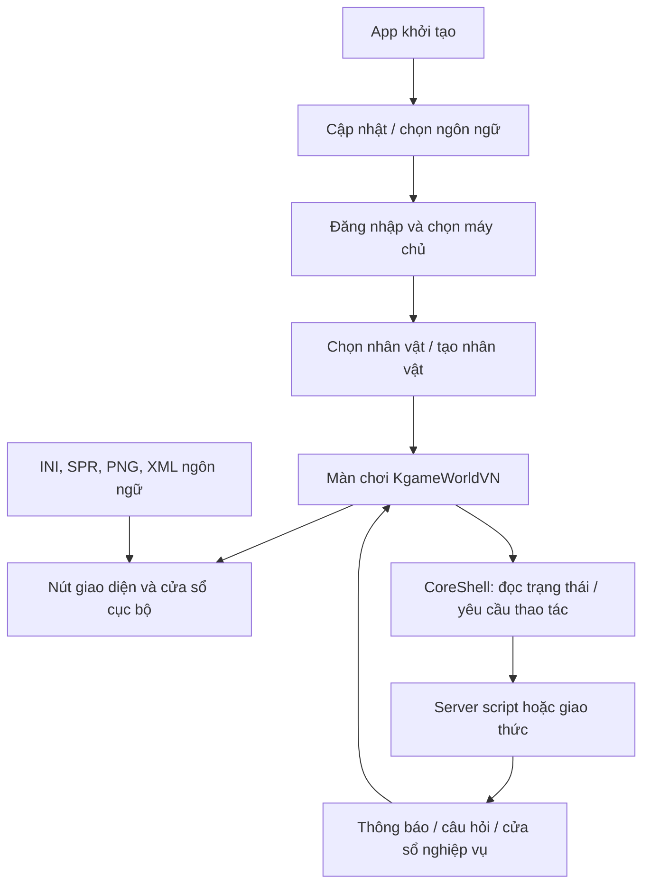

## TÓM TẮT 5 DÒNG
1. [THẤY] Client có luồng đăng nhập/chọn nhân vật, một màn chơi chính và nhiều lớp UI tạo theo nút hoặc sự kiện; số tệp .cpp không phải số màn hình. C/AppDelegate.cpp:183–185; C/gamescene/KgameWorld.cpp:389–416.
2. [THẤY] Scene mở các cửa sổ vật phẩm, kỹ năng, nhiệm vụ, đội/bang hội, giao dịch và hội thoại qua các lớp riêng. C/gamescene/KgameWorld.cpp:2295–2714, 13289–14321; C/vn/gamescence/KgameWorldVN.cpp:1986–2190, 2512–2604, 2934–2950.
3. [THẤY] UI nhận trạng thái qua CoreShell, đọc một số tệp cấu hình/tài nguyên, hoặc nhận hộp thoại từ giao thức và script server. C/gamecore/CoreShell.cpp:1723–1743, 2276–2298; C/gamecore/KProtocolProcess.cpp:246–260; S/Core/Src/ScriptFuns.cpp:24266–24308.
4. [THẤY] Nhánh VN kế thừa KgameWorld, dựng toolbar và một số lớp riêng, đồng thời dùng lại hộp thoại/lớp gốc. [CHƯA KIỂM] Chưa so mọi màn hình hoặc hành vi chạy. C/vn/gamescence/KgameWorldVN.h:19–20; C/vn/gamescence/KgameWorldVN.cpp:669–748, 1986–2190.
5. [CHƯA KIỂM] Chỉ đọc tĩnh; chưa chạy build, exe, VM, mạng hoặc thiết bị; chưa xác nhận dữ liệu/tài nguyên trong bản cài đặt.

# SO-11 — Sổ tay giao diện client và hộp thoại

## Khối thông tin

- **Loại:** tổng hợp
- **Chủ đề:** Chỉ dẫn tĩnh về nhóm màn hình, tác dụng trong source và nguồn dữ liệu UI của client cocos thuộc task.
- **Từ khóa:** giao diện client, UI, hộp thoại, gameui, VN, KgameWorld, CoreShell, script, Cocos2d-x
- **Trạng thái:** DONE — hoàn thành sổ tay trong phạm vi đọc tĩnh; khác biệt runtime vẫn chưa xác minh.
- **Độ phủ:** 140/140 tệp `.cpp` được liệt kê theo hai thư mục UI và tìm signature/call site; đã mô tả các nhóm luồng có bằng chứng trực tiếp. Không đếm được tổng số màn hình của sản phẩm: các tệp gồm thành phần phụ và biến thể, còn nhiều lớp chỉ được thấy ở danh sách/điểm gọi.
- **Liên quan:** `JX1_OPS/REPORTS/K-02-giao-dien.md`, `JX1_OPS/REPORTS/H-05-ui-cuong-hoa.md`, `JX1_OPS/REPORTS/H-10-phim-tat-thanh-nut.md`, `JX1_OPS/REPORTS/H-11-nut-he-thong-cai-dat.md`, `JX1_OPS/DESIGN/MUC-LUC-TRI-THUC.md`
- **Cần tôi quyết định:** không

## Luồng chính

`AppDelegate` khởi chạy scene cập nhật Việt; scene cập nhật đặt chuỗi tiếng Trung hoặc Việt rồi chuyển vào màn đăng nhập Việt. Scene chuyển tiếp dẫn đến `KgameWorldVN`. Sơ đồ diễn giải các điểm gọi trong source, không chứng minh mọi nhánh hay phiên bản triển khai. `C/AppDelegate.cpp:183–185`; `C/vn/gamescence/KUpdateLayerVN.cpp:83–90, 381–390`; `C/vn/gameui/Klogin_f_VN.cpp:435`; `C/vn/gameui/KTranSenceVN.cpp:12–33`.

## Phạm vi và đường dẫn

- `C` = `C:/Jx1CocoV3/Folder/Client2912-20260116T044348Z-3-001/Client2912/Client/Classes` (client được task chỉ định).
- `S` = `C:/Jx1CocoV3/SwordOnline/SwordOnline/jxOnline/gameserver/Sources` (server được task chỉ định; chỉ đọc các điểm script/giao thức trực tiếp liên quan).
- Đã tra cứu nội dung liên quan trong bốn báo cáo được task liệt kê: `JX1_OPS/REPORTS/K-02-giao-dien.md`, `H-05-ui-cuong-hoa.md`, `H-10-phim-tat-thanh-nut.md`, `H-11-nut-he-thong-cai-dat.md`. Chúng là ngữ cảnh và không được coi là thay cho source đang kiểm tra.
- Duyệt có giới hạn danh sách tệp `.cpp` trực tiếp trong `C/gameui` (87) và `C/vn/gameui` (53), rồi tìm chữ ký tạo lớp và đường gọi trong hai scene. Đây là 140 tệp mã được kiểm kê, không phải 140 cửa sổ; danh sách gồm helper, lớp dẫn xuất và biến thể cũ. Không đọc toàn bộ thân của 140 tệp.
- Đã kiểm mã ứng dụng cập nhật/khởi chạy, hai scene game, các callback mở giao diện, một số lớp đại diện cho từng nhóm, đường nhận hộp thoại qua CoreShell/giao thức, và các điểm script mở giao diện trên server. Không khảo sát toàn bộ thư viện Cocos hoặc toàn bộ script/game data.

## Phạm vi và độ phủ

| Phần tử | Kết quả và mức kiểm | Bằng chứng |
|---|---|---|
| Scene cập nhật/đăng nhập/chọn server/nhân vật/tạo nhân vật | [THẤY] Có các scene riêng; tìm thấy chỗ đọc INI, danh sách server cục bộ và các chỗ đổi scene. Chưa lần hết mọi nhánh đăng nhập. | `C/AppDelegate.cpp:183–185`; `C/vn/gamescence/KUpdateLayerVN.cpp:83–90, 381–390`; `C/vn/gameui/Klogin_f_VN.cpp:23, 435`; `C/vn/gameui/KuiSelserverVN.cpp:10, 204`; `C/vn/gameui/KuiSelPlayerVN.cpp:12, 399, 408`; `C/vn/gameui/KuiNewPlayerVN.cpp:9` |
| Cảnh chơi và thanh nút chính | [THẤY] Cảnh gốc `KgameWorld`; `KgameWorldVN` dựng lại scene, thanh nút Việt và menu thao tác. | `C/gamescene/KgameWorld.cpp:389–416, 1059–1096, 1138–1239`; `C/vn/gamescence/KgameWorldVN.h:19–20`; `C/vn/gamescence/KgameWorldVN.cpp:239–283, 669–748, 752–797` |
| Nhân vật, trạng thái, trang bị | [THẤY] Các callback mở hồ sơ/trạng thái; lớp VN `KuiRoleStateVN` dẫn xuất từ lớp chung. Source cho thấy truy vấn/cập nhật core; không xác minh nội dung màn hình khi chạy. | `C/gamescene/KgameWorld.cpp:2687–2714`; `C/vn/gamescence/KgameWorldVN.cpp:2550–2578`; `C/vn/gameui/KuiRoleStateVN.h:14`; `C/gameui/KuiRoleState.cpp:229, 242` |
| Túi đồ, vật phẩm, trang bị mở rộng, mô tả vật phẩm | [THẤY] Có nhiều lớp túi/khung vật phẩm, lựa chọn bản cũ và mới ở một số điểm gọi. `GetGameData` cấp danh sách vật phẩm và thao tác gửi yêu cầu đến CoreShell. | `C/gamescene/KgameWorld.cpp:2306–2310, 2611–2668`; `C/gamecore/CoreShell.cpp:2276–2298`; `C/gameui/KuiItem.cpp:169–178, 624, 803`; `C/vn/gameui/KuiItemVN.h:10` |
| Ô dùng vật phẩm nhanh | [THẤY] Có lớp riêng cho UI VN; mã duyệt ba vị trí `m_refItem` để cập nhật từ danh sách vật phẩm. Báo cáo H-10 chỉ là đối chiếu phụ. | `C/vn/gamescence/KgameWorldVN.cpp:520`; `C/vn/gameui/KuiItemImmediaBoxVN.cpp:263–269, 301–318` |
| Kho/két và kho mở rộng | [THẤY] Có lớp kho VN dẫn xuất và scene VN đặt cùng lớp kho với túi vật phẩm; tác vụ kho phụ thuộc trạng thái vật phẩm/core. | `C/vn/gameui/KuistoreBoxVN.h:17`; `C/vn/gamescence/KgameWorldVN.cpp:5880–5901, 5904–5918`; `C/gameui/KuistoreBox.cpp:296, 407` |
| Kỹ năng, điểm kỹ năng và mô tả | [THẤY] Màn kỹ năng gọi `GDI_FIGHT_SKILLS`, có thao tác tăng cấp; nhánh Việt có lớp dẫn xuất. | `C/gamescene/KgameWorld.cpp:2521–2529`; `C/gameui/KuiSkill.cpp:127, 636, 647`; `C/gamecore/CoreShell.cpp:2373–2378`; `C/vn/gameui/KuiSkillVN.h:14`; `C/vn/gamescence/KgameWorldVN.cpp:2182–2190` |
| Tự động chiến đấu/cấu hình | [THẤY] Có callback mở `KuiAutoPlay`; lớp đọc các tệp cấu hình auto/skill. [CHƯA KIỂM] Không kiểm trạng thái bật, hiệu quả hay cấu hình của người chơi thật. | `C/gamescene/KgameWorld.cpp:4331, 4381`; `C/gameui/KuiAutoPlay.cpp:278–285` |
| Nhiệm vụ và dấu theo dõi | [THẤY] Có lớp danh sách nhiệm vụ, lớp theo dõi và thông báo dữ liệu/tìm đường. Bản Việt dùng `uitasklist_vn.ini`. | `C/gamescene/KgameWorld.cpp:666, 2340`; `C/gameui/GameSpaceChangedNotify.cpp:69–97`; `C/gameui/KuiTaskInfo.cpp:124, 955–963`; `C/vn/gameui/KuiTaskInfoVN.cpp:77` |
| Bản đồ, chuyển bản đồ, bản đồ nhỏ/lớn | [THẤY] Scene mở bản đồ nhỏ/lớn và các lớp chuyển/định vị; mã đọc chỉ số bản đồ/tệp chỉ dẫn trong một số đường đi. Không xác minh mọi tệp bản đồ được đóng gói. | `C/gamescene/KgameWorld.cpp:4280, 4456, 4740–4782, 6159`; `C/gameui/KuiCometoMap.cpp:210, 358–361`; `C/vn/gamescence/KgameWorldVN.cpp:1611, 2701`; `C/vn/gameui/KuiMaxMapVN.cpp:49` |
| Đội, bang hội, bạn bè | [THẤY] Có màn hình đội và bang hội trong scene; nhánh Việt mở `KuiTeamVN`, `KuiTongInfoVN`, `KuiFriendListVN`. Các yêu cầu lấy/cập nhật thông tin đi qua CoreShell hoặc trạng thái client. | `C/gamescene/KgameWorld.cpp:2465, 2511`; `C/vn/gamescence/KgameWorldVN.cpp:2597–2605, 2934–2950`; `C/gameui/KuiTeam.cpp:402`; `C/vn/gameui/KuiTeamVN.cpp:295, 327–331`; `C/vn/gameui/KuiTongCreateSheetVN.cpp:285`; `C/vn/gameui/KuiFriendListVN.cpp:612` |
| Cửa sổ chức năng NPC, cửa hàng NPC và sự kiện | [THẤY] Chọn NPC mở lớp chức năng; cửa hàng mở túi kèm màn mua. UI động đọc cấu hình loại cửa hàng. Không suy ra giá hay tồn kho thật từ source UI. | `C/gamescene/KgameWorld.cpp:13738–13762, 13852–13856`; `C/vn/gamescence/KgameWorldVN.cpp:2512–2537, 2607–2618`; `C/gameui/KuiDynamicShop.cpp:198–212, 500`; `C/vn/gameui/KuiShopVN.cpp:18, 80, 111` |
| Trao đổi, cửa hàng người chơi, bán và xem trang bị người chơi | [THẤY] Có các cửa sổ xem/trade/bán; một phần mở theo thông báo nghiệp vụ. Mã gửi thao tác đến CoreShell; không kiểm kết quả server khi chạy. | `C/gamescene/KgameWorld.cpp:14001–14125`; `C/gameui/GameSpaceChangedNotify.cpp:177–202, 222–242`; `C/gameui/KuiPlayerTrade.cpp:389–410`; `C/vn/gamescence/KgameWorldVN.cpp:5924–5940` |
| Luyện/chế tạo, chuyển đồ và tiến trình | [THẤY] Các lớp UI mở theo callback thông báo; có thao tác hợp thành/phân tách và thanh tiến trình. Phạm vi business server riêng, không khẳng định thành công giao dịch. | `C/gamescene/KgameWorld.cpp:4136, 13869–13875, 13925–13931, 14245–14259`; `C/gameui/KuiCompoundItem.cpp:1029–1064`; `C/gameui/KuiWenGamgItem.cpp:1023–1058` |
| Hội thoại NPC, câu hỏi lựa chọn, xác nhận | [THẤY] Gói hành động script chuyển câu hỏi/hội thoại thành dữ liệu CoreDataChanged; scene tạo lớp thoại/chọn và thao tác chọn gửi lại yêu cầu core. | `S/Core/Src/ScriptFuns.cpp:2043, 2219, 2403, 2595, 2828, 3684, 3785`; `C/gamecore/KPlayer.cpp:3878–3902, 4043–4046, 4059–4067`; `C/gamescene/KgameWorld.cpp:13289–13523`; `C/gameui/KuiDialog.cpp:50, 460`; `C/gameui/KuiTalkDialog.cpp:50, 648–675` |
| Chuỗi nhập liệu, cảnh báo, thư hệ thống và thông báo nổi | [THẤY] Có các lớp nhập chuỗi/cảnh báo và nhiều loại thông báo; một số được tạo khi có dữ liệu thông báo. Chưa đối chiếu toàn bộ loại thông báo/điều kiện server. | `C/gamescene/KgameWorld.cpp:13722–13728, 13795–13826, 14539`; `C/gameui/GameSpaceChangedNotify.cpp:100–109`; `C/gameui/KuiWarnInfo.cpp:59`; `C/gamecore/KPlayer.cpp:4172–4197, 4201` |
| Cài đặt và rời phiên | [THẤY] Nút cài đặt mở `KuiOptions`; lớp đọc/ghi `jx50ai/Setting.ini`. Nút thoát và xử lý rời mạng không đồng nghĩa xác nhận đã đăng xuất trên runtime. | `C/vn/gamescence/KgameWorldVN.cpp:1741–1757`; `C/gameui/KuiOptions.cpp:56, 111–116, 364, 376, 440–457`; `C/gameui/KuiEscInfo.cpp:281` |
| Khác biệt UI VN | [THẤY] Dùng ảnh `ui_vn/toolbar`, có các lớp đặc thù hoặc dẫn xuất. Cảnh VN vẫn gọi lại một số lớp dùng chung như `KuiTalkDialog1`, `KuiAutoPlay`, `KuiOptions` và `Kuiplayerfun`. Chưa so từng pixel/chuỗi/tất cả callback của 140 tệp. | `C/vn/gamescence/KgameWorldVN.h:19–20`; `C/vn/gamescence/KgameWorldVN.cpp:669–748, 1750, 1986, 2189, 2832`; `C/vn/gameui/KuiItemVN.h:10`; `C/vn/gameui/KuiRoleStateVN.h:14`; `C/vn/gameui/KuiPlayerTradeVN.h:11` |
| Số lượng tệp, không phải số lượng màn hình | [THẤY] Có 87 tệp `.cpp` ở `gameui` và 53 ở `vn/gameui`. Bao gồm helper, UI overlay và lớp biến thể/kế thừa; không thể lấy tổng này làm số cửa sổ. | Kết quả liệt kê trực tiếp hai thư mục `C/gameui` và `C/vn/gameui`; điểm tạo lớp mẫu: `C/gamescene/KgameWorld.cpp:2306–2529`; `C/vn/gamescence/KgameWorldVN.cpp:1986–2190` |

## Giải mã tên

| Tên gốc | Mã hóa | Chữ đúng UTF-8 | Nguồn file:dòng |
|---|---|---|---|
| Tiếu Ngạo Giang Hồ Lục | UTF-8 | Tiếu Ngạo Giang Hồ Lục (tên trong thông báo nút nhiệm vụ) | C/vn/gamescence/KgameWorldVN.cpp:705 |
| Không xác định được tên kỹ năng, trang bị, quái, NPC hoặc bản đồ cụ thể trong các đoạn UI được đọc | — | Chưa xác định; task tập trung vào đường gọi và nhóm màn hình, không đọc danh mục game/tài nguyên tên riêng | C/gamescene/KgameWorld.cpp:2306–2529; C/vn/gamescence/KgameWorldVN.cpp:1986–2190 |

## Sắp theo cấu trúc game

1. [THẤY] **Vào game:** scene cập nhật → đăng nhập → chọn máy chủ → chọn/tạo nhân vật → chuyển tiếp → cảnh chơi. `C/AppDelegate.cpp:183–185`; `C/vn/gamescence/KUpdateLayerVN.cpp:381–390`; `C/vn/gameui/Klogin_f_VN.cpp:435`; `C/vn/gameui/KTranSenceVN.cpp:12–33`.
2. [THẤY] **Trong cảnh chơi, nút thường dùng:** nhân vật/trạng thái → hành trang → kỹ năng → nhiệm vụ → bạn bè/tổ đội/bang hội → cài đặt/shop; các menu phụ gồm giao dịch, giao tiếp, ngồi và chọn NPC. `C/vn/gamescence/KgameWorldVN.cpp:669–797`.
3. [THẤY] **Dữ liệu thế giới:** bản đồ nhỏ/lớn và di chuyển; nhiệm vụ/dấu theo dõi; tương tác NPC, hội thoại, cửa hàng, giao dịch; hộp vật phẩm/kho. `C/gamescene/KgameWorld.cpp:4280, 4456, 4740–4782, 6159, 13289–14321`.
4. [THẤY] **Tác vụ và phản hồi:** thông báo hệ thống, hộp xác nhận/chọn, tin nổi và thanh tiến trình. `C/gameui/GameSpaceChangedNotify.cpp:100–109`; `C/gamecore/KPlayer.cpp:4043–4046, 4172–4201`; `C/gamescene/KgameWorld.cpp:13795–13826, 14245–14259`.
5. [CHƯA KIỂM] Chưa có thứ tự màn hình đầy đủ theo một lượt chơi thật; thứ tự trên là nhóm chức năng theo cây gọi/mục đích, không phải kịch bản trải nghiệm đã đo.

## Mỗi nhóm làm gì và dữ liệu lấy từ đâu

Các mô tả dưới đây gắn `[THẤY]` khi tên lớp/đường gọi/đọc dữ liệu có trong source. Nhãn này chỉ xác nhận đường mã tĩnh, không xác nhận hình dạng cuối, hành vi thực tế hoặc nội dung trên server.

| Nhóm UI | Chức năng thể hiện trong mã | Nguồn dữ liệu thể hiện trong mã |
|---|---|---|
| [THẤY] Hồ sơ, túi, kho | Hiển thị thông tin nhân vật/vật phẩm; nhận cập nhật vật phẩm, đưa vật phẩm vào vùng túi/kho. | `CoreShell::GetGameData` và `OperationRequest` đọc danh sách/vị trí từ trạng thái client (`C/gamecore/CoreShell.cpp:1723–1743, 2276–2298`; `C/gameui/KuiItem.cpp:169–178`). Dữ liệu mẫu tĩnh/INI và SPR được lớp UI nạp ở một số cửa sổ (`C/gameui/KuistoreBox.cpp:407`). |
| [THẤY] Kỹ năng | Liệt kê kỹ năng/điểm, hiển thị mô tả và gửi thao tác nâng cấp/chọn. | `GDI_FIGHT_SKILLS`, `GDI_FIGHT_SKILL_POINT` lấy qua core (`C/gameui/KuiSkill.cpp:127, 636–647`; `C/gamecore/CoreShell.cpp:2373–2378`). |
| [THẤY] Nhiệm vụ | Đọc chỉ mục/nội dung hướng dẫn tĩnh; nhận thông điệp nhiệm vụ và dữ liệu tìm đường. | `\\Ui\\uitasklist.ini`, biến thể Việt `\\Ui\\uitasklist_vn.ini`, và thông báo core (`C/gameui/KuiTaskInfo.cpp:124, 955–963`; `C/vn/gameui/KuiTaskInfoVN.cpp:77`; `C/gameui/GameSpaceChangedNotify.cpp:86–96`). Nội dung nhiệm vụ sống không được truy hết. |
| [THẤY] Cửa sổ mua/bán | Dùng chỉ số cửa hàng, thông tin core và tệp cấu hình loại cửa hàng để dựng danh sách; gửi yêu cầu giao dịch. | `GDI_LAOHUJI_INFO`, `\\settings\\Marketshop\\type.txt`, `GOI_TRADE_NPC_BUY` (`C/gameui/KuiDynamicShop.cpp:123, 198–212, 500`; `C/vn/gameui/KuiShopVN.cpp:80, 111`). Giá/kho thực tế: [CHƯA KIỂM]. |
| [THẤY] Hội thoại/câu hỏi | Nhận nội dung và lựa chọn của script; hiển thị, rồi gửi chỉ số lựa chọn hoặc báo xác nhận. | `PLAYER_SCRIPTACTION_SYNC`/các lệnh UI từ server được chuyển qua `KPlayer::OnScriptAction` và `GDCNI_QUESTION_CHOOSE` (`C/gamecore/KPlayer.cpp:3878–3902, 4043–4046`). Hộp hỏi/trả lời dùng `GOI_QUESTION_CHOOSE` (`C/gameui/KuiDialog.cpp:437–460`); hộp lời thoại thông báo xác nhận bằng `GOI_INFORMATION_CONFIRM_NOTIFY` (`C/gameui/KuiTalkDialog.cpp:648–675`). |
| [THẤY] Hộp give/đặt đồ theo yêu cầu | Hiển thị mô tả/title/callback và vùng item; người dùng xác nhận/hủy theo lớp give của client. | Server script `LuaGiveItemUI` tạo `PLAYER_GIVE`, giới hạn số ô ở 24 và gửi gói mở UI (`S/Core/Src/ScriptFuns.cpp:24266–24308`). Client `SyncGive` chuyển thành sự kiện UI và scene tạo `KuiGive_New`/`KuiGiveVN` (`C/gamecore/KProtocolProcess.cpp:246–260`; `C/gameui/GameSpaceChangedNotify.cpp:204–214`; `C/vn/gamescence/KgameWorldVN.cpp:6181–6204`). Đây là nguồn dữ liệu giao thức, không phải nội dung PAK được kiểm.
| [THẤY] Cài đặt | Đọc/ghi một số tùy chọn cục bộ và tác động vào đối tượng client. | `jx50ai/Setting.ini` (`C/gameui/KuiOptions.cpp:111–116, 364, 440–457`). [CHƯA KIỂM] Đường lưu vật lý, quyền, giá trị thực trong thiết bị và đồng bộ.
| [THẤY] Giao diện/chuỗi VN | Dùng ảnh PNG ở `ui_vn/toolbar`; chọn XML ngôn ngữ và chuyển chuỗi trong mã VN. | Chọn `string_cn.xml` hoặc `string_vn.xml` (`C/vn/gamescence/KUpdateLayerVN.cpp:83–90`); `translate` phân nhánh theo `_clientlanguage` và gọi chuyển mã (`C/vn/Translate.cpp:37–53`). Không xác nhận bảng dịch/tài nguyên của mọi màn hình.

## So sánh bản gốc và nhánh VN

- [THẤY] `KgameWorldVN` kế thừa `KgameWorld` (`C/vn/gamescence/KgameWorldVN.h:19–20`). Vì vậy không nên coi mọi cửa sổ VN là bản viết lại: ví dụ scene VN gọi lớp chung `KuiOptions`, `KuiAutoPlay`, `KuiTalkDialog1` và `Kuiplayerfun` (`C/vn/gamescence/KgameWorldVN.cpp:1750, 2832, 3334, 1448`).
- [THẤY] Toolbar Việt nạp ảnh tên Việt từ `ui_vn/toolbar`, ghép nút nhân vật, hành trang, võ công, nhiệm vụ, bạn hữu, tổ đội, bang hội, cài đặt và kỳ trân các (`C/vn/gamescence/KgameWorldVN.cpp:669–748`). Menu dọc riêng có giao dịch, giao tiếp, ngồi và đi/chạy (`:752–797`). Đường nút nhiệm vụ ban đầu bị vô hiệu rồi được thay bằng thông báo text trên scene (`:693–713`); không suy rằng nút mở sổ nhiệm vụ từ đường này.
- [THẤY] Một số lớp có biến thể/dẫn xuất, như `KuiItemVN`, `KuiskillVN`, `KuiRoleStateVN`, `KuistoreBoxVN`, `KuiPlayerTradeVN`; các lớp khác chỉ có bản VN riêng theo thư mục `vn/gameui`. Bằng chứng dẫn xuất: `C/vn/gameui/KuiItemVN.h:10`; `KuiSkillVN.h:14`; `KuiRoleStateVN.h:14`; `KuistoreBoxVN.h:17`; `KuiPlayerTradeVN.h:11`.
- [TÀI LIỆU] Báo cáo H-05 đã so sánh riêng một luồng cường hóa và H-11 đã so sánh một tập file cài đặt giữa cây gốc/Coco. Các kết luận ấy không mở rộng thành so sánh toàn bộ giao diện của hai bản. `JX1_OPS/REPORTS/H-05-ui-cuong-hoa.md:60–76`; `H-11-nut-he-thong-cai-dat.md:162–184`.
- [CHƯA KIỂM] Chưa so sánh hình ảnh, nội dung dịch, vị trí/kích thước, mọi sự kiện chạm, hoặc trạng thái hiển thị trên thiết bị; không khẳng định mức tương đồng toàn bộ bản VN và bản gốc.

## Mục sổ thông số

| Nhóm | Tên/hằng số | file:dòng | Giá trị | Đơn vị | Ảnh hưởng | Đổi an toàn | Nguồn đo |
|---|---|---|---|---|---|---|---|
| Âm thanh | AAAA/MusicSound | C/gameui/KuiOptions.cpp:122–126, 396–400 | 0–1; mặc định source 0.5 | tỷ lệ UI | Nhạc nền; lưu vào jx50ai/Setting.ini | CẨN THẬN | Đọc tĩnh; không kiểm tra khi chạy |
| Âm thanh | AAAA/SoundEffect | C/gameui/KuiOptions.cpp:142–146, 367–381 | 0–1; mặc định source 0.5 | tỷ lệ UI | Âm hiệu; callback cũng gọi SetGameVolume | CẨN THẬN | Đọc tĩnh; chưa đo âm thanh runtime |
| Thu phóng | AAAA/ScaleZoom | C/gameui/KuiOptions.cpp:163–180, 435–442 | 0.75–1.5; mặc định source 1.0 | hệ số | Gọi scaleKgameWorld; slider bị ẩn trong đoạn tạo UI tại :180 | CẨN THẬN | Đọc tĩnh; chưa kiểm đường tương tác |
| Hiển thị | AAAA/LimitFPS | C/gameui/KuiOptions.cpp:183–193, 446–464 | slider 30–90; mặc định source 60; handler clamp 30–120 | FPS | Gọi setAnimationInterval; miền slider và giới hạn handler khác nhau | CẨN THẬN | Đọc tĩnh; chưa đo FPS |

Các số là mặc định/miền trong source, không phải số đo hoặc giá trị đọc từ máy người chơi. Xem đối chiếu chuyên biệt JX1_OPS/REPORTS/H-11-nut-he-thong-cai-dat.md.

## Đề xuất tối ưu

Không đề xuất đổi giao diện hay cấu hình. Trước khi có đề xuất thay đổi cần kiểm tài nguyên và chạy thử trong phạm vi được duyệt riêng.

## Đã xác minh / Chưa xác minh

### Đã xác minh

- [THẤY] `AppDelegate` chạy scene cập nhật VN và `KgameWorldVN` dựng cảnh Việt; đường cập nhật/chuyển scene có các điểm dẫn ở trên. `C/AppDelegate.cpp:183–185`; `C/vn/gamescence/KUpdateLayerVN.cpp:381–390`; `C/vn/gameui/KTranSenceVN.cpp:12–33`.
- [THẤY] Cửa sổ túi, kỹ năng, nhiệm vụ, đội/bang, map và một số hội thoại mở từ scene hoặc notification handler; các bằng chứng nằm trong bảng phạm vi.
- [THẤY] Có ít nhất ba nguồn dữ liệu UI: trạng thái client qua CoreShell, script/gói thông báo server, và file cục bộ/tài nguyên UI/chuỗi.
- [TÀI LIỆU] Bốn báo cáo nguồn được task chỉ định tồn tại và đã dùng như ngữ cảnh; báo cáo cường hóa xác nhận đường riêng `runscript`/`opensysui` và lớp give (`JX1_OPS/REPORTS/H-05-ui-cuong-hoa.md:79–104`).
- [THẤY] Đã chạy lệnh đọc tĩnh PowerShell (`Get-Content`, `Get-ChildItem`, `Select-String`) trên các file/đường dẫn nêu trong phần phạm vi. Không chạy build/test runtime, exe, VM hoặc mạng.

### Chưa xác minh

- [CHƯA KIỂM] Giao diện nhìn thấy, thứ tự/điều kiện xuất hiện, kích thước thực, phản hồi chạm, tính đúng của bản dịch, hiệu lực thao tác hoặc hành vi khi mất kết nối.
- [CHƯA KIỂM] Bản triển khai cụ thể có chứa các INI/SPR/PNG/XML mà source tham chiếu hay không; nội dung cấu hình tài khoản/người chơi thật không được đọc.
- [CHƯA KIỂM] Toàn bộ 140 lớp và mọi call site, mọi script mở UI, UI PC ngoài cây cocos được chỉ định, và khác biệt toàn phần giữa client gốc với client Việt.
- [CHƯA KIỂM] Lệnh `rg` không có trong môi trường; tìm kiếm được giới hạn bằng `Select-String` và liệt kê bằng `Get-ChildItem`. Không cài công cụ thay thế.
- [CHƯA KIỂM] Không ghi được nhịp tại `D:\JX-wt\SO-11.nhip`: sandbox từ chối quyền ghi ngoài workspace. Không tạo tệp thay thế ngoài phạm vi.

## Bàn giao

- Đã tạo `JX1_OPS/DESIGN/SO-TAY-GIAO-DIEN.md` trong phạm vi được giao. Không sửa mã nguồn.
- Không chạy build/test/executable/VM/mạng theo giới hạn task.
- Chưa tạo chỉ mục TSV: task giới hạn vùng sửa ở đầu ra trên; hàng chỉ mục đề xuất để PM gộp: `SO-TAY-GIAO-DIEN.md | tổng hợp | Sổ tay nhóm giao diện client và nguồn dữ liệu tĩnh | giao diện client, UI, hộp thoại, gameui, VN, KgameWorld, CoreShell, script | DONE | 140/140 tệp được kiểm kê và tìm call site; chưa đếm số cửa sổ | K-02-giao-dien.md; H-05-ui-cuong-hoa.md; H-10-phim-tat-thanh-nut.md; H-11-nut-he-thong-cai-dat.md`.
- Không stage/commit/push theo yêu cầu.
- Kỹ năng đã dùng: jx1-retrofit, jx1-read-server, jx1-read-client, jx1-parameters, jx1-knowledge, jx1-report.
