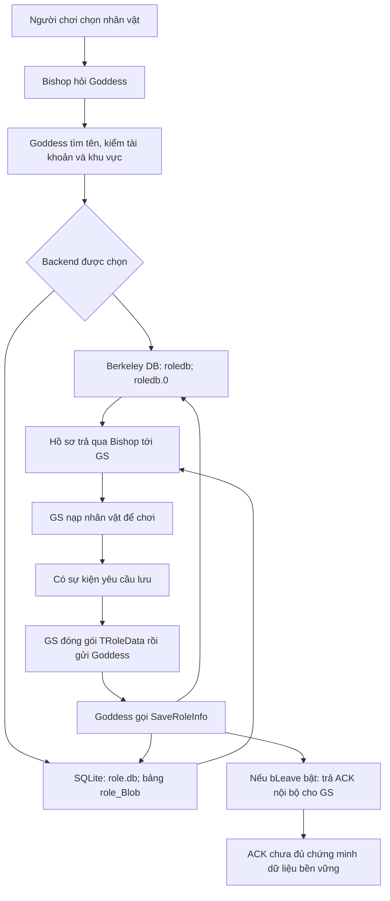

TÓM TẮT 1: [NGUỒN][THẤY] Goddess nhận hồ sơ nhân vật từ GS để lưu và trả hồ sơ cho Bishop khi nạp; đây là đường mã nguồn, chưa phải kết quả chạy thật (`G/ClientNode.cpp:469-503,663-743`).
TÓM TẮT 2: [NGUỒN][THẤY] Nhánh DB dùng `database/roledb` cùng chỉ mục `roledb.0`; nhánh SQL được khảo sát dùng SQLite, bảng `role_Blob` trong `database/role.db` (`G/IDBRoleServer.cpp:191-207,334-343`; `G/sqlitel_db.cpp:81-105,557-564`).
TÓM TẮT 3: [NGUỒN][THẤY] Có đường lưu lúc tạo nhân vật, mất kết nối đủ điều kiện, chuyển GS và giao dịch; lời gọi AutoSave tìm thấy trong vòng lặp đang bị chú thích (`G/ClientNode.cpp:440`; `S/MultiServer/GameServer/KSOServer.cpp:175-176,4938-4955`; `S/Core/Src/KPlayerSet.cpp:1064-1086`; `S/Core/Src/KPlayer.cpp:7027-7036`; `S/Core/Src/KSubWorldSet.cpp:610`).
TÓM TẮT 4: [NGUỒN][THẤY] Cần phân biệt tạo gói, gửi gói, kết quả ghi và độ bền: nhánh SQL không kiểm kết quả cập nhật, còn đường nhận ACK ở GS không kiểm byte kết quả (`S/Core/Src/KPlayer.cpp:927-952`; `G/IDBRoleServer.cpp:760-787`; `S/MultiServer/GameServer/KSOServer.cpp:2916-2948`).
TÓM TẮT 5: [CHƯA KIỂM] Chưa xác nhận backend/binary hiện hành, chu kỳ lưu thực tế hay mức mất dữ liệu khi sự cố; không build, test game, chạy exe, VM hoặc mạng, đúng giới hạn `JX1_OPS/TASKS/SO-14.md:27-30`.

# SO-14 — Sổ tay hiểu game: Goddess lưu nhân vật

Loại: tổng hợp
Chủ đề: Nhân vật được nạp, đóng gói, gửi lưu và ghi vào kho dữ liệu thế nào; vì sao tiến trình chơi mới nhất có thể không còn sau sự cố.
Từ khóa: lưu nhân vật, nạp nhân vật, Goddess, DBTable, IDBRoleServer, roledb, role_Blob, SQLite, AutoSave, ACK
Trạng thái: DONE — hoàn tất sổ tay theo phạm vi đọc tĩnh; các câu hỏi về chạy thật được ghi CHƯA KIỂM.
Độ phủ: đã phủ 9/9 nhóm câu hỏi trong bảng dưới; chưa kiểm chứng vận hành.
Liên quan: `JX1_OPS/REPORTS/A-02-luong-dang-nhap.md`; `JX1_OPS/REPORTS/E-07-goi-tao-nhan-vat-logout.md`; `JX1_OPS/REPORTS/N-05.md`; `JX1_OPS/REPORTS/SO-14.md`.
Cần tôi quyết định: không đối với nội dung khảo sát; mọi thử nghiệm vận hành cần nhiệm vụ được duyệt riêng.

## Sơ đồ chính

[THẤY — ĐÃ XÁC MINH TĨNH] Sơ đồ rút từ đường lấy hồ sơ ở `B/GamePlayer.cpp:1903-1918,2139-2158`, `G/IDBRoleServer.cpp:486-559`, đường nạp ở `S/Core/Src/CoreServerShell.cpp:423-453,496-509`, và đường gửi/ghi ở `S/Core/Src/KPlayerDBFuns.cpp:44-118`, `G/ClientNode.cpp:469-503`. Mũi tên là quan hệ trong source, không phải bản ghi lưu lượng đã đo.

## Phạm vi và độ phủ

| Nhóm câu hỏi | Độ phủ | Bằng chứng chính / giới hạn |
|---|---|---|
| 1. Goddess đứng ở đâu trong vòng đời nhân vật? | Đã phủ tĩnh | [THẤY] `B/GamePlayer.cpp:1903-1918,2139-2158`; `G/ClientNode.cpp:469-503,663-743`. |
| 2. Bảng/kho nào chứa nhân vật? | Đã phủ cả hai nhánh | [THẤY] `G/IDBRoleServer.cpp:191-207,334-343`; `G/DBTable.cpp:107-128`; `G/sqlitel_db.cpp:81-105,557-564`. |
| 3. Hồ sơ chứa những nhóm dữ liệu nào? | Đã phủ 6 nhóm đóng gói | [THẤY] `S/Core/Src/KPlayerDBFuns.cpp:410-434`; không kiểm từng trường, từng món đồ. |
| 4. Khi đăng nhập, hồ sơ được nạp thế nào? | Đã phủ đường chính | [THẤY] `G/IDBRoleServer.cpp:486-559,923-962`; `S/Core/Src/CoreServerShell.cpp:423-453,496-509`. |
| 5. Khi nào có yêu cầu ghi? | Đã phủ các điểm gọi được nêu | [THẤY] `G/ClientNode.cpp:440`; `S/Core/Src/KPlayer.cpp:7027-7036`; `S/Core/Src/KPlayerSet.cpp:1064-1086`; `S/MultiServer/GameServer/KSOServer.cpp:175-176,4938-4955`. Không tuyên bố đã liệt kê mọi điểm gọi trong toàn bộ game. |
| 6. Có tự lưu theo chu kỳ không? | Đã phủ hàm và điểm gọi tìm thấy | [THẤY] `S/Core/Src/KPlayerSet.cpp:1774-1795`; `S/Core/Src/KSubWorldSet.cpp:610`. [CHƯA KIỂM] Hoạt động trong binary. |
| 7. Kết quả lưu và ACK bảo đảm gì? | Đã phủ gửi, DB, SQL và nhận ACK | [THẤY] `S/Core/Src/KPlayerDBFuns.cpp:109-165`; `G/IDBRoleServer.cpp:760-787,876-920`; `S/MultiServer/GameServer/KSOServer.cpp:2916-2948`. |
| 8. Vì sao có thể rớt dữ liệu? | Đã phủ các khoảng hở có bằng chứng | [THẤY] `G/DBTable.cpp:40-42,194-234`; `G/sqlitel_db.cpp:1078-1099`; `G/IDBRoleServer.cpp:602-607,708-760,830-876`. [CHƯA KIỂM] Sự cố thực tế và lượng mất. |
| 9. Lưu thường, checkpoint và backup khác nhau thế nào? | Đã phủ cơ chế tĩnh | [THẤY] `G/DBTable.cpp:513-543`; `G/DBBackup.cpp:307-324,353-424`; `G/DBDumpLoad.cpp:48-70`. Chưa thử phục hồi. |

## Quy ước nguồn và độ chắc

- **THẤY** = đã mở đúng đoạn source hiện có và kiểm dòng; chỉ xác minh tĩnh. **TÀI LIỆU** = dẫn báo cáo cũ, không nâng thành bằng chứng chạy thật. **CHƯA KIỂM** = chưa có phép thử hoặc chưa đủ nguồn. Các nhãn này thực hiện yêu cầu `JX1_OPS/TASKS/SO-14.md:21,27-30`.
- `G/` = `C:/Jx1CocoV3/SwordOnline/SwordOnline/jxOnline/gateway/Sources/MultiServer/Goddess/`.
- `B/` = `C:/Jx1CocoV3/SwordOnline/SwordOnline/jxOnline/gateway/Sources/MultiServer/Bishop/`.
- `S/` = `C:/Jx1CocoV3/SwordOnline/SwordOnline/jxOnline/gameserver/Sources/`.
- `C/` = `C:/Jx1CocoV3/Folder/Client2912-20260116T044348Z-3-001/Client2912/Client/Classes/`.
- [THẤY] Đường dẫn Goddess ghi trong mục tiêu task thiếu `MultiServer`; vị trí thực có các tệp `G/DBTable.cpp`, `G/IDBRoleServer.cpp`. Vị trí này cũng được báo cáo cũ chỉ ra tại `JX1_OPS/REPORTS/A-02-luong-dang-nhap.md:70-74`. Không thay bằng root/build khác, không sửa task gốc ngoài mục Kết quả.
- [CHƯA KIỂM] Task không ghim SHA hoặc hash binary của bộ source trên đĩa; do đó tài liệu này không xác nhận bản đang chạy, theo giới hạn `JX1_OPS/TASKS/SO-14.md:29`.

## Giải mã tên

Không có danh sách tên nhân vật thật, kỹ năng, vật phẩm, NPC hoặc bản đồ trong phạm vi này. Các tên kỹ thuật dưới đây được giữ nguyên; không suy tên Hán/Việt từ chú thích lỗi chữ. Bằng chứng nhận diện nằm ở cột cuối.

| Tên gốc | Mã hóa phần tên | Chữ đúng / cách hiểu | Nguồn file:dòng |
|---|---|---|---|
| Goddess | ASCII | Tiến trình nhận yêu cầu nạp/lưu nhân vật | [THẤY] `G/ClientNode.cpp:469-503,663-743`. |
| Bishop | ASCII | Trung gian hỏi danh sách và hồ sơ khi vào game | [THẤY] `B/GamePlayer.cpp:1421-1452,1903-1918`. |
| DBTable / ZDBTable | ASCII | Lớp bọc thao tác Berkeley DB | [THẤY] `G/DBTable.cpp:97-128,199-234`. |
| IDBRoleServer / SaveRoleInfo | ASCII | Lớp giao tiếp và hàm lưu hồ sơ | [THẤY] `G/IDBRoleServer.h:43-55`; `G/IDBRoleServer.cpp:591`. |
| Berkeley DB / roledb / roledb.0 | ASCII | Kho chính và chỉ mục tài khoản | [THẤY] API `DB_BTREE`, `associate` ở `G/DBTable.cpp:107-128`; tên DB ở `G/IDBRoleServer.cpp:334-343`. |
| SQLite / sqlitel_db / role.db / role_bak.db | ASCII | Nhánh SQL dùng API sqlite3; kho chính và kho backup | [THẤY] `G/IDBRoleServer.cpp:191-196`; `G/sqlitel_db.cpp:81-105`. |
| role_Blob / StudentBlob | ASCII | Bảng hồ sơ và cột chứa gói dữ liệu | [THẤY] `G/IDBRoleServer.cpp:200-207`; `G/sqlitel_db.cpp:539-564`. |
| TRoleData / BaseInfo | ASCII | Gói hồ sơ và phần thông tin cơ bản | [THẤY] `G/IDBRoleServer.cpp:597,646-665`; `S/Core/Src/KPlayerDBFuns.cpp:410-434`. |
| AutoSave / ACK / bLeave | ASCII | Hàm tự lưu / phản hồi nội bộ / cờ yêu cầu phản hồi ở đường đã đọc | [THẤY] `S/Core/Src/KPlayerSet.cpp:1774-1795`; `G/ClientNode.cpp:495-503`. |

[THẤY] Báo cáo đầu ra dùng UTF-8 không BOM theo `JX1_OPS/DESIGN/CHUAN-BAO-CAO.md:29`. Source có chú thích tiếng Hán legacy đọc theo GBK/CP936 và có đoạn hiển thị lỗi; chỉ dùng symbol ASCII và luồng lệnh làm bằng chứng. [CHƯA KIỂM] Chưa chứng nhận toàn bộ mỗi tệp là một mã hóa duy nhất, hay tên nhân vật thực tế dùng GBK/TCVN3/UTF-8; không mở DB hoặc dump để kiểm (`G/IDBRoleServer.cpp:661-666`; `C/gameui/KSelPlayer.cpp:1185-1187`).

## Sắp theo cấu trúc game

[THẤY] Tài liệu đi theo vòng đời **chọn nhân vật → nạp để chơi → phát sinh yêu cầu lưu → ghi vào kho → nhận phản hồi → sao lưu/phục hồi**. Không xếp theo thứ tự các tệp source và không chia theo môn phái, vì đối tượng khảo sát là một hồ sơ nhân vật cùng đường lưu chung (`G/ClientNode.cpp:440,488,711`; `S/Core/Src/KPlayerDBFuns.cpp:410-434`).

## 1. Hồ sơ nhân vật được giữ ở đâu?

[THẤY] Có thể hình dung mỗi nhân vật là **một phong bì dữ liệu**. GS đóng vào đó sáu nhóm: thông tin cơ bản, kỹ năng chiến đấu, kỹ năng sinh hoạt, nhiệm vụ, đồ vật và bạn bè. Goddess nhận phong bì này để ghi; đoạn ghi không tách sáu nhóm thành sáu bảng nhân vật độc lập (`S/Core/Src/KPlayerDBFuns.cpp:410-434`; `G/DBTable.cpp:199-218`; `G/sqlitel_db.cpp:1085-1096`).

| Chế độ | Kho/bảng | Cách tìm một nhân vật | Dữ liệu ghi |
|---|---|---|---|
| DB (`DATA_KIND_DB = 0`) | [THẤY] `database/roledb`, dạng B-tree; chỉ mục tài khoản tên `roledb.0` | Tên nhân vật là khóa chính, gồm byte kết thúc chuỗi. Chỉ mục phụ lấy `BaseInfo.caccname` và cho phép một tài khoản có nhiều hồ sơ. | Gói `TRoleData` có độ dài `dwDataLen`. Nguồn: `G/IDBRoleServer.h:32-35`; `G/IDBRoleServer.cpp:65-74,334-343,876`; `G/DBTable.cpp:107-128,208-218`. |
| SQL (`DATA_KIND_SQL = 1`) | [THẤY] `database/role.db`, bảng `role_Blob`; `database/role_bak.db` có bảng cùng tên dùng cho backup | Hàm đọc dùng `roleName`; câu truy vấn đã đọc không dùng `ekey` làm điều kiện lọc. | Cột `StudentBlob`; schema nguồn còn có `ID`, `roleName`, `ekey`. Nguồn: `G/IDBRoleServer.cpp:191-207`; `G/sqlitel_db.cpp:81-105,536-564,791-813`. |

[THẤY] Các đường `database/...` được dựng theo thư mục làm việc của tiến trình, nên không phải một đường tuyệt đối cố định cho mọi máy (`G/DBTable.cpp:18-40`; `G/sqlitel_db.cpp:81-104`). Chế độ được đọc từ `Setting/dataOpenModel`, mặc định source là `0`, rồi truyền vào `InitDBInterface` (`G/Goddess.cpp:1425,1539`; `G/IDBRoleServer.h:32-35`). [CHƯA KIỂM] Không đọc cấu hình triển khai, không mở các kho vừa nêu; chưa biết tiến trình hiện hành chọn chế độ nào.

[TÀI LIỆU] Báo cáo A-02 phân biệt dữ liệu tài khoản/tính phí với kho hồ sơ nhân vật. Không dùng thông tin đăng nhập làm bằng chứng nội dung nhân vật đã được lưu (`JX1_OPS/REPORTS/A-02-luong-dang-nhap.md:51-53,130-142`).

## 2. Khi chọn nhân vật, dữ liệu được nạp thế nào?

1. [THẤY] Bishop hỏi danh sách theo tài khoản và khu vực. Ở nhánh DB, Goddess đổi chữ hoa ASCII của tài khoản sang chữ thường, tìm chỉ mục tài khoản rồi lọc `isWaiGua` theo khu vực. Vì vậy danh sách trống chưa đủ kết luận hồ sơ bị xóa (`B/GamePlayer.cpp:1421-1452`; `G/IDBRoleServer.cpp:923-962`).
2. [THẤY] Người chơi chọn một tên; client gửi yêu cầu chọn tên tới tuyến đăng nhập, còn Bishop hỏi Goddess bằng tên nhân vật, tài khoản và khu vực (`C/gameui/KSelPlayer.cpp:1176-1189`; `B/GamePlayer.cpp:1903-1918`).
3. [THẤY] Goddess kiểm trạng thái khóa nhân vật trước khi lấy hồ sơ. Hàm đọc tìm theo tên, chép gói dữ liệu và kiểm tài khoản; khi không phải trường hợp chuyển server đặc biệt (`iRoleParm6 == 0`), hàm còn kiểm khu vực. Không tìm thấy hoặc sai kiểm tra có thể làm độ dài trả về bằng 0 (`G/ClientNode.cpp:705-728`; `G/IDBRoleServer.cpp:486-559`).
4. [THẤY] Khi nhận kết quả thành công, Bishop chuyển hồ sơ tới GS. GS cấp chỗ cho nhân vật, chép hồ sơ vào bộ đệm và nạp từng bước để dùng trong game (`B/GamePlayer.cpp:2139-2158`; `S/Core/Src/CoreServerShell.cpp:423-453,496-509`). Client kết nối GS và gửi GUID ở đường vào game đã đọc (`C/gameui/KSelPlayer.cpp:1122-1134`).

[CHƯA KIỂM] Lượt này không đăng nhập thử, không đo thời gian nạp và không kiểm dữ liệu của bất kỳ tài khoản thật nào; chưa thể quy mọi lỗi “không thấy nhân vật” thành lỗi mất dữ liệu (`JX1_OPS/TASKS/SO-14.md:29`; các điều kiện đọc ở `G/IDBRoleServer.cpp:505-520,538-558,956`).

## 3. Khi nào có ghi dữ liệu?

| Thời điểm | Điều source thực sự làm | Giới hạn cách hiểu |
|---|---|---|
| Tạo nhân vật | [THẤY] `_CreateRole` gọi `SaveRoleInfo(..., TRUE)`, có kiểm tên trùng và số nhân vật theo tài khoản. | Chỉ có phản hồi thành công theo logic source; nhánh SQL có khoảng hở nêu ở mục 5. Nguồn: `G/ClientNode.cpp:440-461`; `G/IDBRoleServer.cpp:683-705,790-826`. |
| Mất kết nối của người đang chơi | [THẤY] Sự kiện đóng kết nối gọi `SetNetStatus(..., true)`; nếu trạng thái và chỉ số kết nối còn hợp lệ, GS tạo/gửi hồ sơ trước khi bỏ thông tin kết nối. | Có điều kiện `isSave`, trạng thái chơi/chuyển GS và chỉ số kết nối; không phải mọi nhánh mất kết nối đều ghi. Nguồn: `S/MultiServer/GameServer/KSOServer.cpp:175-176,4932-4973`. |
| Chuẩn bị chuyển sang GS khác | [THẤY] `PrepareExchange` hủy giao dịch đang dở, tạo gói rồi gọi `SavePlayerData(true)`. | Chưa chạy thử chuyển GS hoặc kiểm giao thức chuyển hoàn chỉnh. Nguồn: `S/Core/Src/KPlayerSet.cpp:1064-1086`. |
| Sau đoạn trao đổi đồ giữa hai người | [THẤY] Có lời gọi lưu người nhận, rồi lời gọi lưu người còn lại, đều với cờ `false`. | Hai yêu cầu gửi riêng; đoạn này không chứng minh hai hồ sơ được ghi thành một giao dịch nguyên khối. Nguồn: `S/Core/Src/KPlayer.cpp:6998-7038`. |
| Tự lưu định kỳ | [THẤY] Hàm `AutoSave` có điều kiện đủ `60 * 5 * 18 = 5.400` nhịp game từ lần tạo gói gần nhất, rồi chọn nhân vật đủ điều kiện để lưu. | Điểm gọi tìm thấy ở `KSubWorldSet.cpp:610` đang bị chú thích. Không khẳng định tự lưu đang hoạt động, cũng không lấy chú thích “1 phút” làm số đo. Nguồn: `S/Core/Src/KPlayerSet.cpp:1774-1795`; `S/Core/Src/KSubWorldSet.cpp:610`. |

[THẤY] Gọi `KPlayer::Save()` trước hết chỉ **tạo gói trong bộ nhớ** và cập nhật `m_ulLastSaveTime`. Việc gửi nằm ở lời gọi tiếp theo, `SavePlayerData`; tên hàm hoặc mốc thời gian này không phải xác nhận DB đã ghi (`S/Core/Src/KPlayer.cpp:917-952`; `S/Core/Src/KPlayerDBFuns.cpp:44-118`). Ngay trong `QuitGame`, lời gọi `Save()` thấy được đang bị chú thích, nên không dùng tên hàm “thoát game” để suy ra chắc chắn đã lưu (`S/Core/Src/KPlayer.cpp:1176-1196`).

## 4. Từ yêu cầu lưu tới phản hồi: bốn mốc khác nhau

| Mốc | Điều đã thấy | Có thể kết luận tới đâu? |
|---|---|---|
| 1. Tạo hồ sơ | [THẤY] GS xóa bộ đệm cũ, đóng gói lại dữ liệu và ghi mốc `m_ulLastSaveTime`. | Có ảnh dữ liệu trong bộ nhớ GS; chưa gửi. `S/Core/Src/KPlayer.cpp:927-952`. |
| 2. Gửi yêu cầu | [THẤY] GS đưa header và gói hồ sơ vào bộ chia gói rồi gọi `SendPackToServer`. Đường này không kiểm giá trị trả về của lời gọi gửi và sau đó dọn các gói. | Thấy lệnh gửi, chưa chứng minh Goddess nhận đủ; `TRUE` ở cuối hàm không phải ACK DB. `S/Core/Src/KPlayerDBFuns.cpp:84-118,136-165`. |
| 3a. Berkeley DB nhận ghi | [THẤY] `SaveRoleInfo` gọi `ZDBTable::add`; wrapper kiểm mã trả về của `put(..., DB_AUTO_COMMIT)`. Thành công trả 1, thất bại trả 0. | Nhánh này có truyền kết quả ghi lên; không được mô tả như nhánh SQL bỏ qua lỗi. `G/DBTable.cpp:199-234`; `G/IDBRoleServer.cpp:876-920`. |
| 3b. SQL nhận cập nhật | [THẤY] Gọi `updateBlobData_n` rồi trả 1. Hàm cập nhật không kiểm kết quả `sqlite3_step`, không kiểm số dòng được đổi và thiếu `return` ở đường kết thúc thông thường. | Không có bằng chứng tin cậy rằng hàng đã được cập nhật chỉ từ kết quả 1 của hàm ngoài. `G/sqlitel_db.cpp:1078-1099`; `G/IDBRoleServer.cpp:760-787`. |
| 4. ACK gửi về GS | [THẤY] Ở đường đã đọc, Goddess chỉ trả ACK khi `bLeave` bật và điều kiện identity đi qua; byte kết quả là 1 hoặc -1. GS kiểm mốc `791030`, chỉ số nhân vật, rồi xử lý trạng thái mà không đọc byte kết quả. | ACK là phản hồi nội bộ Goddess → GS; dòng log thành công ở GS không đủ xác nhận ghi thành công. `G/ClientNode.cpp:495-503`; `S/MultiServer/GameServer/KSOServer.cpp:2916-2948`. |

[THẤY] Với DB, môi trường bật `DB_TXN_NOSYNC`; lệnh `sync` ngay sau mỗi lần `put` đang bị chú thích. Hàm wrapper mang tên `commit()` chỉ trả `true`, không thực hiện thêm lệnh DB (`G/DBTable.cpp:40-42,194-196,218-234`). Với SQLite, khởi tạo gọi `Open("database", false)` và nhánh `false` chọn `PRAGMA SYNCHRONOUS = OFF` (`G/IDBRoleServer.cpp:196`; `G/sqlitel_db.cpp:28-29,118-126`).

[CHƯA KIỂM] Từ các cờ và điểm đồng bộ trên, phải giữ mở khả năng bản ghi vừa báo xong chưa bền qua sự cố tiến trình/hệ điều hành/mất điện. Chưa thử lỗi nên không kết luận lần sự cố nào chắc chắn mất, mất bao nhiêu giây hay cả kho hỏng; cũng chưa đối chiếu thư viện/binary triển khai (`G/DBTable.cpp:40-42,218-234`; `G/sqlitel_db.cpp:118-126`).

## 5. Vì sao có thể rớt dữ liệu hoặc tưởng là rớt dữ liệu?

| Tình huống | Căn cứ và mức chắc | Người không lập trình nên hiểu |
|---|---|---|
| Chưa tới điểm lưu đã bị dừng đột ngột | [THẤY] Dữ liệu được đóng gói ở các điểm gọi; tự lưu chưa chứng minh active. [CHƯA KIỂM] Khoảng thời gian bị lùi. `S/Core/Src/KPlayer.cpp:927-952`; `S/Core/Src/KSubWorldSet.cpp:610`. | Những thay đổi mới trong phiên chưa có bằng chứng đã đi vào kho; không hứa “cứ N phút chắc chắn lưu”. |
| Không gửi được tới Goddess | [THẤY] Thiếu `g_pDataClient` thì trả `FALSE`; đường gửi đã đọc không kiểm kết quả `SendPackToServer`. [CHƯA KIỂM] Cơ chế thử lại ở lớp mạng thấp hơn. `S/Core/Src/KPlayerDBFuns.cpp:44-55,109-165`. | Hiện thông báo gọi lưu chưa đủ biết bên nhận đã nhận. |
| Gói hồ sơ vượt giới hạn | [THẤY] `dwDataLen >= 128 * 1024` bị trả 0. `G/IDBRoleServer.cpp:602-607`. | Có thể bị từ chối lưu; chưa kiểm ai chạm giới hạn hoặc có tràn bộ đệm trước đó hay không. |
| Lỗi ghi Berkeley DB | [THẤY] `put` lỗi làm wrapper trả `false`, hàm ngoài trả 0. Nhưng đường nhận ACK ở GS không kiểm byte kết quả. `G/DBTable.cpp:218-234`; `G/IDBRoleServer.cpp:876-920`; `S/MultiServer/GameServer/KSOServer.cpp:2916-2948`. | Có đường báo hoàn tất ở GS dù byte phản hồi là thất bại; chưa có thử nghiệm tái hiện. |
| SQL báo thành công dù chưa đổi hàng | [THẤY] Đường tạo mới và lưu thường đều đi tới `UPDATE ... WHERE roleName=...`; không có `INSERT` trong chính `updateBlobData_n`, không kiểm số hàng đổi. `G/IDBRoleServer.cpp:681-760,787`; `G/sqlitel_db.cpp:1078-1099`. [CHƯA KIỂM] Có đường nào khác tạo sẵn hàng ở triển khai thật. | Nếu chưa có hàng, câu UPDATE này không tạo hồ sơ mới; không lấy log thành công làm bằng chứng đã có hàng. |
| Đổi tên bị ngắt giữa chừng | [THẤY] Có nhánh xóa khóa/tên cũ trước khi ghi tên mới; DB dùng những lời gọi `remove` và `add` riêng, SQL xóa rồi đi tới hàm UPDATE đã nêu. `G/IDBRoleServer.cpp:708-760,830-876`; `G/DBTable.cpp:218,249`. [CHƯA KIỂM] Sự cố và tính nguyên khối ngoài các lời gọi đã đọc. | Đây là khoảng hở cần kiểm trên bản sao; chưa khẳng định đã gây mất nhân vật thật. |
| Giao dịch hai người chỉ lưu được một phía | [THẤY] Hai lệnh lưu riêng trong đoạn sau trao đổi. [CHƯA KIỂM] Khả năng phục hồi/đối soát toàn hệ thống khi ngắt giữa hai lần ghi. `S/Core/Src/KPlayer.cpp:7027-7036`. | Chưa có bằng chứng hai hồ sơ cùng thành công hoặc cùng hoàn tác. |
| Bản ghi mới chưa bền qua sự cố | [THẤY] Các cờ/điểm đồng bộ ở mục 4. [CHƯA KIỂM] Độ bền thực tế. `G/DBTable.cpp:40-42,194-234`; `G/sqlitel_db.cpp:28-29,118-126`. | Phản hồi ứng dụng và dữ liệu đã bền trên ổ đĩa là hai mốc cần kiểm riêng. |
| Chỉ không thấy nhân vật trong danh sách | [THẤY] Có lọc tài khoản/khu vực, giới hạn số kết quả và kiểm khóa khi nạp. `G/IDBRoleServer.cpp:923-962`; `G/ClientNode.cpp:705-728`. | Tách “không được liệt kê/không nạp được” khỏi “hồ sơ đã bị xóa”; chưa mở DB để kết luận trường hợp thực tế. |

## 6. Checkpoint và backup không thay cho lưu phiên chơi

[THẤY] Nhánh DB có luồng gọi `removeLog()` rồi nghỉ `30 * 60 * 1000` mili giây. Hàm này gọi checkpoint, hỏi danh sách log lưu trữ, rồi xóa các đường dẫn log được trả về; đây không phải việc yêu cầu GS đóng gói hồ sơ mới. Luồng được tạo ở nhánh mở DB, nhưng chưa đo nó chạy thành công (`G/IDBRoleServer.cpp:91-98,364-380`; `G/DBTable.cpp:513-543`).

[THẤY] Backup DB là cơ chế khác: lấy dữ liệu đang có trong bảng, ghi từng cặp khóa/dữ liệu vào tệp `.bak` dưới thư mục có dấu thời gian. Đây không phải chỉ chép nguyên tệp B-tree, và không thể coi nó là bằng chứng mọi thay đổi còn trong bộ nhớ GS đã được lưu (`G/DBBackup.cpp:353-424`; `G/DBDumpLoad.cpp:48-70`; đường gửi từ GS ở `S/Core/Src/KPlayerDBFuns.cpp:84-118`).

[THẤY] Tham số lịch backup được lấy modulo 24 rồi so với **giờ địa phương trong ngày**; vòng kiểm tra nghỉ 30 phút. Không diễn giải `BackupSleepTime` thành “cứ từng ấy giờ lại backup” (`G/Goddess.cpp:1435,1533`; `G/DBBackup.cpp:198-204,307-324`). Khi đóng giao tiếp DB, source gọi `commit`, `removeLog`, dừng backup rồi đóng DB; riêng `commit` wrapper không làm thêm thao tác ghi (`G/IDBRoleServer.cpp:386-403`; `G/DBTable.cpp:194-196`).

[CHƯA KIỂM] Chưa kiểm lần backup gần nhất, khả năng nạp lại `.bak`, tính nhất quán khi đang có ghi đồng thời hoặc kế hoạch phục hồi phù hợp binary hiện tại. Không mở hay tạo dump và không thực hiện phục hồi trong SO-14 (`JX1_OPS/TASKS/SO-14.md:29`; định dạng xuất được thấy ở `G/DBDumpLoad.cpp:48-70`).

## MỤC SỔ THÔNG SỐ

| Nhóm | Tên/hằng số | file:dòng | Giá trị | Đơn vị | Ảnh hưởng | Đổi an toàn (CÓ/CẨN THẬN/KHÔNG) | Nguồn đo |
|---|---|---|---|---|---|---|---|
| Backend | dataOpenModel | `G/Goddess.cpp:1539`; `G/IDBRoleServer.h:32-35` | 0 = DB; 1 = SQL; mặc định đọc 0 | Mã chế độ | Chọn kho hồ sơ; không phải tự di chuyển dữ liệu | KHÔNG trong task này | [THẤY] Đọc tĩnh; giá trị chạy thật chưa kiểm |
| Kích thước | dwDataLen | `G/IDBRoleServer.cpp:602-607` | Từ chối từ 131.072 trở lên | Byte; 128 KiB = 128 × 1.024 byte | Chặn ghi hồ sơ quá lớn | KHÔNG; cần kiểm toàn chuỗi | [THẤY] Điều kiện source; chưa đo hồ sơ thật |
| Ghi DB | DB_TXN_NOSYNC | `G/DBTable.cpp:40-42,232-234` | Bật; sync sau put bị chú thích | Cờ / điểm gọi | Cần kiểm độ bền khi sự cố | CẨN THẬN | [THẤY] Đọc tĩnh; chưa thử lỗi |
| Ghi SQL | inSynFlag | `G/IDBRoleServer.cpp:196`; `G/sqlitel_db.cpp:28-29,118-126` | false → PRAGMA SYNCHRONOUS = OFF | Cờ | Chọn chế độ đồng bộ SQLite | CẨN THẬN | [THẤY] Đọc tĩnh; chưa đo độ bền/hiệu năng |
| Tự lưu | Ngưỡng AutoSave | `S/Core/Src/KPlayerSet.cpp:1782`; `S/Core/Src/KSubWorldSet.cpp:610` | 60 × 5 × 18 = 5.400 | Nhịp game | Ngưỡng bên trong hàm; chưa chứng minh có gọi | CẨN THẬN | [THẤY] Tính trực tiếp từ source; không quy đổi thành chu kỳ chạy thật |
| Phản hồi | nDataLen sentinel | `G/ClientNode.cpp:498-501`; `S/MultiServer/GameServer/KSOServer.cpp:2920` | 791030 | Mã đánh dấu | GS nhận diện ACK; không phải số byte hồ sơ | KHÔNG; liên quan hai đầu giao thức | [THẤY] Đọc tĩnh; chưa bắt gói |
| Bảo trì DB | RemoveLogProc | `G/IDBRoleServer.cpp:95-96` | 30 × 60 × 1.000 = 1.800.000 | Mili giây nghỉ giữa các lượt | Checkpoint/dọn log, không phải chu kỳ tạo hồ sơ | CẨN THẬN | [THẤY] Đọc tĩnh; chưa đo thời gian thực |
| Backup DB | aTime / TimerThreadFunc | `G/DBBackup.cpp:198-204,307-324`; `G/Goddess.cpp:1533` | aTime % 24; mặc định đọc cấu hình 3; nghỉ 30 phút để kiểm giờ | Giờ trong ngày / phút nghỉ | Lịch backup riêng với lưu phiên chơi | CẨN THẬN | [THẤY] Đọc tĩnh; cấu hình/lần chạy thật chưa kiểm |

## ĐÃ XÁC MINH / CHƯA XÁC MINH

### Đã xác minh

- [THẤY] Đã kiểm source về kho DB/SQLite, khóa, chỉ mục và schema; trả lời “bảng nào” bằng hai nhánh cụ thể (`G/DBTable.cpp:107-128`; `G/sqlitel_db.cpp:81-105,539-564`).
- [THẤY] Đã nối đường chọn/nạp với đường đóng gói/gửi/ghi/ACK, chỉ ra điểm gọi active và lời gọi bị chú thích; trả lời “khi nào ghi” mà không hứa chu kỳ tự lưu (`B/GamePlayer.cpp:1903-1918,2139-2158`; `S/Core/Src/KPlayer.cpp:927-952`; `S/Core/Src/KSubWorldSet.cpp:610`; `G/ClientNode.cpp:488-503`).
- [THẤY] Đã chỉ ra các khoảng hở và phân biệt lỗi ghi, phản hồi, độ bền, cùng trường hợp bị lọc khỏi danh sách; đây là cơ chế/rủi ro tĩnh, không phải kết luận điều tra một vụ mất dữ liệu (`G/IDBRoleServer.cpp:602-607,760-787,876-920,923-962`; `S/MultiServer/GameServer/KSOServer.cpp:2916-2948`).

### Chưa xác minh

- [CHƯA KIỂM] Backend và giá trị cấu hình thật; phiên bản thư viện, binary có khớp source; mọi điểm gọi AutoSave ngoài điểm đã nêu; độ bền, mức lùi dữ liệu, tỷ lệ lỗi hoặc tình trạng hồ sơ thật. Không dùng mặc định source thay cho phép đo (`G/Goddess.cpp:1539`; `G/DBTable.cpp:40-42`; `S/Core/Src/KSubWorldSet.cpp:610`).
- [CHƯA KIỂM] Chưa chạy build, kiểm thử game, thử SQL/DB, mô phỏng ngắt, phục hồi backup, exe, VM hoặc mạng; task chỉ cho đọc tĩnh (`JX1_OPS/TASKS/SO-14.md:27-30`).

## ĐỀ XUẤT TỐI ƯU

- [CHƯA KIỂM — ĐỀ XUẤT CHO TASK RIÊNG] Ưu tiên làm phản hồi phản ánh lỗi thật: kiểm kết quả gửi, kết quả `sqlite3_step`, số hàng đổi và byte kết quả ACK; chỉ báo thành công sau mốc đã định nghĩa rõ. Chưa sửa mã hoặc kiểm thử đề xuất (`S/Core/Src/KPlayerDBFuns.cpp:109-165`; `G/sqlitel_db.cpp:1078-1099`; `S/MultiServer/GameServer/KSOServer.cpp:2916-2948`).
- [CHƯA KIỂM — ĐỀ XUẤT CHO TASK RIÊNG] Trên bản sao và khi được duyệt, kiểm riêng tự lưu, tạo mới ở SQLite, đổi tên, giao dịch hai người và phục hồi sau sự cố; đo chi phí trước khi đổi chính sách đồng bộ. Không coi các đề xuất là quyền chạy thử trong SO-14 (`G/IDBRoleServer.cpp:708-760,830-876`; `G/DBTable.cpp:40-42`; `S/Core/Src/KPlayer.cpp:7027-7036`; `JX1_OPS/TASKS/SO-14.md:29`).

## Phát hiện khi đối chiếu tài liệu cũ

- [TÀI LIỆU] A-02 đã nêu B-tree, chỉ mục và giới hạn độ bền; E-07 đã phân biệt nhánh SQL bỏ qua kết quả với nhánh DB kiểm lỗi. SO-14 kiểm lại source và diễn giải cho người không lập trình, giữ nguyên các báo cáo đó (`JX1_OPS/REPORTS/A-02-luong-dang-nhap.md:130-150`; `JX1_OPS/REPORTS/E-07-goi-tao-nhan-vat-logout.md:193-199`).
- [TÀI LIỆU] SO-06 còn ghi “Goddess/Berkeley DB chưa kiểm độc lập” trong phạm vi báo cáo kinh tế. Xác minh tĩnh bổ sung tại SO-14 không thay thế hoặc sửa mức nghiệm thu lịch sử của SO-06 (`JX1_OPS/REPORTS/SO-06.md:100-103`; đối chiếu mới: `G/DBTable.cpp:107-128`).
- [THẤY] Nhánh mang tên SQL dùng `sqlitel_db` và API SQLite, dù có chuỗi log viết “mysql”. Không lấy tên log để kết luận backend MySQL/SQL Server (`G/IDBRoleServer.cpp:191-207`; `G/sqlitel_db.cpp:104-105,557-564`).

## Bàn giao

- Đầu ra khảo sát: tài liệu này và `JX1_OPS/REPORTS/SO-14.md`; task được bổ sung mục Kết quả theo chỉ dẫn `JX1_OPS/TASKS/SO-14.md:31`.
- Chưa stage/commit/push theo yêu cầu người giao; không có SHA mới. Tổng quan thực hiện commit hộ.
- Bước tiếp theo: PM rà các điểm CHƯA KIỂM, quyết định task xác minh trên bản sao nếu cần. Giới hạn ghi nhịp ngoài sandbox và hàng chỉ mục đề nghị được ghi tại báo cáo bàn giao.
- Kỹ năng đã dùng: jx1-retrofit (đối chiếu và giữ kết luận cũ), jx1-read-server, jx1-read-client, jx1-parameters, jx1-knowledge, jx1-report.
