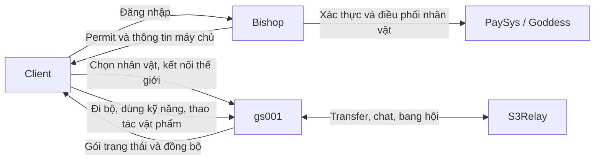

TÓM TẮT 1/5: [NGUỒN][THẤY][TÀI LIỆU] Client dùng c2s_login=65; luồng đăng nhập qua Bishop rồi chuyển tới máy chủ thế giới được dẫn từ báo cáo K-01 (C/KProtocolDef.h:249; K-01-ban-do-truyen-tin-hieu.md:110-121).
TÓM TẮT 2/5: [NGUỒN][THẤY] Các lệnh đi bộ, dùng kỹ năng và thao tác vật phẩm có hằng riêng; server dispatch chúng tới hàm xử lý (C/KProtocol.cpp:214-250; S/KProtocolProcess.cpp:211-237).
TÓM TẮT 3/5: [NGUỒN][THẤY] Client tra opcode đồng bộ để gọi hàm cập nhật tương ứng (C/KProtocolProcess.cpp:76-102; A-06-bang-goi-tin.md:257-283).
TÓM TẮT 4/5: [NGUỒN][TÀI LIỆU] Bảng ví dụ có 10 gói thuộc đăng nhập, di chuyển, chiến đấu và vật phẩm (A-06-bang-goi-tin.md:418-453, 257-283).
TÓM TẮT 5/5: [CHƯA KIỂM] Chỉ đọc tĩnh; không chạy build, test, exe, VM hoặc mạng. Chưa xác nhận hành vi của binary đang chạy (K-01-ban-do-truyen-tin-hieu.md:96-104).

# SO-12 — Sổ tay gói tin client–server cho người không lập trình
Loại: tổng hợp
Chủ đề: Giải thích luồng gói tin cơ bản từ đăng nhập đến thế giới và đồng bộ vật phẩm.
Từ khóa: gói tin, opcode, client-server, KProtocolDef.h, c2s, s2c, Bishop, gs001
Trạng thái: DONE — tài liệu hoàn thành trong phạm vi khảo sát tĩnh.
Độ phủ: 4/4 chủ đề và 10/10 ví dụ gói tin; không bao gồm toàn bộ enum.
Liên quan: JX1_OPS/REPORTS/A-06-bang-goi-tin.md; E-12-khao-sat-goi-tuong-tac.md; K-01-ban-do-truyen-tin-hieu.md; JX1_OPS/DESIGN/MUC-LUC-TRI-THUC.md.
Cần tôi quyết định: không

## Sơ đồ chính

[TÀI LIỆU] Sơ đồ mô tả luồng logic đọc từ báo cáo và source, không khẳng định listener hay trạng thái runtime hiện hành (K-01-ban-do-truyen-tin-hieu.md:49-60, 66-80, 110-121).

## Phạm vi và độ phủ

| Phần tử phạm vi | Trạng thái | Bằng chứng |
|---|---|---|
| Đăng nhập, chọn nhân vật, nối máy chủ thế giới | Đã phủ | [TÀI LIỆU] K-01-ban-do-truyen-tin-hieu.md:110-121; A-06-bang-goi-tin.md:418-421 |
| Di chuyển và lệnh chiến đấu | Đã phủ | [THẤY] C/KProtocol.cpp:214-250; S/KProtocolProcess.cpp:213-215, 5436-5449, 5581-5606 |
| Nhặt/chuyển vật phẩm và gói đồng bộ về client | Đã phủ | [THẤY] S/KProtocolProcess.cpp:236-237, 5713-5734; C/KProtocolProcess.cpp:98-102 |
| Bảng ví dụ 10 gói quan trọng | Đã phủ | [TÀI LIỆU] A-06-bang-goi-tin.md:257-283, 418-453 |
| Tên hằng KProtocolDef.h và hướng c2s/s2c | Đã phủ có chọn lọc; không kiểm toàn bộ enum | [THẤY] C/KProtocolDef.h:249-283; [TÀI LIỆU] A-06-bang-goi-tin.md:418-453 |
| Mã gói trên binary, thời gian trễ, tần suất thực | Chưa kiểm | [CHƯA KIỂM] K-01-ban-do-truyen-tin-hieu.md:96-104, 108-109 |

## Cách đọc nhanh

[TÀI LIỆU] Ký hiệu `C/` trong dẫn nguồn là `C:\Jx1CocoV3\Folder\Client2912-20260116T044348Z-3-001\Client2912\Client\Classes\gamecore\`; `S/` là `C:\Jx1CocoV3\SwordOnline\SwordOnline\jxOnline\gameserver\Sources\Core\Src\`. Đây là hai root khác nhau; đường dẫn và ký hiệu được ghi trong báo cáo A-06 (A-06-bang-goi-tin.md:71-81).

[THẤY] Nhãn `[THẤY]` nghĩa là đã kiểm trực tiếp đoạn source được trích; `[TÀI LIỆU]` là kết quả được dẫn từ báo cáo đã có; `[CHƯA KIỂM]` là điểm không thể kết luận bằng phần đọc tĩnh này.

[TÀI LIỆU] `c2s` là hướng client gửi lên server; `s2c` là hướng server gửi về client. Đây là hướng của thông điệp theo bảng opcode, không phải tên cổng mạng (A-06-bang-goi-tin.md:196-197, 418-453; K-01-ban-do-truyen-tin-hieu.md:94-102).

[TÀI LIỆU] Gói gameplay là một record nằm trong luồng TCP. Một lần gửi socket không đảm bảo tương ứng một gói; TCP có thể chia hoặc ghép dữ liệu. Vì vậy có thể hiểu opcode như “nhãn loại việc”, không phải một lần bấm chuột hay một nhịp mạng cố định (K-01-ban-do-truyen-tin-hieu.md:96, 99).

[TÀI LIỆU] Đăng nhập và chơi thế giới là hai chặng kết nối: client gửi đăng nhập qua Bishop; sau khi chọn nhân vật và nhận thông tin được phép, client mở kết nối tới máy chủ game. Không phải mọi bước đi hay đòn đánh đều quay lại PaySys (K-01-ban-do-truyen-tin-hieu.md:52, 55-57, 110-129).

## MỤC SỔ THÔNG SỐ — 10 gói ví dụ

| Nhóm | Tên/hằng số | Ai gửi → ai nhận | File:dòng | Giá trị | Đơn vị | Ý nghĩa thường | Đổi an toàn | Nguồn đo |
|---|---|---|---|---:|---|---|---|---|
| [TÀI LIỆU] Đăng nhập | `c2s_login` | Client → Bishop | C/KProtocolDef.h:249; K-01-ban-do-truyen-tin-hieu.md:114-116 | 65 | BYTE ID (opcode) | Gửi yêu cầu đăng nhập qua gateway. | KHÔNG — phải khớp hai đầu giao thức. | Đọc tĩnh; A-06-bang-goi-tin.md:418-419 |
| [TÀI LIỆU] Chọn nhân vật | `c2s_dbplayerselect` | Client → Bishop/luồng chọn nhân vật | C/KProtocolDef.h:292; K-01-ban-do-truyen-tin-hieu.md:118 | 108 | BYTE ID (opcode) | Báo nhân vật người chơi chọn để tải dữ liệu. | KHÔNG — phải khớp hai đầu giao thức. | Đọc tĩnh; A-06-bang-goi-tin.md:462 |
| [TÀI LIỆU] Kết thúc đồng bộ đầu vào game | `c2s_syncclientend` | Client → máy chủ game | C/KProtocolDef.h:251; K-01-ban-do-truyen-tin-hieu.md:121 | 67 | BYTE ID (opcode) | Gói báo hiệu kết thúc một chặng đồng bộ; không phải mốc enum rỗng. | KHÔNG — phải khớp payload và handler. | Đọc tĩnh; A-06-bang-goi-tin.md:421 |
| [THẤY] Di chuyển | `c2s_npcwalk` | Client → gs001 | C/KProtocol.cpp:214-223; S/KProtocolProcess.cpp:213, 5436-5449 | 75 | BYTE ID (opcode) | Gửi tọa độ đích đi bộ; server tạo lệnh đi. | KHÔNG — phải khớp kiểu dữ liệu và handler. | Đọc tĩnh; A-06-bang-goi-tin.md:429; K-01-ban-do-truyen-tin-hieu.md:127-130 |
| [THẤY] Chiến đấu | `c2s_npcskill` | Client → gs001 | C/KProtocol.cpp:237-250; S/KProtocolProcess.cpp:215, 5581-5606 | 77 | BYTE ID (opcode) | Gửi mã kỹ năng và đích/tọa độ; server kiểm tra rồi xếp lệnh kỹ năng. | KHÔNG — phải khớp kiểu dữ liệu và handler. | Đọc tĩnh; A-06-bang-goi-tin.md:431; K-01-ban-do-truyen-tin-hieu.md:141-147 |
| [THẤY] Hiển thị động tác kỹ năng | `s2c_skillcast` | gs001 → Client | C/KProtocolDef.h:84; C/KProtocolProcess.cpp:76 | 96 | BYTE ID (opcode) | Báo động tác thi triển; riêng nó chưa chứng minh đòn đánh đã trúng. | KHÔNG — phải khớp hai đầu giao thức. | Đọc tĩnh; A-06-bang-goi-tin.md:257; K-01-ban-do-truyen-tin-hieu.md:145-148 |
| [THẤY] Nhặt vật phẩm | `c2s_playerpickupitem` | Client → gs001 | C/KProtocolDef.h:282; S/KProtocolProcess.cpp:236, 5713-5721 | 98 | BYTE ID (opcode) | Yêu cầu nhặt; server chuyển xử lý tới logic người chơi. | KHÔNG — phải khớp hai đầu giao thức. | Đọc tĩnh; A-06-bang-goi-tin.md:452 |
| [THẤY] Chuyển vật phẩm | `c2s_playermoveitem` | Client → gs001 | C/KProtocol.cpp:645-671; S/KProtocolProcess.cpp:237, 5724-5734 | 99 | BYTE ID (opcode) | Gửi vị trí vật phẩm đi và đến trong túi/kho. | KHÔNG — phải khớp hai đầu giao thức. | Đọc tĩnh; A-06-bang-goi-tin.md:453 |
| [THẤY] Đồng bộ vật phẩm | `s2c_syncitem` | gs001 → Client | C/KProtocolDef.h:106; C/KProtocolProcess.cpp:98 | 118 | BYTE ID (opcode) | Client nhận dữ liệu đồng bộ vật phẩm. Không suy ra cứ mỗi yêu cầu đều có đúng một gói trả lời. | KHÔNG — phải khớp schema và handler. | Đọc tĩnh; A-06-bang-goi-tin.md:279 |
| [THẤY] Đồng bộ vị trí vật phẩm | `s2c_playermoveitem` | gs001 → Client | C/KProtocolDef.h:110; C/KProtocolProcess.cpp:102 | 122 | BYTE ID (opcode) | Client cập nhật kết quả chuyển vị trí vật phẩm. | KHÔNG — phải khớp schema và handler. | Đọc tĩnh; A-06-bang-goi-tin.md:283 |

## Sắp theo cấu trúc game

| Thứ tự | Chặng | Ví dụ tiêu biểu | Giải thích |
|---:|---|---|---|
| 1 | Đăng nhập và vào thế giới | `c2s_login`, `c2s_dbplayerselect`, `c2s_syncclientend` | [TÀI LIỆU] Gateway xác thực/điều phối, client chọn nhân vật rồi đồng bộ với máy chủ game (K-01-ban-do-truyen-tin-hieu.md:110-121). |
| 2 | Di chuyển | `c2s_npcwalk` | [THẤY] Client dựng gói đi bộ; server nhận, giới hạn tọa độ âm về 0 và phát lệnh đi (C/KProtocol.cpp:214-223; S/KProtocolProcess.cpp:5436-5449). |
| 3 | Chiến đấu | `c2s_npcskill`, `s2c_skillcast` | [THẤY] Client gửi kỹ năng; server kiểm tra mã kỹ năng/đích. Gói thi triển là thông báo động tác, HP có luồng đồng bộ riêng (S/KProtocolProcess.cpp:5581-5606; K-01-ban-do-truyen-tin-hieu.md:143-149). |
| 4 | Túi đồ/vật phẩm | `c2s_playerpickupitem`, `c2s_playermoveitem`, `s2c_syncitem`, `s2c_playermoveitem` | [THẤY] Client gửi thao tác; server dispatch tới handler; client có handler riêng cho đồng bộ vật phẩm và vị trí vật phẩm (S/KProtocolProcess.cpp:5713-5734; C/KProtocolProcess.cpp:98-102). |

## Giải mã tên

| Tên gốc | Mã hóa | Chữ đúng / nghĩa đọc nhanh | Nguồn file:dòng |
|---|---|---|---|
| `c2s_login` | ASCII identifier; không phải GBK/TCVN3 | Client gửi đăng nhập lên server | C/KProtocolDef.h:249 |
| `c2s_dbplayerselect` | ASCII identifier; không phải GBK/TCVN3 | Client báo chọn nhân vật | C/KProtocolDef.h:292 |
| `c2s_syncclientend` | ASCII identifier; không phải GBK/TCVN3 | Client báo kết thúc chặng đồng bộ | C/KProtocolDef.h:251 |
| `c2s_npcwalk` | ASCII identifier; không phải GBK/TCVN3 | Client gửi lệnh đi bộ | C/KProtocolDef.h:259 |
| `c2s_npcskill` | ASCII identifier; không phải GBK/TCVN3 | Client gửi lệnh kỹ năng | C/KProtocolDef.h:261 |
| `s2c_skillcast` | ASCII identifier; không phải GBK/TCVN3 | Server báo động tác thi triển | C/KProtocolDef.h:84 |
| `c2s_playerpickupitem` | ASCII identifier; không phải GBK/TCVN3 | Client yêu cầu nhặt vật phẩm | C/KProtocolDef.h:282 |
| `c2s_playermoveitem` | ASCII identifier; không phải GBK/TCVN3 | Client gửi yêu cầu chuyển vật phẩm | C/KProtocolDef.h:283 |
| `s2c_syncitem` | ASCII identifier; không phải GBK/TCVN3 | Server đồng bộ dữ liệu vật phẩm | C/KProtocolDef.h:106 |
| `s2c_playermoveitem` | ASCII identifier; không phải GBK/TCVN3 | Server đồng bộ vị trí vật phẩm | C/KProtocolDef.h:110 |
| `Bishop` | Tên dịch vụ ASCII; không áp dụng GBK/TCVN3 | Gateway đăng nhập/điều phối | K-01-ban-do-truyen-tin-hieu.md:55 |
| `PaySys` | Tên dịch vụ ASCII; không áp dụng GBK/TCVN3 | Dịch vụ xác thực tài khoản/quyền chơi | K-01-ban-do-truyen-tin-hieu.md:52 |
| `Goddess` | Tên dịch vụ ASCII; không áp dụng GBK/TCVN3 | Dịch vụ role/nhân vật | K-01-ban-do-truyen-tin-hieu.md:53 |
| `S3Relay` | Tên dịch vụ ASCII; không áp dụng GBK/TCVN3 | Dịch vụ chuyển tiếp chat/transfer/bang hội | K-01-ban-do-truyen-tin-hieu.md:54 |
| `gs001` | Tên tiến trình ASCII; không áp dụng GBK/TCVN3 | Máy chủ thế giới xử lý di chuyển/chiến đấu | K-01-ban-do-truyen-tin-hieu.md:56 |

[TÀI LIỆU] Các hằng và tên dịch vụ trên là định danh ASCII trong tài liệu/source đã đọc. Không có tên kỹ năng, trang bị, quái, NPC hoặc bản đồ tiếng Hán/tiếng Việt cũ cần giải mã trong phạm vi này.

## Điều cần nhớ và giới hạn

[TÀI LIỆU] Tên hằng đăng nhập ở client và server/gateway có thể khác nhau dù cùng mã 65; vì vậy đối chiếu cả ID, nhánh source và payload, không chỉ so chuỗi tên (A-06-bang-goi-tin.md:418-421).

[TÀI LIỆU] Các bảng protocol có thể khác giữa client, gameserver và gateway; một mã enum giống nhau không chứng minh cấu trúc payload hay ABI giống nhau (A-06-bang-goi-tin.md:91-96, 116-153).

[CHƯA KIỂM] Không đo độ trễ, tần suất gói, hành vi runtime, phiên bản binary đang nạp hoặc việc từng thao tác luôn sinh đúng một phản hồi. TCP có thể chia/ghép record; bảng này chỉ giải thích source tĩnh (K-01-ban-do-truyen-tin-hieu.md:96-104, 108-109).

## Đã xác minh / Chưa xác minh

- [THẤY] Client có các hàm dựng gói đi bộ, chạy, dùng kỹ năng và chuyển vật phẩm; chúng gán hằng opcode rồi gửi buffer tới server (C/KProtocol.cpp:186-195, 214-223, 237-250, 645-671).
- [THẤY] Server dispatch các hằng di chuyển, kỹ năng và vật phẩm tới các hàm xử lý tương ứng (S/KProtocolProcess.cpp:213-237, 5436-5449, 5581-5606, 5713-5734).
- [THẤY] Client ánh xạ các opcode đồng bộ kỹ năng/NPC/vật phẩm tới hàm nhận cụ thể (C/KProtocolProcess.cpp:57-58, 76, 98-102).
- [TÀI LIỆU] Luồng đăng nhập qua Bishop và chuyển sang GS được mô tả trong báo cáo bản đồ, gồm các điểm source tương ứng (K-01-ban-do-truyen-tin-hieu.md:110-121).
- [CHƯA KIỂM] Không chạy build/test/VM/exe/mạng; không xác định gói thực tế, ABI, latency hay trạng thái dịch vụ đang chạy.

## Bàn giao

[THẤY] Đầu ra: `JX1_OPS/DESIGN/SO-TAY-GOI-TIN.md`; báo cáo task: `JX1_OPS/REPORTS/SO-12.md`. [CHƯA KIỂM] Không commit theo yêu cầu; không có SHA.

Liên quan: `JX1_OPS/REPORTS/A-06-bang-goi-tin.md`, `JX1_OPS/REPORTS/E-12-khao-sat-goi-tuong-tac.md`, `JX1_OPS/REPORTS/K-01-ban-do-truyen-tin-hieu.md`.
