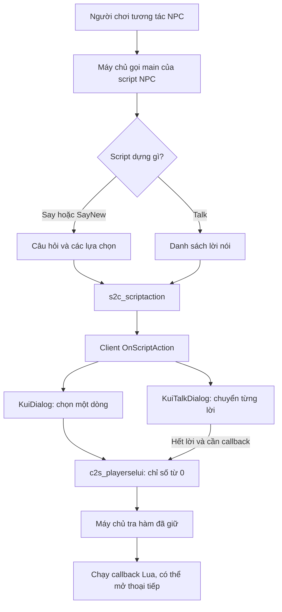

TÓM TẮT 1: [NGUỒN][THẤY] `Say` dựng câu hỏi và lựa chọn; `Talk` dựng chuỗi lời nói: `S/Core/Src/ScriptFuns.cpp:1974,3741,25676,25683`.
TÓM TẮT 2: [NGUỒN][THẤY] Máy chủ giữ tên hàm xử lý, gửi chữ/menu tới client, nhận lại chỉ số lựa chọn: `S/Core/Src/ScriptFuns.cpp:2120–2156`; `C/gamecore/KPlayer.cpp:3796–3816`.
TÓM TẮT 3: [NGUỒN][THẤY] `Talk` chuyển lời tại client; Dã Tẩu có lời thoại bốn đoạn và callback `SelANum`: `C/gameui/KuiTalkDialog.cpp:648–663`; `G/script/global/npcchucnang/datau.lua:664–689`.
TÓM TẮT 4: [CHƯA KIỂM] Chưa xác nhận binding độc lập `Sel`, ánh xạ NPC thường trú hay bằng chứng cùng bản chạy; xem mục Chưa kiểm và `JX1_OPS/REPORTS/SO-31.md`.
TÓM TẮT 5: [CHƯA KIỂM] Chỉ đọc tĩnh; không build, chạy game/exe/VM, kết nối mạng hoặc đo runtime; đối chiếu phạm vi tại `JX1_OPS/TASKS/SO-31.md:24–27`.

# SO-31 — Sổ tay hộp thoại NPC: Say, Talk và lựa chọn (Sel)

Loại: khảo sát
Chủ đề: Theo một cuộc nói chuyện với NPC từ script Lua tới cửa sổ trên client và đường trả lời về máy chủ.
Từ khóa: hộp thoại NPC, hội thoại, Lua, Say, SayNew, Talk, Sel, SelANum, phân trang, gói tin
Trạng thái: DONE — hoàn tất sổ tay đọc tĩnh; các giới hạn về Sel, dữ liệu và runtime ghi riêng.
Độ phủ: đã phủ 6/6 phần nội dung được giao ở mức đọc tĩnh: dựng thoại, lựa chọn/callback, phân trang, truyền gói, client, ví dụ NPC; không phải kiểm kê toàn bộ NPC.
Liên quan: `JX1_OPS/TASKS/SO-31.md`; `JX1_OPS/REPORTS/SO-31.md`; `JX1_OPS/REPORTS/I-05-npc-chuc-nang.md`; `JX1_OPS/DESIGN/THE-GIOI-TONG-QUAN.md`.
Cần tôi quyết định: không — bàn giao tài liệu; mọi chạy thử hoặc thay đổi game cần task riêng.

[THẤY] Sơ đồ ghép các nhánh mã tĩnh, không phải bản ghi một phiên chơi: `S/Core/Src/KPlayer.cpp:9524–9546,8785–8823`; `C/gamecore/KProtocolProcess.cpp:3208–3210`; `C/gameui/KuiTalkDialog.cpp:648–663`.

## Phạm vi và độ phủ

| Phần theo hành trình người chơi | Độ phủ | Bằng chứng và ranh giới |
|---|---|---|
| Bắt đầu nói chuyện | Đã phủ đọc tĩnh | [THẤY] Kiểm NPC gần người chơi, khoảng cách và gọi `main`: `S/Core/Src/KPlayer.cpp:9524–9546`. |
| Dựng câu hỏi và lựa chọn | Đã phủ đọc tĩnh | [THẤY] Binding và cách nhận chuỗi/bảng Lua: `S/Core/Src/ScriptFuns.cpp:1997–2046,25676–25683`. |
| Chọn dòng và gọi lại Lua, liên quan Sel | Đã phủ cơ chế; chưa xác nhận API Sel riêng | [THẤY] Chỉ số trả về và tra callback: `S/Core/Src/KPlayer.cpp:8807–8823`; ví dụ `SelANum`: `G/script/global/npcchucnang/datau.lua:668–689`. |
| Phân trang | Đã phủ lời thoại; giới hạn menu được đối chiếu | [THẤY] `Talk` gửi nhiều lời; client chuyển từng lời: `S/Core/Src/ScriptFuns.cpp:3793–3806`; `C/gameui/KuiTalkDialog.cpp:648–663`. Menu bị chặn số lựa chọn, không tự tạo trang trong nhánh đã đọc: `S/Core/Src/ScriptFuns.cpp:2033–2039,2069–2088`. |
| Gói tin và cửa sổ client | Đã phủ hai chiều ở mã nguồn | [THẤY] `S/Core/Src/KPlayer.cpp:8793–8795`; `C/gamecore/KProtocol.h:1331–1343,1390–1394`; `C/gamescene/KgameWorld.cpp:13501,13523`. Chưa kiểm ABI/binary đang chạy. |
| NPC có script thật | Đã phủ ví dụ Dã Tẩu | [THẤY] `G/script/global/npcchucnang/datau.lua:436–440,483,567–574,664–689`; chưa nối tới template/map/vị trí đang nạp. |

## Giải mã tên

| Tên gốc giữ nguyên | Mã hóa | Chữ đúng UTF-8 | Nguồn file:dòng |
|---|---|---|---|
| `D· TÈu` | TCVN3; biểu diễn byte theo Windows-1252 để đọc chữ gốc | Dã Tẩu; chưa có tên Hán đối chiếu | [THẤY] `G/script/global/npcchucnang/datau.lua:483`. |

[THẤY] Chỉ dùng một tên NPC trong nội dung khảo sát. `SelANum`, `SayNew`, `timhieu` và tên hằng là định danh mã, không phải tên NPC; đối chiếu `G/script/global/npcchucnang/datau.lua:664–683`; `S/Core/Src/ScriptFuns.cpp:25676–25683`.

## Sắp theo cấu trúc game

[THẤY] Tài liệu xếp theo hành trình **gặp NPC → đọc câu hỏi → chọn/trang tiếp → máy chủ xử lý**, rồi tới ví dụ nhiệm vụ Dã Tẩu. Chưa gán ví dụ vào một bản đồ: script có `main`, nhưng chưa đối chiếu bản ghi spawn. Nguồn: `S/Core/Src/KPlayer.cpp:9524–9546`; `G/script/global/npcchucnang/datau.lua:436–440`; giới hạn liên kết cũ: `JX1_OPS/REPORTS/I-05-npc-chuc-nang.md:83–96` [TÀI LIỆU].

## Mục lục

- [Nguồn và cách hiểu nhãn](#nguồn-và-cách-hiểu-nhãn)
- [Từ NPC tới câu hỏi](#từ-npc-tới-câu-hỏi)
- [Chọn một dòng: Sel và callback](#chọn-một-dòng-sel-và-callback)
- [Phân trang lời nói và menu](#phân-trang-lời-nói-và-menu)
- [Gói tin và cửa sổ client](#gói-tin-và-cửa-sổ-client)
- [Ví dụ thật: nhiệm vụ Dã Tẩu](#ví-dụ-thật-nhiệm-vụ-dã-tẩu)
- [Mục sổ thông số](#mục-sổ-thông-số)
- [Đã xác minh](#đã-xác-minh)
- [Chưa kiểm](#chưa-kiểm)
- [Phát hiện khi chuẩn hóa](#phát-hiện-khi-chuẩn-hóa)
- [Bàn giao](#bàn-giao)

## Nguồn và cách hiểu nhãn

[TÀI LIỆU] Task không có mục riêng tên “Nguồn cần đọc”; danh sách đọc được lấy từ các root tại `JX1_OPS/TASKS/SO-31.md:24–27`, rồi lần theo include/symbol và nguồn Lua cụ thể do báo cáo I-05 dẫn. Không coi hai bộ source và gói dữ liệu là cùng một binary đã xác minh.

| Bí danh | Root chính xác và tệp cần đọc theo chủ đề |
|---|---|
| `S` | `C:/Jx1CocoV3/SwordOnline/SwordOnline/jxOnline/gameserver/Sources`; trọng tâm `Core/Src/ScriptFuns.cpp`, `KPlayer.cpp`, `KPlayer.h`, `KProtocolProcess.cpp`, `KProtocol.cpp`, `LuaFuns.cpp`. |
| `C` | `C:/Jx1CocoV3/Folder/Client2912-20260116T044348Z-3-001/Client2912/Client/Classes`; trọng tâm `gamecore/KProtocol.h`, `KProtocolDef.h`, `KProtocolProcess.cpp`, `KPlayer.cpp`, `CoreShell.cpp`; `gameui/KuiDialog.cpp`, `KuiTalkDialog.cpp`; `gamescene/KgameWorld.cpp`. |
| `G` | `C:/Jx1CocoV3/Folder/ServerNew-20260116T043145Z-3-001/ServerNew/_bin_v2_/gs`; đường dẫn dữ liệu được dẫn tại `JX1_OPS/REPORTS/I-05-npc-chuc-nang.md:47`; đọc trực tiếp các đoạn liên quan của `script/global/npcchucnang/datau.lua` để bổ sung ví dụ. |
| Tài liệu định vị | `JX1_OPS/DESIGN/CHUAN-BAO-CAO.md`, `MUC-LUC-TRI-THUC.md`, `CONTEXT-PACK/GS001-MAP.md`; báo cáo `I-05-npc-chuc-nang.md` và tổng quan thế giới, không dùng tóm tắt thay source. |

[TÀI LIỆU] `[THẤY]` = đã mở mã/dữ liệu hoặc thực chạy lệnh đọc, tương đương **ĐÃ XÁC MINH ở mức đọc tĩnh**; `[TÀI LIỆU]` = dẫn lại tài liệu hoặc đề xuất biên tập; `[CHƯA KIỂM]` = chưa có bằng chứng đủ, tương đương **CHƯA XÁC MINH**. Quy tắc không suy runtime áp dụng cho cả tài liệu: `JX1_OPS/TASKS/SO-31.md:24–27`.

[THẤY] Chữ Hán trong các đoạn `S/Core/Src/ScriptFuns.cpp:2012–2035` đọc bằng GBK/CP936; chuỗi Việt tại `G/script/global/npcchucnang/datau.lua:483,567–574` là TCVN3, không đọc như UTF-8. Mã client có comment lỗi chữ lẫn nội dung Việt; chỉ dùng token/lệnh thực thi, ví dụ `C/gamecore/KPlayer.cpp:3796–3816`. Hai tệp SO-31 mới lưu UTF-8 không BOM; kết quả kiểm nằm tại `JX1_OPS/REPORTS/SO-31.md`.

## Từ NPC tới câu hỏi

[THẤY] Khi nhận yêu cầu nói chuyện, máy chủ tìm NPC quanh người chơi, kiểm loại/quan hệ và khoảng cách. Nhánh này cho phép khoảng cách tới `m_DialogRadius * 2`; đạt điều kiện thì gọi `main` bằng script hành động của NPC. Nó truyền tên NPC, thông tin template và chỉ số đối tượng vào Lua: `S/Core/Src/KPlayer.cpp:9524–9546`.

[THẤY] Có thể hiểu `Say(nội_dung, số_lựa_chọn, ...)` là “NPC hỏi một câu, người chơi chọn một dòng”. Nội dung có thể là chuỗi hoặc số tra tài nguyên chữ. Lựa chọn nhận bằng các chuỗi riêng hoặc một bảng Lua; khi nhận bảng, mã đọc phần tử từ 1. Đây là mô tả chữ ký để đọc script, chưa phải lời gọi thử nghiệm: `S/Core/Src/ScriptFuns.cpp:1997–2036,2050–2061,2074–2088`.

[THẤY] `Say` và `SayNew` là hai binding riêng. Cả hai tạo `UI_SELECTDIALOG`; `Say` đặt `m_Select=0`, `SayNew` đặt `m_Select=1`. Client dùng cờ này ở nhánh thông báo hiển thị. Không thay hai hàm cho nhau chỉ vì đều có lựa chọn: `S/Core/Src/ScriptFuns.cpp:2041–2047,2826–2832,25676–25678`; `C/gamecore/KPlayer.cpp:4043–4046`.

[THẤY] Mỗi lựa chọn chứa phần chữ và phần hàm sau dấu `/`. Với dạng thường, máy chủ giữ tên hàm phía sau dấu `/` cuối cùng và ghép phần chữ vào nội dung gửi đi; nếu không có `/`, nhánh đã đọc ghi tên hàm `main`. Đoạn xử lý cũ bị comment ở phía trên không phải đường đang thực thi: `S/Core/Src/ScriptFuns.cpp:2091–2121,2143–2156`. `SayNew` cũng có cách tách tương ứng: `S/Core/Src/ScriptFuns.cpp:2884–2921`.

[THẤY] Nhánh có `#` còn tách tên hàm và chuỗi trong ngoặc để giữ tham số riêng. Chỉ xác nhận có đường phân tích này; chưa coi mọi nội dung ngoặc là một biểu thức Lua bất kỳ được thực thi: `S/Core/Src/ScriptFuns.cpp:2126–2141,2891–2906`.

## Chọn một dòng: Sel và callback

[THẤY] Dòng đầu tiên trên màn hình có chỉ số trả về là **0**. `KuiDialog` duyệt từ `i=0`, khi chạm một dòng thì gửi thao tác chọn với `i`; `CoreShell` ghi số đó vào `nSelectIndex`: `C/gameui/KuiDialog.cpp:442–460`; `C/gamecore/CoreShell.cpp:4547–4554`.

[THẤY] Với hộp thoại do máy chủ mở, client gửi `c2s_playerselui`. Máy chủ nhận tại `PlayerSelUI`, tra tên hàm đã lưu cho số lựa chọn ấy rồi gọi `ExecuteScriptB` trên script hành động đang giữ của người chơi: `C/gamecore/KPlayer.cpp:3796–3806`; `S/Core/Src/KProtocolProcess.cpp:241,5757–5759`; `S/Core/Src/KPlayer.cpp:8807–8823`. Gói trả lời không mang tên hàm hoặc toàn bộ chữ lựa chọn: `C/gamecore/KProtocol.h:1390–1394`.

[THẤY] Ở nhánh callback có chuỗi tham số, `ExecuteScriptB` gọi Lua với cặp số lựa chọn và chuỗi (`"ds"`); nếu chuỗi rỗng thì nhánh này gọi không tham số. Vì thế phải xem cả chỗ tạo lựa chọn lẫn chữ ký hàm xử lý, không áp một chữ ký cho mọi callback: `S/Core/Src/KPlayer.cpp:8053–8059`; `S/Core/Src/ScriptFuns.cpp:2145–2148`.

[THẤY] Ví dụ thật dùng tên `SelANum(sel)`, không phải `Sel`: nó đổi từ chỉ số lựa chọn sang chỉ số bảng Lua bằng `nSel = sel + 1`, rồi kiểm trạng thái nhận thưởng và tiến độ. Tên hàm được chính script gắn vào lựa chọn `/SelANum`: `G/script/global/npcchucnang/datau.lua:668–689`.

[CHƯA KIỂM] Chưa xác nhận có một API chung tên chính xác `Sel` trong bộ game này. Lệnh `Select-String` tìm `"Sel"|LuaSel\b` trong `S/Core/Src/ScriptFuns.cpp` và `S/Core/Src/LuaFuns.cpp`, đếm bằng `Measure-Object`, trả **0**; đây chỉ là kết quả trên hai tệp đó, không chứng minh mọi thư viện/overlay đều thiếu Sel. Binding `Say`/`Talk` xác nhận tại `S/Core/Src/ScriptFuns.cpp:25676–25684`. Khi gặp tên Sel trong tài liệu khác, cần lấy đúng định nghĩa hoặc callback của script đó trước khi diễn giải.

## Phân trang lời nói và menu

[THẤY] `Talk(số_đoạn, tên_hàm_khi_kết_thúc, đoạn_1, ...)` là chuỗi lời nói tiếp nối. Mã kiểm tối thiểu ba đối số, lấy số đoạn từ đối số 1, tên callback từ đối số 2, và lấy các lời từ đối số 3. Lời cũng có thể là số ID tài nguyên. Tên callback rỗng đặt số callback khả dụng về 0; có tên thì giữ một callback ở ô 0: `S/Core/Src/ScriptFuns.cpp:3743–3787,3793–3826`.

[THẤY] Máy chủ ghép các đoạn của một lần `Talk` bằng dấu `|` vào cùng nội dung gửi đi. Client tách nội dung thành danh sách lời. Trang cuối được đánh dấu cần báo hoàn tất nếu gói đặt `m_nParam=1`: `S/Core/Src/ScriptFuns.cpp:3793–3814,3816–3826`; `C/gamecore/KPlayer.cpp:4081–4105`.

[THẤY] Cửa sổ lời nói lưu danh sách và hiển thị lời đầu; mỗi lần chạm gọi `changeMsg()` để chuyển lời. Khi không còn lời, lần chuyển tiếp theo đóng cửa sổ và chỉ báo về core nếu lời cuối yêu cầu xác nhận: `C/gameui/KuiTalkDialog.cpp:123–145,648–677,682–684`. Core dùng chỉ số 0 cho callback kết thúc: `C/gamecore/CoreShell.cpp:3946–3951`. Vì vậy không cần một gói từ máy chủ cho mỗi lần sang lời trong chuỗi đã nhận.

[THẤY] **Menu nhiều lựa chọn khác với chuỗi lời nói.** `Say` chặn số lựa chọn ở `MAX_ANSWERNUM=16`; vòng xử lý chỉ lấy số dòng được khai báo sau khi chặn. Nhánh này không chia phần dư thành trang mới: `S/Core/Src/KPlayer.h:31`; `S/Core/Src/ScriptFuns.cpp:2033–2039,2069–2088`. `SayNew` cũng chặn số lựa chọn: `S/Core/Src/ScriptFuns.cpp:2816–2824`.

[TÀI LIỆU] Để viết menu “trang sau/trang trước”, cần thiết kế lựa chọn gọi lại hàm dựng trang tương ứng và tính các nút chuyển trang vào số lựa chọn. Đây là đề xuất dựa trên cơ chế callback và giới hạn trên, không phải xác nhận đã tìm được một thư viện phân trang chung: `S/Core/Src/ScriptFuns.cpp:2039,2143–2150`; `S/Core/Src/KPlayer.cpp:8823`. Chưa chạy mẫu menu phân trang.

## Gói tin và cửa sổ client

| Chặng | Điều đã đối chiếu |
|---|---|
| Lua → yêu cầu hiển thị | [THẤY] `PLAYER_SCRIPTACTION_SYNC` mang loại hiển thị, loại hộp, số lựa chọn/đoạn và nội dung. `Say`/`Talk` đặt cờ máy chủ ở `m_bParam2`: `S/Core/Src/ScriptFuns.cpp:2041–2046,2165–2180,3783–3788,3830–3836`. |
| Máy chủ → client | [THẤY] `DoScriptAction` gắn `s2c_scriptaction`, tính độ dài theo phần nội dung thực rồi đóng gói cho kết nối của người chơi: `S/Core/Src/KPlayer.cpp:8785–8795`. |
| Cấu trúc phía client | [THẤY] Có `ProtocolType`, `m_wProtocolLong`, các cờ UI, tham số, độ dài, đường ảnh và mảng nội dung; không có tên callback trong cấu trúc đã đọc: `C/gamecore/KProtocol.h:1331–1343`. |
| Nhận gói | [THẤY] `s2c_scriptaction` được gắn với `SyncScriptAction`, hàm này chuyển tới `OnScriptAction`: `C/gamecore/KProtocolProcess.cpp:103,3208–3210`. |
| Menu | [THẤY] Client tách câu hỏi/lựa chọn bằng `|`, ghi nhớ nguồn máy chủ và báo `GDCNI_QUESTION_CHOOSE`: `C/gamecore/KPlayer.cpp:3921–3978,4043–4046`. Cửa sổ được tạo bằng `KuiDialog::create`: `C/gamescene/KgameWorld.cpp:13512–13523`. |
| Lời nói | [THẤY] Client tách các lời, báo `GDCNI_SPEAK_WORDS`; cửa sổ tương ứng là `KuiTalkDialog`: `C/gamecore/KPlayer.cpp:4059–4133`; `C/gamescene/KgameWorld.cpp:13498–13503`. |
| Trả lời | [THẤY] `PLAYER_SELECTUI_COMMAND` chứa mã gói và chỉ số; gửi bằng `c2s_playerselui` cho menu hoặc xác nhận kết thúc Talk: `C/gamecore/KProtocol.h:1390–1394`; `C/gamecore/KPlayer.cpp:3796–3816`. |

[CHƯA KIỂM] Đường gọi và tên trường tương ứng giữa hai bộ source không chứng minh binary tương thích. Chưa kiểm packing, kích thước thực khi biên dịch, số enum trên dây, phiên bản asset hay bắt gói runtime; không công bố số byte toàn gói. Nguồn công thức gửi và khai báo client: `S/Core/Src/KPlayer.cpp:8793–8795`; `C/gamecore/KProtocol.h:1331–1343`.

## Ví dụ thật: nhiệm vụ Dã Tẩu

[THẤY] Đây là script thật trong gói `G`, không phải NPC dựng để minh họa. `main` nhận thông tin NPC và nạp lại chính `datau.lua`; chuỗi thông báo trong script ghi tên gốc `D· TÈu` (Dã Tẩu): `G/script/global/npcchucnang/datau.lua:436–440,483`. Chưa xác nhận một NPC thường trú cụ thể đang dùng file này.

| Tình huống trong script | Người đọc nên hiểu | Nguồn |
|---|---|---|
| Đọc phần giải thích nhiệm vụ | [THẤY] Lựa chọn thứ năm trong lời gọi đang xét trỏ `/timhieu`; hàm `timhieu` gọi `Talk` với 4 ID chữ và callback rỗng. Nó minh họa lời nói nhiều đoạn không cần callback kết thúc. | `G/script/global/npcchucnang/datau.lua:567–572,664–665`. |
| Dựng danh sách mốc thưởng | [THẤY] `phanthuong` tạo các lựa chọn có hậu tố `/SelANum`, thêm lựa chọn đóng, rồi gọi `SayNew`. Đây là một hàm tồn tại; chưa coi nó chắc chắn đi tới được từ menu đang xét. | `G/script/global/npcchucnang/datau.lua:668–679`. |
| Xử lý mốc được chọn | [THẤY] `SelANum` cộng 1 vào chỉ số, đọc cờ thưởng và tiến độ, dùng `Talk(1,...)` báo trường hợp chưa đủ điều kiện/đã nhận. Chưa kiểm toàn bộ cơ chế phát thưởng. | `G/script/global/npcchucnang/datau.lua:682–689`. |
| Điểm cần chú ý trước khi lần theo menu | [THẤY] Lời gọi `SayNew(strMain,5,...)` truyền 6 chuỗi ở dòng 568–573. Theo vòng nhận lựa chọn trong C++, chỉ 5 chuỗi đầu được lấy; chuỗi `/phanthuong` đứng thứ sáu không thuộc menu tạo bởi chính lời gọi này. Đây là hệ quả đọc tĩnh, chưa tái hiện trên game. | `G/script/global/npcchucnang/datau.lua:567–574`; `S/Core/Src/ScriptFuns.cpp:2775–2778,2816–2824,2859–2881`. |

[TÀI LIỆU] Giữ nguyên giới hạn của I-05: script chức năng chưa đủ để gán template/map/tọa độ cho NPC thường trú. SO-31 bổ sung cách dựng và trả lời hội thoại; không đổi kết luận về độ phủ thế giới/NPC trước đây: `JX1_OPS/REPORTS/I-05-npc-chuc-nang.md:80–96`.

## Mục sổ thông số

| Nhóm | Tên/hằng số | file:dòng | Giá trị | Đơn vị | Ảnh hưởng | Đổi an toàn | Nguồn đo |
|---|---|---|---|---|---|---|---|
| Lựa chọn | `MAX_ANSWERNUM` | `S/Core/Src/KPlayer.h:31`; `ScriptFuns.cpp:2039,2823–2824` | [THẤY] 16 | lựa chọn/lần dựng menu | Chặn số lựa chọn được nhận; không tự phân trang | CẨN THẬN; cần rà soát cả hai đầu | Đọc tĩnh, chưa đo runtime |
| Chuỗi lựa chọn | `pAnswer` | `S/Core/Src/ScriptFuns.cpp:2071,2081,2088` | [THẤY] 64 | byte bộ đệm cục bộ | Dùng chung cho nhãn và hậu tố callback; chưa xác nhận quy tắc cắt của helper | CẨN THẬN | Đọc tĩnh; không phải 64 ký tự Unicode |
| Callback | `m_szTaskAnswerFun`, `m_szTaskAnswerCanshu` | `S/Core/Src/KPlayer.h:421–422` | [THẤY] 32 mỗi ô | byte/bộ đệm | Giữ tên hàm và chuỗi tham số theo lựa chọn | CẨN THẬN; chưa kiểm mọi helper sao chép | Đọc tĩnh |
| Nội dung client | `MAX_SCIRPTACTION_BUFFERNUM` | `C/gamecore/KProtocol.h:1331,1342`; `KPlayer.cpp:3897,4061` | [THẤY] 1024; nhánh nhận yêu cầu độ dài 1..1023 | byte | Client loại nội dung rỗng hoặc đạt/vượt 1024; không phải dung lượng toàn gói | CẨN THẬN; không suy hằng phía server từ header client | Đọc tĩnh; chưa đo packing |
| Chỉ số lựa chọn | `i`, `nSelectIndex` | `C/gameui/KuiDialog.cpp:442–460`; `G/script/global/npcchucnang/datau.lua:682–683` | [THẤY] bắt đầu 0; callback mẫu cộng 1 | chỉ số | Phân biệt dòng trên UI với phần tử bảng Lua | CẨN THẬN | Đọc tĩnh |
| Ví dụ Dã Tẩu | `Talk` trong `timhieu` | `G/script/global/npcchucnang/datau.lua:664–665` | [THẤY] 4; callback rỗng | đoạn lời/một lần gọi | Client chuyển qua 4 đoạn nếu nhận đủ nội dung hợp lệ | CẨN THẬN; chưa mở tài nguyên chữ | Dữ liệu mẫu, chưa chạy |

[TÀI LIỆU] “CẨN THẬN” là đánh giá giới hạn hiểu biết, không cấp quyền sửa. Không đổi thông số trong task này: `JX1_OPS/TASKS/SO-31.md:24–27`.

## Đã xác minh

- [THẤY] Đã đọc binding, đường dựng menu/lời, đóng gói, client nhận/hiển thị, đường chọn trả về và callback; các vị trí đối chiếu nằm trong từng mục trên, tiêu biểu `S/Core/Src/ScriptFuns.cpp:25676–25684`; `S/Core/Src/KPlayer.cpp:8785–8823`; `C/gameui/KuiTalkDialog.cpp:648–677`.
- [THẤY] Đã phân biệt mã đang chạy với đoạn comment và nguồn client với server; ví dụ `S/Core/Src/ScriptFuns.cpp:2091–2121,2924–2957`; không dùng đoạn comment làm hợp đồng.
- [THẤY] Đã đối chiếu script NPC thật và chỗ lệch số lựa chọn: `G/script/global/npcchucnang/datau.lua:567–574,664–689`. Không sửa nguồn hoặc kết luận cũ.

## Chưa kiểm

- [CHƯA KIỂM] Định nghĩa chính xác của một API độc lập `Sel`, thư viện hoặc overlay nào có thể cung cấp nó. Kết quả tìm 0 chỉ giới hạn ở hai tệp C++ nêu trong mục callback.
- [CHƯA KIỂM] Template ID, tên bản đồ, tọa độ spawn và liên kết script của Dã Tẩu đang nạp. Không dùng tên file hoặc tham số `main` để suy ra ánh xạ; giữ giới hạn `JX1_OPS/REPORTS/I-05-npc-chuc-nang.md:83–96` [TÀI LIỆU].
- [CHƯA KIỂM] Chữ hiển thị của các ID 10649, 10650, 10652, 11239 trong lời `Talk`: `G/script/global/npcchucnang/datau.lua:665`. Chưa mở bảng tài nguyên tương ứng.
- [CHƯA KIỂM] Tính tương thích binary/ABI, nội dung thật trên dây, độ trễ và việc cửa sổ hiển thị đúng trên bản cài; mới có công thức gửi và header client: `S/Core/Src/KPlayer.cpp:8793–8795`; `C/gamecore/KProtocol.h:1331–1343`.
- [CHƯA KIỂM] Biên tràn/cắt chuỗi, chuỗi chứa `|`, hậu tố callback sai cú pháp, chọn ngoài miền và thứ tự đóng/mở nhanh; chưa chạy kiểm thử âm. Vị trí cần xem tiếp: `S/Core/Src/ScriptFuns.cpp:2071–2088,2120–2156,3799–3806`; `KPlayer.cpp:8812–8823`.
- [CHƯA KIỂM] Menu “trang trước/trang sau” bằng thư viện Lua chung; mới giải thích cơ chế xây bằng callback, không xác nhận có sẵn thư viện đó: `S/Core/Src/ScriptFuns.cpp:2039,2143–2150`.
- [CHƯA KIỂM] Chưa build/test game, chạy exe/VM hay mạng vì task chỉ cho đọc tĩnh: `JX1_OPS/TASKS/SO-31.md:24–27`.

## Phát hiện khi chuẩn hóa

- [THẤY] Phát hiện mới, giữ nguyên nguồn: menu Dã Tẩu khai báo 5 nhưng có 6 chuỗi. Không tự sửa số 5, không kết luận toàn bộ chức năng thưởng hỏng; chưa kiểm đường gọi khác, overlay hoặc runtime. Nguồn: `G/script/global/npcchucnang/datau.lua:567–574`; `S/Core/Src/ScriptFuns.cpp:2775–2778,2859–2881`.
- [THẤY] Lần đọc đầu bằng encoding mặc định làm tài liệu UTF-8 hiển thị lỗi; đã đọc đúng UTF-8 trước khi dùng. Nguồn Lua Việt là TCVN3 và comment Hán của server dùng GBK; không chuyển mã/sửa các tệp gốc. Ví dụ đối chiếu: `G/script/global/npcchucnang/datau.lua:483`; `S/Core/Src/ScriptFuns.cpp:2012–2035`.

## Đề xuất tối ưu

[TÀI LIỆU] Nếu có task triển khai sau: kiểm số lựa chọn khai báo so với số dòng thực, kiểm đủ chỗ cho nhãn và callback theo byte, và ghi rõ chuyển lời tại client hay chuyển menu bằng callback. Đây là đề xuất kiểm tra, chưa sửa/chạy; căn cứ `S/Core/Src/ScriptFuns.cpp:2033–2039,2071–2088`; `C/gameui/KuiTalkDialog.cpp:648–663`; ví dụ lệch đếm `G/script/global/npcchucnang/datau.lua:567–574`.

## Bàn giao

[TÀI LIỆU] Không stage, commit hoặc push theo yêu cầu SO-31; Tổng quan nhận phần commit. Báo cáo thực hiện, lỗi ghi nhịp và dòng chỉ mục đề xuất nằm tại `JX1_OPS/REPORTS/SO-31.md`. Không sửa mục lục hoặc báo cáo I-05.

[TÀI LIỆU] Bước tiếp theo nếu cần kiểm chứng trong game: giao riêng việc nối NPC → script theo đúng bộ dữ liệu, kiểm API Sel của bộ đó và thử lần lượt menu, bốn lời Talk, callback, đóng cửa sổ và menu có số dòng lệch. Task hiện tại không cấp quyền chạy các ca này: `JX1_OPS/TASKS/SO-31.md:24–27`.

liên quan: `JX1_OPS/REPORTS/SO-31.md`; `JX1_OPS/REPORTS/I-05-npc-chuc-nang.md`; `JX1_OPS/DESIGN/THE-GIOI-TONG-QUAN.md`.

Kỹ năng đã dùng: jx1-retrofit, jx1-read-server, jx1-read-client, jx1-parameters, jx1-knowledge, jx1-report.
