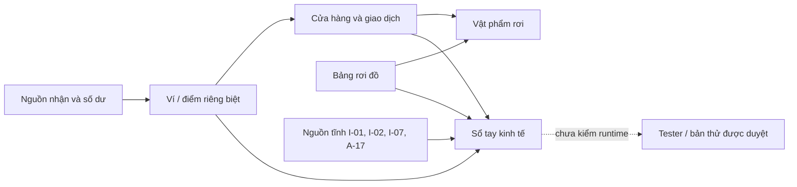

# TÓM TẮT 1/5 — [TÀI LIỆU] Bốn báo cáo cũ đã được gộp thành sổ tay tĩnh về tiền/điểm, cửa hàng và bảng rơi đồ boss. [I-01:8; I-02:8; I-07:7; A-17:7]
# TÓM TẮT 2/5 — [TÀI LIỆU] Bạc túi/rương, XU, điểm nạp, danh vọng, phúc duyên và vinh dự là các số dư/điểm khác nhau; không gộp theo tên gọi. [I-07:79–88]
# TÓM TẮT 3/5 — [TÀI LIỆU] Dữ liệu shop có 1.464 hàng goods; bốn shop Bảo vật tham chiếu 62 món, chủ yếu định giá bằng XU. [I-02:65–73; I-02:82–87]
# TÓM TẮT 4/5 — [TÀI LIỆU] Có 201 tệp bảng rơi đồ; 59 đường dẫn chứa BOSS không đồng nghĩa 59 boss hoạt động. Chưa xác minh runtime. [A-17:43–51]
# TÓM TẮT 5/5 — [CHƯA KIỂM] Task yêu cầu ghi Goddess lưu dữ liệu bằng Berkeley DB; bốn nguồn chưa xác minh độc lập nhận định này. Không build, exe, VM, game hay mạng. [SO-06:19; I-07:146]

# Sổ tay hiểu game: kinh tế (tiền, cửa hàng, rơi đồ)

## Cách đọc nhãn

- **[TÀI LIỆU]**: thông tin đã được ghi trong một báo cáo khảo sát tĩnh trước đó; dẫn `file:dòng` tới báo cáo đó.
- **[CHƯA KIỂM]**: báo cáo nguồn chưa xác nhận đủ hoặc chưa có thử nghiệm runtime. Không suy từ tên biến, tên bảng hay số liệu cấu hình sang hành vi đang chạy.

## Quan hệ chính

## 1. Tiền và điểm

| Số dư/điểm | Điều có trong tài liệu | Điều cần nhớ | Nguồn |
|---|---|---|---|
| Bạc/lượng trong túi | [TÀI LIỆU] Số dư túi có đường nhận và tiêu qua `Earn`/`Pay`; cửa hàng và đấu giá dùng đường tiêu này. | Phần mua thông thường chỉ kiểm tra bạc trong túi. | `I-07-cac-loai-tien-te.md:79` |
| Bạc/lượng trong rương | [TÀI LIỆU] Là cùng loại bạc nhưng lưu ở ngăn rương riêng. | Tổng `GetMoney()` gồm túi và rương không có nghĩa là có thể dùng cả hai để mua hàng. | `I-07-cac-loai-tien-te.md:80` |
| XU | [TÀI LIỆU] Có số dư riêng của nhân vật; được dùng ở cửa hàng và đấu giá. Có đường nhận từ Kim Nguyên Bảo và rút tiền trang được nêu trong báo cáo. | Không đồng nhất XU với điểm nạp `ExtPoint`. Chưa thấy đường chuyển XU trực tiếp giữa người chơi trong nhánh giao dịch đã khảo sát. | `I-07-cac-loai-tien-te.md:81` |
| Điểm nạp/điểm thẻ (`ExtPoint`) | [TÀI LIỆU] Là giá trị riêng trong `KPlayer`; có API cộng/trừ và script tiền trang dùng khi rút sang XU. | Chưa lần được đường ghi PaySys/cơ sở dữ liệu; chưa xác nhận trần hay persistence. | `I-07-cac-loai-tien-te.md:82; 141; 146` |
| Danh vọng | [TÀI LIỆU] Shop/đấu giá có thể dùng danh vọng để mua; phần tiêu gọi trừ giá. | Mức trần cụ thể và các nguồn nhận đầy đủ chưa được xác nhận. | `I-07-cac-loai-tien-te.md:83; 142; 144` |
| Phúc duyên | [TÀI LIỆU] Xuất hiện như một loại tiền mua hàng trong shop/đấu giá. | Chưa xác minh nguồn nhận, trần, mất khi chết, giao dịch hay hiển thị. | `I-07-cac-loai-tien-te.md:84; 142` |
| Vinh dự | [TÀI LIỆU] Trong đường mua đã khảo sát, loại tiền có tên `expoint` đọc task 2051. | Không phải `ExtPoint`/điểm nạp; nguồn thưởng và UI chưa xác minh. | `I-07-cac-loai-tien-te.md:85; 136` |
| Điểm Tống Kim | [TÀI LIỆU] Shop ánh xạ điểm Tống Kim vào task 192. | Chưa kiểm đầy đủ nguồn thưởng và cách hiển thị. | `I-07-cac-loai-tien-te.md:142; 211–212` |
| Bạc khóa/tiền khóa | [CHƯA KIỂM] Chưa có bằng chứng xác nhận một ví bạc khóa riêng. Hai đường mua được khảo sát dùng chung đường `Pay` với bạc thường. | Không suy rằng vật phẩm khóa đồng nghĩa tiền bị khóa. | `I-07-cac-loai-tien-te.md:87` |
| Vé/lệnh bài | [CHƯA KIỂM] Đây là vật phẩm tiêu hao tiềm năng, không phải số dư ví mặc định. | Mỗi mẫu cần kiểm tra riêng về cờ khóa, hạn dùng, xếp chồng và điều kiện sử dụng. | `I-07-cac-loai-tien-te.md:88` |
| Điểm hoạt động | [CHƯA KIỂM] Chưa định danh được số dư/hệ thống cụ thể, nguồn nhận, cách tiêu, chu kỳ hay phần thưởng. | Không gộp với XU hoặc `ExtPoint`. | `I-01-cac-loai-diem.md:91–99; I-07-cac-loai-tien-te.md:43; 142` |

### Ghi chú về Goddess

- [CHƯA KIỂM] Task yêu cầu ghi chú rằng Goddess lưu dữ liệu bằng Berkeley DB. Báo cáo I-07 chỉ nói chưa lần được luồng lưu điểm nạp qua PaySys/Goddess; bốn báo cáo nguồn không dẫn bằng chứng độc lập cho loại cơ sở dữ liệu. Vì vậy, giữ nguyên đây là ghi chú do task cung cấp, không trình bày như kết quả đã xác minh. [`SO-06.md:19`; `I-07-cac-loai-tien-te.md:146`]

## 2. Cửa hàng bán gì

[TÀI LIỆU] Kiểm kê gốc gồm 1.464 hàng hàng hóa và 160 dòng cấu hình cửa hàng (105 dòng có nội dung). Có 2.644 ô ID dương, tương ứng 474 ID hàng khác nhau. Trong các ID được tham chiếu, 312 hàng đang để trống giá cấu hình; giá trống không đồng nghĩa món miễn phí vì một số mẫu có thể kế thừa giá từ mẫu vật phẩm. [`I-02-vat-pham-ban.md:65–74; 95`]

[TÀI LIỆU] Các nhóm lớn gồm trang bị, thuốc, vật phẩm mine, quest và truyền tống. Một số nhóm còn chưa được chia đầy đủ theo công dụng. [`I-02-vat-pham-ban.md:33–43; 112–121`]

| Nhãn | Nhóm hàng | Hàng trong goods | Được shop tham chiếu | Ghi chú |
|---|---|---:|---:|---|
| [TÀI LIỆU] | Trang bị | 1.161 | 326 | Có cả ngựa/phụ kiện; chưa kiểm hết thuộc tính sinh ngẫu nhiên. |
| [TÀI LIỆU] | Thuốc | 50 | 20 | Các ID thuốc được shop dùng đều có dòng tên trong mẫu. |
| [TÀI LIỆU] | Vật phẩm mine | 195 | 121 | Chưa tách hết chế tạo/nguyên liệu theo công dụng. |
| [TÀI LIỆU] | Vật phẩm quest | 57 | 6 | Bao gồm ví dụ vật phẩm Phong Lăng Độ. |
| [TÀI LIỆU] | Truyền tống | 1 | 1 | Kiểm kê theo số hàng và ID shop tham chiếu. |

[`I-02-vat-pham-ban.md:34–36; 114–121`]

[TÀI LIỆU] Trong 474 ID được tham chiếu, loại tiền 0/2/6 có lần lượt 334/115/25 ID. Ví dụ trong báo cáo cho thấy loại 2 dùng XU, loại 6 dùng điểm Tống Kim, và một hàng ngựa có giá bằng bạc. Ô loại tiền trống được tính mặc định là 0; không diễn giải ID nào giá trống là miễn phí. [`I-02-vat-pham-ban.md:73; 84–87; 95–102`]

| Nhãn | Shop Bảo vật | Mã shop | Số món được tham chiếu | Giá cấu hình | Loại tiền |
|---|---|---:|---:|---:|---|
| [TÀI LIỆU] | Kỳ Trân | 99 | 22 | 1–200 | XU |
| [TÀI LIỆU] | Hoạt Động | 100 | 10 | 1–20 | XU |
| [TÀI LIỆU] | Thư Tịch | 101 | 29 | 200 | XU |
| [TÀI LIỆU] | Chiến Mã | 102 | 1 | 300 | XU |

[`I-02-vat-pham-ban.md:82–87`]

| Nhãn | Ví dụ hàng hóa | Giá/ghi chú trong tài liệu | Nguồn |
|---|---|---|---|
| [TÀI LIỆU] | Kim Sáng Dược (tiểu) | Ô giá shop để trống; mẫu thuốc có giá 50, nên chưa chốt được giá giao dịch thực tế. | `I-02-vat-pham-ban.md:95` |
| [TÀI LIỆU] | Bạch Câu Hoàn | 3 XU. | `I-02-vat-pham-ban.md:96` |
| [TÀI LIỆU] | Phù vô hạn | 5 XU; thời hạn cấu hình 10. | `I-02-vat-pham-ban.md:97` |
| [TÀI LIỆU] | Lam Thủy Tinh | 10 XU. | `I-02-vat-pham-ban.md:98` |
| [TÀI LIỆU] | Lệnh bài Phong Lăng Độ | 3 XU. | `I-02-vat-pham-ban.md:99` |
| [TÀI LIỆU] | Bí kíp môn phái (mẫu Đạt Ma Độ Giang) | 200 XU. | `I-02-vat-pham-ban.md:100` |
| [TÀI LIỆU] | Tống Kim Chiến Cổ | 1.000 điểm Tống Kim, mã tiền 6. | `I-02-vat-pham-ban.md:101` |
| [TÀI LIỆU] | Bạch Mã | 5.000 bạc trước thuế. | `I-02-vat-pham-ban.md:102` |

[TÀI LIỆU] Theo đường mua đã khảo sát, người chơi phải ở đúng trạng thái shop, hàng phải hợp lệ, có đủ tiền và chỗ túi; mua nhiều cần hàng xếp chồng được. Có cộng/trừ thuế thành viên bang ở đường giá. Chưa thấy hạn mức ngày trong hàm mua đã đọc, nhưng chưa khảo sát hết protocol/script nên không kết luận toàn hệ thống không có giới hạn. [`I-02-vat-pham-ban.md:123–129`]

## 3. Bảng rơi đồ boss

[TÀI LIỆU] Phạm vi báo cáo A-17 có 201 tệp INI dưới thư mục bảng rơi đồ; 194 có `Count > 0`, 7 có `Count = 0`, tổng `Main.Count` là 10.734 slot khai báo. Có 59 đường dẫn chứa tên `BOSS`; đó là bộ lọc theo tên, không phải số boss hoạt động. [`A-17-roi-do-boss-trang-bi.md:43–47`]

| Nhãn | Ví dụ bảng | Count / RandRange | Khoảng cấp vật phẩm ở Main | Số loại mục | Tổng RandRate trong Count |
|---|---|---:|---:|---:|---:|
| [TÀI LIỆU] | `npcdroprate110.ini` | 52 / 1.000.000 | 5–9 | 2 | 68.000 |
| [TÀI LIỆU] | `bosstask_lev20.ini` | 57 / 4.500 | 2–4 | 7 | 2.033 |
| [TÀI LIỆU] | `bosstask_lev90.ini` | 57 / 4.500 | 8–10 | 7 | 2.033 |
| [TÀI LIỆU] | `boss_a.ini` | 60 / 60.000 | 8–10 | 20 | 33.790 |

[`A-17-roi-do-boss-trang-bi.md:61–66`]

- [TÀI LIỆU] `Npcs.txt` có 2.435 mục, nhưng source server được báo cáo bỏ qua cột `DropRateFile`; riêng việc một NPC có tên file ở cột đó không chứng minh bảng được gắn. [`A-17-roi-do-boss-trang-bi.md:51; 57`]
- [TÀI LIỆU] Ca `boss_tieu` có một lời gọi chuyển `.lua` cho đường nạp chỉ chấp nhận `.ini`, đồng thời có nhánh death script riêng gọi `PickDropItem`/`DropItem`. Không kết luận boss này không rơi vật phẩm; callback runtime chưa kiểm. [`A-17-roi-do-boss-trang-bi.md:76–78`]
- [CHƯA KIỂM] `RandRate`/`RandRange` là cấu hình tĩnh, chưa phải tỉ lệ rơi thực tế mỗi lần hạ boss. Các bảng được boss đang chạy sử dụng, số item sinh ra, điều kiện rơi và kết quả trên client chưa xác minh. [`A-17-roi-do-boss-trang-bi.md:18; 70–78; 138–155`]

## Điều chưa kiểm và giới hạn

- [CHƯA KIỂM] Không có xác nhận source và dữ liệu có khớp binary/server đang chạy; không có thử nghiệm shop, số dư, boss hoặc tỷ lệ rơi. [`I-01-cac-loai-diem.md:158–166`; `I-02-vat-pham-ban.md:180–186`; `I-07-cac-loai-tien-te.md:138–146`; `A-17-roi-do-boss-trang-bi.md:18; 138–155`]
- [CHƯA KIỂM] Nguồn thưởng, trần và persistence của một số điểm; hạn mua toàn hệ thống; danh sách boss đang hoạt động; các item/điều kiện bên trong toàn bộ bảng chưa được kiểm kê đầy đủ. Dùng đúng các mục CHƯA KIỂM trong báo cáo nguồn làm giới hạn, không suy thêm.
- [CHƯA KIỂM] Ghi chú Goddess/Berkeley DB chưa được đối chiếu độc lập như nêu ở mục tiền và điểm.

## Liên quan

`I-01-cac-loai-diem.md`; `I-02-vat-pham-ban.md`; `I-07-cac-loai-tien-te.md`; `A-17-roi-do-boss-trang-bi.md`; task `SO-06.md`.

