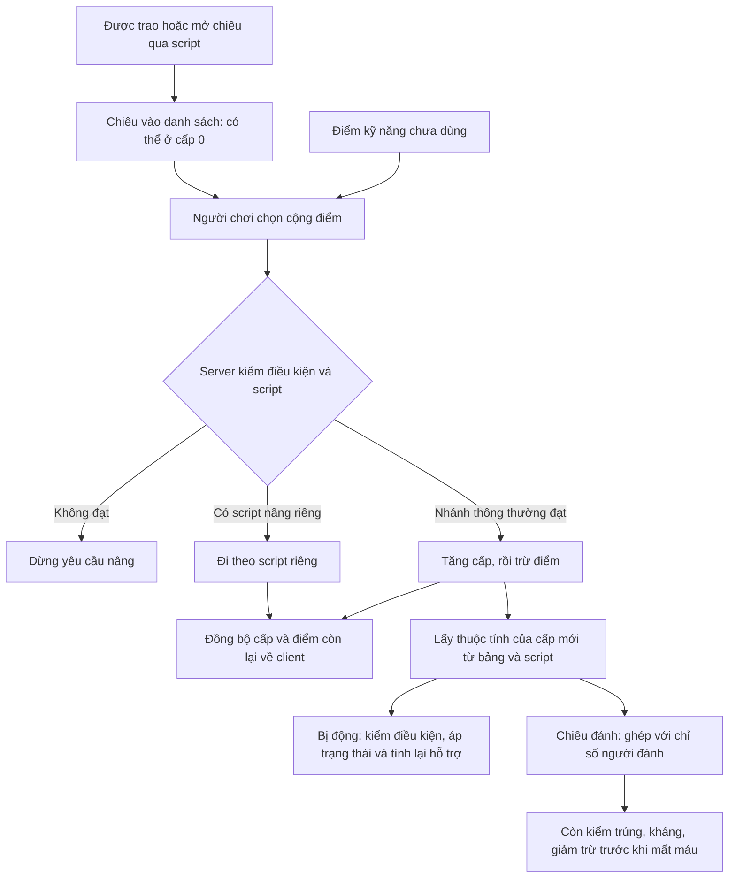

TÓM TẮT 1: [NGUỒN] [THẤY] Học thêm chiêu và cộng điểm nâng chiêu là hai đường riêng; yêu cầu nâng thông thường phải tìm thấy chiêu trong danh sách trước. `S/ScriptFuns.cpp:11117–11135`, `S/KPlayer.cpp:5464–5467`.
TÓM TẮT 2: [NGUỒN] [THẤY] Server kiểm điểm còn lại, script điều kiện, trần và cấp nhân vật; nhánh nâng thông thường chỉ trừ điểm sau khi tăng cấp thành công. `S/KPlayer.cpp:5471–5496,5507–5576`.
TÓM TẮT 3: [NGUỒN] [THẤY] Cấp đã học, cấp hiệu lực, cấp cộng thêm và phần trăm hỗ trợ là các trường riêng; bị động được kiểm điều kiện trước khi áp trạng thái. `S/KSkillList.h:18–34`, `S/KSkillList.cpp:226–255`.
TÓM TẮT 4: [NGUỒN] [THẤY] Thuộc tính theo cấp đi từ bảng kỹ năng qua script rồi ghép với chỉ số người đánh; [TÀI LIỆU] hai sổ tay cũ được đối chiếu, giữ nguyên kết luận. `S/KSkills.cpp:3085–3101,3177–3216,3245–3257`, `D/SO-TAY-KY-NANG.md:110–117`, `D/HIEU-CONG-THUC-SAT-THUONG.md:74–88`.
TÓM TẮT 5: [CHƯA KIỂM] Chưa đối chiếu bảng Settings/script thực nạp, toàn bộ cây học và kết quả trong game; chỉ đọc tĩnh, không build, chạy exe, VM hay mạng. Giới hạn theo `JX1_OPS/TASKS/SO-24.md:24–30`; nguồn bảng được mã gọi tại `S/KSkills.cpp:3088–3100,3184–3190`.

# SO-24 — Sổ tay hiểu game: cấp kỹ năng, điểm kỹ năng và khí công

Loại: tổng hợp
Chủ đề: Người chơi học, nâng và hưởng hiệu quả của kỹ năng như thế nào trong mã client/server được giao.
Từ khóa: học chiêu, cấp kỹ năng, điểm kỹ năng, khí công, bị động, SkillLevel, CurrentSkillLevel, ReqLevel, MaxLevel, LvlSetScript
Trạng thái: DONE — đạt tiêu chí đầu ra tài liệu khảo sát tĩnh; các giá trị thực nạp và hành vi game còn để mở.
Độ phủ: 8/8 chủ đề được giải thích trong bảng dưới; bảng giá trị từng chiêu ở mọi cấp chưa đối chiếu, chưa đếm được tổng vì không đọc dữ liệu ngoài hai gốc source.
Liên quan: [Sổ tay kỹ năng và môn phái](SO-TAY-KY-NANG.md), [Hiểu công thức sát thương](HIEU-CONG-THUC-SAT-THUONG.md), [bàn giao SO-24](../REPORTS/SO-24.md).
Cần tôi quyết định: không đối với nội dung trong phạm vi hiện tại.

[THẤY] Các cạnh học, nâng, đồng bộ và bị động dựa trên `S/ScriptFuns.cpp:11117–11135`, `S/KPlayer.cpp:5483–5496,5540–5546,5602–5612`, `S/KSkillList.cpp:226–255`. [TÀI LIỆU] Phần sau khi đòn chạm mục tiêu theo `D/HIEU-CONG-THUC-SAT-THUONG.md:90–98`.

## Phạm vi và độ phủ

| Chủ đề theo tiến trình chơi | Mức phủ | Nguồn và giới hạn |
|---|---|---|
| 1. Học hoặc mở chiêu | Đã phủ đường thêm chiêu; chưa phủ mọi nhiệm vụ | [THẤY] `S/ScriptFuns.cpp:11091–11135`; [TÀI LIỆU] `D/SO-TAY-KY-NANG.md:112–115` |
| 2. Nhận và tiêu điểm kỹ năng | Đã phủ đường lên cấp và nâng thông thường | [THẤY] `S/KPlayer.cpp:3271–3279,5540–5576`; chưa kiểm mọi nguồn thưởng/hoàn điểm |
| 3. Điều kiện và trần nâng | Đã phủ nhánh C++ cùng cửa chuyển sang script | [THẤY] `S/KPlayer.cpp:5471–5576`; chưa đọc nội dung script ngoài gốc source |
| 4. Cấp đã học, cấp hiệu lực, cộng thêm | Đã phủ trường lưu và gói đồng bộ | [THẤY] `S/KSkillList.h:18–34`, `S/KPlayer.cpp:5604–5612`, `C/gamecore/KProtocolProcess.cpp:1275–1304` |
| 5. Bị động/khí công và hỗ trợ chiêu | Đã phủ cơ chế; chưa phân loại mọi tên chiêu | [THẤY] `S/KSkillList.cpp:226–255,1009–1037`, `S/KSkills.cpp:3462–3506` |
| 6. Thuộc tính/sát thương theo cấp trong Settings | Đã phủ cách đọc bảng, gọi script, ghép vật lý; chưa có bảng số thực từng cấp | [THẤY] `S/KSkills.cpp:2978–2995,3085–3101,3177–3216`, `S/KNpc.cpp:5992–6054` |
| 7. Độ luyện riêng của chiêu | Đã phủ một đường tích độ luyện và tăng một cấp | [THẤY] `S/KSkillList.cpp:260–278`, `S/KPlayer.cpp:5617–5650`; chưa kiểm nơi phát sinh độ luyện |
| 8. Đối chiếu hai tài liệu được giao | Đã phủ cả hai; không sửa kết luận cũ | [TÀI LIỆU] `D/SO-TAY-KY-NANG.md:89–117`, `D/HIEU-CONG-THUC-SAT-THUONG.md:74–98,119–128` |

## Cách đọc bằng chứng và danh sách nguồn

- **[THẤY] / ĐÃ XÁC MINH:** đọc trực tiếp mã hoặc văn bản trên đĩa ở các gốc bên dưới. Phép suy tính được ghi rõ giả định; không phải kết quả chạy game.
- **[TÀI LIỆU]:** dẫn lại nội dung tài liệu cũ; không mặc nhiên đã mở nguồn gốc mà tài liệu ấy dẫn.
- **[CHƯA KIỂM] / CHƯA XÁC MINH:** thiếu dữ liệu hoặc phép thử trong phạm vi SO-24.

| Tiền tố | Gốc đọc chỉ đọc |
|---|---|
| `S/` | `C:/Jx1CocoV3/SwordOnline/SwordOnline/jxOnline/gameserver/Sources/Core/Src/` |
| `C/` | `C:/Jx1CocoV3/Folder/Client2912-20260116T044348Z-3-001/Client2912/Client/Classes/` |
| `D/` | `JX1_OPS/DESIGN/` trong worktree `D:/JX-wt/SO-24` |

[THẤY] Danh sách đọc phục vụ câu hỏi, chọn từ hai gốc source và hai tài liệu được task nêu: `S/{ScriptFuns.cpp,KPlayer.cpp,KSkillList.cpp,KSkillList.h,KSkillManager.cpp,KSkillManager.h,KSkills.cpp,KProtocolProcess.cpp,KNpc.cpp}`; `C/{gameui/KuiSkill.cpp,gamecore/CoreShell.cpp,gamecore/KPlayer.cpp,gamecore/KProtocolProcess.cpp}`; `D/{SO-TAY-KY-NANG.md,HIEU-CONG-THUC-SAT-THUONG.md}`. Chỉ tìm thêm ký hiệu trong một số header client có tên cụ thể; không lấy chúng làm bằng chứng khi không tìm thấy. Căn cứ chọn gốc và đối chiếu: `JX1_OPS/TASKS/SO-24.md:19–25`.

[THẤY] Đọc đoạn chú thích server bằng GBK/CP936 cho ra chữ Hán đọc được. Client có đoạn chú thích hiển thị lỗi khi đọc UTF-8; kết luận dùng định danh ASCII và lệnh đang hoạt động, không suy ý từ chữ lỗi. Tài liệu đầu ra dùng UTF-8 không BOM. Ví dụ bằng chứng ASCII: `S/KSkills.cpp:2982–2995`, `C/gameui/KuiSkill.cpp:619–636`, `C/gamecore/KPlayer.cpp:1938–1954`.

## Giải mã tên

[TÀI LIỆU] Chỉ dùng một tên chiêu và hai tên phái để minh họa. Chuỗi gốc trong bảng dẫn lại từ sổ tay cũ; SO-24 không giải mã lại tệp Settings thô. Không đặt tên Việt cho các ID chưa có tên được nguồn đối chiếu. `D/SO-TAY-KY-NANG.md:61–81,95,103`.

| Tên gốc | Mã hóa của nguồn gốc | Chữ đúng UTF-8 | Nguồn file:dòng |
|---|---|---|---|
| 少林派 | GBK, theo tài liệu | Thiếu Lâm (少林派) | [TÀI LIỆU] `D/SO-TAY-KY-NANG.md:65` |
| 武当派 | GBK, theo tài liệu | Võ Đang (武当派) | [TÀI LIỆU] `D/SO-TAY-KY-NANG.md:73` |
| `§¹t Ma §é Giang` | TCVN3, theo tài liệu | Đạt Ma Độ Giang, ID 318 | [TÀI LIỆU] `D/SO-TAY-KY-NANG.md:81` |

## Sắp theo cấu trúc game

[TÀI LIỆU] Ba dòng dưới đi theo **phái → nhánh → cấp yêu cầu**, là ví dụ tra cứu từ sổ tay đã có, không phải cây kỹ năng đầy đủ. Cấp 80 là trường yêu cầu trong dữ liệu; điều kiện của nhiệm vụ mở chiêu còn riêng. `D/SO-TAY-KY-NANG.md:91–105,112–115`.

| Phái | Nhánh / ID minh họa | Cấp yêu cầu (`ReqLevel`) | Trần bản ghi (`MaxLevel`) | Nguồn |
|---|---|---:|---:|---|
| Thiếu Lâm | Quyền pháp / 318 — Đạt Ma Độ Giang | 80 | 20 | [TÀI LIỆU] `D/SO-TAY-KY-NANG.md:81,95` |
| Võ Đang | Chưởng pháp / 365, giữ nhãn menu cũ | 80 | 30 | [TÀI LIỆU] `D/SO-TAY-KY-NANG.md:103,138` |
| Võ Đang | Kiếm pháp / 368 | 80 | 20 | [TÀI LIỆU] `D/SO-TAY-KY-NANG.md:103` |

[CHƯA KIỂM] Không mở rộng thành danh mục mọi phái/nhánh/cấp vì SO-24 khảo sát cơ chế chung, không đọc lại toàn bộ dữ liệu của các tài liệu cũ. Nhãn menu và nhãn dòng võ công của ID 365 có chỗ khác nhau đã được tài liệu ghi nhận; giữ cả giới hạn ấy, không sửa ngầm. `D/SO-TAY-KY-NANG.md:35–36,103,138`.

## 1. Học một chiêu khác với nâng chiêu đã có

1. **[THẤY] Học/mở chiêu là đưa ID và cấp vào danh sách.** Lệnh script `AddMagic` nhận ID hoặc tên, cấp đối số thứ hai; nếu không có cấp thì dùng 0. Nó gọi `KSkillList::Add`, rồi gửi cấp, điểm còn lại và điểm cộng thêm về client. Trong đoạn này không có phép trừ điểm kỹ năng. Không suy ra nhiệm vụ gọi nó là miễn phí: điều kiện và chi phí ở nơi gọi chưa đọc. `S/ScriptFuns.cpp:11091–11135`.
2. **[THẤY] Có ô chiêu chưa có nghĩa là đã dùng được.** Nhánh thêm chiêu mới có thể lưu cấp 0; nhánh kiểm dùng từ chối khi cấp hiệu lực không dương hoặc chưa hết thời gian chờ. Không lấy việc client dựng biểu tượng làm bằng chứng chiêu đã luyện. `S/KSkillList.cpp:497–510,524–543,879–885`.
3. **[THẤY] Nâng thông thường cần chiêu đã có trong danh sách.** Server tìm ID, không có thì dừng; có thể xét từ cấp 0 bằng cách lấy dữ liệu cấp 1 để kiểm điều kiện. Đây không phải lệnh tự tìm và học mọi kỹ năng mới. `S/KPlayer.cpp:5464–5477`.
4. **[TÀI LIỆU] Ai trao chiêu và khi nào mở menu phụ thuộc script/nhiệm vụ.** Sổ tay trước mô tả học ban đầu qua `SKILLNORMAL`/`AddMagic`, menu kỹ năng 90, và giới hạn chưa rõ với menu 150. SO-24 xác minh thêm đầu nhận `AddMagic`, không đọc lại các script ấy. `D/SO-TAY-KY-NANG.md:112–115`, `S/ScriptFuns.cpp:11117–11135`.

## 2. Điểm kỹ năng, cấp chiêu và độ luyện

| Thứ người chơi gặp | Cách hiểu trong phạm vi mã đã đọc | Bằng chứng |
|---|---|---|
| Điểm chưa dùng | [THẤY] Số dư `m_nSkillPoint`; lên cấp nhân vật có cộng `PLAYER_LEVEL_ADD_SKILL` | `S/KPlayer.cpp:3271–3279` |
| Cấp đã học | [THẤY] Trường `SkillLevel`; hàm server dùng để xét nâng trả về trường này | `S/KSkillList.h:18–25,114–118` |
| Cấp đang có hiệu lực | [THẤY] Trường `CurrentSkillLevel`, được dùng để lấy dữ liệu chiêu khi tăng cấp; server gửi cấp hiệu lực trong gói sau nâng | `S/KSkillList.cpp:202–226`, `S/KPlayer.cpp:5604–5610` |
| Cấp cộng thêm | [THẤY] Trường `mAddPoint`, đọc theo vị trí trong danh sách; tách khỏi số dư điểm chưa dùng | `S/KSkillList.h:24–26,150–155`, `S/KPlayer.cpp:5609–5610` |
| Hỗ trợ sát thương cho chiêu | [THẤY] Trường `EnChance` có chú thích đơn vị phần trăm; được tính lại từ các kỹ năng có cấp hiệu lực dương | `S/KSkillList.h:26`, `S/KSkillList.cpp:1009–1037` |
| Độ luyện | [THẤY] Có mức hiện có và mức yêu cầu riêng; đường `IncreaseExp` đủ ngưỡng gọi tăng một cấp, rồi đặt lại độ luyện qua cờ xóa | `S/KSkillList.h:30–34`, `S/KSkillList.cpp:235–238,260–278` |

[THẤY] Chú thích ở dòng lên cấp nói cộng 1 điểm, nhưng lệnh thực dùng hằng `PLAYER_LEVEL_ADD_SKILL`. SO-24 chưa xác minh định nghĩa hằng server, nên không chốt mọi cấp nhân vật luôn nhận đúng 1 điểm. Bấm nút nâng ở client thì có bằng chứng trực tiếp yêu cầu **1 điểm/lần** ở đường `CoreShell`. `S/KPlayer.cpp:3279`, `C/gamecore/CoreShell.cpp:3965–3968`.

[THẤY] Đường tăng độ luyện được đọc không trừ `m_nSkillPoint`; nó gọi `IncreaseExp` rồi đồng bộ số dư hiện có. [CHƯA KIỂM] Chiêu nào được phép luyện, nguồn sinh độ luyện và mọi trần phụ do nơi gọi quy định. Không suy mọi chiêu đều lên cấp bằng việc đánh quái. `S/KPlayer.cpp:5617–5650`, `S/KSkillList.cpp:260–278`.

## 3. Một lần bấm nâng đi qua đâu?

1. **[THẤY] Client gửi yêu cầu.** Nút nâng gọi `GOI_TONE_UP_SKILL`; `CoreShell` gọi `ApplyAddSkillLevel(..., 1)`. Client kiểm chiêu đã có và số dư, rồi gửi `c2s_playerapplyaddskillpoint`. Kiểm tra client chỉ là một lớp, server còn xử lý riêng. `C/gameui/KuiSkill.cpp:619–636`, `C/gamecore/CoreShell.cpp:3965–3968`, `C/gamecore/KPlayer.cpp:1938–1954`, `S/KProtocolProcess.cpp:5692–5694`.
2. **[THẤY] Server kiểm số dư và gọi cửa điều kiện chung.** Nếu qua kiểm tra đầu, mã gọi `main_Skillset`; kết quả không dương thì dừng. Có `LevelUpScript` thì gọi script nâng riêng, không đi tiếp nhánh cộng điểm C++ thông thường. [CHƯA KIỂM] Nội dung và tác dụng thật của hai script. `S/KPlayer.cpp:5471–5498`, `S/KSkills.cpp:3095–3100`.
3. **[THẤY] Nhánh thông thường kiểm nhiều giới hạn.** Nó có danh sách cấm `NoCanXiSui`, giới hạn kỹ thuật `MAX_SKILLLEVEL`, trần lấy từ `MaxLevel`, phần trần tái sinh/VIP và cấp cộng thêm. Không rút tất cả thành “chiêu nào cũng tối đa 20”. Số 20 trong hàm đọc `MaxLevel` chỉ là mặc định khi đọc cột. `S/KPlayer.cpp:5507–5528`, `S/KSkillManager.cpp:64–74`.
4. **[THẤY] Thành công mới trừ điểm trong nhánh này.** Sau `IncreaseLevel` thành công, server trừ đúng số điểm yêu cầu, cập nhật chỉ số rồi gửi cấp hiệu lực, độ luyện, điểm dư và cấp cộng thêm về client. Client nhận lại số dư, thêm hoặc sửa chiêu và phát thông báo đổi kỹ năng cho giao diện. `S/KPlayer.cpp:5540–5546,5570–5576,5602–5612`, `C/gamecore/KProtocolProcess.cpp:1275–1317`.

### Hiểu điều kiện cấp bằng một ví dụ có giới hạn

[THẤY] Gọi `L` là cấp đã học hiện tại, `d` là số điểm yêu cầu, `W=L+d`, `P` là cấp nhân vật, `R=ReqLevel`, `M=MaxLevel`, `A` là cấp cộng thêm và `B` là phần trần tái sinh. Sau các cửa kiểm trước đó, nhánh thứ nhất đòi `M>1`, `W≤M+B+A`, `W≤P−R+1`. Nhánh dự phòng từ chối nếu `W≥M`; phần còn lại kiểm `W≤M` và `W≤P−R+1+A`. Cửa trần ở trước còn có phần VIP; không đồng nhất nó với điều kiện cho phép ở nhánh sau. `S/KPlayer.cpp:5507–5576`.

[TÀI LIỆU + THẤY — suy tính] Với bản ghi minh họa 318 có `R=80`, `M=20` theo sổ tay cũ, giả sử `A=B=0`, mọi script/cửa khác đều cho qua và chỉ xét nhánh thứ nhất: nhân vật cấp 80 đủ điều kiện cấp chiêu 1; cấp 81 đủ cấp chiêu 2; cấp 99 đủ cấp chiêu 20. Đây là thế số vào `W≤P−R+1`, không khẳng định nhân vật đã được trao chiêu hoặc nâng thành công trong game. Nguồn dữ liệu dẫn lại: `D/SO-TAY-KY-NANG.md:95`; công thức: `S/KPlayer.cpp:5540–5546`.

[CHƯA KIỂM] Không dùng ví dụ trên để khẳng định cách nâng qua trần hoặc tác dụng VIP/tái sinh. Phải có dữ liệu thực, script và kiểm thử được duyệt riêng mới kết luận được trường hợp ấy. `S/KPlayer.cpp:5483–5495,5528–5576`.

## 4. Khí công, bị động và hỗ trợ chiêu

1. **[THẤY] “Bị động” có đường xử lý riêng.** Khi thêm chiêu có cấp dương hoặc đổi cấp, mã lấy chiêu, gọi `NewCanCastSkill`, rồi với kiểu `SKILL_SS_PassivityNpcState` mới chọn đường áp hoặc đường xóa trạng thái theo kết quả. `CastPassivitySkill` chuyển thuộc tính trạng thái sang `SetStateSkillEffect`. [CHƯA KIỂM] Toàn bộ điều kiện của từng chiêu và tác dụng xóa thực tế trong bản chạy. `S/KSkillList.cpp:240–250,549–559`, `S/KSkills.cpp:3462–3472`.
2. **[THẤY] Hỗ trợ cho chiêu khác được tính lại.** `ReEnChance` xóa số hỗ trợ cũ, duyệt chiêu có cấp hiệu lực dương và gọi `EnChanceSkill`. Hàm sau chọn nhóm `magic_addskilldamage1` đến `magic_addskilldamage10` trong thuộc tính tức thời để áp. Đây là đường hỗ trợ đã thấy, không phải chứng minh mọi khí công đều tăng sát thương hoặc đều tăng cấp chiêu. `S/KSkillList.cpp:1009–1037`, `S/KSkills.cpp:3484–3506`.
3. **[THẤY] Kiểu bị động và cờ hào quang là hai trường riêng.** Bảng đọc `SkillStyle` và `IsAura` riêng. **[CHƯA KIỂM]** Chưa có ánh xạ toàn bộ tên “khí công” trên giao diện sang hai trường này; không gọi mọi khí công là hào quang hay mọi hỗ trợ là bị động. `S/KSkills.cpp:2992–2995`.
4. **[THẤY] Cộng cấp và cộng % có thể đi vào phép tính khác nhau.** Cấp hiệu lực chọn bộ dữ liệu chiêu; `EnChance` là tham số hỗ trợ. Nhánh vật lý theo điểm dùng hệ số hỗ trợ, còn nhánh vật lý theo % trong đoạn đã đọc dùng nền và % theo loại vũ khí. Vì thế không lấy một dòng “+cấp” đổi trực tiếp thành một tỷ lệ sát thương chung. `S/KSkillList.cpp:226–235`, `S/KSkills.cpp:3245–3250`, `S/KNpc.cpp:6020–6054`.

## 5. Cấp chiêu biến thành sát thương như thế nào?

### Bảng Settings là đầu vào, script tính giá trị ở cấp cần dùng

[THẤY] Mỗi bản ghi có `SkillId`, `Attrib`, `ReqLevel`, `SkillStyle`, các cờ mục tiêu và hai trường script. `MaxLevel` được bộ quản lý đọc riêng; `LvlSetScript` phục vụ thuộc tính theo cấp, còn `LevelUpScript` phục vụ đường nâng riêng. Hai trường không cùng nhiệm vụ. `S/KSkills.cpp:2978–3002,3085–3100`, `S/KSkillManager.cpp:64–74`.

[THẤY] Khi cần một cặp **ID + cấp**, bộ quản lý trả dữ liệu đã có hoặc tạo dữ liệu cấp ấy. Nó đọc bản ghi rồi gọi `LoadSkillLevelData(cấp, dòng bảng)`. Hàm này đọc các cặp `LvlSetting1…` / `LvlData1…`, gọi `GetSkillLevelData(tên thuộc tính, dữ liệu, cấp)`, rồi phân tích số hoặc chuỗi trả về. Vì vậy không có bằng chứng cho công thức chung “cấp sau luôn mạnh hơn cấp trước x%”. `S/KSkillManager.cpp:175–207`, `S/KSkills.cpp:3177–3216`.

| Đầu vào/thuộc tính | Ý nghĩa trong đường đã đọc | Nguồn |
|---|---|---|
| `LvlSettingN` / `LvlDataN` / cấp | [THẤY] Tên, dữ liệu và cấp truyền vào hàm script | `S/KSkills.cpp:3181–3190` |
| Kết quả dạng ba số | [THẤY] Parser tách thành ba giá trị; ý nghĩa phải xem từng loại thuộc tính | `S/KSkills.cpp:3560–3575` |
| `magic_physicsenhance_p` hoặc `magic_physicsdamage_v` | [THẤY] Đưa vào cùng ô kênh vật lý nhưng giữ loại để phép ghép chọn cách tính | `S/KSkills.cpp:3677–3684`, `S/KNpc.cpp:6020–6054` |
| Băng, hỏa, lôi, độc, `magic_magicdamage_v` | [THẤY] Các nhóm vào ô kênh riêng; không cộng thô mọi trường thành một số | `S/KSkills.cpp:3685–3724`; [TÀI LIỆU] phép ghép từng kênh tại `D/HIEU-CONG-THUC-SAT-THUONG.md:81–88` |
| Chi phí, thời gian chờ, số đạn con | [THẤY] Cũng có trường trong parser, nên hiệu quả theo cấp cần xem đúng những thuộc tính mà script trả | `S/KSkills.cpp:3583–3606`; [CHƯA KIỂM] thuộc tính nào thực thay đổi ở từng chiêu |

### Phép ghép vật lý và ví dụ so hai bộ đầu vào

[THẤY] Với mỗi đầu khoảng sát thương, đặt `N` là nền vật lý cộng điểm vật lý đang có. Nhánh `magic_physicsenhance_p` tính `trunc(N×(100+p)/100)` rồi, với người chơi, cộng riêng `trunc(N×q/100)` theo loại vũ khí. Nhánh `magic_physicsdamage_v` lấy điểm chiêu `V` và tính `trunc(V×(100+e)/100)`, sau đó có thể cộng vật lý nội công khi `bIsPhysical` tắt. `p`, `q`, `e` là các đầu vào khác nhau; phép chia nguyên thực hiện ở từng hạng. `S/KNpc.cpp:5992–5996,6020–6054`.

[TÀI LIỆU + THẤY — suy tính] HG-08 dùng nền minh họa `N=135`, `% chiêu p=50`, `% vũ khí q=20`, cho `202+27=229`. Giữ `N,q` và giả sử bộ dữ liệu của cấp tiếp theo trả `p=60` thì được `216+27=243`, tăng 14 ở bước ghép. Giá trị **60 là giả định để so sánh**, không phải số đã đọc trong Settings; 135/50/20 cũng là đầu vào ví dụ tính tay của tài liệu cũ. Không gán chúng cho ID 318 hay bất kỳ chiêu thật nào. `D/HIEU-CONG-THUC-SAT-THUONG.md:102–108`, `S/KNpc.cpp:6020–6030`.

[TÀI LIỆU] 229/243 là đầu ra ghép ở người đánh, chưa phải máu mục tiêu mất. Còn kiểm trúng, chí mạng, kháng, tương khắc, các hệ số đối tượng và lá chắn. Tooltip/lực tay client cũng không có đủ đầu vào của mục tiêu. SO-24 giữ kết luận cũ này, không dùng tăng cấp chiêu để suy thẳng tăng máu mất. `D/HIEU-CONG-THUC-SAT-THUONG.md:90–98,119,128`.

[CHƯA KIỂM] SO-24 chưa đọc bảng `Skills.txt`, các `LvlSetScript`/`LevelUpScript` được trỏ tới, script `main_Skillset` hay dữ liệu đóng gói thực nạp. Các đường dẫn đó nằm ngoài hai gốc source được nêu để đọc; không khẳng định tệp thiếu trên đĩa. Vì vậy chưa lập bảng sát thương cấp 1…trần cho chiêu thật và chưa kết luận cấp nào tối ưu. Điểm cần đối chiếu khi có phạm vi đọc dữ liệu: `S/KSkills.cpp:3088–3100,3184–3190`, `S/KPlayer.cpp:5483–5495`.

## 6. Đối chiếu và phát hiện khi tổng hợp

| Nội dung tài liệu cũ | Kết quả đối chiếu SO-24 |
|---|---|
| Sổ tay kỹ năng nói nâng cần kiểm cấp, điểm, cấp tối đa | [TÀI LIỆU] `D/SO-TAY-KY-NANG.md:114`. [THẤY] Có các kiểm tra đó và thêm cửa script chung, script nâng riêng, danh sách cấm, các trần phụ: `S/KPlayer.cpp:5471–5576`. Đây là bổ sung chi tiết, không thay kết luận cũ. |
| Sổ tay có chiêu trần 20 và có ID trần 30 | [TÀI LIỆU] `D/SO-TAY-KY-NANG.md:95,103`. [THẤY] Mã đọc từng `MaxLevel`, mặc định 20: `S/KSkillManager.cpp:64–74`. Không biến mặc định thành trần chung. |
| HG-08 tách điểm chiêu và % chiêu | [TÀI LIỆU] `D/HIEU-CONG-THUC-SAT-THUONG.md:76–88`. [THẤY] Khớp hai nhánh vật lý hiện đọc: `S/KNpc.cpp:6020–6054`; thuộc tính theo cấp được lấy qua script: `S/KSkills.cpp:3184–3216`. |
| HG-08 tách lực tay/tooltip và máu mất | [TÀI LIỆU] `D/HIEU-CONG-THUC-SAT-THUONG.md:119–128`. [CHƯA KIỂM] SO-24 không đọc lại toàn đường client tính lực tay và toàn đường nhận đòn; chỉ đối chiếu phần ghép vật lý ở `S/KNpc.cpp:5978–6054`. |

[THẤY] Có một điểm cần giữ thận trọng khi đọc tên trường: server `GetAddPoint` nhận **vị trí trong danh sách**, trong khi biểu thức kiểm sơ bộ ở client truyền biến tên `nSkillID`. Chưa đối chiếu thân `GetAddPoint` của client nên chưa kết luận lỗi hay hai bản có giao diện khác nhau. Không sửa source, không đưa thành kết luận lỗi mới. `S/KSkillList.h:150–155`, `C/gamecore/KPlayer.cpp:1940–1943`.

## Mục sổ thông số

| Nhóm | Tên/hằng số | file:dòng | Giá trị | Đơn vị | Ảnh hưởng | Đổi an toàn | Nguồn đo |
|---|---|---|---|---|---|---|---|
| Điểm | Điểm yêu cầu từ nút nâng | `C/gamecore/CoreShell.cpp:3965–3968` | 1 | điểm/lần bấm | Đối số yêu cầu gửi đi | CẨN THẬN | Đọc tĩnh; chưa đo game |
| Điểm | `PLAYER_LEVEL_ADD_SKILL` | `S/KPlayer.cpp:3279` | Có dùng hằng; chưa kiểm giá trị định nghĩa | điểm/cấp nhân vật | Số dư khi lên cấp | CẨN THẬN | Đọc tĩnh; không dùng chú thích thay định nghĩa |
| Trần | Giá trị mặc định khi đọc `MaxLevel` | `S/KSkillManager.cpp:67` | 20 | cấp kỹ năng | Chỉ mặc định đọc cột | CẨN THẬN | Đọc tĩnh; không phải trần mọi chiêu |
| Trần | `MAX_SKILLLEVEL` | `S/KPlayer.cpp:5525–5526`, `S/KSkillList.cpp:196–205` | Chưa kiểm định nghĩa số; nhánh nâng yêu cầu nhỏ hơn hằng | cấp kỹ năng | Giới hạn kỹ thuật | KHÔNG | Chỉ đọc chỗ dùng; chưa đủ căn cứ sửa |
| Điều kiện | `ReqLevel` | `S/KSkills.cpp:2981–2983` | Đọc cột, mặc định 0 | cấp nhân vật | Tham gia phép xét cấp nâng | CẨN THẬN | Đọc tĩnh |
| Ví dụ dữ liệu | ID 318 / ID 365 / ID 368 | `D/SO-TAY-KY-NANG.md:95,103` | Yêu cầu 80; trần lần lượt 20/30/20 | cấp | Ví dụ tra nhánh, không thay bảng thực nạp | CẨN THẬN | TÀI LIỆU; chưa đọc bảng gốc |
| Hỗ trợ | `EnChance` | `S/KSkillList.h:26`, `S/KNpc.cpp:6044–6048` | Theo nhân vật/chiêu; chưa có số thực | % | Hệ số trong nhánh vật lý theo điểm | CẨN THẬN | Đọc tĩnh; chưa đo |
| Độ luyện | Ngưỡng `nExpSkill`, tăng cấp | `S/KSkillList.cpp:268–278` | Ngưỡng phải dương; đủ ngưỡng gọi tăng 1 cấp | điểm độ luyện; cấp | Đường tăng chiêu bằng độ luyện | CẨN THẬN | Đọc tĩnh; chưa kiểm nơi cấp độ luyện |

[CHƯA KIỂM] Các mức “Đổi an toàn” chỉ nêu độ thận trọng, không cấp quyền sửa. Task chỉ cho đọc source và viết tài liệu; không có thông số nào được thay đổi. `JX1_OPS/TASKS/SO-24.md:27–30`.

## Đã xác minh / Chưa xác minh

### Đã xác minh

- [THẤY] Đường học qua `LuaAddMagic`, nâng qua client → `AddSkillPoint` server → đồng bộ: `S/ScriptFuns.cpp:11091–11135`, `C/gamecore/KPlayer.cpp:1938–1954`, `S/KPlayer.cpp:5460–5612`.
- [THẤY] Các trường cấp/điểm/hỗ trợ, áp bị động và tính lại hỗ trợ: `S/KSkillList.h:18–34`, `S/KSkillList.cpp:226–255,1009–1037`, `S/KSkills.cpp:3462–3506`.
- [THẤY] Đường bảng → script theo cấp → thuộc tính → ghép vật lý: `S/KSkillManager.cpp:175–207`, `S/KSkills.cpp:3177–3216,3677–3684`, `S/KNpc.cpp:6020–6054`.
- [TÀI LIỆU] Đã đối chiếu hai sổ tay, giữ nội dung nguồn cũ: `D/SO-TAY-KY-NANG.md:110–117`, `D/HIEU-CONG-THUC-SAT-THUONG.md:74–98,119–128`.

### Chưa kiểm

- [CHƯA KIỂM] Script điều kiện/nâng riêng và bảng Settings thực nạp; số từng chiêu theo từng cấp; trần VIP/tái sinh thực tế. Không suy từ mã gọi ra nội dung script. `S/KPlayer.cpp:5483–5495,5528–5576`, `S/KSkills.cpp:3088–3100,3184–3190`.
- [CHƯA KIỂM] Toàn bộ nhiệm vụ học, nguồn thưởng/hoàn điểm, cây mọi phái, mọi kiểu khí công/hào quang, nơi sinh độ luyện. `D/SO-TAY-KY-NANG.md:112–117`, `S/KPlayer.cpp:3279,5617–5650`, `S/KSkills.cpp:2992–2995`.
- [CHƯA KIỂM] Hành vi binary/client đã cài, sát thương trên mục tiêu thật, đồng bộ khi bấm liên tục. Không build, chạy exe, VM, mạng hoặc đo runtime theo giới hạn task. `JX1_OPS/TASKS/SO-24.md:27–30`.

## Đề xuất tối ưu và bàn giao

- [THẤY — đề xuất từ nguồn] Khi được mở rộng phạm vi, ưu tiên chọn một ID, chép đúng dòng bảng và hai script được trỏ tới, so cấp liền kề với cùng người đánh/mục tiêu. Cách này bám đúng đầu vào cấp và đường ghép đã thấy, tránh suy tỷ lệ chung. `S/KSkills.cpp:3088–3100,3184–3216`, `S/KNpc.cpp:6020–6054`.
- [THẤY — đề xuất từ nguồn] Khi được duyệt kiểm thử, ghi riêng điểm dư, cấp đã học, cấp hiệu lực, cấp cộng thêm, % hỗ trợ, thuộc tính chiêu và máu mục tiêu. Không gộp chúng thành một số “sức mạnh”. `S/KSkillList.h:18–34`, `S/KPlayer.cpp:5604–5610`; [TÀI LIỆU] `D/HIEU-CONG-THUC-SAT-THUONG.md:119–128`.
- Bàn giao cùng `JX1_OPS/REPORTS/SO-24.md`. Không stage/commit/push; Tổng quan phụ trách commit theo yêu cầu. Không sửa hai sổ tay cũ, mục lục hay tệp source.
- Kỹ năng đã dùng: `jx1-retrofit`, `jx1-read-server`, `jx1-read-client`, `jx1-parameters`, `jx1-knowledge`, `jx1-report`. Áp dụng nguyên tắc giữ kết luận cũ; không tạo chỉ mục ngoài vùng được giao.
