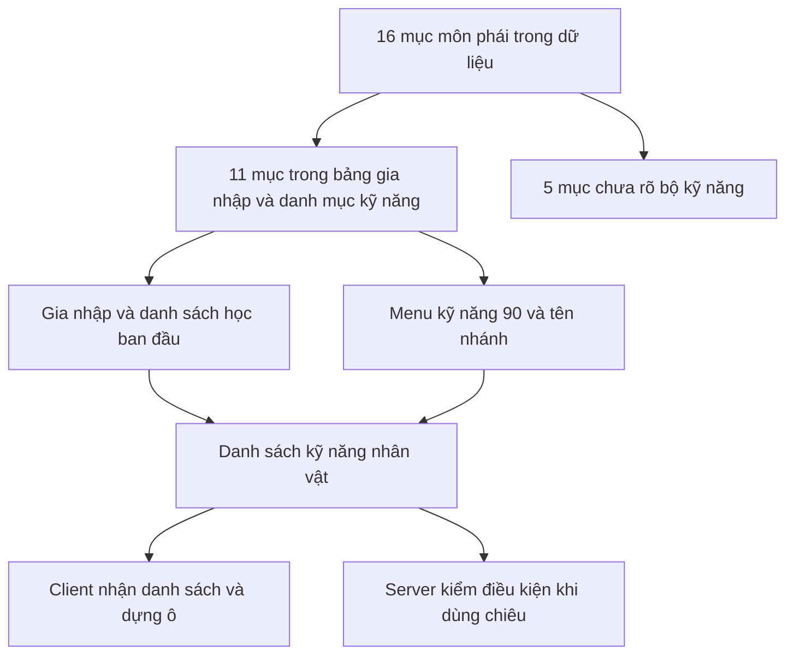

TÓM TẮT 1: [NGUỒN] [THẤY] Có 16 mục môn phái khai báo. 11 mục có tên trong bảng gia nhập và có danh mục liên hệ (531 bản ghi). `BANG:1–2,29–50`, `A-08a:28–47`.
TÓM TẮT 2: [NGUỒN] [THẤY] Có 30 lựa chọn gắn nhãn nhánh trong menu kỹ năng 90 của 11 phái. Nhãn menu và dòng võ công trong mô tả có thể khác nhau. `BANG:83–91,163–175`.
TÓM TẮT 3: [NGUỒN] [TÀI LIỆU] Nguồn mô tả gia nhập, học ban đầu, mở menu 90 và nâng kỹ năng. Điều kiện dùng chiêu của người chơi và NPC hảo hữu được đối chiếu riêng. `BANG:196–202`, `A-15b:36–53`.
TÓM TẮT 4: [NGUỒN] [THẤY] Chuỗi A-15 bỏ sót Võ Đang. Hai báo cáo gọi tên khác nhau ở Hoa Sơn ID 1363. Bảng dưới giữ cả hai cách ghi cùng bằng chứng. `BANG:1152–1153,1309`, `A-08a:91,94`, `A-15c:154–155`.
TÓM TẮT 5: [CHƯA KIỂM] Chưa chốt số phái chơi được, cây học đầy đủ hay số người trúng mỗi chiêu. SO-02 đọc tĩnh năm tài liệu, chưa build, chạy game/exe, VM hoặc mạng. `A-08a:115–121`, `BANG:194,202`, `JX1_OPS/TASKS/SO-02.md:23–27`.

# SO-02 — Sổ tay hiểu game: kỹ năng và môn phái

Loại: tổng hợp
Chủ đề: Số phái, các nhánh võ công, cách học và dùng chiêu trong dữ liệu JX1 đã khảo sát.
Từ khóa: môn phái, võ công, Võ Đang, wudang, 武当, SkillId, ReqLevel, MaxLevel, Attrib, hảo hữu
Trạng thái: DONE — tổng hợp đủ năm tài liệu, ghi rõ phần còn thiếu bằng chứng.
Độ phủ: 16/16 mục khai báo, 11/16 mục có danh mục, 30/30 lựa chọn có nhánh trong 11 nhóm đầu của menu 90.
Liên quan: BANG-KY-NANG-THEO-PHAI, A-08a, A-15a, A-15b, A-15c.
Cần tôi quyết định: không.

## Phạm vi và độ phủ

**Đọc nhanh:** [Tên phái và cách giải mã](#giải-mã-tên) · [Nhánh võ công](#sắp-theo-cấu-trúc-game) · [Cách học](#cách-học-và-nâng-chiêu) · [Cách dùng](#cách-dùng-chiêu) · [Đối chiếu nguồn](#phát-hiện-khi-chuẩn-hóa).

- **[THẤY]** là điều SO-02 đối chiếu được ngay trong năm tài liệu. **[TÀI LIỆU]** là kết quả đọc mã hoặc dữ liệu do các tài liệu đó dẫn lại. **[CHƯA KIỂM]** là điều chưa đủ bằng chứng trong phạm vi này.
- **[THẤY]** Có 16 mục trong hai tệp cấu hình. Bảng gia nhập trong script có 11 mục (Kim 2, Mộc 2, Thủy 3, Hỏa 2, Thổ 2). `BANG:29–50`, `A-08a:1–2,26–49`.
- **[THẤY]** Danh mục chọn bản ghi theo đường dẫn script, cộng hai dòng cũ ở Thiếu Lâm và Đường Môn. Trong 531 bản ghi có cả hiệu ứng, biến thể và kỹ năng NPC. 307 bản ghi tra được nhãn dòng võ công và 224 bản ghi chưa tra được nhãn. `BANG:1–4,62,75–81,159–175`.
- **[CHƯA KIỂM]** Số phái mà người chơi thực sự có thể gia nhập và danh sách kỹ năng mở cho từng phái. Con số 15 mà A-08a dẫn là ví dụ từ yêu cầu thiết kế. `A-08a:16,115–121`, `BANG:194,202`.

ID trong bảng đếm từ 0. Ví dụ, Võ Đang đứng thứ 9 và có ID 8. `BANG:33–50`, `A-15b:23–34`.

| ID | Phái | Hệ | Phạm vi sổ tay | Bản ghi liên hệ | Nguồn |
| ---: | --- | --- | --- | ---: | --- |
| 0 | Thiếu Lâm | Kim | [THẤY] Khai báo, danh mục và nhánh | 47 | `BANG:35,165` |
| 1 | Thiên Vương | Kim | [THẤY] Khai báo, danh mục và nhánh | 55 | `BANG:36,166` |
| 2 | Đường Môn | Mộc | [THẤY] Khai báo, danh mục và nhánh | 56 | `BANG:37,167` |
| 3 | Ngũ Độc | Mộc | [THẤY] Khai báo, danh mục và nhánh | 41 | `BANG:38,168` |
| 4 | Nga My | Thủy | [THẤY] Khai báo, danh mục và nhánh | 56 | `BANG:39,169` |
| 5 | Thúy Yên | Thủy | [THẤY] Khai báo, danh mục và nhánh | 56 | `BANG:40,170` |
| 6 | Cái Bang | Hỏa | [THẤY] Khai báo, danh mục và nhánh | 34 | `BANG:41,171` |
| 7 | Thiên Nhẫn | Hỏa | [THẤY] Khai báo, danh mục và nhánh | 42 | `BANG:42,172` |
| 8 | Võ Đang | Thổ | [THẤY] Khai báo, danh mục và nhánh | 45 | `BANG:43,173` |
| 9 | Côn Lôn | Thổ | [THẤY] Khai báo, danh mục và nhánh | 52 | `BANG:44,174` |
| 10 | Hoa Sơn | Thủy | [THẤY] Khai báo, danh mục và nhánh | 47 | `BANG:45,175` |
| 11 | Lý Tầm Hoan | Mộc | [THẤY] Khai báo. [CHƯA KIỂM] Danh mục và nhánh | — | `BANG:46`, `A-08a:107` |
| 12 | Đào Hoa Đảo | Thủy | [THẤY] Khai báo. [CHƯA KIỂM] Danh mục và nhánh | — | `BANG:47`, `A-08a:108` |
| 13 | Minh Giáo | Hỏa | [THẤY] Khai báo. [CHƯA KIỂM] Danh mục và nhánh | — | `BANG:48`, `A-08a:109` |
| 14 | Đoàn Thị | Thổ | [THẤY] Khai báo. [CHƯA KIỂM] Danh mục và nhánh | — | `BANG:49`, `A-08a:110` |
| 15 | Tự sáng môn phái | Kim | [THẤY] Khai báo. [CHƯA KIỂM] Danh mục và nhánh | — | `BANG:50`, `A-08a:111` |

## Giải mã tên

[TÀI LIỆU] Tên Hán ở `MonPhai.ini` dùng GBK. Tên Việt cũ trong `Skills.txt` và chuỗi Việt trong script dùng TCVN3. Bảng giữ nguyên chuỗi gốc mà nguồn đã chép và ghi bản đọc được bằng UTF-8. `BANG:62–64`, `A-08a:24`.

| Tên gốc | Mã hóa | Chữ đúng | Nguồn file:dòng |
| --- | --- | --- | --- |
| 少林派 | GBK | Thiếu Lâm (少林派) | [TÀI LIỆU] `BANG:35` |
| 天王帮 | GBK | Thiên Vương (天王帮) | [TÀI LIỆU] `BANG:36` |
| 唐门 | GBK | Đường Môn (唐门) | [TÀI LIỆU] `BANG:37` |
| 五毒教 | GBK | Ngũ Độc (五毒教) | [TÀI LIỆU] `BANG:38` |
| 峨嵋派 | GBK | Nga My (峨嵋派) | [TÀI LIỆU] `BANG:39` |
| 翠烟门 | GBK | Thúy Yên (翠烟门) | [TÀI LIỆU] `BANG:40` |
| 丐帮 | GBK | Cái Bang (丐帮) | [TÀI LIỆU] `BANG:41` |
| 天忍教 | GBK | Thiên Nhẫn (天忍教) | [TÀI LIỆU] `BANG:42` |
| 武当派 | GBK | Võ Đang (武当派) | [TÀI LIỆU] `BANG:43` |
| 昆仑派 | GBK | Côn Lôn (昆仑派) | [TÀI LIỆU] `BANG:44` |
| 华山派 | GBK | Hoa Sơn (华山派) | [TÀI LIỆU] `BANG:45` |
| 李寻欢 | GBK | Lý Tầm Hoan (李寻欢) | [TÀI LIỆU] `BANG:46` |
| 桃花岛 | GBK | Đào Hoa Đảo (桃花岛) | [TÀI LIỆU] `BANG:47` |
| 明教 | GBK | Minh Giáo (明教) | [TÀI LIỆU] `BANG:48` |
| 段氏 | GBK | Đoàn Thị (段氏) | [TÀI LIỆU] `BANG:49` |
| 自创门派 | GBK | Tự sáng môn phái (自创门派) | [TÀI LIỆU] `BANG:50` |
| `§¹t Ma §é Giang` | TCVN3 | Đạt Ma Độ Giang (318) | [TÀI LIỆU] `A-08a:24`, `BANG:216` |
| `C«n L«n §ao ph¸p` | TCVN3 | Côn Lôn Đao pháp (167) | [THẤY] `A-15c:89`, `BANG:1055` |
| `Th¸i Nh¹c Tam Thanh Phong` | TCVN3 | Thái Nhạc Tam Thanh Phong (1363) | [THẤY] `A-15c:154`, `BANG:1152` |
| `§o¹t MÖnh Liªn Hoµn Tam Tiªn KiÕm` | TCVN3 | Đoạt Mệnh Liên Hoàn Tam Tiên Kiếm (1364) | [THẤY] `A-15c:155`, `BANG:1153` |
| Chưa có chuỗi thô trong đoạn dẫn | TCVN3 theo nguồn | Phổ Độ Chúng Sinh (332). Nguồn đã giải mã, SO-02 chưa đối chiếu chuỗi thô. | [CHƯA KIỂM] `BANG:64,599`, `A-08a:102` |
| Chưa có chuỗi thô trong đoạn dẫn | TCVN3 theo nguồn | “Minh Giáo kiếm”, “Thánh Hỏa Liêu Nguyên” (1661) và “Nghênh Phật Tây Thiên” (1702) là cách ghi do nguồn dẫn lại. | [CHƯA KIỂM] `A-08a:49,109`, `BANG:1275` |
| `bachchienbachthang` | ASCII | `bachchienbachthang` (1661), giữ nguyên tên bản ghi | [TÀI LIỆU] `A-08a:109,113`, `BANG:1275` |

## Sắp theo cấu trúc game

**[TÀI LIỆU]** Bảng đi theo phái → nhánh → cấp yêu cầu trong dữ liệu (`ReqLevel`). Con số sau dấu `/` là cấp tối đa ghi trên dòng kỹ năng (`MaxLevel`). Chẳng hạn 80/20 là yêu cầu cấp 80 trong dữ liệu và trần kỹ năng 20. Dòng học đầy đủ của từng phái vẫn **[CHƯA KIỂM]**. `BANG:196–202,212–218`.

| Phái | Nhánh trong menu 90 (ID kỹ năng) | Cấp yêu cầu / tối đa | Nguồn |
| --- | --- | --- | --- |
| Thiếu Lâm | Quyền pháp (318), Côn pháp (319), Đao pháp (321) | 80/20 | [TÀI LIỆU] `BANG:216–218` |
| Thiên Vương | Đao pháp (322), Thương pháp (323), Chùy pháp (325) | 80/20 | [TÀI LIỆU] `BANG:308–310` |
| Đường Môn | Phi đao (339), Phi tiêu (342), Tụ tiễn (302), Hãm tĩnh (351) | 80/20 | [TÀI LIỆU] `BANG:415–418` |
| Ngũ Độc | Chưởng pháp (353), Đao pháp (355), Bùa chú (390) | 80/20 | [TÀI LIỆU] `BANG:517–519` |
| Nga My | Kiếm pháp (328), Chưởng pháp (380), Hỗ trợ (332) | 80/20 | [TÀI LIỆU] `BANG:597–599` |
| Thúy Yên | Đao pháp (336), Chưởng pháp (337) | 80/20 | [TÀI LIỆU] `BANG:699–700` |
| Cái Bang | Chưởng pháp (357), Bổng pháp (359) | 80/20 | [TÀI LIỆU] `BANG:792–793` |
| Thiên Nhẫn | Mâu pháp (361), Chưởng pháp (362), Bùa chú (391) | 80/20 | [TÀI LIỆU] `BANG:862–864` |
| Võ Đang | Chưởng pháp (365), Kiếm pháp (368) | 80/30 (365), 80/20 (368) | [TÀI LIỆU] `BANG:944–945` |
| Côn Lôn | Đao pháp (372), Chưởng pháp (375), Bùa chú (394) | 80/20 | [TÀI LIỆU] `BANG:1030–1032` |
| Hoa Sơn | Hoa Sơn kiếm (1364), Hoa Sơn khí (1382) | 90/20 | [TÀI LIỆU] `BANG:1117–1118` |
| ID 11–15 | [CHƯA KIỂM] Chưa gán nhánh hoặc cấp | — | `BANG:1252–1275` |

**[TÀI LIỆU]** Để tra các chiêu khác, mở mục của phái trong BANG và tìm theo ID. Bảng ở đó có tên, cấp yêu cầu, cấp tối đa, mã dòng võ công (`Attrib`) và dấu hiệu bản NPC hoặc biến thể. Ví dụ, Côn Lôn Đao pháp (167) thuộc nhóm hỗ trợ của nhánh đao, có cấp 10/20 trong dữ liệu. Các chiêu dùng chung nhiều nhánh và các mã chưa có nhãn được giữ riêng theo nhóm trong BANG. `BANG:75–81,204–206,1040–1055`, `A-15c:89`.

## Cách học và nâng chiêu

1. **[TÀI LIỆU] Gia nhập phái.** Đường script được A-08a đọc đặt phái, đặt phe rồi gọi học ban đầu. Bước học ban đầu lấy mã chiêu và cấp từ `SKILLNORMAL`, sau đó thêm bằng `AddMagic`. Nhiều mục trong bảng có cấp 0 và bảng hiện thấy có 10 nhóm, trong khi bảng gia nhập có 11 phái. `A-08a:28,49`, `BANG:87,200`.
2. **[TÀI LIỆU] Mở menu kỹ năng 90.** Hàm mở menu kiểm cấp nhân vật từ 80. Khi chọn, script còn đối chiếu kỹ năng đã có và cờ nhiệm vụ trước khi thêm. Đây là điều kiện của đoạn script đã đọc. Cấp ghi trên từng chiêu vẫn theo dữ liệu trong bảng trên. `BANG:198–202`.
3. **[TÀI LIỆU] Nâng chiêu đang có.** Bấm nâng trên client gửi yêu cầu. Đoạn xử lý tăng kỹ năng người chơi mà A-15b dẫn có kiểm cấp, điểm và cấp tối đa. **[CHƯA KIỂM]** Toàn bộ nhiệm vụ, bí kíp, điểm, yêu cầu học chiêu trước và bảng truyền dạy đang dùng. `BANG:198–202`, `A-15b:49,310`.
4. **[TÀI LIỆU] Kỹ năng 150.** Có mảng khai báo riêng, nhưng đường mở menu 150 mà BANG mô tả lại tạo lựa chọn dùng hàm tra mảng 90. **[CHƯA KIỂM]** Cách mở hay học kỹ năng 150 trong bản đang chạy. `A-08a:49,53`, `BANG:200–202`.

**[TÀI LIỆU] Ô kỹ năng trên màn hình.** Client nhận danh sách kỹ năng và cấp từ server, lưu theo ô rồi dựng biểu tượng. Luồng dựng bảng đã khảo sát lấy tối đa 50 mục, có thể lấy cả mục cấp 0. Khi mở mô tả, client dùng mã Attrib để tra tên dòng võ công. **[CHƯA KIỂM]** Nhãn thực nạp từ gói dữ liệu client và danh sách thực nhận trong game. `BANG:88–91,179–194`.

## Cách dùng chiêu

| Tình huống | Điều kiện hoặc ý nghĩa | Nguồn |
| --- | --- | --- |
| Người chơi tung chiêu | [TÀI LIỆU] Chiêu phải sẵn sàng. Đường server đã đọc kiểm mục tiêu và, trong nhánh người chơi, có kiểm vũ khí, cưỡi ngựa và tài nguyên. Quy tắc cụ thể phụ thuộc đường xử lý và từng chiêu. | `A-15a:39–45,52–55`, `A-15b:42–45` |
| NPC hảo hữu tung chiêu | [TÀI LIỆU] Cần gán chiêu vào một ô hợp lệ với cấp dương. Khi dùng vẫn phải chờ hồi chiêu và qua kiểm mục tiêu. Đường kiểm vũ khí/ngựa chỉ áp cho người chơi và hàm `Cost` chấp nhận NPC trước khi tới bước trừ tài nguyên. | `A-15a:3–4,39–47`, `A-15b:40–49`, `A-15c:57–59` |
| Kỹ năng bị động hay tạo NPC | [TÀI LIỆU] Có đường áp bị động khi gán chiêu cho NPC. Kiểu tạo NPC (style 4) nằm ngoài đường tung chiêu thông thường đã đọc. [CHƯA KIỂM] Tác dụng của từng kỹ năng bị động lên hảo hữu, đường xử lý riêng của kiểu 4 và cách AI chọn chiêu. | `A-15a:43–56`, `A-15b:46–51,310` |
| Chiêu địch, trợ lực, tự dùng | [TÀI LIỆU] Cờ mục tiêu phân biệt địch, đồng đội và bản thân. Ví dụ Nga My có Phổ Độ Chúng Sinh (332), với hồi máu, hồi nội lực và trợ lực theo đường dữ liệu đã đọc. [CHƯA KIỂM] Số đồng đội nhận hiệu ứng mỗi lần. | `A-08a:102`, `A-15b:43,99,232` |
| Đòn đơn và đòn vùng (AOE) | [TÀI LIỆU] Tầm chọn mục tiêu, số đạn và vùng va chạm là ba thông số riêng. Một đạn có thể quét vùng. Nhiều đạn có thể chạm cùng một người. [CHƯA KIỂM] Số mục tiêu thực trúng mỗi lần tung chiêu, vì còn va chạm, hiệu ứng nối tiếp và thay đổi theo cấp. | `A-08a:53–58,119`, `A-15a:56–57`, `A-15b:55` |

**[TÀI LIỆU]** Ví dụ Đạt Ma Độ Giang (318) có tầm gốc 90 theo đơn vị game, phát 2 đạn và mẫu vùng va chạm ghi 3. Dữ liệu gọi đây là cấu hình đòn vùng. **[CHƯA KIỂM]** Tầm hiển thị theo đơn vị quen thuộc và số đối thủ thực trúng. `A-08a:54–58,67`, `A-15a:95`.

## Phát hiện khi chuẩn hóa

| Chỗ vênh | Hai cách ghi và cách tra |
| --- | --- |
| Võ Đang bị sót trong chuỗi A-15 | [THẤY] A-15b dùng thứ tự từ 1 và dừng ở thứ 8 (ID 7). A-15c ghi phạm vi 9 đến cuối nhưng bảng bắt đầu bằng ID 9 Côn Lôn, bỏ ID 8 Võ Đang. A-08a có cả hai nhánh Võ Đang. BANG đếm 40 dòng trỏ đúng `wudang.lua` và 5 dòng dưới thư mục `wudang`, cộng 45 bản ghi liên hệ. `A-15b:25–34`, `A-15c:20–28`, `A-08a:87–88`, `BANG:1190–1202,1309`. |
| Vì sao số bản ghi khác nhau | [THẤY] A-15a có 196 dòng cho bốn phái đầu, trong đó 52 của Thiên Vương. BANG có 199, trong đó 55 của Thiên Vương do thêm ba dòng thư mục con (223, 278, 279). A-15b có 149 dòng chính + 39 dòng phụ = 188 và tổng bốn phái trong BANG cũng là 188. A-15c báo 52 Côn Lôn + 47 Hoa Sơn, khớp tổng theo phái của BANG. `A-15a:33,303`, `BANG:165–175,300–302,1311`, `A-15b:61,115,155,190,308`, `A-15c:22–23`. |
| Hai tên ở Hoa Sơn ID 1363 | [THẤY] A-08a ghi Đoạt Mệnh Liên Hoàn Tam Tiên Kiếm cho chiêu sát thương con ID 1363 và mô tả nút 1364 nối đến nó. BANG và A-15c ghi tên bản ghi 1363 là Thái Nhạc Tam Thanh Phong và tên 1364 là Đoạt Mệnh Liên Hoàn Tam Tiên Kiếm. Khi tra tên bản ghi, xem theo ID và giữ cách gọi của mỗi nguồn. [CHƯA KIỂM] Liên kết hiệu ứng khi chạy game. `A-08a:91,94`, `A-15c:154–155`, `BANG:1117,1152–1153`. |
| Nhãn nhánh và nhãn mô tả | [THẤY] Menu gọi Võ Đang 365 là Chưởng pháp, còn Attrib 902 ghi Quyền pháp (nội công). Menu gọi Côn Lôn 375 là Chưởng pháp, còn Attrib 1002 ghi Kiếm pháp (nội công). Tên menu chỉ lựa chọn, còn Attrib phục vụ mô tả từng chiêu. `BANG:85–91,145–150,938,987,1031,1041,1078`. |
| Nhãn đơn hoặc AOE | [THẤY] A-15a để Đánh đơn? (phạm vi?) cho 321, 323, 325, 351, 353 và 355. A-08a xếp các ID đó vào đòn vùng hoặc nhiều đạn theo cấu hình đạn và va chạm. A-15c để mở cách phân loại 375, còn A-08a ghi 4 đạn, vùng gốc 2 và có hiệu ứng nối tiếp cần kiểm. Các nhãn trả lời các câu hỏi khác nhau. `A-15a:56,98,148,150,215,262,264`, `A-15c:36,112`, `A-08a:53–58,69–78,90`. |
| Khai báo bổ sung và giới hạn mã hóa | [THẤY] Mục mảng `[12]` ghi nhánh Minh Giáo kiếm và ID 1661, nhưng khi đối chiếu vị trí lại rơi vào Lý Tầm Hoan. Dòng kỹ năng 1661 mang tên `bachchienbachthang` và script `vongevent.lua`. Mục `[13]` ghi 1702, ID vắng trong bảng kỹ năng rời đã khảo sát. [CHƯA KIỂM] Bộ chiêu của năm mục cuối. A-15c có dấu `?` nằm trong chính văn bản, nên dùng BANG hoặc A-08a để đọc tên phái và giữ A-15c làm nguồn số liệu, ID, chuỗi còn đọc được. `A-08a:49,107–113`, `BANG:1275,1310`, `A-15c:1,7,84–89`. |

## Đã xác minh / Chưa xác minh

- **[THẤY]** Đã đối chiếu 16 mục, 11 danh mục, 30 lựa chọn nhánh và các chỗ vênh ở trên trong năm tài liệu được giao. Các trích dẫn **[TÀI LIỆU]** dẫn lại bằng chứng cũ về dữ liệu và code client/server. `BANG:29–50,83–91,163–202`, `A-08a:26–49`, `A-15a:33–57`, `A-15b:36–55`, `A-15c:20–28,55–61`.
- **[CHƯA KIỂM]** Còn thiếu bằng chứng về phái đang mở, toàn bộ đường học, thứ tự ô thực nhận, nhãn từ gói client, các chiêu hảo hữu được gán và tác dụng thực tế. Phiên SO-02 chưa mở source/data game gốc, build hoặc chạy thử. `BANG:194,202`, `A-08a:115–121`, `A-15b:310–311`, `JX1_OPS/TASKS/SO-02.md:23–27`.

## Bàn giao

Báo cáo tổng hợp và sổ thông số nằm ở [SO-02.md](../REPORTS/SO-02.md). Tổng quan phụ trách commit.

| Tên rút gọn trong dẫn nguồn | Tệp |
| --- | --- |
| BANG | [BANG-KY-NANG-THEO-PHAI.md](BANG-KY-NANG-THEO-PHAI.md) |
| A-08a | [A-08a-mon-phai-ky-nang.md](../REPORTS/A-08a-mon-phai-ky-nang.md) |
| A-15a | [A-15a-ky-nang-phai-1-4.md](../REPORTS/A-15a-ky-nang-phai-1-4.md) |
| A-15b | [A-15b-ky-nang-phai-5-8.md](../REPORTS/A-15b-ky-nang-phai-5-8.md) |
| A-15c | [A-15c-ky-nang-phai-9-cuoi.md](../REPORTS/A-15c-ky-nang-phai-9-cuoi.md) |
