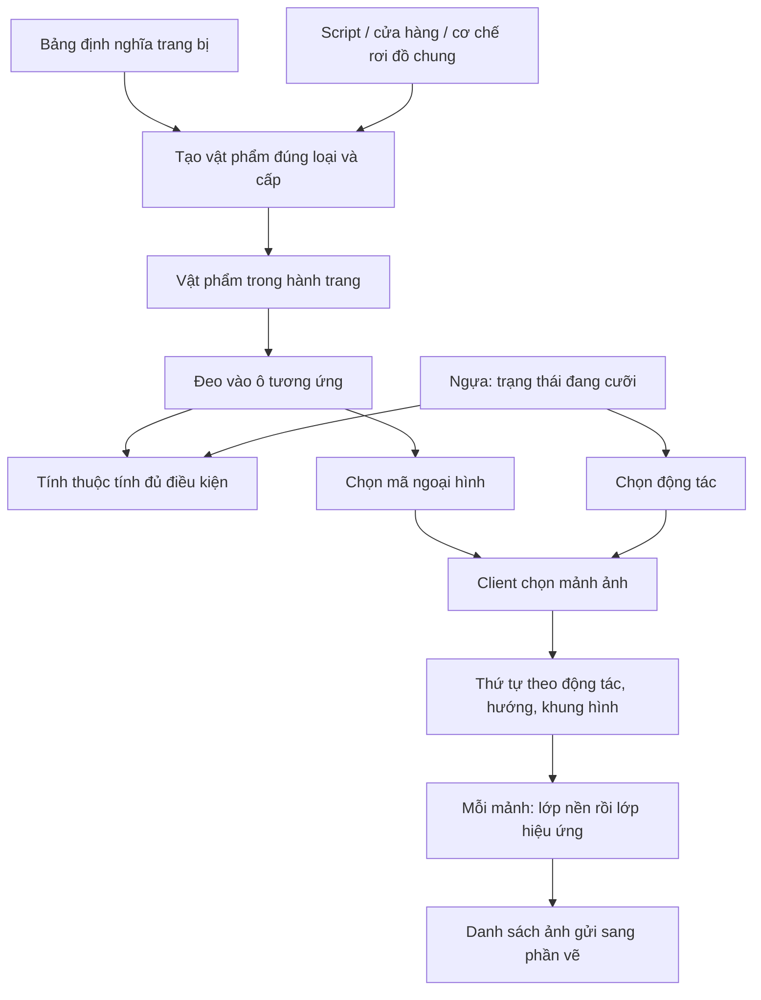

TÓM TẮT 1 — [NGUỒN][THẤY] Có năm nhóm trong phạm vi: ngựa, phi phong, mặt nạ, ấn giám, trang sức; chúng là các loại trang bị riêng (S/KItem.h:85–101).
TÓM TẮT 2 — [NGUỒN][THẤY] Ngựa có trạng thái đang cưỡi; lúc tính lại trang bị, thuộc tính ngựa chỉ được cộng trong nhánh đang cưỡi (S/KPlayer.cpp:3716–3769).
TÓM TẮT 3 — [NGUỒN][THẤY] Phi phong và đồ trang trí đi qua hệ thuộc tính trang bị; một số món còn đổi hình áo hoặc vũ khí (S/KItemList.cpp:1704–1766).
TÓM TẮT 4 — [NGUỒN][THẤY] Client sắp ảnh theo động tác, hướng và khung hình, rồi duyệt lớp nền trước lớp hiệu ứng của từng mảnh (C/gamecore/KNpcRes.cpp:422–423; C/gamecore/KNpcRes.cpp:663–695).
TÓM TẮT 5 — [CHƯA KIỂM] Chưa xác nhận từng món, nơi nhận, tỉ lệ rơi hay hình thực tế; không chạy build, exe, VM hoặc mạng (JX1_OPS/TASKS/SO-23.md:20–30).

# SO-23 — Sổ tay hiểu game: ngựa, phi phong và đồ trang trí

Loại: khảo sát
Chủ đề: Cách năm nhóm trang bị được khai báo, đeo, cộng thuộc tính và hiển thị trong nguồn được giao.
Từ khóa: ngựa, horse, phi phong, pifeng, mantle, mặt nạ, mask, yinjian, shiping, thứ tự lớp
Trạng thái: DONE — đạt tiêu chí tài liệu khảo sát tĩnh; các phần chưa kiểm được liệt kê riêng, không xác nhận runtime.
Độ phủ: đã phủ cơ chế của 5/5 nhóm; đã định vị 3/3 đường nhận chung; chưa đếm được danh mục từng món vì chưa đọc dữ liệu Settings và script vận hành.
Liên quan: JX1_OPS/TASKS/SO-23.md; JX1_OPS/REPORTS/SO-23.md; JX1_OPS/DESIGN/CHUAN-BAO-CAO.md.
Cần tôi quyết định: không — chỉ cần giao việc tiếp nếu muốn xác minh dữ liệu vận hành.

## Sơ đồ chính

[TÀI LIỆU] Sơ đồ ghép các mắt xích đã đọc, không biểu diễn một lần chạy thử: S/KBasPropTbl.CPP:143–179; S/KItemList.cpp:1525–1545; S/KItemList.cpp:1722–1766; C/gamecore/KNpc.cpp:695–698; C/gamecore/KNpcRes.cpp:663–695.

## Phạm vi và độ phủ

[TÀI LIỆU] Năm nhóm lấy từ khai báo thật, không lấy từ tên gọi truyền miệng: S/KItem.h:97–101; C/gamecore/GameDataDef.h:223–227. “Đã phủ” bên dưới nghĩa là đã đọc cơ chế tĩnh, không phải đã kiểm hết vật phẩm đang phát hành.

| Phần tử | Đã phủ | Chưa phủ | Bằng chứng |
|---|---|---|---|
| Ngựa | [THẤY] Loại, ô, bảng nạp, trạng thái cưỡi, điều kiện cộng thuộc tính, mã hình | [CHƯA KIỂM] Tên từng ngựa, tốc độ từng con, nơi nhận | S/KItemList.cpp:1633–1659; S/KPlayer.cpp:3732; C/gamecore/KItemChangeRes.cpp:117–126 |
| Phi phong | [THẤY] Loại, ô, cách chọn hình, đường thuộc tính, nhóm mảnh vẽ | [CHƯA KIỂM] Danh mục từng áo, chỉ số, hình và nguồn nhận thực tế | S/KItemList.cpp:1673–1699; C/gamecore/KNpcRes.cpp:1776–1787 |
| Mặt nạ | [THẤY] Loại, ô, bảng dữ liệu và mã ngoại hình | [CHƯA KIỂM] Từng diện mạo, điều kiện cụ thể, nơi nhận | S/KBasPropTbl.CPP:37; C/gamecore/KItemList.cpp:1280–1287 |
| Ấn giám | [THẤY] Loại, ô, bảng riêng, khả năng thay mã hình áo | [CHƯA KIỂM] Danh mục món/bộ, tên bản địa hóa và nơi nhận | S/KBasPropTbl.CPP:39; S/KItemList.cpp:1710–1715 |
| Trang sức | [THẤY] Loại, ô, bảng riêng, khả năng thay mã hình vũ khí | [CHƯA KIỂM] Danh mục món/bộ, thuộc tính và nơi nhận | S/KBasPropTbl.CPP:40; S/KItemList.cpp:1704–1708 |
| Thuộc tính và tốc độ | [THẤY] Đường cộng/gỡ thuộc tính; một phép tính tốc độ cụ thể | [CHƯA KIỂM] Giá trị trên từng món và tốc độ đo trong game | S/KItem.cpp:140–180; S/KItemList.cpp:2114–2118; S/KNpcAttribModify.cpp:1440–1519 |
| Thứ tự vẽ | [THẤY] Bảng thứ tự; lớp nền/hiệu ứng; nhánh đang hoạt động | [CHƯA KIỂM] Bảng sắp cụ thể và ảnh thực tế mọi hướng | C/gamecore/KNpcResNode.cpp:1390–1456; C/gamecore/KNpcRes.cpp:663–695 |
| Nguồn nhận | [THẤY] Điểm cấp bằng script, mua hàng, gọi script rơi đồ | [CHƯA KIỂM] Món nào thuộc nhiệm vụ/cửa hàng/quái nào; xác suất | S/ScriptFuns.cpp:9053–9059; S/KBuySell.cpp:478–493; S/KNpc.cpp:2483–2488 |

## Cách đọc bằng chứng và nguồn

[TÀI LIỆU] `THẤY` = đã đọc trực tiếp mã đang có; `TÀI LIỆU` = quy ước hoặc diễn giải có nguồn; `CHƯA KIỂM` = phần chưa có bằng chứng đủ. “Thấy trong nguồn” không đồng nghĩa “đã chạy đúng trong game”. Phạm vi chỉ đọc tĩnh: JX1_OPS/TASKS/SO-23.md:23–30.

- [TÀI LIỆU] `S/` là `C:/Jx1CocoV3/SwordOnline/SwordOnline/jxOnline/gameserver/Sources/Core/Src/`. Đây là nguồn server được task chỉ định, không phải chứng cứ bản máy chủ đang chạy: JX1_OPS/TASKS/SO-23.md:24.
- [TÀI LIỆU] `C/` là `C:/Jx1CocoV3/Folder/Client2912-20260116T044348Z-3-001/Client2912/Client/Classes/`. Không thay bằng bản client khác hoặc APK đã cài: JX1_OPS/TASKS/SO-23.md:24.
- [TÀI LIỆU] Các dẫn `S/tệp:dòng` và `C/tệp:dòng` được mở rộng bằng hai gốc trên. Mã C/C++ có cả GBK/CP936 và UTF-8; `C/gamecore/KItemList.cpp` và `C/gamescene/KgameWorld.cpp` đọc UTF-8. Tên Hán ở bảng sau đọc GBK hoặc UTF-8 theo tệp, không tự đổi tên gốc: S/KBasPropTbl.CPP:32–40; C/gamecore/KItemList.cpp:1280–1326.

## Giải mã tên

[TÀI LIỆU] Bảng này giải nghĩa tên nhóm và tên tệp thực sự dùng trong sổ tay. Chưa có danh sách tên riêng của từng món vì chưa đọc bảng vật phẩm thực tế; không đặt tên ngựa/phi phong theo suy đoán. Nguồn tên nhóm: S/KBasPropTbl.CPP:32–40; C/gamecore/KItemList.cpp:1280–1326.

| Tên gốc / định danh giữ nguyên | Mã hóa nguồn | Chữ đúng / cách gọi trong sổ tay | Nguồn file:dòng |
|---|---|---|---|
| `马` / `equip_horse` / `Horse.txt` | GBK; định danh ASCII | Ngựa (马) | C/gamecore/CoreUseNameDef.h:13; S/KBasPropTbl.CPP:32; S/KItem.h:97 |
| `披风` / `equip_pifeng` / `Pifeng.txt` / `MANTLE` | GBK; định danh ASCII | Phi phong, áo choàng (披风) | S/KBasPropTbl.CPP:38; C/gamecore/CoreUseNameDef.h:14 |
| `面具` / `equip_mask` / `Mask.txt` | UTF-8 trong đoạn client; tên tệp ASCII | Mặt nạ (面具) | C/gamecore/KItemList.cpp:1280; S/KBasPropTbl.CPP:37 |
| `印鉴` / `equip_yinjian` / `Yinjian.txt` | GBK và UTF-8 theo tệp | Ấn giám (印鉴); cách gọi giải nghĩa, chưa xác nhận tên trong giao diện Việt | S/KBasPropTbl.CPP:39; C/gamecore/KItemList.cpp:1323 |
| `饰品` / `equip_shiping` / `Shipin.txt` | GBK và UTF-8 theo tệp | Trang sức/đồ trang trí (饰品); giữ khác biệt `shiping` và `Shipin` | S/KBasPropTbl.CPP:40; C/gamecore/KItemList.cpp:1318 |

## Sắp theo cấu trúc game

[TÀI LIỆU] Nội dung đi theo ngựa → phi phong → đồ trang trí (mặt nạ, ấn giám, trang sức), rồi mới đến phần dùng chung. Chưa thể xếp theo bộ và liệt kê từng món: nguồn đã đọc chỉ định nghĩa cơ chế nạp bảng, chưa có các hàng dữ liệu của từng món. Không dùng thứ tự tệp làm danh mục vật phẩm: S/KBasPropTbl.CPP:57–74; S/KBasPropTbl.h:175–205.

## 1. Nhận diện loại, ô đeo và dữ liệu

[THẤY] “Loại vật phẩm” và “ô đang đeo” là hai danh sách khác nhau. Đoạn `GetEquipPlace` chuyển từ loại sang ô. Trong năm nhóm này, số thứ tự tình cờ trùng nhau; không nên lấy đó làm quy tắc cho toàn bộ trang bị: S/KItem.h:85–101; C/gamecore/GameDataDef.h:211–228; S/KItemList.cpp:2495–2508.

| Nhóm | Loại trang bị, số đếm từ 0 | Ô đeo, số đếm từ 0 | Tệp dữ liệu được mã nguồn yêu cầu nạp | Bằng chứng |
|---|---|---|---|---|
| Ngựa | [THẤY] `equip_horse = 10` | `itempart_horse = 10` | `Horse.txt` | S/KItem.h:85–97; C/gamecore/GameDataDef.h:211–223; S/KBasPropTbl.CPP:32 |
| Phi phong | [THẤY] `equip_pifeng = 12` | `itempart_pifeng = 12` | `Pifeng.txt` | S/KItem.h:99; C/gamecore/GameDataDef.h:225; S/KBasPropTbl.CPP:38 |
| Mặt nạ | [THẤY] `equip_mask = 11` | `itempart_mask = 11` | `Mask.txt` | S/KItem.h:98; C/gamecore/GameDataDef.h:224; S/KBasPropTbl.CPP:37 |
| Ấn giám | [THẤY] `equip_yinjian = 13` | `itempart_yinjian = 13` | `Yinjian.txt` | S/KItem.h:100; C/gamecore/GameDataDef.h:226; S/KBasPropTbl.CPP:39 |
| Trang sức | [THẤY] `equip_shiping = 14` | `itempart_shiping = 14` | `Shipin.txt` | S/KItem.h:101; C/gamecore/GameDataDef.h:227; S/KBasPropTbl.CPP:40 |

[THẤY] Bảng định nghĩa nằm dưới đường dẫn logic `\settings\item\004`. Mã chọn tên bảng theo nhóm rồi ghép đường dẫn trước khi nạp. Đây là đường dẫn được chương trình yêu cầu, chưa phải xác nhận nội dung Settings đang triển khai: S/KBasPropTbl.CPP:16; S/KBasPropTbl.CPP:1338–1340; S/KBasPropTbl.CPP:790–810.

[THẤY] Một mẫu trang bị chứa tên, loại, nhánh, hình trong túi, kích thước chiếm chỗ, ngũ hành, giá, cấp, bảy phần tử thuộc tính cơ bản và sáu phần tử yêu cầu. Số phần tử là sức chứa cấu trúc, không có nghĩa mọi món đều có đủ bảy dòng tác dụng: S/KBasPropTbl.h:175–205.

[THẤY] Trong đường tạo trang bị `Gen_Equipment`, số thứ tự bản ghi là `nhánh × 10 + cấp − 1`; mặt nạ dùng riêng số nhánh. Sau đó chương trình lấy bản ghi đúng nhóm. Chưa có giá trị nhánh/cấp thực tế để lập danh sách món: S/KItemGenerator.CPP:628–668; S/KItemGenerator.CPP:704–717.

## 2. Ngựa: món đang đeo và trạng thái đang cưỡi

- [THẤY] Khi đeo ngựa, chương trình chọn mã hình từ bảng ngoại hình, có đường thay bằng hình của trang bị đặc biệt và ưu tiên `GetItemResIdx()` nếu lớn hơn 0. Nếu mã ngựa cuối cùng không âm, nhánh đeo bật trạng thái cưỡi: S/KItemList.cpp:1633–1659; đối chiếu client C/gamecore/KItemList.cpp:1256–1277.
- [THẤY] Khi tháo ngựa, mã hình được đặt về `−1` và trạng thái cưỡi về sai. Thuộc tính món bị gỡ trước khi xóa ô đeo: S/KItemList.cpp:2114–2118; S/KItemList.cpp:2133–2135.
- [THẤY] Khi tính lại toàn bộ trang bị (`ReCalcEquip`), món không dùng được bị bỏ qua. Riêng ngựa còn phải qua điều kiện `m_bRideHorse`; các nhóm còn lại không chịu điều kiện cưỡi này trong vòng lặp: S/KPlayer.cpp:3712–3732; S/KPlayer.cpp:3760–3769.
- [THẤY] Hình ngựa và tốc độ không phải cùng một trường. Bản tin đồng bộ ghi mã ngựa theo trạng thái cưỡi, còn `RunSpeed` và `WalkSpeed` là hai trường tốc độ hiện tại riêng: S/KNpc.cpp:7784–7796.
- [THẤY] Có thuộc tính tăng tốc đi/chạy `magic_fastwalkrun_p`. Hàm xử lý tăng tốc dựa trên tốc độ gốc, chia 100 bằng số nguyên; có nhánh làm tròn riêng khi tích từ 50 đến 100. Cuối hàm chặn tốc độ chạy tối thiểu 10 và đi tối thiểu 5 theo đơn vị nội bộ. Chưa biết món ngựa nào mang giá trị nào của thuộc tính này: S/KNpcAttribModify.cpp:66; S/KNpcAttribModify.cpp:1440–1519.
- [CHƯA KIỂM] Không có căn cứ để nói mọi ngựa đều “cộng X%” hay quy đổi sang mét/giây. Cần đọc hàng vật phẩm và cách tính quãng đường thực tế trước; điểm cần nối là S/KBasPropTbl.h:193 và S/KNpcAttribModify.cpp:1451–1471.

## 3. Phi phong: hình áo choàng và thuộc tính

- [THẤY] Phi phong có loại và ô riêng. Khi đeo, mã hình ghi đè `GetItemResIdx() > 0` được ưu tiên. Với nhánh vật phẩm có `GoldId`, cấp không quá 10 được dùng làm mã hình; cấp lớn hơn 10 lấy phần dư chia 10. Với nhánh còn lại, cấp không quá 10 tra bảng `GetPifengRes`, cao hơn cũng lấy phần dư: S/KItemList.cpp:1673–1699.
- [THẤY] Bảng đổi hình phi phong là `\settings\item\PiFengRes.txt`, tách khỏi bảng thông số `Pifeng.txt`. `GetPifengRes` tra dòng `nhánh × 10 + cấp + 2` ở cột 2 và trả nguyên mã nhận được, không trừ 2 như ngựa: C/gamecore/CoreUseNameDef.h:128; C/gamecore/KItemChangeRes.cpp:91–101; C/gamecore/KItemChangeRes.cpp:117–126.
- [THẤY] Phi phong có thể đi qua đường cộng thuộc tính chung như các trang bị đủ điều kiện; mã nguồn không cho phép kết luận đây chỉ là món đổi hình. Khi tháo, mã hình phi phong được đưa về 0: S/KItemList.cpp:1755–1766; S/KItemList.cpp:2143–2144.
- [THẤY] Đường cập nhật ngoại hình hiện tại gọi `ChangeFeature` rồi gán phần phi phong qua `SetPartInfo`. Với phần phi phong, chỉ nạp ảnh khi mã hình lớn hơn 0 và mảnh tồn tại; trường hợp còn lại giải phóng ảnh của mảnh đó: C/gamecore/KNpc.cpp:695–698; C/gamecore/KNpcRes.cpp:1718–1722; C/gamecore/KNpcRes.cpp:1776–1787.
- [CHƯA KIỂM] Chưa có bảng dữ liệu để kết luận một cấp phi phong cụ thể hiển thị hình gì, cộng bao nhiêu thuộc tính hoặc có được phát hành hay không. Đặc biệt, nhánh lấy phần dư có thể cho mã 0; đó mới là kết quả biểu thức nguồn, chưa phải ảnh quan sát trong game: S/KItemList.cpp:1686–1699; C/gamecore/KNpcRes.cpp:1780–1787.

## 4. Đồ trang trí: mặt nạ, ấn giám, trang sức

| Nhóm | Cách hiểu cho người chơi từ mã đã đọc | Giới hạn |
|---|---|---|
| Mặt nạ | [THẤY] Có mã hình mặt nạ riêng. Nếu không khóa mặt nạ, chương trình dùng mã hình ghi đè hoặc `GetBaseMagic()`: C/gamecore/KItemList.cpp:1280–1287. | [CHƯA KIỂM] Chưa đối chiếu mã mặt nạ với từng diện mạo thực tế. |
| Ấn giám | [THẤY] Khi món có mã hình ghi đè lớn hơn 0, nó thay `m_ArmorType`, tức mã hình áo trong nhánh này: S/KItemList.cpp:1710–1715; C/gamecore/KItemList.cpp:1323–1326. | [CHƯA KIỂM] Không mặc định đây là một lớp ảnh độc lập hoặc luôn là cánh. |
| Trang sức | [THẤY] Khi món có mã hình ghi đè lớn hơn 0, nó thay `m_WeaponType`, tức mã hình vũ khí: S/KItemList.cpp:1704–1708; C/gamecore/KItemList.cpp:1318–1320. | [CHƯA KIỂM] Không suy mọi món đều đổi hình; điều kiện mã hình phải được thỏa. |

[THẤY] Cả ba nhóm có đường lấy bản ghi riêng và được xử lý như trang bị. Tác dụng thực phụ thuộc loại thuộc tính trong món, tình trạng dùng được và điều kiện kích hoạt. Hàm cộng thuộc tính duyệt thuộc tính cơ bản, rồi duyệt thuộc tính phép; các vị trí lẻ của mảng phép còn bị giới hạn bởi số thuộc tính được kích hoạt: S/KItemGenerator.CPP:707–717; S/KItemList.cpp:1755–1766; S/KItem.cpp:148–180.

[THẤY] Hai nguồn không hoàn toàn giống nhau ở bảng kích hoạt: client ghi tường minh hai phần tử mỗi hàng, trong khi server ghi ba; cả hai khai báo kích thước `MAX_ITEM_ACTIVE = 3`. Vì vậy không lấy chú thích “hai món/ba món” làm kết luận tác dụng trong game. Chưa kiểm hành vi của phần tử khởi tạo ngầm và ảnh hưởng khi vận hành: C/gamecore/KItemList.cpp:31–67; C/gamecore/KItemList.h:6; S/KItemList.cpp:34–70; S/KItemList.h:6.

## 5. Client xếp các lớp hình như thế nào?

1. [THẤY] Nhân vật chuyển mã ngoại hình và trạng thái cưỡi sang bộ tài nguyên. Đường cập nhật đã đọc dùng `ChangeFeature`; không dựa vào các lệnh `SetHorse`/`SetPifeng` cũ đã bị chú thích ngay sau đó: C/gamecore/KNpc.cpp:695–710; C/gamecore/KNpcRes.cpp:1703–1726.
2. [THẤY] Phần tài nguyên có năm nhóm ghép hình: đầu, áo, vũ khí, ngựa, phi phong. Mỗi nhóm có bốn mảnh theo `MAX_BODY_PART_SECT`; suy theo chỉ số nhóm, ngựa dùng mảnh 12–15, phi phong 16–19. Đây là chỉ số mảnh, không phải thứ tự trước/sau trên màn hình: C/gamecore/CoreUseNameDef.h:8–15; C/gamecore/KNpcResNode.h:23–25; C/gamecore/KNpcRes.cpp:1776.
3. [THẤY] Trạng thái cưỡi tham gia chọn động tác. Bảng thứ tự vẽ được lấy từ cấu hình loại nhân vật; khi lấy thứ tự, mã xét động tác, hướng và khung hình. Có thứ tự mặc định và các khung hình ngoại lệ: C/gamecore/KNpcRes.cpp:1625–1641; C/gamecore/KNpcResNode.cpp:365–369; C/gamecore/KNpcResNode.cpp:1390–1456.
4. [THẤY] Trong `Draw`, mã lấy bảng thứ tự trước; không lấy được thì dừng phần vẽ đó. Sau đó, với từng mảnh hợp lệ theo thứ tự, mã duyệt `BASE` trước `EFFECT`, bỏ qua tên ảnh rỗng và thêm ảnh vào danh sách: C/gamecore/KNpcRes.cpp:422–423; C/gamecore/CoreUseNameDef.h:20–24; C/gamecore/KNpcRes.cpp:663–695.
5. [THẤY] Danh sách được gửi sang `getIniDataForGame`. Nhánh ảnh duyệt danh sách, lấy ảnh/khung rồi đưa vào lệnh vẽ `setInRect_temp`: C/gamecore/KNpcRes.cpp:695; C/gamescene/KgameWorld.cpp:8876–8899; C/gamescene/KgameWorld.cpp:8966.

[TÀI LIỆU] Hãy hình dung nhân vật được ghép từ nhiều mảnh ảnh trong suốt. Mỗi mảnh có thể có ảnh nền rồi hiệu ứng của nó; không phải vẽ toàn bộ ảnh nền của mọi mảnh xong mới vẽ toàn bộ hiệu ứng. Không thể viết một quy tắc cố định như “phi phong luôn ở sau người” cho mọi hướng, vì thứ tự còn do bảng động tác/hướng/khung hình quyết định: C/gamecore/KNpcRes.cpp:663–695; C/gamecore/KNpcResNode.cpp:1403–1445.

[THẤY] Đoạn vẽ cũ dùng các nhãn `EQ_PART_HORSE` và `EQ_PART_PIFENG` nằm trong khối `/* ... */` từ dòng 846 đến 909. Nó không được dùng làm bằng chứng cho đường gọi đang hoạt động: C/gamecore/KNpcRes.cpp:846–909. Một số chú thích tại tệp này đã lỗi chữ; kết luận phía trên dựa vào lệnh và định danh, không suy từ chữ lỗi.

## 6. Nguồn nhận: đã biết cơ chế nào, chưa biết món nào?

| Đường nhận chung | Đã thấy trực tiếp | Chưa đủ để kết luận |
|---|---|---|
| Cấp qua script | [THẤY] `LuaAddItem` nhận loại/nhánh/cấp, tạo vật phẩm rồi thêm vào hành trang nếu có chỗ: S/ScriptFuns.cpp:8978–8999; S/ScriptFuns.cpp:9053–9059; S/ScriptFuns.cpp:9090–9097. | [CHƯA KIỂM] Script nhiệm vụ/sự kiện nào thực sự cấp từng ngựa hoặc phi phong. |
| Cửa hàng | [THẤY] Mã nạp bảng hàng, đọc loại/nhánh/cấp; nhánh mua tạo bản sao món và đưa vào hành trang: S/KBuySell.cpp:83–118; S/KBuySell.cpp:478–493; S/KBuySell.cpp:558. | [CHƯA KIỂM] Cửa hàng nào bán nhóm nào, tên người bán, giá và điều kiện mua thực tế. |
| Rơi đồ | [THẤY] Trong nhánh quái thường, khi có mã script rơi đồ và người chơi, chương trình gọi hàm `DropRate` của script đó: S/KNpc.cpp:2483–2488. | [CHƯA KIỂM] Chưa có bằng chứng ngựa/phi phong cụ thể nằm trong bảng rơi nào; chưa có tỉ lệ. |

[TÀI LIỆU] Việc có bảng `Horse.txt` hoặc `Pifeng.txt` chứng minh chương trình có cách định nghĩa món, không chứng minh món đó được phát cho người chơi. Muốn viết hướng dẫn “đến đâu nhận”, cần nối đúng hàng định nghĩa với script cấp, hàng cửa hàng hoặc bảng rơi đồ; điểm nối ban đầu nằm ở S/KItemGenerator.CPP:704–717 và S/ScriptFuns.cpp:8994–8999.

## 7. Mục sổ thông số

[TÀI LIỆU] Tất cả giá trị sau là đọc tĩnh; “CẨN THẬN” không cấp quyền sửa. Không có số đo runtime trong bảng.

| Nhóm | Tên/hằng số | file:dòng | Giá trị | Đơn vị | Ảnh hưởng | Đổi an toàn | Nguồn đo |
|---|---|---|---|---|---|---|---|
| Phân loại | [THẤY] Năm loại đang xét | S/KItem.h:97–101 | 10, 11, 12, 13, 14 | Mã loại từ 0 | Chọn nhóm bản ghi | KHÔNG — chỉ khảo sát | Đọc tĩnh enum |
| Ô đeo | [THẤY] Năm ô tương ứng | C/gamecore/GameDataDef.h:223–227 | 10, 11, 12, 13, 14 | Mã ô từ 0 | Lưu món đang đeo | KHÔNG — chỉ khảo sát | Đọc tĩnh enum |
| Bản ghi | [THẤY] Chỉ số `Gen_Equipment` | S/KItemGenerator.CPP:662–668 | nhánh × 10 + cấp − 1; mặt nạ = nhánh | Chỉ số bản ghi | Tìm mẫu vật phẩm | CẨN THẬN | Đọc tĩnh, chưa đối chiếu bảng |
| Mẫu trang bị | [THẤY] Mảng cơ bản/yêu cầu | S/KBasPropTbl.h:193–194 | 7 / 6 | Phần tử cấu trúc | Sức chứa thuộc tính/yêu cầu | CẨN THẬN | Đọc tĩnh, không phải số dòng có tác dụng |
| Ngoại hình ngựa | [THẤY] `GetHorseRes` | C/gamecore/KItemChangeRes.cpp:117–126 | cấp 0 trả −1; còn lại tra dòng nhánh × 10 + cấp + 2, trả mã trừ 2 | Mã hình / dòng bảng | Chọn hình ngựa | CẨN THẬN | Đọc tĩnh |
| Ngoại hình phi phong | [THẤY] `GetPifengRes` | C/gamecore/KItemChangeRes.cpp:91–101 | cấp 0 dùng dòng 2; còn lại dòng nhánh × 10 + cấp + 2; trả nguyên mã | Mã hình / dòng bảng | Chọn hình phi phong | CẨN THẬN | Đọc tĩnh |
| Ghép hình | [THẤY] `MAX_BODY_PART_SECT`, `MAX_PART` | C/gamecore/KNpcResNode.h:23–25 | 4 mảnh/nhóm; sức chứa 6 × 4 = 24 | Mảnh ảnh | Chia nhóm tài nguyên | CẨN THẬN | Đọc tĩnh; không suy cả 24 mảnh đều có ảnh |
| Lớp ảnh | [THẤY] `BASE`, `EFFECT` | C/gamecore/CoreUseNameDef.h:20–24 | 0, 1; tổng 2 lớp | Chỉ số lớp/mảnh | Thứ tự duyệt lớp trong mỗi mảnh | CẨN THẬN | Đọc tĩnh |
| Tốc độ | [THẤY] Nhánh tăng `FastWalkRunP` | S/KNpcAttribModify.cpp:1451–1471 | Tích trong [50,100] thì +1, ngoài khoảng thì tích/100 bằng số nguyên | Điểm tốc độ nội bộ | Tăng đi/chạy theo thuộc tính | CẨN THẬN | Đọc tĩnh, chưa đo quãng đường |
| Tốc độ | [THẤY] Chặn cuối `FastWalkRunP` | S/KNpcAttribModify.cpp:1515–1519 | Chạy tối thiểu 10; đi tối thiểu 5 trong hàm này | Điểm tốc độ nội bộ | Chặn kết quả của phép sửa tốc độ này | CẨN THẬN | Đọc tĩnh; không suy là giới hạn toàn game |

## 8. Đã xác minh

- [THẤY] Đã đọc trực tiếp định danh năm nhóm và đối chiếu ánh xạ loại → ô ở cả hai nguồn: S/KItem.h:97–101; S/KItemList.cpp:2495–2508; C/gamecore/KItemList.cpp:1883–1896.
- [THẤY] Đã lần từ nạp bảng → chọn bản ghi → đeo/cộng thuộc tính, và từ mã hình → danh sách ảnh đã sắp thứ tự. Các mắt xích có dẫn dòng ở mục 1–6; đây là kiểm tra nguồn tĩnh: S/KBasPropTbl.CPP:143–179; S/KItemGenerator.CPP:704–717; C/gamecore/KNpcRes.cpp:663–695.

## 9. Chưa kiểm

- [CHƯA KIỂM] Các hàng thật của `\settings\item\004\Horse.txt`, `Pifeng.txt`, `Mask.txt`, `Yinjian.txt`, `Shipin.txt`; chưa đếm món/bộ, giải mã tên từng món hay lấy chỉ số. Các đường này mới được suy ra từ bộ nạp: S/KBasPropTbl.CPP:16–40; S/KBasPropTbl.CPP:801.
- [CHƯA KIỂM] Nội dung `HorseRes.txt`, `PiFengRes.txt`, bảng thứ tự cụ thể và tệp ảnh. Không đọc ngoài hai cây nguồn mà task giao: C/gamecore/CoreUseNameDef.h:123–128; C/gamecore/KNpcResNode.cpp:365–369; JX1_OPS/TASKS/SO-23.md:24–30.
- [CHƯA KIỂM] Nguồn nhận từng món, điều kiện nhiệm vụ/sự kiện/cửa hàng/quái và tỉ lệ. Các điểm gọi chung ở mục 6 chưa đủ thay thế dữ liệu vận hành: S/ScriptFuns.cpp:9053; S/KBuySell.cpp:113–118; S/KNpc.cpp:2485–2487.
- [CHƯA KIỂM] Trình tự lên/xuống ngựa đầy đủ, cách làm mới mọi thuộc tính ở mọi thời điểm, tính tương thích của hai bộ nguồn và khác biệt bảng kích hoạt. Chỉ xác nhận các nhánh cụ thể đã nêu: S/KItemList.cpp:1652–1659; S/KPlayer.cpp:3732; C/gamecore/KItemList.cpp:63–67; S/KItemList.cpp:66–70.
- [CHƯA KIỂM] Chưa build, chạy exe/VM, đo tốc độ, kiểm giao diện/che khuất hoặc thử kết nối. Không có kết quả kiểm thử runtime: JX1_OPS/TASKS/SO-23.md:28–30.

## 10. Bàn giao

[TÀI LIỆU] Giữ sổ tay này làm tài liệu cơ chế đọc tĩnh. Nếu cần bổ sung tên từng món hoặc nơi nhận, PM giao phạm vi đọc Settings/script tương ứng; nếu cần ảnh thực tế, cần task kiểm thử riêng. Các khoảng trống được giữ nguyên, không đổi thành kết luận khẳng định: JX1_OPS/TASKS/SO-23.md:20–30.

Không commit/push theo yêu cầu; Tổng quan thực hiện phần commit. Vấn đề ghi NHỊP ngoài vùng sandbox và hàng chỉ mục đề nghị PM gộp được ghi trong `JX1_OPS/REPORTS/SO-23.md`.

Kỹ năng đã dùng: jx1-retrofit (khuôn, bảo toàn kết luận), jx1-read-server, jx1-read-client, jx1-parameters, jx1-knowledge, jx1-report.
