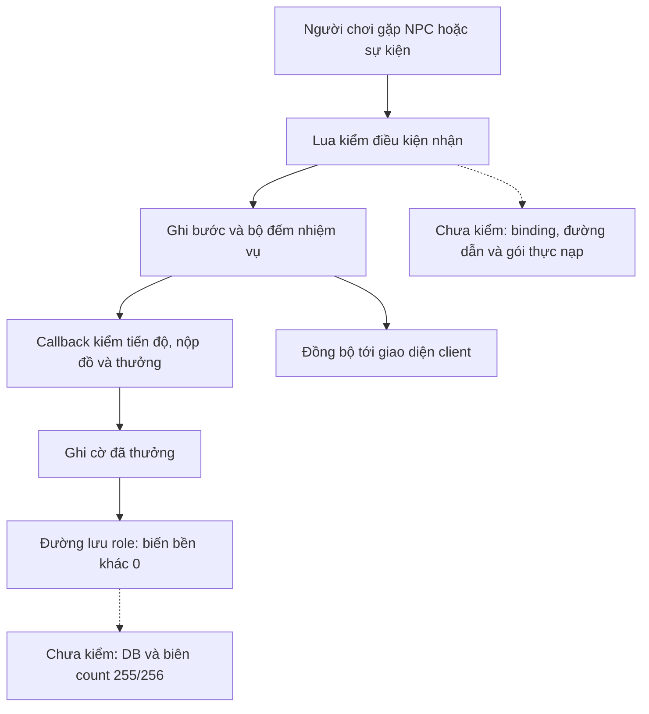

TÓM TẮT 1: [NGUỒN][TÀI LIỆU] Nhiệm vụ dùng kho trạng thái chung; khóa 0–9999 không có nghĩa là 10.000 nhiệm vụ (`JX1_OPS/REPORTS/I-08-he-thong-nhiem-vu.md:114–122`).
TÓM TẮT 2: [NGUỒN][TÀI LIỆU] Lua nối điều kiện nhận, tiến độ và thưởng; mẫu TASKSYS 0→1→2→3 không áp dụng cho mọi tuyến (`JX1_OPS/REPORTS/I-08-he-thong-nhiem-vu.md:124–144`).
TÓM TẮT 3: [NGUỒN][TÀI LIỆU] Đọc script theo đầu vào → điều kiện → thay đổi → thưởng → lưu; ví dụ daily và câu cá cho thấy phải theo cả callback (`JX1_OPS/REPORTS/I-08-he-thong-nhiem-vu.md:134–144`; `JX1_OPS/REPORTS/A-08c-lua-trai-nuong-ca.md:67–88`).
TÓM TẮT 4: [CHƯA KIỂM] IncludeLib, tên đường dẫn legacy, dữ liệu thiếu và tài nguyên đóng gói còn là rào kiểm chứng; chưa kết luận script chạy được (`JX1_OPS/REPORTS/I-08-he-thong-nhiem-vu.md:148–166`; `JX1_OPS/REPORTS/A-08c-lua-trai-nuong-ca.md:31–36,108–117`).
TÓM TẮT 5: [CHƯA KIỂM] SO-05 chỉ tổng hợp ba tài liệu; không đọc lại source, không build, chạy test game, exe, VM hay mạng; giới hạn tĩnh giữ theo nguồn (`JX1_OPS/REPORTS/I-08-he-thong-nhiem-vu.md:70–72`; `JX1_OPS/REPORTS/A-08c-lua-trai-nuong-ca.md:98–106`).

# SO-05 — Sổ tay nhiệm vụ và Lua

Loại: tổng hợp
Chủ đề: Hiểu nơi lưu tiến độ, cách Lua điều khiển nhiệm vụ và cách đọc script bằng lời thường.
Từ khóa: nhiệm vụ, Lua, TASKSYS, GetTask, SetTask, callback, daily, lửa trại, câu cá, nạp script
Trạng thái: DONE — hoàn tất sổ tay theo ba nguồn được giao; không xác nhận vận hành game.
Độ phủ: đã tổng hợp 3/3 tài liệu, đủ 8/8 phần trong bảng phạm vi; không đếm tổng nhiệm vụ hoạt động.
Liên quan: `JX1_OPS/REPORTS/I-08-he-thong-nhiem-vu.md`; `JX1_OPS/REPORTS/A-08c-lua-trai-nuong-ca.md`; `JX1_OPS/DESIGN/HIEU-GAME-CHO-NGUOI-KHONG-LAP-TRINH.md`.
Cần tôi quyết định: không — kiểm bản triển khai và chạy thử cần task riêng.

## Cách đọc nhãn và nguồn

- **THẤY:** điều SO-05 trực tiếp đọc được trong các tệp được giao, chẳng hạn chính câu giới hạn xác minh của tài liệu nhập môn. Không dùng nhãn này để nhận đã xem source game (`JX1_OPS/DESIGN/HIEU-GAME-CHO-NGUOI-KHONG-LAP-TRINH.md:3,5–8`).
- **TÀI LIỆU:** kết quả hoặc hướng dẫn dẫn lại từ báo cáo; các đường source nằm trong báo cáo là bằng chứng gián tiếp của SO-05 (`JX1_OPS/REPORTS/I-08-he-thong-nhiem-vu.md:61–72`).
- **CHƯA KIỂM:** chưa đối chiếu được với bản game thực nạp hoặc chưa chạy thử. Tài liệu đã có số dòng lịch sử khác nhau giữa các root source; không gán chúng sang một bản hiện tại (`JX1_OPS/REPORTS/I-08-he-thong-nhiem-vu.md:369–374`).
- **THẤY:** tài liệu nhập môn nhắc rõ số liệu tĩnh không đồng nghĩa nội dung đang chạy. Vì vậy sổ tay giải thích cách hiểu và cách lần dấu vết, không cam kết nhiệm vụ đang mở (`JX1_OPS/DESIGN/HIEU-GAME-CHO-NGUOI-KHONG-LAP-TRINH.md:3,50–56`).

**TÀI LIỆU:** sơ đồ ghép quan hệ đã mô tả, không phải dấu vết một phiên chơi. Luồng lưu, thưởng và UI lần lượt được dẫn tại `JX1_OPS/REPORTS/I-08-he-thong-nhiem-vu.md:114–144,155–179`.

## Phạm vi và độ phủ

| Phần tử của sổ tay | Độ phủ | Mức và nguồn |
|---|---|---|
| 1. Kho tiến độ, bền/tạm, giới hạn lưu | Đã phủ tài liệu | TÀI LIỆU — `JX1_OPS/REPORTS/I-08-he-thong-nhiem-vu.md:114–122` |
| 2. Tám nhóm nhiệm vụ/nội dung | Đã phủ tài liệu | TÀI LIỆU — `JX1_OPS/REPORTS/I-08-he-thong-nhiem-vu.md:78–87` |
| 3. Nhận, làm, trả và cờ thưởng | Đã phủ tài liệu | TÀI LIỆU — `JX1_OPS/REPORTS/I-08-he-thong-nhiem-vu.md:124–144` |
| 4. Những lời gọi Lua cần nhận ra | Đã phủ tài liệu | TÀI LIỆU — `JX1_OPS/REPORTS/I-08-he-thong-nhiem-vu.md:128–150`; `JX1_OPS/REPORTS/A-08c-lua-trai-nuong-ca.md:42–69` |
| 5. Cách đọc script, ví dụ daily | Đã phủ hướng dẫn | TÀI LIỆU — `JX1_OPS/REPORTS/I-08-he-thong-nhiem-vu.md:134–153` |
| 6. Ví dụ sự kiện câu cá/lửa trại/nướng cá | Đã phủ tài liệu | TÀI LIỆU — `JX1_OPS/REPORTS/A-08c-lua-trai-nuong-ca.md:38–88` |
| 7. Lỗi nạp, dữ liệu và lỗi hiển thị dễ nhầm | Đã phủ cảnh báo | TÀI LIỆU — `JX1_OPS/REPORTS/I-08-he-thong-nhiem-vu.md:148–166`; `JX1_OPS/REPORTS/A-08c-lua-trai-nuong-ca.md:108–117` |
| 8. UI, thông số và giới hạn xác minh | Đã phủ tài liệu | TÀI LIỆU — `JX1_OPS/REPORTS/I-08-he-thong-nhiem-vu.md:155–179,243–270` |

**CHƯA KIỂM:** “đã phủ” là đủ phần giải thích từ nguồn, không phải đã kiểm đủ mọi script hay mọi quest. Tổng nhiệm vụ hoạt động vẫn chưa đếm được vì chưa xác định đầy đủ thư viện và dữ liệu thực nạp (`JX1_OPS/REPORTS/I-08-he-thong-nhiem-vu.md:12–15,70–76`).

## Giải mã tên

| Tên gốc giữ nguyên | Mã hóa | Chữ đúng, dễ đọc | Mức và nguồn file:dòng |
|---|---|---|---|
| `óô»ð.lua` | Báo cáo đối chiếu CP936/GBK và dạng hiển thị Latin-1 | `篝火.lua` — lửa trại; xuất hiện ở nhánh skill và NPC | TÀI LIỆU — `JX1_OPS/REPORTS/A-08c-lua-trai-nuong-ca.md:25–29,33` |
| `¿¾Óã.lua` | Báo cáo đối chiếu CP936/GBK và dạng hiển thị Latin-1 | `烤鱼.lua` — nướng cá | TÀI LIỆU — `JX1_OPS/REPORTS/A-08c-lua-trai-nuong-ca.md:27–29,33` |
| `Á½ºþÇø` | Báo cáo đối chiếu CP936/GBK và dạng hiển thị Latin-1 | `两湖区` — nghĩa là khu Lưỡng Hồ; chưa xác nhận tên Việt trong game | TÀI LIỆU / CHƯA KIỂM tên bản địa hóa — `JX1_OPS/REPORTS/A-08c-lua-trai-nuong-ca.md:26–29,33` |

**TÀI LIỆU:** đây là bảng dẫn lại giải mã trong A-08c; SO-05 không mở byte gốc. Các thuật ngữ “daily”, “random”, “NPC”, “Lua” là tên nhóm/kỹ thuật, không tự đổi thành tên riêng trong game. Nguồn cảnh báo tiếng Việt legacy không thuần GBK; không mặc định mọi chuỗi hỏng đều là GBK hay TCVN3 (`JX1_OPS/REPORTS/A-08c-lua-trai-nuong-ca.md:29,114–117`).

## Sắp theo cấu trúc game và mục lục

**TÀI LIỆU:** thứ tự dưới đây đi theo việc người chơi trải qua: giữ tiến độ → phân loại nội dung → nhận/làm/trả → sự kiện → hiển thị. Đây là cách biên tập từ các luồng gốc, không sắp theo tên file (`JX1_OPS/REPORTS/I-08-he-thong-nhiem-vu.md:78–87,124–179`; `JX1_OPS/REPORTS/A-08c-lua-trai-nuong-ca.md:38–88`).

- [1. Tiến độ được giữ ở đâu?](#1-tiến-độ-được-giữ-ở-đâu)
- [2. Có những nhóm nội dung nào?](#2-có-những-nhóm-nội-dung-nào)
- [3. Nhận ra các lời gọi Lua](#3-nhận-ra-các-lời-gọi-lua)
- [4. Đọc một script nhiệm vụ theo từng bước](#4-đọc-một-script-nhiệm-vụ-theo-từng-bước)
- [5. Đọc sự kiện câu cá, lửa trại và nướng cá](#5-đọc-sự-kiện-câu-cá-lửa-trại-và-nướng-cá)
- [6. Những vướng mắc nạp script đã được ghi nhận](#6-những-vướng-mắc-nạp-script-đã-được-ghi-nhận)
- [7. Giao diện cho biết điều gì?](#7-giao-diện-cho-biết-điều-gì)
- [8. Mục sổ thông số](#8-mục-sổ-thông-số)

## 1. Tiến độ được giữ ở đâu?

**TÀI LIỆU:** hãy hình dung mỗi nhân vật có một cuốn sổ đánh số. Mỗi ô chứa một con số: bước đang làm, số quái đã tính, cờ nhận thưởng hoặc dữ liệu khác. `GetTask` đọc ô, `SetTask` ghi ô. Ô chưa có trả về 0; kho này còn phục vụ gameplay ngoài nhiệm vụ. Vì thế một khóa không đồng nghĩa một nhiệm vụ (`JX1_OPS/REPORTS/I-08-he-thong-nhiem-vu.md:65–68,114–118`).

| Loại thông tin | Cách hiểu bằng lời thường | Mức và nguồn |
|---|---|---|
| Biến bền — `GetTask`/`SetTask` | Phần có đường đưa vào dữ liệu lưu nhân vật; đường save được báo cáo chỉ ghi ô khác 0 | TÀI LIỆU — `JX1_OPS/REPORTS/I-08-he-thong-nhiem-vu.md:65–66,118–120` |
| Biến tạm — `GetTaskTemp`/`SetTaskTemp` | Giấy nháp khi xử lý; có hàm xóa `ClearTempVar`, chưa thấy đưa map tạm vào đường save đã khảo sát | TÀI LIỆU — `JX1_OPS/REPORTS/I-08-he-thong-nhiem-vu.md:118` |
| Bản sao ở giao diện | Số client đang giữ để hiển thị/theo dõi; có thể chưa nhận lần cập nhật mới | TÀI LIỆU — `JX1_OPS/REPORTS/I-08-he-thong-nhiem-vu.md:161–179` |

**TÀI LIỆU:** cần phân biệt bốn thứ dễ cùng được gọi là “ID nhiệm vụ”: khóa ô `GetTask`, mã/tên quest của TASKSYS, khóa timer/mission và `TaskId` của UI. `TaskNo` được báo cáo là mã tính từ tên file, không tra hàng `TaskID.txt`; không lấy mã đó làm khóa ô 0–9999. `TaskID.txt` chỉ có header nên không phải danh sách toàn bộ quest (`JX1_OPS/REPORTS/I-08-he-thong-nhiem-vu.md:68,114–116`).

**TÀI LIỆU:** điểm đáng chú ý của lưu bền là trường đếm `nTaskCount` mang kiểu `BYTE`. Báo cáo suy luận: nếu đúng BYTE 8 bit và đúng đường save/load đó, 255 còn là 255 nhưng 256 thu hẹp thành 0, 257 thành 1. Đây là nguy cơ từ source lịch sử, **chưa phải mất dữ liệu DB đã tái hiện**. Tổng được đếm là các biến khác 0 của nhân vật, không chỉ quest đang nhận (`JX1_OPS/REPORTS/I-08-he-thong-nhiem-vu.md:118–122,249`).

**CHƯA KIỂM:** SO-05 không xác nhận đăng xuất/đăng nhập sẽ giữ đúng từng ô trên bản triển khai; ABI, DB và biên 255/256 vẫn cần fixture riêng. Không tự đổi kiểu dữ liệu hoặc cấp hàng loạt khóa mới từ sổ tay (`JX1_OPS/REPORTS/I-08-he-thong-nhiem-vu.md:120–122,204–205,227`).

## 2. Có những nhóm nội dung nào?

| Nhóm theo trải nghiệm chơi | Điều cần hiểu | Mức và nguồn |
|---|---|---|
| Chính tuyến | Giữ bước riêng ở 1001/1002/1003; ví dụ mốc 50→60 sau thưởng. Không ép về mẫu 0/1/2/3 | TÀI LIỆU — `JX1_OPS/REPORTS/I-08-he-thong-nhiem-vu.md:80,132` |
| Phụ tuyến | Bước và cờ thưởng tách nhau; báo cáo có 36 cổng thưởng, không phải 36 NPC | TÀI LIỆU — `JX1_OPS/REPORTS/I-08-he-thong-nhiem-vu.md:81,133` |
| Hằng ngày — daily | Có mẫu giết quái và thu thập; bảng kill có 17 mẫu nhưng nhánh chọn chỉ tới 16. Reset ngày chưa được nối đủ | TÀI LIỆU — `JX1_OPS/REPORTS/I-08-he-thong-nhiem-vu.md:82,134–142` |
| Ngẫu nhiên/vòng lặp — random/loop | Random có 4 loại khai báo; vòng lặp có bước, chuỗi và vòng. 117 tên nội dung/107 tên chọn không phải số quest hoạt động | TÀI LIỆU — `JX1_OPS/REPORTS/I-08-he-thong-nhiem-vu.md:83,95–112,137–138` |
| Môn phái/kỹ năng | Sách 120/150 có điều kiện cấp và kỹ năng trước; chưa có tổng chuỗi theo từng phái | TÀI LIỆU — `JX1_OPS/REPORTS/I-08-he-thong-nhiem-vu.md:86,140` |
| Đồng bạn | Có mục hướng dẫn và dấu vết PARTNER; chưa chứng minh quest mở roster hảo hữu bền hoàn chỉnh | TÀI LIỆU — `JX1_OPS/REPORTS/I-08-he-thong-nhiem-vu.md:87,188–192` |
| Sự kiện/mission | 33 khóa mission và 47 khóa timer là dòng định tuyến script; không cộng thành số nhiệm vụ | TÀI LIỆU — `JX1_OPS/REPORTS/I-08-he-thong-nhiem-vu.md:84` |
| Lịch định kỳ | File chính có 1 mục, file default có 39 mục; chưa biết loader dùng file nào. Khai báo lịch không chứng minh hoạt động mở | TÀI LIỆU — `JX1_OPS/REPORTS/I-08-he-thong-nhiem-vu.md:85`; `JX1_OPS/REPORTS/A-08c-lua-trai-nuong-ca.md:45` |

**TÀI LIỆU:** riêng mẫu TASKSYS được mô tả là 0 chưa nhận/reset → 1 bắt đầu → 2 hoàn tất → 3 đã thưởng; hủy trở về 0. Cần đọc đúng hệ trước khi giải thích một con số trạng thái (`JX1_OPS/REPORTS/I-08-he-thong-nhiem-vu.md:128,132,137`; `JX1_OPS/DESIGN/HIEU-GAME-CHO-NGUOI-KHONG-LAP-TRINH.md:52–54`).

## 3. Nhận ra các lời gọi Lua

**TÀI LIỆU:** “callback” là tên hàm được hẹn gọi ở bước sau, chẳng hạn khi người chơi chọn menu hoặc hoàn tất thanh tiến độ. Đọc chỗ mở menu/thanh tiến độ mới thấy lời hẹn; phải đọc tiếp thân hàm được gọi mới biết có phát đồ hoặc đổi cờ không. Ví dụ câu cá mở tiến độ rồi gọi `FnThuHoach` (`JX1_OPS/REPORTS/A-08c-lua-trai-nuong-ca.md:69,84–86`).

| Việc trong game | Tên nên nhận ra | Cách đọc và giới hạn | Mức và nguồn |
|---|---|---|---|
| Dùng phần dùng chung | `Include`, `IncludeLib` | Script câu cá Include một thư viện; IncludeLib TASKSYS/PARTNER có vấn đề riêng. Có tên lời gọi chưa chứng minh thư viện nạp thành công | TÀI LIỆU — `JX1_OPS/REPORTS/A-08c-lua-trai-nuong-ca.md:67`; `JX1_OPS/REPORTS/I-08-he-thong-nhiem-vu.md:150` |
| Đọc/ghi tiến độ | `GetTask`, `SetTask` | Đọc/ghi giá trị theo khóa; hỏi rõ khóa nào và thuộc hệ nào | TÀI LIỆU — `JX1_OPS/REPORTS/I-08-he-thong-nhiem-vu.md:65,114–118` |
| Giữ dữ liệu tạm | `GetTaskTemp`, `SetTaskTemp` | Phục vụ khâu xử lý, không mặc định lưu qua phiên chơi | TÀI LIỆU — `JX1_OPS/REPORTS/I-08-he-thong-nhiem-vu.md:118,265–268` |
| Bắt đầu/đóng/đọc trạng thái | `StartTask`, `CloseTask`, `GetTaskStatus`, `ApplyTask` | Tên hàm liên quan hệ nhiệm vụ; còn phải kiểm binding, tức chỗ nối tên Lua với engine | TÀI LIỆU — `JX1_OPS/REPORTS/I-08-he-thong-nhiem-vu.md:128,137,150,173` |
| Kiểm điều kiện | `GetCamp`, `GetFightState` | Ví dụ câu cá/lửa có cổng phái và trạng thái chiến đấu; không suy đây là điều kiện chung của mọi quest | TÀI LIỆU — `JX1_OPS/REPORTS/A-08c-lua-trai-nuong-ca.md:42,69` |
| Hội thoại/giao đồ | `Talk`, `Give`, `ZHUYUA` | Phân biệt dòng đang dùng với dòng bị comment; menu bị tắt có thể khiến callback không đi tới từ đường đó | TÀI LIỆU — `JX1_OPS/REPORTS/A-08c-lua-trai-nuong-ca.md:86` |
| Thưởng tiền/kinh nghiệm | `Earn`, `AddOwnExp` | Nhìn số lượng và nhánh gọi; vẫn cần kiểm chống nhận lặp | TÀI LIỆU — `JX1_OPS/REPORTS/I-08-he-thong-nhiem-vu.md:131,144` |
| Thưởng vật phẩm | `AddItem`, `AddGoldItem`, `AddEventItem` | Lời gọi không chứng minh item đã vào túi; kiểm túi đầy và kết quả trả về còn là việc chưa thử | TÀI LIỆU — `JX1_OPS/REPORTS/I-08-he-thong-nhiem-vu.md:135–144,211` |
| Trừ vật phẩm | `ConsumeItem`, `DelIdItem` | Xem lệnh nằm trước hay sau `return`, có đúng nhánh loại đồ không | TÀI LIỆU — `JX1_OPS/REPORTS/A-08c-lua-trai-nuong-ca.md:52,84,86` |
| Đọc bảng/tạo hoạt động | `TabFile_Load`, `Add_DiemCauCa` | Câu cá cần bảng tọa độ; đường file rời thiếu khiến chưa nối được chuỗi sinh điểm câu | TÀI LIỆU — `JX1_OPS/REPORTS/A-08c-lua-trai-nuong-ca.md:35,67` |
| Gắn skill/thời hạn NPC | `SetNpcSkill`, `SetNpcLiveTime` | Có lệnh gắn chưa chứng minh skill tồn tại; chỉ đổi ra giây khi có bằng chứng API tương ứng | TÀI LIỆU — `JX1_OPS/REPORTS/A-08c-lua-trai-nuong-ca.md:50,63`; `JX1_OPS/REPORTS/I-08-he-thong-nhiem-vu.md:324,326` |
| Hẹn theo thời gian | `OnTimer` | Timer có thể lưu khóa và thời gian còn lại; không tự coi timer là reset nhiệm vụ mỗi ngày | TÀI LIỆU — `JX1_OPS/REPORTS/I-08-he-thong-nhiem-vu.md:139,206` |

## 4. Đọc một script nhiệm vụ theo từng bước

**TÀI LIỆU — cách đọc đề nghị:** các bước sau biên tập từ luồng nhận/mục tiêu/thưởng, cảnh báo Include và các ca kiểm chưa chạy của I-08; không phải hướng dẫn sửa mã (`JX1_OPS/REPORTS/I-08-he-thong-nhiem-vu.md:124–153,204–217`).

1. **TÀI LIỆU:** xác định ai gọi script: NPC/menu, vật phẩm hay lịch. Chưa thấy đường gọi thì ghi “chưa nối đầu vào”, như lịch gọi `fishing.lua` còn chưa rõ (`JX1_OPS/REPORTS/A-08c-lua-trai-nuong-ca.md:42–46,67`).
2. **TÀI LIỆU:** ghi phần phụ thuộc: file Include, thư viện, bảng dữ liệu. Chưa giải quyết được đường nạp thì dừng kết luận “chạy được” (`JX1_OPS/REPORTS/I-08-he-thong-nhiem-vu.md:150–153`).
3. **TÀI LIỆU:** tìm các cổng từ chối: cấp, phái, trạng thái chiến đấu, quest trước. Chú ý nhánh `return` sớm có thể bỏ qua kiểm tra sau đó (`JX1_OPS/REPORTS/I-08-he-thong-nhiem-vu.md:129,135`; `JX1_OPS/REPORTS/A-08c-lua-trai-nuong-ca.md:69`).
4. **TÀI LIỆU:** lập bảng nhỏ “khóa → ý nghĩa → lúc đổi”. Đừng dùng tên biến để đoán đơn vị hoặc coi giá trị 1 luôn là đã nhận thưởng (`JX1_OPS/REPORTS/I-08-he-thong-nhiem-vu.md:116–118,132–139`).
5. **TÀI LIỆU:** theo từng lựa chọn menu/thanh tiến độ tới callback; tách dòng đang chạy khỏi dòng bị comment (`JX1_OPS/REPORTS/A-08c-lua-trai-nuong-ca.md:69,86`).
6. **TÀI LIỆU:** xem hoàn thành dựa trên bộ đếm/đồ nào; tìm vị trí trừ đồ, phát thưởng, đổi bước và chặn nhận lại (`JX1_OPS/REPORTS/I-08-he-thong-nhiem-vu.md:130–144`).
7. **TÀI LIỆU:** ghi riêng tình huống hỏng: túi đầy, gọi lại callback, ngắt kết nối giữa thưởng và ghi cờ. Đó là ca cần thử, không tự đánh dấu đạt (`JX1_OPS/REPORTS/I-08-he-thong-nhiem-vu.md:211–217`).
8. **CHƯA KIỂM:** cuối phiếu đọc ghi rõ còn thiếu binding, tài nguyên, reset/lưu bền hay xác minh runtime nào. I-08 đã giữ riêng các giới hạn này (`JX1_OPS/REPORTS/I-08-he-thong-nhiem-vu.md:70–72,142,150–179`).

### Ví dụ: đọc nhiệm vụ daily giết quái

| Bước đọc | Điều nguồn cho biết | Mức và nguồn |
|---|---|---|
| Cửa nhận | Menu có cổng `GetPlayFF` và trạng thái skill 1076/1075 | TÀI LIỆU — `JX1_OPS/REPORTS/I-08-he-thong-nhiem-vu.md:135` |
| Chọn mẫu | `SHAGUAI` chọn theo dải cấp, chỉ tới ID 16 dù bảng có 17 mẫu | TÀI LIỆU — `JX1_OPS/REPORTS/I-08-he-thong-nhiem-vu.md:82,135,306` |
| Giữ việc đang làm | Khóa 2802 giữ mẫu; 2803 giữ tiến độ; các mẫu kill đều có KillCount=20 | TÀI LIỆU — `JX1_OPS/REPORTS/I-08-he-thong-nhiem-vu.md:134,142,298` |
| Kết thúc | Đủ KillCount thì reset hai biến và tăng byte 1 của 2807; byte 2 dành cho gather | TÀI LIỆU — `JX1_OPS/REPORTS/I-08-he-thong-nhiem-vu.md:134,136` |
| Thưởng | Báo cáo ghi EXP 10.000–20.000, tiền 10.000 đơn vị API và tối đa 4 lượt gọi AddEventItem; không đồng nghĩa chắc nhận 4 món | TÀI LIỆU — `JX1_OPS/REPORTS/I-08-he-thong-nhiem-vu.md:135,299–305` |
| Chỗ còn hở | Include header legacy, reset ngày, kill credit và túi đầy chưa kiểm runtime; chưa dùng daily làm quest Bot hoàn chỉnh | CHƯA KIỂM — `JX1_OPS/REPORTS/I-08-he-thong-nhiem-vu.md:142,153,185,194,207–216` |

## 5. Đọc sự kiện câu cá, lửa trại và nướng cá

### Câu cá: phải đọc cả lúc mở và lúc thu hoạch

**TÀI LIỆU:** `fishing.lua` có `taskcontent`, Include thư viện và gọi `Add_DiemCauCa`. Thư viện chọn map 539, đọc bảng tọa độ rồi tạo NPC template 225 và gắn `quahuyhoang.lua`. Tên hàm đóng trong nguồn là `colsetask` — giữ nguyên cách viết; thân được báo cáo chỉ phát tin kết thúc, không xóa điểm câu (`JX1_OPS/REPORTS/A-08c-lua-trai-nuong-ca.md:67`).

**TÀI LIỆU:** kiểm item cần `(4,190,0)` và mồi `(4,191,0)`, phái/trạng thái/cấp xong mới mở tiến độ tới `FnThuHoach`. Tham số tiến độ `10,5` chưa có đơn vị được xác minh; không tự gọi đó là số giây (`JX1_OPS/REPORTS/A-08c-lua-trai-nuong-ca.md:69`).

**TÀI LIỆU:** nhánh trúng thưởng quay 1..1000, cấp item rồi `return` trước `ConsumeItem`; nhánh trượt mới tiêu hao một cần và một mồi. Đây là điều đáng ghi khi đọc thứ tự lệnh, không tự sửa hay kết luận người chơi đã lợi dụng. Tổng trọng số bảng 0,700 trúng/0,300 trượt là cộng dữ liệu, không phải tỷ lệ đo trong game (`JX1_OPS/REPORTS/A-08c-lua-trai-nuong-ca.md:69,71–84`).

**CHƯA KIỂM:** đường bảng `Settings/maps/great_night/phonglangdofish.txt` từng báo `ENOENT`; nhánh `TabFile_Load==0` in lỗi rồi trả về. Chưa biết bảng nằm trong gói khác, tên khác hoặc lịch nào gọi script; vì thế chưa chứng minh điểm câu xuất hiện (`JX1_OPS/REPORTS/A-08c-lua-trai-nuong-ca.md:35,67,103,116`).

### Lửa trại: tách tạo NPC, skill và EXP

**TÀI LIỆU:** vật phẩm, task định kỳ và GM là các đường tạo lửa khác nhau. Nhánh item đặt 1.800 giây; task/GM đặt 3.600 giây; `JIHUO` đặt lại 5.400 giây và đổi skill 1706. Các số này là thời hạn trong nguồn, không thay bằng con số thiết kế 120 giây. Khai báo lịch 11:00/20:00 trong file default với `IsOpen=-1` chưa chứng minh lịch đang mở (`JX1_OPS/REPORTS/A-08c-lua-trai-nuong-ca.md:43–50`).

**TÀI LIỆU:** chuỗi EXP được mô tả qua effect, callback `goldacition.lua/OnDoAcition` và `AddOwnExp`. Bảng skill ghi lượng cố định 5.000–15.000 theo cấp; cấu hình `GouHouTime=10` chỉ cho phép suy điều kiện nhịp 10 giây nếu đúng bộ source/cấu hình đó được dùng. Chưa nối được skill 1705/1706 với script skill trong bảng rời nên chưa chốt đối tượng hay tốc độ nhận EXP (`JX1_OPS/REPORTS/A-08c-lua-trai-nuong-ca.md:34,58–63`).

**CHƯA KIỂM:** x2 EXP đội, +0,5% mỗi giây và tự sinh lửa khi giết boss xanh chưa có chuỗi bằng chứng đủ; không biến yêu cầu thiết kế thành cơ chế đã chạy (`JX1_OPS/REPORTS/A-08c-lua-trai-nuong-ca.md:16,61–63,90–105`).

### Nướng cá: tên menu chưa nói hết hành vi

**TÀI LIỆU:** `ZHUYU` chỉ gọi `Talk`; dòng mở `Give` tới `ZHUYUA` bị comment. Callback cũ còn đếm/xóa item nhưng chưa có lệnh thưởng thân mật/EXP đồng bạn. Nhánh ăn cá trực tiếp dùng `AddOwnExp` là chuyện khác; chưa xác minh mapping mọi cá với script ăn (`JX1_OPS/REPORTS/A-08c-lua-trai-nuong-ca.md:86–88`).

## 6. Những vướng mắc nạp script đã được ghi nhận

**TÀI LIỆU:** bảng này tách lỗi đọc file đã ghi nhận khỏi nghi vấn tích hợp. Không hàng nào là lỗi runtime SO-05 vừa tái hiện (`JX1_OPS/REPORTS/I-08-he-thong-nhiem-vu.md:148–153`; `JX1_OPS/REPORTS/A-08c-lua-trai-nuong-ca.md:31–36,108–117`).

| Dấu hiệu trong nguồn | Cách hiểu đúng | Điều còn cần đối chiếu trong task riêng | Mức và nguồn |
|---|---|---|---|
| `IncludeLib` chỉ đọc chuỗi rồi return 0 trong source đã khảo sát | Không thấy nạp TASKSYS/PARTNER ở hàm đó; chưa tìm đủ binding TaskId/GetTaskStatus/SetTaskStatus | Binary/binding khác hoặc chỗ đăng ký khác | TÀI LIỆU / CHƯA KIỂM — `JX1_OPS/REPORTS/I-08-he-thong-nhiem-vu.md:150,373` |
| Tên Hán tự literal không có nhưng có tên vật lý `óô»ð.lua`, `¿¾Óã.lua` | Có lệch dạng tên filesystem; báo cáo đã đối chiếu mã hóa, chưa chứng minh loader nối được | Cách engine xử lý tên và file thực nạp | TÀI LIỆU / CHƯA KIỂM — `JX1_OPS/REPORTS/A-08c-lua-trai-nuong-ca.md:25–33,100,112` |
| Include của daily khác tên header cạnh nó | Nghi vấn tên legacy/đường dẫn, chưa thể nhận đã resolve | Đúng tên byte và quy tắc tìm file của loader | TÀI LIỆU / CHƯA KIỂM — `JX1_OPS/REPORTS/I-08-he-thong-nhiem-vu.md:153,374` |
| `phonglangdofish.txt` báo `ENOENT` khi đọc file rời | Lỗi thiếu đường literal đã ghi nhận; callback nạp bảng có nhánh trả về khi thất bại | Nội dung gói đóng sẵn và đường thực dùng | TÀI LIỆU / CHƯA KIỂM — `JX1_OPS/REPORTS/A-08c-lua-trai-nuong-ca.md:35,67,116` |
| Không tìm được 16 đường Lua guide/trace dưới cây file rời | Chỉ chứng minh chưa có file rời ở root đã khảo sát; không nói game thiếu hẳn script | PAK, INI/Lua UI và bản client đang triển khai | TÀI LIỆU / CHƯA KIỂM — `JX1_OPS/REPORTS/I-08-he-thong-nhiem-vu.md:162–166` |
| Nhãn loại random không giao với khóa map Lua; thiếu condition rời/award tương ứng | Đây là lệch dữ liệu/source, có thể chặn chọn nội dung; chưa khẳng định crash | Fixture binding/type/entity/rate/award theo đúng phiên bản | TÀI LIỆU / CHƯA KIỂM — `JX1_OPS/REPORTS/I-08-he-thong-nhiem-vu.md:95–102,150–152,207` |
| Chưa nối 1705/1706 sang script skill trong bảng Skills rời | Phụ thuộc skill chưa đủ; việc tạo NPC không chứng minh có aura EXP | Bảng/gói skill thực nạp và lời gọi gắn skill | TÀI LIỆU / CHƯA KIỂM — `JX1_OPS/REPORTS/A-08c-lua-trai-nuong-ca.md:34,63,101` |
| Hiển thị giống thiếu dấu nháy khi đọc sai encoding | A-08c đã kiểm byte và thấy đủ nháy ASCII ở các dòng nghi ngờ; không lặp kết luận lỗi cú pháp cũ | Chưa chạy compiler; kiểm byte và encoding trước khi kết luận | TÀI LIỆU / CHƯA KIỂM — `JX1_OPS/REPORTS/A-08c-lua-trai-nuong-ca.md:114–117` |

**TÀI LIỆU — cách ghi một vướng mắc:** chép đường/tên symbol, loại lỗi đã thấy, root nguồn, encoding và cái còn thiếu. Báo cáo I-08 cũng giữ riêng mốc dòng client bản A với C/O lịch sử; không lấy số dòng của bản này làm chứng cứ cho bản khác (`JX1_OPS/REPORTS/I-08-he-thong-nhiem-vu.md:61,157,372–374`; `JX1_OPS/REPORTS/A-08c-lua-trai-nuong-ca.md:18–36,108–117`).

## 7. Giao diện cho biết điều gì?

**TÀI LIỆU:** client có danh sách, chi tiết và theo dõi nhiệm vụ; có đường nhận giá trị cập nhật vào kho client rồi cập nhật theo dõi. Mảng 20 thông tin UI và mô tả 512 byte là giới hạn thành phần hiển thị, không phải số quest toàn game hay trần bản ghi DB (`JX1_OPS/REPORTS/I-08-he-thong-nhiem-vu.md:155–171,261–262`).

**TÀI LIỆU:** `GetTask` phía client có đường gửi yêu cầu rồi trả bản đang giữ. Vì thế vừa bấm menu hoặc vừa gửi yêu cầu chưa phải server xác nhận đã nhận quest/đã thưởng. Đường `c2s_settaskval` khảo sát lại đặt giá trị 0, không phải API nhận/trả quest để dùng thay Lua (`JX1_OPS/REPORTS/I-08-he-thong-nhiem-vu.md:170–179`).

**CHƯA KIỂM:** Bot còn thiếu nhận/trả quest, đọc callback và ghép lựa chọn hội thoại; quái chết quan sát được không chứng minh người chơi được tính công. UI/waypoint hiện ra cũng chưa chứng minh đi tới đích hoặc asset đúng trên APK (`JX1_OPS/REPORTS/I-08-he-thong-nhiem-vu.md:164–166,194,215–216`).

## 8. Mục sổ thông số

**TÀI LIỆU:** chỉ trích các thông số cần để hiểu sổ tay. “Nguồn đo” dưới đây luôn là tài liệu dẫn lại, chưa đo runtime và chưa kiểm lại source. Cột đổi an toàn là cảnh báo phụ thuộc, không cấp quyền chỉnh (`JX1_OPS/REPORTS/I-08-he-thong-nhiem-vu.md:243–270,363`; `JX1_OPS/REPORTS/A-08c-lua-trai-nuong-ca.md:98–106`).

| Nhóm | Tên/hằng số | file:dòng | Giá trị | Đơn vị | Ảnh hưởng | Đổi an toàn (CÓ/CẨN THẬN/KHÔNG) | Nguồn đo |
|---|---|---|---|---|---|---|---|
| Lưu | MAX_TASK | `JX1_OPS/REPORTS/I-08-he-thong-nhiem-vu.md:247` | 10.000; khóa 0–9999 | khóa | Miền kho chung | KHÔNG — hợp đồng | TÀI LIỆU, đọc tĩnh gián tiếp |
| Lưu | nTaskCount | `JX1_OPS/REPORTS/I-08-he-thong-nhiem-vu.md:120,249` | BYTE; nếu 8 bit thì 255 | bản ghi khác 0 | Nguy cơ thu hẹp count | KHÔNG — cần schema/ABI | TÀI LIỆU, chưa đo DB |
| Lưu | DBLOADPERTIME_TASK | `JX1_OPS/REPORTS/I-08-he-thong-nhiem-vu.md:251` | 20 | bản ghi/lô | Nhịp load, không tăng trần count | CẨN THẬN | TÀI LIỆU, đọc tĩnh gián tiếp |
| UI | nTaskInfo / nTaskDesc | `JX1_OPS/REPORTS/I-08-he-thong-nhiem-vu.md:261–262` | 20 / 512 | phần tử / byte | Giới hạn UI/mô tả | CẨN THẬN | TÀI LIỆU, đọc tĩnh gián tiếp |
| Daily | KillCount | `JX1_OPS/REPORTS/I-08-he-thong-nhiem-vu.md:142,298` | 20 ở 17 mẫu | quái/mẫu | Ngưỡng hoàn thành | CẨN THẬN | TÀI LIỆU, số đếm bảng |
| Random | MIN_LEVEL | `JX1_OPS/REPORTS/I-08-he-thong-nhiem-vu.md:286` | 60 | cấp | Cổng nhận | CẨN THẬN | TÀI LIỆU, đọc tĩnh gián tiếp |
| Random | Giới hạn random / scroll | `JX1_OPS/REPORTS/I-08-he-thong-nhiem-vu.md:287–288` | 10 / 8 | lượt/ngày theo source | Nhịp nhận | CẨN THẬN | TÀI LIỆU, chưa đo reset |
| Vòng lặp | TL_MAXTIMES / TL_MAXLINKS / TL_MAXLOOPS | `JX1_OPS/REPORTS/I-08-he-thong-nhiem-vu.md:310–318` | 20 / 20 / 20; hằng liên quan 400=20×20 | bước/chuỗi; chuỗi/vòng; vòng | Phải xét cùng packing và công thức | CẨN THẬN | TÀI LIỆU, đọc tĩnh gián tiếp |
| Lửa | Thời hạn item / task-GM / JIHUO | `JX1_OPS/REPORTS/A-08c-lua-trai-nuong-ca.md:50` | 1.800 / 3.600 / 5.400 | giây theo API đã khảo sát | Thời gian NPC tồn tại | CẨN THẬN | TÀI LIỆU, chưa đo runtime |
| Lửa | GouHouTime | `JX1_OPS/REPORTS/A-08c-lua-trai-nuong-ca.md:58–63` | Cấu hình 10; mặc định C++ 90 | giây theo chuỗi được báo cáo | Nhịp EXP có điều kiện; thiếu nối skill | CẨN THẬN | TÀI LIỆU, chưa đo runtime |
| Câu cá | Tham số mở tiến độ | `JX1_OPS/REPORTS/A-08c-lua-trai-nuong-ca.md:69` | 10,5 | chưa xác minh | Hẹn callback thu hoạch | CẨN THẬN | TÀI LIỆU, chưa đọc API gốc |

## Đã xác minh / Chưa xác minh

- **THẤY — ĐÃ XÁC MINH ở mức tài liệu:** ba nguồn nêu rõ phải tách kết quả tĩnh khỏi vận hành; I-08 còn ghi các root và mốc dòng lịch sử khác nhau. Sổ tay giữ các ranh giới đó (`JX1_OPS/DESIGN/HIEU-GAME-CHO-NGUOI-KHONG-LAP-TRINH.md:3,52–56`; `JX1_OPS/REPORTS/I-08-he-thong-nhiem-vu.md:369–374`; `JX1_OPS/REPORTS/A-08c-lua-trai-nuong-ca.md:98–106`).
- **TÀI LIỆU:** các kết quả về kho task, trạng thái, Lua và sự kiện đều là dẫn lại; SO-05 không nâng thành xác minh source hiện tại (`JX1_OPS/REPORTS/I-08-he-thong-nhiem-vu.md:61–72,114–179`; `JX1_OPS/REPORTS/A-08c-lua-trai-nuong-ca.md:18–36,38–106`).
- **CHƯA KIỂM:** source có khớp binary, thư viện/binding, file trong PAK, lịch thực nạp, DB/ABI, trao thưởng/chống lặp và reset ngày. Không có kết quả build/test game đạt để công bố (`JX1_OPS/REPORTS/I-08-he-thong-nhiem-vu.md:70–72,198–219`; `JX1_OPS/REPORTS/A-08c-lua-trai-nuong-ca.md:98–106`).

## Bàn giao và đề xuất tiếp theo

- **TÀI LIỆU — ưu tiên kiểm chứng ở task riêng:** I-08 đề nghị chốt count DB, binding/dữ liệu, thưởng/túi và gói tin trước khi mở rộng; dùng các ca Q02/Q04/Q08/Q10 làm đầu vào, chưa coi là test đã chạy (`JX1_OPS/REPORTS/I-08-he-thong-nhiem-vu.md:198–219,227`).
- **TÀI LIỆU — đề xuất tối ưu kế thừa:** kiểm manifest trước nạp và tách thưởng có chống lặp; lợi ích chưa có số đo. Sổ tay không sửa cấu hình, Lua hoặc mã (`JX1_OPS/REPORTS/I-08-he-thong-nhiem-vu.md:231–241`).
- **THẤY:** kết quả kiểm tài liệu và giới hạn xác minh SO-05 nằm tại `JX1_OPS/REPORTS/SO-05.md:55–78`; mục Kết quả bàn giao nằm tại `JX1_OPS/TASKS/SO-05.md:31–36`.

## Phát hiện khi chuẩn hóa

- **THẤY:** dẫn nguồn ở mục Nhiệm vụ của tài liệu nhập môn còn dùng dải dòng lịch sử. Sổ tay dẫn tới mục hiện đọc được của I-08 thay vì chép lại dải dòng đó; không sửa tài liệu gốc hoặc kết luận cũ (`JX1_OPS/DESIGN/HIEU-GAME-CHO-NGUOI-KHONG-LAP-TRINH.md:50–56`; `JX1_OPS/REPORTS/I-08-he-thong-nhiem-vu.md:114–144`).
- **TÀI LIỆU:** lỗi tên legacy và nghi vấn thiếu dấu nháy được giữ đúng giới hạn của nguồn; không đổi tên, chuyển mã hay tự sửa script (`JX1_OPS/REPORTS/I-08-he-thong-nhiem-vu.md:374`; `JX1_OPS/REPORTS/A-08c-lua-trai-nuong-ca.md:112–117`).
