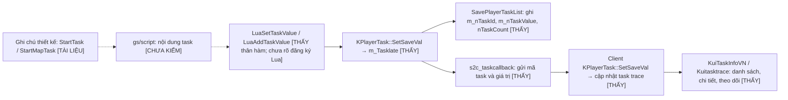

TÓM TẮT 1 [NGUỒN] Server lưu task theo cặp mã–giá trị; nTaskCount đếm bản ghi đã lưu (server/Sources/Core/Src/KPlayerDBFuns.cpp:1344-1383, 1803-1865).
TÓM TẮT 2 [NGUỒN] Đọc/ghi task-value, callback đồng bộ và UI theo dõi có bằng chứng tĩnh (server/Sources/Core/Src/KPlayerTask.cpp:104-125; client/Classes/gamecore/KPlayerTask.cpp:81-95).
TÓM TẮT 3 [TÀI LIỆU] Ghi chú nêu StartTask/StartMapTask theo bản đồ; chưa đối chiếu script (server/Sources/Core/Src/任务系统设计文档.txt:14-24).
TÓM TẮT 4 [CHƯA KIỂM] Slot điểm Tống Kim 192 và vinh dự 2051 có trong code; chưa xác nhận đây là hai quest NPC (server/Sources/Core/Src/ScriptFuns.cpp:544-564, 569-599).
TÓM TẮT 5 [CHƯA KIỂM] Chưa có script task trong root được giao; nhận/trả và runtime chưa kiểm (JX1_OPS/TASKS/SO-19.md:23-30).
# Hệ thống nhiệm vụ JX1 — task-value, Lua và giao diện

Loại: tổng hợp
Chủ đề: Vòng đời trạng thái nhiệm vụ từ dữ liệu server tới giao diện client
Từ khóa: nhiệm vụ, task, KPlayerTask, nTaskCount, task-value, Lua, gs\script, Kuitasktrace, KuiTaskInfo
Trạng thái: PARTIAL — thiếu script quest cụ thể để xác minh nhận/trả và tên hai quest.
Độ phủ: 2/7 khía cạnh xác minh hoàn toàn; 2 khía cạnh một phần; 3 khía cạnh chưa xác minh.
Liên quan: JX1_OPS/DESIGN/MUC-LUC-TRI-THUC.md (đề xuất PM gộp tài liệu này vào mục lục).
Cần tôi quyết định: có — cần root chứa gs\script hoặc danh sách file script task để xác minh quy trình nhận/trả và ví dụ quest.
Nguồn client: C:/Jx1CocoV3/Folder/Client2912-20260116T044348Z-3-001/Client2912/Client/Classes
Nguồn server: C:/Jx1CocoV3/SwordOnline/SwordOnline/jxOnline/gameserver/Sources

## Luồng chính

[TÀI LIỆU/CHƯA KIỂM] Đường đứt biểu thị ghi chú hoặc script chưa có; cạnh còn lại tóm tắt các hàm C++ đã đọc, không xác nhận runtime (server/Sources/Core/Src/KPlayerTask.cpp:104-125; JX1_OPS/TASKS/SO-19.md:23-30).

## Nhiệm vụ được khai báo và kích hoạt

[TÀI LIỆU] Ghi chú thiết kế server mô tả lệnh GM `StartTask(id, mapid)`, hàm `StartMapTask(mapid/mapname, taskid)`, và cách ghép tên task, ID, đường dẫn script. Cùng ghi chú còn nêu `ShowMapTaskList`, `GetMapTask` và `SetMapTask` cho trạng thái task theo bản đồ (server/Sources/Core/Src/任务系统设计文档.txt:14-24). Đây là ghi chú thiết kế, không phải bằng chứng hàm đang được đăng ký hoặc gọi trong runtime.

[TÀI LIỆU] Ghi chú phân biệt task gắn với bản đồ và Mission có danh sách người tham gia, timer, các script khởi tạo/chạy/kết thúc (server/Sources/Core/Src/任务系统设计文档.txt:26-67). Không nên đồng nhất đối tượng Mission theo bản đồ với trạng thái task cá nhân `KPlayerTask`.

[THẤY] Server có lớp `KMission` gọi các hàm script theo tên như `InitMission`, `JoinMission`, `RunMission`, `EndMission`; bảng `g_MissionTabFile` cung cấp đường dẫn script theo mission ID (server/Sources/Core/Src/ScriptFuns.cpp:22692-22700, 22707-22747, 22750-22810; server/Sources/Core/Src/KMission.cpp:86-123, 126-183). Đây là cơ chế mission server, không phải bằng chứng của một quest NPC cụ thể.

[CHƯA KIỂM] Task yêu cầu đọc client Classes và server Sources nhưng chưa có đường dẫn cụ thể của gs\script; chưa xác định điều kiện nhận, tiến độ hoặc trả thưởng (JX1_OPS/TASKS/SO-19.md:23-30).

## Giá trị task và nTaskCount

[THẤY] Server khai báo `MAX_TASK = 10000` và `MAX_TEMP_TASK = 10000`. `KPlayerTask` giữ hai bản đồ số nguyên: `m_Tasklate` cho giá trị lưu và `m_TaskTemplate` cho giá trị tạm; phía client có tối đa 20 mục `cTaskInfo` (server/Sources/Core/Src/KPlayerTask.h:13-14, 39-45, 50-65).

[THẤY] `GetSaveVal(id)` trả 0 nếu ID ngoài phạm vi hoặc chưa có giá trị; `SetSaveVal(id, value, isSyn)` cập nhật bản đồ lưu. Khi `isSyn` bật và kết nối hợp lệ, server tạo `PLAYER_GETBACK_TASKVAL` với `s2c_taskcallback`, task ID và giá trị rồi gửi về client (server/Sources/Core/Src/KPlayerTask.cpp:84-125).

[THẤY] Giá trị tạm có getter/setter riêng; `ClearTempVar` xóa bản đồ tạm. Giá trị này không phải cùng nơi lưu với task-value bền vững (server/Sources/Core/Src/KPlayerTask.cpp:69-79, 137-159).

[THẤY] Khi nạp dữ liệu nhân vật, `LoadPlayerTaskList` lấy `nTaskCount` từ `TRoleData`, đọc từng bản ghi `m_nTaskId` / `m_nTaskValue`, bỏ ID vượt giới hạn, rồi nạp giá trị khác 0 vào `KPlayerTask` (server/Sources/Core/Src/KPlayerDBFuns.cpp:1314-1383).

[THẤY] Khi lưu, `SavePlayerTaskList` duyệt các ID, lấy giá trị đã lưu, ghi cặp ID–value khác 0 và tăng `nTaskCount`; sau vòng lặp, số bản ghi được ghi lại vào `TRoleData.nTaskCount` (server/Sources/Core/Src/KPlayerDBFuns.cpp:1795-1865). Do đó `nTaskCount` là số bản ghi task được lưu, không phải số bước tiến độ của một quest.

## API Lua phía server

[THẤY] `LuaGetTaskValue` lấy task ID rồi đọc `m_cTask.GetSaveVal`; `LuaSetTaskValue` nhận ID và value rồi gọi `SetSaveVal(..., true)`; `LuaAddTaskValue` đọc giá trị cũ, cộng phần tăng rồi ghi lại và đồng bộ (server/Sources/Core/Src/ScriptFuns.cpp:4001-4067, 4125-4146).

[THẤY] Có nhóm API tạm riêng `LuaGetTempTaskValue` / `LuaSetTempTaskValue`, nối với `GetClearVal` / `SetClearVal` (server/Sources/Core/Src/ScriptFuns.cpp:4150-4217).

[CHƯA KIỂM] Đã xác nhận thân các hàm C++ trên, nhưng chưa xác nhận tên Lua nào được đăng ký trong bảng hàm đang dùng và chưa có tệp `gs\script` để chứng minh script quest gọi chúng. Không dùng thân hàm đơn lẻ để kết luận cách một quest cụ thể được nhận hay trả.

## Hai ví dụ task-value có thật

[THẤY] **Điểm Tống Kim** dùng slot task-value `192`: mã đọc bằng `GetSaveVal(192)` và hàm cộng điểm ghi `SetSaveVal(192, old + delta, true)` (server/Sources/Core/Src/ScriptFuns.cpp:544-564).

[THẤY] **Điểm vinh dự** dùng slot task-value `2051`: mã đọc bằng `GetSaveVal(2051)` và cộng điểm rồi ghi lại bằng `SetSaveVal(2051, old + delta, true)` (server/Sources/Core/Src/ScriptFuns.cpp:569-599).

[THẤY/CHƯA KIỂM] Hai ví dụ xác minh hai loại điểm game được lưu bằng task-value; chưa xác minh quest NPC, điều kiện nhận, mục tiêu hoặc trả thưởng (server/Sources/Core/Src/ScriptFuns.cpp:544-564, 569-599; JX1_OPS/TASKS/SO-19.md:20-30).

## Giao diện client

[THẤY] `KPlayerTask::SetSaveVal` phía client cập nhật bản đồ task và gọi `Kuitasktrace::upTaskdata(id)` nếu có panel theo dõi (client/Classes/gamecore/KPlayerTask.cpp:66-95).

[THẤY] UI tiếng Việt đọc `\\Ui\\uitasklist_vn.ini`, tạo danh sách task và danh sách nội dung riêng; hai sự kiện chọn danh sách tách biệt (client/Classes/vn/gameui/KuiTaskInfoVN.cpp:70-113).

[THẤY] UI có nút theo dõi và bỏ theo dõi; mỗi nút gắn tag riêng và đi qua callback trang (client/Classes/vn/gameui/KuiTaskInfoVN.cpp:200-226). Panel trace duy trì map task đang theo dõi, tìm theo task ID và xử lý cập nhật theo ID (client/Classes/gameui/Kuitasktrace.h:48-58, 102-106; client/Classes/gameui/Kuitasktrace.cpp:1206-1243).

[CHƯA KIỂM] Chưa kiểm gói tin hoặc runtime để kết luận thời điểm UI mở, cách mục tiêu cập nhật hoặc hiệu ứng nút theo dõi (JX1_OPS/TASKS/SO-19.md:25-30).

## Phạm vi và độ phủ

| Phần tử | Độ phủ | Bằng chứng / giới hạn |
|---|---|---|
| Định nghĩa/kích hoạt task | Một phần | Ghi chú GM `StartTask` / `StartMapTask`; chưa đối chiếu code và script (server/Sources/Core/Src/任务系统设计文档.txt:14-24). |
| Nhận task | Chưa phủ | Chưa có script NPC/điều kiện nhận; xem phạm vi nguồn task (JX1_OPS/TASKS/SO-19.md:23-30). |
| Tiến độ task-value và `nTaskCount` | Đã phủ tĩnh | Bản đồ giá trị và số bản ghi được nạp/lưu (server/Sources/Core/Src/KPlayerTask.cpp:84-125; KPlayerDBFuns.cpp:1314-1383, 1795-1865). |
| API Lua | Một phần | Có thân hàm đọc/ghi/cộng; chưa xác nhận đăng ký và callsite (server/Sources/Core/Src/ScriptFuns.cpp:4001-4067, 4125-4217). |
| Trả task / nhận thưởng | Chưa phủ | Thiếu script để kiểm tra hoàn thành và trả thưởng (JX1_OPS/TASKS/SO-19.md:20-30). |
| UI danh sách / theo dõi | Đã phủ tĩnh | Hai danh sách, callback chọn và nút theo dõi/bỏ theo dõi (client/Classes/vn/gameui/KuiTaskInfoVN.cpp:70-113, 200-226). |
| Hai ví dụ quest cụ thể | Chưa phủ | Hai slot task-value có thật, chưa xác minh quest NPC (server/Sources/Core/Src/ScriptFuns.cpp:544-564, 569-599). |

## Giải mã tên

Không có tên NPC, quái, kỹ năng hoặc bản đồ cụ thể được khẳng định trong phạm vi đã kiểm. Giữ nguyên các định danh code ASCII; tài liệu ghi chú tiếng Hoa `任务系统设计文档.txt` được đọc như GBK và chỉ dùng như tài liệu định hướng, không diễn giải lại nội dung lỗi mã hóa thành kết luận.

| Tên gốc | Mã hóa / loại | Diễn giải đã xác minh | Nguồn |
|---|---|---|---|
| `nTaskCount` | Định danh ASCII | Số bản ghi task được nạp/lưu trong dữ liệu nhân vật. | server/Sources/Core/Src/KPlayerDBFuns.cpp:1344-1383, 1803-1863 |
| `m_nTaskId` | Định danh ASCII | Mã task của một bản ghi dữ liệu. | server/Sources/Core/Src/KPlayerDBFuns.cpp:1373-1383, 1852-1859 |
| `m_nTaskValue` | Định danh ASCII | Giá trị gắn với mã task trong bản ghi dữ liệu. | server/Sources/Core/Src/KPlayerDBFuns.cpp:1373-1383, 1852-1859 |
| `KPlayerTask` | Tên lớp | Bộ đọc/ghi task-value lâu dài và giá trị task tạm. | server/Sources/Core/Src/KPlayerTask.cpp:84-159 |

## Sắp theo cấu trúc game

[TÀI LIỆU/THẤY/CHƯA KIỂM] Xếp theo vòng đời: ghi chú kích hoạt theo bản đồ → API Lua → lưu cặp task ID–value → callback/UI trace. Chưa xếp theo từng quest vì thiếu script (server/Sources/Core/Src/任务系统设计文档.txt:14-24; server/Sources/Core/Src/ScriptFuns.cpp:4001-4067; server/Sources/Core/Src/KPlayerDBFuns.cpp:1795-1865; client/Classes/vn/gameui/KuiTaskInfoVN.cpp:70-113).

## Chưa kiểm

- [CHƯA KIỂM] Chưa có file script task trong các root được giao; cần đường dẫn chính xác để xác minh điều kiện nhận, hoàn thành, trả thưởng và hai quest ví dụ (JX1_OPS/TASKS/SO-19.md:23-30).
- [CHƯA KIỂM] Chưa xác minh đăng ký hàm Lua, handler callback ở client hoặc gói tin end-to-end (server/Sources/Core/Src/ScriptFuns.cpp:4001-4067; client/Classes/gamecore/KPlayerTask.cpp:81-95).
- [CHƯA KIỂM] Chỉ đọc tĩnh; không build, VM, executable, mạng hoặc đo runtime (JX1_OPS/TASKS/SO-19.md:25-30).
- [CHƯA KIỂM] Kết quả chỉ áp dụng cho hai root được task chỉ định; không suy rộng sang bản đang chạy (JX1_OPS/TASKS/SO-19.md:23-25).
- [TÀI LIỆU] Ghi chú task được đọc như GBK; nội dung không giải mã không dùng làm bằng chứng (server/Sources/Core/Src/任务系统设计文档.txt:1-24).
- liên quan: JX1_OPS/DESIGN/MUC-LUC-TRI-THUC.md (PM gộp hàng chủ đề nhiệm vụ / task-value, trỏ tới tài liệu này).
