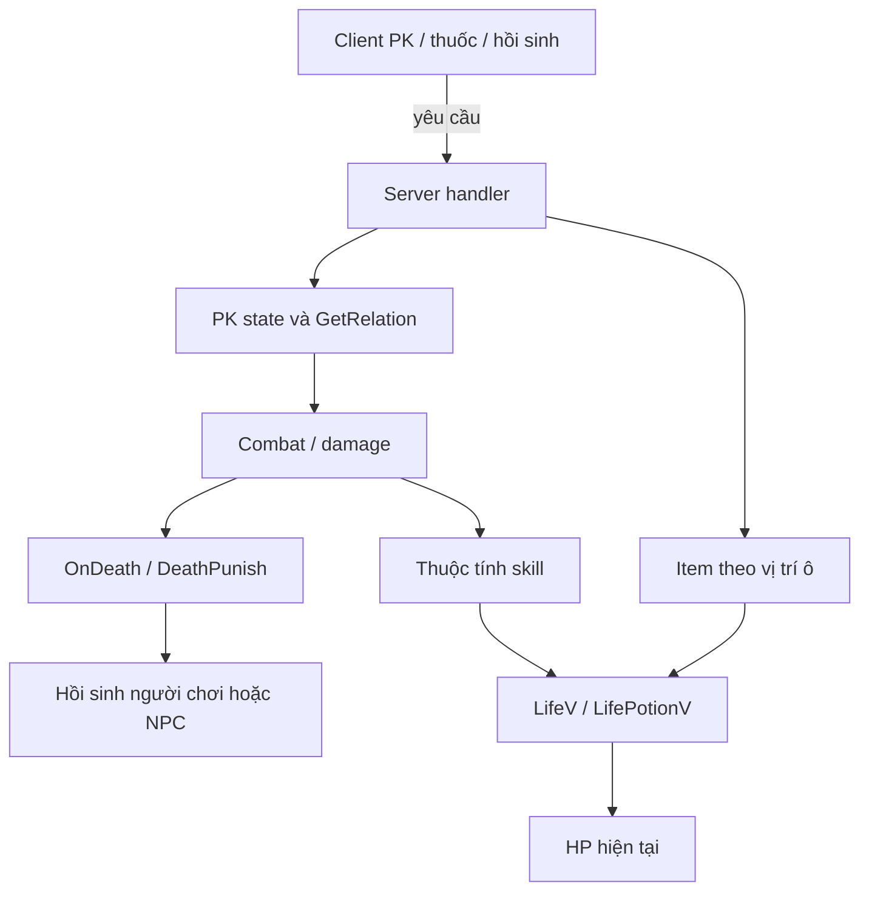

# TÓM TẮT 5 DÒNG
1. [TÀI LIỆU] PK/thù trong server phụ thuộc cờ PK, chế độ giao chiến, quan hệ mục tiêu và ngữ cảnh.
2. [TÀI LIỆU] Khi chết, server chọn nhánh hình phạt; hồi sinh người chơi có thể tại chỗ hoặc về điểm hồi sinh.
3. [TÀI LIỆU] Thuốc được chọn từ vị trí ô đồ; thuộc tính có thể tăng HP ngay hoặc theo thời gian.
4. [CHƯA KIỂM] Chưa xác định skill hồi máu cụ thể, giá trị dữ liệu, cấu hình đang chạy hay runtime.
5. [TÀI LIỆU] Đây là khảo sát tĩnh theo nguồn SO-08; không build, VM, exe, game hoặc mạng.

# Sổ tay JX1: PK, chết, hồi sinh và hồi máu

## Phạm vi nguồn
[TÀI LIỆU] Server: C:/Jx1CocoV3/SwordOnline/SwordOnline/jxOnline/gameserver/Sources, phần liên quan ở Core/Src/. Client: C:/Jx1CocoV3/Folder/Client2912-20260116T044348Z-3-001/Client2912/Client/Classes, phần liên quan ở gamecore/.
[TÀI LIỆU] Đã đọc ba báo cáo theo task: E-11 hồi máu/vật phẩm, A-05 tương tác GS001, H-12 tự động chiến đấu. Giữ nguyên kết luận cũ; tài liệu này đối chiếu thêm symbol liên quan trong root SO-08.
[CHƯA KIỂM] Chưa có commit/version hash cho cây source ngoài repository và chưa xác minh cây này khớp server đang chạy.

## 1. PK và thù
[TÀI LIỆU] Client gửi cờ PK thường qua KPlayerPK::ApplySetNormalPKState; server nhận c2s_pkapplychangenormalflag, gọi SetNormalPKState, cập nhật cờ và đồng bộ lại. Nếu yêu cầu đóng khi nhân vật còn giao chiến, còn sống và bộ đếm chưa hết, code giữ cờ mở. Client/gamecore/KPlayerPK.cpp:468-477; Server/Core/Src/KProtocolProcess.cpp:6211-6215; Server/Core/Src/KPlayerPK.cpp:55-85.
[TÀI LIỆU] Lệnh thù có đường riêng: kiểm trạng thái/cấm, tìm mục tiêu gần và xác nhận đó là người chơi; EnmityPKOpen còn kiểm fight mode, camp, đối luyện và thù hiện hữu rồi đồng bộ mục tiêu cho hai phía. Server/Core/Src/KProtocolProcess.cpp:6217-6238; KPlayerPK.cpp:128-228.
[TÀI LIỆU] KNpcSet::GetRelation xét fight mode, PK state/camp, thù/đối luyện, tổ đội và bang hội để quyết định địch/bạn/không quan hệ. PK không chỉ là một công tắc. Server/Core/Src/KNpcSet.cpp:1951-2042.
[TÀI LIỆU] Client còn có ApplySetPK gửi c2s_playerapplysetpk; server gọi KPlayer::SetPK để đặt camp tự do hoặc khôi phục camp. Đây là đường riêng với cờ PK thường. Client/gamecore/KPlayer.cpp:1876-1883; Server/Core/Src/KProtocolProcess.cpp:5672-5675; KPlayer.cpp:2238-2246.

## 2. Chết và hình phạt
[TÀI LIỆU] KNpc::OnDeath chạy script chết riêng của người chơi hoặc script chung khi không có script riêng. Server/Core/Src/KNpc.cpp:2571-2589.
[TÀI LIỆU] DeathCalcPKValue chọn loại xử lý theo mode phạt, người kết liễu, trạng thái PK/thù/đối luyện và điều kiện cấp/camp; DeathPunish có nhánh miễn phạt, kinh nghiệm, tiền, trang bị và PK. Hậu quả phụ thuộc mode hiện hành, không phải một mức mất cố định. KNpc.cpp:11429-11550,11555-11599,14144-14208.
[TÀI LIỆU] Một nhánh PK tăng PK value người bị hạ và có thể đánh dấu kẻ kết liễu là thù; AddPKValue giới hạn giá trị và đồng bộ. KNpc.cpp:11740-11759; KPlayerPK.cpp:349-363.

## 3. Hồi sinh người chơi và NPC
[TÀI LIỆU] NpcReviveCommand: loại 0 hồi tại chỗ nếu có tỷ lệ auto-revive, nếu không chuyển sang hồi về thành; loại 1 gọi hồi về thành; loại khác cũng mặc định về thành. Server/Core/Src/KProtocolProcess.cpp:6178-6204.
[TÀI LIỆU] KPlayer::Revive gửi thông báo/broadcast; nhánh hồi về điểm hồi sinh có thể đổi world. Sau đó đặt HP, mana, thể lực về tối đa, nộ về 0 và gửi do_revive. Một số nhánh map quyết định fight mode. Server/Core/Src/KPlayer.cpp:7248-7308.
[TÀI LIỆU] NPC có luồng riêng: DoRevive đặt trạng thái chờ; Revive đưa NPC về vị trí gốc, thêm lại vào region và bật lại AI. Server/Core/Src/KNpc.cpp:3375-3435,13900-13937.

## 4. Hồi máu bằng vật phẩm
[TÀI LIỆU] Client ApplyUseItem gửi yêu cầu gồm vị trí/tọa độ ô và chỉ số item cục bộ. Server chặn khi đang giao dịch, gọi KPlayer::EatItem, rồi chuyển vị trí ô cho EatMecidineC. Client/gamecore/KPlayer.cpp:1964-2007; Server/Core/Src/KProtocolProcess.cpp:5706-5711; KPlayer.cpp:5909-5914.
[TÀI LIỆU] EatMecidineC tìm item theo ô trang bị hoặc ô nhanh; thuốc ở ô nhanh có thể được lấp lại bằng item cùng loại sau khi dùng. Nhánh thuốc kiểm điều kiện rồi áp thuộc tính từ item. Server/Core/Src/KItemList.cpp:2709-2736,8053-8092.
[TÀI LIỆU] LifeV cộng giá trị thuộc tính vào HP; LifePotionV gộp trạng thái hồi theo thời gian. KNpc cộng theo nhịp GAME_UPDATE_TIME và giới hạn HP tối đa. Server/Core/Src/KNpcAttribModify.cpp:27,42,1644-1651,2407-2424; KNpc.cpp:2133-2143.

## 5. Hồi máu bằng kỹ năng
[TÀI LIỆU] Khi missile skill gây damage thành công, server áp thuộc tính trạng thái và tức thời lên mục tiêu. SetImmediatelySkillEffect chuyển từng thuộc tính qua ModifyAttrib; modifier định tuyến mã thuộc tính tới handler. Server/Core/Src/KMissle.cpp:1531-1537; KNpc.cpp:5960-5975; KNpcAttribModify.cpp:322-333.
[TÀI LIỆU] magic_life_v có handler cộng giá trị vào HP; nếu dữ liệu skill có giá trị dương và áp dụng lên nhân vật đó, cơ chế này có thể tăng HP. Server/Core/Src/KNpcAttribModify.cpp:42,1644-1651.
[CHƯA KIỂM] Nguồn trong task không cho biết skill nào có thuộc tính này, phái/nhánh/cấp học, lượng hồi, điều kiện mục tiêu hay kỹ năng tự hồi. Không gán tên, ID hoặc giá trị cụ thể.

## 6. Điều đã quan sát
[TÀI LIỆU] Đã đọc tĩnh các báo cáo và symbol client/server trong root SO-08. Đây là bằng chứng về đường xử lý source, không phải quan sát trận PK, cái chết, hồi sinh hoặc hồi HP trên server chạy thật.
[CHƯA KIỂM] Chưa build/test, chạy VM/exe/game hay mạng; chưa đo thời gian thực, cấu hình hiệu lực hoặc ABI.

## Sơ đồ luồng chính

## Phạm vi và độ phủ
| Hạng mục | Độ phủ | Nguồn | Giới hạn |
|---|---|---|---|
| PK/thù và quan hệ mục tiêu | Đã phủ source tĩnh | KPlayerPK.cpp; KProtocolProcess.cpp; KNpcSet.cpp | Chưa ánh xạ toàn bộ UI/map. |
| Chết và hình phạt | Đã phủ entry point, mode và nhánh | KNpc.cpp:2571-2589,11429-11550,14144-14208 | Cấu hình/runtime chưa xác minh. |
| Hồi sinh player/NPC | Đã phủ hai luồng | KProtocolProcess.cpp:6178-6204; KPlayer.cpp:7248-7308; KNpc.cpp:3375-3435,13900-13937 | Chưa kiểm điểm hồi thực tế. |
| Hồi HP bằng item | Đã phủ request, chọn ô, modifier | KItemList.cpp; KNpcAttribModify.cpp; KNpc.cpp | Chưa có dữ liệu thuốc/cooldown. |
| Hồi HP bằng skill | Đã phủ tuyến thuộc tính tổng quát | KMissle.cpp; KNpc.cpp; KNpcAttribModify.cpp | Chưa có danh sách skill/ID/phái/cấp. |

## Giải mã tên
| Tên gốc | Mã hóa | Nghĩa | Nguồn |
|---|---|---|---|
| EnmityPKOpen | ASCII identifier | Mở trạng thái thù nhắm người chơi | Server/Core/Src/KPlayerPK.cpp:128-228 |
| DeathCalcPKValue | ASCII identifier | Chọn nhánh xử lý khi chết trong PK | Server/Core/Src/KNpc.cpp:14144-14208 |
| LifeV / magic_life_v | ASCII identifier | Thuộc tính HP tức thời, không phải tên skill | Server/Core/Src/KNpcAttribModify.cpp:42,1644-1651 |
| LifePotionV / magic_lifepotion_v | ASCII identifier | Thuộc tính hồi theo thời gian, không phải tên item | Server/Core/Src/KNpcAttribModify.cpp:27,2407-2424 |
[CHƯA KIỂM] Không có tên Hán/TCVN3, tên thuốc hay tên kỹ năng cụ thể trong phần nguồn được trích để giải mã.

## Sắp theo cấu trúc game
| Nhóm | Thứ tự | Tình trạng |
|---|---|---|
| PK | PK thường → thù mục tiêu → quan hệ camp/tổ đội/bang hội | Code có; luật đầy đủ theo map chưa có. |
| Chết/hồi sinh | Chọn phạt → hồi sinh người chơi; NPC riêng | Entry point tĩnh đã có. |
| Hồi máu | Item tức thời → theo thời gian → thuộc tính skill tổng quát | Cơ chế có; item/skill cụ thể chưa có. |
| Kỹ năng theo phái → nhánh → cấp học | Chưa thể sắp | Task không nêu bảng skill; không bịa tên/ID/cấp. |

liên quan: JX1_OPS/REPORTS/E-11-hoi-mau-vat-pham-doi-ban-do.md; JX1_OPS/REPORTS/A-05-diem-tuong-tac-gs001.md; JX1_OPS/REPORTS/H-12-tu-dong-chien-dau.md; JX1_OPS/DESIGN/CHUAN-BAO-CAO.md.
