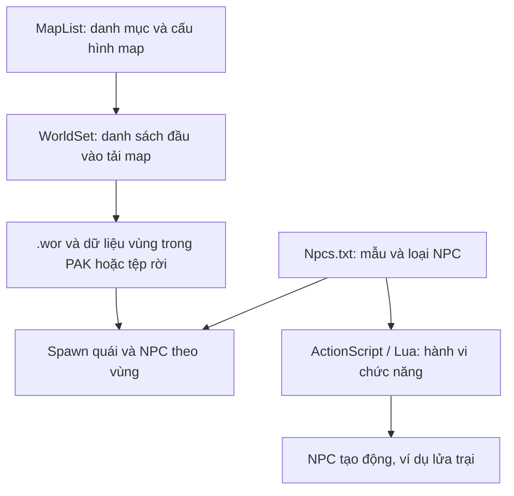

# TÓM TẮT 5 DÒNG
1. [TÀI LIỆU] Catalog có 993 ID map; có 1.412 mẫu quái/động vật Kind=0, 19 mẫu Kind trống và 958 mẫu NPC đối thoại Kind=3. (`I-04-khao-sat-map.md:32`; `I-03-khao-sat-quai-vat.md:2,67–75`; `I-05-npc-chuc-nang.md:13`)
2. [TÀI LIỆU] Hai PAK có 94.098 bản ghi spawn Kind=0 trên 195 map; đây không phải số quái đang sống. (`I-03-khao-sat-quai-vat.md:3,227–228`)
3. [TÀI LIỆU] PAK có `.wor` khớp cho 955 ID, thêm một tệp rời; 37 ID chưa thấy `.wor` trong nguồn đã kiểm. (`I-03-khao-sat-quai-vat.md:40–41`; `K-02-ban-do.md:74–88`)
4. [CHƯA KIỂM] Chưa xác định map nào không nạp được khi chạy, hoặc đủ vị trí NPC chức năng thường trú. (`I-04-khao-sat-map.md:78–80`; `I-05-npc-chuc-nang.md:35–42,83,92–96`)
5. [TÀI LIỆU] Đây là tổng hợp tĩnh từ bốn báo cáo; không chạy build, exe, VM hay game. (`I-03-khao-sat-quai-vat.md:190`; `I-04-khao-sat-map.md:1–5`; `I-05-npc-chuc-nang.md:1–5`; `K-02-ban-do.md:170–174`)

# Sổ tay quái, NPC và bản đồ JX1

Loại: tổng hợp\
Chủ đề: Số lượng bản đồ, quái và NPC chức năng; nơi tra dữ liệu và giới hạn kiểm kê.\
Từ khóa: SO-04, bản đồ, quái vật, NPC, MapList, WorldSet, Kind, spawn, PAK, .wor\
Trạng thái: DONE — hoàn thành tổng hợp tĩnh bốn báo cáo; chưa xác minh trong game.\
Độ phủ: 4/4 báo cáo nguồn; 12/12 nhóm đường dẫn map của K-02; 9 map mẫu của I-03; 8/8 nhóm chức năng của I-05 được ghi rõ mức đã/chưa phủ.\
Liên quan: `JX1_OPS/REPORTS/I-03-khao-sat-quai-vat.md`, `I-04-khao-sat-map.md`, `I-05-npc-chuc-nang.md`, `K-02-ban-do.md`.\
Cần tôi quyết định: không.

## Phạm vi và cách đọc

Tài liệu này gom kết quả khảo sát tĩnh từ bốn báo cáo được giao. Nhãn **TÀI LIỆU** nghĩa là số liệu hoặc kết luận được trích từ các báo cáo nguồn; **CHƯA KIỂM** nghĩa là chưa có bằng chứng trong phạm vi khảo sát. Không suy số lượng trong tệp thành số đối tượng đang hoạt động trong game.

[THẤY] Bốn tệp nguồn trong mục Liên quan có sẵn và đã được đọc; các tên tệp dẫn ngắn bên dưới đều thuộc `JX1_OPS/REPORTS/`. Nhãn **THẤY** chỉ áp dụng việc kiểm tra tài liệu trong SO-04, không có nghĩa đã nhìn thấy đối tượng trong game. `I-03-khao-sat-quai-vat.md:8`; `I-04-khao-sat-map.md:7`; `I-05-npc-chuc-nang.md:7`; `K-02-ban-do.md:7`.

[TÀI LIỆU] Giữ riêng nguồn: I-03/I-04/I-05 dẫn client gốc, còn K-02 dẫn client A và cây source khác. K-02 có tiêu đề bên trong là K-02c; sổ tay vẫn trỏ đúng tệp được giao `K-02-ban-do.md`. Không coi các cây source hoặc client này là cùng bản đang chạy. `I-03-khao-sat-quai-vat.md:48–51,180`; `I-04-khao-sat-map.md:53–60`; `I-05-npc-chuc-nang.md:47–49`; `K-02-ban-do.md:7,33–37`.

Mục lục: [Phạm vi](#phạm-vi-và-độ-phủ) · [Bản đồ](#bản-đồ-cấu-hình-dữ-liệu-và-giới-hạn-kết-luận) · [Quái](#quái-mẫu-chỉ-số-và-điểm-sinh) · [NPC chức năng](#npc-chức-năng-điều-đã-có-và-còn-thiếu) · [Giải mã tên](#giải-mã-tên) · [Sổ thông số](#mục-sổ-thông-số) · [Xác minh](#đã-xác-minh--chưa-xác-minh).

[TÀI LIỆU] Trong đường dẫn của các báo cáo, `GS/` chỉ cây dữ liệu gói server: tra mẫu tại `GS/Settings/Npcs.txt`, danh mục tại `GS/Settings/MapList.ini`, danh sách map tại `GS/maps/WorldSet_gs001.ini`, rồi đối chiếu `.wor`, dữ liệu vùng/PAK và các script liên quan. `I-03-khao-sat-quai-vat.md:47–51`; `I-04-khao-sat-map.md:38–40`; `K-02-ban-do.md:113–128`.

## Phạm vi và độ phủ

| Phần | Kết quả trong báo cáo nguồn | Mức phủ và giới hạn | Nhãn |
|---|---|---|---|
| Danh mục bản đồ gốc | 993 ID trên 993 ID | Đã kiểm kê catalog; chưa đồng nghĩa tất cả map được đưa vào danh sách tải. `I-04-khao-sat-map.md:13,32` | TÀI LIỆU |
| Danh sách tải `WorldSet_gs001` | 872 mục; `Count=800` | 800 là số mục vòng đọc cấu hình, không phải bằng chứng 800 map nạp thành công. Có 121 ID catalog không nằm trong danh sách này. `I-04-khao-sat-map.md:2,38,80` | TÀI LIỆU |
| Tệp `.wor` của map | 955 ID khớp trong hai PAK; thêm 1 tệp `.wor` rời; 37 ID không thấy `.wor` trong các nguồn được kiểm | 956/993 ID có tệp khớp theo lần kiểm kê K-02. I-03 chỉ tính hai PAK nên báo 955/993 và 38 ID không khớp trong PAK. Không suy rằng ID thiếu tệp chắc chắn không thể nạp từ nguồn khác. `I-03-khao-sat-quai-vat.md:2,40–41`; `K-02-ban-do.md:74–88` | TÀI LIỆU |
| Các ID chưa thấy `.wor` | 95, 97, 63, 64, 96, 98, 88, 89, 107, 108, 133, 134, 156, 157, 159, 191, 192, 334, 335, 356, 592, 598–604, 902–904, 975, 976, 985, 987, 988, 994 | Tổng 37 ID, liệt kê theo các nhóm trong bảng cấu trúc của K-02. Danh sách này mô tả kết quả dò tệp, không phải kết luận lỗi nạp runtime. `K-02-ban-do.md:74–88` | TÀI LIỆU |
| Template quái và NPC | 2.435 hàng mẫu; 1.412 Kind=0 rõ ràng, 19 Kind trống; 958 Kind=3 | Đã kiểm kê các hàng. Kind trống được giữ riêng; mẫu không đồng nghĩa instance. `I-03-khao-sat-quai-vat.md:31–36,67–75`; `I-05-npc-chuc-nang.md:28–41` | TÀI LIỆU |
| Bản ghi spawn quái | 94.098 bản ghi Kind=0 trên 195 map trong hai PAK | Kiểm kê tĩnh; không phải số quái đồng thời trong game. `I-03-khao-sat-quai-vat.md:3,227–228` | TÀI LIỆU |
| Chức năng NPC | 958 mẫu Kind=3; tìm ví dụ xử lý cho 6/8 nhóm chức năng | Đã có đường xử lý mẫu; thiếu liên kết đầy đủ giữa một số NPC thường trú, template và vị trí. `I-05-npc-chuc-nang.md:12–13,28–42` | TÀI LIỆU |
| Cấp NPC theo map | 131 ID có cặp cấu hình cấp đủ điều kiện | 862 ID còn lại không có bộ cờ/cấp tương ứng theo phép kiểm tĩnh; không gán cấp 0 cho chúng. `I-03-khao-sat-quai-vat.md:38,133–150` | TÀI LIỆU |

## Bản đồ: cấu hình, dữ liệu và giới hạn kết luận

- [TÀI LIỆU] **Danh mục:** `Settings/MapList.ini` chứa ID, đường dẫn và một số thuộc tính map. Catalog gốc có 993 ID; bản `Settings/vn/MapList.ini` là bộ riêng 1.020 ID, không gộp hai danh sách. `I-04-khao-sat-map.md:32–33,68–69`.
- [TÀI LIỆU] **Danh sách đưa vào luồng tải:** `maps/WorldSet_gs001.ini` khai báo 872 mục vật lý nhưng `Count=800`. Mã nguồn được I-04 trích dẫn lặp theo `Count`, do đó không được xem các mục ngoài giới hạn là đã tải. Danh sách cấu hình cũng không xác nhận tải thành công. `I-04-khao-sat-map.md:38,78–80`.
- [TÀI LIỆU] **Tệp map và vùng:** `.wor` cung cấp khung map; dữ liệu vùng server có dạng `region_s.dat` trong PAK hoặc tệp tương ứng. K-02 kiểm tra các mục PAK và tệp rời; I-03 kiểm kê spawn trong hai PAK. `K-02-ban-do.md:113–147`; `I-03-khao-sat-quai-vat.md:40–41`.
- [TÀI LIỆU] **Map thiếu `.wor` trong lần kiểm kê:** 37 ID ở bảng trên chưa có tệp khớp trong tập nguồn K-02; trong phạm vi chỉ hai PAK của I-03 có 38 ID không khớp. Khác biệt một ID là tệp `.wor` rời đã thấy trong K-02. Vì vậy, tài liệu chỉ kết luận “chưa tìm thấy tệp trong nguồn đã kiểm”, không kết luận “map không nạp được”. `I-03-khao-sat-quai-vat.md:40–41`; `K-02-ban-do.md:74–88,149`.
- [CHƯA KIỂM] **Chưa xác minh:** không có lần chạy game hoặc phép đo runtime trong các nguồn được giao. Tình trạng nạp còn phụ thuộc cấu hình, PAK/tệp rời và đường xử lý lúc chạy; báo cáo nguồn cũng ghi rõ không kết luận map đang được nạp chỉ từ danh mục. `I-04-khao-sat-map.md:78–80`; `K-02-ban-do.md:170–174`.

### Tra map theo vùng

[TÀI LIỆU] Bảng giữ thứ tự vùng của K-02, với khóa thư mục gốc để tra cứu. Một vùng có thể chứa nhiều ID dùng chung tệp. Tổng 993 ID là danh mục map, không phải số nơi người chơi chắc chắn vào được. `K-02-ban-do.md:70–88,132–139`.

| Vùng theo đường dẫn gốc | ID trong danh mục | ID có `.wor` trong PAK | ID có `.wor` rời | ID chưa thấy `.wor` | Nhãn / nguồn |
|---|---:|---:|---:|---|---|
| 西北南区 | 17 | 16 | 0 | 987 | TÀI LIỆU — `K-02-ban-do.md:76` |
| 西南北区 | 32 | 30 | 0 | 95, 97 | TÀI LIỆU — `K-02-ban-do.md:77` |
| 中原北区 | 86 | 84 | 0 | 107–108 | TÀI LIỆU — `K-02-ban-do.md:78` |
| 两湖区 | 29 | 25 | 0 | 63–64, 96, 98 | TÀI LIỆU — `K-02-ban-do.md:79` |
| 中原南区 | 35 | 33 | 0 | 88–89 | TÀI LIỆU — `K-02-ban-do.md:80` |
| 西北北区 | 54 | 52 | 0 | 133–134 | TÀI LIỆU — `K-02-ban-do.md:81` |
| 西南南区 | 25 | 22 | 0 | 156–157, 159 | TÀI LIỆU — `K-02-ban-do.md:82` |
| 江南区 | 71 | 69 | 0 | 191–192 | TÀI LIỆU — `K-02-ban-do.md:83` |
| 特殊用地 | 632 | 613 | 0 | 334–335, 356, 592, 598–604, 902–904, 975–976, 985, 988, 994 | TÀI LIỆU — `K-02-ban-do.md:84` |
| 东北区 | 10 | 10 | 0 | — | TÀI LIỆU — `K-02-ban-do.md:85` |
| `rongyuxitong` | 1 | 1 | 0 | — | TÀI LIỆU — `K-02-ban-do.md:86` |
| `fongkieu` | 1 | 0 | 1 | — | TÀI LIỆU — `K-02-ban-do.md:87` |
| **Tổng** | **993** | **955** | **1** | **37 ID** | TÀI LIỆU — `K-02-ban-do.md:88` |

- [TÀI LIỆU] **Đếm theo tệp:** 993 ID dùng 324 đường dẫn; 296 đường dẫn có `.wor` đọc được và 28 chưa thấy. Trong 800 mục đầu WorldSet, 772 ID có `.wor` và 28 chưa thấy. Không nhầm 296 tệp với 956 ID có tệp tương ứng. `K-02-ban-do.md:41–43`.
- [TÀI LIỆU] **ID 995 — Kiếm Môn Quan:** có `.wor` rời và 479/506 tọa độ vùng có tệp `Region_C.dat` rời. Cả 479 bảng phần đều không có dữ liệu trap, NPC hoặc vật thể; chúng là dữ liệu vùng phía client, không thay cho bản ghi spawn server. `K-02-ban-do.md:45,149–157`.
- [CHƯA KIỂM] **Danh sách map lỗi nạp:** chưa xác định được từ bốn báo cáo. 37 ID thiếu tệp khớp, 28 ID thiếu trong giới hạn tải và các vùng chưa khớp chỉ mục là các phép đếm khác nhau; cần phép kiểm khi chạy được duyệt riêng trước khi gọi một ID là map lỗi. `K-02-ban-do.md:41–44,173`; `I-04-khao-sat-map.md:78–80`.
- [TÀI LIỆU] **Phía client A:** cây tệp và danh mục hai APK được K-02 kiểm kê chưa thấy `.wor`, tệp vùng hoặc `.pak`; gói client tải riêng chưa được kiểm. Không suy từ đó rằng client không thể vào map. `K-02-ban-do.md:46,173`.

## Quái: mẫu, chỉ số và điểm sinh

- [TÀI LIỆU] **Mẫu:** bảng `Settings/Npcs.txt` có 2.435 hàng dữ liệu, gồm 1.412 hàng ghi rõ `Kind=0`, 958 hàng `Kind=3`, cùng các loại khác và 19 hàng để trống `Kind`. Con số 1.412 chỉ đếm hàng ghi số 0; không tự nhập các hàng trống vào nhóm này. `I-03-khao-sat-quai-vat.md:31–36,67–75`.
- [TÀI LIỆU] **Điểm sinh:** báo cáo I-03 đếm 94.098 bản ghi `shKind=0` trên 195 map ở hai PAK server. Bản ghi cho biết dữ liệu spawn tĩnh, không nói có bao nhiêu quái đang tồn tại trong phiên game. `I-03-khao-sat-quai-vat.md:3,227–228`.
- [TÀI LIỆU] **Cấp và chỉ số:** cấp spawn và cấu hình cấp map ảnh hưởng HP/EXP và chỉ số. Các ví dụ số học trong I-03 được suy từ source/Lua, chưa chạy Lua hoặc game; không áp rộng cho mọi loại quái. `I-03-khao-sat-quai-vat.md:109–129,133–150`.
- [TÀI LIỆU] **Dữ liệu tra cứu:** dùng `Npcs.txt` để tra mẫu và trường dữ liệu; `MapList.ini` để tra cấp map; `region_s.dat`/dữ liệu vùng trong PAK để tra điểm spawn. Cần phân biệt ID template với ID instance. `I-03-khao-sat-quai-vat.md:65–89,111,133–152`.

### Tra quái theo map

[TÀI LIỆU] I-03 nêu chín map mẫu dưới đây; toàn bộ kiểm kê có 195 map với bản ghi quái và 172 mã mẫu quái khác nhau. Số 172 là mẫu thực sự được tham chiếu trong tập bản ghi đã kiểm, khác 1.412 mẫu có sẵn trong bảng. Bản ghi dùng chung giữa nhiều ID map được tính cho từng ID, nên 94.098 không phải số vị trí hay số quái riêng biệt đang sống. `I-03-khao-sat-quai-vat.md:228–240,258–260`.

| ID map | Bản ghi quái `shKind=0` | Mã mẫu quái khác nhau trong map | Cấp theo cấu hình min..max | Nhãn / nguồn |
|---|---:|---:|---|---|
| 3 | 338 | 4 | 25..25 | TÀI LIỆU — `I-03-khao-sat-quai-vat.md:232` |
| 4 | 230 | 3 | 35..35 | TÀI LIỆU — `I-03-khao-sat-quai-vat.md:233` |
| 5 | 182 | 2 | 45..45 | TÀI LIỆU — `I-03-khao-sat-quai-vat.md:234` |
| 9 | 358 | 3 | 75..75 | TÀI LIỆU — `I-03-khao-sat-quai-vat.md:235` |
| 10 | 266 | 3 | 85..85 | TÀI LIỆU — `I-03-khao-sat-quai-vat.md:236` |
| 12 | 46 | 1 | 55..55 | TÀI LIỆU — `I-03-khao-sat-quai-vat.md:237` |
| 26 | 33 | 2 | 65..65 | TÀI LIỆU — `I-03-khao-sat-quai-vat.md:238` |
| 50 | 122 | 10 | 15..15 | TÀI LIỆU — `I-03-khao-sat-quai-vat.md:239` |
| 75 | 216 | 3 | 95..95 | TÀI LIỆU — `I-03-khao-sat-quai-vat.md:240` |

[CHƯA KIỂM] Không có danh sách đầy đủ tên quái/NPC và tọa độ theo từng map trong bốn báo cáo, nên chỉ sắp được các map mẫu có bằng chứng. Cấp trong bảng là cấp NPC theo cấu hình, không phải cấp yêu cầu của người chơi. Chưa có kết quả đo số quái xuất hiện hoặc được sinh lại lúc chạy. `I-03-khao-sat-quai-vat.md:206–209,258`; `I-04-khao-sat-map.md:71,114–116`; `I-05-npc-chuc-nang.md:95`.

## NPC chức năng: điều đã có và còn thiếu

- [TÀI LIỆU] Có 958 mẫu NPC đối thoại `Kind=3`. Báo cáo I-05 tìm thấy ví dụ cho 6/8 nhóm chức năng, gồm đường truyền tống, cường hóa/ghép, kho và lửa trại. Đây là ví dụ đường xử lý, không phải danh sách đầy đủ NPC có thể gặp trong game. `I-05-npc-chuc-nang.md:12–13,28–42,75–90`.
- [CHƯA KIỂM] Chưa ghép đầy đủ NPC thường trú với template, map, tọa độ và script. Riêng kho có script gọi mở kho nhưng chưa xác định template/điểm đặt; nhiệm vụ và hảo hữu cũng chưa có ánh xạ đáng tin cậy. `I-05-npc-chuc-nang.md:35–40,79–83,92–96`.
- [TÀI LIỆU] Mẫu ID 2078 là lửa trại được tạo động, không phải bằng chứng về NPC thường trú. Báo cáo ghi nó có thể được tạo tại vị trí phát sinh và có thời hạn; không gán nó thành NPC hảo hữu. `I-05-npc-chuc-nang.md:59,86–96`.
- [TÀI LIỆU] **Nơi tra dữ liệu:** `Npcs.txt` chứa mẫu và cột `ActionScript`; script Lua chứa hành vi; dữ liệu vùng/map chứa vị trí NPC; lửa trại có nhánh tạo động trong các script liên quan. Không có một bảng tĩnh duy nhất đã chứng minh đủ mọi NPC chức năng và tọa độ. `I-05-npc-chuc-nang.md:26–42,75–96`; `I-04-khao-sat-map.md:39`.

[TÀI LIỆU] **Chưa đếm được tổng NPC chức năng thường trú.** Cả 958 mẫu `Kind=3` đều trống `ActionScript` trong bảng rời; phải nối bản ghi vùng và script mới biết từng NPC làm gì. Có ví dụ xử lý cho sáu nhóm không có nghĩa đã tìm được sáu NPC, và 958 không phải số NPC chức năng đã xác nhận. `I-05-npc-chuc-nang.md:2,13,32–41,73,83–84,125`.

[TÀI LIỆU] I-03 đếm 1.854 bản ghi đối thoại `shKind=3` trong tổng 95.952 bản ghi NPC; phép đếm tính theo từng ID map, không phải tổng NPC chức năng riêng biệt hoặc hiện sống. `I-03-khao-sat-quai-vat.md:227–228`.

| Nhóm chức năng | Đã có gì trong tài liệu | Map / vị trí đã biết | Phần chưa phủ | Nhãn / nguồn |
|---|---|---|---|---|
| Bán hàng | Ví dụ script `thoren.lua` gọi mở cửa hàng | Chưa gắn NPC thường trú | Mẫu, điểm đặt và liên kết tới bảng hàng | TÀI LIỆU — `I-05-npc-chuc-nang.md:34,80–82` |
| Nhiệm vụ | Chưa ghép NPC với script nhiệm vụ | Chưa xác định | Mẫu, map, tọa độ và tương tác cụ thể | CHƯA KIỂM — `I-05-npc-chuc-nang.md:35,83` |
| Truyền tống | Nhánh chuyển map trong `sysshop.lua`; `Station.txt` có 16 dòng trạm | Không coi 16 trạm là 16 NPC | NPC đứng ở đâu và ai gọi nhánh chuyển map | TÀI LIỆU — `I-05-npc-chuc-nang.md:36,71–73,77` |
| Cường hóa / ghép | Có đường mở giao diện và Lua xử lý | Chưa gắn NPC thường trú | Mẫu và map/tọa độ của NPC mở chức năng | TÀI LIỆU — `I-05-npc-chuc-nang.md:37,78–79` |
| Kho | `ruongchuado.lua` có gọi `OpenBox()` trong ngữ cảnh map 242–248 | Đây là điều kiện script, chưa phải vị trí NPC kho | Mẫu, map spawn và tọa độ NPC | TÀI LIỆU — `I-05-npc-chuc-nang.md:38,80,83` |
| Hoạt động | Có điểm vào và callback trong Lua | Chưa gắn NPC mở menu | Mẫu, vị trí và liên kết menu | TÀI LIỆU — `I-05-npc-chuc-nang.md:39,81` |
| Hảo hữu | Chưa có ánh xạ đáng tin cậy tới NPC | Chưa xác định | NPC hay giao diện hệ thống; quan hệ với lửa trại | CHƯA KIỂM — `I-05-npc-chuc-nang.md:40,83,96` |
| Lửa trại tạo động | Mẫu 2078; script tạo ở map 53 hoặc vị trí người dùng | Ví dụ map 53: ô hiển thị (202,200), MPS (51717,102750) theo script | Chưa quan sát khi chạy; không coi là NPC thường trú/hảo hữu | TÀI LIỆU — `I-05-npc-chuc-nang.md:41,59,88–90,96` |

## Giải mã tên

| Tên gốc | Mã hóa | Chữ đúng (UTF-8) | Nguồn |
|---|---|---|---|
| `篝火` | GBK | Lửa trại | `I-05-npc-chuc-nang.md:59` |
| `KiÕm M«n Quan` | TCVN3 | Kiếm Môn Quan, ID 995 | `K-02-ban-do.md:56` |
| 西北南区 | GBK | 西北南区; tên Việt chưa được nguồn xác nhận | `K-02-ban-do.md:51,57,76` |
| 西南北区 | GBK | 西南北区; tên Việt chưa được nguồn xác nhận | `K-02-ban-do.md:51,58,77` |
| 中原北区 | GBK | 中原北区; tên Việt chưa được nguồn xác nhận | `K-02-ban-do.md:51,59,78` |
| 两湖区 | GBK | 两湖区; tên Việt chưa được nguồn xác nhận | `K-02-ban-do.md:51,60,79` |
| 中原南区 | GBK | 中原南区; tên Việt chưa được nguồn xác nhận | `K-02-ban-do.md:51,61,80` |
| 西北北区 | GBK | 西北北区; tên Việt chưa được nguồn xác nhận | `K-02-ban-do.md:51,62,81` |
| 西南南区 | GBK | 西南南区; tên Việt chưa được nguồn xác nhận | `K-02-ban-do.md:51,63,82` |
| 江南区 | GBK | 江南区; tên Việt chưa được nguồn xác nhận | `K-02-ban-do.md:51,64,83` |
| 特殊用地 | GBK | 特殊用地; tên Việt chưa được nguồn xác nhận | `K-02-ban-do.md:51,65,84` |
| 东北区 | GBK | 东北区; tên Việt chưa được nguồn xác nhận | `K-02-ban-do.md:51,66,85` |
| `rongyuxitong` | ASCII | Giữ khóa thư mục; chưa xác định tên Việt | `K-02-ban-do.md:67,86` |
| `fongkieu` | ASCII | Giữ khóa thư mục; chưa xác định tên Việt | `K-02-ban-do.md:68,87` |

[TÀI LIỆU] Bảng trên dẫn lại cách giải mã trong báo cáo nguồn; SO-04 không đọc lại byte dữ liệu gốc. Những khóa vùng đã có chữ Hán UTF-8 không đồng nghĩa đã xác nhận tên Việt hiển thị trong game. `K-02-ban-do.md:49–68`; `I-05-npc-chuc-nang.md:59,125`.

## Sắp theo cấu trúc game

1. [TÀI LIỆU] **Catalog map** (`MapList.ini`) → 2. **Danh sách chọn map** (`WorldSet`) → 3. **Khung map** (`.wor`) → 4. **Dữ liệu vùng** (`region_s.dat`/tệp vùng) → 5. **Bản ghi spawn** (quái/NPC) → 6. **Hành vi NPC** (ActionScript/Lua; một số NPC như lửa trại được tạo động). Thứ tự này mô tả quan hệ dữ liệu được các báo cáo nêu, không khẳng định mọi bước đều thành công lúc runtime. `I-04-khao-sat-map.md:78–80`; `I-03-khao-sat-quai-vat.md:40–41`; `I-05-npc-chuc-nang.md:75–90`; `K-02-ban-do.md:113–128`.

[TÀI LIỆU] Khi tra cứu: chọn vùng → ID map trong bảng bản đồ → quái theo ID map mẫu → nhóm chức năng NPC. Riêng lửa trại được gắn ví dụ map 53 và giữ trong nhóm tạo động. Phần NPC thường trú chưa có ánh xạ đầy đủ nên không tự đặt vào map cụ thể. `K-02-ban-do.md:70–88`; `I-03-khao-sat-quai-vat.md:230–240`; `I-05-npc-chuc-nang.md:83,88–96`.

## Mục sổ thông số

[TÀI LIỆU] Đây là sổ tra giá trị, không phải hướng dẫn chỉnh cấu hình. Cột KHÔNG nghĩa là không được thay đổi trong phạm vi SO-04; chưa đánh giá tính an toàn khi sửa trong môi trường khác. Tất cả giá trị là nguồn gián tiếp, chưa đối chiếu lại tệp gốc. `I-03-khao-sat-quai-vat.md:65,75–77,133`; `I-04-khao-sat-map.md:68–80`.

| Nhóm | Tên/hằng số | file:dòng | Giá trị | Đơn vị | Ảnh hưởng / cách hiểu | Đổi an toàn | Nguồn đo |
|---|---|---|---|---|---|---|---|
| Danh mục map | `MapList Count` | `I-04-khao-sat-map.md:68` dẫn `GS/Settings/MapList.ini:2` | 1000 | giá trị khai báo | Không thay số ID thực kiểm kê là 993 | KHÔNG | TÀI LIỆU — đọc cấu hình tĩnh trong I-04 |
| Chọn map | `WorldSet Count` | `I-04-khao-sat-map.md:72–80` dẫn `GS/maps/WorldSet_gs001.ini:2` | 800 | mục đầu danh sách | Ngoài giới hạn này còn 72 mục; không đồng nghĩa 800 map tải thành công | KHÔNG | TÀI LIỆU — cấu hình và source trong I-04 |
| Loại NPC | `Kind` | `I-03-khao-sat-quai-vat.md:65,69–75` | 0 / 3 | mã loại | Quái/động vật / đối thoại; 19 ô trống được tách riêng | KHÔNG | TÀI LIỆU — định nghĩa và kiểm kê trong I-03 |
| Định danh mẫu | `ID = STT − 1` | `I-03-khao-sat-quai-vat.md:77`; `I-05-npc-chuc-nang.md:57–59` | bắt đầu từ 0 | mã mẫu | Ví dụ STT 2079 là mẫu 2078; khác mã đối tượng đang sống | KHÔNG | TÀI LIỆU — quy tắc đọc bảng trong I-03/I-05 |

## Đã xác minh / Chưa xác minh

- [TÀI LIỆU] **ĐÃ XÁC MINH THEO TÀI LIỆU** — các số kiểm kê catalog, template, spawn và `.wor` nêu trên; loại nguồn và giới hạn của từng phép đếm được giữ theo báo cáo gốc. `I-04-khao-sat-map.md:68–80`; `I-03-khao-sat-quai-vat.md:69–77,227–228`; `K-02-ban-do.md:41–46`.
- [CHƯA KIỂM] **CHƯA XÁC MINH** — map nào nạp thành công khi chạy; ID thiếu `.wor` có nguồn thay thế hay không; số lượng quái/NPC hiện sống; vị trí đầy đủ của NPC thường trú; mọi nhánh chức năng trong game. `I-03-khao-sat-quai-vat.md:203–209,258`; `I-05-npc-chuc-nang.md:92–97`; `K-02-ban-do.md:173`.
- Không chạy test, build, exe, VM hoặc game trong công việc nguồn. Kết quả là tổng hợp tĩnh từ báo cáo, không kiểm tra lại mã hoặc dữ liệu gốc ngoài các báo cáo được giao.

## Bàn giao

Liên quan: `JX1_OPS/REPORTS/I-03-khao-sat-quai-vat.md`, `I-04-khao-sat-map.md`, `I-05-npc-chuc-nang.md`, `K-02-ban-do.md`.

Hàng đề nghị PM thêm vào `JX1_OPS/DESIGN/MUC-LUC-TRI-THUC.md`:

| Chủ đề | Tài liệu | Nội dung | Độ chắc |
|---|---|---|---|
| Quái, NPC chức năng, catalog map và dữ liệu vùng | `DESIGN/SO-TAY-QUAI-NPC-BAN-DO.md` | Số lượng kiểm kê, quan hệ MapList–WorldSet–tệp map–vùng–spawn, giới hạn về NPC thường trú và nạp runtime | Tổng hợp tĩnh từ I-03, I-04, I-05, K-02 |

Kỹ năng đã dùng: jx1-knowledge, jx1-retrofit, jx1-parameters, jx1-report; đã nạp jx1-read-server và jx1-read-client để giữ ranh giới nguồn/phiên bản, không mở mã, dữ liệu gốc hay cấu hình ngoài bốn báo cáo được giao.

## Phát hiện khi chuẩn hóa

- [TÀI LIỆU] I-04 và I-05 vẫn là PARTIAL ở phạm vi khảo sát của chúng; trạng thái DONE của SO-04 chỉ xác nhận đã tổng hợp bốn nguồn, không biến các phần chưa kiểm thành đã xác minh. `I-04-khao-sat-map.md:12`; `I-05-npc-chuc-nang.md:12`; `K-02-ban-do.md:173`.
- [TÀI LIỆU] I-04 giữ số 48 Cave/789 ID thiếu khóa khi phân biệt cách viết `MapType`; ghi chú chuẩn hóa nêu 49/788 khi gộp hoa thường do ID 42 dùng `Maptype`. Sổ tay không đổi kết luận cũ hay quyết định thay loader cách phân loại. `I-04-khao-sat-map.md:88,92,237–238`; `I-03-khao-sat-quai-vat.md:150,265`.
- [TÀI LIỆU] Mốc 955/38 chỉ hai PAK của I-03 và mốc 956/37 gồm tệp rời của K-02 có phạm vi khác nhau; đã giữ cả hai thay vì chọn ngầm một số. `I-03-khao-sat-quai-vat.md:227–228`; `K-02-ban-do.md:41–43,88`.
