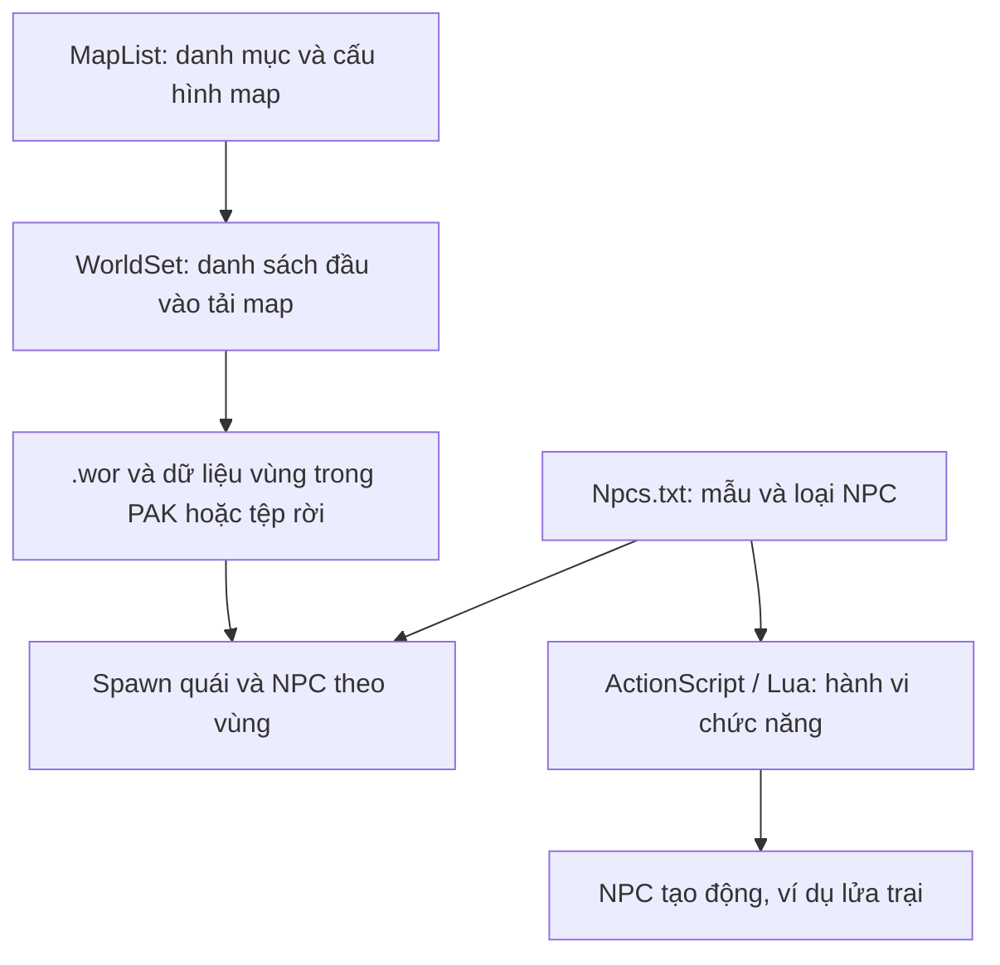

# TÓM TẮT 5 DÒNG
1. [TÀI LIỆU] Catalog có 993 ID map; có 1.412 mẫu quái/động vật Kind=0, 19 mẫu Kind trống và 958 mẫu NPC đối thoại Kind=3. (`I-04-khao-sat-map.md:32`; `I-03-khao-sat-quai-vat.md:2,67–75`; `I-05-npc-chuc-nang.md:13`)
2. [TÀI LIỆU] Hai PAK có 94.098 bản ghi spawn Kind=0 trên 195 map; đây không phải số quái đang sống. (`I-03-khao-sat-quai-vat.md:2`)
3. [TÀI LIỆU] PAK có `.wor` khớp cho 955 ID, thêm một tệp rời; 37 ID chưa thấy `.wor` trong nguồn đã kiểm. (`I-03-khao-sat-quai-vat.md:40–41`; `K-02-ban-do.md:74–88`)
4. [CHƯA KIỂM] Chưa xác định map nào không nạp được khi chạy, hoặc đủ vị trí NPC chức năng thường trú. (`I-04-khao-sat-map.md:78–80`; `I-05-npc-chuc-nang.md:35–42,83,92–96`)
5. [TÀI LIỆU] Đây là tổng hợp tĩnh từ bốn báo cáo; không chạy build, exe, VM hay game. (`I-03-khao-sat-quai-vat.md:190`; `I-04-khao-sat-map.md:1–5`; `I-05-npc-chuc-nang.md:1–5`; `K-02-ban-do.md:170–174`)

# Sổ tay quái, NPC và bản đồ JX1

## Phạm vi và cách đọc

Tài liệu này gom kết quả khảo sát tĩnh từ bốn báo cáo được giao. Nhãn **TÀI LIỆU** nghĩa là số liệu hoặc kết luận được trích từ các báo cáo nguồn; **CHƯA KIỂM** nghĩa là chưa có bằng chứng trong phạm vi khảo sát. Không suy số lượng trong tệp thành số đối tượng đang hoạt động trong game.

Trong đường dẫn của các báo cáo, `GS/` chỉ cây dữ liệu gói server: tra mẫu tại `GS/Settings/Npcs.txt`, danh mục tại `GS/Settings/MapList.ini`, danh sách map tại `GS/maps/WorldSet_gs001.ini`, rồi đối chiếu `.wor`, dữ liệu vùng/PAK và các script liên quan. `I-03-khao-sat-quai-vat.md:47–51`; `I-04-khao-sat-map.md:38–40`; `K-02-ban-do.md:113–128`.

## Phạm vi và độ phủ

| Phần | Kết quả trong báo cáo nguồn | Mức phủ và giới hạn | Nhãn |
|---|---|---|---|
| Danh mục bản đồ gốc | 993 ID trên 993 ID | Đã kiểm kê catalog; chưa đồng nghĩa tất cả map được đưa vào danh sách tải. `I-04-khao-sat-map.md:13,32` | TÀI LIỆU |
| Danh sách tải `WorldSet_gs001` | 872 mục; `Count=800` | 800 là số mục vòng đọc cấu hình, không phải bằng chứng 800 map nạp thành công. Có 121 ID catalog không nằm trong danh sách này. `I-04-khao-sat-map.md:2,38,80` | TÀI LIỆU |
| Tệp `.wor` của map | 955 ID khớp trong hai PAK; thêm 1 tệp `.wor` rời; 37 ID không thấy `.wor` trong các nguồn được kiểm | 956/993 ID có tệp khớp theo lần kiểm kê K-02. I-03 chỉ tính hai PAK nên báo 955/993 và 38 ID không khớp trong PAK. Không suy rằng ID thiếu tệp chắc chắn không thể nạp từ nguồn khác. `I-03-khao-sat-quai-vat.md:2,40–41`; `K-02-ban-do.md:74–88` | TÀI LIỆU |
| Các ID chưa thấy `.wor` | 95, 97, 63, 64, 96, 98, 88, 89, 107, 108, 133, 134, 156, 157, 159, 191, 192, 334, 335, 356, 592, 598–604, 902–904, 975, 976, 985, 987, 988, 994 | Tổng 37 ID, liệt kê theo các nhóm trong bảng cấu trúc của K-02. Danh sách này mô tả kết quả dò tệp, không phải kết luận lỗi nạp runtime. `K-02-ban-do.md:74–88` | TÀI LIỆU |
| Template quái và NPC | 2.435 hàng mẫu; 1.412 Kind=0 rõ ràng, 19 Kind trống; 958 Kind=3 | Đã kiểm kê các hàng. Kind trống được giữ riêng; mẫu không đồng nghĩa instance. `I-03-khao-sat-quai-vat.md:31–36,67–75`; `I-05-npc-chuc-nang.md:28–41` | TÀI LIỆU |
| Bản ghi spawn quái | 94.098 bản ghi Kind=0 trên 195 map trong hai PAK | Kiểm kê tĩnh; không phải số quái đồng thời trong game. `I-03-khao-sat-quai-vat.md:2,40` | TÀI LIỆU |
| Chức năng NPC | 958 mẫu Kind=3; tìm ví dụ xử lý cho 6/8 nhóm chức năng | Đã có đường xử lý mẫu; thiếu liên kết đầy đủ giữa một số NPC thường trú, template và vị trí. `I-05-npc-chuc-nang.md:12–13,28–42` | TÀI LIỆU |
| Cấp NPC theo map | 131 ID có cặp cấu hình cấp đủ điều kiện | 862 ID còn lại không có bộ cờ/cấp tương ứng theo phép kiểm tĩnh; không gán cấp 0 cho chúng. `I-03-khao-sat-quai-vat.md:38,133–150` | TÀI LIỆU |

## Bản đồ: cấu hình, dữ liệu và giới hạn kết luận

- [TÀI LIỆU] **Danh mục:** `Settings/MapList.ini` chứa ID, đường dẫn và một số thuộc tính map. Catalog gốc có 993 ID; bản `Settings/vn/MapList.ini` là bộ riêng 1.020 ID, không gộp hai danh sách. `I-04-khao-sat-map.md:32–33,68–69`.
- [TÀI LIỆU] **Danh sách đưa vào luồng tải:** `maps/WorldSet_gs001.ini` khai báo 872 mục vật lý nhưng `Count=800`. Mã nguồn được I-04 trích dẫn lặp theo `Count`, do đó không được xem các mục ngoài giới hạn là đã tải. Danh sách cấu hình cũng không xác nhận tải thành công. `I-04-khao-sat-map.md:38,78–80`.
- [TÀI LIỆU] **Tệp map và vùng:** `.wor` cung cấp khung map; dữ liệu vùng server có dạng `region_s.dat` trong PAK hoặc tệp tương ứng. K-02 kiểm tra các mục PAK và tệp rời; I-03 kiểm kê spawn trong hai PAK. `K-02-ban-do.md:113–147`; `I-03-khao-sat-quai-vat.md:40–41`.
- [TÀI LIỆU] **Map thiếu `.wor` trong lần kiểm kê:** 37 ID ở bảng trên chưa có tệp khớp trong tập nguồn K-02; trong phạm vi chỉ hai PAK của I-03 có 38 ID không khớp. Khác biệt một ID là tệp `.wor` rời đã thấy trong K-02. Vì vậy, tài liệu chỉ kết luận “chưa tìm thấy tệp trong nguồn đã kiểm”, không kết luận “map không nạp được”. `I-03-khao-sat-quai-vat.md:40–41`; `K-02-ban-do.md:74–88,149`.
- [CHƯA KIỂM] **Chưa xác minh:** không có lần chạy game hoặc phép đo runtime trong các nguồn được giao. Tình trạng nạp còn phụ thuộc cấu hình, PAK/tệp rời và đường xử lý lúc chạy; báo cáo nguồn cũng ghi rõ không kết luận map đang được nạp chỉ từ danh mục. `I-04-khao-sat-map.md:78–80`; `K-02-ban-do.md:170–174`.

## Quái: mẫu, chỉ số và điểm sinh

- [TÀI LIỆU] **Mẫu:** bảng `Settings/Npcs.txt` có 2.435 hàng dữ liệu, gồm 1.412 hàng ghi rõ `Kind=0`, 958 hàng `Kind=3`, cùng các loại khác và 19 hàng để trống `Kind`. Con số 1.412 chỉ đếm hàng ghi số 0; không tự nhập các hàng trống vào nhóm này. `I-03-khao-sat-quai-vat.md:31–36,67–75`.
- [TÀI LIỆU] **Điểm sinh:** báo cáo I-03 đếm 94.098 bản ghi `shKind=0` trên 195 map ở hai PAK server. Bản ghi cho biết dữ liệu spawn tĩnh, không nói có bao nhiêu quái đang tồn tại trong phiên game. `I-03-khao-sat-quai-vat.md:2,40`.
- [TÀI LIỆU] **Cấp và chỉ số:** cấp spawn và cấu hình cấp map ảnh hưởng HP/EXP và chỉ số. Các ví dụ số học trong I-03 được suy từ source/Lua, chưa chạy Lua hoặc game; không áp rộng cho mọi loại quái. `I-03-khao-sat-quai-vat.md:109–129,133–150`.
- [TÀI LIỆU] **Dữ liệu tra cứu:** dùng `Npcs.txt` để tra mẫu và trường dữ liệu; `MapList.ini` để tra cấp map; `region_s.dat`/dữ liệu vùng trong PAK để tra điểm spawn. Cần phân biệt ID template với ID instance. `I-03-khao-sat-quai-vat.md:65–89,111,133–152`.

## NPC chức năng: điều đã có và còn thiếu

- [TÀI LIỆU] Có 958 mẫu NPC đối thoại `Kind=3`. Báo cáo I-05 tìm thấy ví dụ cho 6/8 nhóm chức năng, gồm đường truyền tống, cường hóa/ghép, kho và lửa trại. Đây là ví dụ đường xử lý, không phải danh sách đầy đủ NPC có thể gặp trong game. `I-05-npc-chuc-nang.md:12–13,28–42,75–90`.
- [CHƯA KIỂM] Chưa ghép đầy đủ NPC thường trú với template, map, tọa độ và script. Riêng kho có script gọi mở kho nhưng chưa xác định template/điểm đặt; nhiệm vụ và hảo hữu cũng chưa có ánh xạ đáng tin cậy. `I-05-npc-chuc-nang.md:35–40,79–83,92–96`.
- [TÀI LIỆU] Mẫu ID 2078 là lửa trại được tạo động, không phải bằng chứng về NPC thường trú. Báo cáo ghi nó có thể được tạo tại vị trí phát sinh và có thời hạn; không gán nó thành NPC hảo hữu. `I-05-npc-chuc-nang.md:59,86–96`.
- [TÀI LIỆU] **Nơi tra dữ liệu:** `Npcs.txt` chứa mẫu và cột `ActionScript`; script Lua chứa hành vi; dữ liệu vùng/map chứa vị trí NPC; lửa trại có nhánh tạo động trong các script liên quan. Không có một bảng tĩnh duy nhất đã chứng minh đủ mọi NPC chức năng và tọa độ. `I-05-npc-chuc-nang.md:26–42,75–96`; `I-04-khao-sat-map.md:39`.

## Giải mã tên

| Tên gốc | Mã hóa | Chữ đúng (UTF-8) | Nguồn |
|---|---|---|---|
| `篝火` | GBK | Lửa trại | `I-05-npc-chuc-nang.md:59` |

## Sắp theo cấu trúc game

1. [TÀI LIỆU] **Catalog map** (`MapList.ini`) → 2. **Danh sách chọn map** (`WorldSet`) → 3. **Khung map** (`.wor`) → 4. **Dữ liệu vùng** (`region_s.dat`/tệp vùng) → 5. **Bản ghi spawn** (quái/NPC) → 6. **Hành vi NPC** (ActionScript/Lua; một số NPC như lửa trại được tạo động). Thứ tự này mô tả quan hệ dữ liệu được các báo cáo nêu, không khẳng định mọi bước đều thành công lúc runtime. `I-04-khao-sat-map.md:78–80`; `I-03-khao-sat-quai-vat.md:40–41`; `I-05-npc-chuc-nang.md:75–90`; `K-02-ban-do.md:113–128`.

## Đã xác minh / Chưa xác minh

- **ĐÃ XÁC MINH THEO TÀI LIỆU** — các số kiểm kê catalog, template, spawn và `.wor` nêu trên; loại nguồn và giới hạn của từng phép đếm được giữ theo báo cáo gốc.
- **CHƯA XÁC MINH** — map nào nạp thành công khi chạy; ID thiếu `.wor` có nguồn thay thế hay không; số lượng quái/NPC hiện sống; vị trí đầy đủ của NPC thường trú; mọi nhánh chức năng trong game.
- Không chạy test, build, exe, VM hoặc game trong công việc nguồn. Kết quả là tổng hợp tĩnh từ báo cáo, không kiểm tra lại mã hoặc dữ liệu gốc ngoài các báo cáo được giao.

## Bàn giao

Liên quan: `JX1_OPS/REPORTS/I-03-khao-sat-quai-vat.md`, `I-04-khao-sat-map.md`, `I-05-npc-chuc-nang.md`, `K-02-ban-do.md`.

Hàng đề nghị PM thêm vào `JX1_OPS/DESIGN/MUC-LUC-TRI-THUC.md`:

| Chủ đề | Tài liệu | Nội dung | Độ chắc |
|---|---|---|---|
| Quái, NPC chức năng, catalog map và dữ liệu vùng | `DESIGN/SO-TAY-QUAI-NPC-BAN-DO.md` | Số lượng kiểm kê, quan hệ MapList–WorldSet–tệp map–vùng–spawn, giới hạn về NPC thường trú và nạp runtime | Tổng hợp tĩnh từ I-03, I-04, I-05, K-02 |

Kỹ năng đã dùng: jx1-knowledge, jx1-retrofit và jx1-report; đã đọc hướng dẫn jx1-read-server, jx1-read-client, jx1-parameters nhưng không mở mã, dữ liệu gốc hay cấu hình ngoài các nguồn task cho phép.
