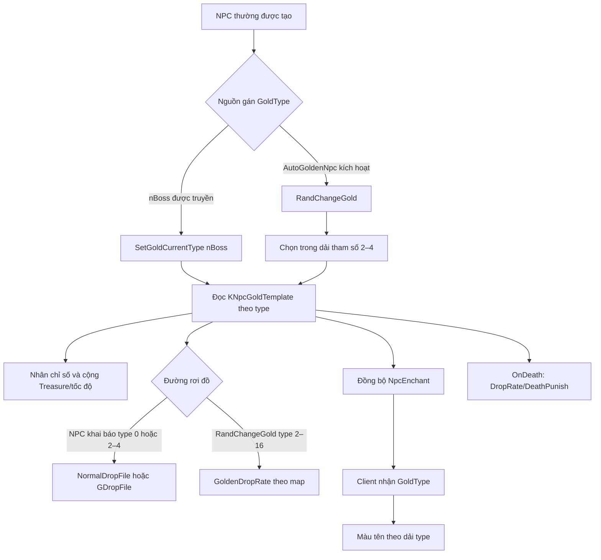

TÓM TẮT 1/5 [NGUỒN] [THẤY] — GoldType mặc định 0; setter client/server chấp nhận 1–16 và mẫu có 30 ô khai báo, không đồng nghĩa có 30 loại đang dùng (`S/KNpcGold.h:13,145–154`; `S/KNpcGold.cpp:487–500`).
TÓM TẮT 2/5 [NGUỒN] [THẤY] — Nhánh tự tăng cường gọi `GetRandomNumber(2,4)` ở cả hai vế; đường NPC boss chỉ định kiểu qua `nBoss` (`S/KNpcGold.cpp:322–350`; `S/KNpcSet.cpp:774–779`).
TÓM TẮT 3/5 [NGUỒN] [THẤY] — Template nhân EXP, máu tối đa, hồi máu, chính xác, phòng thủ và sát thương; cộng `Treasure` cùng các tốc độ (`S/KNpcGold.cpp:392–407,530–544`).
TÓM TẮT 4/5 [NGUỒN] [THẤY] — Client tô trắng/xanh/lục nhạt/vàng/đỏ theo dải GoldType; A-10 khớp nhánh 2–4 và màu RGB 100,100,255 (`C/KNpc.cpp:5334–5356`; `JX1_OPS/REPORTS/A-10-lua-trai-boss.md:1`).
TÓM TẮT 5/5 [CHƯA KIỂM] — Đọc tĩnh source; chưa kiểm cấu hình template/map đang dùng hoặc runtime, không build/chạy exe/VM/mạng (`S/KNpcGold.cpp:626–702`; giới hạn theo task SO-34).

# SO-34 — Sổ tay quái vàng (GoldType) và biến thể boss

- Loại: khảo sát
- Chủ đề: Nhận diện GoldType, nhánh biến thể quái, hệ số thưởng, đường rơi và màu tên client.
- Từ khóa: quái vàng, GoldType, boss xanh, quái tăng cường, KNpcGold, Treasure, GoldenDropRate, màu tên
- Trạng thái: PARTIAL — hoàn tất đối chiếu tĩnh; chưa có giá trị cấu hình/template đang dùng và chưa kiểm runtime.
- Độ phủ: 6/6 chủ đề có kết luận tĩnh; hệ số thực và cấu hình theo bản phát hành chưa xác minh.
- Liên quan: [A-10 — Lửa trại từ boss tinh anh](../REPORTS/A-10-lua-trai-boss.md), [SO-TAY-ROI-DO](./SO-TAY-ROI-DO.md).
- Cần tôi quyết định: không

## Phạm vi và độ phủ

| Phần tử mục tiêu | Mức phủ | Kết quả tĩnh và nguồn |
|---|---|---|
| GoldType và phân biệt quái thường/biến thể | **[THẤY] Đã phủ** | `GetGoldType()` trả 0 nếu trạng thái vàng chưa bật; setter nhận 1–16. `S/KNpcGold.cpp:479–500` |
| Nhánh sinh quái vàng và boss chỉ định kiểu | **[THẤY] Đã phủ** | `RandChangeGold` có nhánh tự tăng cường và nhánh gán boss; `KNpcSet` gọi tự động khi khóa map âm và gọi setter với `nBoss` ở nhánh NPC chỉ định. `S/KNpcGold.cpp:233–255,322–350`; `S/KNpcSet.cpp:619–626,769–779` |
| Chỉ số thưởng/template | **[THẤY]** Phủ logic; **[CHƯA KIỂM]** giá trị cấu hình | Nhân các chỉ số và cộng Treasure/tốc độ; giá trị mỗi mẫu chưa đọc. `S/KNpcGold.h:84–115`; `S/KNpcGold.cpp:392–407,530–544,626–702` |
| Rơi đồ | **[THẤY]** Phủ các đường mã; **[CHƯA KIỂM]** cấu hình map | Khi tạo NPC, type 2–4 có thể gắn `nGDropFile`, type 0 có thể gắn `nNDropFile`; nhánh `RandChangeGold` có đường `GoldenDropRate` cho type >1 tới 16. `S/KNpcSet.cpp:595–616`; `S/KNpcGold.cpp:409–432` |
| Màu tên client | **[THẤY]** Đã phủ nhánh chọn màu; **[CHƯA KIỂM]** runtime | Type 0 trắng (khi không có AuraSkillId), 1 xanh lục, 2–4 RGB 100,100,255, 5–11 RGB 234,189,11, 12–16 RGB 255,62,62. `C/KNpc.cpp:5334–5356` |
| Đối chiếu A-10 và sổ tay rơi đồ | **[TÀI LIỆU]** Đã phủ; **[THẤY]** phần khớp source | A-10 nêu type 2–4 và RGB 100,100,255; khớp source client và nhánh tự tăng cường. SO-TAY-ROI-DO mô tả bảng thường/hoàng kim trong mẫu; source còn có nhánh GoldenDropRate theo map. `JX1_OPS/REPORTS/A-10-lua-trai-boss.md:1`; `S/KNpcGold.cpp:326–350,409–432`; `S/KNpcSet.cpp:595–616` |

## Giải mã tên

| Tên gốc | Mã hóa | Chữ đúng/ý nghĩa | Nguồn file:dòng |
|---|---|---|---|
| `GoldType` | ASCII (tên trường) | Loại/nhánh quái vàng; giá trị 0–16 được xử lý ở các nhánh nêu trên | `S/KNpcGold.h:13,20–22,72–73`; `S/KNpcGold.cpp:487–500` |
| `Treasure` | ASCII (khóa/trường) | Chỉ số số lượt/trang bị rơi được cộng vào `m_CurrentTreasure`; không phải tên riêng trong game | `S/KNpcGold.h:95–100`; `S/KNpcGold.cpp:400–405` |

**[THẤY]** Trong các trích đoạn source nêu trong tài liệu không có tên riêng cụ thể của quái, NPC, bản đồ hay vật phẩm cần giải mã GBK/TCVN3; tên định danh và khóa cấu hình giữ nguyên như source (`S/KNpcGold.h:84–115`; `C/KNpc.cpp:5334–5356`).

## Sắp theo cấu trúc game

### Quái thường → loại tăng cường

- **[THẤY] Type 0:** không được xem là vàng khi `m_nIsGolding` tắt; nhánh tạo NPC có thể nạp `nNDropFile`. `S/KNpcGold.cpp:479–483`; `S/KNpcSet.cpp:608–609`.
- **[THẤY] Type 1:** client tô xanh lục; nhánh tạo NPC được khảo sát không gắn `nGDropFile` cho type 1. `C/KNpc.cpp:5338–5342`; `S/KNpcSet.cpp:606–609`.
- **[THẤY] Type 2–4:** nhánh tự đổi loại truyền cận 2 và 4; client tô RGB 100,100,255; nhánh tạo NPC có thể dùng `nGDropFile`. `S/KNpcGold.cpp:326–350`; `C/KNpc.cpp:5342–5343`; `S/KNpcSet.cpp:606–607`.

### Boss hoặc loại chỉ định → dải GoldType

- **[THẤY] Type 1–16:** `SetGoldCurrentType` từ chối type ngoài dải này, khôi phục dữ liệu nền rồi áp dụng mẫu theo chỉ số type. Đường `nBoss>0` chuyển trực tiếp type vào setter. `S/KNpcGold.cpp:487–512`; `S/KNpcSet.cpp:774–779`.
- **[THẤY] Type 5–11 và 12–16:** client chọn lần lượt RGB 234,189,11 và 255,62,62. Đây là dải màu trong client; chưa xác nhận mọi kiểu có cấu hình template hợp lệ trên bản server đang dùng. `C/KNpc.cpp:5344–5347`.
- **[THẤY] Sau khi chết:** mã gọi khôi phục chỉ số; type ≤4 đi qua nhánh hồi sinh, type >4 đi vào nhánh gỡ NPC. Phần này là logic source, chưa xác nhận hành vi máy chủ đang vận hành. `S/KNpc.cpp:2660–2688`; `S/KNpcGold.cpp:121–160,187–193`.

## Chỉ số thưởng và đường biến đổi

**[THẤY]** `KNpcGoldTemplateInfo` chứa hệ số EXP, máu tối đa, hồi máu, chính xác, phòng thủ, sát thương min/max; các trường Treasure, tốc độ đi/chạy/đánh/niệm; kỹ năng và kháng. `KNpcGold::RandChangeGold` nhân nhóm chỉ số chính với hệ số mẫu, cộng Treasure và các tốc độ; nhánh `SetGoldCurrentType` cũng lấy mẫu để áp dụng các trường kháng và chỉ số tương tự. Khi khôi phục, code chia hoặc trừ theo mẫu. `S/KNpcGold.h:84–115`; `S/KNpcGold.cpp:145–193,352–407,487–544`.

**[THẤY]** `Treasure` được cộng vào `m_CurrentTreasure`; tài liệu rơi đồ SO-25 mô tả số lượt kiểm tra rơi dựa trên số này. Không suy ra số lượt hay xác suất thực nếu chưa biết giá trị template và bảng rơi. `S/KNpcGold.cpp:400–405`; [SO-TAY-ROI-DO](./SO-TAY-ROI-DO.md).

### Sổ thông số

| Nhóm | Tên/hằng số | file:dòng | Giá trị/đơn vị | Ảnh hưởng | Đổi an toàn | Nguồn đo |
|---|---|---|---|---|---|---|
| Dải kiểu | `defMAX_NPC_GOLD_TYEP` | `S/KNpcGold.h:13,149`; `S/KNpcGold.cpp:487–500` | 30 ô cấp phát; setter chấp nhận 1–16; 0 là không vàng | Giới hạn mảng và nhánh loại | KHÔNG | Đọc source tĩnh; không sửa |
| EXP/máu/hồi máu/chính xác/phòng thủ/sát thương | `m_nExp`, `m_nLife`, `m_nLifeReplenish`, `m_nAttackRating`, `m_nDefense`, `m_nMinDamage`, `m_nMaxDamage` | `S/KNpcGold.h:87–94`; `S/KNpcGold.cpp:392–399,531–537,644–650` | Hệ số nguyên đọc từ template; fallback trong loader là 1; giá trị template thật chưa kiểm | Nhân thuộc tính hiện tại khi áp mẫu | CẨN THẬN | Đọc code; chưa đọc file cấu hình |
| Số lượt rơi/tốc độ | `m_nTreasure`, `m_nWalkSpeed`, `m_nRunSpeed`, `m_nAttackSpeed`, `m_nCastSpeed` | `S/KNpcGold.h:95–100`; `S/KNpcGold.cpp:400–405,652–656` | Số nguyên cộng/trừ; fallback loader là 0; giá trị template thật chưa kiểm | Thay số lượt/rơi theo trường Treasure và các tốc độ | CẨN THẬN | Đọc code; chưa đọc file cấu hình |
| Kháng | Các trường `FireResist`, `ColdResist`, `LightingResist`, `PoisonResist`, `PhycicsResist` và `*Max` | `S/KNpcGold.h:106–115`; `S/KNpcGold.cpp:352–363,500–512,662–671` | Giá trị template được gán trực tiếp; số cụ thể chưa kiểm | Kháng hiện tại của quái biến thể | CẨN THẬN | Đọc code; chưa đọc file cấu hình |
| Cấu hình map | `AutoGoldenNpc`, `GoldenType`, `GoldenDropRate`, `NormalDropRate` | `S/KNpcGold.cpp:247–265,328–341,409–432`; `S/KNpcSet.cpp:620–626` | Giá trị map chưa được đọc | Nhánh tự sinh và đường nạp bảng rơi | CẨN THẬN | Chỉ thấy tên khóa/nhánh trong source |

## Nhánh tạo, rơi đồ và màu tên

- **[THẤY] Tự tăng cường:** mã đọc `<MapID>_AutoGoldenNpc` và so hai giá trị sinh ngẫu nhiên; nếu vào nhánh `bGold==1`, nó đọc `<MapID>_GoldenType` với mặc định 4 nhưng hai nhánh gán đều gọi `GetRandomNumber(2,4)`. Không kết luận xác suất từ tên khóa hoặc phép so sánh. `S/KNpcGold.cpp:247–255,322–350`.
- **[THẤY] Boss chỉ định:** `KNpcSet` truyền `nBoss` vào `SetGoldCurrentType`; setter bỏ trạng thái vàng với giá trị ngoài 1–16. `S/KNpcSet.cpp:769–779`; `S/KNpcGold.cpp:487–500`.
- **[THẤY] Nạp bảng rơi khi tạo NPC:** trong nhánh `kind_normal`, `GoldType` 2–4 có thể gắn `nGDropFile`, type 0 có thể gắn `nNDropFile`; cả hai phụ thuộc file đã được khai báo và NPC không bị danh sách cấm. `S/KNpcSet.cpp:595–616`.
- **[THẤY] Nạp bảng rơi ở nhánh tự đổi loại:** mã đọc `<MapID>_GoldenDropRate`, rồi khi type >1 và ≤16 cùng các điều kiện khác được đáp ứng mới nạp bảng vào template quái. Đây là đường code rộng hơn nhánh `nGDropFile` lúc tạo NPC. `S/KNpcGold.cpp:409–432`.
- **[THẤY] Xét khi chết:** quái thường có thể gọi death drop script `DropRate`; sau đó nhánh type 1–4 có điều kiện autoplay riêng trước `DeathPunish`. `S/KNpc.cpp:2483–2506`.
- **[THẤY] Đồng bộ hiển thị:** client nhận `NpcSync->NpcEnchant` rồi gọi `SetGoldCurrentType`; hàm vẽ tên đọc `GetGoldType()` để chọn màu. `C/KProtocolProcess.cpp:2222–2224`; `C/KNpc.cpp:5334–5356`.
- **[TÀI LIỆU] A-10:** kết luận type 2–4 là boss xanh và màu RGB 100,100,255 khớp code vừa đối chiếu. A-10 cũng tách phần callback chết và nội dung script; sổ này không kết luận lại tính năng ngoài phạm vi GoldType. `JX1_OPS/REPORTS/A-10-lua-trai-boss.md:1`.
- **[TÀI LIỆU] SO-TAY-ROI-DO:** dùng làm đối chiếu luồng bảng thường/hoàng kim và số lượt rơi; các khóa và dải type cần đánh giá theo từng nhánh source ở trên, không coi mẫu trong báo cáo là cấu hình triển khai. `S/KNpcSet.cpp:595–616`; `S/KNpcGold.cpp:409–432`.

## Đã xác minh

- **[THẤY]** Source server định nghĩa mảng mẫu, các trường hệ số và cách nhân/cộng/khôi phục thuộc tính. `S/KNpcGold.h:13,84–115,145–154`; `S/KNpcGold.cpp:145–193,392–407,487–544`.
- **[THẤY]** Đường gọi tự sinh, boss chỉ định, gắn bảng rơi lúc tạo và đồng bộ GoldType sang client có file:dòng nêu trong tài liệu. `S/KNpcSet.cpp:595–626,769–779`; `C/KProtocolProcess.cpp:2222–2224`.
- **[THẤY]** Quy tắc màu client theo type ở `C/KNpc.cpp:5334–5356`; phần so sánh A-10 khớp `JX1_OPS/REPORTS/A-10-lua-trai-boss.md:1`.
- **[TÀI LIỆU]** SO-TAY-ROI-DO là tài liệu tham chiếu cho điều kiện rơi và số lượt; giới hạn nó nêu là ví dụ theo dữ liệu mẫu, không thay cho giá trị cấu hình hiện tại. [SO-TAY-ROI-DO](./SO-TAY-ROI-DO.md).

## Chưa kiểm

- **[CHƯA KIỂM]** Giá trị template thật theo từng GoldType và các khóa `AutoGoldenNpc`, `GoldenType`, `GoldenDropRate`, `NormalDropRate`; chỉ đọc tên khóa và fallback ở source, không mở dữ liệu Settings ngoài root được giao. `S/KNpcGold.cpp:247–255,328–341,409–432,626–702`.
- **[CHƯA KIỂM]** Bản server/client đang triển khai có khớp source, màu lên màn hình thực tế, tỷ lệ sinh, EXP/đồ thực nhận, thời gian và hồi sinh; không chạy build, exe, VM hoặc kết nối.
- **[CHƯA KIỂM]** Dải mảng khai báo 30 ô so với dải setter 1–16 và các template thực có; cấu hình game có thể chỉ khai báo một phần. `S/KNpcGold.h:13,149`; `S/KNpcGold.cpp:487–500,626–702`.

## Bàn giao

Nội dung tài liệu hoàn tất trong phạm vi đọc tĩnh. Trạng thái PARTIAL vì hệ số/config đang dùng và runtime chưa xác minh. Không commit theo yêu cầu; tổng quan commit do PM phụ trách. Đề xuất PM gộp dòng SO-34 vào `JX1_OPS/DESIGN/MUC-LUC-TRI-THUC.md`.

liên quan: [A-10 — Lửa trại từ boss tinh anh](../REPORTS/A-10-lua-trai-boss.md), [SO-TAY-ROI-DO](./SO-TAY-ROI-DO.md), [SO-34](../TASKS/SO-34.md).
