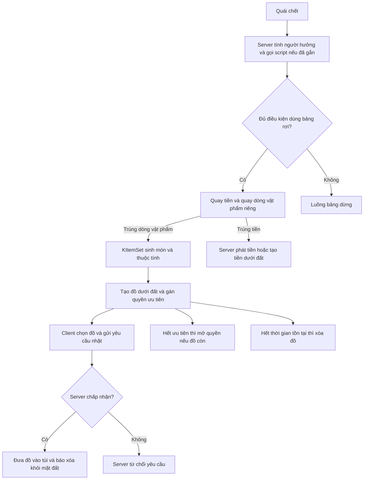

TÓM TẮT 1/5 [NGUỒN] [THẤY] — Bản đồ và script có thể gắn bảng Settings cho quái. Khi quái chết, server xét tiền và vật phẩm theo các lượt riêng (`S/KNpcSet.cpp:595–616`, `S/KNpc.cpp:11883–11900`).
TÓM TẮT 2/5 [NGUỒN] [THẤY] — `RandRange` là khoảng quay, còn `RandRate` là phần khoảng dành cho một dòng. Một lượt có thể không chọn dòng nào (`S/KNpc.cpp:12606–12640`).
TÓM TẮT 3/5 [NGUỒN] [THẤY] — Trong luồng bảng INI, may mắn tham gia khi sinh thuộc tính sau khi dòng vật phẩm đã được chọn (`S/KNpc.cpp:12677–12757`).
TÓM TẮT 4/5 [NGUỒN] [THẤY] — Server xét quyền nhặt. Mốc hết ưu tiên và mốc vật phẩm biến mất có bộ đếm riêng (`S/KPlayer.cpp:5662–5736`, `S/KObj.cpp:678–695`).
TÓM TẮT 5/5 [CHƯA KIỂM] — Đã đọc tĩnh mã và bảng mẫu. Chưa chạy build, game, exe hay VM và chưa đo tỉ lệ hoặc thời gian thực tế.

# SO-25 — Sổ tay rơi đồ và tỉ lệ rơi của quái

- Loại: khảo sát
- Chủ đề: Từ lúc quái chết đến lúc đồ vào túi hoặc biến mất.
- Từ khóa: rơi đồ, may mắn, quyền nhặt, DropRate, RandRange, RandRate, KNpc, KItemSet
- Trạng thái: DONE — đủ phạm vi khảo sát tĩnh.
- Độ phủ: 6/6 nhóm cơ chế trong task. Dữ liệu Settings dùng ví dụ chọn lọc.
- Liên quan: [A-17 — Rơi đồ boss và trang bị](../REPORTS/A-17-roi-do-boss-trang-bi.md), [báo cáo SO-25](../REPORTS/SO-25.md).
- Cần tôi quyết định: không

## Phạm vi và độ phủ

| Nhóm | Độ phủ | Nguồn chính |
|---|---|---|
| Bảng rơi trong Settings và cách quái nhận bảng | Đã phủ | `D/MapList.ini:17–18`, `S/KNpcSet.cpp:595–616` |
| Tỉ lệ và số lượt xét tiền, vật phẩm | Đã phủ | `S/KNpc.cpp:11765–11788`, `S/KNpc.cpp:11870–11900`, `S/KNpc.cpp:12617–12640` |
| May mắn và tạo vật phẩm | Đã phủ | `S/KNpc.cpp:12677–12757`, `S/KNpc.cpp:12912–12930`, `S/KItemSet.cpp:364–400` |
| Quyền nhặt | Đã phủ | `S/KNpc.cpp:12978–12989`, `S/KPlayer.cpp:5662–5736` |
| Thời gian tồn tại | Đã phủ | `S/KObjSet.cpp:468`, `S/KObj.cpp:683–695`, `S/KObj.cpp:741–752` |
| Client gửi yêu cầu và nhận đồng bộ | Đã phủ | `C/gamescene/KGameWorld.cpp:4887–4898`, `C/gamecore/KPlayer.cpp:2306–2315`, `C/gamecore/KProtocolProcess.cpp:2873–2879` |

## Giải mã tên

| Tên gốc | Mã hóa | Chữ đúng | Nguồn file:dòng |
|---|---|---|---|
| `剑` | GBK (trang mã 936) | Kiếm (`剑`), nhãn mẫu của đối tượng dưới đất, DataID 9 | `D/ObjSetting.txt:10` |

Các quái và bản đồ trong ví dụ được dẫn bằng ID hoặc nhóm quái, theo đúng phạm vi đối chiếu. Các khóa INI và tên hàm được giữ nguyên bằng ASCII. Tài liệu dùng UTF-8.

## Sắp theo cấu trúc game

### Bản đồ → quái thường, quái hoàng kim và quái có script

- **[THẤY]** Trong dữ liệu mẫu, bản đồ ID `1` trỏ quái thường tới `npcdroprate10.ini` và quái hoàng kim tới `golden_lv10.ini`. Mã đọc hai khóa theo ID bản đồ, chép đường dẫn vào thông tin quái của vùng rồi gọi `InitDropRate` khi đủ điều kiện. Nhánh quan sát được dùng bảng thường cho `GoldType = 0` và bảng hoàng kim cho `GoldType = 2–4`, với đường dẫn có giá trị. `D/MapList.ini:17–18`, `S/KSubWorld.cpp:886–889`, `S/KRegion.cpp:417–425`, `S/KNpcSet.cpp:595–616`.
- **[THẤY]** Server đọc phần `[Main]` của INI rồi đọc các mục đánh số từ `[1]` tới `[Count]`. Mỗi mục mang mã loại đồ (`Genre`, `Detail`, `Particular`), trọng số `RandRate` và các thiết lập như chất lượng, cấp, khóa hay số lượng xếp chồng. Riêng cột `DropRateFile` của `Npcs.txt` bị vô hiệu ở bước đọc mẫu NPC trong mã này. Script còn có hàm `LoldDropRate` để gắn INI. `S/KNpcTemplate.cpp:129–177`, `S/KNpcTemplate.cpp:192–212`, `S/KNpcTemplate.cpp:512–551`, `S/KNpcTemplate.cpp:697–725`, `S/ScriptFuns.cpp:1398`, `S/ScriptFuns.cpp:1435`, `S/ScriptFuns.cpp:26823`.
- **[THẤY]** Khi quái thuộc `kind_normal` chết, hàm `DoDeath` lấy người hưởng từ bước tính kinh nghiệm. Nếu có script rơi và có người hưởng, nó gọi `DropRate` trước nhánh `DeathPunish`. Nhánh bảng cần có người hưởng và có bảng đã gắn, đồng thời có các điều kiện dừng theo bản đồ hoặc cờ rơi. `OnDeath` còn có đường gọi script chết riêng. `S/KNpc.cpp:2470–2506`, `S/KNpc.cpp:2618–2623`, `S/KNpc.cpp:11765–11788`, `S/KNpc.cpp:11861–11899`, `S/KNpc.cpp:12606–12615`.
- **[TÀI LIỆU]** A-17 ghi nhận `boss_tieu` truyền tên `.lua` vào `LoldDropRate` và có đường rơi riêng qua death script. Điều kiện `.ini` của `InitDropRate` đã được đối chiếu lại. Hai script của ví dụ boss được dẫn theo A-17. `JX1_OPS/REPORTS/A-17-roi-do-boss-trang-bi.md:76–78`, `S/KNpcTemplate.cpp:512–520`.

### Quái chết → lượt xét tiền và vật phẩm

- **[THẤY]** `nTypeNum` là số lượt xét ban đầu. Mã có thể dùng `m_CurrentTreasure` nếu dương, giới hạn số lượt theo `Count`, rồi dùng giá trị dự phòng 3 nếu số lượt vẫn không dương tại bước sau. Khi đi tới hai vòng quay, mỗi vòng dùng số lượt này. Cờ ngừng rơi có thể kết thúc nhánh sớm. `S/KNpc.cpp:11776–11788`, `S/KNpc.cpp:11870–11900`.
- **[THẤY]** Mỗi lượt tiền so `g_Random(100)` với `MoneyRate`. Khi trúng và đủ điều kiện, `MoneyNum` là lượng tiền đầu vào. Nhánh server nhận diện client di động cộng thẳng một lượng trong khoảng từ một nửa đến toàn bộ giá trị đó. Nhánh còn lại tạo tiền dưới đất và gán quyền ưu tiên. `S/KMath.h:376–384`, `S/KNpc.cpp:11883–11890`, `S/KNpc.cpp:11929–11998`.
- **[THẤY]** Mỗi lượt vật phẩm lấy một số từ `0` đến `RandRange − 1` khi `RandRange` dương. Các dòng chiếm những đoạn nối tiếp nhau theo `RandRate`. Số rơi vào đoạn nào thì chọn dòng đó. Phần khoảng không có dòng cho kết quả trượt. Khi dòng đã được đánh dấu qua lượt trước của cùng lần rơi, mã bỏ qua dòng đó và không cộng đoạn của nó vào lượt sau. `S/KNpc.cpp:11875`, `S/KNpc.cpp:12617–12640`, `S/KNpc.cpp:12677`, `E/KRandom.cpp:68–95`.

| Ví dụ thuộc bản đồ ID `1` | Lượt đầu trong mô hình quay đều | Nguồn |
|---|---|---|
| **[THẤY]** Quái thường, dòng `[1]`, mã `(0,0,0)` | Khoảng của dòng là `300 / 330.000`, tương đương khoảng **0,0909%** để chọn dòng. Tổng trọng số đọc được là `144.000`, còn `186.000 / 330.000` ô không chọn dòng, khoảng **56,36%**. | `D/droprate/npcdroprate10.ini:2–3`, `D/droprate/npcdroprate10.ini:18–22`, bảng đến dòng `337` |
| **[THẤY]** Quái hoàng kim, dòng `[1]`, mã `(0,0,0)` | Khoảng của dòng là `40.000 / 3.000.000`, khoảng **1,3333%**. Đến dòng `[51]`, các dòng trước đã chiếm `2.649.910` ô nên dòng này chỉ còn `350.090` ô trong khoảng quay, dù `RandRate = 1.867.000`. | `D/droprate/goldennpc/golden_lv10.ini:2–3`, `D/droprate/goldennpc/golden_lv10.ini:17–21`, `D/droprate/goldennpc/golden_lv10.ini:372` |

Các số trên mô tả phần khoảng của lượt đầu với bảng đã gắn, trước các điều kiện tạo món. Tỉ lệ nhặt được sau một lần hạ quái còn phụ thuộc số lượt, các dòng đã chọn, điều kiện rơi và kết quả sinh món. **[THẤY]** Một kiểu sai khác khác là mục `[53]` trong `npcdroprate110.ini` nằm ngoài `Count=52`, nên vòng nạp này dừng ở `[52]`. `S/KNpcTemplate.cpp:192–198`, `S/KNpc.cpp:11891–11900`, `S/KNpc.cpp:12912–12930`, `D/droprate/npcdroprate110.ini:2`, `D/droprate/npcdroprate110.ini:335–339`.

### Dòng vật phẩm → món và thuộc tính

- **[THẤY]** Sau khi chọn dòng, server tính may mắn từ may mắn hiện tại của người hưởng, hệ số của nhân vật và hệ số toàn cục ở mục 28. Hệ số toàn cục dùng 1 khi giá trị đọc được không dương. Mã còn nhân với hệ số của quái khi xét thuộc tính. Phép quay thuộc tính so hai số lấy theo `MagicRate + nSerLucky` và `LuckyRate`. Các nhánh sau đó còn xét cấp và trạng thái kỹ năng. `S/KNpc.cpp:12677–12689`, `S/KNpc.cpp:12725–12770`.
- **[THẤY]** `LuckyRate` của server có giá trị dự phòng 100. Hai tệp mẫu ghi lần lượt 100 trong `gamesetting.ini` và 0 trong `gamesetting_gs001.ini`. Mã có đường tải tệp theo tham số khởi động. Nếu bản đang chạy thực sự dùng 0 ở đây thì `g_Random(0)` trả 0, nên phép so `>=` ở cửa xét thuộc tính sẽ qua. Các bước chọn thuộc tính tiếp theo vẫn áp dụng. `S/KCore.cpp:261–265`, `S/KGameglobalSet.cpp:88–93`, `D/gamesetting.ini:424`, `D/gamesetting_gs001.ini:442`, `E/KRandom.cpp:89–95`, `S/KNpc.cpp:12734–12770`.
- **[THẤY]** `KItemSet` sinh món theo mã đã chọn. `Quality=0` đi qua `AddOther`, dùng bộ sinh phù hợp như trang bị, thuốc hoặc vật phẩm nhiệm vụ. `Quality>0` đi qua nhánh đồ hoàng kim thường hoặc ngẫu nhiên. Tạo món thành công thì server tìm vị trí trống quanh quái và tạo đối tượng trên đất. Nếu tạo đối tượng thất bại, mã thu hồi món vừa sinh. `S/KNpc.cpp:12912–12938`, `S/KItemSet.cpp:364–400`, `S/KNpc.cpp:12945–12974`.

### Đồ dưới đất → quyền nhặt, hết hạn và vào túi

- **[THẤY]** Đồ thường gán ưu tiên cho người hưởng. Nếu đòn cuối do đồng bạn đánh, nhánh xét chủ đồng bạn hợp lệ trước khi gán. Lúc nhặt, người đi một mình phải là người được ưu tiên. Với tổ đội, server kiểm tra đội hiện tại của người nhặt có chứa người được ưu tiên hay không. Server còn kiểm tra vật thể có tồn tại, cùng bản đồ và có thuộc trường hợp bị cấm nhặt không. `S/KNpc.cpp:12978–12989`, `S/KPlayer.cpp:5662–5736`.
- **[THẤY]** Quyền ưu tiên thường bắt đầu ở **600 lượt cập nhật của đối tượng**. Khi về 0, quyền ưu tiên được gỡ nếu vật còn trên đất. Thời gian tồn tại là cột `LifeTime` của mẫu đối tượng. Ví dụ, dòng `剑` với DataID `9` có `LifeTime=2400`. Server giảm bộ đếm tồn tại ở mỗi lượt cập nhật và xóa vật thể khi về 0. Tiền trên đất cũng có hai bộ đếm tương ứng. `S/KObj.h:46`, `S/KObj.cpp:1639–1645`, `S/KObjSet.cpp:457–468`, `D/ObjSetting.txt:1`, `D/ObjSetting.txt:10`, `S/KRegion.cpp:1146–1157`, `S/KObj.cpp:678–695`, `S/KObj.cpp:739–752`.
- **[THẤY]** Khi bấm nút nhặt, client đi qua `pickCallback` → `clientPickItem` → `mainPickItem`. Client tìm mục tiêu gần khi chưa có mục tiêu, di chuyển tới món và gọi `PickUpItem` trong tầm. Nó tìm chỗ trong túi, rồi gửi mã vật thể và vị trí túi qua `c2s_playerpickupitem`. Nhánh nhặt tiền gửi yêu cầu riêng về mặt thao tác, cùng loại gói. `C/gamescene/KGameWorld.cpp:2090–2094`, `C/gamescene/KGameWorld.cpp:4887–4898`, `C/gamecore/CoreShell.cpp:452–455`, `C/gamecore/KNpcAI.cpp:1243–1249`, `C/gamecore/KNpcAI.cpp:1285–1322`, `C/gamecore/KPlayer.cpp:2218–2238`, `C/gamecore/KPlayer.cpp:2306–2315`, `C/gamecore/KPlayer.cpp:2185–2214`.
- **[THẤY]** Server nhận yêu cầu, thử đưa món vào túi và chỉ dọn đối tượng sau khi thêm thành công ở nhánh thông thường. Khi server gửi gói xóa, client tìm vật thể theo mã rồi xóa hình khỏi cảnh. `S/KProtocolProcess.cpp:236`, `S/KProtocolProcess.cpp:5713–5722`, `S/KPlayer.cpp:5870–5896`, `S/KObj.cpp:1556–1560`, `S/KObj.cpp:1660–1664`, `C/gamecore/KProtocolProcess.cpp:2873–2879`.

## Nguồn và mức xác minh

| Tiền tố | Gốc nguồn chỉ đọc |
|---|---|
| `S/` | `C:/Jx1CocoV3/SwordOnline/SwordOnline/jxOnline/gameserver/Sources/Core/Src/` |
| `E/` | `C:/Jx1CocoV3/SwordOnline/SwordOnline/jxOnline/gameserver/Sources/Engine/Src/` |
| `C/` | `C:/Jx1CocoV3/Folder/Client2912-20260116T044348Z-3-001/Client2912/Client/Classes/` |
| `D/` | Bản dữ liệu mẫu `ServerNew-20260116T043145Z-3-001/ServerNew/_bin_v2_/gs/Settings/` dưới `C:/Jx1CocoV3/Folder/` |

**Đã xác minh.** `[THẤY]` là phần đọc trực tiếp từ mã hoặc dữ liệu cục bộ, kể cả phép tính từ các trường đã đọc. `[TÀI LIỆU]` là thông tin dẫn từ A-17. Dẫn nguồn dùng dòng vật lý bắt đầu từ 1. Các trích dẫn mã chỉ dựa vào biểu thức và định danh ASCII. Nhãn Hán trong bảng đối tượng được giải mã riêng bằng GBK.

## Chưa kiểm

- **[CHƯA KIỂM]** Bản server, APK và Settings nào đang được triển khai, script nào được gắn cho một quái cụ thể, cùng toàn bộ quy tắc của các boss và sự kiện riêng.
- **[CHƯA KIỂM]** Tần suất rơi và nhặt đo trong game, thời gian ưu tiên và tồn tại tính bằng giây, trạng thái túi và hiển thị khi nhiều người nhặt đồng thời. Chưa chạy build, game, exe hay VM trong lượt khảo sát này.

## Bàn giao

Kết quả kiểm tra, sổ thông số và hàng đề xuất cho mục lục nằm trong [báo cáo SO-25](../REPORTS/SO-25.md). Tổng quan phụ trách commit.
