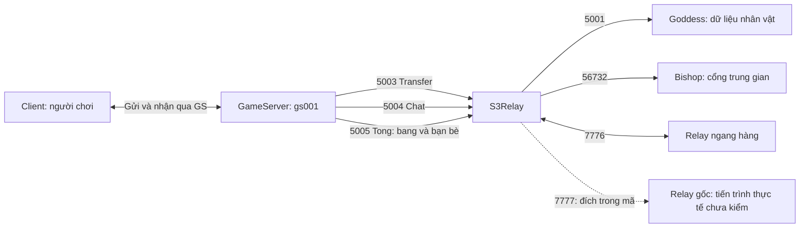

TÓM TẮT 1: [NGUỒN] [THẤY] S3Relay làm đầu mối chuyển tiếp giữa GameServer, phân phối chat và xử lý bang hội, bạn bè (`R/Global.cpp:464,476,489`; `R/TongConnect.cpp:88-95`).
TÓM TẮT 2: [NGUỒN] [THẤY] Tin riêng và chat kênh, kể cả kênh bang, đi qua Chat 5004; kết bạn và các thao tác quản lý bang đi qua Tong 5005 (`S/MultiServer/GameServer/KSOServer.cpp:3615-3622,6118-6119`; `R/ChannelMgr.cpp:1115-1126`).
TÓM TẮT 3: [NGUỒN] [THẤY] GameServer nối thêm Transfer 5003; relay ngang hàng dùng 7776. S3Relay nối ra Goddess 5001, Bishop 56732 và relay gốc 7777 (`H/ServerPort.h:5-13`; `R/Global.cpp:395-491`).
TÓM TẮT 4: [CHƯA KIỂM] Chưa biết triển khai hiện tại có dùng 7777/7776 hoặc ảnh hưởng cụ thể khi thiếu các kết nối đó (`JX1_OPS/REPORTS/A-01-ban-do-tien-trinh.md:50,91`; `JX1_OPS/REPORTS/N-06.md:123-124`).
TÓM TẮT 5: [NGUỒN] [THẤY] Phạm vi chỉ đọc mã và tài liệu; không build, chạy game/exe, VM hoặc kiểm tra mạng (`JX1_OPS/TASKS/SO-15.md:27-31`).

# SO-15 — Sổ tay hiểu game: S3Relay

Loại: khảo sát\
Chủ đề: Tin nhắn, bạn bè, bang hội và các kết nối máy chủ mà S3Relay phụ trách.\
Từ khóa: S3Relay, GameServer, chat, tin riêng, bạn bè, bang hội, Tong, Transfer, 7777\
Trạng thái: DONE, đủ câu hỏi khảo sát tĩnh; chưa xác minh triển khai thực tế.\
Độ phủ: Đã phủ 5/5 nhóm câu hỏi của task (chat, bạn bè, bang hội, cổng, tiến trình).\
Liên quan: [K-01](../REPORTS/K-01-ban-do-truyen-tin-hieu.md), [N-06](../REPORTS/N-06.md), [A-01](../REPORTS/A-01-ban-do-tien-trinh.md), [A-02](../REPORTS/A-02-luong-dang-nhap.md), [SO-15](../REPORTS/SO-15.md).\
Cần tôi quyết định: không.

[THẤY] Chiều mũi tên ở các dòng có cổng thể hiện bên chủ động kết nối; dữ liệu có thể đi cả hai chiều sau khi kết nối. Nhánh 7777 là đích trong mã, chưa xác nhận tiến trình đang nghe. Bằng chứng: bảng kết nối bên dưới.

## Phạm vi và độ phủ

| Phạm vi | Độ phủ | Bằng chứng chính |
|---|---|---|
| Kênh chat và tin riêng | Đã phủ tĩnh | [THẤY] `C/gamescene/KgameWorld.cpp:3016-3024,3065-3073`; `R/ChatConnect.cpp:132-183` |
| Bạn bè | Đã phủ tĩnh | [THẤY] `R/TongConnect.cpp:832-860,887-925,951-977,1089-1101`; `R/HostConnect.cpp:108,133` |
| Bang hội | Đã phủ tĩnh | [THẤY] `R/TongConnect.cpp:512-574,671-675`; `S/MultiServer/GameServer/KSOServer.cpp:6102-6119` |
| Cổng kết nối | Đã phủ tĩnh | [THẤY] `H/ServerPort.h:5-13`; `R/Global.cpp:395-491` |
| Tiến trình và chiều kết nối | Đã phủ tĩnh | [THẤY] `R/Global.cpp:395-491,677-678`; `G/Sources/Sword3PaySys/S3RELAYSERVER/main.cpp:100-109,197` |
| Cổng hiệu lực, tiến trình thực sự chạy, kết quả nghiệp vụ | Chưa phủ, ngoài khảo sát tĩnh | [CHƯA KIỂM] `JX1_OPS/TASKS/SO-15.md:27-31` |

## Giải mã tên

| Tên gốc | Mã hóa | Chữ đúng / nghĩa | Nguồn file:dòng |
|---|---|---|---|
| `帮派`, `Tong` | GBK / ASCII | Bang hội (帮派) | `R/ChannelMgr.cpp:503`; `R/TongConnect.cpp:512` |
| `门派`, `FAC` | GBK / ASCII | Môn phái (门派) | `R/ChannelMgr.cpp:502,516` |
| `组队`, `TEAM` | GBK / ASCII | Tổ đội (组队) | `R/ChannelMgr.cpp:501,520` |
| `S3Relay`, `gs001`, `Goddess`, `Bishop` | ASCII | Giữ nguyên tên tiến trình | `JX1_OPS/REPORTS/A-01-ban-do-tien-trinh.md:60-62`; `R/Global.cpp:428,445` |
| `S3RelayServer.exe` | ASCII | Giữ nguyên tên đầu ra của dự án mã nguồn; ứng viên relay gốc | `G/Sources/Sword3PaySys/S3RELAYSERVER/S3RelayServer.vcxproj:159` |
| `Sword3PaySys` | ASCII | Giữ nguyên tên dịch vụ tài khoản được nhắc trong báo cáo cũ | `JX1_OPS/REPORTS/A-01-ban-do-tien-trinh.md:47` |

Không có tên kỹ năng, trang bị, NPC hay địa danh cụ thể trong phạm vi này. Các ký hiệu trong bảng là tên nhóm chức năng và tiến trình.

## Sắp theo cấu trúc game

| Ở trong game | S3Relay làm gì |
|---|---|
| Tin nhắn → tin riêng | [THẤY] Theo tên người nhận, tìm nhân vật trong danh sách đang kết nối của dịch vụ Chat và chuyển gói cho GameServer của người nhận (`R/ChannelMgr.cpp:854-885,888-903`). |
| Tin nhắn → kênh | [THẤY] Cấp mã kênh, nhận đăng ký/hủy đăng ký và xử lý tin theo loại kênh. Mã có nhóm tổ đội, môn phái, bang, nhóm nhắn, kênh màn hình và phát rộng; tên hiển thị và kênh nào bật trong bản chạy [CHƯA KIỂM] (`R/ChannelMgr.cpp:86-91,490-546,1099-1171`; `R/ChatConnect.cpp:57-110`). |
| Quan hệ → bạn bè | [THẤY] Nhận lời mời và trả lời; quản lý danh sách, nhóm bạn, xóa bạn và đồng bộ danh sách. Khi nhân vật vào/rời game, đầu Transfer báo cho bộ quản lý bạn bè (`R/TongConnect.cpp:832-860,900-908,951-977,1089-1101`; `R/HostConnect.cpp:108,133`). |
| Bang hội → chat và quản lý | [THẤY] Chat trong kênh bang thuộc dịch vụ Chat; tạo bang, thêm hoặc trục xuất thành viên thuộc dịch vụ Tong (`R/ChannelMgr.cpp:1115-1126`; `R/TongConnect.cpp:512-574,671-675`). |
| Thế giới → chuyển tiếp giữa GameServer | [THẤY] Transfer nhận yêu cầu tìm đường theo nhân vật hoặc bản đồ; nhánh tìm bản đồ gọi sang Bishop (`R/HostConnect.cpp:153-159,261-278,409-424`). |

## Từ thao tác đến kết quả

[THẤY] **Gửi tin riêng hoặc chat kênh:** client đóng gói hai loại tin rồi GameServer chọn kết nối Chat. S3Relay chuyển yêu cầu sang bộ quản lý kênh. Khi nhận kết quả, GameServer gửi tin tới một người hoặc một nhóm; client mở nhánh hiển thị tin riêng hoặc kênh tương ứng. Ví dụ, một tin nhắn trong **kênh bang** vẫn đi qua Chat 5004 (`C/gamescene/KgameWorld.cpp:3016-3024,3065-3073`; `S/MultiServer/GameServer/KSOServer.cpp:3615-3622,3683-3688,2790-2876`; `R/ChatConnect.cpp:132-183`; `R/ChannelMgr.cpp:1115-1126`; `C/gamecore/KProtocolProcess.cpp:4291-4311`).

[THẤY] **Kết bạn:** GameServer chuyển nhóm gói bạn bè sang Tong. S3Relay có nhánh gửi lời mời và nhánh ghi quan hệ khi người nhận đồng ý; GameServer trả kết quả về client, nơi xử lý lời mời hoặc câu trả lời. Bộ quản lý bạn bè có đường đọc và ghi dữ liệu danh sách. [CHƯA KIỂM] Không có bằng chứng trong các nhánh đã đọc để khẳng định tin nhắn riêng được lưu rồi phát lại khi người nhận đăng nhập (`S/MultiServer/GameServer/KSOServer.cpp:1721-1764,3615-3622`; `R/TongConnect.cpp:832-860,900-908,951-977`; `R/FriendMgr.cpp:980,1020`; `C/gamecore/KProtocolProcess.cpp:4368-4414`; `R/ChannelMgr.cpp:854-965`).

[THẤY] **Tạo bang:** client gửi yêu cầu; GameServer chuyển yêu cầu tạo bang qua Tong 5005; S3Relay đưa yêu cầu vào bộ quản lý bang. Đây là đường thay đổi dữ liệu bang, tách khỏi đường nhắn trong kênh bang (`C/gamecore/KPlayerTong.cpp:160-168`; `S/MultiServer/GameServer/KSOServer.cpp:6102-6119`; `R/TongConnect.cpp:512-528`).

## Kết nối và ý nghĩa của từng cổng

| Bên mở kết nối → bên nhận | Cổng trong mã | Ý nghĩa và nguồn |
|---|---:|---|
| `gs001` → `S3Relay` | 5003 | [THẤY] Transfer. Relay mở đầu nghe Host; GameServer đọc mặc định `[Transfer]` rồi gọi kết nối (`R/Global.cpp:464-466`; `S/MultiServer/GameServer/KSOServer.cpp:732,1057`). |
| `gs001` → `S3Relay` | 5004 | [THẤY] Chat, gồm tin riêng và kênh (`R/Global.cpp:489-491`; `S/MultiServer/GameServer/KSOServer.cpp:734,1111`). |
| `gs001` → `S3Relay` | 5005 | [THẤY] Tong, gồm chức năng bang và bạn bè (`R/Global.cpp:476-478`; `R/TongConnect.cpp:88-95`; `S/MultiServer/GameServer/KSOServer.cpp:736,1162`). |
| `S3Relay` → `Goddess` | 5001 | [THẤY] Đầu nối dịch vụ dữ liệu nhân vật (`H/ServerPort.h:5`; `R/Global.cpp:425-435`). |
| `S3Relay` → `Bishop` | 56732 | [THẤY] Đầu nối gateway; có lời gọi dùng nó để tìm đường theo bản đồ (`R/Global.cpp:442-453`; `R/HostConnect.cpp:419-424`). |
| Relay ngang hàng ↔ `S3Relay` | 7776 | [THẤY] Mã có cả đầu nghe và nhánh chủ động nối relay khác (`R/Global.cpp:395-402,677-678`). [CHƯA KIỂM] Có relay ngang hàng trong triển khai hiện tại hay không. |
| `S3Relay` → relay gốc | 7777 | [THẤY] Đích `RELAY_ROUTE_PORT` của `g_RootClient`. Dự án riêng `S3RelayServer.exe` có mã mở đầu nghe với mặc định này, có thể đọc giá trị khác từ cấu hình của nó (`H/ServerPort.h:13`; `R/Global.cpp:411-418`; `G/Sources/Sword3PaySys/S3RELAYSERVER/main.cpp:100-109,197`; `G/Sources/Sword3PaySys/S3RELAYSERVER/S3RelayServer.vcxproj:159`). [CHƯA KIỂM] Tệp thực thi, đầu nghe, giá trị hiệu lực và tính bắt buộc trong triển khai. |

[TÀI LIỆU] A-01 ghi lịch sử không thấy tiến trình nghe 7777 và chưa rõ ảnh hưởng; N-06 ghi ứng viên từ mã. Hai nguồn mô tả hai loại bằng chứng khác nhau. [THẤY] Mã đã đối chiếu có nhánh hỏi relay gốc khi tìm nhân vật và nhánh kênh đặc biệt kiểm tra relay gốc đã sẵn sàng. [CHƯA KIỂM] Không suy từ đó rằng mọi chat, bạn bè hoặc bang hội sẽ ngừng nếu thiếu 7777 (`JX1_OPS/REPORTS/A-01-ban-do-tien-trinh.md:50,91`; `JX1_OPS/REPORTS/N-06.md:123-124`; `R/HostConnect.cpp:341-403`; `R/ChannelMgr.cpp:1015-1028`).

[TÀI LIỆU] A-02 ghi S3Relay đăng nhập dịch vụ PaySys; K-01 chưa xác định được kết nối trực tiếp. [CHƯA KIỂM] Các đầu kết nối đã đối chiếu trong SO-15 chưa chứng minh đường trực tiếp S3Relay → PaySys; giữ nguyên cả hai báo cáo (`JX1_OPS/REPORTS/A-02-luong-dang-nhap.md:114`; `JX1_OPS/REPORTS/K-01-ban-do-truyen-tin-hieu.md:90`; `R/Global.cpp:408-453`).

## Đã xác minh / Chưa xác minh

| Nhãn | Mức bằng chứng |
|---|---|
| THẤY / ĐÃ XÁC MINH TĨNH | Đọc mã tại các dòng đã dẫn: chia ba đầu Transfer/Chat/Tong, luồng chat, lời mời kết bạn và ví dụ tạo bang, chiều kết nối và giá trị cổng trong mã. |
| TÀI LIỆU | Thông tin từ báo cáo trước; gồm tình trạng lịch sử của 7777 và nhận định còn khác nhau về PaySys. |
| CHƯA KIỂM / CHƯA XÁC MINH | Bản dựng và cấu hình triển khai, tiến trình đang chạy, cổng hiệu lực, đi qua relay khác trong thực tế, tên các kênh đang bật và hành vi tin riêng khi người nhận vắng mặt. Không build, chạy exe, VM hay kết nối mạng. |

Quy ước dẫn nguồn (cây mã nguồn trên đĩa theo task, chưa ghép với bản chạy):

| Ký hiệu | Gốc của đường dẫn |
|---|---|
| `G` | `C:/Jx1CocoV3/SwordOnline/SwordOnline/jxOnline/gateway` |
| `H` | `G/Headers` |
| `R` | `G/Sources/MultiServer/S3Relay` |
| `S` | `C:/Jx1CocoV3/SwordOnline/SwordOnline/jxOnline/gameserver/Sources` |
| `C` | `C:/Jx1CocoV3/Folder/Client2912-20260116T044348Z-3-001/Client2912/Client/Classes` |

Định danh mã dùng ASCII; chú thích tiếng Hán trích ở bảng tên đọc theo GBK (CP936); sổ tay và báo cáo viết bằng UTF-8.

## Bàn giao

Tổng quan nhận bản local và gộp mục lục theo hàng đề xuất trong [báo cáo SO-15](../REPORTS/SO-15.md). Kết quả đọc tĩnh và sổ thông số cổng bàn giao cùng báo cáo.
